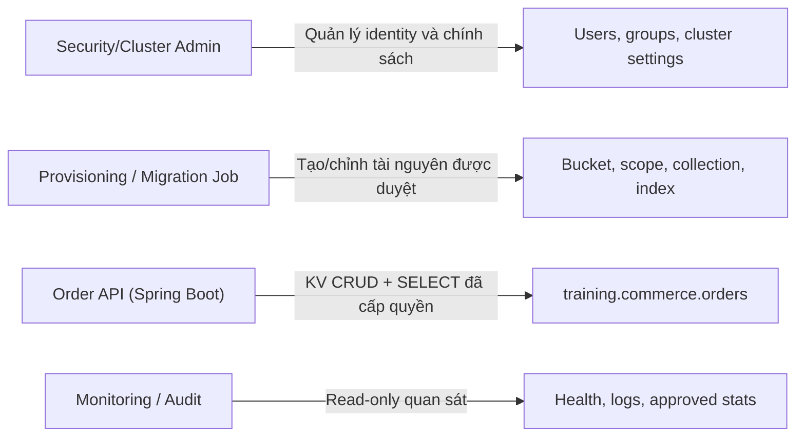
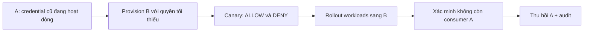

# Tách tài khoản ứng dụng khỏi tài khoản quản trị

## Mục tiêu bài học

Một ứng dụng **Spring Data Couchbase** chỉ cần đọc/ghi document, chạy repository query và thực thi một số thao tác qua `CouchbaseTemplate`; nhưng trong nhiều môi trường học tập, người phát triển lại dùng ngay tài khoản `Administrator` đã tạo cluster để cấu hình cho ứng dụng. Cách làm này có thể khiến `findById` và `findByStatus` chạy ngay, đồng thời tạo ra một rủi ro lớn: **mật khẩu của API bị lộ cũng có thể trở thành mật khẩu để xóa bucket, thay đổi quyền hoặc quản lý toàn cluster**.

Trong chương **Bảo mật** của module `SPRING_DATA_COUCHBASE`, bài này tập trung vào **tách danh tính theo trách nhiệm vận hành**. Bài không chỉ liệt kê role RBAC mà xây dựng một quy trình từ **thiết kế tài khoản → cấp quyền → đưa secret vào Spring Boot → kiểm thử ALLOW/DENY → xoay/thu hồi credential**. Các ví dụ dùng bucket `training`, scope `commerce`, collection `orders` và `sessions`; cùng một nguyên tắc áp dụng cho document mapping, repository, SQL++, index, TTL, CAS, giao dịch và API reactive.

Sau bài học, bạn có thể:

- Giải thích vì sao **tài khoản quản trị**, **tài khoản triển khai/migration**, **tài khoản ứng dụng runtime** và **tài khoản quan sát** nên khác nhau.
- Phân biệt **cấp quyền đúng thao tác** với chỉ việc tạo một username khác `Administrator`.
- Thiết kế tài khoản cho Spring Data KV CRUD, SQL++ query và provisioning index/scope/collection.
- Cấu hình Couchbase Server Enterprise hoặc Capella mà không đưa quyền quản trị vào tiến trình ứng dụng; biết giới hạn của Community Edition.
- Quản lý mật khẩu và connection string qua nguồn cấu hình ngoài mã nguồn; biết cách xoay credential ít gián đoạn.
- Kiểm thử cả quyền **được phép (ALLOW)** và quyền **phải bị chặn (DENY)** bằng chính user runtime.
- Ghi nhận audit và phản ứng an toàn nếu nghi ngờ lộ tài khoản dịch vụ.

> **Điều kiện đầu vào:** Có cluster Couchbase đã khởi tạo, Data Service hoạt động; Query và Index Service có mặt khi sử dụng SQL++. Với scope/collection cần Couchbase Server 7.0+. Ví dụ cấp role `data_reader`/`data_writer`/`query_select` giới hạn đến collection giả định **Enterprise Edition** hoặc Capella hỗ trợ RBAC tương đương. **Không áp dụng nguyên trạng cho Community Edition** vì tập role hạn chế.

## 1. Rủi ro khi ứng dụng dùng chung tài khoản quản trị

Giả sử nhóm phát triển đặt thông tin sau vào cấu hình chạy API:

```yaml
# KHÔNG LÀM: ví dụ anti-pattern, tuyệt đối không lưu mật khẩu thật.
spring:
  couchbase:
    connection-string: couchbase://127.0.0.1
    username: Administrator
    password: "replace-me-with-a-real-secret"
  data:
    couchbase:
      bucket-name: training
```

Ngay cả khi chuỗi `"replace-me-with-a-real-secret"` chỉ là placeholder, việc định cấu hình **tài khoản Full Admin** cho application runtime đã sai về nguyên tắc phân tách. Nó gây các vấn đề:

1. **Blast radius quá lớn:** Lỗi remote code execution, đọc biến môi trường, lộ image/log/CI secret hoặc máy chủ bị xâm nhập có thể mở quyền rộng tới nhiều bucket và dịch vụ.
2. **Không truy vết rõ ai làm gì:** Cùng một username được dùng bởi người quản trị, pipeline và application khiến audit khó xác định thao tác xuất phát từ đâu.
3. **Khó xoay mật khẩu:** Đổi password admin có thể đồng thời làm hỏng Web Console, deployment và mọi API dùng chung account.
4. **Khó thực hiện least privilege:** Mọi bug vô tình gọi index DDL hoặc truy cập collection khác đều có thể thành công vì tài khoản có quá nhiều quyền.
5. **Không kiểm chứng được mô hình bảo mật:** Integration test dùng `Administrator` có thể PASS dù user ứng dụng thật không đủ quyền.

### 1.1. Tách tên tài khoản vẫn chưa đủ

Tạo một user tên `orders-api` nhưng **gán role `admin` cho nó** về bản chất vẫn là cấp quyền quản trị cho API. Cũng vậy, user có role hẹp trực tiếp nhưng đồng thời kế thừa `admin` hoặc `bucket_admin` qua group vẫn có quyền rộng.

**Định nghĩa hoàn thành bài:** Tài khoản ứng dụng **khác danh tính**, **khác secret**, **chỉ có những quyền cần thiết** và đã được chứng minh không thể thực hiện thao tác quản trị không được phép.



**Một danh tính ứng dụng không nên có đường quản trị ngầm** qua Web Console, API quản trị, role rộng hoặc group được kế thừa. Ngược lại, tài khoản provisioning chỉ tồn tại/được cấp quyền ở thời điểm cần thay đổi schema; không được tích hợp vào `application.yml` của tiến trình API.

## 2. Thiết kế bốn lớp tài khoản và trách nhiệm

| Danh tính gợi ý | Chủ thể dùng | Nhiệm vụ | Quyền không nên có |
| --- | --- | --- | --- |
| **`cluster-operator` / `security-operator`** | Quản trị viên hoặc hệ thống quản trị được ủy quyền | Quản lý cluster, network, user/group, audit, certificate theo nhiệm vụ cụ thể | Không dùng làm login từ API nghiệp vụ hay job test thông thường |
| **`orders-migrator`** | Pipeline triển khai/migration có approval | Provision scope/collection/index, cập nhật policy tài nguyên trong phạm vi được duyệt | Không cần đổi password các user hoặc Full Admin chỉ để `CREATE INDEX` |
| **`orders-api`** | Tiến trình Spring Boot chạy bình thường | KV read/write `commerce.orders` và SQL++ `SELECT` theo nghiệp vụ | Không được tạo index, xóa bucket, quản lý users, đọc collection khác không liên quan |
| **`orders-observer`** | Hệ thống quan sát có kiểm soát | Đọc health, stats, sự kiện audit hoặc thông tin được cho phép | Không được mutate dữ liệu, schema, roles |

Tùy kiến trúc có thể có **nhiều hơn bốn danh tính**: `billing-api`, `session-api`, `report-reader`, `backup-operator`, `on-call-breakglass`. Không bắt buộc mỗi role phải có một username riêng nếu không tồn tại use case, nhưng **mọi process hoặc automation có bề mặt rủi ro và vòng đời khác nhau** cần được đánh giá tách tài khoản.

### 2.1. Tách theo môi trường

```text
Local Docker:
  local-orders-api       -> bucket training (chỉ lab)
  local-provisioner      -> bucket/scope/index lab

Staging Capella:
  staging-orders-api     -> bucket orders_staging
  staging-orders-migrator-> staging resource provisioning

Production Capella:
  prod-orders-api        -> bucket orders_prod
  prod-orders-migrator   -> migration có approval
  prod-security-operator -> cluster access/security management
```

Một secret production **không được dùng lại** cho staging, test hoặc laptop. Một account production không được cấp role ở cluster khác chỉ vì cùng tên service. Quy tắc đặt tên nên thể hiện **môi trường và nhiệm vụ** để rotation, ownership và audit dễ đọc.

### 2.2. Tách theo ranh giới triển khai

Hai repository `OrdersRepository` và `SessionsRepository` dùng chung một `Cluster` với cùng credentials **không** có ranh giới RBAC giữa chúng chỉ nhờ Java package, `@Scope` hoặc `@Collection`. RBAC gắn với **danh tính của kết nối**. Nếu một process cần cả hai collection, account của nó có tổng quyền của cả hai; nếu yêu cầu cách ly mạnh, cân nhắc tách process/service và credentials.

Trường hợp một user có direct role giới hạn `orders` nhưng là thành viên group có quyền trên toàn `training`, quyền thực tế vẫn rộng. **Cần kiểm tra cả direct roles, group roles và external/LDAP group mapping**, không chỉ một trường username trên màn hình Security.

## 3. Phân biệt quyền của từng thao tác Spring Data Couchbase

Trong một cluster **Enterprise Edition** với bucket `training`, scope `commerce` và collection `orders`, cân nhắc các quyền:

| Đường truy cập | Ví dụ | Role phù hợp cho `orders-api` | Ai quản lý? |
| --- | --- | --- | --- |
| **KV đọc** | Java SDK `get`/`exists`, repository `findById` | `data_reader[training:commerce:orders]` | Runtime |
| **KV ghi** | `insert`, `upsert`, `replace`, `remove`, repository `save` | `data_writer[training:commerce:orders]` | Runtime |
| **SQL++ đọc** | `findByStatus`, `@Query` SELECT, `cluster.query("SELECT ...")` | `query_select[training:commerce:orders]` | Runtime nếu nghiệp vụ dùng |
| **SQL++ mutation** | `INSERT`, `UPSERT`, `UPDATE`, `DELETE` bằng SQL++ | Role Query Insert/Update/Delete tương ứng, nếu thật sự cần | Chỉ cấp khi statement dùng |
| **Chỉ mục** | `CREATE INDEX`, `DROP INDEX` | `query_manage_index` trên keyspace thích hợp | Migrator/provisioner |
| **Scope/collection** | Tạo/drop `commerce.orders` | `scope_admin` hoặc quyền quản trị tài nguyên phù hợp | Provisioner |
| **Bucket và quota** | Thay settings, xóa bucket, quản lý replica | `bucket_admin` hoặc vai trò quản trị thích hợp | Hạ tầng/DBA |
| **User/group/security** | Tạo user, thay roles, rotate password | Quyền user/security management của Server/Capella | Security operator |

**Không tự suy quyền từ tên Java API:** `CouchbaseTemplate` có phương thức KV và phương thức query; `ReactiveCouchbaseTemplate` cũng vậy. Một `findById` thành công không chứng minh `findByStatus` có Query Select hay Index Service. Việc dùng reactive `Mono`/`Flux` **không có role riêng**.

### 3.1. Bộ quyền runtime minh họa

Nếu `orders-api` thực hiện KV CRUD trên đơn hàng và SQL++ SELECT theo trạng thái, bộ quyền tham khảo:

```text
data_reader[training:commerce:orders]
data_writer[training:commerce:orders]
query_select[training:commerce:orders]
```

Đây là **mô tả role assignment** cho Server Enterprise, không phải command cần chạy nguyên văn trên Capella/Community. Nếu ứng dụng chỉ làm KV, loại `query_select`; nếu chỉ báo cáo SQL++, cân nhắc account `orders-report` riêng với Query Select nhưng **không** KV write.

`query_select` có thể cho SQL++ `SELECT` thông qua SDK nhưng **không tự cấp quyền sử dụng Query Workbench**. Đừng nâng quyền ứng dụng lên `admin` chỉ vì không mở được Query Workbench bằng account này.

### 3.2. Vì sao index cần được provision trước?

`findByStatus("NEW")` thường dùng SQL++ và secondary index. Index `idx_orders_status` có thể được tạo một lần trong **migration**:

```sql
-- Chỉ chạy bằng identity migration/provisioning, không phải orders-api.
CREATE INDEX idx_orders_status
ON `training`.`commerce`.`orders`(status);
```

Sau khi index online, `orders-api` chỉ cần quyền Query Select để chạy câu đọc tương ứng; nó không cần `query_manage_index`. Nếu runtime có quyền index DDL, một bug/config sai có thể tạo/xóa index làm ảnh hưởng tải truy vấn và dữ liệu vận hành.

**Không tạo index trong `@PostConstruct` hoặc application startup của mọi replica**. Khi nhiều pod cùng start, các lệnh DDL có thể đua nhau, mở rộng quyền không cần thiết và khiến rollout khó dự đoán. Dùng migration/infra job có idempotency, audit và gate chờ index online.

### 3.3. Hạn chế quyền admin theo phiên bản

Couchbase Server Enterprise có các role quản trị với nhiệm vụ tách biệt:

- `admin` (Full Admin) có toàn quyền và cần được bảo vệ nghiêm ngặt.
- `cluster_admin` dùng quản trị cluster ngoài security; không tự động là account dùng để đọc document.
- `bucket_admin` có quyền quản lý bucket trong phạm vi được cấp, rộng hơn nhu cầu CRUD.
- `user_admin_local`/`user_admin_external` quản lý người dùng theo domain; riêng **quyền tạo user có Data roles có thể trở thành đường nâng quyền gián tiếp** dù tài khoản quản lý user không trực tiếp đọc dữ liệu.
- `security_admin` liên quan thiết lập bảo mật như chứng chỉ, audit, LDAP/SAML; **trong Server 8.0+ đã tách khỏi quản lý user/group**. Quyền và tên của role có thể khác ở Server 7.x; luôn đối chiếu đúng phiên bản trước khi gán.

Với Server 8.0 trở lên, đừng coi "quản trị bảo mật" và "quản lý user/group" là cùng một quyền mặc định. Nếu một account được phép tạo user có quyền đọc dữ liệu, audit hành vi **tạo user và sửa role** cũng quan trọng như giám sát truy cập data.

Nguồn: [Roles and Privileges](https://docs.couchbase.com/server/current/learn/security/roles.html), [Manage Users and Roles](https://docs.couchbase.com/server/current/manage/manage-security/manage-users-and-roles.html), [Couchbase Java SDK — Managing Connections](https://docs.couchbase.com/java-sdk/current/howtos/managing-connections.html).

## 4. Quy trình trên Couchbase Server Enterprise

### 4.1. Provisioner hoặc admin tạo account runtime

Trên **cluster lab/staging được phép**, với user có quyền quản lý **local users**:

1. Mở Web Console → **Security → Users & Groups → Users → Add User**. Giao diện có thể khác giữa Server version.
2. Chọn local user, nhập tên `orders-api` và một mật khẩu mạnh, ngẫu nhiên. Đưa secret vào nơi lưu trữ an toàn; không đưa vào tài liệu, Git, shell history hoặc CI log.
3. Cấp `Data Reader` và `Data Writer` với **Bucket = training**, **Scope = commerce**, **Collection = orders**.
4. Nếu API có `findByStatus`/`@Query` SELECT, cấp thêm `Query Select` trên **cùng collection**.
5. Kiểm tra role nào đang có `*`/All Buckets/All Scopes/All Collections. Bỏ wildcard không cần thiết.
6. Kiểm tra group membership và inherited roles để tránh một role rộng khác ghi đè mục tiêu giới hạn.
7. Lưu user. Đăng xuất khỏi account quản trị hoặc dùng phiên/terminal riêng để kiểm thử bằng user `orders-api`.
8. Dùng chính credentials `orders-api` trong ứng dụng, chạy positive/negative tests ở mục 9.

Không đặt mật khẩu quản trị làm mật khẩu ứng dụng, không cấu hình cùng account cho migration và API, và không cấp role DDL chỉ để đơn giản hóa bước khởi động.

### 4.2. Xác minh tài khoản và roles bằng REST chỉ đọc

Với **self-managed Server trên localhost**, tài khoản có quyền liệt kê user/roles có thể kiểm tra:

```bash
# Chỉ nhập username để curl hỏi password; không ghi password vào command.
curl --fail --show-error --user Administrator \
  http://127.0.0.1:8091/settings/rbac/users

curl --fail --show-error --user Administrator \
  http://127.0.0.1:8091/settings/rbac/groups

curl --fail --show-error --user Administrator \
  http://127.0.0.1:8091/settings/rbac/roles
```

REST quản trị ở ví dụ dùng HTTP **chỉ vì localhost của lab**. Với remote cluster, sử dụng **HTTPS/18091**, mạng quản trị riêng và chứng chỉ hợp lệ. Trên Windows PowerShell 5.1, dùng `curl.exe` thay cho alias `curl`.

Kiểm tra user `orders-api`:

```text
Expected user: orders-api (local)
Expected direct roles:
  data_reader      training/commerce/orders
  data_writer      training/commerce/orders
  query_select     training/commerce/orders (nếu có SQL++ SELECT)
Expected effective groups: không có quyền rộng ngoài nhu cầu
Expected admin/index/schema roles: KHÔNG
```

**Bằng chứng phải bao gồm quyền từ group.** User có thể chỉ có Data Reader trực tiếp nhưng được gán `data_writer[training]` từ một group; nếu chỉ đọc direct roles thì sẽ đánh giá sai blast radius. Kết quả cũng cần lưu version/edition vì quyền khả dụng thay đổi giữa các release.

### 4.3. REST provisioning không phải lệnh của application

Với Server self-managed, một API quản trị user có dạng:

```text
PUT /settings/rbac/users/local/<username>
Content-Type: application/x-www-form-urlencoded

roles=data_reader[training:commerce:orders],data_writer[training:commerce:orders],query_select[training:commerce:orders]
password=<new-secret-from-secure-channel>
```

Đây chỉ là **cấu trúc mô tả**, **không phải command nên copy để chạy**. Truyền mật khẩu qua tham số lệnh shell có thể làm lộ secret. Endpoint này cần account quản trị và quyền quản lý user, **không** được gọi từ ứng dụng API. Khi sửa user hiện có, lệnh `PUT` có thể làm thay đổi/thay thế tập role/group; phải đọc cấu hình cũ, review thay đổi và thử quyền sau khi cập nhật. Khi chỉ cần xoay password, xem tùy chọn cập nhật password bằng API phù hợp thay vì ghi đè toàn bộ role.

Nguồn: [Couchbase Server — RBAC REST API](https://docs.couchbase.com/server/current/rest-api/rbac.html), [Authorization API](https://docs.couchbase.com/server/current/rest-api/rest-authorization.html).

## 5. Community Edition và Capella: hai đường thiết lập khác Enterprise

### 5.1. Community Edition: tách account vẫn cần, nhưng quyền chi tiết bị giới hạn

Theo tài liệu REST RBAC hiện hành, Couchbase Server **Community Edition** chỉ cho phép gán các role:

```text
admin
ro_admin
bucket_full_access
```

`bucket_full_access[training]` (role legacy, được đánh dấu deprecated) cho phép **KV read/write trong bucket** `training`, nhưng **không cấp Query Select cho SQL++**. Community không cho gán bộ `data_reader[training:commerce:orders]`/`data_writer[...]`/`query_select[...]` chi tiết như Enterprise, dù trong bucket có scope và collection. Vì vậy:

- Tạo `local-kv-app` với `bucket_full_access[training]` để học **KV-only** trên một bucket lab **không chứa dữ liệu nhạy cảm**.
- Giữ `Administrator` trong phiên Web Console **chỉ để tạo tài nguyên, index và thực hành SQL++ quản trị**; không đặt admin credential vào `spring.couchbase.password` của API.
- Không khẳng định `local-kv-app` bị chặn `sessions` cùng bucket nếu nó có `bucket_full_access[training]`; role được cấp rộng ở **cấp bucket**.
- Khi muốn kiểm thử **SQL++ repository query bằng user ứng dụng** hoặc collection-level least privilege, chọn **Enterprise Edition hoặc Capella** có role/tính năng thích hợp.

**Quan trọng:** Đây là một giới hạn của edition, không phải lý do để thêm `admin` cho application. Đánh dấu phần kiểm thử granular RBAC là **NOT SUPPORTED** thay vì đánh dấu PASS sai. Nếu lab của bạn cần API Spring Data derived query thực sự, lên kế hoạch môi trường có đủ Query Select; đừng đổi code bảo mật để vượt hạn chế.

Nguồn: [RBAC REST API — Community Edition Limits](https://docs.couchbase.com/server/current/rest-api/rbac.html), [Roles](https://docs.couchbase.com/server/current/learn/security/roles.html).

### 5.2. Couchbase Capella: người quản trị Console khác credential truy cập data

Trên **Capella Operational**, có **hai lớp danh tính cần giữ tách biệt**:

| Lớp | Ví dụ | Mục đích |
| --- | --- | --- |
| **Capella organization/project user & roles** | Người có `Project Owner` hoặc `Cluster Manager` | Đăng nhập Capella UI, quản lý cluster và quyền tổ chức/dự án theo vai trò được cấp. |
| **Cluster Access Credentials** | `prod-orders-api` | SDK/API truy cập dữ liệu trên **một cluster cụ thể** bằng credential và access levels/roles tương ứng. |

Để tạo credential cho ứng dụng, trong Capella Console mở **cluster đích → Settings → Cluster Access** (các phiên bản giao diện có thể gọi là **Access Control**) → **Create Access**:

1. Tạo credential name `prod-orders-api` và secret mạnh, riêng production. Không dùng tài khoản đăng nhập Console hoặc credential của môi trường staging.
2. **Basic Access Credentials:** chọn bucket/scope/collection và tập mức Read, Write, Read/Write được Capella cung cấp. Đây là các tập quyền định trước; không coi tên "Read" là đồng nghĩa với chỉ đúng `query_select`.
3. **Advanced Access Credentials:** trên **paid plan hỗ trợ**, gán roles hoặc tạo custom roles/privileges nếu cần phân biệt chính xác KV vs Query và loại trừ index DDL. Chỉ chọn những resource/privilege thật sự cần.
4. Kiểm tra những lựa chọn `All Buckets`, `All Scopes` hoặc `All Collections` không vô tình mở rộng quyền hiện tại và tương lai.
5. Lưu secret vào secret manager, cấu hình ứng dụng, thử các thao tác ALLOW/DENY. Không gửi secret trong email, tin nhắn hoặc commit.

**Tính độc lập:** Credential dữ liệu của Capella không mặc nhiên là user quản trị project. Ngược lại, một project admin quản lý access credentials không phải lý do để chạy Spring Boot dưới danh tính đăng nhập Capella Console. Capella Management API dành cho quản lý credentials/roles khác với REST `/settings/rbac/...` của Server tự quản lý; **không áp lệnh của self-managed Server vào Capella nếu chưa xác minh hỗ trợ**.

### 5.3. Network security là lớp khác RBAC

Capella SDK thường dùng `couchbases://` (TLS), DNS SRV và **Allowed IP Addresses** cho **public egress IP của máy chủ ứng dụng** hoặc private connectivity đã được cấu hình. Một user đúng quyền có thể vẫn **timeout** nếu IP chưa được allowlist hoặc TLS/DNS sai; đó là vấn đề network, không phải role.

Ngược lại, TCP/TLS kết nối thành công nhưng thao tác trả authorization failure là dấu hiệu cần xem role của đúng user/resource. Không đưa `0.0.0.0/0` vào allowed IP lâu dài hay vô hiệu hóa kiểm tra TLS chỉ để xác định lỗi.

Nguồn: [Capella — Cluster Access](https://docs.couchbase.com/cloud/clusters/cluster-rbac.html), [Manage Cluster Access Credentials](https://docs.couchbase.com/cloud/clusters/manage-database-users.html), [Capella — Connect](https://docs.couchbase.com/cloud/get-started/connect.html), [Allowed IP Addresses](https://docs.couchbase.com/cloud/clusters/allow-ip-address.html).

## 6. Spring Boot sử dụng riêng runtime credential

### 6.1. Cấu hình cơ bản với biến môi trường

Trong dự án có Spring Boot BOM/dependency management tương thích:

```groovy
dependencies {
    implementation 'org.springframework.boot:spring-boot-starter-data-couchbase'
}
```

File `src/main/resources/application.yml`:

```yaml
spring:
  couchbase:
    connection-string: ${CB_CONNECTION_STRING}
    username: ${CB_APP_USERNAME}
    password: ${CB_APP_PASSWORD}
  data:
    couchbase:
      bucket-name: ${CB_BUCKET_NAME}
```

Các placeholder này là cú pháp **Spring Boot**, không phải lệnh thực thi. Ví dụ:

| Biến runtime | Local Enterprise (ví dụ) | Capella production |
| --- | --- | --- |
| `CB_CONNECTION_STRING` | `couchbase://127.0.0.1` (loopback lab) | Chuỗi `couchbases://...` lấy từ Capella **Connect → SDK** |
| `CB_APP_USERNAME` | `orders-api` | `prod-orders-api` — cluster access credential |
| `CB_APP_PASSWORD` | Secret từ nơi lưu mật khẩu của lab | Secret production từ vault/secret manager |
| `CB_BUCKET_NAME` | `training` | Bucket production đã provision |

**Không dùng** `CB_ADMIN_USERNAME`/`CB_ADMIN_PASSWORD` trong Spring Boot API. Các credentials quản trị chỉ nên tồn tại trong quy trình provisioner có quyền, tách khỏi container ứng dụng. Nếu thiếu `CB_APP_PASSWORD`, cho application/test **FAIL sớm** thay vì fallback về mật khẩu Administrator.

### 6.2. Java entity và repository phải trỏ đúng collection

Một entity tối giản:

```java
package com.example.orders;

import org.springframework.data.annotation.Id;
import org.springframework.data.couchbase.core.mapping.Collection;
import org.springframework.data.couchbase.core.mapping.Document;
import org.springframework.data.couchbase.core.mapping.Scope;

@Document
@Scope("commerce")
@Collection("orders")
public class Order {
    @Id
    private String id;
    private String status;

    public Order() {}

    public Order(String id, String status) {
        this.id = id;
        this.status = status;
    }

    public String getId() { return id; }
    public String getStatus() { return status; }
}
```

Repository:

```java
package com.example.orders;

import java.util.List;
import org.springframework.data.couchbase.repository.CouchbaseRepository;

public interface OrderRepository
        extends CouchbaseRepository<Order, String> {
    List<Order> findByStatus(String status);
}
```

`findById` chủ yếu truy cập KV theo key, `save` ghi document theo key, còn `findByStatus` thường sinh SQL++ cần Query Select và index phù hợp. Spring Data có thể thêm metadata type/predicate như `_class`; nếu query trả **0 row** thì chưa chắc user thiếu quyền, phải kiểm tra data/metadata và statement thực. **Annotation không cấp RBAC**: nó quyết định nơi thao tác, còn Couchbase kiểm tra quyền của account đang kết nối.

### 6.3. Một `Cluster` được quản lý theo vòng đời ứng dụng

Spring Boot auto-configure `Cluster`, `CouchbaseTemplate` và repository theo cấu hình. Dùng một client có lifecycle đúng; không tạo `Cluster.connect(...)` mới cho **mỗi HTTP request**. Couchbase Java SDK khuyến nghị **tái sử dụng** các đối tượng `ClusterEnvironment`, `Cluster`, `Bucket`, `Scope` và `Collection` vì chúng thread-safe.

Việc tái sử dụng connection đồng nghĩa **khi thay mật khẩu hoặc role**, không được giả định tất cả kết nối đang mở sẽ lập tức dùng credential mới. Cần có kế hoạch rollout/khởi tạo lại kết nối và test quyền sau khi thay secret.

### 6.4. Profiles không phải ranh giới bảo mật

`SPRING_PROFILES_ACTIVE=staging` chỉ quyết định property/bean của Spring; nó **không ngăn** ứng dụng sử dụng endpoint production nếu biến môi trường được cấp sai. Bên cạnh profile:

- Dùng **credentials riêng** theo môi trường và chỉ gán role lên cluster/bucket đó.
- Hạn chế network từ CI/staging tới production.
- Không cấp secret production cho unit/integration test job.
- Có guard/readiness để phát hiện bucket/cluster sai trước một phép mutation; nhưng guard theo tên `training`/`prod` **không thay thế** kiểm soát quyền thật từ server.
- Tách migration job có quyền DDL khỏi application runtime, cả trong staging lẫn production.

## 7. Secret management và xoay credential an toàn

### 7.1. Những nơi không được lưu password

| Nơi lưu/truyền | Rủi ro | Lựa chọn phù hợp |
| --- | --- | --- |
| `application.yml`/`application-prod.yml` trong Git | Bị lộ qua clone, history, code review, build artifact | Chỉ dùng placeholder, nhận secret runtime |
| `Dockerfile ARG/ENV` khi build | Có thể bị lưu vào layer/history/registry | Inject secret lúc run, không lúc build |
| Docker Compose `.env` commit vào Git | Lộ credential; `docker compose config` có thể in giá trị đã nội suy | Secret manager, mount secret, deny commit `.env` |
| Dòng lệnh `curl -d password=...` | Lưu shell history/process list/CI logs | UI an toàn hoặc provisioning qua secure secret pipeline |
| Log/debug Actuator env | Có thể tiết lộ biến nhạy cảm và nội dung JSON | Mask/redact, kiểm soát quyền truy cập logs/endpoints |
| Chat, email, ticket hoặc tài liệu | Secret tồn tại lâu, người xem không được kiểm soát | Chỉ lưu **secret reference** trong ticket, không giá trị |

**Password manager/secret manager** cần có audit, access control, encryption và rotation. Biến môi trường tiện cho local nhưng có thể bị lộ qua process/container metadata với người có quyền hệ điều hành; nó là **cách inject**, không phải giải pháp quản lý secret hoàn chỉnh.

### 7.2. Dùng `configtree:` nếu secret được mount thành file

Spring Boot hỗ trợ đọc mounted secret files qua `spring.config.import`:

```text
/run/secrets/
  spring.couchbase.username
  spring.couchbase.password
```

Với **phương án thay thế** cho placeholder credentials trong `application.yml`, có thể cấu hình:

```yaml
spring:
  config:
    import: "configtree:/run/secrets/"
  couchbase:
    connection-string: ${CB_CONNECTION_STRING}
  data:
    couchbase:
      bucket-name: ${CB_BUCKET_NAME}
```

Trong trường hợp này tên file cung cấp trực tiếp `spring.couchbase.username` và `spring.couchbase.password`; không cần đồng thời yêu cầu `CB_APP_PASSWORD` cho cùng một cấu hình. **Không dùng `optional:` nếu thiếu secret phải làm startup fail.** Bảo đảm mount read-only, file permissions thích hợp, audit và lifecycle theo Kubernetes/secret system.

**Chú ý:** Mount secret mới hoặc thay file không đảm bảo `Cluster` đang kết nối tự cập nhật xác thực tức thời. Giải pháp rollout/recreate client theo phiên bản Boot/SDK và hệ thống deploy cần được kiểm thử.

Nguồn: [Spring Boot — Externalized Configuration / Config Trees](https://docs.spring.io/spring-boot/reference/features/external-config.html).

### 7.3. Quy trình xoay không gián đoạn theo kiểu A → B

Nếu có thể duy trì **hai runtime credentials** trong cùng môi trường, xoay theo trình tự:

1. **A đang chạy:** `prod-orders-api-a` có bộ role nhỏ nhất đã xác minh. Ghi lại nơi credential A đang được dùng (pods, CI jobs, batch jobs).
2. **Tạo B mới:** `prod-orders-api-b` có bộ role **tương đương**, đúng bucket/scope/collection; secret B nằm trong secret manager với quyền đọc chỉ cho workload hợp lệ.
3. **Thử B trên staging hoặc canary production:** bootstrapping, KV GET, SQL++ SELECT khi cần, và negative tests không có quyền admin.
4. **Rollout có quan sát:** cập nhật reference secret/connection của một nhóm instance, theo dõi 401/403, timeouts, health và error rate. Khi cần, restart/refresh kết nối để client dùng credential B.
5. **Xác nhận toàn bộ consumers đã rời A**, kể cả batch job ít chạy, cronjob và công cụ vận hành. Không thu hồi A chỉ vì một pod đã thành công.
6. **Revoke/Delete A:** chỉ sau khi chắc không còn người dùng hợp lệ phụ thuộc A; kiểm tra từ A bị từ chối và từ B vẫn hoạt động. Ghi audit và người phê duyệt.



Nếu công cụ/môi trường **không cho hai credential đồng thời**, lập kế hoạch thay password trên **một account** và điều phối rollout theo yêu cầu availability. Lựa chọn thay đổi password trực tiếp thường làm kết nối dùng secret cũ thất bại nếu chưa cập nhật. **Không bảo đảm zero downtime chỉ bằng cách đổi một environment variable.**

Đối với Capella, tài liệu cảnh báo xóa Cluster Access Credential có thể khiến ứng dụng đang dùng nó dừng hoạt động; phải cập nhật workloads trước. Nếu dùng Vault dynamic/short-lived credentials, cần thiết kế TTL, renew/revoke và tạo lại connection đúng chu kỳ.

### 7.4. Quyền hạn thu hồi khác mật khẩu

Đổi secret chỉ ngăn việc sử dụng mật khẩu cũ sau khi hệ thống xác thực lại; nó **không** tự loại bỏ role quá rộng đã được gán cho account B hoặc từ group. Khi một dịch vụ đổi trách nhiệm, làm **role review và negative test** cùng với rotation. Khi service bị loại bỏ vĩnh viễn, thu hồi secret, user/group membership và đường truy cập network tương ứng.

## 8. Phân tách bước triển khai và tiến trình phục vụ yêu cầu

### 8.1. Hợp đồng giữa provisioner và application

Một pipeline triển khai an toàn cần có hai bước **khác quyền**:

```text
Job 1 — Infrastructure / Schema Provisioning
  Credential: orders-migrator hoặc nhóm quản trị được ủy quyền
  Việc làm:
    - kiểm tra đúng cluster và bucket
    - tạo hoặc cập nhật scope/collection được duyệt
    - tạo secondary index, chờ online
    - kiểm tra policy TTL/index và metadata cần cho transactions
    - ghi kết quả provisioning, không lộ secret
          |
          v
        GATE PASS
          |
          v
Job 2 — Application Deployment
  Credential: orders-api
  Việc làm:
    - kết nối cluster bằng secret runtime
    - kiểm tra KV/SQL++ với quyền hạn chế
    - nhận traffic và thực hiện nghiệp vụ
    - không tạo index, không quản lý user, không đổi cấu hình bucket
```

**Tách quyền ngay cả khi cùng một tổ chức DevOps chịu trách nhiệm cả hai job.** Mật khẩu migrator không xuất hiện trong pod application. Nếu migration thất bại hoặc chưa có index, **deployment gate FAIL** thay vì cấp role Index Manage cho API để tự xử lý.

| Hoạt động | Tài khoản chạy | Trạng thái mong đợi với `orders-api` |
| --- | --- | --- |
| `CREATE INDEX` / `DROP INDEX` | `orders-migrator` được duyệt | **DENY** |
| Tạo scope/collection | Account provisioning phù hợp | **DENY** |
| Thay role/mật khẩu user khác | Security/user operator được ủy quyền | **DENY** |
| Đọc/ghi đơn hàng bằng KV | `orders-api` | **ALLOW** |
| SQL++ `SELECT` trên orders | `orders-api` nếu nghiệp vụ dùng | **ALLOW** |
| SQL++ `UPDATE/DELETE` không thuộc nghiệp vụ | Không được cấp cho runtime | **DENY** |
| Đọc document ở collection sessions | `session-api` có credential riêng | **DENY** với `orders-api` |

**Phải tách cả tác vụ CI/CD:** Job chạy unit test không cần Couchbase credential; job integration test có credential của **test cluster**; job deploy API chỉ có quyền đọc runtime secret; job schema migration mới nhận secret provisioning khi qua approval. Không đưa admin secret làm global CI environment variable.

### 8.2. Không dùng `autoIndexCreation` hoặc script tạo index như cách né phân quyền

Trong một số dự án, lập trình viên cấu hình tự động tạo index/DDL ở lúc startup để tiết kiệm bước provisioning. Điều đó có thể buộc account runtime có quyền DDL và gây race condition khi nhiều replica start đồng thời.

Nếu dự án có cơ chế tự động tạo index của framework hoặc mã tự quản lý schema:

1. Tắt cơ chế đó cho runtime production nếu không có yêu cầu được review.
2. Chuyển việc tạo index sang migration/one-off job có danh tính riêng.
3. Chạy migration trước rollout, chờ index **online**, đối chiếu `EXPLAIN`.
4. Chạy lại application bằng **`orders-api` không có quyền DDL**; nếu chạy được mới chứng minh tách tài khoản thành công.

### 8.3. Tài khoản khẩn cấp (break-glass)

Khi xảy ra sự cố lớn, có thể cần account quản trị quyền rộng. Account này nên:

- Chỉ được kích hoạt theo quy trình **incident/approval** rõ ràng, có người chịu trách nhiệm.
- Có bảo vệ mạnh (MFA/SSO ở lớp quản trị khi được hỗ trợ, vault, thời hạn truy cập, ghi nhật ký/audit).
- Không được lưu trong `application.yml`, image, pod thường trực hoặc hệ thống CI không kiểm soát.
- Được thu hồi quyền truy cập tạm thời hoặc thay secret sau sự cố, review mọi thay đổi.

**Break-glass không phải account fallback của Spring Boot.** Nếu runtime không có quyền, hướng xử lý là xem role và thay đổi được phê duyệt, **không tự động kết nối lại bằng Administrator**.

## 9. Kiểm chứng ranh giới bằng user runtime

### 9.1. Chuẩn bị fixture ở môi trường cô lập

Provisioner (không phải `orders-api`) tạo trước những document giả lập:

```text
training.commerce.orders:
  document key: order::rbac-01
  JSON: {"status":"NEW","type":"order","total":150000}

training.commerce.sessions:
  document key: session::rbac-01
  JSON: {"state":"ACTIVE","type":"session"}
```

Kiểm tra bằng identity provisioning rằng **cả hai key tồn tại thật** trước khi thử `orders-api`. Nếu key của `sessions` không tồn tại, một lỗi `DocumentNotFoundException` sẽ **không** chứng minh user bị chặn bởi RBAC.

### 9.2. Ma trận ALLOW/DENY

| Test | Chạy bằng `orders-api` | Kết quả đạt |
| --- | --- | --- |
| **P1** | KV `get("order::rbac-01")` tại `orders` | **ALLOW** và `status = "NEW"` |
| **P2** | SQL++ `SELECT ... USE KEYS "order::rbac-01"` | **ALLOW**, đúng một row nếu app có Query Select |
| **P3** | KV insert key ngẫu nhiên trong `orders`, sau đó đọc/xóa key test | **ALLOW** nếu app có Data Writer; chỉ chạy trong lab/staging |
| **N1** | KV `get("session::rbac-01")` tại `sessions` | **DENY**, từ chối quyền cụ thể |
| **N2** | SQL++ SELECT tại `sessions` | **DENY**, không cho đọc keyspace khác |
| **N3** | SQL++ mutation không được cấp hoặc `CREATE INDEX` | **DENY**; kiểm tra trong môi trường cô lập, không tác động dữ liệu dùng chung |
| **N4** | Gọi API quản trị users/roles bằng runtime credential | **DENY** |

**Định nghĩa DENY đúng:** Có phản hồi được xác định là **authorization failure** cho resource/thao tác đang kiểm thử. **Không** coi mọi exception là DENY thành công. Timeout có thể do network; 401 có thể do sai mật khẩu; `DocumentNotFound` có thể do không có key; `CollectionNotFound` có thể do sai tên. Negative test cần phân loại chính xác thay vì `assertThrows(Exception.class)`.

**Không chạy lệnh phá hủy:** N3/N4 được mô tả ở mức test-case. Nếu muốn tự động hóa, dùng bộ tài nguyên test được tạo riêng và thao tác được thiết kế không gây hại. Tuyệt đối không thử `DROP INDEX`, `DROP COLLECTION` hoặc xóa hàng loạt trên cluster có dữ liệu chung chỉ để kiểm tra quyền.

### 9.3. Smoke test KV chỉ đọc bằng Java SDK

Đoạn sau là nội dung của một method đã được inject `com.couchbase.client.java.Cluster cluster` do Spring Boot quản lý:

```java
var bucket = cluster.bucket("training");
bucket.waitUntilReady(java.time.Duration.ofSeconds(30));

var orders = bucket.scope("commerce").collection("orders");
var order = orders.get("order::rbac-01");

if (!"NEW".equals(order.contentAsObject().getString("status"))) {
    throw new IllegalStateException("Wrong seed data or keyspace");
}
System.out.println("P1 KV read: ALLOW");
```

**Điểm cần đối chiếu:** Chính process/test phải cấu hình `CB_APP_USERNAME=orders-api` hoặc tài khoản tương đương trong Enterprise/Capella. Một phép thử chạy bằng `Administrator` là phép thử **khác** và không chứng minh least privilege.

### 9.4. Smoke test SQL++ chỉ đọc, không phụ thuộc index

```java
var query = cluster.query(
    "SELECT META(o).id AS docId, o.status " +
    "FROM `training`.`commerce`.`orders` AS o USE KEYS $id",
    com.couchbase.client.java.query.QueryOptions.queryOptions()
        .parameters(
            com.couchbase.client.java.json.JsonObject.create()
                .put("id", "order::rbac-01")
        )
);

var rows = query.rowsAsObject();
if (rows.size() != 1 ||
        !"order::rbac-01".equals(rows.get(0).getString("docId"))) {
    throw new IllegalStateException("P2 SQL++ seed query failed");
}
System.out.println("P2 SQL++ SELECT: ALLOW");
```

`USE KEYS` giúp tách khả năng Query Select khỏi việc **secondary index chưa tạo/online**. Khi bài học chuyển sang repository derived query `findByStatus`, cần kiểm tra Query Service, Index Service, chỉ mục trên `status` và metadata mapping (Spring Data có thể thêm predicate loại `_class`).

### 9.5. Kiểm tra N1 mà không nuốt lỗi

Ở integration test cô lập, với key `session::rbac-01` đã được provisioner xác nhận tồn tại:

```java
var sessions = bucket.scope("commerce").collection("sessions");

// EXPECTED: authorization denied by server; không thực thi tại production.
sessions.get("session::rbac-01");
```

Đoạn này chỉ là **lệnh thử phải bị từ chối**; một test thực tế cần assert exception/response là authorization failure theo **Java SDK và Server version đang dùng**, ghi lại error context đã redact. Nếu trả body document thì **FAIL an ninh**; nếu trả `DocumentNotFound`/timeout thì **INCONCLUSIVE/FAIL test setup**, không tự xem là PASS.

### 9.6. Viết JUnit test tích hợp chỉ đọc cho phép truy cập

Một test class minh họa bên trong ứng dụng Spring Boot đã có starter + JUnit Jupiter:

```java
package com.example.orders;

import com.couchbase.client.java.Cluster;
import com.couchbase.client.java.json.JsonObject;
import com.couchbase.client.java.query.QueryOptions;
import org.junit.jupiter.api.Test;
import org.springframework.beans.factory.annotation.Autowired;
import org.springframework.boot.test.context.SpringBootTest;
import org.springframework.beans.factory.annotation.Value;

import static org.junit.jupiter.api.Assertions.assertEquals;

@SpringBootTest
class OrdersRuntimePermissionsIT {
    @Autowired Cluster cluster;
    @Value("${spring.data.couchbase.bucket-name}")
    String bucketName;

    @Test
    void apiCanReadOnlyItsOrderFixture() {
        assertEquals("training", bucketName,
            "Use an isolated training cluster for this test");
        var orders = cluster.bucket(bucketName)
                            .scope("commerce").collection("orders");
        assertEquals(
            "NEW",
            orders.get("order::rbac-01")
                  .contentAsObject().getString("status")
        );
    }

    @Test
    void apiCanSelectItsOrderViaSqlpp() {
        assertEquals("training", bucketName);
        var result = cluster.query(
            "SELECT META(o).id AS docId " +
            "FROM `training`.`commerce`.`orders` AS o USE KEYS $id",
            QueryOptions.queryOptions()
                .parameters(JsonObject.create().put("id", "order::rbac-01"))
        );
        assertEquals(1, result.rowsAsObject().size());
    }
}
```

**Giới hạn:** Hai test chỉ đọc chứng minh credential đang có quyền KV read và SQL++ SELECT tại `orders`, **chưa** chứng minh Data Writer hoặc các thao tác phải DENY. Để chứng minh tách admin, chạy thêm negative tests theo ma trận N1–N4 trên cluster cô lập. Không gắn test class với user `Administrator`.

Trong CI, chạy integration test bằng **credentials của environment test riêng**, không dùng production secret. Test chỉ được chạy sau khi fixture được seed và permissions được cấu hình. Trường hợp chọn `@ActiveProfiles("test")`, đừng cho profile test vô tình nhận `CB_APP_USERNAME` production từ runner.

## 10. TTL, CAS, transaction và reactive vẫn phải giữ ranh giới danh tính

| Tính năng nghiệp vụ | Runtime cần gì | Không nên tự cấp |
| --- | --- | --- |
| **TTL trên document** | Quyền KV mutation khi lưu/replace document với expiry | `bucket_admin` chỉ để thay Max TTL policy |
| **CAS/optimistic locking** | Quyền đọc để lấy CAS và ghi để replace/remove phù hợp | Cluster Admin để tránh `CasMismatchException` |
| **Repository derived query** | Query Select trên các collection mà query truy cập; index phù hợp | Query Manage Index cho API |
| **Reactive CRUD** | Data Reader/Writer cho KV, Query roles khi thực thi SQL++ | Không có một role "Reactive" |
| **Giao dịch nhiều document** | Quyền KV/SQL++ cho **tất cả collection** tham gia và tài nguyên transaction metadata theo cấu hình | Toàn quyền bucket/cluster chỉ để "giao dịch không lỗi" |

**Transaction đặc biệt cần kiểm tra:** các giao dịch dùng Java SDK có thể lưu **ATR (Active Transaction Record)** trong metadata collection và có hành vi Query mode khi dùng SQL++ trong transaction. Nếu app được giới hạn tới `commerce.orders` nhưng metadata nằm ở collection khác, giao dịch có thể thất bại do quyền, dù KV một document thành công. Giải pháp là thiết kế **metadata collection và role tối thiểu đúng theo transaction feature**, chứ không phải đưa admin secret vào app. Đồng thời topology/replica/durability và version SDK/Server cũng phải đáp ứng; 403 không giống lỗi durability.

**Authentication của người dùng cuối API không phải RBAC Couchbase:** Ngay cả khi `orders-api` chỉ có `data_reader` trên collection `orders`, nó vẫn có thể đọc **mọi document trong collection đó** theo quyền của service account. Nếu người dùng A chỉ được xem đơn của mình, ứng dụng cần kiểm tra **tenant ID, ownership, claim và chính sách nghiệp vụ** trước khi gọi database. Không cho user cuối trực tiếp dùng chung Couchbase credential của backend.

## 11. Xử lý lỗi khi đã tách tài khoản

| Triệu chứng | Kiểm tra đầu tiên | Hướng xử lý |
| --- | --- | --- |
| Sau khi thay Administrator bằng `orders-api`, application startup lỗi authentication | Secret sai, user chưa tạo, domain auth khác | Kiểm tra đúng account và secret runtime; không quay về Admin để chạy production |
| App `findById` PASS, `save` bị từ chối | Thiếu Data Writer trên đúng collection | Chỉ thêm quyền KV write cần thiết |
| KV CRUD PASS, `findByStatus` bị 403 | Thiếu Query Select hoặc truy vấn chạm collection khác | Kiểm tra role/query thực Spring Data sinh |
| SQL++ SELECT lỗi no index | Index chưa online hoặc không phù hợp | Chạy migration bằng `orders-migrator`, không cấp DDL cho runtime |
| Không xem được Query Workbench bằng app user | Query Select không cho phép dùng Workbench | Kiểm tra query bằng Java SDK/runtime credential |
| `orders-api` đọc được `sessions` | Role rộng trực tiếp hoặc được kế thừa từ group, dùng nhầm credential | Review groups/role origins và test danh tính |
| API tự tạo index được | User có Index Manage/Admin role ngoài nhu cầu | Thu hồi quyền, review CI/runtime secrets, audit |
| Capella timeout trước khi xác thực | Egress IP chưa allowlist, DNS SRV, route, TLS | Kiểm tra network từ app server; không đổi role vô cớ |
| Bị 401 ngay sau xoay password | Instance/batch job còn dùng credential A hoặc secret chưa reload | Kiểm tra rollout/version secret và connection lifecycle |
| Credential mới B hoạt động nhưng A vẫn được dùng | Consumer cũ chưa migration hoặc job ít chạy | Tìm toàn bộ consumers trước khi thu hồi A; nếu sự cố bảo mật, ưu tiên chặn khẩn cấp |
| Test N1 trả DocumentNotFound | Key fixture không tồn tại hoặc đã hết TTL | Seed/kiểm tra key bằng provisioner trước, không coi là DENY |
| Transaction fail dù KV thường chạy | Thiếu quyền metadata/Query mode hoặc topology không đủ | Xem quyền từng collection và các điều kiện transaction |

**Trình tự khắc phục:** xác minh **đúng credential + đúng cluster** → phân loại KV/SQL++/DDL → kiểm tra tài nguyên thực → xem direct/group roles → kiểm tra index/service → chạy positive/negative tests. Không sử dụng một tài khoản superuser làm workaround mặc định vì sẽ che mất lỗi phân quyền.

## 12. Khi credential runtime có thể đã bị lộ

Đây là tình huống **incident response**, khác một đợt rotation định kỳ:

1. **Xác định phạm vi:** User nào, môi trường nào, quyền hiệu lực nào, xuất hiện ở image/log/Git/CI hay đã bị sử dụng bất thường. Không phát tán lại giá trị secret trong ticket.
2. **Chặn nguy cơ:** Theo quy trình security team, khẩn cấp revoke/change password, giới hạn network hoặc tạm khóa user. Với credential có quyền quản trị, mức ưu tiên cao hơn vì blast radius rộng; cân nhắc khả năng gián đoạn và phối hợp response.
3. **Tạo credential thay thế an toàn:** Không reuse secret cũ; cấp role tối thiểu, hạn chế collection, update secret store và rollout service.
4. **Kiểm tra audit:** User/group/role changes, truy vấn DDL, bucket/index mutations và dữ liệu bị truy cập theo khả năng log. Không giả định audit ghi đủ mọi document read nếu chưa cấu hình.
5. **Khắc phục nguồn rò rỉ:** Xóa secret khỏi cấu hình công khai, điều chỉnh Git/CI/container logs và kiểm soát quyền truy cập. **Chỉ xóa plaintext khỏi commit mới không làm secret đã lộ trở lại an toàn**.
6. **Xác minh sau thay thế:** ALLOW đúng nghiệp vụ, DENY quyền quản trị và collection ngoài phạm vi, không còn consumer hợp lệ dùng secret cũ; lưu kết quả và postmortem.

Một lợi ích trực tiếp của tách tài khoản là nếu `orders-api` bị lộ, account ấy **không thể** quản lý user/index/bucket trong thiết kế đúng; bạn chỉ cần ứng phó với **phạm vi mà nó thực sự được cấp**. Tuy nhiên dữ liệu trong `orders` vẫn có thể bị đọc/ghi trái phép, vì vậy không coi least privilege là thay thế cho threat monitoring, TLS, key rotation và kiểm soát đầu vào/API.

## 13. Bài tập tình huống

### Bài 1 — Tách đúng tài khoản nhưng vẫn sai quyền

Nhóm phát triển tạo user mới `orders-api`, gán `admin`, sau đó thay `Administrator` bằng `orders-api` trong `application.yml`. Họ tuyên bố đã tách account quản trị khỏi ứng dụng. Đúng hay sai?

**Đáp án gợi ý:** Sai. Danh tính đã khác nhưng **quyền hiệu lực vẫn là Full Admin**. Cần thu hồi `admin` và gán Data Reader/Writer/Query Select đúng collection/operation trong edition hỗ trợ, kiểm tra inherited group roles và negative tests. Nếu chạy trong Community Edition, không thể giả lập least privilege collection-level giống Enterprise; phải nêu rõ giới hạn môi trường.

### Bài 2 — Query được phép nhưng index không được tạo

`orders-api` dùng `findById`, `save` và `findByStatus`. Khi chạy lần đầu, `findByStatus` báo không có index phù hợp. Có nên cấp `query_manage_index` cho `orders-api` để Spring Boot tự tạo index?

**Đáp án gợi ý:** Không. Chạy một migration/provisioning job bằng `orders-migrator` để tạo index, đợi online, rồi giữ account runtime ở Data Reader/Writer và Query Select. Nếu query vẫn lỗi, xem SQL++ được sinh/metadata `_class` và `EXPLAIN` trước khi tăng quyền.

### Bài 3 — Tài khoản readonly báo cáo

Một batch report chỉ chạy `SELECT` theo trạng thái đơn hàng trên `orders`. Nó không bao giờ gọi SDK `get(id)` hay SQL++ mutation. Hãy thiết kế account của nó.

**Đáp án gợi ý:** Tạo `orders-report` với `query_select[training:commerce:orders]` trên Server Enterprise (hoặc equivalent Capella role), không cần Data Writer/Index Manage/Admin. Nếu report JOIN thêm collection, bổ sung Query Select đúng collection đó. Kiểm thử báo cáo bằng chính credential report.

### Bài 4 — Mật khẩu chung ở staging và production

Nhóm quản trị dùng cùng mật khẩu cho `staging-orders-api` và `prod-orders-api` vì hai môi trường có cùng Java code và schema. Vấn đề gì?

**Đáp án gợi ý:** Hai hệ thống không còn có ranh giới secret độc lập; rò rỉ từ staging có thể làm production bị ảnh hưởng, rotation phức tạp, audit khó. Tách credentials và secret manager paths theo môi trường; giới hạn network, cluster/bucket roles và CI access riêng.

### Bài 5 — Group kế thừa làm quyền bị mở rộng

Direct roles của `orders-api` chỉ ở `training.commerce.orders`, nhưng phép thử đọc `sessions` thành công. Một nhóm `all-commerce-writers` được gán vào user từ trước. Điều tra thế nào?

**Đáp án gợi ý:** Đọc user/group role assignments, xem origins/inherited roles và kiểm tra user/cluster thực đang dùng. Role ở scope/bucket có thể bao trùm `sessions`. Gỡ quyền group không cần, chạy lại N1 và các test ALLOW. Thêm direct role hẹp không triệt tiêu group role rộng.

### Bài 6 — Capella Console login có thay Cluster Access Credentials không?

Một developer là Project Owner của Capella, đã đăng nhập UI và muốn dùng username/password của mình trong `spring.couchbase.*`. Có nên làm thế?

**Đáp án gợi ý:** Không. Organization/project role quản lý Capella và **Cluster Access Credentials** dùng SDK truy cập dữ liệu là hai lớp khác nhau. Tạo credential riêng cho `prod-orders-api` từ Cluster Access với phạm vi phù hợp, lưu secret an toàn. Dùng Advanced roles nếu cần Query Select riêng và gói dịch vụ hỗ trợ.

### Bài 7 — Negative test cho kết quả sai loại lỗi

Test `orders-api` đọc `session::rbac-01` và nhận `DocumentNotFoundException`. Nhóm đánh dấu PASS vì nghĩ user bị từ chối. Vì sao chưa đạt?

**Đáp án gợi ý:** Không tìm thấy key không phải là authorization failure. Phải seed fixture có thật bằng provisioning identity, kiểm tra đúng bucket/collection, rồi xác minh response bị từ chối **do quyền**. Timeout, missing key và wrong collection phải FAIL/INCONCLUSIVE thay vì PASS.

### Bài 8 — Xoay password không gián đoạn

`prod-orders-api-a` được 12 pod và hai batch jobs sử dụng. Một kỹ sư tạo `prod-orders-api-b` rồi cập nhật 12 pod; họ định thu hồi A ngay. Có đủ chưa?

**Đáp án gợi ý:** Chưa. Hai batch jobs cũng có thể dùng A vào lịch chạy sau. Cần inventory đầy đủ consumers, test B, rollout batch, theo dõi auth errors, xác nhận A không còn được dùng rồi mới revoke. Nếu có sự cố lộ secret đang diễn ra, cân nhắc ưu tiên thu hồi khẩn cấp theo incident procedure và chấp nhận điều phối gián đoạn.

### Bài 9 — Transaction bị thiếu quyền

Một service đã có Data Reader/Writer trên `commerce.orders`, nhưng transaction sử dụng thêm SQL++ và metadata collection, rồi báo authorization failure. Có thể giải quyết bằng cách đặt `CB_APP_USERNAME=Administrator` không?

**Đáp án gợi ý:** Không. Cần phân tích transaction operations, Query mode, Query roles ở collection liên quan và quyền metadata/ATR collection. Ngoài RBAC, xem topology/replica và durability. Chỉ cấp đúng quyền có bằng chứng yêu cầu, không chuyển sang Full Admin.

### Bài 10 — Một container có hai repository

`OrdersRepository` và `SessionsRepository` nằm ở hai package Java khác nhau nhưng dùng cùng một `Cluster` và cùng username. Người phát triển tin rằng mỗi repository tự có quyền riêng theo annotation. Điều này có đúng không?

**Đáp án gợi ý:** Không. RBAC áp trên kết nối/danh tính của runtime. Annotation giúp chọn scope/collection, không tạo danh tính riêng. Để phân tách quyền thực, cần tách process/service/clients có credentials khác nhau hoặc thiết kế một account có tổng quyền được review, kết hợp authorization nghiệp vụ.

## 14. Checklist GO/NO-GO trước khi phát hành

### Danh tính và phân tách nhiệm vụ

- [ ] Không có `Administrator`/Full Admin trong cấu hình Spring Boot API, container image, secret runtime hay fallback code.
- [ ] Tài khoản `orders-api` riêng với `orders-migrator` và operator quản trị.
- [ ] Có owner chịu trách nhiệm từng account, mục đích, thời hạn/review và environment.
- [ ] Local/test/staging/prod dùng credentials riêng, không tái sử dụng password production.
- [ ] Đã rà soát quyền trực tiếp, groups, inherited/external mappings và wildcard ở bucket/scope/collection.
- [ ] Tài khoản runtime không có Query Manage Index, Scope Admin, Bucket Admin, User Admin hoặc Full Admin nếu không có nhu cầu đã phê duyệt.
- [ ] Account provisioning không được mount vào application deployment thông thường.

### Quyền dữ liệu và kiểm thử

- [ ] Mỗi API đã được phân loại KV, SQL++ SELECT, SQL++ mutation, index DDL hoặc schema provisioning.
- [ ] User runtime có quyền đúng keyspace, role phù hợp edition/Capella plan.
- [ ] Positive tests dùng chính account runtime được cấu hình từ môi trường.
- [ ] Negative tests đã kiểm tra quyền bị từ chối trên collection ngoài phạm vi; không dùng lỗi missing key/timeout làm bằng chứng.
- [ ] Index đã được provision, trạng thái online, repository query chạy mà không cần runtime DDL role.
- [ ] Nếu có TTL/CAS/transaction/reactive, đã kiểm tra đường thao tác thật và những metadata collection được sử dụng.
- [ ] Application authorization cho tenant/ownership được thực thi; không nhầm collection-level RBAC với record-level policy.

### Credential và vận hành

- [ ] Secret được lấy từ runtime secret manager hoặc mount an toàn; không commit vào Git, hardcode trong `application.yml` hay in ra log.
- [ ] TLS, DNS, IP allowlist/private networking của Capella hoặc Server từ xa đã được cấu hình theo môi trường.
- [ ] Có inventory consumers của từng secret và runbook xoay A → B/thu hồi.
- [ ] Đã xác minh connection lifecycle và rollout khi thay password; không giả định SDK tự nhận secret mới ngay.
- [ ] Audit user/role/index changes và security errors được gửi tới nơi giám sát với dữ liệu nhạy cảm đã redact.
- [ ] Có quy trình thu hồi khẩn cấp nếu credential bị lộ, cùng kế hoạch khôi phục hoạt động.

**GO:** Mỗi danh tính chỉ thực hiện được các thao tác thuộc trách nhiệm của mình, bộ test ALLOW/DENY đạt yêu cầu và secrets/quyền được quản lý qua deployment độc lập. **NO-GO:** Một account runtime vẫn có Full Admin hoặc có thể tạo user/xóa index/truy cập collection ngoài phạm vi, hoặc hệ thống không thể xác định credential hiện được dùng ở đâu.

## 15. Các nguồn tài liệu chính thức

1. [Couchbase Server — Roles and Privileges](https://docs.couchbase.com/server/current/learn/security/roles.html).
2. [Couchbase Server — Authentication Overview](https://docs.couchbase.com/server/current/learn/security/authentication-overview.html).
3. [Couchbase Server — Manage Users and Roles](https://docs.couchbase.com/server/current/manage/manage-security/manage-users-and-roles.html).
4. [Couchbase Server — RBAC REST API / Community Edition restrictions](https://docs.couchbase.com/server/current/rest-api/rbac.html).
5. [Couchbase Server — Authorization API](https://docs.couchbase.com/server/current/rest-api/rest-authorization.html).
6. [Couchbase Server — Manage Passwords](https://docs.couchbase.com/server/current/manage/manage-security/manage-passwords.html).
7. [Couchbase Server — Scopes and Collections](https://docs.couchbase.com/server/current/learn/data/scopes-and-collections.html).
8. [Couchbase Capella — Cluster Access Roles and Credentials](https://docs.couchbase.com/cloud/clusters/cluster-rbac.html).
9. [Couchbase Capella — Manage Cluster Access Credentials and Rotation](https://docs.couchbase.com/cloud/clusters/manage-database-users.html).
10. [Couchbase Capella — Connect to Your Cluster](https://docs.couchbase.com/cloud/get-started/connect.html).
11. [Couchbase Capella — Allowed IP Addresses](https://docs.couchbase.com/cloud/clusters/allow-ip-address.html).
12. [Spring Boot — Working with NoSQL/Couchbase](https://docs.spring.io/spring-boot/reference/data/nosql.html).
13. [Spring Boot — Externalized Configuration and Config Trees](https://docs.spring.io/spring-boot/reference/features/external-config.html).
14. [Spring Data Couchbase — Repositories](https://docs.spring.io/spring-data/couchbase/reference/couchbase/repository.html).
15. [Spring Data Couchbase — Collection Support](https://docs.spring.io/spring-data/couchbase/reference/couchbase/collections.html).
16. [Couchbase Java SDK — Managing Connections](https://docs.couchbase.com/java-sdk/current/howtos/managing-connections.html).
17. [Couchbase Java SDK — Error Handling](https://docs.couchbase.com/java-sdk/current/howtos/error-handling.html).
18. [Couchbase Java SDK — Transactions](https://docs.couchbase.com/java-sdk/current/concept-docs/transactions.html).

## Tổng kết

**Tách tài khoản ứng dụng khỏi tài khoản quản trị** có nghĩa là tách **danh tính, secret, quyền hiệu lực, môi trường sử dụng và vòng đời vận hành**, chứ không phải chỉ đặt thêm một username. Trong Spring Data Couchbase, `orders-api` cần những quyền cho KV và SQL++ thực sự dùng; index, schema, users và cluster settings thuộc về những identity provisioning/quản trị khác.

Khi nhóm phát triển chứng minh được rằng `orders-api` **đọc/ghi được đơn hàng nhưng không thể quản lý user, index hoặc truy cập collection ngoài phạm vi**, đồng thời có quy trình quản lý secret và rotation, hệ thống mới đạt mục tiêu của bài. Mô hình này bảo vệ cả các chức năng nâng cao như `CouchbaseTemplate`, CAS, TTL, transaction và reactive API mà không trao quyền quản trị cho một tiến trình phục vụ HTTP thường trực.
