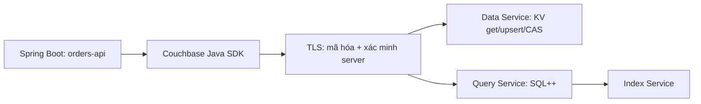
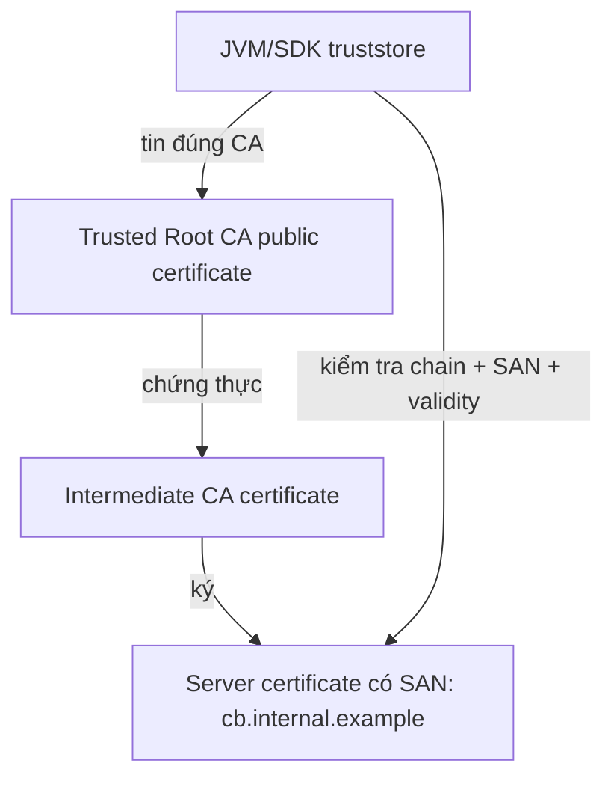
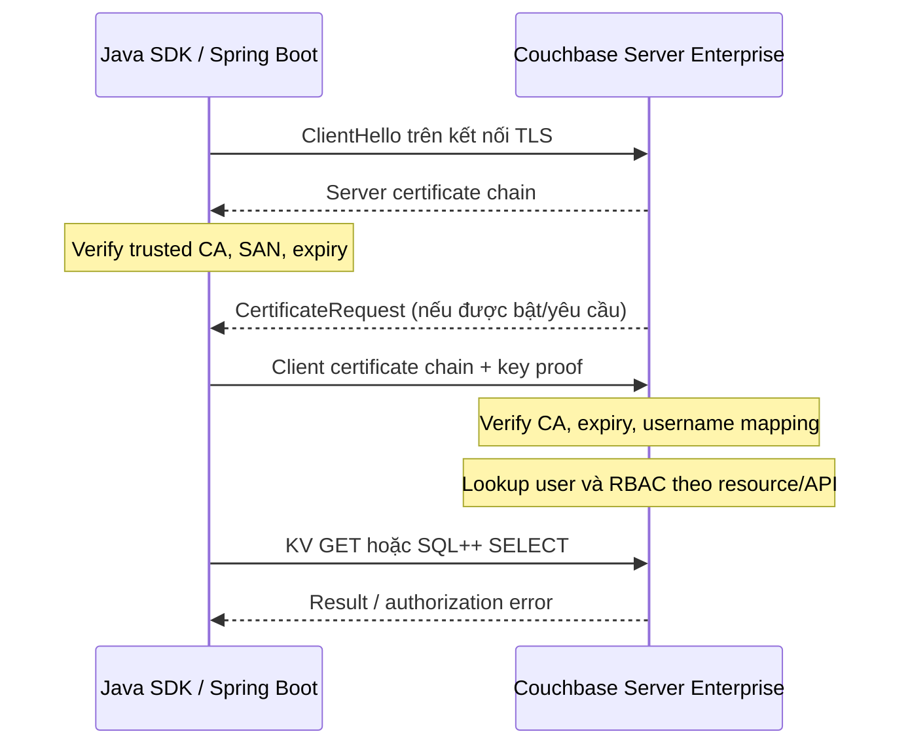
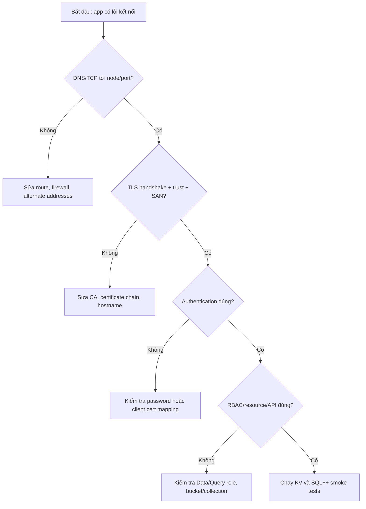
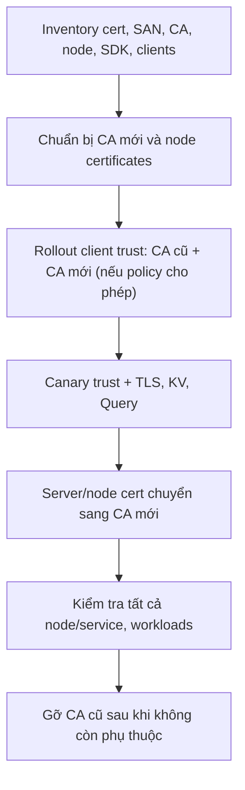

# Kết nối mã hóa TLS và xác thực chứng chỉ

## Mục tiêu bài học

Ứng dụng **Spring Data Couchbase** trao đổi document, câu truy vấn và metadata với Couchbase Server qua mạng. `CouchbaseRepository.findById` thường đi qua Key-Value (KV), derived repository query và `CouchbaseTemplate` có thể gọi SQL++, còn TTL, CAS, giao dịch và reactive API cũng dựa trên Couchbase Java SDK. Nếu đường truyền không được bảo vệ, dữ liệu nghiệp vụ và thông tin xác thực có thể bị quan sát. Nếu **kiểm tra chứng chỉ máy chủ sai**, ứng dụng có thể bị dẫn tới máy chủ giả dù đường truyền vẫn mã hóa.

Bài thuộc chương **Bảo mật** của module `SPRING_DATA_COUCHBASE` giải thích cách kết nối TLS đúng và phân biệt **ba lớp**: mã hóa đường truyền, xác thực danh tính bằng certificate/password và phân quyền RBAC sau khi xác thực. Đây là bài thực hành bảo mật kết nối, không phải tài liệu tổng quát về việc giấu password.

Sau bài học, bạn có thể:

- Giải thích TLS handshake, CA/trust chain, thời hạn certificate và Subject Alternative Name (SAN).
- Chọn `couchbase://` hay `couchbases://`, nhận biết cổng TLS của Data/Query/Management Service.
- Kết nối Couchbase **Capella** bằng Java SDK mà không thêm truststore không cần thiết.
- Cấu hình **Spring Boot SSL bundle** với CA tin cậy cho **Server Enterprise self-managed**.
- Phân biệt **TLS + password** với **X.509 client-certificate authentication (mTLS)**; cấu hình đúng từng phương án.
- Kiểm tra node hostname, advertised/alternate addresses, certificate chain và DNS SRV.
- Viết smoke test KV/SQL++ **chỉ đọc** và phân loại lỗi network/TLS/authentication/RBAC/index.
- Lập kế hoạch thay certificate/CA và kiểm chứng trước khi thu hồi chứng chỉ cũ.

> **Phạm vi phiên bản:** Theo tài liệu Java SDK, kết nối client TLS đầy đủ và xác thực client certificate được hỗ trợ bởi **Couchbase Server Enterprise Edition** và **Capella** theo cơ chế của từng sản phẩm. Không suy rằng một lab **Community Edition** chưa cấu hình TLS chỉ cần đổi URI thành `couchbases://` là tự được bảo vệ. Những ví dụ xác thực client bằng X.509 bên dưới dành cho **Server Enterprise self-managed đã bật client-certificate handling**, không phải cấu hình mặc định của Capella.

## 1. TLS bảo vệ điều gì và không bảo vệ điều gì?



TLS cung cấp:

- **Confidentiality**: thông điệp trao đổi được mã hóa, giảm nguy cơ đọc trộm document JSON, câu SQL++ và thông tin xác thực truyền qua mạng.
- **Integrity**: ngăn việc thay đổi nội dung gói tin mà không bị phát hiện.
- **Server authentication**: khi Java SDK **kiểm tra certificate chain và hostname đúng**, client có bằng chứng rằng endpoint đang kết nối thuộc server được tin cậy.

TLS **không thay thế**:

- **RBAC**: người dùng kết nối thành công có thể vẫn thiếu `data_reader` cho KV hoặc `query_select` cho SQL++.
- **Application authorization**: cùng một service account có thể đọc mọi document trong collection được cấp; ứng dụng vẫn phải kiểm tra tenant/ownership ở tầng API.
- **Encryption at rest**, mã hóa backup, field-level encryption hoặc secret manager.
- **CAS, TTL, giao dịch, durability và scan consistency**: đây là semantics của thao tác dữ liệu, không phải tính năng tự phát sinh khi dùng TLS.
- **Bảo mật endpoint**: secret trong log, heap dump hoặc container bị xâm nhập vẫn có thể lộ.

### 1.1. Phân biệt các cơ chế xác thực

| Khái niệm | Bản chất | Điều dễ nhầm |
| --- | --- | --- |
| **TLS encryption** | Mã hóa và bảo vệ toàn vẹn kết nối giữa SDK và Server. | Mã hóa không tự cấp quyền dữ liệu. |
| **Server certificate validation** | SDK tin CA và kiểm chứng endpoint/server certificate. | Không nhất thiết cần client certificate. |
| **Password authentication over TLS** | Ứng dụng gửi username/password qua kênh TLS đến Couchbase. | Đây là TLS, **không phải** mTLS theo nghĩa hai phía dùng certificate. |
| **Client-certificate authentication** | SDK xuất trình X.509 certificate và chứng minh sở hữu private key; Server xác định user. | Chỉ chạy khi Server hỗ trợ và bật cơ chế này. |
| **RBAC authorization** | Server kiểm tra role của user đã xác thực trên bucket/scope/collection và theo dịch vụ. | Role không được suy từ certificate hay scheme. |

Đối với **Capella thông thường**, dùng `couchbases://` và **Cluster Access Credentials** (username/password). Với Server tự quản lý cần mức xác thực client bằng X.509, có thể triển khai **mTLS** theo chính sách của cluster. Từng mô hình có cấu hình riêng.

### 1.2. TLS client-to-server khác node-to-node encryption

Ứng dụng Spring Boot nói chuyện với các Couchbase service nodes là **client-to-server traffic**. Các node Couchbase trao đổi nội bộ với nhau là **node-to-node traffic**. Bật TLS trong ứng dụng **không tự cấu hình** node-to-node encryption trên Server. Đơn vị vận hành phải đánh giá cả hai chính sách nếu workload có yêu cầu bảo vệ toàn bộ đường truyền.

## 2. Chuỗi kết nối và cổng mã hóa

| Môi trường | Connection string minh họa | Điều kiện |
| --- | --- | --- |
| Docker lab trên host | `couchbase://127.0.0.1` | Không TLS, chỉ lab cô lập và không chứa dữ liệu thật. |
| App cùng Docker Compose network | `couchbase://couchbase` | Dùng DNS của service; `localhost` trong app container trỏ về chính nó. |
| Server Enterprise TLS | `couchbases://cb.internal.example` | Node certificates, CA tin cậy, DNS/SAN và TLS ports hoạt động. |
| Capella public | Chuỗi `couchbases://...` do **Connect → SDK** cung cấp | TLS, DNS SRV, Allowed IP và Cluster Access Credentials. |
| Capella private | Connection string private do Capella cung cấp | Private DNS/network route và TLS tương ứng. |

Chữ **s** trong `couchbases://` là điểm phân biệt quan trọng. **Không dùng `https://`** làm Couchbase SDK connection string và không thay về `couchbase://` để né lỗi chứng chỉ. Với Capella, không tự tạo hostname hay thay hostname bằng IP từ một lần tra DNS.

### 2.1. Những cổng Server thông dụng

| Dịch vụ | Không TLS | TLS |
| --- | ---: | ---: |
| Web Console / Cluster Management | 8091 | 18091 |
| KV / Data Service | 11210 | 11207 |
| SQL++ / Query Service | 8093 | 18093 |
| Search Service | 8094 | 18094 |
| Analytics Service | 8095 | 18095 |

Đây chỉ là **các cổng mặc định tiêu biểu của Server tự quản lý**. Cluster có thể đổi cổng hoặc sử dụng thêm các port khác; **Capella** cần dùng connection string và service discovery chính thức. Mở được port 18091 **không chứng minh** 11207 hoặc 18093 thông. Java SDK bootstrap rồi nhận node/service topology; các địa chỉ tiếp theo cũng phải có route, port và certificate hợp lệ.

### 2.2. Hostname, NAT và alternate addresses

Trong Docker/NAT, client có thể bootstrap qua địa chỉ ngoài nhưng Server quảng bá IP bridge/container mà app không truy cập được. Khi dùng TLS, hostname/địa chỉ được SDK sử dụng còn phải phù hợp certificate ở node tương ứng. Kiểm tra:

1. App nằm ở đâu: host, container, VM hoặc cloud runtime.
2. Seed hostname và tất cả node addresses SDK khám phá có DNS/route hợp lệ.
3. Firewall mở **các TLS service ports cần thiết**, không chỉ quản trị.
4. Cluster có **alternate/external addresses** đúng khi đi qua NAT; `io.networkResolution` chỉ là lựa chọn mạng theo topology đã cấu hình.
5. Certificate của **từng node/endpoint** tương thích hostname được dùng, không chỉ certificate của bootstrap node.

Nguồn: [Couchbase Server — Ports](https://docs.couchbase.com/server/current/install/install-ports.html), [Java SDK — Managing Connections](https://docs.couchbase.com/java-sdk/current/howtos/managing-connections.html).

## 3. Certificate chain, SAN và nguồn tin cậy



Một TLS handshake thông thường có các bước:

1. Server xuất trình certificate của endpoint/node và các intermediate certificates cần thiết.
2. Java SDK/JVM xây **chain of trust** đến CA/root mà client tin cậy.
3. Client kiểm tra chữ ký, thời hạn hiệu lực, mục đích sử dụng certificate và **hostname/SAN** theo cấu hình TLS.
4. Nếu xác minh thành công, phiên TLS được thiết lập; ứng dụng xác thực bằng password hoặc client certificate theo phương án đã chọn.

**Public CA certificate** như `ca.pem` không phải bí mật, nhưng nguồn và tính toàn vẹn phải được xác minh. **Server private key** không bao giờ được đưa sang ứng dụng Java. **Client private key** chỉ được dùng cho client-certificate auth và phải được bảo vệ như secret.

### 3.1. Vì sao tin CA chưa đủ?

Certificate được CA đáng tin ký nhưng có SAN `old-cb.internal.example` không xác thực cho endpoint `cb.internal.example`. Hoặc certificate chỉ có DNS SAN trong khi ứng dụng kết nối bằng IP không nằm trong SAN. **Tắt hostname verification** không phải giải pháp; hãy sửa DNS/endpoint hoặc cấp certificate có SAN đúng.

DNS SRV có thể trỏ đến nhiều node của Capella. Các node và địa chỉ quảng bá trong cluster self-managed cũng phải xác thực được theo cùng chính sách. Đọc kết quả handshake **từ nơi ứng dụng chạy**, không chỉ từ trình duyệt máy quản trị.

### 3.2. Tách CA, certificate và private key

| File/vật liệu | Chức năng | Độ nhạy cảm |
| --- | --- | --- |
| `root-ca.pem` / intermediate public cert | Client dùng để tin Server, hoặc Server dùng để tin client CA | Public; phải bảo đảm nguồn đúng. |
| `server.crt` | Server trình certificate có public key, SAN và issuer | Public. |
| `server.key` | Server private key | **Secret**, không chuyển sang client. |
| `client.crt` | Định danh ứng dụng khi mTLS được bật | Public, nhưng cần quản lý vòng đời. |
| `client.key` | Client private key tương ứng `client.crt` | **Secret**; không đặt trong image/Git. |
| Truststore/keystore password | Mở store khi cần | **Secret**, tách với password Couchbase. |

Nếu chỉ lộ public CA certificate thì không tương đương với lộ private key ký của CA. Ngược lại, **CA signing private key** bị xâm nhập là sự cố nghiêm trọng cần xem lại mọi certificate/trust anchor mà CA ấy bảo vệ.

### 3.3. Các lý do phổ biến khiến bắt tay TLS thất bại

| Lỗi quan sát | Nguyên nhân cần kiểm tra |
| --- | --- |
| `PKIX path building failed` / `certificate_unknown` | Thiếu trusted CA, intermediate chain, bundle không được load, proxy thay chứng chỉ. |
| Hostname verification failed | SAN không khớp seed/node hostname hoặc kết nối bằng IP không có trong SAN. |
| Certificate expired/not yet valid | Hạn certificate hoặc đồng hồ máy/nút lệch. |
| Protocol/handshake failure | Scheme/cổng không phù hợp, TLS policy/cipher/protocol không chung hoặc mTLS requirement. |
| Connect timeout/refused | DNS, firewall, advertised addresses, service down; **chưa chắc là lỗi TLS**. |
| Authentication failure sau TLS | User/password sai hoặc client certificate không ánh xạ user hợp lệ. |

**Tuyệt đối không dùng trust-all `TrustManager`, tắt hostname verification hoặc cố hạ xuống plaintext** để xử lý những lỗi này. Làm vậy có thể mất khả năng xác thực đúng Server và tạo nguy cơ man-in-the-middle.

## 4. Kết nối Couchbase Capella: TLS và Cluster Access Credentials

Capella cấp cho mỗi Operational Cluster một connection string và certificate phù hợp. **Java SDK hiện đại đã đóng gói CA tiêu chuẩn Capella**, nên trong trường hợp thông thường chỉ cần dùng `couchbases://`; **không phải** tự tải `ca.pem` và thêm một truststore cho tất cả ứng dụng.

### 4.1. Quy trình chuẩn bị

1. Vào **Capella Operational Cluster** đúng môi trường (**staging/test**, không chọn nhầm production).
2. Mở **Connect → SDK**, sao chép đúng **connection string** mà Capella cung cấp. Không tự xây DNS name từ bucket hoặc tên cluster.
3. Tạo **Cluster Access Credentials** dành cho service; đây là danh tính SDK truy cập dữ liệu, **khác tài khoản đăng nhập Capella Console**.
4. Cấp role vừa đủ trên bucket/scope/collection mà `CouchbaseRepository` hoặc `CouchbaseTemplate` sử dụng. KV Data Reader/Writer và SQL++ Query Select có điều kiện quyền riêng.
5. Nếu dùng public connectivity, thêm **public egress IPv4 của máy chạy ứng dụng** vào **Allowed IP Addresses**, chờ rule **Active**. IP máy laptop quản trị có thể khác NAT IP của cloud VM hoặc CI runner.
6. Xác minh runtime có DNS SRV, đường mạng đến các service nodes và TLS. Với private connectivity, dùng **endpoint private và DNS/route private đã được triển khai**.
7. Thực hiện một phép đọc KV/SQL++ **chỉ đọc** từ chính runtime, không dùng `Administrator` như tài khoản smoke test.

### 4.2. Spring Boot cấu hình Capella tối thiểu

```yaml
# src/main/resources/application.yml - không chứa secret thật
spring:
  couchbase:
    connection-string: ${CB_CONNECTION_STRING}
    username: ${CB_APP_USERNAME}
    password: ${CB_APP_PASSWORD}
  data:
    couchbase:
      bucket-name: ${CB_BUCKET_NAME}
```

Biến môi trường trong Capella staging sẽ có dạng:

```text
CB_CONNECTION_STRING=<toàn bộ chuỗi couchbases:// do Capella Connect cấp>
CB_APP_USERNAME=<cluster-access-credential-name>
CB_APP_PASSWORD=<secret lấy từ vault hoặc secret manager>
CB_BUCKET_NAME=<bucket dành cho staging>
```

Đây là **mẫu cấu hình**, không phải file `.env` chứa secret để commit. Nếu SDK đã trust CA Capella tiêu chuẩn, **không thêm custom SSL bundle chỉ để bật TLS**. Nếu đang dùng proxy có TLS inspection hoặc cấu hình trust tùy biến, phải hiểu đầy đủ certificate chain mà client thật sự thấy, xác minh policy của tổ chức và tránh vô tình thay CA bundle tiêu chuẩn.

### 4.3. Kiểm tra DNS SRV từ máy chủ ứng dụng

Với hostname thật do Capella cấp, bỏ scheme và tra bản ghi:

```bash
# Thay <host-capella> bằng DNS hostname thật, không có "couchbases://".
dig SRV _couchbases._tcp.<host-capella>
```

Trên Windows PowerShell:

```powershell
Resolve-DnsName -Type SRV "_couchbases._tcp.<host-capella>"
```

Kết quả DNS chỉ chứng minh khả năng phân giải, **không chứng minh** TCP, TLS handshake hay RBAC. Đừng dùng ICMP ping như điều kiện bắt buộc của một kết nối Couchbase SDK: cloud firewall có thể chặn ICMP dù ứng dụng truy cập TCP/TLS bình thường.

### 4.4. Khi nào phải lấy CA certificate từ Capella UI?

Trong một số hệ thống ngoài Java SDK, môi trường sử dụng custom truststore hoặc quy trình chứng thực được quản lý riêng, bạn có thể cần root certificate X.509 mà Capella cung cấp ở **Settings → Security Certificate**. Tài liệu Capella hướng dẫn tải certificate dạng `.txt` và lưu thành `.pem`/`.crt` nếu ứng dụng yêu cầu.

**Phải xác minh nguồn của certificate.** Đừng tin một file CA nhận từ email/chia sẻ không kiểm soát chỉ vì hostname trong file trông đúng. Cũng đừng tải certificate xong rồi **thay toàn bộ truststore mặc định** mà chưa kiểm tra các CA khác ứng dụng cần.

Nguồn: [Couchbase Java SDK — Managing Connections](https://docs.couchbase.com/java-sdk/current/howtos/managing-connections.html), [Capella Root Certificates](https://docs.couchbase.com/cloud/security/security-certificates.html), [Capella — Connect](https://docs.couchbase.com/cloud/get-started/connect.html), [Troubleshooting Cloud Connections](https://docs.couchbase.com/java-sdk/current/howtos/troubleshooting-cloud-connections.html).

## 5. Couchbase Server Enterprise: chuẩn bị TLS phía Server

Với cluster self-managed, **ứng dụng không thể tự bật TLS phía Server** bằng một thuộc tính trong `application.yml`. Security/platform team phải chuẩn bị chứng chỉ và cấu hình trên **mỗi node/endpoint** theo kiến trúc mạng của cluster.

### 5.1. Checklist provisioning bởi đội quản trị

1. Xác định hostname/DNS nội bộ mà các client sẽ dùng, bao gồm các **advertised/alternate addresses** nếu có NAT hoặc nhiều network.
2. Có CA/root trust anchor được phê duyệt và certificate chain dành cho các node. Node certificate có **SAN** phù hợp hostname được sử dụng; private keys được bảo vệ.
3. Cấu hình root/intermediate/node certificates, các TLS services và mức mã hóa theo **Server Enterprise version** thực tế.
4. Xác minh các cổng **18091, 11207, 18093** và những dịch vụ khác mà ứng dụng dùng, với firewall/ACL phù hợp. **Không** mở management port toàn Internet.
5. Kiểm tra TLS certificate cho **mọi node** sau rebalance/failover, không chỉ bootstrap node.
6. Thiết kế chính sách **node-to-node encryption** riêng; không suy từ client TLS rằng traffic nội bộ đã mã hóa.
7. Tạo **application user** với RBAC tối thiểu; quản lý user/role/index bằng danh tính provisioning hoặc security khác.
8. Ghi nhận CA fingerprints, expiration schedule và runbook rotation; cung cấp cho ứng dụng **public CA**, **không cấp Server private key**.

**Tài liệu chính thức:** [Configure Server Certificates](https://docs.couchbase.com/server/current/manage/manage-security/configure-server-certificates.html), [Manage Certificates](https://docs.couchbase.com/server/current/manage/manage-security/manage-certificates.html), [Couchbase Server Ports](https://docs.couchbase.com/server/current/install/install-ports.html).

### 5.2. Sử dụng CA trong JVM truststore

Với **Java SDK 3.4 trở lên**, nếu Server certificate được cấp bởi một CA mà **JVM truststore** đã tin, SDK thường không cần chỉ định root certificate bằng `securityConfig` riêng. Với CA công ty chưa có trong truststore, có thể:

- Nhập CA vào **truststore được platform quản lý**, đúng JDK/runtime image.
- Cấu hình **Spring Boot SSL bundle** dùng public CA certificate file chỉ cho Couchbase.
- Hoặc khi dùng trực tiếp SDK, cấu hình `securityConfig.trustCertificate(...)` hoặc cơ chế trust tương đương.

Không sửa JVM global `cacerts` thủ công trong container image không kiểm soát chỉ để thử nhanh. Nếu dự án có nhiều kết nối TLS khác nhau, một **named SSL bundle** hạn chế phạm vi trust thường dễ kiểm soát và triển khai hơn việc thay truststore cho toàn bộ JVM.

### 5.3. Lấy và xác minh file CA

Đội vận hành cấp public CA file qua secret/config distribution đã được phê duyệt. Có thể kiểm tra metadata (chỉ certificate **public**):

```bash
openssl x509 \
  -in /etc/couchbase-certs/ca.pem \
  -noout -subject -issuer -dates -fingerprint -sha256
```

Đối chiếu fingerprint với giá trị do security/platform team cung cấp qua **kênh độc lập**. Lệnh chỉ xác nhận các thuộc tính của file đang có; **tự in fingerprint của một CA giả không chứng minh CA đó đáng tin**. Không đưa `server.key`, `client.key` hoặc CA signing key vào lệnh debug tạo log công khai.

## 6. Spring Boot SSL bundle cho Server Enterprise

Spring Boot có thể gán **SSL bundle** cho Couchbase client qua `spring.couchbase.env.ssl.bundle` trên các phiên bản hỗ trợ. Bạn cần kiểm tra cấu hình tương thích giữa **Spring Boot BOM**, **Spring Data Couchbase** và **Java SDK** của dự án. Hai lựa chọn PEM và PKCS12 bên dưới là **phương án thay thế**, không được khai báo chồng chéo rồi trông chờ precedence tự xử lý.

### 6.1. Trust public CA theo định dạng PEM

Giả sử file CA hợp lệ được platform mount ở `/etc/couchbase-certs/ca.pem`:

```yaml
# Ví dụ dành cho self-managed Server Enterprise đã cấu hình TLS
spring:
  couchbase:
    connection-string: ${CB_CONNECTION_STRING}
    username: ${CB_APP_USERNAME}
    password: ${CB_APP_PASSWORD}
    env:
      ssl:
        enabled: true
        bundle: couchbase-server-trust
  ssl:
    bundle:
      pem:
        couchbase-server-trust:
          truststore:
            certificate: "file:/etc/couchbase-certs/ca.pem"
  data:
    couchbase:
      bucket-name: ${CB_BUCKET_NAME}
```

Giá trị `CB_CONNECTION_STRING` trong profile này phải là hostname TLS thật, ví dụ `couchbases://cb.internal.example`. `truststore.certificate` là **public CA**, **không phải client certificate** và tuyệt đối không phải client private key. Bundle dùng để client xác minh Server; ứng dụng vẫn dùng username/password để xác thực với Couchbase và còn phải có RBAC đúng.

Với **Capella chuẩn dùng CA đã được SDK tin mặc định**, đừng copy cả khối `spring.ssl.bundle.*` sang profile Capella mà không có yêu cầu rõ ràng. Nếu có, cần kiểm tra trust source thực tế sau override.

### 6.2. Truststore PKCS12/JKS

Nếu tổ chức cấp một truststore đã chứa trusted CA:

```yaml
spring:
  ssl:
    bundle:
      jks:
        couchbase-server-trust:
          truststore:
            location: "file:/etc/couchbase-certs/truststore.p12"
            type: PKCS12
            password: ${CB_TRUSTSTORE_PASSWORD}
  couchbase:
    connection-string: ${CB_CONNECTION_STRING}
    username: ${CB_APP_USERNAME}
    password: ${CB_APP_PASSWORD}
    env:
      ssl:
        enabled: true
        bundle: couchbase-server-trust
  data:
    couchbase:
      bucket-name: ${CB_BUCKET_NAME}
```

`CB_TRUSTSTORE_PASSWORD` là password của truststore khi định dạng/triển khai yêu cầu, **khác** với `CB_APP_PASSWORD`. Không để password thật trong YAML/CI log. **Truststore** chứa các CA public mà client tin; **keystore** chứa identity/private key của client khi dùng mTLS. Hai mục đích này không thay cho nhau.

### 6.3. Java SDK trực tiếp (không dùng Spring Boot auto-config)

Nếu viết một chương trình Java SDK độc lập, có thể cấu hình CA khi connect:

```java
import com.couchbase.client.java.Cluster;
import com.couchbase.client.java.ClusterOptions;
import java.nio.file.Path;

// Mẫu code cho chương trình độc lập; credential do secret provider cấp.
String connectionString = System.getenv("CB_CONNECTION_STRING");
String username = System.getenv("CB_APP_USERNAME");
String password = System.getenv("CB_APP_PASSWORD");

Cluster cluster = Cluster.connect(
    connectionString,
    ClusterOptions.clusterOptions(username, password)
        .environment(env -> env.securityConfig(security ->
            security.trustCertificate(
                Path.of("/etc/couchbase-certs/ca.pem")
            )
        ))
);
try {
    var bucket = cluster.bucket("training");
    bucket.waitUntilReady(java.time.Duration.ofSeconds(30));
    System.out.println("SDK TLS/KV bootstrap completed");
} finally {
    cluster.disconnect();
}
```

Đoạn này giả định Server dùng CA riêng, `CB_CONNECTION_STRING` bắt đầu bằng `couchbases://` và JDK/SDK hỗ trợ API được dùng. Trong **ứng dụng Spring Boot**, ưu tiên `Cluster` do Boot quản lý và SSL bundle thay vì tự tạo một `Cluster.connect(...)` mới trong từng method. Mã trên chỉ kiểm chứng bootstrap/bucket readiness, **chưa** xác nhận user đọc được một key cụ thể.

**Bảo mật vòng đời:** `Cluster` và `ClusterEnvironment` là tài nguyên được tái sử dụng; client tự tạo phải `disconnect` theo lifecycle. Không tạo một cluster mới trên mỗi HTTP request. Khi dùng `ClusterEnvironment` tự quản lý, phải đóng nó theo hướng dẫn SDK.

Nguồn: [Spring Boot — Couchbase SSL Bundle](https://docs.spring.io/spring-boot/reference/data/nosql.html), [Spring Boot — SSL Bundles](https://docs.spring.io/spring-boot/reference/features/ssl.html), [Java SDK — Managing Connections](https://docs.couchbase.com/java-sdk/current/howtos/managing-connections.html).

## 7. X.509 client-certificate authentication: TLS hai chiều

Trong **TLS + password**, client xác minh certificate của Server, còn Server xác thực client dựa trên username/password. Trong **X.509 client-certificate authentication**, Server cũng yêu cầu hoặc chấp nhận **chứng chỉ do client xuất trình**, kiểm tra CA ký chứng chỉ, ánh xạ certificate sang một Couchbase user, rồi kiểm tra RBAC. Đây là nền tảng của cách kết nối thường gọi là **mTLS**.



**Quan trọng:** Có client certificate hợp lệ **không tự cấp quyền Admin**. Couchbase Server trích danh tính user từ certificate theo cấu hình mapping, rồi áp dụng RBAC của user đó. Nếu certificate map tới user chỉ có KV Data Reader trên `commerce.orders`, một câu SQL++ `SELECT` vẫn có thể bị từ chối vì thiếu Query Select.

### 7.1. Bật client-certificate handling phía Server

Couchbase Server Enterprise hỗ trợ các chế độ trên màn hình **Security → Certificates**; người có quyền quản trị security có thể đặt:

| Chế độ | Ý nghĩa | Tác động đến ứng dụng |
| --- | --- | --- |
| **Disable** | Không dùng client certificate authentication; xác thực client bằng cơ chế khác như password | App có thể chỉ cần TLS + username/password. |
| **Enable** | Server chấp nhận client certificate nếu được trình; client không có certificate vẫn có thể dùng username/password | Phù hợp giai đoạn chuyển đổi có kiểm soát sang X.509. |
| **Hybrid** | Cho phép certificate hoặc username/password với client; áp dụng yêu cầu mTLS cho node-to-node theo chính sách Server | Cần xem cấu hình cluster encryption prerequisite và tác động tới toàn cụm. |
| **Mandatory** | Buộc client certificate authentication và quy định nghiêm ngặt hơn cho node-to-node | Một app chỉ có username/password sẽ **không** qua được khi policy được áp dụng. |

**Không chuyển sang Mandatory trực tiếp** trên cluster đang phục vụ ứng dụng chỉ dùng password. Cần inventory mọi SDK/backup/automation client, chuẩn bị client identity, CA, RBAC, canary, rollback và cửa sổ thay đổi. Hybrid/Mandatory có điều kiện `clusterEncryptionLevel` phù hợp; tuân theo đúng tài liệu Server version trước khi bật.

Nguồn: [Enable Client-Certificate Handling](https://docs.couchbase.com/server/current/manage/manage-security/enable-client-certificate-handling.html).

### 7.2. Server xác định username trong certificate như thế nào?

Couchbase không mặc định coi mọi client certificate được một CA bất kỳ ký là có quyền. Server cần:

1. Tin **client CA/root** hợp lệ theo cấu hình, với chain hợp lệ và certificate chưa hết hạn.
2. Nhận được certificate có extension/mục đích phù hợp để **client authentication**.
3. Trích **username** từ một đường dẫn trong certificate mà administrator cấu hình, chẳng hạn `subject.cn`, `san.dns`, `san.email` hoặc `san.uri`, tùy version và policy.
4. Tìm **Couchbase user** tương ứng và kiểm tra các roles của user đó trên resource/operation.

```text
Client cert: Subject CN = orders-api
              |
              v
Server configured mapping: subject.cn -> "orders-api"
              |
              v
Couchbase user orders-api có role:
  data_reader[training:commerce:orders]
  query_select[training:commerce:orders] (nếu cần SQL++)
              |
              v
KV read và SQL++ SELECT được phép trong giới hạn role
```

Các path, prefix, delimiter và external/local user mapping phải được kiểm tra theo cấu hình Server thực tế. **Đổi CN hoặc SAN trong certificate mà không cập nhật mapping có thể khiến authentication thất bại** dù CA được tin cậy. Server 7.1+ có thể lưu nhiều root CAs, trong đó có CA chỉ dùng cho client-auth; client CA không nhất thiết phải là chính CA phát certificate cho node.

### 7.3. Chuẩn bị client identity an toàn

Đội security/platform phát hành:

- **Client private key** mới, sinh trong secret manager/HSM hoặc quy trình bảo mật được duyệt.
- **Certificate Signing Request (CSR)** và client X.509 certificate có identity mapping, usage `clientAuth`, hạn hiệu lực và CA phù hợp.
- **Certificate chain** của client (khi cần intermediate) và trust anchors của Server.
- RBAC tối thiểu cho Couchbase user mà certificate map tới.

Lưu `client.key` trong **secret volume chỉ đọc** cho process cần nó. Không commit private key, không in nội dung PEM ra log/ticket, không đưa Server private key hoặc CA signing key vào app. Quyền đọc certificate file chưa đủ: Server phải bật client cert handling và biết mapping danh tính.

**Quy trình cấp certificate và ký CA** là công việc quản trị PKI, không nên đưa một CA private key của doanh nghiệp vào workspace developer chỉ để tạo bộ cert thử.

## 8. Cấu hình Spring Boot cho X.509 client authentication

Các ví dụ này là **phương án thay thế** cho username/password TLS ở mục 6 và chỉ chạy khi Couchbase Server Enterprise đã bật certificate handling. **Không dùng mặc định với Capella** chỉ vì Capella có TLS; Capella thường dùng Cluster Access Credentials cho Java SDK.

### 8.1. Client certificate + private key dạng PEM

Giả sử platform mount:

```text
/etc/couchbase-certs/
  server-ca.pem                 # Public CA để SDK tin Server
/run/secrets/couchbase-client/
  client-chain.pem              # Public certificate chain của client
  client.key                    # Private key của client - SECRET
```

Cấu hình:

```yaml
spring:
  couchbase:
    connection-string: ${CB_CONNECTION_STRING}
    env:
      ssl:
        enabled: true
        bundle: couchbase-server-trust
    authentication:
      pem:
        certificates: "file:/run/secrets/couchbase-client/client-chain.pem"
        private-key: "file:/run/secrets/couchbase-client/client.key"
  ssl:
    bundle:
      pem:
        couchbase-server-trust:
          truststore:
            certificate: "file:/etc/couchbase-certs/server-ca.pem"
  data:
    couchbase:
      bucket-name: ${CB_BUCKET_NAME}
```

**Chú giải:**

- `spring.couchbase.authentication.pem.certificates` là certificate/chain để **Server xác thực client**.
- `spring.couchbase.authentication.pem.private-key` là **private key** của chính client.
- `spring.ssl.bundle.pem.*.truststore.certificate` là **public CA để client xác minh Server**.
- `CB_CONNECTION_STRING` phải dùng endpoint **TLS** của self-managed cluster, thường bắt đầu `couchbases://`.
- Không khai báo đồng thời `spring.couchbase.username/password` cho ví dụ **client-certificate auth thuần** này; chọn một phương thức đúng với Server policy và Boot/SDK version.

**Tuyệt đối không đảo `client.key` với `server-ca.pem`**. Private key không nằm trong `truststore.certificate`; một public CA certificate không thể dùng làm `authentication.pem.private-key`. TLS trust và client identity là hai quan hệ mật mã khác nhau.

### 8.2. Client identity dạng PKCS12/JKS

Nếu platform cung cấp Java keystore chứa **certificate và private key** của client:

```yaml
spring:
  couchbase:
    connection-string: ${CB_CONNECTION_STRING}
    env:
      ssl:
        enabled: true
        bundle: couchbase-server-trust
    authentication:
      jks:
        location: "file:/run/secrets/couchbase-client/client-identity.p12"
        password: ${CB_CLIENT_KEYSTORE_PASSWORD}
  ssl:
    bundle:
      pem:
        couchbase-server-trust:
          truststore:
            certificate: "file:/etc/couchbase-certs/server-ca.pem"
  data:
    couchbase:
      bucket-name: ${CB_BUCKET_NAME}
```

`CB_CLIENT_KEYSTORE_PASSWORD` bảo vệ keystore client, **không phải password Couchbase user**. Nếu Server CA đã nằm trong JVM truststore hoặc đội platform cấp truststore riêng, thay phần SSL bundle theo thiết kế thực tế. Không mặc định keystore client identity cũng chứa mọi CA Server cần tin.

**Kiểm tra định dạng/alias/chain** của `.p12` theo Java/Spring Boot version đang dùng. Khi private key bị lộ phải thay **keypair + certificate**, không chỉ thay keystore password.

### 8.3. Java SDK CertificateAuthenticator

Java SDK có `CertificateAuthenticator` dành cho client certificate auth. Với một ứng dụng SDK **tự quản lý Cluster** (không phải Spring Boot auto-config), có thể:

```java
import com.couchbase.client.java.Cluster;
import com.couchbase.client.java.ClusterOptions;
import com.couchbase.client.java.env.ClusterEnvironment;
import com.couchbase.client.java.auth.CertificateAuthenticator;
import java.nio.file.Path;
import java.security.KeyStore;

// Giả định có một KeyStore đã chứa client certificate + private key,
// được đọc an toàn từ secret volume. loadClientKeyStore() là helper
// của ứng dụng, không phải API tự có của Java SDK.
KeyStore clientKeyStore = loadClientKeyStore();
char[] keyStorePassword = readSecretFromProvider();

var authenticator = CertificateAuthenticator.fromKeyStore(
    clientKeyStore,
    new String(keyStorePassword)
);

Cluster cluster = Cluster.connect(
    System.getenv("CB_CONNECTION_STRING"),
    ClusterOptions.clusterOptions(authenticator)
        .environment(env -> env.securityConfig(
            security -> security.trustCertificate(
                Path.of("/etc/couchbase-certs/server-ca.pem")
            )
        ))
);

try {
    var bucket = cluster.bucket("training");
    bucket.waitUntilReady(java.time.Duration.ofSeconds(30));
    // Chạy KV read-only bằng identity X.509 sau khi được provision.
} finally {
    cluster.disconnect();
    java.util.Arrays.fill(keyStorePassword, '\0');
}
```

**Đây là snippet minh họa**, không phải file Java hoàn chỉnh: `loadClientKeyStore()` và `readSecretFromProvider()` phải do dự án triển khai. Không dùng `new String(...)` để giả định đã xóa được bí mật trong bộ nhớ; `String` là immutable và vẫn có thể tồn tại đến khi GC. Trong production, ưu tiên API xác thực/keystore và secret handling phù hợp version, dùng lifecycle do Spring Boot quản lý thay vì tự tạo cluster tại từng request.

### 8.4. Chế độ Certificate Required và migration từ password

Với Server ở chế độ **Enable**, có thể triển khai một canary dùng client certificate trong khi các ứng dụng còn lại dùng password nếu policy cho phép. Đối với **Mandatory**, app password-only sẽ không được chấp nhận. Vì vậy thứ tự khuyến nghị:

1. Provision client users, certificate chains và trust.
2. Cấu hình Enable ở môi trường staging; smoke test cả password/Cert theo yêu cầu migration.
3. Rollout client certificate auth tới từng workload và batch/backup tool được hỗ trợ.
4. Xác minh user mapping + RBAC và các service endpoints.
5. Chỉ cân nhắc Mandatory khi tất cả clients đã sẵn sàng và có rollback theo quy trình Server.

Điểm quyết định là **chứng minh RBAC của identity từ certificate**, không chỉ xem handshake thành công. Nếu certificate map nhầm sang một user có quyền quá rộng, đây là lỗi thiết kế bảo mật dù TLS thành công.

Nguồn: [Java SDK — Authentication](https://docs.couchbase.com/java-sdk/current/howtos/sdk-authentication.html), [Configure Client Certificates](https://docs.couchbase.com/server/current/manage/manage-security/configure-client-certificates.html), [Enable Client-Certificate Handling](https://docs.couchbase.com/server/current/manage/manage-security/enable-client-certificate-handling.html), [Spring Boot — Couchbase](https://docs.spring.io/spring-boot/reference/data/nosql.html).

## 9. Kiểm tra certificate và TLS handshake an toàn

Điểm khó của TLS là phải chứng minh **đúng endpoint** đã được xác minh bằng **đúng CA**, chứ không phải chỉ có một cổng TCP đang mở. Các lệnh dưới đây chỉ nên chạy với certificate/hostname của **cluster lab hoặc staging được phép**.

### 9.1. Kiểm tra metadata certificate public

Nếu platform cấp file public CA:

```bash
openssl x509 \
  -in /etc/couchbase-certs/ca.pem \
  -noout -subject -issuer -dates -fingerprint -sha256
```

Đối chiếu fingerprint SHA-256 với bản ghi được security/platform team **cấp qua kênh đáng tin cậy khác**. Chỉ tự tính fingerprint từ một file tải không rõ nguồn không chứng minh đó là CA thật. Kiểm tra `notBefore`, `notAfter` và issuer; không in nội dung private key để "kiểm tra chứng chỉ".

### 9.2. Kiểm tra một HTTPS endpoint bằng OpenSSL

Đối với **Server Enterprise self-managed** có TLS ở cổng management 18091, có thể chạy:

```bash
# Chỉ kiểm tra endpoint HTTPS quản trị; không thay thế KV/Query SDK smoke.
openssl s_client \
  -connect cb.internal.example:18091 \
  -servername cb.internal.example \
  -verify_hostname cb.internal.example \
  -CAfile /etc/couchbase-certs/ca.pem \
  -verify_return_error
```

- `-connect` chọn host/cổng kiểm tra; `-servername` cung cấp SNI.
- `-verify_hostname` so tên máy với certificate.
- `-CAfile` chỉ định public CA tin cậy; `-verify_return_error` khiến lỗi xác thực được phản ánh ở quá trình kiểm tra.
- Quan sát certificate chain và `Verify return code`. **Không dùng `-verify 0` hoặc cờ bỏ qua xác minh** để công bố PASS.

Lệnh này xác nhận **một endpoint HTTPS** (thường là management) và không tự xác minh được Java SDK đã dùng TLS/CA đúng khi truy cập **KV 11207** hay **Query 18093**. SDK phải hoàn thành smoke test của các dịch vụ thực tế. Với Capella, **không** suy từ bảng cổng self-managed để bắn lệnh vào 18091; dùng hướng dẫn kết nối chính thức của Capella.

### 9.3. Kiểm tra truststore JKS/PKCS12

Với file truststore do platform cung cấp, có thể liệt kê metadata:

```bash
keytool -list \
  -keystore /etc/couchbase-certs/truststore.p12 \
  -storetype PKCS12
```

`keytool` sẽ yêu cầu password nếu store có bảo vệ; không điền `-storepass <secret>` trực tiếp vào shell history/process listing ở môi trường dùng chung. Lệnh chỉ giúp quan sát alias/entries, **chưa chứng minh** certificate chain được Java SDK sử dụng đúng ở runtime. Quan sát thêm SSL bundle name, mount path, process identity và effective configuration đã được redact.

### 9.4. Khác biệt giữa lỗi TLS và lỗi ứng dụng

| Phép kiểm tra | PASS chứng minh | Chưa chứng minh |
| --- | --- | --- |
| `nc -vz host 11207` / TCP port check | Đường mạng tới một listener. | TLS, certificate, credential, bucket. |
| `openssl s_client` với CA + hostname | Trust/handshake của **endpoint kiểm tra**. | KV/SQL++ service endpoints khác. |
| `bucket.waitUntilReady` với `couchbases://` | SDK có thể bootstrap và bucket đạt trạng thái chờ theo cấu hình. | Quyền đọc key, data seed, index/Query Service. |
| SDK `collection.get(id)` | KV read thật trên collection bằng identity ứng dụng. | Quyền SQL++ hay nghiệp vụ khác. |
| SDK `SELECT ... USE KEYS` | Query Service và Query Select theo key, không cần secondary index. | Derived query theo status/index hoặc quyền transaction. |
| Spring `CouchbaseRepository.findByStatus` | Truy vấn thực của framework và index/metadata tương thích. | Không tự chứng minh các role DDL/transaction khác. |

**Không in nguyên exception context chứa hostname/URI/credential ra kênh công khai**. Trong debug TLS có thể cần một số certificate metadata, nhưng phải kiểm tra dữ liệu được phép lưu trữ, mức độ nhạy cảm và thời hạn giữ log.

## 10. Spring Boot integration test xác nhận TLS + dữ liệu

Một test tự chứa sẽ hữu ích hơn phép ping đơn lẻ vì nó kiểm tra **đúng Spring Boot configuration, Java SDK và khả năng đọc dữ liệu**. Bài test dưới đây **chỉ đọc**, dùng cluster/credential dành riêng cho test; bạn phải provision dữ liệu và quyền trước khi chạy.

### 10.1. Cấu hình profile dành cho TLS integration test

Tạo `src/test/resources/application-tls-test.yml` trong **dự án thực hành của bạn**:

```yaml
spring:
  config:
    activate:
      on-profile: tls-test
  couchbase:
    connection-string: ${CB_IT_CONNECTION_STRING}
    username: ${CB_IT_USERNAME}
    password: ${CB_IT_PASSWORD}
  data:
    couchbase:
      bucket-name: ${CB_IT_BUCKET_NAME}
```

**Không commit giá trị thực** của `CB_IT_PASSWORD`, chỉ đặt placeholder. Nếu test dùng self-managed CA nội bộ, bổ sung cấu hình SSL bundle tương ứng ở profile test và mount CA file qua đường tin cậy. Nếu test dùng Capella chuẩn, không nhất thiết thêm custom truststore.

### 10.2. Chuẩn bị fixture và tài khoản

Provisioner/admin **không phải account runtime** tạo trong môi trường test:

```text
Bucket:      it_tls
Scope:       commerce
Collection:  orders
Document ID: order::tls-test-001
Body JSON:   {"type":"order","status":"NEW","total":120000}
```

User test có **Data Reader** trên `it_tls.commerce.orders` và **Query Select** nếu muốn test SQL++ ở phần sau. Không cấp Admin hoặc index DDL role cho test runtime chỉ để smoke. Dùng bucket riêng tên `it_tls` là một **guard bổ sung**, không thay kiểm soát network/RBAC ngăn CI chạm production.

### 10.3. JUnit + Spring Boot: TLS và KV read-only

```java
package com.example.orders;

import com.couchbase.client.java.Cluster;
import org.junit.jupiter.api.Test;
import org.springframework.beans.factory.annotation.Autowired;
import org.springframework.beans.factory.annotation.Value;
import org.springframework.boot.test.context.SpringBootTest;
import org.springframework.test.context.ActiveProfiles;

import java.time.Duration;

import static org.junit.jupiter.api.Assertions.assertEquals;
import static org.junit.jupiter.api.Assertions.assertTrue;

@SpringBootTest
@ActiveProfiles("tls-test")
class CouchbaseTlsIT {

    private static final String SEED_ID = "order::tls-test-001";

    @Autowired
    Cluster cluster;

    @Value("${spring.couchbase.connection-string}")
    String connectionString;

    @Value("${spring.data.couchbase.bucket-name}")
    String bucketName;

    @Test
    void connectsOverTlsAndReadsSeed() {
        assertTrue(connectionString.startsWith("couchbases://"),
                "TLS must be enabled in this test profile");
        assertEquals("it_tls", bucketName,
                "Refuse to test against an unexpected bucket");

        var bucket = cluster.bucket(bucketName);
        bucket.waitUntilReady(Duration.ofSeconds(30));
        var orders = bucket.scope("commerce").collection("orders");

        var result = orders.get(SEED_ID);
        assertEquals(
            "NEW",
            result.contentAsObject().getString("status")
        );
    }
}
```

Test này cần ứng dụng có Spring Boot main configuration và `spring-boot-starter-data-couchbase`, JUnit Jupiter (`spring-boot-starter-test`). **Không tự chạy trong bài soạn Markdown này**; đây là mã để người học đưa vào ứng dụng riêng và thực thi trên môi trường test.

**Quan trọng:** Bài test giả định cấu hình TLS thực tế do Spring Boot dùng đến từ properties; nếu dự án override `Cluster` bằng bean tự tạo hoặc `@ServiceConnection`, chỉ kiểm tra property string **chưa đủ** để kết luận client đang sử dụng config đó. Cần xem effective connection details và xác minh handshake/service thật. Một lỗi `DocumentNotFoundException` có thể do chưa seed key, không phải do TLS.

### 10.4. JUnit: bổ sung SQL++ không cần secondary index

Nếu app dùng SQL++ repository query, thêm method sau **trong cùng class `CouchbaseTlsIT`**:

```java
@Test
void queryServiceAlsoWorksOverTls() {
    assertEquals("it_tls", bucketName);
    var result = cluster.query(
        "SELECT META(o).id AS docId, o.status " +
        "FROM `it_tls`.`commerce`.`orders` AS o USE KEYS $id",
        com.couchbase.client.java.query.QueryOptions.queryOptions()
            .parameters(
                com.couchbase.client.java.json.JsonObject.create()
                    .put("id", "order::tls-test-001")
            )
    );
    var rows = result.rowsAsObject();
    assertEquals(1, rows.size());
    assertEquals("order::tls-test-001",
                 rows.get(0).getString("docId"));
}
```

`USE KEYS` không đòi secondary index, nên đây là phép thử **Query connectivity + Query Select**. Sau đó mới kiểm tra `WHERE status = "NEW"`, `system:indexes`/`EXPLAIN` và Spring Data type metadata `_class` nếu có derived repository query. TLS thành công không đồng nghĩa `findByStatus` sẽ chạy khi index không sẵn sàng.

### 10.5. Chạy test và diễn giải kết quả

Trong dự án có Gradle wrapper:

```bash
./gradlew test --tests "com.example.orders.CouchbaseTlsIT"
```

Trên Windows dùng `gradlew.bat`. Chỉ cấp `CB_IT_*` qua CI secret store và chọn environment test cô lập. Không đặt mật khẩu trong lệnh `--args` hay log debug. **PASS** của hai phương thức trên chỉ xác nhận đường KV và Query đã test, **không** chứng minh transaction, Index DDL, mọi service hoặc tất cả certificate trên mọi node tương lai.

## 11. Chẩn đoán TLS theo tầng, không đoán từ một thông báo lỗi



| Hiện tượng | Nghi vấn trước tiên | Việc kiểm tra |
| --- | --- | --- |
| `UnknownHostException` hoặc không có SRV | DNS/sai hostname, Capella endpoint không đúng | Tra DNS từ app runtime; lấy lại connection string từ Connect → SDK. |
| TCP 18091 thông nhưng SDK KV timeout | Cổng 11207/advertised address không tới được | Kiểm tra topology, firewall và alternate addresses sau bootstrap. |
| `PKIX path building failed` | CA/JVM truststore/SSL bundle không đúng hoặc chain thiếu | Đọc issuer và trust chain, thử CA đúng nguồn; không trust-all. |
| Certificate SAN mismatch | Kết nối sai hostname/IP hoặc node cert chưa chuẩn | Sửa DNS/SAN/cert và advertised addresses, không tắt hostname verification. |
| Certificate expired | Cert node hoặc client đã quá `notAfter` | Xoay certificate/keypair theo runbook; đồng bộ clocks. |
| Handshake fail sau bật Mandatory | Client chưa có cert/private key hợp lệ hoặc mapping sai | Kiểm tra policy X.509 và client identity, rollback qua quy trình được phê duyệt. |
| Password authentication thất bại nhưng TLS PASS | Sai user/password hoặc account không thuộc cluster này | Kiểm tra runtime secret, Capella Cluster Access Credentials/Server user. |
| Client certificate TLS PASS nhưng 403 | User certificate đã map, song thiếu role | Kiểm tra user mapping, direct/inherited RBAC theo collection. |
| Capella không kết nối được dù certificate đúng | Public egress IP chưa allowlist, DNS SRV/proxy/firewall | Kiểm tra allowed IP Active và network từ chính runtime. |
| KV GET PASS, SQL++ fail | Query Service/RBAC/port 18093, index nếu WHERE | Kiểm tra Query Select và query plan, không tự suy là TLS. |
| JUnit GET fail vì missing key | Fixture chưa tồn tại, TTL hết hạn, collection sai | Seed fixture đúng trong test cluster, giữ nguyên TLS config. |
| Client A chạy, Client B fail sau CA rotation | B chưa được rollout trust CA mới hoặc đang dùng JDK/store khác | So sánh store phiên bản, cert chain, root/intermediate và deployment. |

### 11.1. Không biến TLS debug thành nguồn rò rỉ mới

Java/JVM có chế độ debug TLS như `javax.net.debug=ssl,handshake`, nhưng output có thể dài và chứa certificate chain/metadata nhạy cảm về hạ tầng. Nếu buộc dùng, chỉ thực hiện trong **môi trường cô lập, có thời hạn**, kiểm soát quyền đọc logs và redact trước khi chia sẻ. Không bật mặc định ở production hoặc xuất toàn bộ environment/password theo log kèm.

**Cách đọc lỗi đúng:** `TLS/PKIX` thường nằm ở tầng handshake/trust; `AuthenticationFailure` nói về danh tính; `Authorization/403` nói về quyền; `DocumentNotFound` nói về key; `No index available` nói về indexing/query. Những lỗi này có hành động khắc phục khác nhau. Đổi mật khẩu không sửa được SAN mismatch; cấp admin không tạo được trust chain.

## 12. Quản lý và xoay vòng certificate

Certificate có ngày `notBefore`/`notAfter`, issuer, subject/SAN, serial number và public key. Nó có thể hết hạn, cần thay CA hoặc bị thu hồi khi private key lộ. Một cơ chế kết nối TLS tốt phải có **certificate inventory**, cảnh báo hết hạn và cách thay đổi không làm đứt mọi client cùng lúc.

### 12.1. Có hai loại thay đổi khác nhau

| Loại thay đổi | Điều gì đổi? | Ảnh hưởng phía app |
| --- | --- | --- |
| **Renew/rotate node certificate**, cùng CA | Public cert, private key và thời hạn của một node | Trust CA có thể giữ nguyên; vẫn kiểm tra SAN, chain và node/SDK re-connect. |
| **CA rotation** | Trust anchor/chain ký Server cert thay đổi | Client phải tin CA mới **trước khi** nó cần xác minh cert mới, theo kế hoạch overlap được duyệt. |
| **Client certificate renewal** | Client keypair + cert X.509 mới | App phải có client identity mới, Server vẫn map đúng user và tin CA ký client. |
| **Client CA rotation** | CA dùng để Server xác minh client certificate thay đổi | Server phải có trust root phù hợp và client phải đổi certificate đúng thứ tự. |
| **Certificate/private key compromise** | Không còn thể tin khóa/CA cũ | Incident response, revoke/replace nhanh; **không** giữ overlap rủi ro chỉ vì tránh downtime. |

### 12.2. Quy trình CA Server rotation thông thường



Trình tự kiểm soát:

1. **Inventory** tất cả Couchbase nodes và endpoints, SDK/JDK versions, truststores, Certificate SAN, service accounts, batch jobs và expiry. Ghi owner và ngày thay đổi.
2. **Phát hành CA/cert mới** bằng quy trình PKI được duyệt, với private key mới và node SAN đúng; kiểm tra root/intermediate chain và yêu cầu node-to-node encryption.
3. Trong **rotation bình thường** (CA cũ vẫn đáng tin), cho client trust **CA cũ và CA mới** trong khoảng overlap được thiết kế; rollout trust material tới mọi Java runtime/batch jobs. Với SSL bundle/truststore tùy chỉnh, chuẩn bị bundle chứa đúng tập CA được phê duyệt.
4. **Canary:** kết nối bằng trust mới tới cluster hiện tại, thử TLS, KV và SQL++. Canary phải dùng phiên bản JDK/runtime image tương đương production.
5. **Chuyển node certificates** theo quy trình Couchbase Server, xác nhận cluster health và từng cổng TLS; có thể cần tính đến quá trình thay cert của nhiều node/không đồng bộ trong một khoảng ngắn.
6. **Xác minh sau chuyển:** không còn error PKIX/SAN, cùng lúc Key-Value, Query, Search nếu dùng đều hoạt động; kiểm tra các client/batch lâu chạy.
7. **Loại CA cũ** khỏi truststores khi thời hạn overlap kết thúc và không còn certificate cần CA cũ; lưu change record, fingerprint/expiration và dữ liệu audit.

**Giới hạn:** Overlap chỉ thích hợp khi CA cũ **vẫn đáng tin**. Nếu CA signing private key hoặc Server private key nghi bị xâm nhập, xử lý qua **incident response**, có thể phải thu hồi ngay hoặc cách ly hệ thống dù gây gián đoạn. Không tiếp tục tin CA bị compromise để giữ service xanh.

### 12.3. Xoay client certificate riêng với Server trust

Khi self-managed cluster dùng mTLS:

1. Tạo **client keypair mới**, không reuse private key cũ; giữ trong secret provider/HSM được kiểm soát.
2. Cấp X.509 certificate mới có issuer/chain, `clientAuth` usage và identity mapping mà Server hỗ trợ.
3. Cập nhật secret file `client-chain.pem`, `client.key` hoặc `client-identity.p12` cho **canary**, không thay cả production ngay.
4. Kiểm tra Server chấp nhận certificate và **ánh xạ đúng Couchbase user**; kiểm tra KV/SQL++ với chính quyền RBAC của user đó.
5. Rollout pods, batch jobs và các connection pools. Cần **recreate/restart connection** theo cơ chế thực tế, không cho rằng SDK tự đọc lại private key trên disk ngay lập tức.
6. Thu hồi certificate/key cũ và xóa đường truy cập secret phiên bản cũ khi tất cả consumer đã chuyển; ghi audit.

**Client certificate rotation không thay thế Server CA rotation.** Nếu client key được CA chuyên dùng cho client-auth ký, đội platform phải kiểm tra **trust của Server đối với client CA**, không chỉ truststore của Java app đối với Server.

### 12.4. Certificate và secret distribution

Một cách bố trí mount:

```text
/etc/couchbase-certs/
  server-ca.pem                 # Public trust material
/run/secrets/couchbase-client/
  client-chain.pem              # Public client identity
  client.key                    # Secret private key
```

Trong Kubernetes/secret manager:

- Chỉ cấp quyền đọc private key cho workload cần dùng, không cho mọi pod/service account trong namespace.
- Dùng read-only volume, filesystem permissions và encryption-at-rest tương ứng nền tảng.
- Không commit Kubernetes Secret manifest chứa `data:` base64 với key thật vào Git: **base64 không phải encryption**.
- Không đưa private key vào Docker `ARG`, `ENV` build-time, image layer, stdout hoặc `docker compose config`.
- Kiểm soát logs/heap dumps/core dumps và không công bố thông tin cấu hình nhạy cảm qua Actuator endpoints.

**Một file Secret được update không có nghĩa Java SDK hiện hành tự đổi TLS identity.** Thay đổi cần gắn với rollout/reconnection và smoke tests có đo lường. Với long-lived transaction hoặc batch jobs, xử lý yêu cầu graceful shutdown.

Nguồn: [Couchbase Server — Certificate Rotation](https://docs.couchbase.com/server/current/manage/manage-security/rotate-server-certificates.html), [Configure Server Certificates](https://docs.couchbase.com/server/current/manage/manage-security/configure-server-certificates.html), [Kubernetes Secrets](https://kubernetes.io/docs/concepts/configuration/secret/).

## 13. Thiết kế điều kiện GO/NO-GO trước khi bật TLS hoặc mTLS

| Gate | Hạng mục | Bằng chứng PASS |
| --- | --- | --- |
| **T0 — Đúng hệ thống** | Biết Server/Capella version/edition, cluster, workload và môi trường | Có deployment contract, không trỏ nhầm production từ test. |
| **T1 — Kết nối** | DNS, TCP, firewall/allowlist tới tất cả service nodes cần dùng | Kết nối từ **app runtime**, không chỉ máy quản trị. |
| **T2 — Trust** | CA đúng nguồn, chain đầy đủ, SAN/hostname khớp, cert còn hạn | Handshake xác minh thật; không bỏ qua certificate validation. |
| **T3 — Authentication** | Password hoặc client X.509 identity tương thích chính sách Server | Client được xác thực bằng **đúng danh tính ứng dụng**. |
| **T4 — RBAC** | User có đúng quyền KV/SQL++ tại keyspace mục tiêu | KV GET/SQL++ SELECT chỉ đọc thành công, negative test từ chối quyền ngoài scope. |
| **T5 — Ứng dụng** | Spring Boot env/SSL bundle/mount path đúng, SDK được cấu hình thực tế | Smoke test từ process/app container tương ứng PASS. |
| **T6 — Vận hành** | Certificate expiry, alert, rotation/rollback/runbook và owner | Có canary, inventory consumer và đường thay cert đã test. |

**GO cho TLS + password:** T0–T6 PASS, không có private key client nếu Server không yêu cầu, không dùng account quản trị trong app. **GO cho X.509 mTLS:** cộng thêm xác minh certificate handling mode, client cert/key, CA Server tin, username extraction/mapping và RBAC của user map. **NO-GO** nếu phải dùng trust-all, certificate sai SAN, client key nằm trong Git, hoặc workload không thể xác định sẽ mất quyền khi chuyển Mandatory.

### 13.1. Startup, readiness và liveness khác nhau

Trong môi trường Kubernetes hoặc load balancer:

- **Startup probe**: cho ứng dụng đủ thời gian khởi tạo SDK và bean trước khi đánh giá health.
- **Readiness probe**: cho biết instance đã sẵn sàng nhận traffic phụ thuộc Couchbase/TLS theo tiêu chí tối thiểu được định nghĩa. Không chạy một query SQL++ nặng liên tục.
- **Liveness probe**: kiểm tra tiến trình còn hoạt động; không nên ràng buộc cứng vào mọi lần database có sự cố để tránh restart storm.
- **Integration preflight**: kiểm tra sâu các gate T0–T6, scope/collection, role, fixture và index trước deployment/test suite.

Một health indicator cho Couchbase của Spring Boot có thể báo kết nối ở mức nào đó nhưng **không tự chứng minh** SAN/role/index/metadata của mọi query hay CA rotation đã an toàn. Đối chiếu đúng phiên bản Boot/Actuator và phép thử thực tế.

### 13.2. Những bằng chứng không được dùng làm tiêu chí PASS

- `docker ps` hiển thị Couchbase container `Up`, trong khi Server chưa cấu hình TLS.
- Có HTTPS Web Console ở 18091, nhưng ứng dụng vẫn dùng `couchbase://` và KV 11210.
- `openssl s_client` kết nối thành công nhưng **bỏ qua certificate verification**.
- Java SDK `waitUntilReady` thành công dưới tài khoản Administrator trong khi runtime dùng user khác.
- `ping` thành công đến một node, nhưng các node/query endpoints khác có certificate sai.
- `findById` thành công nhưng `findByStatus` thiếu Query Select/Index Service; đây là hai capability khác nhau.

## 14. Bài tập tình huống có đáp án

### Bài 1 — TLS không đồng nghĩa mTLS

Ứng dụng Java đang dùng `couchbases://` và username/password đến Capella. Một kỹ sư nói rằng "đã có chữ `s` nghĩa là Server cũng xác thực app bằng client certificate". Nhận định đúng không?

**Đáp án:** Sai. `couchbases://` thể hiện kết nối TLS; Java SDK kiểm tra certificate của Server và ứng dụng có thể xác thực bằng **Cluster Access Credentials**. Chỉ khi Server yêu cầu/chấp nhận **client X.509 certificate** và client cung cấp cert/key hợp lệ mới có certificate authentication phía client (mTLS).

### Bài 2 — CA đúng nhưng SAN sai

App kết nối `couchbases://10.10.0.5`. Certificate node do CA công ty tin cậy ký nhưng chỉ có SAN `cb.internal.example`. Có được tắt hostname verification để chạy không?

**Đáp án:** Không. Phải dùng DNS hostname phù hợp SAN, hoặc cấu hình certificate/node advertised address đúng để IP/hostname cần dùng được xác thực. Tắt hostname verification làm giảm bảo đảm danh tính Server; CA đúng không khiến mọi IP tự khớp.

### Bài 3 — TLS Web Console hoạt động, KV vẫn timeout

Port 18091 tới Server Enterprise reachable và Web Console HTTPS mở được. `bucket.waitUntilReady` vẫn timeout khi app dùng `couchbases://`. Điều tra ở đâu?

**Đáp án:** Kiểm tra 11207 cho KV, node addresses được Server quảng bá, firewall/NAT/alternate addresses, DNS và certificate của từng node. Web Console không chứng minh toàn bộ service topology đã reachable.

### Bài 4 — Capella cần thêm CA file không?

Ứng dụng Java SDK hiện đại kết nối Capella qua connection string chuẩn `couchbases://`. Nhóm muốn luôn tự download CA và thay truststore JVM cho mọi pod. Có bắt buộc không?

**Đáp án:** Thông thường **không** vì SDK đã đóng gói CA tiêu chuẩn Capella. Chỉ thêm trust material khi có yêu cầu thật hoặc môi trường/SDK đặc biệt; cần bảo đảm không vô tình bỏ mất CA được tin cậy mặc định. Lấy CA từ Capella Console đúng cluster.

### Bài 5 — Client certificate đã được ký nhưng vẫn bị từ chối

Một certificate có chain hợp lệ do CA client được Server tin, nhưng Java SDK không xác thực được. Trong certificate `CN=svc-order-api`, còn Server username mapping và user thực tế yêu cầu `orders-api`. Bạn làm gì?

**Đáp án:** Kiểm tra client certificate handling mode, path/prefix/delimiter của username extraction, định danh được map, quyền của user thực và điều kiện expiry/usage. Cấp certificate đúng identity theo policy hoặc sửa mapping được phê duyệt. Không cấp Admin để bỏ qua lỗi.

### Bài 6 — Truststore và keystore có khác nhau?

Một người đặt `client.key` (private key) vào property `spring.ssl.bundle.pem.*.truststore.certificate` và đặt public `server-ca.pem` vào `spring.couchbase.authentication.pem.private-key`. Có thể hoạt động không?

**Đáp án:** Không. **Truststore** chứa public trust anchors để client xác minh Server. **Client private key** chứng minh danh tính ứng dụng và đi cùng **client certificate** khi dùng mTLS. Đảo hai loại không thể hoàn thành handshake đúng.

### Bài 7 — Thay password có sửa được lỗi PKIX?

CI sau khi cập nhật base image JDK báo `PKIX path building failed`. Team nghi Couchbase user password hết hạn và định xoay mật khẩu. Kết luận có cơ sở chưa?

**Đáp án:** Chưa. PKIX là dấu hiệu kiểm tra **certificate chain/trust**; JDK image mới có thể dùng truststore khác. Xem root/intermediate certificates, SSL bundle, hostname, proxy TLS interception, SDK/JDK version. Chỉ xem password sau khi TLS đã hợp lệ và lỗi authentication thực sự xuất hiện.

### Bài 8 — Chuyển Server sang Mandatory

Cluster Server Enterprise đang hỗ trợ password authentication. Admin định bật client certificate **Mandatory** ngay trong giờ cao điểm để tăng bảo mật. Có rủi ro gì?

**Đáp án:** Password-only apps có thể bị từ chối; node-to-node security policy có điều kiện riêng. Phải inventory toàn bộ clients/batch tools, cấp client cert/key, kiểm tra CA, username mapping, RBAC và canary trong staging; rollout trước khi áp Mandatory, có rollback và change window.

### Bài 9 — Thứ tự xoay CA

Đội vận hành thay Server certificate chỉ được ký bởi CA mới **trước**, sau đó mới cập nhật truststore ứng dụng. Điều gì xảy ra?

**Đáp án:** Những ứng dụng chỉ tin CA cũ có thể ngừng TLS handshake. Với **rotation bình thường**, chuẩn bị client trust CA mới và cũ trong overlap được kiểm soát, canary, đổi Server certificate, xác minh, rồi gỡ CA cũ khi đủ điều kiện. Nếu CA cũ bị compromise, xử lý khẩn cấp, không kéo dài overlap mất an toàn.

### Bài 10 — TLS thành công nhưng repository query bị 403

`findById` đọc được đơn hàng qua KV/TLS, nhưng `findByStatus` báo thiếu quyền. Có nên cấu hình client certificate khác hoặc bỏ TLS?

**Đáp án:** Không. Đây có thể là vấn đề **Query Select** hoặc câu SQL++ truy cập collection khác; kiểm tra quyền của đúng user và generated query. Nếu query báo không có index thì kiểm tra Index Service/DDL provisioning. Mã hóa kết nối, RBAC và index là ba lớp độc lập.

### Bài 11 — Negative test chứng chỉ

Một test dùng CA sai nhưng lại bật trust-all rồi kết luận rằng ứng dụng có thể failover an toàn sang bất kỳ node nào. Điều gì sai?

**Đáp án:** Test đã loại bỏ chính thuộc tính cần kiểm tra. Một negative TLS test đúng phải xác nhận **CA không tin** hoặc **hostname sai** dẫn đến lỗi xác minh khi dùng cấu hình bảo mật bình thường. Chỉ thực hiện trên cluster test biệt lập; không chấp nhận bypass validation.

### Bài 12 — Client private key bị đưa vào Git

File `client.key` của `orders-api` đã xuất hiện trong Git history dù commit hiện tại xóa file. Chỉ xóa khỏi HEAD đã đủ chưa?

**Đáp án:** Chưa. Coi private key đã bị lộ: revoke/replace client identity theo PKI/Server policy, tạo keypair mới, cập nhật secrets và rollout, audit quyền truy cập, xử lý Git history/log/registry theo quy trình. Không giả định một private key hết nguy hiểm chỉ vì file mới không còn chứa nó.

## 15. Checklist nghiệm thu kết nối TLS và xác thực chứng chỉ

### 15.1. Môi trường và đường mạng

- [ ] Đã xác định rõ **Server Enterprise/Capella** và version/edition phù hợp với TLS/mTLS.
- [ ] Connection string đúng `couchbases://` khi yêu cầu TLS; không tự dùng `https://` hoặc downgrade plaintext.
- [ ] App runtime có DNS/route/TCP tới **mọi node/service** cần dùng, không chỉ bootstrap/Web Console.
- [ ] Docker/NAT, alternate addresses và SAN/hostname khớp nhau nếu cluster ở nhiều mạng.
- [ ] Capella dùng endpoint từ Connect → SDK, public egress IP allowlist hoặc private connectivity chính xác.

### 15.2. Chứng chỉ và trust

- [ ] Public CA/trust material được nhận qua **nguồn đáng tin**, fingerprint có cách đối chiếu độc lập.
- [ ] Certificate chain hoàn chỉnh, chưa hết hạn, SAN phù hợp hostname, đồng hồ hệ thống hợp lý.
- [ ] Spring Boot SSL bundle/JVM truststore được cấu hình đúng nhu cầu, không chồng PEM và PKCS12 ngoài chủ đích.
- [ ] Với Capella tiêu chuẩn và Java SDK hỗ trợ, không thêm custom CA vô cớ.
- [ ] Không có trust-all, tắt hostname verification, bỏ kiểm tra certificate hoặc dùng plaintext để che lỗi.
- [ ] Server private key/CA private signing key không xuất hiện trong app environment, image hoặc repository.

### 15.3. Authentication và RBAC

- [ ] Đã chọn rõ **TLS + username/password** hoặc **X.509 client-certificate authentication** theo policy Server.
- [ ] Nếu dùng client X.509, đã xác minh chế độ Enable/Hybrid/Mandatory, CA client trust và client `clientAuth` usage.
- [ ] Certificate identity được Server ánh xạ đúng Couchbase user, role đủ cho KV/SQL++ theo collection.
- [ ] Client private key được cấp từ secret manager/read-only volume với quyền tối thiểu, không commit vào Git.
- [ ] Runtime user không dùng Administrator, không có quyền Index/Schema/User Admin khi nghiệp vụ chỉ cần CRUD/query.
- [ ] Các thao tác TTL/CAS/transaction/reactive dùng role thích hợp; TLS không bị nhầm là quyền dữ liệu.

### 15.4. Kiểm thử và vận hành

- [ ] KV read-only smoke test bằng chính credential runtime đã PASS.
- [ ] SQL++ `SELECT ... USE KEYS` đã PASS nếu service dùng SQL++; index được kiểm riêng cho query theo thuộc tính.
- [ ] Negative TLS tests (CA sai/SAN sai) không bị bypass bởi `TrustManager` tin tất cả.
- [ ] Có inventory certificate chain/node/expiry và consumer credentials; cảnh báo trước khi certificate hết hạn.
- [ ] Đã có runbook/canary cho certificate/CA rotation và client key rotation; rollout kết nối được kiểm chứng.
- [ ] Sự cố private key/CA bị lộ có quy trình revoke/replace ưu tiên an toàn; không giữ CA bị compromise để tránh downtime.
- [ ] CI/log/Actuator không công khai password, private key, full environment hay nội dung document nhạy cảm.

**GO:** App kết nối đến đúng cluster với TLS được xác minh, định danh client rõ ràng, RBAC đúng phạm vi và có bằng chứng KV/SQL++ smoke test tương ứng. **NO-GO:** Certificate SAN sai phải tắt verification mới chạy, key nằm trong Git, runtime dùng Admin, hoặc không thể kiểm soát client certificate khi chuyển Server sang Mandatory.

## 16. Tài liệu tham khảo chính thức

1. [Couchbase Java SDK — Managing Connections and Secure Connections](https://docs.couchbase.com/java-sdk/current/howtos/managing-connections.html).
2. [Couchbase Java SDK — Certificate Authentication](https://docs.couchbase.com/java-sdk/current/howtos/sdk-authentication.html).
3. [Couchbase Java SDK — Client Settings and TLS Certificates](https://docs.couchbase.com/java-sdk/current/ref/client-settings.html).
4. [Couchbase Java SDK — Troubleshooting Cloud Connections](https://docs.couchbase.com/java-sdk/current/howtos/troubleshooting-cloud-connections.html).
5. [Couchbase Server — Certificates](https://docs.couchbase.com/server/current/learn/security/certificates.html).
6. [Couchbase Server — Configure Server Certificates](https://docs.couchbase.com/server/current/manage/manage-security/configure-server-certificates.html).
7. [Couchbase Server — Configure Client Certificates](https://docs.couchbase.com/server/current/manage/manage-security/configure-client-certificates.html).
8. [Couchbase Server — Enable Client-Certificate Handling](https://docs.couchbase.com/server/current/manage/manage-security/enable-client-certificate-handling.html).
9. [Couchbase Server — Certificate Rotation](https://docs.couchbase.com/server/current/manage/manage-security/rotate-server-certificates.html).
10. [Couchbase Server — Required Ports](https://docs.couchbase.com/server/current/install/install-ports.html).
11. [Couchbase Capella — Connect to Your Cluster](https://docs.couchbase.com/cloud/get-started/connect.html).
12. [Couchbase Capella — Root Certificates](https://docs.couchbase.com/cloud/security/security-certificates.html).
13. [Couchbase Capella — Allowed IP Addresses](https://docs.couchbase.com/cloud/clusters/allow-ip-address.html).
14. [Spring Boot — Working with Couchbase](https://docs.spring.io/spring-boot/reference/data/nosql.html).
15. [Spring Boot — SSL Bundles](https://docs.spring.io/spring-boot/reference/features/ssl.html).
16. [Spring Boot — Externalized Configuration](https://docs.spring.io/spring-boot/reference/features/external-config.html).
17. [Spring Data Couchbase — Repositories](https://docs.spring.io/spring-data/couchbase/reference/couchbase/repository.html).
18. [Kubernetes — Secrets](https://kubernetes.io/docs/concepts/configuration/secret/).

## Tổng kết

Kết nối an toàn với Spring Data Couchbase cần **ba xác minh độc lập**: (1) dữ liệu đi qua **TLS** thay vì đường plaintext không được phép; (2) Java SDK xác minh **đúng Server certificate, CA và hostname**, và nếu chọn X.509 thì Server xác minh **client certificate identity**; (3) Couchbase áp dụng **RBAC** lên những thao tác KV, SQL++, Index và các collection thực tế của ứng dụng.

Một cấu hình `couchbases://` chỉ là điểm khởi đầu. Bài học hoàn tất khi người học chứng minh kết nối thật từ Spring Boot/Java SDK, phân loại đúng lỗi TLS với lỗi quyền hoặc dữ liệu, bảo vệ private keys và có kế hoạch certificate rotation. Khi đó các phần document mapping, `CouchbaseRepository`, `CouchbaseTemplate`, TTL, CAS, giao dịch và reactive API có thể vận hành trên **kênh đã xác thực và mã hóa** mà không đánh đổi bảo mật để lấy sự tiện lợi.
