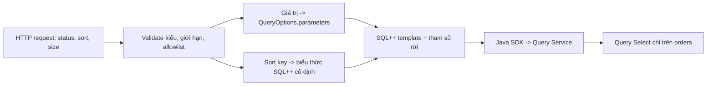
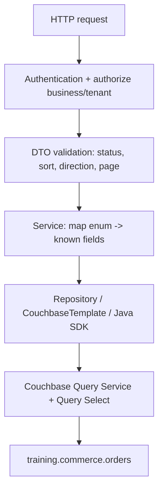

# Ràng buộc tham số SQL++ và kiểm soát trường sắp xếp động

## Mục tiêu bài học

Khi xây dựng tầng truy cập dữ liệu với **Spring Data Couchbase**, nhiều API cần cho người dùng **lọc đơn hàng, tìm kiếm trạng thái, chọn khoảng thời gian, sắp xếp và phân trang**. Đường truy cập này thường sử dụng **SQL++** (trước đây gọi là N1QL), được thực thi qua `CouchbaseRepository`, `CouchbaseTemplate` hoặc `com.couchbase.client.java.Cluster.query(...)`. Một chuỗi truy vấn được ghép trực tiếp từ tham số HTTP có thể khiến người dùng thay đổi ý nghĩa của câu lệnh, bỏ qua điều kiện lọc hoặc tiêu tốn quá nhiều tài nguyên.

Bài thuộc chương **Bảo mật** của module `SPRING_DATA_COUCHBASE` tập trung vào hai quyết định liên quan nhưng **không thể thay thế nhau**:

1. **Ràng buộc tham số (parameter binding)** cho **giá trị** như `status`, `tenantId`, ngày bắt đầu/kết thúc, danh sách ID, `LIMIT`/`OFFSET`.
2. **Allowlist cấu trúc câu truy vấn** cho **trường sắp xếp, hướng sắp xếp, tên collection và biểu thức SQL++**: không thể coi một string người dùng nhập là identifier an toàn chỉ bằng cách đưa nó vào `QueryOptions.parameters(...)`.

Sau bài học, bạn có thể:

- Phân biệt **SQL++ injection**, sai logic lọc và lạm dụng truy vấn nặng.
- Sử dụng **named** và **positional parameters** của Couchbase Java SDK 3.x; giữ query statement cố định và dữ liệu tách riêng.
- Viết `@Query` với `$1` hoặc `@Param` trong Spring Data Couchbase, không nhầm với string interpolation hay SpEL.
- Xây dựng API sắp xếp động an toàn qua `enum`/mapping field → **SQL++ expression cố định**, kiểm tra `ASC`/`DESC` và nhiều tiêu chí.
- Dùng `Sort`/`Pageable` ở repository **sau khi** đã chuyển tham số client thành một tập field được cho phép.
- Giới hạn `LIMIT`, `OFFSET`, số field sort, chi phí truy vấn và điều kiện bảo vệ tenant; lựa chọn pagination có thứ tự ổn định.
- Viết bài kiểm thử positive/negative để phát hiện injection ở cả giá trị và cấu trúc, không chỉ thử query “chạy được”.
- Bổ sung **RBAC theo collection**, `readonly(true)`, chỉ mục và logging đã redact thành các lớp phòng vệ độc lập.

> **Bối cảnh:** Ví dụ dùng bucket `training`, scope `commerce`, collection `orders` trên Couchbase Server hỗ trợ scope/collection, và Spring Boot/Java SDK tương thích. Mọi document là dữ liệu giả. Chỉ dẫn về role Query Select, chỉ mục và khả năng thực thi phụ thuộc edition/plan; Community Edition có tập RBAC hạn chế. Nội dung này hướng dẫn **viết truy vấn phòng thủ** trong ứng dụng, không hướng dẫn khai thác hệ thống.

## 1. Vì sao chỉ ràng buộc giá trị vẫn chưa đủ?

Hãy tưởng tượng endpoint:

```text
GET /orders?status=NEW&sort=createdAt&direction=DESC&page=0&size=20
```

Ứng dụng muốn thực thi ý nghĩa sau:

```sql
SELECT META(o).id AS documentId, o.status, o.createdAt, o.total
FROM `training`.`commerce`.`orders` AS o
WHERE o.status = "NEW"
ORDER BY o.createdAt DESC, META(o).id ASC
LIMIT 20 OFFSET 0;
```

Chỉ có một số thành phần thuộc **dữ liệu đầu vào**; phần còn lại thuộc **cấu trúc câu lệnh**:

| Thành phần | Ví dụ | Được bind làm parameter? | Phương pháp đúng |
| --- | --- | --- | --- |
| Giá trị lọc | `NEW` | **Có** | `WHERE o.status = $status` |
| Khoảng giá trị | `startAt`, `endAt` | **Có** | `>= $from`, `< $to` và kiểm tra type |
| Danh sách trạng thái | `["NEW","PAID"]` | **Có**, là JSON array | `o.status IN $statuses` |
| Document key | `order::demo-1001` | **Có** | `USE KEYS $id` |
| Giới hạn và độ dịch | `20`, `0` | **Có**, nếu vị trí hỗ trợ; dùng số nguyên | `LIMIT $limit OFFSET $offset` |
| Field/biểu thức sắp xếp | `createdAt`, `total` | **Không dùng placeholder để thay trực tiếp identifier** | Allowlist client key → biểu thức SQL++ cố định |
| Chiều sắp xếp | `ASC`, `DESC` | **Không** như keyword | Chọn token cố định sau khi validate/enum |
| Tên bucket/scope/collection | `training.commerce.orders` | **Không** như tên keyspace trong `FROM` | Identifier do cấu hình tin cậy và allowlist quyết định |
| Tùy chọn index/query hint | `USE INDEX` | Không chấp nhận raw text từ request | Cấu hình/SQL template tĩnh được review |



**Nguyên tắc ranh giới dữ liệu/cấu trúc:** Tất cả giá trị có nguồn từ request phải đi vào vị trí **giá trị** của parameterized query; mọi fragment ghép vào cú pháp SQL++ phải được chọn từ danh sách **chuỗi hằng do developer sở hữu**. Ngay cả khi người dùng gửi chuỗi trông giống tên field hoặc từ khóa hợp lệ, **không nối nguyên văn nó vào câu SQL++**.

Nguồn: [Couchbase Java SDK — Parameterized Queries](https://docs.couchbase.com/java-sdk/current/howtos/sqlpp-queries-with-sdk.html), [SQL++ Query Concepts](https://docs.couchbase.com/server/current/n1ql/n1ql-intro/queriesandresults.html), [ORDER BY](https://docs.couchbase.com/server/current/n1ql/n1ql-language-reference/orderby.html).

## 2. SQL++ injection trông như thế nào?

**Ví dụ code cần tránh**: một lập trình viên ghép status từ request thành SQL++:

```java
// KHÔNG LÀM: minh họa anti-pattern, không dùng trong ứng dụng.
String statusFromHttp = request.getParameter("status");

String sql = "SELECT META(o).id AS documentId, o.status " +
    "FROM `training`.`commerce`.`orders` AS o " +
    "WHERE o.status = '" + statusFromHttp + "'";

cluster.query(sql);
```

Nếu chuỗi đầu vào chứa ký tự quote và cú pháp SQL++, nó không còn là **giá trị của status**; một phần input có thể được parser xem là **toán tử/biểu thức SQL++**. Tùy cấu trúc query và quyền account, điều kiện lọc có thể bị thay đổi hoặc query có thể thất bại ngoài ý muốn. Đây là một lớp lỗi **SQL++ injection**.

Các cách "sửa" sau **không đủ**:

- Thay ký tự `'` bằng `''` hay dùng backslash escape tự viết. Escape rules có thể phức tạp theo ngữ cảnh, JSON string, tên identifier và version.
- Dùng `String.format`, template literals, string concatenation hoặc text block để ghép input vào query. Chúng **chỉ đổi cú pháp Java**, không bind parameter.
- Dùng regex "chỉ chữ và số" cho mọi giá trị. Mã trạng thái là `NEW` nhưng tên khách hàng/ngày/ID có thể cần ký tự khác; chặn quá mức vẫn không tạo ra parameter binding.
- Tắt lỗi parser hoặc retry với quyền Admin. Không bảo vệ khỏi injection và có thể mở rộng phạm vi thiệt hại.
- Chỉ thêm `QueryOptions.readonly(true)`. Readonly hạn chế side effects của query nhưng không ngăn một điều kiện lọc bị thay đổi thành đọc dữ liệu ngoài dự kiến.

**Phân biệt hai nguy cơ:** SQL++ injection có thể thay đổi ý nghĩa câu lệnh. Ngay cả query được parameterize đúng vẫn có thể bị **lạm dụng tài nguyên**, ví dụ người dùng yêu cầu hàng triệu rows, một `LIKE` quá rộng, sorting thiếu index hoặc offset cực lớn. Vì vậy bài này dùng **binding + allowlist + giới hạn chi phí + RBAC**.

## 3. Couchbase Java SDK: named parameters

Java SDK 3.x hỗ trợ `QueryOptions.parameters(JsonObject)` với **named placeholders** bắt đầu bằng `$` trong SQL++.

### 3.1. Ví dụ hoàn chỉnh cho tìm kiếm đơn hàng

```java
package com.example.orders;

import com.couchbase.client.java.Cluster;
import com.couchbase.client.java.json.JsonObject;
import com.couchbase.client.java.query.QueryOptions;
import com.couchbase.client.java.query.QueryResult;

import java.util.List;

public final class OrderQueries {

    private static final String BY_STATUS = """
        SELECT META(o).id AS documentId, o.status, o.createdAt, o.total
        FROM `training`.`commerce`.`orders` AS o
        WHERE o.status = $status
        ORDER BY o.createdAt DESC, META(o).id ASC
        LIMIT $limit
        """;

    private final Cluster cluster;

    public OrderQueries(Cluster cluster) {
        this.cluster = cluster;
    }

    public List<JsonObject> byStatus(String status, int limit) {
        if (status == null || status.isBlank()) {
            throw new IllegalArgumentException("status is required");
        }
        if (limit < 1 || limit > 100) {
            throw new IllegalArgumentException("limit must be 1..100");
        }

        JsonObject values = JsonObject.create()
            .put("status", status)
            .put("limit", limit);

        QueryResult result = cluster.query(
            BY_STATUS,
            QueryOptions.queryOptions()
                .parameters(values)
                .readonly(true)
        );
        return result.rowsAsObject();
    }
}
```

**Dấu hiệu quan trọng:** SQL++ có `$status` và `$limit`, còn Java object có keys `"status"` và `"limit"` **không thêm `$`**. Query statement là hằng số; SDK gửi các giá trị JSON **tách** với câu lệnh, Query Service không parser nội dung `status` như cấu trúc truy vấn.

Trong dự án Spring Boot, inject `Cluster` do framework quản lý qua constructor, không tạo `Cluster.connect(...)` trong từng request. Ví dụ cố định bucket lab `training`. Khi dùng staging/prod, tên bucket phải do **cấu hình triển khai đáng tin** lựa chọn, tuyệt đối không lấy từ query parameter của HTTP request.

**Phụ thuộc dữ liệu:** ví dụ muốn sắp xếp theo `createdAt`; document phải có field này với kiểu đồng nhất (ví dụ ISO-8601 UTC chuẩn hóa). Nếu dữ liệu seed hiện không có `createdAt`, query vẫn có thể chạy nhưng kết quả sắp xếp không có ý nghĩa như kỳ vọng. Bài tập có thể thêm field vào **fixture test**, không sửa dữ liệu production.

### 3.2. Bind nhiều giá trị, JSON array và range

Ví dụ đoạn method có sẵn `cluster`:

```java
var params = JsonObject.create()
    .put("statuses",
        com.couchbase.client.java.json.JsonArray.from("NEW", "PAID"))
    .put("minTotal", 100000)
    .put("maxTotal", 500000);

var result = cluster.query("""
    SELECT META(o).id AS documentId, o.status, o.total
    FROM `training`.`commerce`.`orders` AS o
    WHERE o.status IN $statuses
      AND o.total >= $minTotal
      AND o.total < $maxTotal
    ORDER BY o.total ASC, META(o).id ASC
    LIMIT 50
    """, QueryOptions.queryOptions()
        .parameters(params)
        .readonly(true));
```

**Kiểm tra ngữ nghĩa trước khi bind:** `minTotal`/`maxTotal` phải là số và `minTotal <= maxTotal`, `statuses` phải có số lượng phần tử giới hạn và chỉ chứa status cho phép. Parameterized query bảo vệ cú pháp, **không tự đảm bảo các giá trị hợp lệ theo nghiệp vụ**.

### 3.3. Không nối tên keyspace dù values đã bind

**Sai**:

```java
// Không bao giờ lấy keyspace raw từ người dùng HTTP.
String fromHttp = request.getParameter("collection");
String sql = "SELECT o.* FROM " + fromHttp + " AS o WHERE o.status = $s";
```

**Đúng về kiến trúc:** Danh tính ứng dụng có quyền trên một keyspace cụ thể. Nếu hệ thống thực sự cho chọn dữ liệu từ nhiều keyspace, dùng **enum/mapping được review** giữa tên công khai và **identifier canonical** trong cấu hình; người dùng chỉ chọn một enum hợp lệ. **Không** tạo string backtick bằng cách escape tùy tiện từ input người dùng rồi coi đó là an toàn.

Nguồn: [Couchbase Java SDK — SQL++ Query and Parameters](https://docs.couchbase.com/java-sdk/current/howtos/sqlpp-queries-with-sdk.html).

## 4. Positional parameters, binding và giới hạn cú pháp

Ngoài named parameters, Java SDK có `QueryOptions.parameters(JsonArray)` với vị trí `?` (hoặc `$1`, `$2` tùy cú pháp). Ví dụ:

```java
import com.couchbase.client.java.json.JsonArray;
import com.couchbase.client.java.query.QueryOptions;

var result = cluster.query(
    "SELECT META(o).id AS id, o.status " +
    "FROM `training`.`commerce`.`orders` AS o " +
    "WHERE o.status = ? AND o.total >= ? LIMIT ?",
    QueryOptions.queryOptions()
        .parameters(JsonArray.from("NEW", 100000, 25))
        .readonly(true)
);
```

**Không trộn thứ tự:** `JsonArray` cung cấp lần lượt `status`, `minTotal`, `limit`. Thêm điều kiện ở đầu query mà quên cập nhật mảng có thể đổi nghĩa lọc nhưng **không phải injection**. Với query phức tạp, named parameters dễ review hơn.

| SQL++ fragment | Cách bind hợp lệ | Nhận xét |
| --- | --- | --- |
| `WHERE o.status = $status` | `JsonObject.put("status", "NEW")` | Value tách riêng. |
| `WHERE META(o).id = $id` | `put("id", "order::demo-1001")` | Dữ liệu document ID. |
| `USE KEYS $id` | `put("id", docId)` | Kiểm tra quyền trên collection thực tế. |
| `LIMIT $limit OFFSET $offset` | `put("limit", 20).put("offset", 0)` | Bind số nguyên và giới hạn ở application. |
| `ORDER BY $field` | **Không dùng để thay identifier động** | `$field` là một giá trị/biểu thức; không an toàn/không đúng nghĩa "sắp theo field chỉ định". |
| `ORDER BY o.total $direction` | **Không** cho keyword `ASC`/`DESC` | Chọn một trong hai token cố định từ enum. |
| `FROM $keyspace` | **Không** thay thế keyspace identifier | Sử dụng tên keyspace tĩnh/allowlist. |
| `USE INDEX $index` | **Không** như tên index identifier | DDL/hints thuộc cấu trúc được duyệt. |

Không phải tất cả vị trí của cú pháp SQL++ chấp nhận parameter; một số vị trí sai trả `PlanningFailureException`. **Đừng thử né bằng cách nối raw input vào SQL++** khi placeholder không hoạt động; đó là dấu hiệu phải chuyển sang thiết kế allowlist/templates.

### 4.1. Query parameter không giống string escape

Ở dạng:

```sql
WHERE o.status = $status
```

Nếu `status` mang ký tự `'`, `--`, `;` hoặc token SQL++, SDK vẫn truyền một **JSON string value**. Query Service so sánh chính giá trị đó với field `status`. Có thể trả 0 row, nhưng input **không được nối lại vào statement để parse cú pháp**.

Không cố "sanitize" bằng cách loại bỏ mọi ký tự đặc biệt khỏi status; cách đúng là **validate domain** (ví dụ enum `NEW/PAID/CANCELLED`) **và bind parameter**. Đối với họ tên/địa chỉ cho phép nhiều Unicode, validate ngữ nghĩa/độ dài rồi bind, không tạo escape parser thủ công.

### 4.2. LIKE và wildcard là một lớp khác

Một giá trị lọc `LIKE $pattern` được bind an toàn khỏi injection nhưng các ký tự pattern như `%`, `_` vẫn có **ý nghĩa wildcard** trong SQL++ tương ứng. Nếu user chỉ muốn tìm một chuỗi ký tự **literal**, ứng dụng phải định nghĩa chính sách escaping wildcard theo cú pháp `LIKE ... ESCAPE` của đúng Server version hoặc dùng kiểu tìm kiếm khác. Nếu người dùng được phép tìm wildcard, giới hạn độ dài/tần suất/chỉ mục để tránh những query tốn kém. **Binding không đồng nghĩa với vô hiệu hóa wildcard semantics.**

## 5. Tại sao `ORDER BY $field` không phải sắp xếp theo field động?

SQL++ cho phép `ORDER BY` theo một **biểu thức**; biểu thức đó có thể là tên field, phép tính hoặc alias đã xác định. Câu:

```sql
SELECT META(o).id AS id, o.total
FROM `training`.`commerce`.`orders` AS o
ORDER BY $sortField;
```

với `sortField = "total"` **không biến chuỗi `"total"` thành tên thuộc tính `o.total`**. Nó được sử dụng như một **giá trị expression**. Nếu mọi document được sort theo cùng một giá trị hằng, thứ tự giữa các document vẫn có thể không được xác định; nó **không** tương đương `ORDER BY o.total`. Tương tự, `$direction` không phải vị trí cú pháp để truyền keyword `ASC` hoặc `DESC`.

Đôi khi SQL++ hỗ trợ **dynamic field access** qua biểu thức phù hợp; tuy nhiên cho người dùng tùy ý chọn đường dẫn/biểu thức vẫn tạo nguy cơ dữ liệu bị lộ, query không dùng index hoặc chi phí bất thường. Trong các API công khai, **allowlist field** là hợp đồng bảo mật và hiệu năng rõ ràng hơn.

### 5.1. Các anti-pattern của dynamic sort

```java
// KHÔNG LÀM: sortColumn và direction đến từ HTTP request.
String sql = "SELECT o.* FROM `training`.`commerce`.`orders` AS o "
    + "ORDER BY o." + sortColumn + " " + direction;
```

Các biểu hiện rủi ro:

- Một sort key chứa dấu cách, dấu ngoặc, dấu phẩy hay SQL++ expression có thể thay đổi cấu trúc mà developer dự định.
- Một field có thật nhưng **không được phê duyệt để sắp xếp** (ví dụ `customer.ssn`, dữ liệu bí mật hoặc array lớn) vẫn có thể bị sử dụng.
- Một sort expression tính toán động có thể bỏ index và làm tăng CPU/memory, dẫn tới DoS logic.
- Một `direction` tùy ý có thể thêm các clause hoặc expression ngoài `ASC`/`DESC`.
- Nhiều sort key không giới hạn có thể tạo truy vấn khó kiểm soát.

**Không giải quyết bằng cách thêm backtick quanh `sortColumn` do người dùng gửi.** Quoting identifier có thể xử lý một số tên hợp lệ, nhưng không quyết định field có **được phép công khai** hay có index/hiệu năng đáp ứng hay không. Đúng cách là **mapping public key → expression tĩnh**.

## 6. Java SDK: dynamic ORDER BY an toàn bằng enum và allowlist

Ví dụ này cho phép client chọn đúng ba sort keys: `createdAt`, `total` và `status`. Mỗi lựa chọn được ánh xạ sang **fragment SQL++ cố định**; hướng sắp xếp chỉ có `ASC` hoặc `DESC`. Một điều kiện `tenantId` bắt buộc luôn được bind, không lấy từ query parameter do user tự khai.

### 6.1. Mã Java hoàn chỉnh

```java
package com.example.orders;

import com.couchbase.client.java.Cluster;
import com.couchbase.client.java.json.JsonObject;
import com.couchbase.client.java.query.QueryOptions;

import java.util.List;
import java.util.Locale;
import java.util.Set;

public final class SafeOrderSearch {

    // Chỉ developer có quyền thay đổi enum này trong code review.
    enum SortField {
        CREATED_AT("o.createdAt"),
        TOTAL("o.total"),
        STATUS("o.status");

        final String sqlExpression;

        SortField(String sqlExpression) {
            this.sqlExpression = sqlExpression;
        }

        static SortField fromPublicName(String publicName) {
            if (publicName == null) {
                throw new IllegalArgumentException("Sort field is required");
            }
            return switch (publicName) {
                case "createdAt" -> CREATED_AT;
                case "total" -> TOTAL;
                case "status" -> STATUS;
                default -> throw new IllegalArgumentException(
                    "Unsupported sort field");
            };
        }
    }

    enum Direction {
        ASC, DESC;

        static Direction fromPublicName(String value) {
            if (value == null) {
                throw new IllegalArgumentException("Direction is required");
            }
            return switch (value.toUpperCase(Locale.ROOT)) {
                case "ASC" -> ASC;
                case "DESC" -> DESC;
                default -> throw new IllegalArgumentException(
                    "Unsupported sort direction");
            };
        }
    }

    private static final Set<String> ALLOWED_STATUSES =
        Set.of("NEW", "PAID", "CANCELLED");

    private final Cluster cluster;

    public SafeOrderSearch(Cluster cluster) {
        this.cluster = cluster;
    }

    public List<JsonObject> list(
            String verifiedTenantId,
            String status,
            String publicSortKey,
            String publicDirection,
            int page,
            int size) {

        // verifiedTenantId do authentication/authorization layer xác định.
        if (verifiedTenantId == null || verifiedTenantId.isBlank()) {
            throw new IllegalArgumentException("Missing tenant identity");
        }
        if (status == null || !ALLOWED_STATUSES.contains(status)) {
            throw new IllegalArgumentException("Unsupported order status");
        }
        if (size < 1 || size > 100 || page < 0) {
            throw new IllegalArgumentException("Invalid page or size");
        }

        long offset = (long) page * size;
        if (offset > 10_000) {
            throw new IllegalArgumentException("Offset exceeds API policy");
        }

        SortField field = SortField.fromPublicName(publicSortKey);
        Direction direction = Direction.fromPublicName(publicDirection);

        // Chỉ nối những fragments được tạo từ enum nội bộ.
        String sql = "SELECT META(o).id AS documentId, " +
            "o.tenantId, o.status, o.createdAt, o.total " +
            "FROM `training`.`commerce`.`orders` AS o " +
            "WHERE o.tenantId = $tenantId AND o.status = $status " +
            "ORDER BY " + field.sqlExpression + " " + direction.name() +
            ", META(o).id ASC LIMIT $limit OFFSET $offset";

        JsonObject params = JsonObject.create()
            .put("tenantId", verifiedTenantId)
            .put("status", status)
            .put("limit", size)
            .put("offset", offset);

        return cluster.query(
            sql,
            QueryOptions.queryOptions()
                .parameters(params)
                .readonly(true)
        ).rowsAsObject();
    }
}
```

**Giải thích quyết định bảo mật:**

1. `SortField.fromPublicName` chỉ cho **ba lựa chọn chính xác**; input có dấu chấm, dấu cách, expression, keyword hay field chưa được review đều bị từ chối trước khi query.
2. `Direction` chỉ có `ASC` và `DESC`. `direction.name()` không thể chứa fragment do client tùy ý gửi.
3. `WHERE o.tenantId = $tenantId` dùng **tenant identity từ server-side auth context**, không tin client khai `tenantId`.
4. `status`, `tenantId`, `LIMIT` và `OFFSET` đều là **values**, được bind bằng `JsonObject`.
5. `size <= 100` và `offset <= 10000` chặn các yêu cầu quá lớn. Những con số là **policy minh họa**, cần điều chỉnh theo SLA/chỉ mục và giám sát thực tế.
6. `META(o).id ASC` tạo **tie-breaker ổn định** khi nhiều document có cùng total/createdAt/status.
7. `readonly(true)` giúp SDK/Query Service xác định đây là query đọc; user vẫn cần Query Select trên collection, không nên có quyền quản trị hoặc SQL++ mutation nếu không dùng.

**Khả năng tương thích:** Ví dụ dùng Java 17+ (switch expression) và Couchbase Java SDK 3.x. Lớp này giả định **document test có `tenantId`, `createdAt`, `total`, `status`** với kiểu đúng. Nếu bộ dữ liệu học ban đầu chỉ có bốn document mẫu thiếu `tenantId`/`createdAt`, hãy **seed fixture riêng cho bài này** hoặc điều chỉnh model test có kiểm soát; không bỏ bộ lọc tenant ở production để “đủ rows”.

### 6.2. Điều gì xảy ra khi user gửi sort không hợp lệ?

| Input publicSortKey | Input direction | Kết quả |
| --- | --- | --- |
| `createdAt` | `DESC` | `ORDER BY o.createdAt DESC, META(o).id ASC` |
| `total` | `asc` | `ORDER BY o.total ASC, META(o).id ASC` |
| `status` | `ASC` | `ORDER BY o.status ASC, META(o).id ASC` |
| `customer.ssn` | `ASC` | **Rejected**: field không được cho phép. |
| `total, o.status` | `DESC` | **Rejected**: không phải một public sort key hợp lệ. |
| `total DESC` | `ASC` | **Rejected**: không phải sort key hợp lệ. |
| `total` | `DESC NULLS LAST` | **Rejected**: direction không thuộc enum. |
| `createdAt` | giá trị rỗng/null | **Rejected**, hoặc dùng default server-side đã được tài liệu hóa trước khi gọi hàm. |

Trong REST API, trả **HTTP 400** kèm thông báo tổng quát kiểu “Unsupported sort field/direction”. Đừng echo nguyên chuỗi gây lỗi vào log không kiểm soát hoặc trả toàn bộ SQL++ statement/stack trace cho người dùng.

### 6.3. Nếu cần nhiều sort keys

Thiết kế contract có dạng:

```text
sort=createdAt:desc,total:asc
```

Ở tầng controller/service, cần:

- Parse thành danh sách tối đa **2** (hoặc số nhỏ do sản phẩm quyết định).
- Từ chối key không nằm trong allowlist và direction ngoài `ASC/DESC`.
- Từ chối key lặp lại/không có direction nếu API yêu cầu; tránh sort list rất dài.
- Với mỗi phần tử, ánh xạ sang **SQL++ expression cố định**, sau đó nối fragments từ enum và thêm `META(o).id ASC` làm tie-breaker cuối cùng nếu chưa có.
- Giới hạn kết quả, request rate và timeout; index chỉ phục vụ một số thứ tự sắp xếp thường gặp.

**Không** viết `String.join(",", request.getParameter("sort"))`; việc ràng buộc giá trị `WHERE` đúng không bảo vệ một `ORDER BY` được ghép bằng raw string.

### 6.4. Sort by JSON path và expression phức tạp

Nếu nghiệp vụ cần `customer.name` hoặc `LOWER(customer.name)`, thêm **một public alias** như `customerName` và ánh xạ nó sang expression SQL++ đã code review. Chỉ nên cho phép nếu dữ liệu đó **được phép công khai** và đã kiểm chứng chi phí query/index; không expose tùy ý đường JSON `a.b.c`, array path hay function name từ client. Sắp xếp trên dữ liệu thiếu thống nhất type có thể tạo thứ tự khó dự đoán; xem thêm `NULLS FIRST/LAST` theo SQL++ docs.

## 7. Spring Data Couchbase: repository, `@Query`, `Sort` và `Pageable`

Spring Data giúp viết query từ tên method hoặc annotation `@Query`. **Framework không miễn trách nhiệm kiểm tra tham số công khai.** Những giá trị lọc có thể được bind an toàn, nhưng một `Sort` do client tự dựng vẫn biểu diễn **lựa chọn cấu trúc** của query — phải giới hạn field và direction trước khi đưa vào repository.

### 7.1. Entity ánh xạ đúng collection

```java
package com.example.orders;

import org.springframework.data.annotation.Id;
import org.springframework.data.couchbase.core.mapping.Document;
import org.springframework.data.couchbase.core.mapping.Scope;
import org.springframework.data.couchbase.core.mapping.Collection;

@Document
@Scope("commerce")
@Collection("orders")
public class Order {
    @Id
    private String id;
    private String tenantId;
    private String status;
    private String createdAt;
    private long total;

    public Order() {}

    public String getId() { return id; }
    public String getTenantId() { return tenantId; }
    public String getStatus() { return status; }
    public String getCreatedAt() { return createdAt; }
    public long getTotal() { return total; }
}
```

Ở ví dụ này `@Scope` và `@Collection` xác định đường truy cập mặc định tới `commerce.orders`. Thuộc tính `spring.data.couchbase.bucket-name` phải trỏ đến bucket đã provision. **Annotation mapping không phải RBAC**; danh tính Couchbase của ứng dụng vẫn cần quyền thực tế.

### 7.2. Repository method và bind giá trị

```java
package com.example.orders;

import java.util.List;
import org.springframework.data.couchbase.repository.CouchbaseRepository;
import org.springframework.data.couchbase.repository.Query;
import org.springframework.data.domain.Page;
import org.springframework.data.domain.Pageable;
import org.springframework.data.domain.Sort;
import org.springframework.data.repository.query.Param;

public interface OrderRepository extends CouchbaseRepository<Order, String> {

    // Derived query: Spring Data xây SQL++ theo tên method và bind status.
    List<Order> findByStatus(String status, Sort sort);

    Page<Order> findByStatus(String status, Pageable pageable);

    // Inline query: $status là value placeholder.
    // SpEL dưới đây lấy SELECT/FROM và type metadata do Spring Data quản lý.
    @Query("#{#n1ql.selectEntity} WHERE #{#n1ql.filter} " +
           "AND status = $status")
    List<Order> findByStatusInline(
        @Param("status") String status, Sort sort);
}
```

**Tại sao `#{#n1ql.selectEntity}` và `#{#n1ql.filter}`?** Spring Data Couchbase có thể lưu metadata loại entity (`_class`) và dùng filter để chỉ trả document thuộc kiểu entity tương ứng. Nếu document được nhập thủ công không có metadata đó, inline query vẫn có thể trả rỗng dù status đúng. Đừng bỏ filter chỉ để test có rows mà chưa hiểu cơ chế ánh xạ; dùng fixture tạo từ repository hoặc mô hình phù hợp.

**Quan trọng về hai cú pháp:**

| Cú pháp | Vai trò |
| --- | --- |
| `$status` hoặc `$1` trong `@Query` | SQL++ parameter, value được bind từ method parameter. |
| `@Param("status")` | Ghép tên tham số Java với named placeholder. |
| `#{#n1ql.selectEntity}` | Spring Data SpEL tạo SELECT/FROM phù hợp entity mapping. |
| `#{#n1ql.filter}` | Spring Data SpEL filter metadata entity. |
| `#{[0]}` hoặc SpEL chèn text tùy biến | Có thể tạo **cấu trúc SQL++**; nếu lấy field/expression từ HTTP mà không allowlist, có nguy cơ injection. |

Với `@Query`, chọn **named placeholders** hoặc **positional placeholders** theo một quy tắc rõ ràng; **đừng trộn** cả hai trong một query. Ví dụ tương đương một tham số:

```java
@Query("#{#n1ql.selectEntity} WHERE #{#n1ql.filter} AND status = $1")
List<Order> findWithPositionalStatus(String status);
```

`$1` trong Spring Data inline query là tham số method đầu tiên theo cách mapping mà framework hỗ trợ. **Không** thay nó bằng string concatenation hoặc SpEL text injection để xử lý special characters.

### 7.3. Xây dựng `Sort` an toàn từ client

Đặt việc chuyển đổi input thành entity property ở **service/controller boundary**:

```java
package com.example.orders;

import org.springframework.data.domain.Sort;
import java.util.Locale;

public final class SafeRepositorySort {
    private SafeRepositorySort() {}

    public static Sort fromClient(
            String publicField, String publicDirection) {
        if (publicField == null || publicDirection == null) {
            throw new IllegalArgumentException("Sort is required");
        }

        // Các giá trị dưới đây là entity property names, không phải raw SQL++.
        String property = switch (publicField) {
            case "createdAt" -> "createdAt";
            case "total" -> "total";
            case "status" -> "status";
            default -> throw new IllegalArgumentException("Unsupported sort");
        };

        Sort.Direction direction = switch (
                publicDirection.toUpperCase(Locale.ROOT)) {
            case "ASC" -> Sort.Direction.ASC;
            case "DESC" -> Sort.Direction.DESC;
            default -> throw new IllegalArgumentException(
                "Unsupported sort direction");
        };

        return Sort.by(new Sort.Order(direction, property));
    }
}
```

Sử dụng:

```java
Sort safeSort = SafeRepositorySort.fromClient(
    requestedField, requestedDirection);

List<Order> orders = repository.findByStatus("NEW", safeSort);
```

**Không viết `Sort.by(request.getParameter("sort"))` rồi tin rằng một instance `Sort` đã tự trở thành allowlist.** `Sort` biểu diễn property cần sắp xếp, nó không biết API nào được phép cho người dùng chọn. Framework có thể áp dụng những quy tắc xử lý riêng, nhưng bảo mật nghiệp vụ và ràng buộc chi phí vẫn phải nằm ở boundary code.

Với entity có `@Field` đổi tên document property, **public API name**, **entity property** và **SQL++ field** có thể khác nhau. Duy trì mapping có kiểm thử: đừng đơn giản nối `o.` + tên entity property vào một custom query nếu không chắc field lưu trữ thực tế.

### 7.4. `Pageable` phải được tạo sau khi giới hạn kích thước

```java
import org.springframework.data.domain.Page;
import org.springframework.data.domain.PageRequest;

int page = requestedPage;
int size = requestedSize;

if (page < 0 || page > 200 || size < 1 || size > 50) {
    throw new IllegalArgumentException("Invalid paging request");
}

var pageable = PageRequest.of(
    page, size,
    SafeRepositorySort.fromClient(requestedField, requestedDirection)
);
Page<Order> result = repository.findByStatus("NEW", pageable);
```

**Tính đúng đắn về phân trang:** `Page` có thể cần **COUNT query** bổ sung, tăng tải khi collection lớn. `Slice` hoặc phân trang keyset có thể phù hợp hơn khi UI chỉ cần nút “Tiếp theo”. `OFFSET` rất lớn thường tốn kém, ngay cả khi đầu vào đã bind và không có SQL++ injection.

Đặc biệt khi **`@Query` dùng `Pageable` hoặc `Sort`**, tránh viết sẵn `ORDER BY`/`LIMIT`/`OFFSET` trong inline SQL++ rồi để Spring Data thêm lần nữa; tài liệu Spring Data Couchbase cảnh báo câu truy vấn có thể thành malformed. Hãy để framework thêm phần paging/sorting từ `Pageable` đã được kiểm soát, hoặc chuyển sang một **custom SDK query template** như mục 6 khi cần điều khiển SQL++ chính xác.

**Order ổn định:** Với pagination, nếu chỉ ORDER BY `createdAt` mà nhiều document có cùng giá trị, các trang có thể trùng/bỏ sót khi truy vấn riêng lẻ. Nếu cần paging ổn định, bổ sung một **thuộc tính unique, được mapping và cho phép** làm secondary sort; hoặc dùng custom SQL++ với `META(o).id` làm tie-breaker. Không giả định Spring Data `Sort.by("id")` luôn map thành `META().id` mà chưa kiểm chứng query sinh theo phiên bản.

Nguồn: [Spring Data Couchbase — Repositories](https://docs.spring.io/spring-data/couchbase/reference/couchbase/repository.html), [Query Methods / Sort / Pageable](https://docs.spring.io/spring-data/couchbase/reference/repositories/query-methods-details.html), [@Query API](https://docs.spring.io/spring-data/couchbase/docs/current/api/org/springframework/data/couchbase/repository/Query.html).

## 8. Bảo vệ ranh giới tenant và quyền truy cập dữ liệu

**Parameter binding bảo vệ cú pháp, không tự xác minh người dùng cuối được xem document nào.** Nếu collection `orders` chứa dữ liệu của nhiều tổ chức, `tenantId` là **điều kiện bắt buộc do server xác định**.

### 8.1. Không lấy tenant tin cậy từ query parameter

**Sai:**

```text
GET /orders?tenantId=tenant-other&status=NEW
```

Nếu backend dùng `request.getParameter("tenantId")` trực tiếp làm điều kiện lọc, câu SQL++ vẫn được bind an toàn nhưng có thể đọc dữ liệu **tenant khác** do lỗi authorization nghiệp vụ. Binding **không ngăn** một giá trị hợp lệ về cú pháp nhưng sai về quyền.

**Đúng:** Backend xác thực người gọi, lấy tenant/organization scope từ identity/claims đã xác minh hoặc chính sách access control của server, kiểm tra membership theo nghiệp vụ, rồi bind tenant đó:

```java
// verifiedTenantId đã được tầng authentication/authorization xác minh;
// không lấy trực tiếp từ @RequestParam.
var params = JsonObject.create()
    .put("tenantId", verifiedTenantId)
    .put("status", requestedStatus);

var rows = cluster.query(
    "SELECT META(o).id AS id, o.status " +
    "FROM `training`.`commerce`.`orders` AS o " +
    "WHERE o.tenantId = $tenantId AND o.status = $status " +
    "ORDER BY META(o).id ASC LIMIT 50",
    QueryOptions.queryOptions()
        .parameters(params)
        .readonly(true)
).rowsAsObject();
```

Không đưa `tenantId` chỉ vào frontend rồi tin client sẽ luôn gửi đúng. Mọi đường truy cập khác như `getById` theo KV, `CouchbaseTemplate`, `@Query`, reactive operations và admin/report API cũng phải có **policy tenant ownership** phù hợp. Một truy vấn query được bảo vệ nhưng endpoint KV `findById` không kiểm tra tenant vẫn có thể lộ dữ liệu.

### 8.2. Couchbase RBAC không phải row-level access control

`Query Select` trên collection `orders` cho phép query trong phạm vi collection được cấp, **không tự giới hạn mỗi document có một tenantId nhất định**. Nếu cần ranh giới dữ liệu mạnh ở cấp tổ chức, cân nhắc kiến trúc bucket/scope/collection tách biệt và tài khoản riêng, tùy nhu cầu/chi phí. Dù chọn mô hình nào, code API vẫn phải kiểm soát owner/tenant, bởi mỗi endpoint có thể chứa các đường truy cập KV và SQL++ khác nhau.

### 8.3. Truy vấn nhiều collection và dynamic keyspace

`JOIN`, `UNNEST`, subquery hoặc CTE có thể mở rộng bề mặt truy cập. App user cần role phù hợp trên **tất cả keyspace được tham chiếu**; không cấp Query Select toàn cluster chỉ để sửa lỗi trong một query. Nếu endpoint cho chọn loại tài nguyên, dùng **routes/methods tách biệt** hoặc **enum mapping tới keyspace được duyệt**, không nhận `FROM` text tùy ý.

Với câu query scope-level, Java SDK hỗ trợ `scope.query(...)` để tránh việc nối đầy đủ bucket/scope/collection name từ input:

```java
var scope = cluster.bucket("training").scope("commerce");
var rows = scope.query(
    "SELECT META(o).id AS id, o.status " +
    "FROM `orders` AS o WHERE o.status = $status LIMIT 20",
    QueryOptions.queryOptions()
        .parameters(JsonObject.create().put("status", "NEW"))
        .readonly(true)
).rowsAsObject();
```

Trong ví dụ, `training`, `commerce`, `orders` là identifiers được developer triển khai/tin cậy, **không phải request parameters**.

## 9. Phân trang và tiêu chí sắp xếp ổn định

### 9.1. `LIMIT`/`OFFSET` là values nhưng vẫn cần policy

```sql
SELECT META(o).id AS id, o.status, o.createdAt
FROM `training`.`commerce`.`orders` AS o
WHERE o.status = $status
ORDER BY o.createdAt DESC, META(o).id ASC
LIMIT $limit OFFSET $offset;
```

Hai placeholders `limit`, `offset` được bind bằng **JSON numbers**, không phải chuỗi `"20"` hay `"-1"`. Tầng ứng dụng phải kiểm tra `limit >= 1`, `offset >= 0` và trần cho cả hai. Nếu client gửi `page * size` lớn hoặc số vượt giới hạn, **từ chối trước khi query**. Chính sách ví dụ `size <= 100` và `offset <= 10000` không phải giới hạn mặc định của Couchbase.

**Thứ tự không xác định khi thiếu `ORDER BY`**: Query Service có thể trả rows theo thứ tự khác nhau qua các lần chạy. Với nhiều document cùng sort value, thêm **tiebreaker unique** như `META(o).id ASC` để mỗi lượt có thứ tự toàn phần. Tuy nhiên, nếu dữ liệu bị thêm/xóa/cập nhật giữa các request trang, `OFFSET` vẫn có thể thấy bản ghi trùng/bỏ sót do dịch chuyển tập kết quả.

### 9.2. Keyset/seek pagination cho tập lớn

Với thứ tự cố định `createdAt DESC, META(o).id ASC`, một **cursor đã được server xác minh** có thể giữ last createdAt và last document ID. Query trang tiếp theo:

```sql
SELECT META(o).id AS documentId, o.createdAt, o.status
FROM `training`.`commerce`.`orders` AS o
WHERE o.tenantId = $tenantId
  AND o.status = $status
  AND (
    o.createdAt < $lastCreatedAt
    OR (o.createdAt = $lastCreatedAt
        AND META(o).id > $lastDocumentId)
  )
ORDER BY o.createdAt DESC, META(o).id ASC
LIMIT $limit;
```

**Chú ý điều kiện:** `createdAt` phải có kiểu/định dạng so sánh nhất quán và giá trị tồn tại trên mọi document trong tập được paging. Cursor **không phải raw SQL++ fragment**; chỉ chứa **values** đã xác minh và bind. Không để user tự thay tenant/status/sort trong cursor để nhảy sang dữ liệu khác. Có thể ký hoặc mã hóa cursor token phù hợp với threat model, kèm tenant, filters, sort, expiry/version và validation.

Đối với order khác nhau (`ASC`, `total`, `status`), điều kiện seek **phải đổi đúng theo thứ tự tương ứng**. Không dùng lại công thức trên cho mọi sort lựa chọn. Vì thế nhiều API chọn **ít sort contracts** được hỗ trợ đầy đủ, thay vì nhận arbitrary ORDER BY từ client.

**Giới hạn:** Seek pagination thường hiệu quả hơn offset sâu khi có index phù hợp, nhưng không tạo snapshot bất biến nếu dữ liệu thay đổi giữa các lượt. Với hệ thống yêu cầu nhất quán mạnh qua nhiều trang, cần thiết kế snapshot/versioning hoặc chiến lược phù hợp chứ không chỉ thay `OFFSET`.

## 10. Ràng buộc truy vấn an toàn phải đi cùng index và hiệu năng

SQL++ injection là một nguy cơ **cú pháp và quyền**; query đã chống injection vẫn có thể gây **tốn CPU/RAM/I/O** nếu cho client tự quyết định filter quá rộng, nhiều sort expressions hoặc offset khổng lồ. Một allowlist được thiết kế tốt nên phản ánh những trường **có chỉ mục và có hợp đồng hiệu năng**.

### 10.1. Ví dụ index cho một sort contract phổ biến

Với nghiệp vụ “lọc đơn theo tenant và status, mới nhất trước”:

```sql
-- Chỉ chạy bằng account migration/provisioning được phép.
CREATE INDEX idx_orders_tenant_status_created_desc
ON `training`.`commerce`.`orders`
    (tenantId, status, createdAt DESC);
```

Đây là lệnh **provisioning**, không phải lệnh cần `orders-api` chạy lúc khởi động. Sau khi index online, kiểm tra plan:

```sql
EXPLAIN
SELECT META(o).id AS documentId,
       o.tenantId, o.status, o.createdAt, o.total
FROM `training`.`commerce`.`orders` AS o
WHERE o.tenantId = "tenant-a"
  AND o.status = "NEW"
ORDER BY o.createdAt DESC, META(o).id ASC
LIMIT 20;
```

**Đánh giá `EXPLAIN` và latency thật**: Việc có index theo `createdAt DESC` chưa bảo đảm mọi plan loại bỏ hoàn toàn sort, đặc biệt khi thêm `META(o).id ASC`, projection khác hoặc index không cover query. Sort theo `total` có thể cần index khác, hoặc ứng dụng chỉ cho phép khi số rows dự kiến được giới hạn đủ nhỏ.

Không tự động tạo hàng chục index cho mọi tổ hợp sort, vì index tốn RAM/disk, tăng chi phí ghi và có thể ảnh hưởng vận hành. Product/API và DBA nên chọn **những sort choices thật sự cần**, có performance tests và budget.

### 10.2. Giới hạn workload ở nhiều tầng

| Tầng | Kiểm soát | Mục đích |
| --- | --- | --- |
| HTTP/API | Max URL/query length, rate limit, tenant quota, authentication | Tránh spam request và dữ liệu quá dài. |
| Validation | Enum field/direction, max sort terms, giới hạn page/size/list/LIKE | Tránh điều kiện/ORDER BY tùy ý và quá rộng. |
| Query design | Tenant filter bắt buộc, projection đủ dùng, index phù hợp | Không đọc/đổ dữ liệu nhạy cảm không cần thiết. |
| Java SDK | `readonly(true)`, timeout hợp lý, parameter binding | Giảm accidental writes và quản lý latency. |
| Couchbase RBAC | Query Select trên collection cần thiết; không có Query DML/index DDL | Giới hạn tác động nếu endpoint bị khai thác. |
| Operations | Slow-query monitoring, query plan review, cluster quotas, alert | Phát hiện lạm dụng và regression. |

**`readonly(true)` là phòng vệ bổ sung, không thay RBAC.** Nó yêu cầu Query Service không thực hiện thao tác gây mutation trong câu query đó, nhưng không thay đổi điều kiện WHERE, không quyết định trường nào được sort và không giới hạn việc đọc của một user có Query Select.

**Prepared query không tự bảo vệ SQL++ injection:** `adhoc(false)` cho phép reuse prepared plan theo cơ chế SDK/Server, nhưng một query được build sai từ raw input vẫn sai. Sau khi dùng binding/allowlist đúng, prepared plan caching là **tối ưu hóa hiệu năng** cần benchmark theo pattern query và phiên bản Server; không phải lớp authorization.

### 10.3. Scan consistency và dữ liệu mới ghi

Secondary index được cập nhật bất đồng bộ. Sau một mutation KV, câu SQL++ với scan consistency mặc định `NOT_BOUNDED` có thể chưa thấy document mới. Khi nghiệp vụ yêu cầu read-your-own-write, Java SDK có thể dùng:

```java
import com.couchbase.client.java.query.QueryScanConsistency;

var result = cluster.query(
    "SELECT META(o).id AS id FROM `training`.`commerce`.`orders` AS o " +
    "WHERE o.status = $status LIMIT 20",
    QueryOptions.queryOptions()
        .parameters(JsonObject.create().put("status", "NEW"))
        .scanConsistency(QueryScanConsistency.REQUEST_PLUS)
        .readonly(true));
```

`REQUEST_PLUS` có thể chờ index catch up và tăng latency. Không bật cho mọi query mà không đo lường; cũng không dùng `Thread.sleep` cố định thay consistency. **Sự cố query chưa thấy dữ liệu mới không tự chứng minh parameter binding bị lỗi**. Trường hợp dữ liệu thiếu `_class` metadata do seed thủ công cũng có thể khiến Spring Data repository query rỗng mà SQL++ raw query trả kết quả.

### 10.4. Giới hạn Server version và quyền sequential scan

Couchbase Server 7.6+ có những khả năng query không dùng secondary index qua sequential scan khi điều kiện/role cho phép. Đây không phải đường tắt phù hợp để bỏ GSI trong production. Phân biệt:

- **Bảo mật:** User cần Query Select thích hợp; có thể cần quyền dùng sequential scan tùy Server/role.
- **Tính đúng:** Có thể chạy được query dù index chưa online, nhưng thứ tự/giới hạn vẫn phải xác minh.
- **Hiệu năng:** Scan toàn collection có thể tốn kém khi endpoint bị gọi liên tục hoặc ORDER BY trường không index.

Không cấp thêm quyền scan/index/admin cho runtime chỉ để một truy vấn dynamic ORDER BY tùy ý hoạt động.

Nguồn: [Couchbase Server — CREATE INDEX](https://docs.couchbase.com/server/current/n1ql/n1ql-language-reference/createindex.html), [ORDER BY](https://docs.couchbase.com/server/current/n1ql/n1ql-language-reference/orderby.html), [Java SDK — Query Options](https://docs.couchbase.com/java-sdk/current/howtos/sqlpp-queries-with-sdk.html).

## 11. Kiểm thử bảo mật: kiểm tra cả cấu trúc và dữ liệu

### 11.1. Ma trận test đầu vào

| Test | Đầu vào | Kỳ vọng |
| --- | --- | --- |
| V1 | `status = "NEW"` | Bind đúng; trả dữ liệu của status NEW. |
| V2 | Status có dấu nháy hoặc ký tự SQL++ | Nếu domain không cho phép thì **400**; nếu cho phép string thì vẫn là **một giá trị**, không đổi cấu trúc câu query. |
| V3 | `statuses` là JSON array nhỏ, hợp lệ | Bind là array; filter đúng tập trạng thái. |
| S1 | `sort = "total"`, `direction = "DESC"` | Query dùng `o.total DESC` từ enum, không ghép raw. |
| S2 | `sort = "customer.ssn"` | **Reject**: không thuộc allowlist. |
| S3 | `sort = "total, o.status"` | **Reject**: nhiều fragments không qua parser. |
| S4 | `direction = "DESC NULLS FIRST"` | **Reject**: không phải direction enum. |
| P1 | `size = 0` hoặc `size = 100000` | **Reject** theo policy. |
| P2 | `page < 0` hoặc offset vượt trần | **Reject** trước khi gửi query. |
| A1 | Client tự đổi `tenantId` | **Không được dùng** client tenant như danh tính; backend dùng verified tenant context. |
| A2 | Runtime user thử đọc collection ngoài phạm vi | **Authorization denied**, không phải chỉ 0 rows. |
| R1 | Query `readonly(true)` với câu DML do bug | Query Service phải từ chối mutation; test trong môi trường cô lập. |
| I1 | Index chưa online sau provisioning | Gate query theo thuộc tính FAIL/NOT READY, không tự cấp Admin cho app. |

**Test cả hai hướng:** Một phép thử injection chỉ kiểm tra input xấu bị từ chối **chưa chứng minh** input hợp lệ được bind và cho đúng rows; ngược lại, một query status NEW trả data **chưa chứng minh** sort expression không thể bị thay đổi.

### 11.2. Unit test allowlist không cần Couchbase Server

Với lớp `SafeOrderSearch` ở mục 6 (cùng package `com.example.orders`), JUnit Jupiter:

```java
package com.example.orders;

import org.junit.jupiter.api.Test;
import static org.junit.jupiter.api.Assertions.*;

class SafeOrderSortTest {

    @Test
    void acceptedFieldsAreMappedToFixedExpressions() {
        assertEquals(
            "o.total",
            SafeOrderSearch.SortField.fromPublicName("total")
                .sqlExpression
        );
        assertEquals(
            SafeOrderSearch.Direction.DESC,
            SafeOrderSearch.Direction.fromPublicName("desc")
        );
    }

    @Test
    void rejectsUnknownFieldsAndSqlFragments() {
        for (String rejected : new String[] {
                "customer.ssn",
                "total, o.status",
                "total DESC",
                "LOWER(o.status)",
                ""
        }) {
            assertThrows(IllegalArgumentException.class,
                () -> SafeOrderSearch.SortField.fromPublicName(rejected));
        }
    }

    @Test
    void rejectsDirectionFragments() {
        assertThrows(IllegalArgumentException.class,
            () -> SafeOrderSearch.Direction.fromPublicName(
                "DESC NULLS FIRST"));
        assertThrows(IllegalArgumentException.class,
            () -> SafeOrderSearch.Direction.fromPublicName(null));
    }
}
```

**Điểm mạnh:** Các test này không cần cluster, không gửi bất kỳ SQL++ nào và kiểm tra trực tiếp rằng không tồn tại đường nối raw sort text. Phần validation của `size/page/tenant/status` có thể tách thành một hàm thuần để test tương tự; không cần mock Query Service để kiểm tra một phép chuyển enum.

### 11.3. Integration test kiểm tra binding thực

Trong **dự án thực hành riêng**, cấu hình `src/test/resources/application-security-test.yml`:

```yaml
spring:
  config:
    activate:
      on-profile: security-test
  couchbase:
    connection-string: ${CB_IT_CONNECTION_STRING}
    username: ${CB_IT_USERNAME}
    password: ${CB_IT_PASSWORD}
  data:
    couchbase:
      bucket-name: ${CB_IT_BUCKET_NAME}
```

Yêu cầu provisioning: tạo riêng bucket `it_orders_security`, scope `commerce`, collection `orders` và các document giả:

```json
{
  "id": "order::it-safe-001",
  "tenantId": "tenant-a",
  "status": "NEW",
  "total": 125000,
  "createdAt": "2026-11-01T10:00:00Z"
}
```

`id` ở đây là **document key** khi seed, không nhất thiết là field cần lưu trong JSON body. Dữ liệu test phải ở cluster/bucket riêng, không dùng production credentials. Bài test:

```java
package com.example.orders;

import com.couchbase.client.java.Cluster;
import com.couchbase.client.java.json.JsonObject;
import com.couchbase.client.java.query.QueryOptions;
import org.junit.jupiter.api.Test;
import org.springframework.beans.factory.annotation.Autowired;
import org.springframework.beans.factory.annotation.Value;
import org.springframework.boot.test.context.SpringBootTest;
import org.springframework.test.context.ActiveProfiles;

import static org.junit.jupiter.api.Assertions.assertEquals;

@SpringBootTest
@ActiveProfiles("security-test")
class SqlppBindingIT {

    @Autowired Cluster cluster;

    @Value("${spring.data.couchbase.bucket-name}")
    String bucketName;

    @Test
    void ordinaryValueMatchesOneFixture() {
        assertEquals("it_orders_security", bucketName);
        assertEquals(1, run("NEW").size());
    }

    @Test
    void queryLookingValueIsDataNotSqlSyntax() {
        assertEquals("it_orders_security", bucketName);
        // Cố tình chứa quote và SQL-like tokens: vẫn chỉ là JSON value.
        assertEquals(0, run("NEW' OR TRUE --").size());
    }

    private java.util.List<JsonObject> run(String status) {
        return cluster.query(
            "SELECT META(o).id AS id FROM " +
            "`it_orders_security`.`commerce`.`orders` AS o " +
            "WHERE o.tenantId = $tenantId AND o.status = $status",
            QueryOptions.queryOptions()
                .parameters(JsonObject.create()
                    .put("tenantId", "tenant-a")
                    .put("status", status))
                .readonly(true)
        ).rowsAsObject();
    }
}
```

**Giới hạn test:** Kỳ vọng "1 row" chỉ đúng nếu fixture và cluster test **chỉ có một document tenant-a/NEW**. Nếu nhiều test cùng chạy trên bucket hoặc index chưa kịp đồng bộ, kết quả có thể khác; cần test isolation và scan consistency phù hợp. Không xem test FAIL vì thiếu seed là bằng chứng bị injection. **Không** đổi endpoint sang production để làm test xanh.

### 11.4. Tách âm tính "không cho chọn field" khỏi "không cho đọc"

- **Sort field bị reject (400)**: diễn ra ở **API validation**, không nhất thiết tạo Couchbase query.
- **Value đặc biệt trả 0 rows**: có thể là hành vi đúng của **parameterized WHERE**.
- **Đọc collection bị chặn trả authorization error**: Couchbase **RBAC**, không phải allowlist sort.
- **Query plan thiếu index hoặc timeout**: vấn đề **schema/chi phí**, không suy là injection.
- **Một request đã xác thực nhưng truy vấn tenant khác**: lỗi **business authorization**, dù placeholder hoàn toàn đúng.

Đo lường bảo mật phải phân biệt các cơ chế thay vì coi mọi lỗi đều là PASS.

## 12. Phòng vệ nhiều lớp trong ứng dụng Spring Boot

### 12.1. Chia trách nhiệm giữa Controller, Service và data access



**Controller** phải parse dữ liệu theo type chặt chẽ, trả 400 khi sort không được hỗ trợ. **Service** giữ mapping public key → field nội bộ, chính sách tenant và giới hạn kết quả. **Data access** thực hiện query có placeholder hoặc method repository được kiểm soát. **Database** thực thi Query Select giới hạn trên collection đích.

Phân tầng như vậy giảm nguy cơ một endpoint mới bypass allowlist vì developer nghĩ `@Query` hoặc `Sort` tự bảo vệ cấu trúc. Mỗi đường khác nhau (`CouchbaseTemplate`, `ReactiveCouchbaseTemplate`, `Cluster.query`, `scope.query`) vẫn phải tuân thủ cùng hợp đồng input.

### 12.2. Áp dụng với `CouchbaseTemplate` và reactive APIs

`CouchbaseTemplate` có fluent API như `findByQuery(Order.class)`; nó làm việc cùng entity mapping và Couchbase SQL++ nhưng **không cho phép ta truyền raw field/SQL fragment từ HTTP mà bỏ validation**. Khi dùng Criteria/fluent operations, giữ các field được chọn trong code đã review và các giá trị từ request được đưa vào **value position** theo API phiên bản tương ứng.

Ví dụ chỉ đọc một tập entity theo mapping của template:

```java
// couchbaseTemplate do Spring Boot quản lý.
// Đây là lời gọi SQL++ mặc định, KHÔNG phải ví dụ dynamic user sorting.
java.util.List<Order> all = couchbaseTemplate
    .findByQuery(Order.class)
    .all();
```

Phép này có thể quét tập dữ liệu rộng và **không phù hợp làm endpoint công khai vô giới hạn**; cần bổ sung filter, paging/limit và quyền theo nghiệp vụ bằng API của version đang dùng. Khi cần custom query có SQL++ template chính xác, dùng Java SDK `Cluster.query` với `QueryOptions.parameters` như các mục trước thay vì ghép chuỗi tùy ý.

Với reactive API, ví dụ `cluster.reactive().query(sql, options)`, **cùng nguyên tắc** áp dụng: bind values, allowlist ORDER BY, giới hạn số rows và tôn trọng backpressure/cancellation. Async/reactive **không làm query string trở nên an toàn hơn**; một SQL++ injection trong statement vẫn là vấn đề ở Query Service.

### 12.3. Tránh dynamic SpEL và query template không được kiểm soát

Spring Data `@Query` hỗ trợ SpEL trong template. Ví dụ `#{#n1ql.selectEntity}` là **macro framework biết rõ mapping**. Nhưng cách tạo một biểu thức field từ tham số client qua SpEL hoặc string replacement có thể đưa dữ liệu vào **cấu trúc query**. Nếu buộc phải dùng field động:

1. Map client key sang **enum field được duyệt** ở service.
2. Chọn một trong các **query templates cố định** hoặc SQL expression constants.
3. Giữ mọi giá trị lọc là `$status`, `$tenantId`...; không chuyển chúng thành đoạn SpEL/string.
4. Review câu query thực được sinh với các sort cases được hỗ trợ; không đánh giá chỉ từ annotated method signature.

Đặc biệt, **không lưu một template SQL++ từ request body** rồi thực thi bằng user của backend. Đó không còn là một API lọc/sắp xếp có kiểm soát, mà là quyền thực thi truy vấn tùy ý trên những collection được backend account truy cập.

### 12.4. RBAC và `readonly(true)` là lớp giảm thiểu thiệt hại

User ứng dụng đọc đơn hàng thường chỉ cần `Query Select` trên `training.commerce.orders`; KV read/write tùy chức năng. Không cấp `Query Insert/Update/Delete`, `Query Manage Index` hoặc `Administrator` khi endpoint chỉ thực hiện `SELECT`.

Nếu lỗi lập trình để user sửa cấu trúc của SELECT, **Query Select hẹp** giúp hạn chế keyspace có thể đọc; **không** bảo đảm an toàn tuyệt đối khi dữ liệu nhạy cảm của nhiều tenant nằm trong cùng collection. Vì vậy RBAC và tenant predicate đều cần.

`readonly(true)` hữu ích để đảm bảo câu query không gây mutation, nhưng **không phải một SQL++ injection sanitizer**. Với SQL++ transaction/mutation endpoints, phải thiết kế API và role riêng, không cho phép thay `readonly` từ query parameter HTTP.

### 12.5. Logging, tracing và xử lý lỗi

| Nên ghi nhận | Không nên ghi |
| --- | --- |
| Route name, query template ID, sort enum, page size, elapsed time, Couchbase error code | Password, connection string chứa secret, full environment. |
| Client context ID không chứa PII, correlation/request ID ngắn | Raw query parameter nhạy cảm, toàn bộ payload JSON khách hàng. |
| Mã lỗi validation `INVALID_SORT_FIELD`, `INVALID_DIRECTION` | Câu SQL++ do user nhập nguyên văn hoặc stack trace với dữ liệu riêng tư trong HTTP 500. |
| Slow query count, index plan sau review và redaction | Mặc định `System.out.println(params)` trong production, log giá trị token/email. |

**SDK query options `clientContextId`** có thể giúp correlation mà không cần nhét user input vào SQL++ string. Không đặt nguyên email/tenant secret hoặc chuỗi tấn công vào client context ID; log metadata tối thiểu theo policy. Nên phân biệt 400 (validation), 403 (authorization), 429 (rate limit) và 5xx (service/internal) thay vì trả chung một lỗi kèm statement chi tiết.

## 13. Những triệu chứng và cách chẩn đoán

| Triệu chứng | Nguyên nhân có thể | Điều tra/khắc phục |
| --- | --- | --- |
| Status có dấu nháy làm query báo syntax error | Đang nối status raw vào SQL++ thay vì bind | Chuyển sang `QueryOptions.parameters` hoặc `@Query` placeholder. |
| `ORDER BY $field` cho thứ tự lạ | Parameter là **value**, không thay tên field | Map enum → expression tĩnh; thêm unique tie-breaker. |
| Client dùng `sort=customer.ssn` nhưng API vẫn trả rows | Thiếu allowlist, cho chọn field ngoài hợp đồng | Từ chối ở service/DTO; không dựa vào quoting/regex. |
| `direction=DESC NULLS FIRST` làm SQL biến đổi | Ghép raw direction | Parse direction thành enum `ASC/DESC`, không nhận suffix tự do. |
| Page size 100000 làm query chậm | Chưa giới hạn `LIMIT` và projections | Trần size/offset, rate limit, index, timeout/metrics. |
| `@Query` bị malformed khi dùng `Pageable` | Query inline đã có `ORDER BY`/`LIMIT`/`OFFSET` rồi Spring Data thêm tiếp | Xóa clauses có xung đột hoặc dùng custom SDK query. |
| `Page<Order>` gây tải COUNT lớn | Pagination cần đếm tổng rows | Xem `Slice`, seek paging hoặc API không yêu cầu total count. |
| `findByStatus` trả rỗng, SDK raw SELECT có rows | Spring Data metadata `_class`/mapping, sai scope, consistency | Kiểm tra query generated, index, seed/mapping. |
| KV write xong SQL++ chưa thấy row | GSI cập nhật bất đồng bộ | `REQUEST_PLUS`/mutation consistency khi nghiệp vụ cần. |
| Query có value bind nhưng đọc tenant khác | Server lấy tenantId từ client, authorization nghiệp vụ thiếu | Xác thực tenant từ identity và bind server-side. |
| Query lọc status chậm với sort total | Index không phù hợp, sort tốn memory | `EXPLAIN`, performance test, giới hạn choices. |
| SDK báo PlanningFailure | Placeholder dùng sai vị trí, kiểu dữ liệu sai hoặc query syntax lỗi | Kiểm tra statement/template và types; không nối raw input để “chữa”. |
| Server trả authorization denied | User thiếu Query Select trên một collection được query | Kiểm tra RBAC theo keyspace; không nâng lên Admin. |
| Query chạy với Admin nhưng app user fail | Test sai danh tính, quyền runtime khác | Chạy smoke với chính app credentials. |
| Test injection trả 0 rows | Có thể là kết quả đúng của parameter binding hoặc fixture rỗng | Xác nhận control fixture và query template được giữ nguyên. |
| Nhiều sort options sinh rất nhiều prepared plans | Cấu trúc query thay đổi quá rộng | Giới hạn tổ hợp sort, review cache/`adhoc` và plan. |

**Thứ tự chẩn đoán:** input validation → SQL statement có giữ cấu trúc cố định không → value binding và types → tenant policy → keyspace/RBAC → index/scan consistency → latency/limit. Không thay đổi password, TLS hoặc role quản trị để xử lý một input sort không hợp lệ.

## 14. Bài tập tự đánh giá

### Bài 1 — Thay string concatenation

Một service đang tạo câu query:

```java
String sql = "SELECT o.* FROM `training`.`commerce`.`orders` AS o "
    + "WHERE o.status = '" + statusFromHttp + "'";
```

Hãy sửa bằng named parameters.

**Đáp án gợi ý:** Dùng statement cố định `WHERE o.status = $status` và `QueryOptions.queryOptions().parameters(JsonObject.create().put("status", statusFromHttp))`, đồng thời kiểm tra status có thuộc tập nghiệp vụ cho phép. Không tự escape quotes hay đưa giá trị trực tiếp vào text của query.

### Bài 2 — Tại sao `ORDER BY $field` không đủ?

Developer bind `"total"` vào `$field` và kỳ vọng query sort theo `o.total`, nhưng các rows không theo thứ tự tiền. Vì sao?

**Đáp án gợi ý:** Placeholder giữ **giá trị string**, không thay thế identifier SQL++ bằng `o.total`. Map public key `total` sang expression cố định `o.total` và direction enum `ASC/DESC` rồi dựng `ORDER BY` từ constants.

### Bài 3 — Khách hàng chọn field nhạy cảm

API chỉ cần sort theo ngày tạo, trạng thái, tổng tiền. Client gửi `customer.ssn`, đây là field thực tồn tại trong JSON nhưng không nên public. Chỉ cần quote backtick để nó an toàn không?

**Đáp án gợi ý:** Không. Quote không quyết định quyền công khai. API phải reject field không nằm trong allowlist; cân nhắc không trả các fields nhạy cảm trong projection và tách collection/RBAC phù hợp.

### Bài 4 — Direction không phải parameter value

Một người muốn dùng `ORDER BY o.createdAt $direction` với `direction="DESC"`. Sửa thế nào?

**Đáp án gợi ý:** Phân tích direction thành enum hai giá trị `ASC` hoặc `DESC`, chuyển thành **token cố định** và nối vào query template; không bind như data value tại vị trí keyword và không nối raw string từ HTTP.

### Bài 5 — Spring Data `Sort` có tự phòng injection?

Một controller làm `Sort.by(request.getParameter("sort"))` rồi truyền thẳng cho `repository.findByStatus(status, sort)`. Có nên giữ?

**Đáp án gợi ý:** Không cho input trực tiếp chọn mọi property. Dùng mapping public alias → entity property được review, kiểm tra direction, số sort terms và chi phí. Cơ chế Spring Data giúp biểu diễn sort, không biết chính sách sản phẩm/field nhạy cảm của API.

### Bài 6 — Named vs positional parameters

Query có ba placeholders `?` cho status, minTotal, limit. Developer thay thứ tự clauses nhưng không thay `JsonArray`. Đây có phải injection?

**Đáp án gợi ý:** Không nhất thiết là injection, nhưng là **logic bug** do positional values bind nhầm vị trí. Dùng named parameters hoặc đồng bộ thứ tự query/values, bổ sung test loại dữ liệu và expected rows.

### Bài 7 — Tenant ID do ai quyết định?

Client gửi `tenantId=partner-b`, SQL++ dùng `WHERE o.tenantId = $tenantId` và bind đúng. Có thể kết luận tenant data an toàn?

**Đáp án gợi ý:** Chưa. Parameter binding bảo vệ cú pháp chứ không chứng thực tenant. Backend phải xác minh user thuộc tenant nào và lấy tenant từ server-side auth context, áp trên mọi đường KV/query.

### Bài 8 — Tại sao query vẫn chậm khi không bị injection?

API cho `size=500000` và `sort=createdAt` không có index. Mọi giá trị đều được bind. Vẫn có rủi ro?

**Đáp án gợi ý:** Có, nguy cơ resource exhaustion. Giới hạn page size/offset, field sort được hỗ trợ và index; kiểm tra `EXPLAIN`, timeout, rate limit/metrics. Injection safety khác resource safety.

### Bài 9 — Dữ liệu mới ghi chưa xuất hiện

`repository.save` vừa ghi document bằng KV, `findByStatus` ngay sau đó trả thiếu row. Có nên sửa status placeholder hoặc tắt bộ lọc tenant?

**Đáp án gợi ý:** Không. Kiểm tra scan consistency, index lag, metadata `_class` và mapping. Khi cần read-your-own-write, cân nhắc `REQUEST_PLUS`/mutation tokens và đánh giá latency, không nới authorization.

### Bài 10 — Truy vấn nhiều collection

`orders-api` được cấp Query Select trên `orders`. Người phát triển nối raw `JOIN <collectionFromHttp>` để người dùng chọn collection liên kết, rồi cấp Admin vì bị denied. Sai ở đâu?

**Đáp án gợi ý:** Dynamic keyspace phải được chọn từ allowlist có mục đích, không nhận raw text; Query Select phải cấp **trên những collection thật sự cần** theo nghiệp vụ. Không cấp Admin để sửa sai thiết kế query hoặc permission.

### Bài 11 — Tiêu chí `readonly(true)`

Một team bật `readonly(true)` cho mọi SELECT nhưng vẫn nối raw user string vào WHERE và ORDER BY. Hệ thống đã chống injection chưa?

**Đáp án gợi ý:** Chưa. Readonly giảm rủi ro mutation nhưng input có thể thay đổi điều kiện đọc hoặc sắp xếp và lộ dữ liệu. Cần binding values, allowlist fragments, RBAC và tenant enforcement.

### Bài 12 — Phân trang ổn định

Trong tập 100.000 đơn hàng, nhiều document có `createdAt` trùng nhau; `ORDER BY createdAt DESC LIMIT 20 OFFSET 20` đôi lúc bị trùng bản ghi giữa hai trang. Thiết kế cải thiện?

**Đáp án gợi ý:** Thêm unique tie-breaker `META(o).id ASC`, giới hạn offset và cân nhắc seek pagination với cursor chứa last createdAt + last ID, bind cursor values và xác minh cursor thuộc đúng tenant/filter/sort. Nếu cần snapshot mạnh, phải có thiết kế nhất quán bổ sung.

## 15. Checklist nghiệm thu bảo mật

### Parameter binding

- [ ] Mọi giá trị từ HTTP (`status`, tên, ngày, danh sách ID, limit/offset) đều được bind như **JSON values**, không nối trực tiếp vào SQL++.
- [ ] Sử dụng `QueryOptions.parameters(JsonObject/JsonArray)` đúng kiểu và thứ tự, hoặc `@Query` placeholders đúng của Spring Data.
- [ ] Không dùng string concatenation/SpEL để đưa **giá trị** trực tiếp vào câu query.
- [ ] Pattern `LIKE` được xem xét wildcard semantics, giới hạn độ dài và chi phí.
- [ ] Không dùng `$field` để giả thay identifier hoặc `$direction` như keyword sắp xếp.

### Dynamic ORDER BY và pagination

- [ ] Chỉ các public sort keys nằm trong allowlist mới được chấp nhận.
- [ ] Mỗi public key được ánh xạ sang **entity property hoặc SQL++ expression cố định**, không thành raw query string.
- [ ] Direction chỉ nhận `ASC`/`DESC`; các suffix/biểu thức tự do bị reject.
- [ ] Có giới hạn số sort terms, page size và offset; xử lý overflow/tràn số trước truy vấn.
- [ ] Phân trang có tie-breaker unique; deep pagination được đánh giá để dùng seek/cursor khi phù hợp.
- [ ] Không tạo `Sort.by(clientInput)` trực tiếp hoặc kết hợp `@Query` inline `ORDER BY` với `Pageable` để phát sinh câu lệnh malformed.
- [ ] Đã kiểm tra indexes và `EXPLAIN` cho những sort contracts công khai, không tạo index tùy ý ở runtime.

### Quyền dữ liệu, kiểm thử và vận hành

- [ ] Tenant/ownership được xác minh từ **server-side auth context**, không chỉ request body/query string.
- [ ] Query Select và quyền KV được giới hạn theo collection; runtime không dùng Administrator/Index DDL nếu không cần.
- [ ] Unit tests xác nhận field/direction không hợp lệ bị từ chối mà không tạo SQL++.
- [ ] Integration tests chứng minh input giống cú pháp SQL++ vẫn chỉ là một value, không đổi WHERE hoặc ORDER BY.
- [ ] Test sắp xếp, paging và tenant đều có fixture độc lập, không dùng production data để “thử injection”.
- [ ] Logging/tracing và HTTP errors không trả toàn bộ SQL++/raw query parameters/PII cho client không được phép.
- [ ] Có rate limit, timeout, slow-query monitoring và cảnh báo hiệu năng khi triển khai API search/sort.

**GO:** Giá trị đầu vào được bind, sort fragments chỉ đến từ allowlist đã kiểm chứng, tenant được xác thực, query có giới hạn chi phí, RBAC hẹp và tests đo đúng hành vi ALLOW/DENY. **NO-GO:** Chỉ một trong các field, direction, keyspace hoặc query hint còn được nối trực tiếp từ input HTTP vào SQL++ mà không có mapping cố định và review.

## 16. Tài liệu tham khảo chính thức

1. [Couchbase Java SDK — Querying with SQL++](https://docs.couchbase.com/java-sdk/current/howtos/sqlpp-queries-with-sdk.html) — named/positional parameters, `readonly`, consistency.
2. [Couchbase Java SDK — Query Concepts](https://docs.couchbase.com/java-sdk/current/concept-docs/n1ql-query.html) — query plans, indexes, prepared statements.
3. [Couchbase Server — SQL++ Query Concepts](https://docs.couchbase.com/server/current/n1ql/n1ql-intro/queriesandresults.html) — placeholders.
4. [Couchbase Server — ORDER BY](https://docs.couchbase.com/server/current/n1ql/n1ql-language-reference/orderby.html) — ordering expressions, ASC/DESC, NULL/MISSING.
5. [Couchbase Server — SELECT Syntax](https://docs.couchbase.com/server/current/n1ql/n1ql-language-reference/select-syntax.html) — LIMIT, OFFSET và SELECT clauses.
6. [Couchbase Server — Comparison Operators (LIKE)](https://docs.couchbase.com/server/current/n1ql/n1ql-language-reference/comparisonops.html) — wildcard semantics/ESCAPE.
7. [Couchbase Server — Identifiers](https://docs.couchbase.com/server/current/n1ql/n1ql-language-reference/identifiers.html) — tên keyspace và field.
8. [Couchbase Server — CREATE INDEX](https://docs.couchbase.com/server/current/n1ql/n1ql-language-reference/createindex.html) — index phục vụ query.
9. [Spring Data Couchbase — Repository Queries](https://docs.spring.io/spring-data/couchbase/reference/couchbase/repository.html) — derived query, inline `@Query`, SpEL metadata.
10. [Spring Data Couchbase — Query Methods](https://docs.spring.io/spring-data/couchbase/reference/repositories/query-methods-details.html) — `Sort`, `Pageable` và `Slice`.
11. [Spring Data Couchbase — @Query API](https://docs.spring.io/spring-data/couchbase/docs/current/api/org/springframework/data/couchbase/repository/Query.html) — placeholder/readonly.
12. [Spring Data Couchbase — Template & Direct Operations](https://docs.spring.io/spring-data/couchbase/reference/couchbase/template.html) — `CouchbaseTemplate`, fluent operations.
13. [Spring Boot — Couchbase Support](https://docs.spring.io/spring-boot/reference/data/nosql.html) — auto-configuration.
14. [Couchbase Server — Roles and Privileges](https://docs.couchbase.com/server/current/learn/security/roles.html) — Query Select và quản trị.

## Tổng kết

**Ràng buộc tham số SQL++** giữ **giá trị lọc** tách khỏi cú pháp truy vấn; **kiểm soát trường sắp xếp động** giữ **cấu trúc ORDER BY** trong một tập expression được developer cho phép. Hai lớp này cần phối hợp: bind `status`, `tenantId`, `LIMIT`/`OFFSET` dưới dạng values; chỉ tạo identifier/ASC/DESC từ enum/allowlist, không từ raw request string.

Khi kết hợp cùng **tenant authorization**, **RBAC**, các giới hạn tài nguyên, query plan/index và bài kiểm thử không làm thay đổi dữ liệu, tầng `CouchbaseRepository`, `CouchbaseTemplate`, Java SDK và reactive API có thể cung cấp tìm kiếm/sắp xếp linh hoạt mà không trao cho người dùng quyền định hình tùy ý câu SQL++ hoặc vượt ra ngoài dữ liệu họ được phép đọc.
