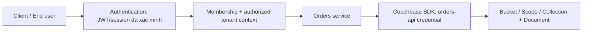
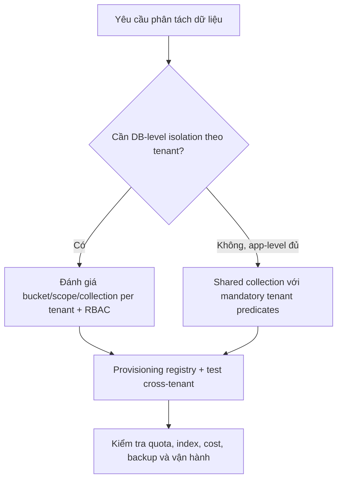
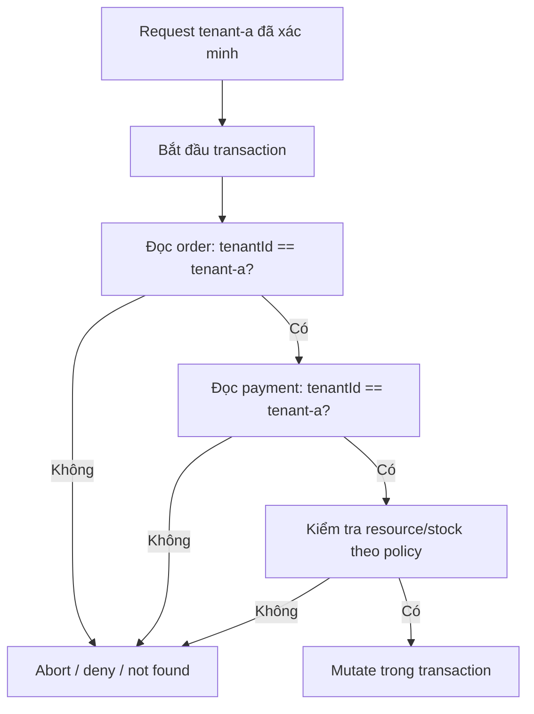
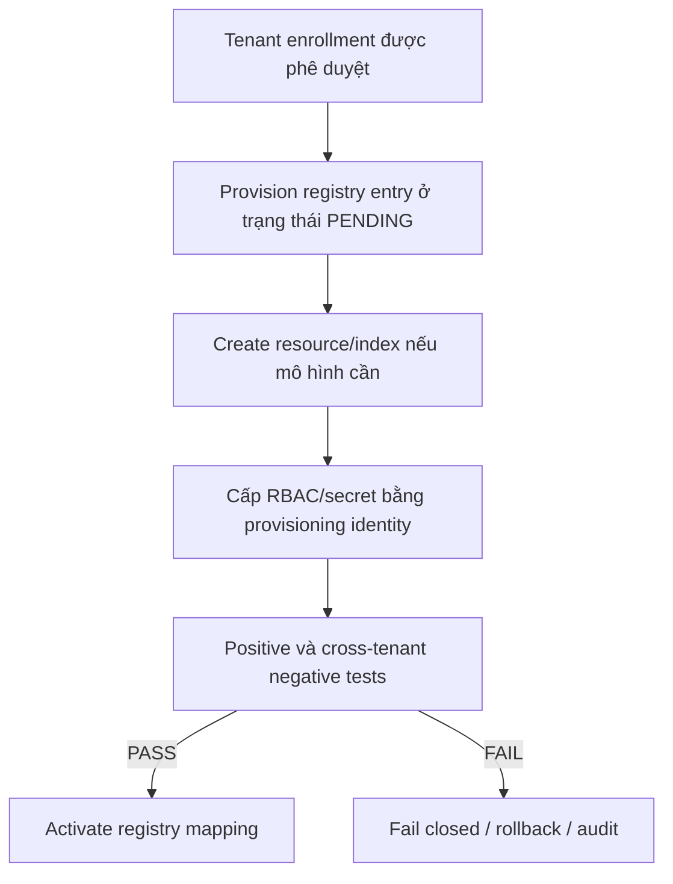

# Xác minh tenant và ngăn truy cập nhầm collection

## Mục tiêu bài học

Trong ứng dụng đa khách hàng (**multi-tenant**) dùng **Spring Data Couchbase**, một kết nối hợp lệ đến database **không có nghĩa** người dùng A được xem đơn hàng, session hay hóa đơn của người dùng B. Tài khoản `orders-api` có thể được cấp quyền đọc một **collection chung** cho nhiều tenant để phục vụ nghiệp vụ; vì vậy ứng dụng phải tự xác minh **ai là tenant đang được ủy quyền**, **document thuộc tenant nào**, và **đường truy cập đang trỏ tới bucket/scope/collection nào**.

Bài học thuộc chương **Bảo mật** của `SPRING_DATA_COUCHBASE`. Trọng tâm không phải cách tạo một username Couchbase mới mà là **bảo vệ ranh giới dữ liệu theo tenant trên tất cả API**: document mapping, `CouchbaseRepository`, `CouchbaseTemplate`, truy vấn SQL++, thao tác KV theo key, TTL/CAS, transaction và reactive API. Lỗi thường gặp là thêm điều kiện `tenantId` vào câu `SELECT` nhưng quên kiểm tra `findById` hoặc `deleteById`; một lỗi khác là cho phép đầu vào HTTP quyết định collection mà SDK sẽ sử dụng.

Sau khi học, bạn có thể:

- Phân biệt **tenant identity**, **người dùng cuối**, **service account Couchbase** và **RBAC theo collection**.
- Nhận diện **Broken Object Level Authorization (BOLA/IDOR)** và **cross-tenant data exposure**.
- Chọn kiến trúc **shared collection**, **collection/scope per tenant** hoặc **bucket per tenant** theo mức cô lập, chi phí vận hành và giới hạn sản phẩm.
- Xây dựng `VerifiedTenantContext` từ authentication và membership **được xác minh phía server**, không tin header, query parameter hay JSON field do client tự khai.
- Thiết kế collection resolver chỉ cho chọn **resource trong registry/allowlist đáng tin cậy**; tuyệt đối không nối raw bucket/scope/collection từ request.
- Kiểm tra tenant khi **KV GET, insert, replace, delete**, dùng **CAS** để tránh cập nhật trên bản đọc cũ; giữ `tenantId` bất biến.
- Ràng buộc `tenantId` vào **SQL++ parameters** và repository method; bảo đảm mọi nhánh query, count, page, export, batch job đều có chính sách tenant.
- Viết positive/negative tests phân biệt **app-level denial** với **Couchbase RBAC denial**, đồng thời tránh tiết lộ sự tồn tại của document tenant khác.
- Rà soát RBAC, audit, index, TTL, transaction metadata và quy trình cấp tenant mới trước khi triển khai.

> **Điều kiện nền:** Ví dụ dùng Couchbase Server hỗ trợ scope/collection (7.0+), bucket `training`, scope `commerce`, collection `orders`. Spring Boot/Java SDK 3.x và Spring Data Couchbase phải dùng bộ phiên bản tương thích. Dữ liệu minh họa hoàn toàn giả lập. **Đừng thực hiện phép thử cross-tenant bằng dữ liệu production**. Tên role/cấp quyền theo collection được nêu cho Server Enterprise/Capella có hỗ trợ; Community Edition có giới hạn RBAC.

## 1. Ba lớp danh tính không được đánh đồng

Một request đi qua ít nhất ba đối tượng:

1. **End user / client principal:** người hoặc hệ thống gọi HTTP API; danh tính của họ được xác minh bằng session/token/mTLS ở API gateway hoặc ứng dụng.
2. **Tenant:** tổ chức/không gian dữ liệu mà principal đang được quyền đại diện. Một người có thể thuộc **nhiều** tenant nhưng chỉ có một tenant đang được chọn cho mỗi request.
3. **Database identity:** tài khoản Couchbase (ví dụ `orders-api`) mà Spring Boot dùng để kết nối; nó thường có quyền truy cập **nhiều document của nhiều user/tenant** nếu dùng collection chung.



**Ví dụ:** Alice được phép dùng `tenant-a`. API có thể dùng cùng `orders-api` để phục vụ Alice và Bob của `tenant-b`. Khi Alice gọi `GET /orders/order::b-123`, Couchbase account vẫn có thể đọc document nếu cả hai tenant ở collection `orders`; **ứng dụng phải từ chối trước khi trả kết quả**.

### 1.1. BOLA/IDOR trong Couchbase

**Broken Object Level Authorization (BOLA)** xảy ra khi endpoint truy cập một đối tượng theo ID nhưng không xác minh người gọi có quyền với đối tượng đó. Trong Couchbase, document key như `order::a-1001` là **địa chỉ dữ liệu**, không phải một chứng cứ về quyền sở hữu.

**Các tình huống nguy hiểm:**

- `repository.findById(id)` trả đơn hàng theo một ID do client cung cấp, rồi controller trả toàn bộ JSON mà không kiểm tra `tenantId`.
- `repository.deleteById(id)` xóa trực tiếp document ở tenant khác.
- `CouchbaseTemplate` query theo `status` nhưng quên `tenantId`; một endpoint báo cáo có thể trả nhiều tenant.
- `PATCH /orders/{id}` nhận JSON với `tenantId` và dùng `save`, cho phép đổi chủ sở hữu giả tạo.
- Một tham số `collection=sessions` từ client được ghép vào `bucket.scope(collection)`, đưa cùng account ứng dụng sang dữ liệu khác.
- Batch export chạy bằng admin và không áp lại tenant filter của HTTP API.

**Phân biệt lỗi:** SQL++ được bind an toàn vẫn có thể gây rò dữ liệu nếu tenant ID lấy từ client chưa được ủy quyền. Ngược lại, Couchbase RBAC chỉ có quyền trên collection **không tự thực thi phân quyền từng document theo `tenantId`**.

### 1.2. Bộ bất biến cho truy cập tenant

Một hệ thống an toàn cần duy trì:

| Bất biến | Ý nghĩa |
| --- | --- |
| **Tenant được xác minh trước truy cập** | Không tạo `tenantContext` chỉ từ `X-Tenant-Id` hoặc JSON body. |
| **Collection được chọn từ cấu hình đáng tin** | Người gọi không gửi tên bucket/scope/collection để SDK dùng trực tiếp. |
| **Document có tenant owner không giả mạo được** | Tenant được gắn lúc tạo từ context server; update không được đổi tenant tùy ý. |
| **Mọi read/write kiểm tra cùng một tenant** | KV, SQL++, template, repository, batch và reactive đều phải tuân thủ. |
| **Quyền DB là lớp phụ** | RBAC collection-level giới hạn phạm vi account; app-level policy kiểm soát tenant trong collection chung. |
| **Chính sách thất bại an toàn (fail closed)** | Không xác minh được tenant hoặc không tìm thấy mapping → từ chối, không fallback `_default`. |
| **Không lộ thông tin cross-tenant** | Đối với ID ngoài quyền, phản hồi không tiết lộ document tồn tại, body hay metadata. |

Nguồn tham khảo: [OWASP API1:2023 Broken Object Level Authorization](https://owasp.org/API-Security/editions/2023/en/0xa1-broken-object-level-authorization/), [OWASP Authorization Cheat Sheet](https://cheatsheetseries.owasp.org/cheatsheets/Authorization_Cheat_Sheet.html).

## 2. Chọn mô hình cô lập tenant trước khi viết repository

Trong Couchbase, mô hình dữ liệu có thể tách theo **document**, **collection**, **scope** hoặc **bucket**. Không có một lựa chọn tối ưu cho mọi hệ thống: cần đối chiếu blast radius, quy mô tenant, RBAC và chi phí quản trị.

### 2.1. Ba mô hình phổ biến

| Mô hình | Ví dụ tài nguyên | Ưu điểm | Rủi ro / chi phí |
| --- | --- | --- | --- |
| **Shared collection** | `training.commerce.orders` chứa mọi tenant, mỗi document có `tenantId` | Ít tài nguyên schema/index; dễ query tổng hợp có kiểm soát | RBAC chỉ giới hạn collection, nên mọi API phải kiểm tra tenant trên từng thao tác; dễ BOLA. |
| **Collection hoặc scope per tenant** | `training.commerce.orders_a` và `orders_b`; hoặc scope riêng mỗi tenant | Có ranh giới resource rõ hơn; Enterprise/Capella hỗ trợ role collection/scope theo khả năng | Tăng số collection/scope, index/provisioning, migration và cấu hình; dễ chọn nhầm nếu routing sai. |
| **Bucket per tenant** | `tenant_a.orders`, `tenant_b.orders` | Cô lập quản trị/resource rõ hơn; có thể có policy/quotas riêng | Tốn tài nguyên, bucket/index/backup vận hành; cần quản lý limits và lifecycle. |

**Không suy từ tên cấp hierarchy rằng mỗi cấp tương đương một security domain hoàn chỉnh.** Một user có quyền `data_reader[training]` có thể vẫn đọc nhiều scope/collection thuộc bucket `training`. Một process dùng credential có quyền trên cả `orders_a` và `orders_b` vẫn có thể chọn nhầm collection, dù RBAC từng collection đã cấu hình.

### 2.2. Khi nào chọn shared collection?

Shared collection thường phù hợp khi số tenant lớn, mỗi tenant có ít dữ liệu, cùng schema, cùng retention policy và đội ngũ có khả năng thực thi/test **bắt buộc tenant predicate** cho mọi query/mutation.

**Điều kiện tối thiểu:**

- Mỗi document sở hữu tenant có field `tenantId` **không rỗng, không giả mạo, bất biến** trong vòng đời thông thường.
- API đọc theo ID phải kiểm tra ownership **sau KV GET nhưng trước khi đưa body ra ngoài**; update/delete phải kiểm tra ownership trước mutation.
- Query trên nhiều document phải có `WHERE o.tenantId = $tenantId`, với `$tenantId` do server xác minh.
- Export, scheduled job và administrative reports có ranh giới rõ: tenant-scoped hay cross-tenant operation có phê duyệt riêng.
- Chỉ mục ưu tiên tenant predicate và những bộ lọc/sort thực được hỗ trợ.
- Có negative tests với **hai tenant thật trong fixture**, không chỉ test một tenant.

Shared collection **không cung cấp database row-level RBAC** theo tenant. Nếu yêu cầu hợp đồng pháp lý đòi tách dữ liệu ở mức DB credential, cân nhắc tài nguyên/cấu hình riêng thay vì chỉ rely vào một điều kiện `tenantId` trong code.

### 2.3. Khi nào chọn per-tenant collection/scope/bucket?

Tách resource thích hợp khi cần giới hạn truy cập bằng role, data residency/lifecycle riêng, isolation cao hơn hoặc tenant có quy mô lớn. Tuy nhiên:

1. Kiểm tra **giới hạn số lượng bucket/scope/collection** theo Server version/Capella plan và năng lực cluster trước khi tạo một collection cho mỗi tenant.
2. Index/backup/monitoring/migration thường cần được quản lý theo nhiều resources; tổng chi phí tăng theo số tenant.
3. Không tạo scope/collection **ngay trong request HTTP** bằng account ứng dụng. Quy trình onboarding qua provisioning identity được phê duyệt, có retry/idempotency/audit.
4. Xác định resource mapping từ một **tenant registry đáng tin**, không suy từ một header người dùng chưa xác thực.
5. Nếu vẫn chia sẻ một `Cluster`/credential có quyền trên tất cả tenant resources, lỗi routing có thể đọc chéo. **Credential riêng per tenant hoặc per security boundary** tạo lớp bảo vệ bổ sung nhưng cũng tăng chi phí quản lý secrets/connection pools.

### 2.4. Quyết định theo threat model



Trong cả hai nhánh, **authentication và tenant authorization ở API vẫn bắt buộc**. Khả năng chỉ đọc một collection bằng account Couchbase không tự xác minh end user có quyền dùng collection đó.

Nguồn: [Couchbase Server — Scopes and Collections](https://docs.couchbase.com/server/current/learn/data/scopes-and-collections.html), [Couchbase Server — Roles](https://docs.couchbase.com/server/current/learn/security/roles.html).

## 3. Xây dựng tenant context từ danh tính đã xác minh

### 3.1. Không tin đầu vào do client tự tuyên bố

Các nguồn dưới đây đều là **request data**, không đủ để tự trở thành tenant đáng tin:

```text
GET /orders?tenantId=tenant-b
X-Tenant-Id: tenant-b
POST /orders {"tenantId":"tenant-b","status":"NEW"}
GET /tenants/tenant-b/orders
```

Một API có thể cho phép client chọn `tenant-b` trong URL nếu người dùng thuộc nhiều tenant, nhưng server phải **xác minh quyền chọn tenant-b trước**. Việc dùng `@RequestParam String tenantId` rồi bind trực tiếp vào SQL++ không giải quyết authorization.

### 3.2. Hai tình huống xác minh

**Tình huống A — mỗi principal thuộc một tenant:** Sau khi hệ thống xác thực token/session, tenant ID lấy từ claims hoặc server-side user record đã xác minh. Claim token chỉ đáng tin khi resource server kiểm tra **signature**, **issuer**, **audience**, **expiry**, trạng thái token và policy phát hành liên quan. Với JWT, “decode Base64 và lấy `tenant_id`” **không phải xác minh token**.

**Tình huống B — một principal thuộc nhiều tenant:** Client có thể gửi tenant đang được chọn; backend phải đối chiếu với membership/role entitlement hợp lệ:

```text
principal = user-17
allowedTenants = [tenant-a, tenant-c]   <- lấy từ authorization service đáng tin
requestedTenant = tenant-b              <- HTTP input
=> DENY (không thuộc membership)

requestedTenant = tenant-c
=> ALLOW sau khi kiểm tra account role + membership hiện hành
```

Khi membership có thể bị thu hồi giữa vòng đời JWT, đánh giá TTL của claim, authorization cache, token revocation và server-side membership lookup. **Token hợp lệ về chữ ký vẫn có thể chứa quyền đã cũ**; lựa chọn phụ thuộc yêu cầu rủi ro và thời gian thu hồi của sản phẩm.

### 3.3. Định nghĩa context bất biến theo request

```java
package com.example.orders.security;

public record VerifiedTenantContext(String tenantId, String principalId) {
    public VerifiedTenantContext {
        if (tenantId == null || tenantId.isBlank()
                || principalId == null || principalId.isBlank()) {
            throw new IllegalArgumentException(
                "Verified tenant and principal are required");
        }
    }
}
```

**Chú ý:** `record` chỉ giúp **bất biến dữ liệu**, **không tự xác thực quyền**. Object này **chỉ được khởi tạo sau khi** authentication và tenant membership/permission check thành công; không tạo bằng `new VerifiedTenantContext(request.tenantId(), request.userId())` ở Controller. Trong hệ thống có rủi ro cao, giới hạn quyền tạo context qua lớp resolver/factory nội bộ và kiểm thử boundary.

Một hợp đồng resolver an toàn:

```java
package com.example.orders.security;

import org.springframework.security.core.Authentication;

public interface VerifiedTenantResolver {
    // requestedTenantId có thể null nếu sản phẩm chỉ có 1 tenant/user.
    // Implement phải kiểm tra principal và tenant membership/roles thật.
    VerifiedTenantContext resolve(
        Authentication authenticatedPrincipal,
        String requestedTenantId
    );
}
```

Đây là **interface thiết kế**, không phải một implementation có sẵn trong Spring Data Couchbase. Nếu dự án dùng Spring Security, `Authentication` đến từ security context đã xác minh; giải pháp triển khai phải kiểm tra cả `isAuthenticated()` và policy entitlement tương ứng. Nếu dự án không dùng Spring Security, đổi kiểu đối số sang một kiểu principal đã xác minh của hệ thống, **không dùng raw header**.

### 3.4. Chọn phản hồi 403 hay 404?

- Nếu user chưa đăng nhập/xác thực: theo hợp đồng API, thường trả **401**.
- Nếu user không có quyền truy cập tenant được chỉ định: có thể trả **403**, nếu điều đó không tiết lộ tài nguyên nhạy cảm.
- Khi request tham chiếu **ID document của tenant khác**, thường dùng phản hồi **404 giống document không tồn tại** để tránh kênh dò đoán ID/tenant.
- Các lỗi network, DB authorization, timeout và malformed input phải được phân loại phù hợp; **không trả 404 cho mọi exception** rồi che hệ thống bị lỗi.

Tính nhất quán của thông điệp, response body, logging và timing nên được review theo threat model; không đưa `tenantId` của chủ sở hữu thật vào lỗi phản hồi.

Nguồn: [OWASP Multi Tenant Security Cheat Sheet](https://cheatsheetseries.owasp.org/cheatsheets/Multi_Tenant_Security_Cheat_Sheet.html), [OWASP Authentication Cheat Sheet](https://cheatsheetseries.owasp.org/cheatsheets/Authentication_Cheat_Sheet.html).

## 4. Ngăn route sang nhầm bucket/scope/collection

### 4.1. Anti-pattern: nối resource identifier từ request

```java
// KHÔNG LÀM — mọi giá trị dưới đây đều chưa được xác minh:
String bucketName = request.getParameter("bucket");
String scopeName = request.getParameter("scope");
String collectionName = request.getParameter("collection");

var collection = cluster.bucket(bucketName)
    .scope(scopeName)
    .collection(collectionName);
```

Vấn đề ở đây không chỉ là SQL++ injection. Với KV SDK, `collection(...)` nhận một **tên resource thật**, nên nếu database credential có quyền trên nhiều collection, client có thể khiến API đọc nhầm collection bằng một **lỗi authorization logic**. Với SQL++, tên keyspace trong `FROM` cũng là **cấu trúc query**, không thể thay trực tiếp bằng một named parameter như `$collection`.

### 4.2. Phương án A: resource cố định cho shared collection

Đối với shared collection, định danh resource nên do app/deployment xác định:

```java
package com.example.orders.storage;

import com.couchbase.client.java.Cluster;
import com.couchbase.client.java.Collection;
import org.springframework.beans.factory.annotation.Value;
import org.springframework.stereotype.Component;

@Component
public final class OrdersCollectionProvider {
    private final Collection orders;

    public OrdersCollectionProvider(
            Cluster cluster,
            @Value("${spring.data.couchbase.bucket-name}") String bucketName) {
        this.orders = cluster.bucket(bucketName)
            .scope("commerce")
            .collection("orders");
    }

    public Collection orders() {
        return orders;
    }
}
```

Không có `collectionName`, `scopeName` hoặc `bucketName` nào đến từ Controller request. `bucketName` là config đáng tin của environment; ở production cần validate deployment target tránh nhầm cluster/bucket. Một repository có `@Scope("commerce")` và `@Collection("orders")` cũng lựa chọn resource mặc định, nhưng **annotation không tự chứng minh tenant ownership**.

### 4.3. Phương án B: registry cho per-tenant collection

Khi mỗi tenant có collection riêng, một **tenant registry được quản trị** ánh xạ tenant đã xác minh sang resource:

```java
package com.example.orders.storage;

import com.couchbase.client.java.Cluster;
import com.couchbase.client.java.Collection;
import java.util.Map;
import java.util.NoSuchElementException;

public final class TenantCollectionRouter {
    // Chỉ minh họa: production lấy registry đã xác thực/kiểm soát
    // từ config/provisioning store, không lấy từ HTTP request.
    private static final Map<String, String> ORDER_COLLECTIONS = Map.of(
        "tenant-a", "orders_a",
        "tenant-b", "orders_b"
    );
    private final Cluster cluster;

    public TenantCollectionRouter(Cluster cluster) {
        this.cluster = cluster;
    }

    public Collection ordersForVerifiedTenant(String verifiedTenantId) {
        String collection = ORDER_COLLECTIONS.get(verifiedTenantId);
        if (collection == null) {
            throw new NoSuchElementException("Tenant resource unavailable");
        }
        return cluster.bucket("training")
            .scope("commerce")
            .collection(collection);
    }
}
```

**Quan trọng:** Phương thức nhận `verifiedTenantId` đã đi qua `VerifiedTenantResolver`, không nhận raw `request.tenantId`. `Map.of` chỉ mô tả **allowlist**, không phải phương án lưu registry quy mô lớn. Trong production registry cần owner, audit, mapping version, trạng thái onboarding/offboarding, khóa tenant bị đình chỉ và kiểm tra drift của tên resource. Không fallback về `_default._default` hoặc `orders` khi không tìm thấy tenant.

### 4.4. Kiểm tra quyền của database identity

Nếu một account `orders-api` có cả `data_reader[training:commerce:orders_a]` và `data_reader[training:commerce:orders_b]`, registry giúp giảm lỗi nhưng **không ngăn mã độc trong cùng process gọi `orders_b`**. Nếu threat model đòi ranh giới **ở cấp credential**, dùng account/role riêng cho từng tenant hoặc security boundary, với secret/connection lifecycle được quản lý. Không nhân bản hàng nghìn connections một cách tùy tiện; kiểm tra tải, chi phí và khả năng hỗ trợ của plan trước khi chọn.

Nguồn: [Couchbase Java SDK — Collections](https://docs.couchbase.com/java-sdk/current/howtos/working-with-collections.html), [Couchbase Server — Roles and Privileges](https://docs.couchbase.com/server/current/learn/security/roles.html).

## 5. KV GET: kiểm tra ownership trước khi trả dữ liệu

Đường KV `collection.get(documentId)` đọc trực tiếp theo key, **không chạy `WHERE tenantId = ...`**. `CouchbaseRepository.findById` cũng thường sử dụng KV. Với **shared collection**, tất cả document có thể được đọc bởi cùng database account có Data Reader, nên ứng dụng bắt buộc kiểm tra tenant của document.

### 5.1. Cách làm dễ mắc lỗi

```java
// KHÔNG LÀM: không có tenant ownership check.
@GetMapping("/orders/{id}")
public Order getOne(@PathVariable String id) {
    return repository.findById(id).orElseThrow();
}
```

Một attacker đoán/biết ID hợp lệ của tenant khác có thể nhận được document nếu repository chạy dưới tài khoản có quyền trên collection. **Khóa khó đoán (UUID)** làm giảm khả năng đoán nhưng **không thay thế authorization**; ID có thể bị lộ qua logs, referrer, email hoặc dữ liệu liên kết.

### 5.2. Service kiểm tra owner và không làm lộ body

Ví dụ một service dùng collection cố định từ `OrdersCollectionProvider` ở mục 4, nhận `VerifiedTenantContext` đã được resolve ở security boundary:

```java
package com.example.orders.service;

import com.couchbase.client.core.error.DocumentNotFoundException;
import com.couchbase.client.java.Collection;
import com.couchbase.client.java.json.JsonObject;
import com.example.orders.security.VerifiedTenantContext;
import com.example.orders.storage.OrdersCollectionProvider;
import org.springframework.stereotype.Service;
import java.util.NoSuchElementException;
import java.util.Objects;

@Service
public final class TenantOrderReader {
    public record OrderView(String id, String status, Long total) {}

    private final Collection orders;

    public TenantOrderReader(OrdersCollectionProvider provider) {
        this.orders = provider.orders();
    }

    public OrderView getOne(
            String documentId, VerifiedTenantContext tenant) {
        Objects.requireNonNull(tenant, "Verified tenant required");
        if (documentId == null || documentId.isBlank()) {
            throw new IllegalArgumentException("Document ID required");
        }

        JsonObject body;
        try {
            body = orders.get(documentId).contentAsObject();
        } catch (DocumentNotFoundException ex) {
            throw new NoSuchElementException("Order not found");
        }

        // Trước thời điểm này KHÔNG serialize hoặc log body ra HTTP.
        if (!tenant.tenantId().equals(body.getString("tenantId"))) {
            throw new NoSuchElementException("Order not found");
        }
        return new OrderView(
            documentId, body.getString("status"), body.getLong("total")
        );
    }
}
```

**Lý do dùng cùng thông điệp “Order not found”:** Khi ID thuộc tenant khác, trả nội dung/owner/“belongs to tenant-b” sẽ tạo **existence oracle**. Một HTTP exception handler có thể map `NoSuchElementException` thành cùng response **404** với document không tồn tại. Không bắt mọi exception thành 404: network timeout, KV permission denied và lỗi Server cần được xử lý/giám sát riêng.

**Giới hạn của shared collection:** Đoạn code đã đọc body tenant khác **vào bộ nhớ server** trước khi kiểm tra, vì KV GET không có predicate theo document field. Vì vậy cần tuyệt đối không log/tracing raw body và không có side effect trước check. Nếu điều này không chấp nhận theo threat model, tách resource hoặc dùng tầng đọc không cung cấp KV trực tiếp theo ID từ tập dữ liệu chung.

### 5.3. Kết nối Controller với tenant resolver

```java
// Bên trong một Spring @RestController đã có constructor injection:
// tenantResolver: VerifiedTenantResolver do ứng dụng triển khai;
// tenantOrderReader: service ở trên.
@GetMapping("/orders/{id}")
public TenantOrderReader.OrderView getOne(
        @PathVariable String id,
        org.springframework.security.core.Authentication authentication) {
    VerifiedTenantContext tenant = tenantResolver.resolve(
        authentication, null
    );
    return tenantOrderReader.getOne(id, tenant);
}
```

Đây là **snippet method**, không phải class Java độc lập. Trong kiến trúc có user thuộc nhiều tenant, truyền `requestedTenantId` từ route **qua resolver để xác minh membership trước**, không truyền trực tiếp vào `getOne`. Không expose `TenantOrderReader` hoặc `OrderRepository` như endpoint gọi trực tiếp mà bypass tenant resolver.

## 6. KV CREATE/UPDATE/DELETE: không để client sửa tenant

Đọc là một nửa bài toán. Các thao tác ghi còn nguy hiểm hơn: attacker có thể **tạo document thuộc tenant khác**, **đổi tenantId của document**, **xóa document** hoặc **ghi đè document đã thay đổi**.

### 6.1. CREATE: gắn tenant từ server, không từ payload

DTO cho phép client gửi các trường nghiệp vụ, **không có `tenantId` hoặc keyspace**:

```java
package com.example.orders.api;

public record CreateOrderRequest(String status, long total) {}
```

Service tạo document:

```java
// Method của service đã có "Collection orders" và VerifiedTenantContext tenant.
public String create(CreateOrderRequest payload, VerifiedTenantContext tenant) {
    if (!java.util.Set.of("NEW", "PAID").contains(payload.status())
            || payload.total() < 0) {
        throw new IllegalArgumentException("Invalid order data");
    }

    String id = "order::" + java.util.UUID.randomUUID();
    var body = com.couchbase.client.java.json.JsonObject.create()
        .put("tenantId", tenant.tenantId())
        .put("status", payload.status())
        .put("total", payload.total());

    orders.insert(id, body);
    return id;
}
```

**Giới hạn ví dụ:** Đây là đoạn method để đặt vào service đã được cấu hình collection, không phải code class hoàn chỉnh. `tenant` được resolve/authorized server-side trước khi gọi. Với nghiệp vụ thực tế, kiểm tra quyền được tạo loại đơn hàng, quota và idempotency key. `UUID` giúp tạo ID khó đoán nhưng **không cung cấp row-level RBAC**. `Collection.insert` không cho phép ghi đè một key đã tồn tại; nếu cần idempotent create, phải thiết kế cơ chế idempotency riêng, không chuyển tùy tiện sang `upsert`.

### 6.2. UPDATE: đọc → kiểm tra owner → CAS replace

`CAS (Compare-And-Swap)` giúp bảo đảm document chưa bị thay đổi kể từ lần đọc. Để cập nhật status trong **shared collection**:

```java
import com.couchbase.client.java.kv.ReplaceOptions;
import com.couchbase.client.core.error.DocumentNotFoundException;

// Method của service dùng Collection orders và VerifiedTenantContext tenant.
public void changeStatus(String id, String newStatus,
                         VerifiedTenantContext tenant) {
    if (!java.util.Set.of("NEW", "PAID", "CANCELLED")
            .contains(newStatus)) {
        throw new IllegalArgumentException("Invalid status");
    }

    var fetched = orders.get(id);
    var body = fetched.contentAsObject();
    if (!tenant.tenantId().equals(body.getString("tenantId"))) {
        throw new java.util.NoSuchElementException("Order not found");
    }

    // Không lấy tenantId từ payload; chỉ cập nhật field cho phép.
    body.put("status", newStatus);
    orders.replace(
        id, body, ReplaceOptions.replaceOptions().cas(fetched.cas())
    );
}
```

**Tại sao không dùng `repository.save` với JSON đầy đủ do client gửi?** Nếu DTO tự mang `tenantId`, `id` và nhiều field khác, attacker có thể ghi đè sở hữu hoặc dữ liệu không được phép sửa. Cách an toàn là **chỉ nhận các field nghiệp vụ được phép**, đọc trạng thái hiện tại, xác minh tenant, rồi mutate dưới cơ chế concurrency thích hợp.

**CAS không phải authorization:** CAS chỉ kiểm tra phiên bản document. Nếu dùng `replace` bằng CAS nhưng bỏ kiểm tra `tenantId`, thao tác vẫn có thể cập nhật document tenant khác nếu client lấy được CAS hoặc server lấy CAS thay họ. Cần cả **ownership check + CAS**.

**Race condition:** Nếu writer khác có thể đổi `tenantId` giữa lúc đọc và ghi, CAS khiến replace dựa trên phiên bản cũ thất bại **nếu mọi thay đổi document đều cập nhật CAS**; không auto-retry mù quáng. Cần bảo đảm `tenantId` bất biến bằng policy và kiểm soát mọi writer. Khi gặp `CasMismatchException`, trả **409 Conflict** hoặc thực hiện retry có giới hạn, **đọc lại và xác minh tenant ở mỗi lần retry**.

### 6.3. DELETE: xác minh rồi remove có CAS

```java
import com.couchbase.client.java.kv.RemoveOptions;

// Chỉ chạy từ handler đã resolve VerifiedTenantContext.
public void delete(String id, VerifiedTenantContext tenant) {
    var fetched = orders.get(id);
    if (!tenant.tenantId().equals(
            fetched.contentAsObject().getString("tenantId"))) {
        throw new java.util.NoSuchElementException("Order not found");
    }
    orders.remove(id, RemoveOptions.removeOptions().cas(fetched.cas()));
}
```

**Không gọi `repository.deleteById(id)` trực tiếp từ HTTP** nếu dùng shared collection và chưa xác minh owner. Tùy workflow, cần thêm kiểm tra trạng thái đơn hàng/retention policy trước khi xóa; nếu `CAS` mismatch, không được tiếp tục xóa theo `id` mà bỏ kiểm tra phiên bản.

### 6.4. Ràng buộc ở tầng schema và repository

Trong entity, tránh public setter tự do cho `tenantId` nếu có thể. Có thể đánh dấu thuộc tính chỉ tạo lúc khởi tạo; nhưng **bất biến Java không đủ** nếu SQL++ UPDATE, template hoặc batch job khác vẫn có quyền thay document JSON. Cần chính sách nhất quán cho **mọi writer**, test negative và audit hành vi thay đổi owner.

Nếu có chức năng **chuyển tenant** (ví dụ chuyển sở hữu dữ liệu khi sáp nhập tổ chức), coi đây là **quy trình admin nghiệp vụ riêng**: xác minh hai phía, approval, giao dịch/migration, mapping ID, audit và khả năng rollback. Không cho phép thực hiện chỉ bằng `PATCH /orders/{id} {"tenantId":"..."}`.

### 6.5. TTL, CAS và soft delete

- **TTL**: document hết hạn sẽ không còn được đọc; không suy 404 là đúng quyền tenant. Đối với session/token, tenant check và owner check vẫn cần **trước khi hết hạn**.
- **CAS**: giúp bảo vệ optimistic concurrency; không kiểm tra tenant, role hoặc danh tính end user.
- **Soft delete**: query/repository có thể cần thêm `deleted = false`; điều kiện này **bổ sung**, không thay `tenantId`. Không để soft-deleted record của tenant khác xuất hiện qua report, export hay admin endpoint không kiểm soát.
- **Append-only event data**: nếu event chứa `tenantId`, bảo đảm mọi consumer/search/index và subscriber cũng lọc theo tenant thay vì chỉ dựa vào API tạo event.

Nguồn: [Couchbase Java SDK — KV Operations](https://docs.couchbase.com/java-sdk/current/howtos/kv-operations.html), [Concurrent Document Mutations](https://docs.couchbase.com/java-sdk/current/howtos/concurrent-document-mutations.html).

## 7. SQL++: tenant predicate bắt buộc và parameter hóa

Đối với SQL++ trên shared collection, không thể dựa vào việc `Query Select` đã cấp. **Mỗi truy vấn nghiệp vụ của tenant phải có điều kiện tenant được lấy từ context đã xác minh**.

### 7.1. SELECT an toàn trong Java SDK

```java
import com.couchbase.client.java.Cluster;
import com.couchbase.client.java.json.JsonObject;
import com.couchbase.client.java.query.QueryOptions;
import java.util.List;

// verifiedTenantId do server-side authorization resolver cung cấp.
public List<JsonObject> listOrders(
        Cluster cluster,
        String verifiedTenantId,
        String status,
        int limit) {
    if (verifiedTenantId == null || verifiedTenantId.isBlank()) {
        throw new IllegalArgumentException("Tenant must be verified");
    }
    if (!java.util.Set.of("NEW", "PAID", "CANCELLED").contains(status)) {
        throw new IllegalArgumentException("Invalid status");
    }
    if (limit < 1 || limit > 100) {
        throw new IllegalArgumentException("Invalid limit");
    }

    String statement = """
        SELECT META(o).id AS documentId, o.status, o.createdAt, o.total
        FROM `training`.`commerce`.`orders` AS o
        WHERE o.tenantId = $tenantId AND o.status = $status
        ORDER BY o.createdAt DESC, META(o).id ASC
        LIMIT $limit
        """;

    return cluster.query(statement, QueryOptions.queryOptions()
        .parameters(JsonObject.create()
            .put("tenantId", verifiedTenantId)
            .put("status", status)
            .put("limit", limit))
        .readonly(true)
    ).rowsAsObject();
}
```

**Điểm cốt lõi:** `$tenantId` là **parameter value**; `"tenantId"` trong `JsonObject` **không có dấu `$`**. Đừng tạo:

```java
// KHÔNG LÀM:
String query = "SELECT o.* FROM `training`.`commerce`.`orders` AS o " +
    "WHERE o.tenantId = '" + requestTenantId + "'";
```

Chuỗi client gửi có thể thay đổi cú pháp (SQL++ injection). Ngay cả khi bind đúng, nếu `requestTenantId` chưa được membership-check, attacker vẫn có thể yêu cầu **tenant-b** mà họ không được phép.

### 7.2. Query DML phải có điều kiện tenant

Nếu ứng dụng thực sự dùng **SQL++ UPDATE** thay vì KV:

```sql
-- Câu lệnh minh họa, chỉ thực thi với tenantId đã xác minh.
UPDATE `training`.`commerce`.`orders` AS o
USE KEYS $id
SET o.status = $newStatus
WHERE o.tenantId = $tenantId;
```

Ở đây `$id`, `$newStatus` và `$tenantId` đều là **values**. Câu lệnh không được mutate document của tenant khác chỉ vì người gọi biết ID. Tuy nhiên service account phải có **Query Update** phù hợp; **Data Writer (KV)** không tự cấp quyền SQL++ UPDATE. Hãy kiểm tra số document bị ảnh hưởng và quyết định trả 404/409 theo API contract, không tiết lộ record của tenant khác.

**Không chạy ví dụ mutation trên production** chỉ để chứng minh tenant restriction. Dùng fixture test, một account có quyền đúng thao tác và negative assertions xác nhận dữ liệu tenant khác không đổi. Khi transaction/KV mutation, cần điều kiện owner tương đương.

### 7.3. Query nhiều collection và JOIN

Ví dụ `orders` JOIN `payments`:

```sql
SELECT META(o).id AS orderId, o.status, p.amount
FROM `training`.`commerce`.`orders` AS o
JOIN `training`.`commerce`.`payments` AS p
  ON p.orderId = META(o).id
 AND p.tenantId = o.tenantId
WHERE o.tenantId = $tenantId
LIMIT $limit;
```

**Hai lớp phải đúng:** `o.tenantId = $tenantId` giới hạn orders theo context, còn `p.tenantId = o.tenantId` ngăn join một payment thuộc tenant khác (nếu ID bị trùng hoặc dữ liệu sai). Chỉ có `WHERE o.tenantId = $tenantId` **không đủ** nếu join predicate không chứa tenant mà dữ liệu có thể liên kết chéo. Query Select cũng phải được cấp trên **các collection thật sự cần** (orders và payments); không mở Query Select toàn cluster chỉ để JOIN hoạt động.

### 7.4. Count, search, pagination, export và hệ thống báo cáo

Nếu API hỗ trợ tìm kiếm/phân trang:

- `COUNT(*)` phải có cùng `tenantId` và các filters nghiệp vụ với query trả page; không đếm cả tenant khác làm lộ số lượng record.
- Sort fields và `ASC/DESC` phải được lấy từ allowlist ở service; SQL++ placeholders **không thay trực tiếp identifier hoặc keyword**.
- `LIMIT/OFFSET` là giá trị có thể bind nhưng phải giới hạn; offset sâu có thể tốn kém. Dùng tie-breaker unique để paging ổn định.
- Exports, CSV, asynchronous jobs và admin reports cần tenant policy **độc lập với request HTTP**. Job `exportTenant(tenant)` phải xác minh ai đã ủy quyền export; không tin một tenant string nằm trong hàng đợi.
- Cursor pagination phải được ràng buộc với tenant/filter/sort và có expiry/validation. Không nhận một cursor tự sửa cho phép chuyển sang tenant khác.

### 7.5. Index theo tenant để giảm chi phí

Một index minh họa cho query theo tenant + status + thời gian:

```sql
-- Chỉ do migration/provisioning job có quyền index thực hiện.
CREATE INDEX idx_orders_tenant_status_created
ON `training`.`commerce`.`orders`
    (tenantId, status, createdAt DESC);
```

**Điều kiện tenant không chỉ có ý nghĩa bảo mật**, nó cũng giúp index lựa chọn ít rows hơn nếu index phù hợp. Nhưng có index theo `tenantId` **không tự chèn tenant predicate** vào query: backend vẫn phải gửi điều kiện đúng. Kiểm tra `EXPLAIN`/plan, scan consistency và response latency cho từng query type; không trao quyền `Query Manage Index` cho runtime chỉ để query chạy.

Nguồn: [Couchbase Java SDK — SQL++ Queries](https://docs.couchbase.com/java-sdk/current/howtos/sqlpp-queries-with-sdk.html), [Couchbase Server — CREATE INDEX](https://docs.couchbase.com/server/current/n1ql/n1ql-language-reference/createindex.html), [Couchbase Server — JOIN](https://docs.couchbase.com/server/current/n1ql/n1ql-language-reference/join.html).

## 8. Spring Data Repository: đảm bảo mọi method có tenant boundary

### 8.1. Entity của shared collection

```java
package com.example.orders.domain;

import org.springframework.data.annotation.Id;
import org.springframework.data.couchbase.core.mapping.Document;
import org.springframework.data.couchbase.core.mapping.Scope;
import org.springframework.data.couchbase.core.mapping.Collection;

@Document
@Scope("commerce")
@Collection("orders")
public class Order {
    @Id
    private String id;
    private String tenantId;
    private String status;
    private String createdAt;
    private Long total;

    protected Order() {}

    public String getId() { return id; }
    public String getTenantId() { return tenantId; }
    public String getStatus() { return status; }
    public String getCreatedAt() { return createdAt; }
    public Long getTotal() { return total; }
}
```

Không có public setter `setTenantId(...)` là một **bước giúp giảm bug**, nhưng không phải ranh giới tuyệt đối nếu code khác vẫn sử dụng reflection, template, KV SDK hoặc SQL++ UPDATE. Cần áp policy tenant tại **service/data-access boundary**, không chỉ tin vào entity setter.

### 8.2. Derived query/inline query có điều kiện tenant

```java
package com.example.orders.domain;

import java.util.List;
import org.springframework.data.couchbase.repository.CouchbaseRepository;
import org.springframework.data.couchbase.repository.Query;
import org.springframework.data.repository.query.Param;

public interface OrderRepository
        extends CouchbaseRepository<Order, String> {

    // Spring Data tạo WHERE dựa trên các property entity.
    List<Order> findByTenantIdAndStatus(
        String tenantId, String status);

    // Inline query: tenantId và status đều là bound parameters.
    @Query("#{#n1ql.selectEntity} WHERE #{#n1ql.filter} " +
           "AND tenantId = $tenantId AND status = $status")
    List<Order> findByTenantAndStatusQuery(
        @Param("tenantId") String tenantId,
        @Param("status") String status);
}
```

**Không gọi repository trực tiếp từ Controller với tenant ID do user chọn.** Tạo một wrapper service:

```java
// Method của service có OrderRepository repository đã inject.
public java.util.List<Order> listByStatus(
        VerifiedTenantContext tenant, String status) {
    if (!java.util.Set.of("NEW", "PAID", "CANCELLED").contains(status)) {
        throw new IllegalArgumentException("Invalid status");
    }
    return repository.findByTenantIdAndStatus(tenant.tenantId(), status);
}
```

**Lưu ý quan trọng:** `repository.findById(id)` và `repository.deleteById(id)` được kế thừa từ `CouchbaseRepository` **không tự thêm điều kiện tenant**. Khi dùng shared collection, đừng expose trực tiếp chúng ở API; phải đi qua ownership-check service (mục 5–6), hoặc thiết kế repository/data-access adapter chỉ cho phép thao tác tenant-safe. Tương tự, `findAll()` và `deleteAll()` là những method đặc biệt nguy hiểm khi account có quyền trên shared collection.

Spring Data có thể thêm filter metadata entity như `_class`. Nếu document được seed trực tiếp bằng KV không có metadata tương ứng, repository query có thể trả rỗng dù raw SQL++ trả dữ liệu. **Đừng xóa `tenantId`/type filter để “làm query chạy”**; hãy xác minh entity mapping, dữ liệu seed và statement thực sự được sinh.

### 8.3. Base repository không phải chính sách bảo mật

Việc khai báo `OrderRepository extends CouchbaseRepository<Order, String>` tự mang nhiều inherited methods. Có thể giấu bớt các method khỏi API cấp cao bằng repository interface hẹp/custom adapter, nhưng điều đó **không tự chặn** mã khác trong process gọi SDK trực tiếp khi có database credential.

Định nghĩa hợp đồng an toàn ở service:

```text
getOrder(verifiedTenant, id)
listOrders(verifiedTenant, filters, safeSort)
createOrder(verifiedTenant, validatedDto)
changeOrderStatus(verifiedTenant, id, validatedStatus, expectedVersion)
deleteOrder(verifiedTenant, id)
```

Không thiết kế public service API như `getById(id)`, `save(userSuppliedOrder)` hoặc `listAll()` nếu đó là API tenant-scoped. Với người quản trị toàn tổ chức cần xem nhiều tenant, tạo **separate use case** và authorization rõ ràng, không thêm cờ boolean `ignoreTenant=true` do HTTP điều khiển.

Nguồn: [Spring Data Couchbase — Repository Support](https://docs.spring.io/spring-data/couchbase/reference/couchbase/repository.html), [Spring Data Couchbase — Collection Support](https://docs.spring.io/spring-data/couchbase/reference/couchbase/collections.html).

## 9. CouchbaseTemplate, reactive APIs và context propagation

### 9.1. `CouchbaseTemplate` không tự thêm tenant condition

`CouchbaseTemplate` và các fluent operations hỗ trợ nhiều cách đọc/ghi document, nhưng **không có bảo đảm chung** rằng mọi thao tác trên một entity sẽ tự thêm điều kiện `tenantId` theo HTTP principal. Ví dụ, code gọi `findByQuery(Order.class)` để lấy toàn bộ entities và bỏ tenant filter có thể trả dữ liệu nhiều tenant:

```java
// KHÔNG tạo endpoint tenant-scoped trả tất cả entities như thế này.
var allOrders = couchbaseTemplate.findByQuery(Order.class).all();
```

Framework có thể áp type metadata (`_class`) và mapping, nhưng **type filter không phải tenant filter**. Đối với template query, phải thêm tiêu chí `tenantId` từ `VerifiedTenantContext` và giới hạn kết quả theo API của phiên bản Spring Data. Nếu không chắc fluent API đang sinh SQL++ gì, bật **query statement tracing trong test có kiểm soát**, kiểm tra generated statement và tham số sau khi **redact**; không chấp nhận một query chỉ có `WHERE status = ...` mà thiếu tenant.

Với template **KV by id**, nguyên tắc giống mục 5: GET không nhận tenant predicate; phải kiểm tra owner trong kết quả trước khi phản hồi và trước mọi mutation.

### 9.2. Reactive không biến tenant context thành dữ liệu tin cậy

`ReactiveCouchbaseRepository`, `ReactiveCouchbaseTemplate` và Java SDK reactive API chỉ thay đổi **mô hình thực thi bất đồng bộ**, không thay ranh giới RBAC hoặc ownership. Một `Mono<Order>` chứa document tenant khác vẫn là rò rỉ nếu được serialize ra HTTP.

Một nguy cơ trong reactive code là lưu `tenantId` vào một **ThreadLocal` rồi giả định Reactor luôn chạy trên cùng thread. Reactor có thể chuyển scheduler/thread; context có thể thất lạc hoặc bị sử dụng sai khi truyền qua callback.

**Hướng triển khai:**

1. Xác minh authentication/tenant membership trong security layer cho request.
2. Giữ `VerifiedTenantContext` như một **tham số tường minh** qua service methods, hoặc dùng **Reactor Context / ReactiveSecurityContextHolder** theo cơ chế được hỗ trợ.
3. Với KV reactive `get`, kiểm tra field `tenantId` **trong pipeline trước khi map sang response**; không dùng `doOnNext` để log raw document trước khi kiểm tra.
4. Với reactive SQL++ query, bind `$tenantId` từ context đã xác minh; không đọc tenant từ raw request trong một operator về sau.
5. Đừng dùng `subscribe()` thủ công trong controller chỉ để khởi chạy một mutation nằm ngoài lifecycle/authorization của request. Trả publisher đúng cách và kiểm soát cancellation/retry.
6. Khi retry do CAS/network, mỗi lần truy cập phải giữ **cùng tenant đã xác minh** và đọc lại ownership nếu state đã thay đổi; không tự đổi tenant theo resource trả về.

**Ví dụ flow cần review:**

```text
HTTP principal
   -> verifyTenant(authentication, requestedTenant)
   -> Mono/Flux with explicit VerifiedTenantContext
   -> collection.get(id)
   -> validate document.tenantId == context.tenantId
   -> map allowed fields
   -> send HTTP response
```

Trong Kotlin coroutines hoặc virtual threads, đánh giá lại nơi giữ context theo framework cụ thể; không thay ngẫu nhiên từ `Reactor Context` sang mutable singleton để “dùng chung”.

### 9.3. Batch/async job không có HTTP principal hiện diện

Một scheduled job thường không có `Authentication` của HTTP request. Đừng mặc định “không có principal → tenant = all”. Thay vào đó:

- Một job tenant-scoped phải có **job authorization record** được kiểm chứng khi tạo và khi thực thi (nếu quyền có thể bị thu hồi).
- Job payload giữ `tenantId` như **tham chiếu**, không phải bằng chứng quyền; worker đối chiếu với danh tính dịch vụ, purpose và trạng thái tenant trong registry.
- Cross-tenant reconciliation/reporting phải dùng **separate privileged use case**, role và audit với approval; không tái sử dụng `orders-api` endpoint có cờ `ignoreTenant=true`.
- Export file object storage, cache keys, notifications và search results cũng phải carry tenant namespace; lỗi isolation không chỉ nằm ở Couchbase.

## 10. Giao dịch, CAS và quyền truy cập nhiều collection

### 10.1. Transaction không tự hiểu “cùng tenant”

Một giao dịch có thể đọc `orders`, ghi `payments` và cập nhật `inventory`. Couchbase SDK transaction đảm bảo semantics nguyên tử theo điều kiện kỹ thuật, **nhưng không tự xác minh** rằng mọi document trong giao dịch thuộc tenant của người dùng API.

**Bất biến giao dịch:** trước mỗi mutation document, phải chứng minh owner đúng; với mỗi query có nhiều rows, phải có tenant predicate tương ứng. Nếu giao dịch chạy SQL++ rồi chuyển **query mode**, các KV operations sau đó có thể bị kiểm tra theo **Query roles**, khác Data roles; cần xác định quyền trên tất cả collections và transaction metadata collection thực tế.



**Chỉ đặt tenant filter trên order đầu tiên chưa đủ** khi payment ID hoặc invoice ID lấy từ client; cả nguồn liên kết phải cùng tenant hoặc được cho phép theo business policy cụ thể.

### 10.2. Metadata collection/ATR và least privilege

Couchbase transaction sử dụng metadata như **Active Transaction Records (ATR)**, có thể ở collection được cấu hình riêng. Nếu production hạn chế role theo collection, account giao dịch phải có quyền cần thiết với **metadata collection thực tế**, ngoài quyền dữ liệu. Không suy từ lỗi transaction rằng cần cấp `admin` hoặc `data_writer[training]` cho mọi tenant.

Nếu mỗi tenant dùng collection riêng, metadata transaction dùng chung có thể tạo một **tài nguyên hỗ trợ** có phạm vi quyền khác với dữ liệu tenant. Cần review RBAC, logging, retention và policy của metadata collection thay vì để routing tenant tùy ý quyết định nơi đặt ATR.

### 10.3. Cross-tenant transfer là nghiệp vụ nhạy cảm

Đôi khi có nhu cầu di chuyển đơn hàng từ tenant A sang tenant B. **Không** hỗ trợ bằng cách cho `changeStatus(...)` hoặc `updateOrder(...)` nhận `tenantId` mới. Một chuyển giao hợp lệ cần:

- Quyền từ cả phía nguồn/đích hoặc thẩm quyền quản trị đặc biệt theo chính sách sản phẩm.
- Snapshot/migration có kiểm tra referential consistency, ID collision, event/outbox, index và các bộ nhớ cache/search liên quan.
- Transaction/migration strategy và rollback có bằng chứng, không xóa nguồn trước khi đích được xác minh.
- Audit ghi ai phê duyệt, mục đích, resource trước/sau và kết quả.

Nếu tách bằng collection/bucket per tenant, di chuyển document giữa collections có thể yêu cầu **tạo document đích rồi xóa nguồn** với kiểm tra trạng thái thích hợp. Không giả định KV `rename key` đồng nghĩa chuyển chủ sở hữu một cách nguyên tử trên mọi collection.

### 10.4. TTL, versioning, deletes và consistency

- **TTL** có thể xóa session/document theo thời gian; việc một ID không còn tồn tại không chứng minh user bị từ chối vì tenant.
- **CAS** chống race trên document; không tự bảo đảm owner đúng và không thay tenant membership.
- **SQL++ index có thể trễ** sau KV mutation. Nếu kiểm thử tenant query vừa seed mà trả rỗng, xem `REQUEST_PLUS`/mutation consistency và metadata thay vì xóa tenant predicate.
- **Soft delete** phải áp điều kiện `tenantId` **và** `deleted = false` ở mọi read; mutation/undelete cũng phải xác minh tenant.
- **Backup/restore** có thể làm xuất hiện dữ liệu từ các tenant đã offboard; quy trình restore phải kiểm tra policy retention/isolation của toàn bộ bộ dữ liệu.

Nguồn: [Couchbase Java SDK — Transactions](https://docs.couchbase.com/java-sdk/current/concept-docs/transactions.html), [Couchbase Server — Transaction Concepts](https://docs.couchbase.com/server/current/learn/data/transactions.html).

## 11. RBAC: lớp phòng vệ khi code chọn nhầm collection

Couchbase RBAC cho phép cấp một số quyền **theo bucket, scope hoặc collection** tùy Server edition/Capella plan. Nó giúp giảm tác hại của một lỗi collection routing, nhưng **không thay thế** application-level ownership check trong shared collection.

### 11.1. Ma trận quyền minh họa

| Identity | Tài nguyên được phép | Quyền phù hợp trong Enterprise | Cần từ chối |
| --- | --- | --- | --- |
| `orders-api` (shared collection) | `training.commerce.orders` | `data_reader`/`data_writer` cho KV, `query_select` nếu dùng SQL++ | `sessions`, index DDL, user/cluster management |
| `tenant-a-orders-api` (resource riêng) | `training.commerce.orders_a` | Data/Query roles **chỉ trên `orders_a`** | `orders_b` |
| `tenant-b-orders-api` (resource riêng) | `training.commerce.orders_b` | Data/Query roles **chỉ trên `orders_b`** | `orders_a` |
| `tenant-provisioner` | Resource/schema được duyệt | Scope/collection/index management phù hợp | Credential không được mount vào runtime |
| `cross-tenant-report` | Những collections được policy cho phép | Separate reporting identity, accountabilities và audit | Không expose như API mặc định |

**Tài khoản runtime** không nên có `Administrator` chỉ vì thao tác SQL++ cần Index Service. Query Select khác quyền Query Manage Index; index do provisioner tạo trước. Trên Server **Community Edition**, role chi tiết theo collection có giới hạn; đừng khẳng định collection-level least privilege đã được kiểm thử ở CE khi user thực tế có `bucket_full_access` trên toàn bucket. Với Capella, đối chiếu Basic/Advanced Cluster Access Credentials và plan thực tế.

### 11.2. Group có thể mở rộng quyền ngoài ý muốn

Giả sử `tenant-a-orders-api` có direct role chỉ trên `orders_a` nhưng thuộc group `commerce-readers` có `data_reader[training:commerce]`. Tập quyền **hiệu lực** cho phép đọc `orders_b` qua quyền group rộng, phá mục tiêu cách ly tại DB.

Khi đánh giá:

1. Đọc **direct roles** của user.
2. Đọc **groups, external groups và role origins**.
3. Kiểm tra wildcard/All Buckets/All Scopes/All Collections.
4. Thử **positive** trên resource được phép và **negative** trên resource khác bằng **chính credential runtime**.
5. Lặp lại sau onboarding collection mới hoặc thay đổi group.

### 11.3. Hai loại negative test không được nhầm

**Shared collection**: `orders-api` có Data Reader trên `orders` nên trực tiếp `collection.get("order::b-1001")` **có thể thành công** về mặt Couchbase RBAC. Negative test phải đi qua **service/controller với VerifiedTenantContext tenant-a**, kỳ vọng response **404/deny** sau ownership check. Không ghi kết quả `SDK GET success` là “RBAC failure” khi schema cố tình shared.

**Per-tenant collection + per-tenant credential**: tài khoản `tenant-a-orders-api` chỉ có role trên `orders_a` thì SDK truy cập `orders_b` phải được **Server từ chối authorization**. Nếu vẫn ALLOW, kiểm tra account đang dùng, inherited roles, bucket-wide permissions hoặc việc test chạy nhầm dưới Administrator. **Không** lấy lỗi `DocumentNotFound`/`CollectionNotFound`/timeout làm bằng chứng RBAC deny.

### 11.4. TLS, network và secret không thay authorization

TLS, IP allowlist, private endpoint và secret manager giúp bảo vệ đường kết nối và credential. Chúng **không xác định** user cuối được xem document nào. Không dùng một shared Couchbase credential cho client mobile/web; end user chỉ giao tiếp với API đã xác thực, còn API thực thi tenant authorization trước khi gọi database.

Nguồn: [Couchbase Server — Authorization](https://docs.couchbase.com/server/current/learn/security/authorization.html), [Couchbase Server — Roles](https://docs.couchbase.com/server/current/learn/security/roles.html), [Couchbase Capella — Cluster Access](https://docs.couchbase.com/cloud/clusters/cluster-rbac.html).

## 12. Kiểm thử cross-tenant bằng hai bộ fixture độc lập

Một bài test chỉ có tenant A và vài document “đúng quyền” sẽ không phát hiện BOLA. Cần **ít nhất hai tenant**, một vài key có thể đoán/tra cứu được, và xác định rõ **lớp nào phải DENY**. Mọi test mutation phải chạy trên **cluster/bucket test biệt lập**.

### 12.1. Provision fixture cho shared collection

Trong bucket test `it_tenants`, scope `commerce`, collection `orders`, provisioner tạo:

| Document key | `tenantId` | `status` | `total` |
| --- | --- | --- | ---: |
| `order::a-1001` | `tenant-a` | `NEW` | 120000 |
| `order::a-1002` | `tenant-a` | `PAID` | 90000 |
| `order::b-1001` | `tenant-b` | `NEW` | 88000 |
| `order::b-1002` | `tenant-b` | `PAID` | 150000 |

Ví dụ JSON của document `order::b-1001`:

```json
{
  "tenantId": "tenant-b",
  "status": "NEW",
  "total": 88000,
  "createdAt": "2026-10-01T10:00:00Z"
}
```

**Document key** nằm trong metadata của Couchbase, không nhất thiết là field `id` trong body. Seed tất cả fixture qua identity provisioning có quyền ở môi trường test; không gán `Administrator` cho API để làm fixture “nhanh hơn”. Nếu test dựa trên Spring Data repository query, xem `_class` metadata tương ứng; còn SDK raw SQL++ `USE KEYS` có thể kiểm tra dữ liệu mà không phụ thuộc secondary index.

### 12.2. Profile an toàn cho integration test

```yaml
# src/test/resources/application-tenant-it.yml
spring:
  config:
    activate:
      on-profile: tenant-it
  couchbase:
    connection-string: ${CB_IT_CONNECTION_STRING}
    username: ${CB_IT_USERNAME}
    password: ${CB_IT_PASSWORD}
  data:
    couchbase:
      bucket-name: ${CB_IT_BUCKET_NAME}
```

`CB_IT_*` phải đến từ một test secret store, **không dùng production credentials**. Bên ngoài Spring profile, CI cần network policy không cho phép integration job chạm production. Chọn `CB_IT_BUCKET_NAME=it_tenants`; nếu bucket khác, test phải **FAIL** trước khi có mutation.

### 12.3. JUnit: chứng minh service không trả document tenant khác

Giả định Spring Boot test context có `OrdersCollectionProvider` và `TenantOrderReader` ở mục 4–5; ta tự tạo `VerifiedTenantContext` **trong test fixture tin cậy**:

```java
package com.example.orders;

import com.couchbase.client.java.Cluster;
import com.couchbase.client.java.json.JsonArray;
import com.couchbase.client.java.json.JsonObject;
import com.couchbase.client.java.query.QueryOptions;
import com.example.orders.security.VerifiedTenantContext;
import com.example.orders.service.TenantOrderReader;
import org.junit.jupiter.api.Test;
import org.springframework.beans.factory.annotation.Autowired;
import org.springframework.beans.factory.annotation.Value;
import org.springframework.boot.test.context.SpringBootTest;
import org.springframework.test.context.ActiveProfiles;

import java.util.NoSuchElementException;
import static org.junit.jupiter.api.Assertions.*;

@SpringBootTest
@ActiveProfiles("tenant-it")
class TenantIsolationIT {

    @Autowired TenantOrderReader reader;
    @Autowired Cluster cluster;

    @Value("${spring.data.couchbase.bucket-name}")
    String bucketName;

    private final VerifiedTenantContext tenantA =
        new VerifiedTenantContext("tenant-a", "alice-test");

    @Test
    void ownerCanReadOwnOrder() {
        assertEquals("it_tenants", bucketName);
        var order = reader.getOne("order::a-1001", tenantA);
        assertEquals("NEW", order.status());
    }

    @Test
    void anotherTenantsOrderIsNotVisibleThroughService() {
        assertEquals("it_tenants", bucketName);
        assertThrows(NoSuchElementException.class,
            () -> reader.getOne("order::b-1001", tenantA));
    }

    @Test
    void boundQueryReturnsOnlyAuthorizedTenant() {
        assertEquals("it_tenants", bucketName);
        var rows = cluster.query(
            "SELECT META(o).id AS id " +
            "FROM `it_tenants`.`commerce`.`orders` AS o " +
            "USE KEYS $keys WHERE o.tenantId = $tenantId",
            QueryOptions.queryOptions()
                .parameters(JsonObject.create()
                    .put("keys", JsonArray.from(
                        "order::a-1001", "order::b-1001"))
                    .put("tenantId", tenantA.tenantId()))
                .readonly(true)
        ).rowsAsObject();

        assertEquals(1, rows.size());
        assertEquals("order::a-1001", rows.get(0).getString("id"));
    }
}
```

**Giải thích PASS:** test đầu kiểm tra positive read; test thứ hai kiểm tra **application-level ownership guard**, không phải RBAC từ Server; test thứ ba kiểm tra SQL++ bind tenant predicate dù tập IDs có cả tenant A và B. `USE KEYS` tránh phụ thuộc secondary index khi test read-only.

**Giới hạn:** Test này **không kiểm tra `VerifiedTenantResolver`**, vì test trực tiếp tạo context; cần thêm **HTTP/security integration tests** để chứng minh JWT/session/membership đã được xác minh đúng. Đồng thời account test có thể có Data Reader trên toàn shared collection; việc SDK `get("order::b-1001")` tự nó thành công không phải PASS của authorization API.

### 12.4. Ma trận end-to-end đầy đủ

| ID | Danh tính/điều kiện | Thao tác | Kỳ vọng |
| --- | --- | --- | --- |
| A1 | Alice thuộc `tenant-a` | GET `order::a-1001` | **ALLOW**, chỉ fields được phép. |
| A2 | Alice thuộc `tenant-a` | GET `order::b-1001` | **DENY/404** ở service, không tiết lộ `tenant-b`. |
| A3 | Alice thuộc `tenant-a` | SELECT status NEW | Chỉ rows `tenant-a`; count/paging cùng filter. |
| A4 | Alice gửi `X-Tenant-Id: tenant-b` | GET/SELECT | **DENY** khi resolver không tìm thấy membership. |
| A5 | Alice gửi JSON `tenantId = tenant-b` khi create | CREATE | Server **bỏ qua/từ chối field**; document thuộc `tenant-a`. |
| A6 | Alice sửa `tenantId` của document A | PATCH | **DENY**; owner field không được cập nhật. |
| A7 | Alice dùng ID B để update/delete | KV mutation | **DENY/404**, document B không thay đổi. |
| A8 | Concurrent update trên order A dùng CAS cũ | Replace/remove | **409 conflict** hoặc retry đã kiểm tra owner lại. |
| A9 | Alice chọn `collection=sessions` trong URL | Bất kỳ API | **Reject** request hoặc ignore theo contract; không route raw. |
| A10 | Unknown/suspended tenant trong registry | GET/POST | **Fail closed**, không fallback `_default`. |
| B1 | Bob thuộc `tenant-b` | GET `order::b-1001` | **ALLOW** để chứng minh fixture tồn tại. |
| B2 | Bob thuộc `tenant-b` | GET `order::a-1001` | **DENY/404**. |
| R1 | Credential chỉ có `orders_a` | KV get ở `orders_b` | **DB authorization denied**, không phải missing key. |
| E1 | Export job được giao tenant A | Export data | Chỉ tenant A, không có toàn collection vì thiếu context. |

**Khi một negative test trả `DocumentNotFound`:** trước tiên xác minh document fixture tồn tại dưới provisioning identity. Một document không tồn tại hoặc đã TTL-expire không chứng minh user bị chặn đúng quyền. Khi API trả 404 do ownership mismatch, test cần kiểm tra cùng một ID **được Bob đọc thành công** để xác nhận đây là denial có ý nghĩa.

### 12.5. Bảo đảm không “test xanh” bằng Administrator

Lưu một bảng evidence gồm test environment, cluster/bucket alias, principal, Couchbase username, expected owner, result/status code và timestamp. Không lưu password hoặc toàn bộ JSON chứa PII. Trong bài shared collection, testing cùng account database để phục vụ nhiều tenant là chấp nhận theo mô hình; **security principal ở HTTP vẫn phải khác nhau** và được resolver xử lý đúng.

Với per-tenant credential, chạy lại test SDK direct access bằng **đúng user có role hẹp** và so sánh denied/allowed theo collection. Không dùng `Administrator` cho smoke rồi kết luận user per-tenant bị giới hạn.

## 13. Onboarding/offboarding và thay đổi cấu trúc tenant

### 13.1. Quy trình tạo tenant mới



Với shared collection, không nhất thiết phải tạo collection mới nhưng cần xác minh tenant được kích hoạt, membership đúng, data seed không trùng ID, cache namespace và policy retention. Với per-tenant collection, provisioning job có trách nhiệm tạo collection, index và gán role đúng; **account API không có quyền `scope_admin`/`query_manage_index`** trong runtime.

**Activation gate:** Chỉ sau khi registry, resource, index, RBAC và test đạt mới đặt tenant sang trạng thái ACTIVE. Nếu provision thất bại, request tenant mới phải được từ chối rõ ràng; không chuyển tạm sang collection `orders` chung hoặc `_default` để “giữ dịch vụ hoạt động”.

### 13.2. Offboarding và thu hồi quyền

Khi tenant rời hệ thống:

1. Chuyển registry sang **SUSPENDED/DELETING** và chặn các request/job mới theo policy.
2. Thu hồi membership của user và service-to-service rights liên quan, xử lý cache/token còn hiệu lực theo thời hạn thu hồi.
3. Tạm dừng exports/jobs, message consumers và scheduled tasks mang tenant đó; không để job cũ tiếp tục ghi dữ liệu sau khi offboard.
4. Theo chính sách pháp lý/retention, archive, xóa hoặc chuyển dữ liệu; xác minh backup, analytics, search, object storage và caches liên quan.
5. Nếu per-tenant resource, dùng **provisioning identity** để thu hồi roles/credentials và xóa collection/bucket khi được duyệt; không để API runtime tự drop.
6. Audit trạng thái và kết quả, có biện pháp khôi phục khi dữ liệu phải giữ lại.

**Lưu ý về eventual consistency:** Cache, search index, analytics và secondary index có thể trễ so với KV. Offboarding phải bao gồm các kho dữ liệu phụ để tránh trả dữ liệu tenant đã bị khóa; nếu cần thu hồi quyền tức thời, kiểm soát tại API trước cả cache/query.

### 13.3. Tên ID, cache key và external integrations

Nếu hệ thống tạo document key `order::<uuid>`, đừng suy tenant từ prefix do client nhập. Nếu chọn key cấu trúc `tenant::<tenantId>::order::<id>`, tenantId trong key phải đến từ **context đã xác minh**; vẫn cần check ownership vì key format có thể bị giả mạo hoặc dữ liệu lịch sử không đồng nhất.

Tương tự, cache key nên được namespace theo tenant và resource (`tenantId:orderId`), nhưng **namespace chỉ hỗ trợ partition**; user vẫn cần authorization trước khi đọc cache. Với message/event payload, `tenantId` phải được kiểm chứng theo producer identity hoặc job authorization record, không vì nó nằm trong JSON mà trở thành tin cậy.

### 13.4. Thay đổi registry và rollback

Mỗi thay đổi tenant → resource mapping cần một **change record có version**. Nếu thay `tenant-a` từ `orders_a` sang `orders_a_v2` khi migration:

- Không bật mapping mới trước khi dữ liệu/index/RBAC kiểm tra xong.
- Tránh pod A dùng registry version cũ và pod B dùng version mới cùng mutate hai nơi mà không có migration mode.
- Sau rollout, kiểm tra read/write và audit trên đúng resource, rồi vô hiệu mapping cũ.
- Nếu rollback, điều phối schema/secret/permissions và dữ liệu phát sinh trong giai đoạn chuyển đổi; không chỉ đổi một string.

## 14. Logging, giám sát và xử lý sự cố lộ dữ liệu tenant

### 14.1. Ghi lại quyết định, không ghi dữ liệu nhạy cảm

Một log an toàn có thể ghi:

```text
event=tenant_authorization_denied
route=/orders/{id}
principal_ref=<pseudonymous-reference>
requested_tenant_ref=<approved-pseudonymous-reference>
resource_type=order
decision=deny
request_id=<correlation-id>
reason_code=TENANT_OWNERSHIP_MISMATCH
```

**Không ghi** document body, số tài khoản, session token, raw JWT, password Couchbase, tên owner tenant khác hoặc mọi giá trị có thể nhận diện người dùng không cần thiết. Nếu cần record ID để điều tra, dùng ID đã băm/giới hạn quyền truy cập audit logs theo policy; không echo thông tin owner vào HTTP response.

### 14.2. Chỉ số nên theo dõi

- Số lượng cross-tenant authorization denial theo route/version; tăng đột biến có thể là lỗi code, crawler hoặc hành vi dò ID.
- Tỷ lệ query không có tenant predicate theo kiểm tra query templates/telemetry **đã redact**; cần kiểm tra cả các đường batch/export.
- Những lần kết nối tới collection không thuộc resource registry, hoặc role/query access mở rộng ngoài thiết kế.
- 404/403 bất thường sau migration registry, thay role hoặc thay release.
- Truy vấn chậm vì thiếu index `tenantId`/sort, offset quá lớn, fanout sang nhiều collections.
- Thay đổi owner/`tenantId` trái kỳ vọng, thay role, tạo/drop collection/index hoặc thay membership.

**Không kết luận mọi denial là tấn công.** Có thể là ID cũ từ tenant đã bị merge, cache stale hoặc bug route. Phân tích theo request ID và audit đã kiểm soát quyền, không cần thu thập toàn bộ PII.

### 14.3. Khi phát hiện rò cross-tenant

1. **Containment:** tạm khóa route/job nguy hiểm hoặc đưa feature flag về trạng thái an toàn; không tắt toàn bộ authorization để “giảm lỗi”.
2. **Định danh phạm vi:** version release, principal/tenant bị ảnh hưởng, collection/ID, thời gian và loại thao tác (read, update, delete, export).
3. **Rà soát database credential:** nếu app có quyền quá rộng, tạm giới hạn role/network khi điều kiện vận hành cho phép; xoay secret nếu nghi bị lộ.
4. **Xác minh data integrity:** tìm document đã đổi `tenantId`, cập nhật/xóa trái quyền, bản sao cache/export và các downstream consumers.
5. **Khắc phục root cause:** resolver/membership, collection routing, missing predicate, repository method hoặc job authorization; thêm regression tests hai tenant.
6. **Phục hồi và thông báo:** theo incident response/privacy obligations của tổ chức, giữ evidence phù hợp và review nguồn rò rỉ; tránh ghi thêm dữ liệu nhạy cảm vào tickets.

**Tenant isolation là chính sách xuyên hệ thống**: sửa một `WHERE tenantId = ...` trong Couchbase không đủ nếu cache, message consumer, search hoặc export vẫn cho phép truy cập chéo.

## 15. Bảng chẩn đoán các lỗi tenant isolation

| Triệu chứng | Nghi vấn chính | Cách xác minh và xử lý |
| --- | --- | --- |
| Alice đọc được `order::b-1001` | `findById`/KV GET không kiểm tra `tenantId` trước serialize | Bổ sung ownership guard, response 404 nhất quán, test BOLA. |
| Alice không đọc được B qua SQL++ nhưng đọc được qua KV | SQL++ có tenant predicate, KV không có WHERE | Áp tenant policy cho **mọi đường data access**; không chỉ repository query. |
| Update bằng JSON đổi được `tenantId` | DTO/entity cho client điều khiển owner | Không nhận owner field trong DTO, tạo từ verified context, validate before CAS replace. |
| Delete trên ID B thành công | Controller gọi `deleteById` trực tiếp | Đọc/verify owner trước mutation, CAS remove, regression test. |
| `collection=sessions` làm API truy cập sessions | Dynamic routing nhận raw resource | Đặt resource cố định hoặc registry/enum từ verified tenant. |
| Unknown tenant tự động ghi vào `_default` | Có fallback không an toàn khi registry miss | Fail closed và cảnh báo, không fallback resource. |
| `orders_a` có role hẹp nhưng credential đọc `orders_b` | Group/bucket-wide roles hoặc cùng Admin | Kiểm tra direct/group/origins, credential dùng thật, negative test DB. |
| Query có `WHERE tenantId` mà vẫn lộ tenant khác | Tenant value do HTTP tự khai, membership chưa verify | Resolve tenant từ authenticated principal và authorization service. |
| SQL++ JOIN trả payment tenant khác | JOIN chỉ theo orderId mà không ràng buộc tenant hai bên | Thêm `p.tenantId = o.tenantId` cùng query-level tenant filter. |
| Page trả 20 rows đúng tenant nhưng total count của cả cluster | Count query bỏ tenant filter | Cùng tenant predicate cho SELECT/COUNT/Slice/export. |
| `repository.findByTenantIdAndStatus` trả 0 dù raw SELECT có row | `_class` metadata hoặc tên property/scope sai | Kiểm tra query generated, mapping, fixture và index. |
| Query ngay sau KV insert chưa thấy record | Index consistency/lag, không nhất thiết lỗi tenant | Dùng scan consistency khi cần, kiểm tra dữ liệu và index. |
| Transaction fail sau SQL++ | Query mode/RBAC/ATR metadata hoặc thiếu tenant check | Review từng collection/operation, Query roles và metadata. |
| App A/B chạy lệch resource sau rollout | Registry cache/version mismatch | Canary, atomic activation/migration plan, kiểm tra versions. |
| 403 từ Couchbase sau thu hồi quyền | DB identity không đủ role | Kiểm tra user/group và keyspace thực; không cấp Admin để vượt qua. |
| 404 từ API nhưng SDK direct GET với app account vẫn có row | Có thể đúng với shared collection và app-level ownership denial | Phân biệt DB-level role với app-level tenant guard. |
| Negative test bị coi là PASS khi nhận timeout | Không đi tới DB/thiếu fixture/network | Kiểm tra loại lỗi; không coi mọi exception là authorization denial. |
| Job export không có HTTP principal nên trả mọi tenant | Thiếu job authorization context | Dùng principal/job entitlement riêng, không mặc định “all”. |
| Cache trả dữ liệu tenant khác dù Couchbase query đúng | Cache key thiếu tenant namespace hoặc authorization trước cache | Partition cache keys và kiểm tra quyền trước trả cache hit. |

### 15.1. Quy trình điều tra sáu bước

1. **Principal**: ai gọi request, token/session đã được xác minh chưa; có thay đổi membership không?
2. **Tenant context**: tenant đang chọn đến từ đâu, có authorization check cho requested tenant không?
3. **Route**: SDK/repository/template đang trỏ đúng bucket/scope/collection của tenant chưa?
4. **Operation**: KV by key, SQL++ SELECT/DML, transaction hay reactive; ownership/predicate xuất hiện tại đâu?
5. **Rights/data**: DB user có role trực tiếp/qua group nào; document thật có `tenantId` nào, fixture có tồn tại không?
6. **Evidence**: positive/negative tests trên hai tenant, kết quả HTTP và DB đã redact, role/index/registry versions; sửa đúng lớp lỗi.

**Không thực hiện “khắc phục” bằng cách:** xóa tenant predicate để có rows, bật Administrator cho runtime, dùng tenant string từ header chưa xác thực, cho phép chọn collection raw từ query parameter, hoặc bắt toàn bộ exception thành 404.

## 16. Bài tập tình huống và lời giải

### Bài 1 — Shared collection, KV ID bị đoán

Alice thuộc `tenant-a`. `orders-api` có Data Reader trên `training.commerce.orders`. Alice gọi `GET /orders/order::b-1001` và endpoint trả body document B. Nguyên nhân chính là gì?

**Đáp án gợi ý:** Endpoint có lỗi BOLA: `collection.get(id)`/`repository.findById(id)` đọc theo key mà không kiểm tra `document.tenantId == verifiedTenantId` trước response. Shared collection RBAC cho account DB đọc toàn collection là thiết kế đã chọn; cần service ownership guard, same-result 404 với ID không tồn tại và negative tests.

### Bài 2 — SQL++ đã bind tenant nhưng vẫn lộ dữ liệu

`cluster.query` dùng `WHERE o.tenantId = $tenantId`, với `$tenantId` lấy từ `X-Tenant-Id`. Một user đổi header sang tenant khác và thấy dữ liệu. Parameter binding đã thất bại?

**Đáp án gợi ý:** Binding hoạt động đúng về cú pháp, nhưng **authorization của tenantId thất bại**. Server phải verify principal có membership/entitlement với tenant đó hoặc lấy tenant từ identity đã xác thực. Chỉ bind một value không chứng minh value được phép.

### Bài 3 — Per-tenant collection mà vẫn truy cập chéo

Tenant A có `orders_a`, tenant B có `orders_b`. App nhận `?collection=orders_b` từ client và gọi `cluster.bucket("training").scope("commerce").collection(collectionFromRequest)`; API đọc được dữ liệu B.

**Đáp án gợi ý:** Resource name được chọn bằng input chưa đáng tin. Tách collection không hữu ích nếu một credential có role trên nhiều collections và Controller cho phép chọn tùy ý. Dùng registry ánh xạ **verified tenant → approved collection**, fail closed, và cân nhắc credential per tenant khi cần DB-level isolation.

### Bài 4 — Header có giá trị đúng format

Một developer thêm regex chỉ cho `X-Tenant-Id` theo mẫu `tenant-[a-z]+` rồi cho phép header quyết định tenant. Đã đủ an toàn chưa?

**Đáp án gợi ý:** Chưa. Regex chỉ kiểm tra **định dạng**, không chứng thực người dùng thuộc tenant đó. Bắt buộc kiểm tra tenant membership/role từ nguồn đáng tin; token cần được verify chữ ký/issuer/audience/expiry theo security architecture.

### Bài 5 — Thay `tenantId` bằng `save`

Alice gửi PATCH JSON có `id=order::a-1001`, `tenantId=tenant-b`, `status=PAID`. Controller bind toàn bộ JSON vào entity rồi `repository.save`. Rủi ro?

**Đáp án gợi ý:** Client có thể đổi owner hoặc ghi đè fields ngoài quyền. Dùng DTO không chứa `tenantId`, load document hiện tại, kiểm tra owner và business state, chỉ cập nhật field cho phép, dùng CAS/optimistic locking. Tenant transfer hợp lệ phải là workflow đặc biệt có approval.

### Bài 6 — CAS có đủ ngăn BOLA?

Developer dùng `replace(id, newJson, cas)` nhưng CAS được lấy bằng một `get(id)` ngay trước đó, không kiểm tra tenant. Họ nói rằng CAS bảo đảm không có truy cập sai tenant. Đúng không?

**Đáp án gợi ý:** Sai. CAS chống cập nhật trên document version cũ, không xác minh owner. Nếu cùng DB credential đọc được document B, code vẫn có thể lấy CAS B rồi replace. Cần owner check trước replace và mỗi retry; tenant field bất biến.

### Bài 7 — Query JOIN thiếu tenant ở bảng thứ hai

Query lấy orders theo `o.tenantId = $tenantId` rồi JOIN payments bằng `p.orderId = META(o).id`. Khi dữ liệu có payment liên kết sai tenant, response lộ payment B. Cách sửa?

**Đáp án gợi ý:** Thêm điều kiện tenant trên **cả hai phía**, ví dụ `p.tenantId = o.tenantId`, kiểm tra keys/mapping và test fixture payment cross-tenant. Tách role/collection nếu cần. Một tenant predicate trên bảng chính không tự đảm bảo tất cả kết quả JOIN đều cùng tenant.

### Bài 8 — `findAll` trong job báo cáo

HTTP API đã dùng `findByTenantIdAndStatus` an toàn, nhưng scheduled CSV export gọi `repository.findAll()` và chia sẻ file cho tenant A. Vì sao nguy hiểm?

**Đáp án gợi ý:** Scheduled job không thừa hưởng tenant context từ HTTP endpoint và `findAll()` không tự lọc tenant. Job phải có mục đích, authenticated/authorized job context, tenant ID được xác minh; export chỉ gồm tenant được phép và file/storage cũng được namespace phù hợp.

### Bài 9 — Một request sau khi offboard vẫn chạy được

Tenant B đã bị khóa trong registry, nhưng một pod giữ cache mapping cũ và một background worker vẫn xử lý messages của B. Nên xử lý thế nào?

**Đáp án gợi ý:** Offboarding cần chặn admission/request/job **ở policy boundary**, đồng bộ/invalidate registry cache, revoke memberships/tokens theo yêu cầu, dừng worker và xử lý data replicas/caches. Không chỉ xóa collection trong khi các consumers còn ghi vào nó.

### Bài 10 — Phân biệt DB denial với app denial

Với shared collection, test trực tiếp SDK `get(order::b-1001)` bằng app credential trả document, còn endpoint của Alice trả 404. Hệ thống có an toàn không?

**Đáp án gợi ý:** Đây **có thể đúng** theo mô hình shared collection vì user DB có role đọc toàn collection. Cần chứng minh endpoint/service chặn đúng, không log body tenant khác, cùng với các đường write/export/reports và auth resolver. Nếu chính sách yêu cầu DB credential không thể đọc tenant khác, cần per-tenant resource/credential; app-level guard không đủ.

### Bài 11 — Query count bị quên tenant

Danh sách 10 đơn của tenant A đúng, nhưng endpoint trả `totalElements=200000` vì count query đếm cả collection. Đây có phải rò dữ liệu?

**Đáp án gợi ý:** Có thể lộ metadata về số lượng đơn của tenant khác. Count phải dùng **cùng tenant/filters** với page query. Nếu dùng Spring Data `Page`, kiểm tra generated count query và các side paths; cân nhắc `Slice` khi không cần total count.

### Bài 12 — Thử nghiệm sai vì fixture không tồn tại

Test mong `GET /orders/order::b-1001` bằng Alice trả 404 nhưng document B chưa được seed hoặc đã hết TTL. Test PASS có chứng minh isolation?

**Đáp án gợi ý:** Chưa. 404 có thể do missing document. Seed B bằng provisioning account, xác minh Bob đọc được B, rồi Alice phải bị 404; phân biệt application denial với network/DB authorization và missing-key errors.

## 17. Checklist GO/NO-GO cho tenant isolation

### Danh tính và membership

- [ ] Authentication của người dùng cuối được verify đúng chữ ký/session, issuer/audience/expiry và policy liên quan.
- [ ] Tenant context được tạo **server-side** sau khi xác minh membership/entitlement; không tin raw `tenantId` từ header/query/body.
- [ ] User thuộc nhiều tenant chỉ được chọn tenant nằm trong danh sách đang được phép; membership revoked có hiệu lực theo SLA đã định.
- [ ] Mỗi request/job có tenant context bất biến và được truyền tường minh hoặc qua cơ chế context đã kiểm chứng.
- [ ] Thiếu principal, tenant không tồn tại, tenant suspended hoặc thiếu mapping đều **fail closed**.

### Collection routing và quyền Couchbase

- [ ] Đã chọn rõ shared collection, per-tenant collection/scope hoặc bucket theo threat model và quy mô.
- [ ] Bucket/scope/collection từ **cấu hình hoặc trusted registry**, không nối raw tên từ request HTTP.
- [ ] Không có fallback `_default`, default tenant hoặc cross-tenant collection khi registry miss.
- [ ] Nếu per-tenant resources, registry onboarding/migration/rollback có owner, version và audit.
- [ ] Tài khoản runtime có Data/Query roles nhỏ nhất theo edition/plan; không dùng `Administrator` hoặc provisioning credential.
- [ ] Đã xem direct roles, group inherited roles và wildcard trên bucket/scope/collection.
- [ ] Nếu yêu cầu database-level isolation, đã thử trực tiếp bằng **per-tenant credential** để xác nhận collection khác bị authorization denied.

### Dữ liệu, query và mutation

- [ ] Mọi document tenant-scoped có `tenantId` do server gắn, không cho client tự đổi owner.
- [ ] KV `get`/`findById` đều xác minh owner **trước khi trả data**.
- [ ] KV `replace`/`remove`/`save`/`deleteById` không thể mutate ID tenant khác; CAS/retry không bỏ ownership check.
- [ ] SQL++ SELECT/UPDATE/DELETE, derived query, `@Query`, template và reactive code đều có tenant predicate/ownership policy đúng.
- [ ] JOIN/subquery/CTE có kiểm tra tenant trên **mọi bảng/collection liên quan**, không chỉ bảng chính.
- [ ] COUNT, pagination, sort, search, export và background jobs dùng cùng tenant-scoping policy.
- [ ] Input được bind bằng SQL++ parameters, còn tên collection/sort expression đến từ allowlist, không phải raw request.
- [ ] Index được provision theo tenant/filter, query plan và scan consistency được kiểm chứng riêng; index không được coi là authorization.
- [ ] Transaction nhiều document/collection kiểm tra tenant từng resource, cả metadata/ATR permissions và Query mode khi dùng SQL++.

### Kiểm thử, quan sát và vận hành

- [ ] Fixture test có **ít nhất hai tenant**, positive/negative tests phân biệt được app-level deny và DB-level deny.
- [ ] HTTP test với token/membership tenant A không đọc/ghi/xóa được ID B; Bob có thể đọc fixture B để chứng minh key tồn tại.
- [ ] Unknown/suspended tenant và wrong collection routing có negative tests, không fallback.
- [ ] Có test CAS mismatch/retry, create không chấp nhận owner giả và delete không bypass guard.
- [ ] Có test COUNT/export/job/cache để ngăn rò metadata hoặc dữ liệu ngoài đường HTTP.
- [ ] Log/tracing đã redact, không ghi document tenant khác/PII/credential, và có cảnh báo bất thường cross-tenant.
- [ ] Onboarding/offboarding, migration registry, backup/restore và search/cache consumers được bao phủ bởi runbook tenant isolation.
- [ ] CI/test account/network không thể truy cập production hoặc xóa collection/bucket production để làm negative test.

**GO:** Mọi request có tenant được xác minh, đường KV/SQL++ và các service phụ đều kiểm tra ownership, collection routing chỉ lấy từ registry đáng tin, negative tests với hai tenant đạt, RBAC phù hợp mức cô lập mong muốn. **NO-GO:** Một endpoint còn nhận resource/tenant từ client mà không kiểm tra membership; `findById`/`deleteById` có thể truy cập chéo tenant; hoặc registry miss tự động route sang collection mặc định.

## 18. Tài liệu chính thức và bảo mật tham khảo

1. [OWASP API1:2023 — Broken Object Level Authorization](https://owasp.org/API-Security/editions/2023/en/0xa1-broken-object-level-authorization/) — kiểm tra ownership trên object identifiers.
2. [OWASP — Authorization Cheat Sheet](https://cheatsheetseries.owasp.org/cheatsheets/Authorization_Cheat_Sheet.html) — deny by default, kiểm tra quyền ở mọi request.
3. [OWASP — Multi Tenant Security Cheat Sheet](https://cheatsheetseries.owasp.org/cheatsheets/Multi_Tenant_Security_Cheat_Sheet.html) — cô lập tenant xuyên các tầng.
4. [OWASP — REST Security Cheat Sheet](https://cheatsheetseries.owasp.org/cheatsheets/REST_Security_Cheat_Sheet.html) — xác thực, JWT và bảo vệ API.
5. [Couchbase Server — Scopes and Collections](https://docs.couchbase.com/server/current/learn/data/scopes-and-collections.html) — cấu trúc bucket/scope/collection.
6. [Couchbase Server — Roles](https://docs.couchbase.com/server/current/learn/security/roles.html) — RBAC theo loại thao tác/tài nguyên.
7. [Couchbase Server — Authorization](https://docs.couchbase.com/server/current/learn/security/authorization.html) — authorization model.
8. [Couchbase Java SDK — Working with Collections](https://docs.couchbase.com/java-sdk/current/howtos/working-with-collections.html) — collection routing.
9. [Couchbase Java SDK — KV Operations](https://docs.couchbase.com/java-sdk/current/howtos/kv-operations.html) — GET/insert/replace/remove.
10. [Couchbase Java SDK — Concurrent Document Mutations](https://docs.couchbase.com/java-sdk/current/howtos/concurrent-document-mutations.html) — CAS và conflict handling.
11. [Couchbase Java SDK — SQL++ Querying](https://docs.couchbase.com/java-sdk/current/howtos/sqlpp-queries-with-sdk.html) — parameters/QueryOptions.
12. [Couchbase Server — CREATE INDEX](https://docs.couchbase.com/server/current/n1ql/n1ql-language-reference/createindex.html) — index cho tenant predicate.
13. [Couchbase Server — JOIN](https://docs.couchbase.com/server/current/n1ql/n1ql-language-reference/join.html) — điều kiện liên kết giữa collections.
14. [Spring Data Couchbase — Repositories](https://docs.spring.io/spring-data/couchbase/reference/couchbase/repository.html) — derived query, `@Query` và inherited methods.
15. [Spring Data Couchbase — Collections](https://docs.spring.io/spring-data/couchbase/reference/couchbase/collections.html) — entity mapping tới scope/collection.
16. [Spring Data Couchbase — Template](https://docs.spring.io/spring-data/couchbase/reference/couchbase/template.html) — direct/fluent data operations.
17. [Couchbase Java SDK — Transactions](https://docs.couchbase.com/java-sdk/current/concept-docs/transactions.html) — metadata/ATR và transaction semantics.
18. [Couchbase Capella — Cluster Access](https://docs.couchbase.com/cloud/clusters/cluster-rbac.html) — credentials/roles theo Capella.
19. [Spring Security — Method Security](https://docs.spring.io/spring-security/reference/servlet/authorization/method-security.html) — kiểm tra authorization tại service boundary.
20. [Spring Security — Reactive Authorization](https://docs.spring.io/spring-security/reference/reactive/authorization/method.html) — reactive security context và method rules.

## Tổng kết

**Xác minh tenant và ngăn truy cập nhầm collection** đòi hỏi nhiều hơn một điều kiện `WHERE tenantId = ...`. Danh tính tenant phải đến từ **authentication và authorization phía server**; collection đích phải đến từ **cấu hình/registry tin cậy**; mọi thao tác theo key, query, mutation, transaction và job bất đồng bộ phải thực thi cùng chính sách ownership.

Trong **shared collection**, Couchbase Data/Query roles thường cho account backend quyền trên **cả collection**, vì vậy ứng dụng chịu trách nhiệm kiểm tra từng document và không làm lộ dữ liệu trước khi kiểm tra. Trong **per-tenant resource**, RBAC giúp tạo ranh giới bổ sung nhưng phải đảm bảo resolver, secret và role không mở rộng chéo tenant. CAS bảo vệ phiên bản cập nhật, SQL++ binding bảo vệ cú pháp và TLS bảo vệ đường truyền — **không cơ chế nào tự thay thế tenant authorization**.

Một triển khai chỉ đạt mục tiêu khi có bằng chứng rõ ràng: Alice đọc/ghi được dữ liệu tenant A, Bob đọc/ghi được tenant B, không ai truy cập chéo qua KV/SQL++/template/reactive/export, và một registry misconfiguration cũng không tự chuyển request sang collection mặc định.
