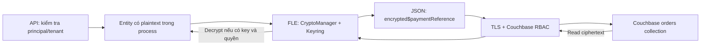
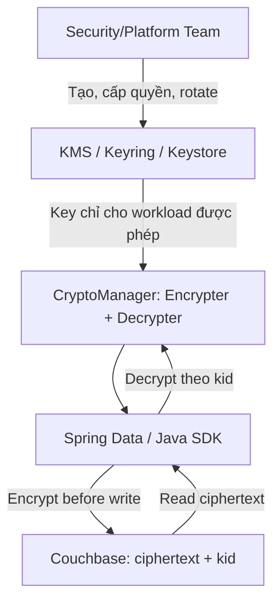
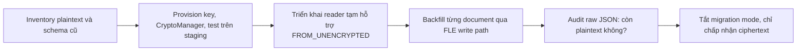
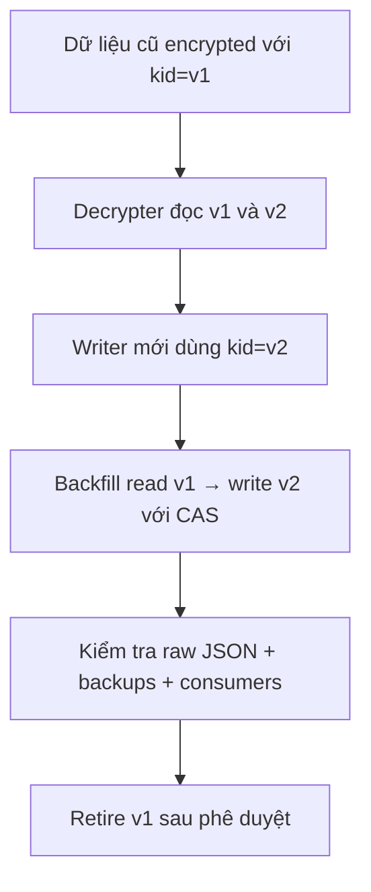

# Field Level Encryption và điều kiện phụ thuộc cần bổ sung

## Mục tiêu bài học

Trong ứng dụng **Spring Data Couchbase**, không phải trường nào trong JSON document cũng nhạy cảm như nhau. `status`, `createdAt` và `total` thường cần lọc, sắp xếp hoặc lập chỉ mục; các trường như `paymentReference`, định danh cá nhân hoặc thông tin riêng tư có thể cần được **mã hóa ngay tại ứng dụng trước khi đưa vào Couchbase**.

**Field Level Encryption (FLE)** là khả năng mã hóa **những trường JSON được chọn** ở phía ứng dụng/SDK. Nó **khác với TLS** (bảo vệ đường truyền) và **native encryption at rest** (bảo vệ dữ liệu lưu trên Server). Trong Spring Data Couchbase, FLE cần **dependency riêng `couchbase-encryption`**, cấu hình **`CryptoManager`**, **keyring**, định nghĩa những trường có `@Encrypted` và quy trình bảo vệ/rotation khóa. Chỉ thêm `spring-boot-starter-data-couchbase` hoặc chỉ gắn annotation là **chưa đủ**.

Bài thuộc chương **Bảo mật** của `SPRING_DATA_COUCHBASE`, liên hệ với document mapping, `CouchbaseRepository`, `CouchbaseTemplate`, truy vấn SQL++, bucket/scope/collection, TTL, CAS, giao dịch và reactive API. Sau bài học, bạn có thể:

- Phân loại lớp bảo vệ **FLE, TLS, RBAC, encryption at rest** và chọn field cần mã hóa.
- Xác minh phiên bản Java SDK/Spring Data/crypto library, license và những **điều kiện phụ thuộc cần bổ sung**.
- Cấu hình `Keyring`, `CryptoManager` và `@Encrypted` trong Spring Data hoặc `ClusterEnvironment` của Java SDK.
- Hiểu dữ liệu lưu dạng `encrypted$<field>` với `alg`/`kid`/`ciphertext`; biết vì sao SQL++ không thể tự truy vấn plaintext.
- Chọn đường chuyển đổi dữ liệu cũ và rotation key an toàn; không khiến dữ liệu lịch sử mất khả năng giải mã.
- Kiểm thử mã hóa thực trên **raw document**, round-trip, lỗi key, và đảm bảo không lộ plaintext qua logs/export.

> **Phạm vi:** Tài liệu chính thức nêu Java SDK **3.0.5+**, Java Couchbase Encryption library **3.0.0+**, và Spring Data Couchbase hỗ trợ FLE từ **5.0.0-RC1**. Các mức này là điều kiện tối thiểu, không phải đề xuất sử dụng phiên bản cũ trong production. Thư viện `couchbase-encryption` là **optional** và chịu điều kiện Couchbase License/Enterprise Subscription; cần kiểm tra license và compatibility trước khi dùng. Ví dụ sử dụng bucket `training`, scope `commerce`, collection `orders`, hoàn toàn là dữ liệu giả lập.

## 1. FLE giải quyết vấn đề gì?

Một document đơn hàng:

```json
{
  "tenantId": "tenant-a",
  "status": "PAID",
  "createdAt": "2026-11-01T09:00:00Z",
  "total": 250000,
  "paymentReference": "LAB-REF-5821"
}
```

Giả sử ứng dụng chỉ cần lọc/sort `status`, `createdAt`, `total`; `paymentReference` chỉ cần được giải mã cho một endpoint đặc quyền. FLE cho phép mã hóa riêng field ấy, trong khi những field khác vẫn dùng được cho SQL++ query/index.



**Ranh giới tin cậy:** Couchbase lưu **ciphertext** của các field đã mã hóa. FLE không bắt Query Service biết plaintext hoặc encryption key. Nhưng backend có keyring và quyền database **vẫn có thể giải mã trong memory**; FLE không thay authorization phía API, bảo vệ host/container hoặc giới hạn dữ liệu được log.

### 1.1. So sánh các lớp bảo vệ

| Cơ chế | Phạm vi bảo vệ | Không giải quyết |
| --- | --- | --- |
| **TLS / `couchbases://`** | Giao tiếp mạng SDK ↔ Server | Người đọc document sau khi Server đã xử lý; field plaintext trong DB |
| **Native encryption at rest** | Tệp database/log/audit tùy chính sách sản phẩm/phiên bản | SQL++ nhìn dữ liệu đã xử lý ở Server và quyền truy cập sai |
| **FLE** | Giá trị **một số trường** được client mã hóa trước khi ghi | Field không được đánh dấu; document ID/metadata, dữ liệu trong memory/log |
| **RBAC** | Quyền Data/Query theo bucket/scope/collection | Ownership theo tenant trong collection dùng chung |
| **API authorization** | Người dùng cuối được phép xem/sửa object nào | TLS/disk/field encryption nếu chưa triển khai |

Couchbase Server 8.x và các cluster Capella Operational mới có chức năng native encryption at rest theo edition/plan. Chức năng đó **không tự bật `@Encrypted`**. FLE cũng không thay mã hóa ổ đĩa, backup hoặc TLS. Hệ thống cần chọn các lớp dựa trên threat model, không vì có FLE mà bỏ RBAC hay xác minh tenant.

### 1.2. Chọn trường mã hóa và trường để plaintext có kiểm soát

| Trường | Thiết kế phổ biến | Đánh đổi cần đánh giá |
| --- | --- | --- |
| `tenantId` | Giữ như field phục vụ tenant filter và kiểm soát ở API | Có thể tiết lộ metadata tenant; cân nhắc cách ly bằng collection/bucket |
| `status`, `createdAt` | Không mã hóa nếu phải lọc/sort/index trên Server | Có thể tiết lộ tình trạng/thời điểm giao dịch |
| `total` | Chọn dựa trên nhu cầu aggregate/risk | Mã hóa sẽ không còn `SUM`/`ORDER BY` plaintext bình thường |
| `paymentReference` | Ứng viên FLE nếu chỉ giải mã cho chức năng được duyệt | Không truy vấn bằng equality/plaintext trực tiếp |
| `documentId` | Không có bảo đảm FLE che ID metadata | Không nhét email, số thẻ hoặc thông tin nhạy cảm vào key |
| `_class`/metadata | Framework có thể lưu bên ngoài trường mã hóa | Cần review khả năng lộ loại entity |

**Không dùng FLE để thay thế password hashing**: mật khẩu đăng nhập cần thuật toán password hash thích hợp, không được lưu bằng một khóa reversible chỉ để so khớp. Thu thập ít dữ liệu nhạy cảm hơn vẫn là biện pháp bảo vệ hiệu quả nhất.

## 2. Bảng phụ thuộc bắt buộc

| Thành phần | Điều kiện tối thiểu tài liệu hóa | Việc phải kiểm tra |
| --- | --- | --- |
| Couchbase Java SDK | `3.0.5+` | Version thực được Spring Boot BOM kéo vào |
| Java Couchbase Encryption | `3.0.0+`; artifact `com.couchbase.client:couchbase-encryption` | Khai báo riêng, chọn version tương thích, license |
| Spring Data Couchbase | Tích hợp FLE từ `5.0.0-RC1` | Khả năng override `AbstractCouchbaseConfiguration.cryptoManager()` và mapping đúng |
| Spring Boot | Có `spring-boot-starter-data-couchbase` | **Starter không tự kéo FLE**; không nhầm auto-config với crypto config |
| Keyring | Key hợp lệ, có `kid` | Có encrypter mặc định/alias, decrypter cho dữ liệu cũ |
| Key store/KMS | Được bảo vệ, có quyền, audit và rotation | Không hardcode key/keystore password trong Git/Image |
| Server/Capella | Bucket/scope/collection và RBAC phù hợp | Bản thân Server không thực hiện client-side FLE thay ứng dụng |
| Queries & migration | Schema lưu encrypted field khác plaintext | Index/filter/analytics, legacy documents, rollback |
| Test | Test cluster với fake secrets/fixtures | Xác minh raw ciphertext và typed decrypted value |

**Quan trọng:** `couchbase-encryption` **không phải** `spring-boot-starter-data-couchbase` hoặc `spring-security-crypto`. Annotation cần dùng thuộc `com.couchbase.client.java.encryption.annotation.Encrypted`. Có dependency nhưng không có `CryptoManager` thì chưa đúng, và có `CryptoManager` nhưng writer không dùng cơ chế encryption thì dữ liệu vẫn có thể là plaintext.

### 2.1. Khai báo Gradle

```groovy
dependencies {
    implementation 'org.springframework.boot:spring-boot-starter-data-couchbase'

    // Optional module được bổ sung TƯỜNG MINH.
    implementation 'com.couchbase.client:couchbase-encryption:<approved-version>'

    // Chỉ dùng khi chọn HashiCorp Vault Transit và đã kiểm tra
    // phiên bản Spring Vault tương thích với Boot BOM:
    // implementation 'org.springframework.vault:spring-vault-core'

    testImplementation 'org.springframework.boot:spring-boot-starter-test'
}
```

`<approved-version>` là **placeholder** cho version được phê duyệt, chưa phải cấu hình build dùng được. Không sao chép máy móc một bản Spring Vault cũ từ code mẫu trên Internet. Với deployment thực, pin/check dependencies, xem license, SDK compatibility, transitive Jackson/crypto providers.

### 2.2. Khai báo Maven

```xml
<dependencies>
  <dependency>
    <groupId>org.springframework.boot</groupId>
    <artifactId>spring-boot-starter-data-couchbase</artifactId>
  </dependency>
  <dependency>
    <groupId>com.couchbase.client</groupId>
    <artifactId>couchbase-encryption</artifactId>
    <version>${approved.couchbase.encryption.version}</version>
  </dependency>
</dependencies>
```

Maven property phải được định nghĩa trong build/dependency management đáng tin. Một build thành công **không chứng minh** dữ liệu đã được mã hóa; phải kiểm tra cả **raw JSON đã lưu**.

### 2.3. Những điều kiện không được lược bỏ

1. **Key** được sinh an toàn và lưu trong keyring, có danh tính `kid` được quản lý.
2. **CryptoManager** có decrypter và encrypter, được gắn vào đúng serialization path.
3. Những fields cần bảo vệ **được đánh dấu hoặc ghi qua encryption-aware API**.
4. Có **RBAC**, TLS và API authorization độc lập.
5. Có **phương án query/index** vì SQL++ không đọc được plaintext field bị mã hóa.
6. Có **rollout/migration**, backup/restore keys và kế hoạch rotation trước production.

Nguồn: [Java SDK — Encrypting Your Data](https://docs.couchbase.com/java-sdk/current/howtos/encrypting-using-sdk.html), [Spring Data Couchbase — Field Level Encryption](https://docs.spring.io/spring-data/couchbase/reference/couchbase/fieldlevelencryption.html).

## 3. Định dạng lưu trữ ciphertext

Một field Java `paymentReference` có `@Encrypted` thường trở thành raw JSON:

```json
{
  "tenantId": "tenant-a",
  "status": "PAID",
  "total": 250000,
  "encrypted$paymentReference": {
    "alg": "AEAD_AES_256_CBC_HMAC_SHA512",
    "kid": "orders-field-key-v1",
    "ciphertext": "<base64-encoded-ciphertext>"
  }
}
```

`encrypted$` là **prefix tên field mặc định** trong FLE SDK 3; `alg` là thuật toán đã dùng, `kid` là **key identifier** (không phải secret), `ciphertext` là dữ liệu mã hóa. Không dùng `ciphertext` như plaintext trong `WHERE o.paymentReference = ...`. Đọc raw `JsonObject` thường thấy payload ciphertext, còn decryption chỉ xảy ra ở **đường đọc đã được tích hợp crypto**.

Thư viện có provider tiêu chuẩn **`AEAD_AES_256_CBC_HMAC_SHA512`**, dùng **key dài 64 byte**: các phần key AES/HMAC riêng được quản lý chung. **Không thay bằng một AES key 32 byte** và không tự triển khai CBC/HMAC vì dễ sai quy trình xác thực tag/nonce. Các thuật toán dùng primitive nằm trong danh mục FIPS approved **không tự chứng nhận toàn bộ deployment đã đạt FIPS compliance**; hãy kiểm tra module/provider và yêu cầu compliance thực tế.

### 3.1. Những gì Couchbase vẫn nhìn thấy

- ID và keyspace của document, field name sau mã hóa, loại thuật toán `alg`, `kid` và độ dài tương đối của ciphertext.
- Các field **không** được mã hóa, metadata `_class`/CAS/expiry, số lượng document và pattern query.
- Những giá trị từ ứng dụng được đưa vào logs/search/cache/export ngoài chính FLE serialization.

FLE **không ẩn toàn bộ document**, không mã hóa field ID một cách tự động và không chặn backend có key giải mã một field sau khi vượt qua API authorization.

### 3.2. Khóa FLE không phải TLS certificate

| Vật liệu | Công việc |
| --- | --- |
| FLE keyring / KMS data keys | Encrypt/decrypt `encrypted$...` fields |
| JVM truststore / CA PEM | SDK xác minh Couchbase Server qua TLS |
| Client certificate/private key | Chỉ khi dùng X.509 client authentication/mTLS |
| DB username/password | Couchbase xác thực và kiểm tra RBAC |

Xoay TLS certificate không tự re-encrypt document. Xoay FLE key không sửa lỗi SAN/hostname hoặc mật khẩu DB.

## 4. Quản lý keyring và `CryptoManager`



### 4.1. Key 64 byte phải được sinh bằng CSPRNG

Ví dụ **trong provisioning job cô lập**:

```java
import java.security.SecureRandom;
import java.util.Arrays;

byte[] keyBytes = new byte[64];
new SecureRandom().nextBytes(keyBytes);

try {
    // Hàm do tổ chức triển khai: không có sẵn trong Java SDK.
    storeKeyMaterialSecurely("orders-field-key-v1", keyBytes);
} finally {
    Arrays.fill(keyBytes, (byte) 0);
}
```

Đây là đoạn mã mô tả key generation, **không phải chương trình provisioning hoàn chỉnh**; `storeKeyMaterialSecurely` phải được thực hiện bằng API vault/HSM/keystore được duyệt. Không ghi base64 của `keyBytes` vào YAML, Git, log hay ticket. Tài liệu Couchbase có ví dụ `JCEKS` và `KeyStoreKeyring.setSecretKey(...)` để học trong lab, nhưng production còn cần encryption-at-rest, access control, audit, restore và key lifecycle.

### 4.2. Cấu hình encrypter và decrypter

Theo cơ chế chính thức, cần cung cấp keyring, provider và `CryptoManager`:

```java
// Đoạn minh họa bên trong thành phần FLE config của dự án.
// Hai helper bên dưới PHẢI được triển khai bởi platform team.
KeyStore store = loadApprovedKeyStore();
Keyring keyring = new KeyStoreKeyring(
    store, keyName -> resolveEntryPasswordFromSecrets(keyName));

AeadAes256CbcHmacSha512Provider provider =
    AeadAes256CbcHmacSha512Provider.builder()
        .keyring(keyring)
        .build();

CryptoManager manager = DefaultCryptoManager.builder()
    .decrypter(provider.decrypter())
    .defaultEncrypter(provider.encrypterForKey("orders-field-key-v1"))
    .build();
```

`loadApprovedKeyStore()` và `resolveEntryPasswordFromSecrets(...)` **không phải API có sẵn** của Java SDK. Chúng cần được implement theo secret manager/keystore của dự án và đúng kiểu dữ liệu/password contract theo release đã duyệt. Các class còn lại nằm ở thư viện FLE/SDK tương ứng. `defaultEncrypter` chọn key để **ghi mới**; `decrypter` phải đọc được `kid` của **cả dữ liệu hiện hành và cũ**. Không xóa key cũ khi document lịch sử vẫn cần giải mã.

### 4.3. Chính sách key management

- Không dùng chung encryption key giữa **test/staging/production**.
- Giới hạn quyền KMS **encrypt/decrypt** theo service purpose, môi trường, tenant nếu yêu cầu.
- Duy trì key IDs, version, owner, ngày tạo/thu hồi, backup/recovery và audit.
- Không đưa **Vault root token** hoặc CA signing key vào pod ứng dụng để nhận FLE key.
- Khi key unavailable, **fail closed**: không trả plaintext fallback, không ghi document không mã hóa chỉ để giữ service hoạt động.
- Đánh giá key rotation và một job re-encryption trước khi lưu dữ liệu thật, vì mất key có thể khiến dữ liệu không thể khôi phục.

## 5. Spring Data Couchbase: cấu hình `CryptoManager` đúng đường mapping

Theo tài liệu chính thức của Spring Data Couchbase, một cách tích hợp là **override `cryptoManager()` trong `AbstractCouchbaseConfiguration`**. CryptoManager được framework dùng cho mapping/repository và cho các Java SDK direct calls đi qua `CouchbaseClientFactory` do Spring Data quản lý.

### 5.1. Tách việc lấy khóa khỏi cấu hình kết nối

Một module quản lý secret/keyring được tổ chức phê duyệt có thể cấp `CryptoManager`:

```java
// Đoạn mô tả Bean trong cấu hình riêng; PlatformKeyringProvider là
// abstraction tự định nghĩa và kiểm thử trong dự án, KHÔNG phải SDK API.
@Configuration
class FleKeyConfiguration {
    @Bean
    CryptoManager ordersCryptoManager(PlatformKeyringProvider keys) {
        Keyring keyring = keys.loadFor("orders-service");
        var provider = AeadAes256CbcHmacSha512Provider.builder()
            .keyring(keyring)
            .build();
        return DefaultCryptoManager.builder()
            .decrypter(provider.decrypter())
            .defaultEncrypter(
                provider.encrypterForKey("orders-field-key-v1"))
            .build();
    }
}
```

**Đây là một skeleton thiết kế:** Dự án phải cung cấp `PlatformKeyringProvider` và imports/classpath cụ thể từ FLE library, xác minh key tồn tại và secret store truy cập được. Không lấy một chuỗi mật khẩu production hardcode như ví dụ minh họa trong tài liệu SDK. Nếu project không dùng Spring Boot auto-config, triển khai cùng chiến lược cung cấp CryptoManager trong lớp cấu hình thực.

### 5.2. Tạo một `AbstractCouchbaseConfiguration` có CryptoManager

Ví dụ với Spring Data Couchbase phiên bản hỗ trợ method `cryptoManager()`:

```java
package com.example.orders.config;

import com.couchbase.client.core.encryption.CryptoManager;
import org.springframework.context.annotation.Configuration;
import org.springframework.data.couchbase.config.AbstractCouchbaseConfiguration;
import org.springframework.data.couchbase.repository.config.EnableCouchbaseRepositories;

@Configuration
@EnableCouchbaseRepositories(
    basePackages = "com.example.orders.repository")
public class OrdersCouchbaseConfiguration
        extends AbstractCouchbaseConfiguration {

    private final CryptoManager manager;

    public OrdersCouchbaseConfiguration(CryptoManager manager) {
        this.manager = manager;
    }

    @Override
    public String getConnectionString() {
        return required("CB_CONNECTION_STRING");
    }

    @Override
    public String getUserName() {
        return required("CB_APP_USERNAME");
    }

    @Override
    public String getPassword() {
        return required("CB_APP_PASSWORD");
    }

    @Override
    public String getBucketName() {
        return required("CB_BUCKET_NAME");
    }

    @Override
    protected CryptoManager cryptoManager() {
        return manager;
    }

    private static String required(String key) {
        String value = System.getenv(key);
        if (value == null || value.isBlank()) {
            throw new IllegalStateException("Missing config: " + key);
        }
        return value;
    }
}
```

**Phân biệt:** Đây là **một phương án cấu hình Spring Data đầy đủ**, không phải đoạn cần thêm chồng lên mọi cấu hình Spring Boot hiện tại. Nếu project đã có `AbstractCouchbaseConfiguration` hoặc `Cluster` beans tùy biến, hãy **tích hợp vào đúng một configuration path** thay vì tạo hai cluster factories/beans trùng nhau. Đọc rõ tài liệu phiên bản Boot/SDC và test rằng repository thật dùng CryptoManager này.

`System.getenv(...)` ở đây là đường lấy cấu hình runtime đơn giản; production có thể dùng secret manager hoặc Spring property injection đã được bảo vệ. Đừng in ra các giá trị vừa lấy, nhất là `CB_APP_PASSWORD` và keystore passwords.

### 5.3. Khi nào cần cấu hình thêm Jackson?

Trong Java SDK, `@Encrypted` được tích hợp qua **`EncryptionModule`** của Jackson serializer. Khi SDK sử dụng **custom `ObjectMapper`**, phải bảo đảm module được đăng ký đúng:

```java
// Trong chương trình SDK custom serialization, không phải cấu hình
// bắt buộc cho mọi Spring Data repository.
ObjectMapper mapper = new ObjectMapper();
mapper.registerModule(new JsonValueModule());
mapper.registerModule(new EncryptionModule(cryptoManager));

// Khi quản lý ClusterEnvironment trực tiếp:
ClusterEnvironment env = ClusterEnvironment.builder()
    .cryptoManager(cryptoManager)
    .jsonSerializer(JacksonJsonSerializer.create(mapper))
    .build();
```

**Không nhầm hai lớp serialization:** Spring Data Couchbase có **MappingCouchbaseConverter** và tích hợp FLE riêng được tài liệu hóa; Java SDK `contentAs(MyPojo.class)` có đường Jackson serializer riêng. Cách dùng **custom ObjectMapper của Spring MVC HTTP JSON** không tự bảo đảm Couchbase SDK hoặc Spring Data mapping dùng cùng mapper/module. Cần kiểm thử cả repository, template và SDK trực tiếp trước khi coi FLE đã được áp dụng toàn bộ.

Nguồn: [Spring Data Couchbase — FLE Integration](https://docs.spring.io/spring-data/couchbase/reference/couchbase/fieldlevelencryption.html), [Java SDK — Custom ObjectMapper](https://docs.couchbase.com/java-sdk/current/howtos/encrypting-using-sdk.html).

## 6. Entity mapping và `@Encrypted` trong repository

### 6.1. Entity giữ field nghiệp vụ nhưng mã hóa khi persist

```java
package com.example.orders.domain;

import com.couchbase.client.java.encryption.annotation.Encrypted;
import org.springframework.data.annotation.Id;
import org.springframework.data.couchbase.core.mapping.Document;
import org.springframework.data.couchbase.core.mapping.Scope;
import org.springframework.data.couchbase.core.mapping.Collection;

@Document
@Scope("commerce")
@Collection("orders")
public class Order {
    @Id
    private String id;
    private String tenantId;
    private String status;
    private long total;

    // Field này ở dạng String trong Java object, nhưng cần mã hóa ở DB.
    @Encrypted
    private String paymentReference;

    protected Order() {}

    public Order(String id, String tenantId, String status,
                 long total, String paymentReference) {
        this.id = id;
        this.tenantId = tenantId;
        this.status = status;
        this.total = total;
        this.paymentReference = paymentReference;
    }

    public String getId() { return id; }
    public String getTenantId() { return tenantId; }
    public String getStatus() { return status; }
    public long getTotal() { return total; }
    public String getPaymentReference() { return paymentReference; }
}
```

**Cần phân biệt hai loại annotation:** `@Document`, `@Scope`, `@Collection` là mapping tới Couchbase; `@Encrypted` ở đây đến từ **Couchbase Java SDK encryption library**. Đừng lấy một annotation `@Encrypted` khác tên nhưng khác package.

### 6.2. Repository

```java
package com.example.orders.repository;

import com.example.orders.domain.Order;
import java.util.List;
import org.springframework.data.couchbase.repository.CouchbaseRepository;

public interface OrderRepository
        extends CouchbaseRepository<Order, String> {
    List<Order> findByTenantIdAndStatus(
        String tenantId, String status);
}
```

Đọc/ghi qua repository **được cấu hình FLE đúng**:

```java
// Chỉ minh họa trong integration test ở bucket test riêng.
Order order = new Order(
    "order::fle-test-001",
    "tenant-a", "PAID", 250000, "LAB-REF-5821"
);
repository.save(order);

Order restored = repository.findById("order::fle-test-001")
    .orElseThrow();

// Giá trị Java được giải mã nếu CryptoManager/keyring đúng.
assert restored.getPaymentReference().equals("LAB-REF-5821");
```

**Mấu chốt:** Spring Data Couchbase docs xác nhận `@Encrypted` được mã hóa khi **write** và giải mã khi **read**, với `CryptoManager` cấu hình hợp lệ. Nhưng một test chỉ so sánh giá trị Java bằng nhau **chưa đủ**: nếu FLE không được nối vào đúng đường mapping, cả lưu và đọc plaintext vẫn có thể trông như round-trip PASS. Phải kiểm tra **raw document thực tế không có `paymentReference` plaintext** và có `encrypted$paymentReference` như mục 3.

### 6.3. Khi chọn encrypter alias

Có thể dùng:

```java
@Encrypted(encrypter = "orders-pii")
private String paymentReference;
```

**`orders-pii` là alias của encrypter được đăng ký trong `CryptoManager`**, không phải tên thuật toán, `kid` hay key material. Đừng chỉ thêm annotation như trên khi CryptoManager **chưa đăng ký** alias tương ứng; nó sẽ không tự tạo một key `orders-pii`. Với ví dụ tối giản, `@Encrypted` không truyền alias sẽ dùng **default encrypter**, như khi cấu hình `defaultEncrypter(provider.encrypterForKey("orders-field-key-v1"))`.

### 6.4. Không dùng entity như HTTP response chứa mọi field

Một entity `Order` sau khi đọc có `paymentReference` **plaintext trong memory**. Không trả trực tiếp toàn bộ entity từ REST controller. Chuyển sang response DTO có **chỉ các trường người gọi được phép thấy**, ví dụ:

```java
public record OrderSummary(
    String id, String status, long total
) {}

public static OrderSummary toSummary(Order order) {
    return new OrderSummary(
        order.getId(), order.getStatus(), order.getTotal());
}
```

Endpoint có quyền đặc biệt xem `paymentReference` phải xác thực principal/tenant và kiểm tra quyền **trước khi đưa plaintext vào response**, giới hạn log/tracing và audit. FLE không thay thế kiểm tra ownership của `findById`, không có tự động “decryption authorization” cho user cuối nếu backend được cấp key.

## 7. Java SDK: hai đường mã hóa khác nhau

### 7.1. POJO data binding với `@Encrypted`

Khi SDK dùng `ClusterEnvironment` với `cryptoManager` và JSON serializer tích hợp:

```java
// Đoạn minh họa trong app SDK đã có Cluster/Collection được cấu hình.
var orders = cluster.bucket("training")
    .scope("commerce")
    .collection("orders");

// Order là class có @Encrypted như mục 6.
Order source = new Order(
    "order::fle-sdk-001", "tenant-a", "PAID", 250000, "LAB-SDK-KEY");

orders.insert("order::fle-sdk-001", source);

// Raw JsonObject không tự giải mã.
var raw = orders.get("order::fle-sdk-001").contentAsObject();

// POJO data binding có CryptoManager/EncryptionModule sẽ giải mã.
Order typed = orders.get("order::fle-sdk-001").contentAs(Order.class);
```

Không log `typed` hoặc raw `ciphertext` ở production; ví dụ tồn tại để làm phép kiểm tra test. **Một `JsonObject` raw khác với POJO `@Encrypted`**: SDK không tự đoán JSON string nào là dữ liệu nhạy cảm nếu bạn chỉ gọi `collection.upsert(key, JsonObject)` mà chưa dùng `JsonObjectCrypto`.

### 7.2. `JsonObjectCrypto` khi làm việc với JSON tree

Nếu chọn đường xử lý `JsonObject`, SDK cung cấp `JsonObjectCrypto` view:

```java
import com.couchbase.client.java.json.JsonObject;

var orders = cluster.bucket("training")
    .scope("commerce")
    .collection("orders");

JsonObject raw = JsonObject.create()
    .put("tenantId", "tenant-a")
    .put("status", "PAID");

// Chỉ những field đưa qua crypto view mới được mã hóa.
var crypto = raw.crypto(orders);
crypto.put("paymentReference", "LAB-VIEW-001");

orders.insert("order::fle-view-001", raw);

JsonObject stored = orders.get("order::fle-view-001")
    .contentAsObject();

// Đọc qua crypto view thì mới decrypt trường được mã hóa.
String sensitiveValue = stored.crypto(orders)
    .getString("paymentReference");
```

**Đây là lựa chọn thay thế**, không phải yêu cầu kết hợp cả `@Encrypted` và `crypto.put` cho cùng field trong một write. Dùng hai cơ chế lên cùng dữ liệu mà không hiểu serialization path có thể dẫn đến double encryption hoặc schema mismatch.

**Phạm vi:** `crypto view` chỉ nhìn những field đã mã hóa; đọc field thường qua view không tương đương đọc `raw.getString(...)`. Để kiểm thử raw storage, đọc `stored.getObject("encrypted$paymentReference")` và xác nhận `ciphertext/kid/alg`.

### 7.3. Tránh SDK direct call bỏ qua Spring Data conversion

Một method Spring Data `repository.save(order)` và một lệnh Java SDK `collection.upsert(id, jsonObject)` không nhất thiết có cùng cơ chế mapping. Nếu ai đó tạo `JsonObject.create().put("paymentReference", plaintext)` rồi upsert trực tiếp, **dữ liệu có thể được lưu plaintext** ngay cả khi entity Java khai báo `@Encrypted`.

Trước khi dùng SDK, Template, reactive hoặc sub-document APIs, phải quyết định **một data-access contract có crypto** và kiểm thử từng write path. Không dựa vào tên field Java hay annotation ở một class không được dùng để serialize thao tác đó.

Nguồn: [Java SDK — Encrypting Your Data / JsonObjectCrypto](https://docs.couchbase.com/java-sdk/current/howtos/encrypting-using-sdk.html).

## 8. Query, index và phân tích hiệu năng trên ciphertext

### 8.1. SQL++ không tự giải mã giá trị

Một câu query:

```sql
SELECT META(o).id AS documentId, o.status, o.total
FROM `training`.`commerce`.`orders` AS o
WHERE o.tenantId = $tenantId
  AND o.status = $status
ORDER BY o.createdAt DESC
LIMIT $limit;
```

vẫn có thể chạy nếu các trường `tenantId`, `status`, `createdAt` được lưu plaintext có kiểm soát. Nhưng câu:

```sql
-- KHÔNG kỳ vọng truy vấn được plaintext của encrypted field.
SELECT META(o).id AS id
FROM `training`.`commerce`.`orders` AS o
WHERE o.paymentReference = $plaintextReference;
```

**không tìm được giá trị** nếu dữ liệu vật lý chỉ còn `encrypted$paymentReference`. Ngay cả truy vấn SELECT trực tiếp trường vật lý `encrypted$paymentReference` cũng chỉ nhìn thấy **metadata/ciphertext**, không làm Query Service tự giải mã.

### 8.2. Kiểu truy vấn nào bị ảnh hưởng?

| Nhu cầu | Có làm trên plaintext đã được FLE mã hóa tại Server? | Thiết kế thay thế cần review |
| --- | --- | --- |
| KV GET bằng document ID đã biết | Có, do key lookup, rồi client decrypt | Kiểm tra tenant/ownership trước khi trả plaintext |
| `WHERE status = ...` / `ORDER BY createdAt` | Có khi những field đó không mã hóa | Index phù hợp, giới hạn query và RBAC |
| `WHERE paymentReference = ...` | **Không mặc nhiên** theo plaintext | Thiết kế lookup token/blind index riêng khi có lý do và threat review |
| `LIKE`, full-text search trên field FLE | **Không** theo plaintext | Search trên field được phép khác, hoặc dịch vụ tìm kiếm có thiết kế bảo vệ riêng |
| `ORDER BY paymentReference` | **Không** theo plaintext | Đổi API sort contract hoặc giữ một trường khác đã được duyệt |
| `SUM/AVG(total)` khi `total` mã hóa | **Không** theo số plaintext tại Query Service | Aggregate phía client sau bounded query, hoặc materialized aggregate có kiểm soát |
| Index thông thường trên `encrypted$...` | Có thể index cấu trúc ciphertext, **không** tạo plaintext searchable | Cần chứng minh mục đích và leakage của metadata |

**Không tự triển khai “deterministic AES” rồi gọi đó là FLE tìm kiếm được**. Kỹ thuật blind index/HMAC token để equality lookup cần key riêng, canonicalization, domain separation, rotation strategy và đánh giá rủi ro correlation/frequency leakage; nó **không phải tính năng mặc định của `@Encrypted`**. Đặc biệt với dữ liệu ít giá trị khả dĩ (giới tính, trạng thái, mã vùng), token ổn định có thể để lộ tần suất; cần security review.

### 8.3. Thiết kế hai bước khi cần hiển thị dữ liệu nhạy cảm

1. API xác minh principal, tenant/ownership và quyền xem field nhạy cảm.
2. Query **bounded** dựa trên index của các field không mã hóa, hoặc dùng document ID được phép.
3. Chỉ đọc/giải mã **những document cần hiển thị**, không quét toàn collection rồi giải mã mọi thứ.
4. Chuyển sang DTO chứa đúng fields được phép; không serialize raw entity ra HTTP log.
5. Giới hạn page size, concurrency và gọi KMS; quan sát latency/timeout theo chính sách.

Nếu query trả projection chỉ có `ciphertext`, Spring Data/SDK **không nhất thiết** deserialize thành entity đầy đủ được; cần kiểm tra field alias, type metadata (`_class`) và JSON layout. Đừng kỳ vọng `rowsAsObject()` của một raw SQL++ response tự giải mã một field chỉ vì entity Java có annotation.

### 8.4. Index và consistency vẫn là yêu cầu độc lập

Một index minh họa cho query theo tenant/status:

```sql
-- Chỉ chạy bằng credential migration/provisioning được phép.
CREATE INDEX idx_orders_tenant_status_created
ON `training`.`commerce`.`orders`
    (tenantId, status, createdAt DESC);
```

Runtime app chỉ cần quyền **Query Select** phù hợp trên collection cho SQL++, không cần `Query Manage Index` để dùng FLE. Index cập nhật bất đồng bộ; `REQUEST_PLUS` có thể cần trong workflow đọc ngay sau ghi, nhưng không phải phương pháp giải mã field. TTL/CAS/transaction semantics cũng độc lập với thuật toán encrypt.

## 9. Chuyển đổi field plaintext cũ sang FLE

### 9.1. Vì sao không chỉ thêm `@Encrypted` rồi deploy?

Giả sử trước đây Couchbase lưu:

```json
{
  "tenantId": "tenant-a",
  "paymentReference": "LAB-REF-OLD-01"
}
```

Sau khi ứng dụng thêm `@Encrypted` và CryptoManager, decrypter có thể kỳ vọng field vật lý `encrypted$paymentReference`. Những document cũ còn plaintext sẽ cần **kế hoạch migration rõ ràng**, nếu không repository có thể lỗi khi đọc hoặc dữ liệu bị xử lý không đồng nhất.

Spring Data/Java SDK hỗ trợ annotation:

```java
import com.couchbase.client.java.encryption.annotation.Encrypted;

// CHỈ trong giai đoạn migration được kiểm soát.
@Encrypted(migration = Encrypted.Migration.FROM_UNENCRYPTED)
private String paymentReference;
```

Chế độ `FROM_UNENCRYPTED` cho phép deserialize **cả field plaintext cũ lẫn ciphertext mới** và sẽ mã hóa khi ghi bằng đường mapping FLE đúng. Đây là công cụ **chuyển đổi**, không phải lựa chọn thường trực: chấp nhận field **không có authenticated ciphertext** có thể giảm bảo đảm phát hiện tampering/downgrade cho dữ liệu.

### 9.2. Quy trình migration có gate



1. **Khảo sát:** Xác định field nào, document type/collection nào còn plaintext; loại bỏ các bản sao plaintext trong cache/export/index/backups theo policy.
2. **Chuẩn bị schema & key:** Provision `CryptoManager`/keyring cho **tất cả readers/writers** có thể truy cập field, kiểm thử việc decrypt ciphertext, thiết kế rollback không mất khóa.
3. **Thử nghiệm trong staging:** Ghi cả document cũ/plaintext và mới/ciphertext, xác minh `@Encrypted(migration = ...)` chỉ dùng trong thời hạn đã quy định.
4. **Backfill có kiểm soát:** Đọc document cũ, xác minh tenant/ownership, ghi lại bằng **FLE-enabled mapping**; dùng CAS/`@Version` hoặc transaction phù hợp để không ghi đè thay đổi đồng thời.
5. **Theo dõi tiến độ:** Đếm số document còn field plaintext, số encrypted fields, errors và Key IDs, không ghi chính giá trị plaintext lên dashboard/log.
6. **Chuyển trạng thái:** Khi tất cả writers dùng FLE và còn **0** plaintext document trong phạm vi cần bảo vệ, bỏ migration mode, thêm negative test plaintext không được đọc như ciphertext.
7. **Backup/DR:** Review các bản backup/lưu trữ trước migration, retention/legal hold và quy trình restore có thể đưa plaintext quay lại.

**Không backfill bằng SQL++ UPDATE sao chép trực tiếp** giá trị từ `paymentReference` sang field `encrypted$paymentReference`. Đó chỉ là copy một chuỗi, không mã hóa hay thêm authenticated ciphertext hợp lệ. SQL++ Server không sở hữu keyring FLE. Backfill phải chạy qua một **client writer đã bật FLE** hoặc một pipeline mã hóa được kiểm toán.

### 9.3. Legacy SDK 2 là một bài toán riêng

Tài liệu Couchbase nêu SDK 2 có prefix cũ `__crypt_`, SDK 3 dùng `encrypted$`; SDK 2 **không đọc** dữ liệu SDK 3 đã mã hóa. Thuật toán FLE SDK 2 cũ không còn được dùng để mã hóa dữ liệu mới và có thể cần **legacy decrypters** được cấu hình riêng để đọc trong giai đoạn nâng cấp.

Vì vậy:

- Không rolling upgrade mù quáng hai thế hệ writers cùng đọc/ghi một collection nếu chưa chứng minh compatibility.
- Có thể chọn **maintenance window** hoặc **blue-green migration** với data compatibility gates.
- Chỉ bật legacy decrypt cho tập dữ liệu cần chuyển đổi; không ghi ciphertext mới bằng thuật toán cũ.
- Có kế hoạch đổi tên field/prefix và nested fields (SDK 3 hỗ trợ field nested hơn SDK 2), nếu hệ thống còn lưu định dạng cũ.

Nguồn: [Java SDK — Encryption Migration](https://docs.couchbase.com/java-sdk/current/howtos/encrypting-using-sdk.html), [Spring Data — FLE Migration](https://docs.spring.io/spring-data/couchbase/reference/couchbase/fieldlevelencryption.html).

## 10. Xoay encryption key và khôi phục dữ liệu

**Key rotation** không chỉ là đổi một password môi trường. Một document đã mã hóa chứa `kid`; muốn đọc nó, decrypter phải tìm được key tương ứng. Nếu chỉ cấu hình encrypter mới cho lần ghi tiếp theo, **document cũ vẫn được mã hóa bằng key cũ** cho đến khi được ghi lại qua encryption-aware path.

### 10.1. Kịch bản key v1 → v2

| Giai đoạn | Encrypter dùng để ghi mới | Keys cần thiết để đọc | Việc làm |
| --- | --- | --- | --- |
| A — Trước rotation | `orders-field-key-v1` | `v1` | Inventory documents/consumers |
| B — Canary v2 | `v2` cho canary | `v1 + v2` | Thử read old/new trên staging |
| C — Rollout | `v2` | `v1 + v2` | Cập nhật mọi API/batch clients, monitoring |
| D — Re-encrypt lịch sử | `v2` | `v1 + v2` | Backfill từng document có CAS, idempotent |
| E — Xác minh | `v2` | `v1 + v2` trong thời hạn fallback | Raw scan xác minh không còn `kid=v1` trong phạm vi áp dụng |
| F — Retire v1 | `v2` | `v2`, nếu đã hết phụ thuộc hợp lệ | Revoke theo policy; lưu audit/DR plan |



**Lưu ý:** Re-save một field bằng **FLE-enabled mapping** có thể mã hóa lại với default encrypter đang hoạt động, nhưng cần kiểm chứng trong test và kiểm soát CAS/expiry; không giả định đổi `defaultEncrypter` đã re-encrypt dữ liệu nằm trên ổ đĩa. Nếu job gặp lỗi decrypt key v1, **không được** ghi `null`, blank hoặc plaintext đè lên field cũ.

### 10.2. Re-encryption và CAS

Trong migration job:

1. Đọc raw metadata để xác định `kid`, hoặc đọc typed entity bằng CryptoManager có đủ old keys.
2. Kiểm tra tenant, resource ID, schema version và chính sách retention.
3. Giải mã trong process được bảo vệ; tái mã hóa bằng encrypter mới.
4. Thay document bằng CAS/optimistic locking để tránh ghi đè update đang diễn ra.
5. Khi CAS mismatch, **đọc và kiểm tra lại** chứ không retry replace mù; để field nhạy cảm không bị plaintext.
6. Ghi tiến độ bằng document reference và `oldKid/newKid` được cho phép, **không log value plaintext/ciphertext**.

Nếu nhiều services/SDK versions vẫn ghi bằng key v1, backfill sẽ liên tục thấy dữ liệu cũ quay lại. **Rollout tất cả writers sang v2 trước khi coi việc retire v1 đã an toàn.**

### 10.3. Key unavailable, bị xóa hoặc bị lộ

- **Mất key:** Decryption thất bại; cần backup/recovery đã được kiểm tra. **Không trả plaintext mặc định** hoặc silent-ignore errors.
- **Key tạm thời unavailable (KMS outage):** Thiết kế startup/readiness, retry có giới hạn, circuit breaker và degraded mode. Không cho API dùng một khóa hardcode fallback.
- **Key bị lộ:** Kích hoạt incident response, thu hồi quyền/key theo chính sách, phát hành v2, review khả năng dữ liệu cũ đã bị giải mã; có thể cần re-encrypt khẩn cấp và thay đổi exposure window.
- **Lộ DB password:** Rotate credential Couchbase; FLE key độc lập vẫn cần review nhưng không mặc nhiên phải thay nếu chưa bị truy cập. Nếu attacker có thể đọc cả DB lẫn KMS key, nguy cơ cao hơn.
- **Backup/restore:** Backup chứa ciphertext có thể an toàn hơn plaintext theo threat model, nhưng **không thể phục hồi dữ liệu đã mã hóa nếu mất key đúng `kid`**; kiểm tra key lifecycle và backups tách biệt.

### 10.4. Multitenant và key isolation

FLE áp dụng trên **field**, không tự xác minh owner. Trong shared collection, một CryptoManager có thể giải mã field của **nhiều tenant** nếu nó có mọi key tương ứng. Nếu yêu cầu isolation mạnh:

- Xác minh tenant từ principal **trước khi đọc/giải mã và trả kết quả**; không dựa vào raw client header.
- Xem xét key riêng theo tenant/security domain và giới hạn KMS decrypt role, đồng thời tính đến số tenant, key caching và chi phí.
- Key alias/`kid` phải được ràng buộc với keyring được phép; không cho người gọi chọn arbitrary `kid`/encrypter alias để vượt policy.
- Nếu tenant offboarding, review key destruction/crypto-shredding **rất thận trọng**: khóa có thể còn được dùng cho dữ liệu phải giữ theo legal hold/backup; xóa key có thể làm dữ liệu không phục hồi được.

**Không coi “per-tenant key” là thay thế cho RBAC và tenant predicates**. Service có keyring toàn cục vẫn có thể giải mã cross-tenant nếu access control bị lỗi. Thiết kế này cần threat modeling rõ ràng và đo lường chi phí key management.

## 11. TTL, CAS, sub-document và transactions khi dùng FLE

### 11.1. TTL / expiry

TTL/expiry áp lên **document** chứ không tự dựa trên việc field có `@Encrypted` hay không. Document hết hạn vẫn phải được xử lý bằng retention policy, còn document chưa hết hạn vẫn có thể bị đọc nếu backend có quyền và key giải mã.

Khi migration re-save document, cần **giữ TTL/expiry hiện hành** theo SDK/Spring Data semantics được sử dụng: một thao tác replace/upsert có thể thay đổi expiry nếu không cấu hình preserve expiry đúng. Thử trên fixture có TTL ngắn trước khi chạy backfill; không dùng `@Encrypted` làm bằng chứng policy retention.

### 11.2. CAS / optimistic locking

Crypto layer không tự tránh lost update. Trong Spring Data, `@Version` có thể tận dụng CAS để hỗ trợ optimistic locking theo model được cấu hình; trong Java SDK, `replace` có `ReplaceOptions.cas(...)`. Nếu vừa decrypt field cũ rồi encrypt lại nhưng document đã đổi giữa chừng, **CAS conflict phải được xử lý**, không bỏ kiểm tra.

Ciphertext có thể thay đổi khi field được mã hóa lại dù plaintext nghiệp vụ tương đương; audit/CDC/diffing nên so sánh **semantic state được phép**, không mặc định so raw ciphertext để kết luận người dùng đã đổi nội dung.

### 11.3. Sub-document mutation và SQL++ DML có thể bypass FLE

**Nguy cơ đặc biệt:** Đoạn Java SDK:

```java
// KHÔNG LÀM đối với field được thiết kế có FLE:
collection.mutateIn(
    id,
    java.util.List.of(
        com.couchbase.client.java.kv.MutateInSpec
            .upsert("paymentReference", plaintextFromRequest)
    )
);
```

Nếu chỉ gửi plaintext vào `mutateIn` hoặc SQL++ `UPDATE ... SET paymentReference = $value`, không có cơ chế nào tự đảm bảo **FLE field serializer** chạy trên đúng đường đó. Kết quả có thể tạo field plaintext cạnh `encrypted$paymentReference`, gây rò dữ liệu và schema drift.

**Cách làm:** Dùng write path đã được chứng minh có FLE, hoặc mã hóa payload/field trước khi thực hiện subdoc operation theo API chuyên dụng được review; luôn kiểm tra raw JSON và concurrency. Không gửi ciphertext object giả tự tạo rồi bỏ qua HMAC/crypto manager.

### 11.4. Transactions: atomicity khác confidentiality

Transaction nhiều document có thể bao gồm orders và payments. Nó bảo vệ commit/rollback theo cơ chế SDK/Server, **không tự kiểm tra tất cả fields đều được mã hóa**. Trước mỗi write trong transaction:

- Xác minh tenant và ownership của **tất cả documents**.
- Bảo đảm serialization được cấu hình FLE cho mọi writer (KV/Query mode).
- Không thêm đường `query UPDATE` raw plaintext chỉ vì transaction đã bảo đảm atomicity.
- Kiểm tra Keyring/KMS availability và transaction retry; lỗi decrypt nên abort, không ghi document partial.
- Review quyền với **transaction metadata/ATR collection** và Query roles, khác với Data role KV.

Trong retried transaction callback, không gọi dịch vụ side-effect bên ngoài không idempotent chỉ để lấy key; nếu KMS request/cache không an toàn cho retry, cần thiết kế key access và failure semantics rõ ràng.

### 11.5. Reactive API và thread/context

Reactive `Mono`/`Flux` không tự thay đổi chính sách FLE. Hãy xác minh crypto manager chạy trong đúng serialization path của `ReactiveCouchbaseRepository`, `ReactiveCouchbaseTemplate` và Java SDK reactive calls; tránh block reactor event loop vì một KMS sync call quá chậm. Đo throughput/backpressure, retry, timeouts và bảo vệ secret trong logs.

Nếu mỗi request có tenant context, giữ nó tường minh hoặc qua **Reactor Context/Spring Security context** phù hợp; không dựa vào mutable static key alias hay `ThreadLocal` tùy tiện. Một async publisher có thể tiếp tục trên scheduler khác và không được đổi key/tenant theo request khác.

## 12. Custom converters và ranh giới serialization

Spring Data Couchbase có **custom conversions** (ReadingConverter/WritingConverter) cho các kiểu miền riêng. Đây là cơ chế **khác** FLE built-in với `@Encrypted`. Không nên tự viết một converter `String -> String` global để mã hóa mọi string rồi hy vọng mọi field nhạy cảm đều an toàn:

- Converter source/target là native types có thể **mơ hồ** về chiều đọc/ghi; Spring Data Commons yêu cầu phân biệt rõ bằng `@ReadingConverter`/`@WritingConverter` khi cần.
- Converters phải được **đăng ký**; không tự hoạt động chỉ vì có `@Component`.
- Converter tổng quát có thể mã hóa nhầm `tenantId`/`status` hoặc khiến query/metadata lệch, thậm chí double encryption.
- Nếu chọn custom converter cho kiểu mạnh như `SensitiveReference`, cần hợp đồng key/version, failure handling và test **đầy đủ mọi đường ghi**, thay vì coi converter riêng là thay thế `CryptoManager` của Couchbase.

**Ưu tiên:** Dùng cơ chế FLE chính thức cho field đã được hỗ trợ trong phiên bản Spring Data/SDK của dự án. Chỉ xây custom crypto/transcoder khi có yêu cầu khác và được security review, không sáng chế thuật toán riêng.

Nguồn: [Spring Data — Custom Conversions](https://docs.spring.io/spring-data/couchbase/reference/data-commons/custom-conversions.html), [Spring Data — Field Level Encryption](https://docs.spring.io/spring-data/couchbase/reference/couchbase/fieldlevelencryption.html).

## 13. Test tích hợp: chứng minh đã mã hóa thật

### 13.1. Vì sao round-trip đơn thuần chưa đủ?

Test:

```java
repository.save(order);
assertEquals(value, repository.findById(id)
    .orElseThrow().getPaymentReference());
```

có thể PASS cả khi **field bị lưu plaintext** vì cả writer và reader đều bỏ qua FLE. Một integration test đúng phải quan sát **hai mặt**:

1. **Raw document:** `paymentReference` plaintext **không tồn tại** và `encrypted$paymentReference` có `alg`, `kid`, `ciphertext`.
2. **Typed entity:** `repository.findById` giải mã về đúng giá trị ban đầu khi keyring hợp lệ.

Ngoài ra phải có negative tests cho key bị thiếu, ciphertext bị sai, data migration và đường JSON raw không được phép ghi plaintext.

### 13.2. Test setup và secret boundary

Tạo một cluster/bucket **dành riêng cho test**, ví dụ `it_fle`, scope `commerce`, collection `orders`. Cấp quyền runtime Data Reader/Writer phù hợp, CryptoManager keyring **chỉ cho test** với key `orders-field-key-it-v1`; điều chỉnh `defaultEncrypter` của test config sang key đó, không lấy production key.

Ví dụ biến môi trường do CI test secret store cấp:

```text
CB_CONNECTION_STRING=<endpoint của cluster test>
CB_APP_USERNAME=<FLE test runtime user>
CB_APP_PASSWORD=<test secret>
CB_BUCKET_NAME=it_fle
FLE_KEYSTORE_PATH=<đường mount của keyring test>
FLE_KEYSTORE_PASSWORD=<test secret riêng>
```

**Không commit một file `.env` chứa giá trị thật** hoặc dùng production secret khi test. Test có phép ghi/xóa, vì vậy **không chạy trên production/shared training bucket**; ngoài profile kiểm tra tên bucket còn phải cô lập network/credentials.

### 13.3. JUnit kiểm tra raw ciphertext + typed decrypt

Ví dụ dùng entity `Order`, repository và CryptoManager đã cấu hình ở mục 5–6:

```java
package com.example.orders;

import com.couchbase.client.java.Cluster;
import com.couchbase.client.java.json.JsonObject;
import com.example.orders.domain.Order;
import com.example.orders.repository.OrderRepository;
import org.junit.jupiter.api.Test;
import org.springframework.beans.factory.annotation.Autowired;
import org.springframework.boot.test.context.SpringBootTest;

import java.util.UUID;

import static org.junit.jupiter.api.Assertions.*;

@SpringBootTest
class FieldEncryptionIT {

    @Autowired OrderRepository repository;
    @Autowired Cluster cluster;

    @Test
    void repositoryEncryptsBeforePersistAndDecryptsOnRead() {
        String bucketName = System.getenv("CB_BUCKET_NAME");
        assertEquals("it_fle", bucketName,
            "This mutation test requires the isolated test bucket");

        String id = "order::it-fle-" + UUID.randomUUID();
        String secret = "LAB-FLE-REF-5821";

        var collection = cluster.bucket(bucketName)
            .scope("commerce").collection("orders");

        try {
            repository.save(
                new Order(id, "tenant-a", "PAID", 250000, secret));

            // Raw JSON kiểm tra schema vật lý trên Server.
            JsonObject raw = collection.get(id).contentAsObject();
            assertFalse(raw.containsKey("paymentReference"),
                "Plaintext field must not be stored");

            JsonObject encrypted =
                raw.getObject("encrypted$paymentReference");
            assertNotNull(encrypted,
                "Encrypted field envelope is missing");
            assertNotNull(encrypted.getString("ciphertext"));
            assertNotNull(encrypted.getString("kid"));
            assertEquals("AEAD_AES_256_CBC_HMAC_SHA512",
                encrypted.getString("alg"));

            // Phải qua Spring Data FLE mapping mới có plaintext Java.
            Order read = repository.findById(id).orElseThrow();
            assertEquals(secret, read.getPaymentReference());
            assertEquals("tenant-a", read.getTenantId());
        } finally {
            // Chỉ cleanup trong bucket test biệt lập đã guard ở trên.
            repository.deleteById(id);
        }
    }
}
```

**Giới hạn:** Mẫu kiểm tra **tên bucket bằng environment variable** vì `AbstractCouchbaseConfiguration` ở ví dụ lấy `CB_BUCKET_NAME` trực tiếp. Nếu project dùng Spring properties hoặc Testcontainers, sửa test theo cấu hình thực, vẫn giữ guard không thể chạm production. `repository.deleteById(id)` trong `finally` có thể che lỗi gốc khi cleanup cũng fail; test runner thực nên dùng cleanup helper/logged suppression để không mất stack trace ban đầu. Đây là ví dụ **STEP 4**, chưa chạy build hoặc Couchbase cluster.

**Quan sát quan trọng:** `alg/kid/ciphertext` trong raw JSON chứng minh writer đã dùng định dạng FLE nhưng **chưa chứng minh** toàn bộ hệ thống đã đủ FIPS hoặc tất cả field khác đều bảo vệ. Phải mở rộng test cho những trường nhạy cảm trong schema thực tế.

### 13.4. Test schema âm tính và key failure

| Test | Điều kiện | Kỳ vọng |
| --- | --- | --- |
| P1 | Writer repository có CryptoManager v1 | Raw field `encrypted$paymentReference`, không có `paymentReference` |
| P2 | Reader v1 có key đúng | Typed `Order` trả plaintext đúng |
| P3 | Reader thiếu key phù hợp `kid` | **Decrypt failure**, không trả plaintext/null giả |
| N1 | Writer không có CryptoManager | **Deployment/test FAIL**; không được coi dữ liệu plaintext là FLE PASS |
| N2 | `mutateIn` trực tiếp ghi plaintext field | Test phát hiện raw `paymentReference` xuất hiện → **FAIL** |
| N3 | Ciphertext/envelope bị can thiệp ở fixture test | Decrypt/verify failure, không silent fallback |
| M1 | Legacy plaintext với `FROM_UNENCRYPTED` tạm thời | Đọc được theo migration contract và **ghi lại thành ciphertext** |
| M2 | Sau migration, dùng strict `@Encrypted` | Plaintext cũ không còn được chấp nhận bởi protected path |
| R1 | Data v1, reader có v1+v2 | Đọc v1 thành công, ghi document mới dưới v2 |
| R2 | Sau backfill đầy đủ, reader chỉ có v2 | Đọc toàn tập đúng; retire v1 có evidence |
| Q1 | SQL++ query theo status/tenant thường | Vẫn hoạt động, field nhạy cảm không xuất plaintext |
| A1 | User không có quyền xem field nhạy cảm | API DTO không chứa plaintext dù backend đã decrypt |

**Không thử phá ciphertext thật** hoặc xóa key KMS production để xem lỗi. Key/tamper tests phải chạy ở cluster test biệt lập. Khi thử key missing, phân biệt lỗi mạng KMS, sai `kid`, license/dependency/config và ciphertext malformed; không đánh đồng mọi exception với việc “bảo mật đã PASS”.

### 13.5. Kết hợp tenant isolation và encryption

Một test API cần hai tenant A/B trong shared collection. Dù raw document cả hai đều đã FLE, endpoint của Alice vẫn phải:

- Không đọc/trả `paymentReference` của tenant B.
- Không có trường nhạy cảm trong danh sách đơn thông thường của tenant A nếu user chưa đủ role.
- Không để query `SELECT encrypted$...` hoặc debug endpoint trả raw ciphertext/metadata ngoài quyền.
- Không coi việc “chỉ trả ciphertext” là đủ authorization: raw encrypted blob cũng có thể chứa dữ liệu/metadata không được phép.

FLE có thể giảm nguy cơ nếu dữ liệu DB bị đọc qua một credential **không có KMS decrypt**; nhưng nếu chính API đã có key và kiểm tra tenant sai, kết quả vẫn có thể là plaintext leak.

## 14. Hiệu năng, observability và bảo mật vận hành

### 14.1. Chi phí CPU, payload và KMS

FLE phát sinh:

- CPU/memory cho encryption/decryption và authenticated envelope.
- Kích thước document tăng do `alg`, `kid`, `ciphertext` và encode overhead.
- Có thể làm tăng latency, đặc biệt nếu mỗi field decrypt gọi KMS/Vault Transit từ xa.
- Mất khả năng SQL++ filter/sort/aggregate trực tiếp trên field plaintext đã mã hóa.
- Có thêm rủi ro **KMS availability** và key caching/refresh khi hệ thống có nhiều replicas.

Benchmark phải đo dưới workload thật: kích thước/loại field, số field/document, concurrent requests, bulk imports, repository reads, reactive workloads và KMS latency. Không hứa FLE “không ảnh hưởng hiệu năng” chỉ vì tài liệu code ngắn.

### 14.2. Những điều được phép log và không được phép

| Có thể ghi sau review | Cấm đưa vào log thông thường |
| --- | --- |
| Template ID, operation type, latency, success/failure, key alias hay kid được phê duyệt | Raw plaintext field, keyBytes, keystore password, Vault root token |
| `ENCRYPT_FAIL`, `DECRYPT_FAIL`, `KEY_UNAVAILABLE` với count | Full `Order.toString()` chứa paymentReference |
| Số document đã chuyển `kid=v1` → `kid=v2`, progress % | Entire raw JSON/ciphertext, memory dumps truy cập rộng |
| SDK/Spring FLE version và container image version | KMS request/response mang secret hoặc HTTP body chứa PII |

**Đừng log nguyên exception context không kiểm soát**: một serializer hoặc SDK debug log có thể chứa tên field, key ID, tài liệu hoặc dữ liệu liên quan. Giữ audit riêng có quyền hẹp/retention phù hợp và không lấy toàn bộ ciphertext làm “bằng chứng” trong ticket.

### 14.3. Alert/điểm kiểm soát

- Startup fail nếu keyring/cấu hình encrypter không có hoặc license/dependency bị thiếu.
- Readiness/canary có thể xác nhận key provider sẵn sàng mà **không decrypt một document production ở mỗi probe**.
- Thống kê rate `encrypt/decrypt failures`, `unknown kid`, KMS latency/throttling, phiên bản key và tỷ lệ ciphertext migration.
- Cảnh báo nếu phát hiện trường raw `paymentReference` trong phạm vi bắt buộc FLE.
- Kiểm soát số lượng/độ sâu field, kích thước ciphertext và request rate để tránh overload.
- Monitoring/documentation cho timezone/TTL/backup retention vì migration/backfill có thể thay đổi expiry hoặc thời hạn khóa cần giữ.

### 14.4. Khi FLE key/KMS không khả dụng

**Fail closed** là mặc định an toàn. Một dịch vụ không đọc được key cần từ chối thao tác cần decrypt/encrypt (có thể trả lỗi dịch vụ theo hợp đồng và retry có giới hạn). **Không** chuyển sang:

- Lưu `paymentReference` plaintext vì “encrypter đang hỏng”.
- Mặc định `paymentReference = ""` hoặc `null` rồi ghi đè document cũ.
- Dùng cùng một hardcoded `test-key` khi KMS production lỗi.
- Trả nguyên raw ciphertext của field như “bản thay thế” cho người dùng cuối.
- Tắt auditing/authorization để phục hồi tốc độ.

Nếu sản phẩm hỗ trợ degraded mode, nó chỉ nên phục vụ những chức năng **không cần field nhạy cảm** và đã được security review, tránh lưu cache plaintext lâu dài.

## 15. Bảng xử lý lỗi

| Triệu chứng | Nguyên nhân có thể | Xử lý |
| --- | --- | --- |
| `@Encrypted` có nhưng raw field vẫn plaintext | Thiếu `couchbase-encryption`/CryptoManager hoặc writer bypass mapping | Kiểm tra dependency/config và test raw document sau repository.save |
| `NoClassDefFoundError` liên quan encryption | Dependency không có trong runtime artifact hoặc version xung đột | Kiểm tra dependency tree, BOM và packaging |
| Spring Boot startup có hai `Cluster`/config beans | Trộn `AbstractCouchbaseConfiguration` với custom Boot auto-config | Chọn một cấu hình FLE, đối chiếu lifecycle beans |
| Encrypt fail, key ID không tồn tại | `defaultEncrypter` chọn `kid` chưa provision | Sửa keyring/key alias, không hardcode fallback |
| Decrypt fail với `kid=v1` sau rotation | Key v1 bị thu hồi quá sớm hoặc decrypter chưa hỗ trợ | Rollout dual-key đọc, kiểm tra backfill, phục hồi key theo policy |
| Raw `encrypted$...` có nhưng typed read trả lỗi | Wrong key/algorithm, class mapping, incomplete module | Kiểm tra CryptoManager, `EncryptionModule` và entity schema |
| Spring Data query đọc dữ liệu nhưng `paymentReference` null | Projection/mapping không lấy encrypted envelope hoặc dữ liệu hỗn hợp | Kiểm tra raw document, type metadata và query projection |
| SQL++ `WHERE paymentReference = ...` trả 0 | Field vật lý đã đổi thành ciphertext; Server không decrypt | Thiết kế lookup không dựa vào plaintext field hoặc thay API contract |
| `ORDER BY paymentReference` cho kết quả sai | Không có plaintext index/sort | Chọn sort field không mã hóa đã được phê duyệt |
| SQL++ `UPDATE` khiến plaintext xuất hiện | Query DML bypass FLE serialization | Sửa writer, cleanup/migrate dữ liệu bị rò theo incident policy |
| `mutateIn` thêm `paymentReference` bên cạnh `encrypted$paymentReference` | Ghi subdoc trực tiếp plaintext | Dùng FLE-aware writer, test schema, tránh double fields |
| Migration đọc plaintext rồi âm thầm giữ plaintext | Chưa rewrite bằng FLE mapping, migration mode quá lâu | Backfill và raw validation, tắt `FROM_UNENCRYPTED` đúng thời hạn |
| Keyring hoạt động nhưng DB query 403 | Thiếu Query Select/RBAC, không phải lỗi crypto | Review user/resource/role theo collection |
| SQL++ được nhưng repository query rỗng | `_class` metadata/namespace hoặc scan consistency | Kiểm tra entity mapping, index và query generated |
| KMS latency cao làm reactive service chậm | Crypto/KMS sync I/O chạy trên event loop | Thiết kế scheduler/caching an toàn, giới hạn concurrency, benchmark |
| Rotating key làm TTL thay đổi | Backfill re-save không preserve expiry | Điều chỉnh write options/expiry contract; test trước production |
| Test round-trip PASS nhưng security review FAIL | Không có raw JSON assertion | Thêm test xác nhận plaintext field vắng mặt và envelope hợp lệ |
| Logs chứa secret dù field DB đã mã hóa | DTO/toString/trace in plaintext trước encryption hoặc sau decryption | Redact, phân tách DTO, hạn chế debug, incident response nếu đã lộ |

**Thứ tự điều tra:** dependency và license → Keyring/CryptoManager → **đường writer/reader cụ thể** → raw schema/encrypted envelope → mapping/class/projection → KMS key/rotation → RBAC/tenant/query/index → metrics. Không coi lỗi FLE là lý do cấp quyền Administrator hoặc tắt TLS.

## 16. Bài tập thực hành và câu hỏi tình huống

### Bài 1 — Starter đã đủ FLE chưa?

Một dự án thêm `spring-boot-starter-data-couchbase` và `@Encrypted` lên field `paymentReference` nhưng không khai báo `couchbase-encryption` hoặc `CryptoManager`. Nhóm phát triển tuyên bố dữ liệu đã mã hóa. Đánh giá thế nào?

**Đáp án gợi ý:** Chưa đủ điều kiện. Phải khai báo artifact `com.couchbase.client:couchbase-encryption` tương thích, cung cấp keyring/`CryptoManager` và nối đúng vào Spring Data configuration. Dùng test raw `encrypted$paymentReference` để xác nhận; annotation hay round-trip đơn thuần không chứng minh encryption.

### Bài 2 — Khác biệt FLE và encryption at rest

Server đã bật native encryption at rest, còn application query trả `paymentReference` plaintext cho một DB account có Query Select. Có bất thường không? FLE sẽ thay đổi điều gì?

**Đáp án gợi ý:** Native encryption at rest bảo vệ tệp lưu trên Server nhưng Server vẫn phải xử lý dữ liệu rõ đối với SQL++ được phép. FLE client-side đưa field ciphertext vào JSON trước khi lưu, nên Query Service không thể mặc nhiên đọc `paymentReference` plaintext. Tuy nhiên app giữ key vẫn decrypt được; authorization vẫn cần.

### Bài 3 — Độ dài khóa

Một người cấp 32 random bytes vì thuật toán có chữ “AES-256”. Nhà cung cấp FLE tiêu chuẩn chấp nhận không?

**Đáp án gợi ý:** Thuật toán `AEAD_AES_256_CBC_HMAC_SHA512` mặc định của Couchbase FLE SDK 3 cần **64 byte** quản lý chung cho thành phần encryption/authentication. Phải cấp key đúng API/length, không tự cắt HMAC key hay thay algorithm chưa được review.

### Bài 4 — Dữ liệu plaintext từ `mutateIn`

Entity có `@Encrypted String paymentReference`. Một developer dùng `MutateInSpec.upsert("paymentReference", text)` để sửa nhanh một field. Raw JSON sau đó có cả `paymentReference` và `encrypted$paymentReference`. Vấn đề ở đâu?

**Đáp án gợi ý:** Sub-document mutation raw không nhất thiết qua FLE field serializer, làm lộ plaintext. Sửa writer dùng một đường FLE-aware, kiểm tra raw schema, bảo vệ CAS/TTL và cleanup dữ liệu lỗi; không coi annotation ở entity khác là ràng buộc tự động trên mọi SDK API.

### Bài 5 — Có thể dùng `WHERE paymentReference = $value` không?

API muốn tìm đơn bằng paymentReference, nhưng field đã được mã hóa thành `encrypted$paymentReference`. Cứ bind `$value` bằng Java SDK có tìm được không?

**Đáp án gợi ý:** Không mặc nhiên. Parameter binding giải quyết injection, không khiến Query Service có key để giải mã field ciphertext. Cần thay đổi API search contract, dùng ID/field không nhạy cảm được kiểm soát hoặc thiết kế lookup token/blind index sau threat/security review; không tự phát minh deterministic encryption.

### Bài 6 — Dùng `@Encrypted(migration = FROM_UNENCRYPTED)` mãi mãi

Một service đã backfill xong và số document plaintext bằng 0 nhưng vẫn giữ migration mode vô thời hạn vì “tương thích tốt hơn”. Có nên?

**Đáp án gợi ý:** Không. Migration mode có thể chấp nhận dữ liệu không được authenticated encryption, làm yếu khả năng phát hiện downgrade/tamper. Sau khi tất cả writers và backups/restore policy đã chuẩn hóa, tắt mode và kiểm thử strict reading; chỉ giữ migration có giới hạn khi còn dữ liệu cũ thực sự cần.

### Bài 7 — Xoay key chỉ sửa cấu hình

`defaultEncrypter` chuyển từ `v1` sang `v2`. Không có job re-encrypt; người vận hành xóa key v1 ngay sau deploy. Điều gì có thể xảy ra?

**Đáp án gợi ý:** Dữ liệu cũ vẫn có `kid=v1` nên không thể decrypt khi key v1 bị xóa. Cần dual-key decryption trong giai đoạn chuyển tiếp, chuyển writers sang v2, backfill có CAS, chứng minh không còn phụ thuộc key cũ rồi mới retire theo chính sách. Backup/DR có thể cần giữ key theo retention.

### Bài 8 — SQL++ SELECT raw có tự giải mã không?

Developer chạy `cluster.query("SELECT o.* ...")` rồi `rowsAsObject()`, thấy envelope `encrypted$paymentReference`. Họ cho rằng thư viện FLE hỏng vì repository `findById` trả plaintext.

**Đáp án gợi ý:** Đây là hai đường đọc khác nhau. Raw SQL++/`JsonObject` phản ánh ciphertext Server lưu; typed mapping có FLE-aware deserialization mới giải mã. Cần đối chiếu DTO/mapper/projection và role thay vì coi envelope là dữ liệu sai.

### Bài 9 — Logging gây lộ dữ liệu

Database chỉ lưu ciphertext nhưng `Order.toString()` được log sau `repository.findById`, chứa paymentReference plaintext. FLE có ngăn được không?

**Đáp án gợi ý:** Không. FLE bảo vệ dữ liệu trong document lưu trữ; sau decryption plaintext nằm trong process. Không log toàn entity/raw bodies, dùng response DTO và structured logging đã redact; quản lý access/retention của audit logs.

### Bài 10 — Một KMS key cho mọi tenant

Ứng dụng phục vụ 400 tenant trong shared collection và dùng một key FLE cho tất cả. Điều đó tự động sai hay đúng?

**Đáp án gợi ý:** Tùy threat model. Một key có blast radius lớn; key per tenant có thể giảm phạm vi nhưng tăng quota/KMS overhead/lifecycle và không thay ownership checks. Thiết kế phải đối chiếu yêu cầu pháp lý, key caching, cost, tenant isolation và tài khoản KMS của backend.

### Bài 11 — Transaction ghi plaintext

Một transaction sử dụng query mode và có lệnh `UPDATE ... SET paymentReference = $value`. Vì transaction có atomicity, nhóm nói dữ liệu vẫn được FLE bảo vệ. Nhận định?

**Đáp án gợi ý:** Sai. Atomicity không tự encrypt field. Query mode SQL++ chạy trên Server, không mang keyring FLE client-side; cần encryption-aware write path và test raw data, quyền Query DML riêng, cùng tenant checks/metadata permissions.

### Bài 12 — Key unavailable

KMS gián đoạn, developer đề xuất cho app ghi field nhạy cảm plaintext và đánh dấu “mã hóa sau” để giữ service. Có nên?

**Đáp án gợi ý:** Không mặc định. Đây là đường bypass FLE, tạo dữ liệu rò rỉ khó kiểm soát. Với trường bắt buộc mã hóa, fail closed và retry có giới hạn; có thể cung cấp degraded mode **không dùng field nhạy cảm** nếu đã được review.

### Bài 13 — Spring Converter thay FLE chính thức

Một developer viết global `Converter<String, String>` để mã hóa mọi string, nhưng không phân biệt read/write và không đăng ký rõ; sau đó `tenantId` cũng bị mã hóa. Nguy cơ?

**Đáp án gợi ý:** Converter native-to-native mơ hồ có thể gây lỗi mapping, double encryption và làm hỏng SQL++ index/tenant filters. Ưu tiên `@Encrypted` + `CryptoManager`; nếu custom conversion cần `@ReadingConverter`/`@WritingConverter`, đăng ký chính xác và test mọi đường dữ liệu.

### Bài 14 — FIPS compliance

Tài liệu nói thuật toán dùng những thành phần FIPS-approved. Nhóm tuyên bố cả ứng dụng đạt chứng nhận FIPS 140-2 chỉ vì dùng FLE. Có đúng không?

**Đáp án gợi ý:** Không. Cần đánh giá cryptographic provider/module được validation, cách cấu hình và boundary của toàn hệ thống, license và compliance evidence. Sử dụng thuật toán có approved primitives không tự cấp chứng nhận cho deployment.

## 17. Checklist GO/NO-GO trước production

### Dependency và license

- [ ] Java SDK, Spring Data Couchbase và encryption library phù hợp **version matrix**, dependency lock/BOM đã review.
- [ ] Có explicit `com.couchbase.client:couchbase-encryption` trong runtime artifact; không giả định starter tự bao gồm.
- [ ] Điều kiện Couchbase Enterprise/license sử dụng FLE đã được bộ phận có thẩm quyền xác nhận.
- [ ] `CryptoManager`/Keyring được cung cấp qua **đường cấu hình thực sự được Spring Data/SDK sử dụng**; không có duplicate bean/cluster gây sai đường mapping.
- [ ] Custom Jackson module hoặc custom converters nếu có đã được kiểm thử trên từng serialization path.

### Key và crypto policy

- [ ] Thuật toán/encrypter provider, key length (64 byte với provider tiêu chuẩn), `kid`, alias và default encrypter đúng.
- [ ] Key material được sinh từ nguồn tin cậy, lưu trong KMS/keyring/keystore bảo vệ; không hardcode trong Git/image/log.
- [ ] Mật khẩu keystore/KMS token/DB password/TLS keys **tách biệt**, cấp quyền hẹp và audit.
- [ ] Có decrypter cho document cũ, quy trình dual-key rotation, re-encrypt với CAS và thời hạn retire.
- [ ] Key backup/restore và incident response đã test; mất key không khiến app silent-write plaintext.
- [ ] Nếu yêu cầu FIPS, đã đánh giá provider/module và chứng cứ compliance thay vì chỉ tên thuật toán.

### Schema, SQL++ và quyền dữ liệu

- [ ] Danh sách fields bắt buộc mã hóa được product/security phê duyệt; field query/index được giữ plaintext chỉ theo quyết định có kiểm soát.
- [ ] Raw JSON chỉ có `encrypted$...` cho trường bảo vệ; không tồn tại song song plaintext field cùng tên.
- [ ] Query/Sort/Index/Analytics/Exports không giả định Server có plaintext của field mã hóa.
- [ ] Mọi SDK `upsert`, `mutateIn`, SQL++ UPDATE, template/repository/reactive writers đã có test FLE; không có bypass.
- [ ] `tenantId`/ownership và RBAC theo collection được xác minh độc lập; giải mã không biến thành quyền xem field cho mọi end user.
- [ ] Phân trang/search/report có giới hạn chi phí; không dùng unbounded client-side decrypt.

### Migration, test và vận hành

- [ ] Có inventory plaintext documents, kế hoạch `FROM_UNENCRYPTED` tạm thời, raw validation và date tắt migration mode.
- [ ] Test round-trip **và raw ciphertext envelope** thành công trên cluster test tách production.
- [ ] Negative tests cho wrong/missing key, tampered payload, legacy plaintext và write bypass đã được chạy trong test.
- [ ] Key rotation v1 → v2 có canary/dual decrypt/backfill/rollback, kiểm tra `kid` và TTL/CAS.
- [ ] Logging/Actuator/tracing không ghi raw entity, key material hoặc plaintext sau decrypt; có rate/error monitoring.
- [ ] Runbook KMS outage, incident key compromise, backup/restore và per-tenant offboarding có owner rõ.
- [ ] Không dùng Admin/production key khi chạy integration tests hoặc khi sửa lỗi encryption.

**GO:** Dependencies/license phù hợp; FLE CryptoManager thực sự được nối vào Spring Data/SDK; raw JSON không lưu plaintext field bắt buộc; reader có thể giải mã bằng đúng key; authorization/RBAC và key lifecycle được chứng minh bằng test, có runbook vận hành. **NO-GO:** Thiếu thư viện `couchbase-encryption`, dùng `@Encrypted` mà writer bypass encryption, field plaintext xuất hiện sau `mutateIn`/SQL++ update, key nằm trong Git hoặc không có phương án đọc ciphertext cũ sau rotation.

## 18. Tài liệu chính thức để tiếp tục học

1. [Couchbase Java SDK — Field Level Encryption concepts](https://docs.couchbase.com/java-sdk/current/concept-docs/encryption.html) — nguyên lý, format `encrypted$...`, thuật toán, keyring và integrity.
2. [Couchbase Java SDK — Encrypting Your Data](https://docs.couchbase.com/java-sdk/current/howtos/encrypting-using-sdk.html) — dependencies, `CryptoManager`, `@Encrypted`, `JsonObjectCrypto` và migration.
3. [Couchbase — Java Couchbase Encryption library](https://github.com/couchbase/java-couchbase-encryption) — artifact, compatibility và configuration examples.
4. [Spring Data Couchbase — Field Level Encryption](https://docs.spring.io/spring-data/couchbase/reference/couchbase/fieldlevelencryption.html) — `AbstractCouchbaseConfiguration.cryptoManager()`, repository mapping và migration.
5. [Spring Data Couchbase — Mapping and Converters](https://docs.spring.io/spring-data/couchbase/reference/couchbase/entity.html) — entity mapping và converter lifecycle.
6. [Spring Data — Custom Conversions](https://docs.spring.io/spring-data/couchbase/reference/data-commons/custom-conversions.html) — `@ReadingConverter`/`@WritingConverter` và đăng ký.
7. [Couchbase Server — Encryption Overview](https://docs.couchbase.com/server/current/learn/security/encryption-overview.html) — native encryption at rest vs field encryption.
8. [Couchbase Java SDK — KV Operations](https://docs.couchbase.com/java-sdk/current/howtos/kv-operations.html) — insert/get/replace/`JsonObject`.
9. [Couchbase Java SDK — Sub-Document Operations](https://docs.couchbase.com/java-sdk/current/howtos/subdocument-operations.html) — raw path operations cần kiểm tra FLE.
10. [Couchbase Java SDK — CAS & Concurrent Mutations](https://docs.couchbase.com/java-sdk/current/howtos/concurrent-document-mutations.html) — backfill/rotation chống lost updates.
11. [Couchbase Java SDK — SQL++](https://docs.couchbase.com/java-sdk/current/howtos/sqlpp-queries-with-sdk.html) — parameter binding, Index Service và query planning.
12. [Couchbase Java SDK — Transactions](https://docs.couchbase.com/java-sdk/current/concept-docs/transactions.html) — transaction retry và metadata.
13. [Couchbase Server — Roles and Privileges](https://docs.couchbase.com/server/current/learn/security/roles.html) — quyền trên bucket/scope/collection.
14. [Spring Boot — Couchbase Support](https://docs.spring.io/spring-boot/reference/data/nosql.html) — Boot dependency/configuration.
15. [Spring Boot — Externalized Configuration](https://docs.spring.io/spring-boot/reference/features/external-config.html) — môi trường, config tree, secret mounts.
16. [OWASP — Cryptographic Storage Cheat Sheet](https://cheatsheetseries.owasp.org/cheatsheets/Cryptographic_Storage_Cheat_Sheet.html) — nguyên tắc key management và encryption lifecycle.
17. [OWASP — Secrets Management Cheat Sheet](https://cheatsheetseries.owasp.org/cheatsheets/Secrets_Management_Cheat_Sheet.html) — secret distribution, rotation, access control.

## Tổng kết

**Field Level Encryption trong Spring Data Couchbase** là một tính năng có ích khi cần bảo vệ **một số trường JSON** ngay từ phía ứng dụng. Để dùng đúng, phải có **Java SDK tương thích + thư viện `couchbase-encryption` bổ sung + `CryptoManager`/keyring an toàn + `@Encrypted` hoặc `JsonObjectCrypto` trên mọi đường ghi**, cùng evidence từ raw document và kế hoạch quản lý `kid`/rotation.

FLE làm thay đổi **mô hình query/index**: Query Service không tự giải mã field ciphertext, nên không thể coi `WHERE paymentReference = $value` hay `ORDER BY paymentReference` như khi field còn plaintext. Migration từ dữ liệu cũ và rotation khóa phải giữ tương thích đọc, tránh đường sub-document/SQL++ DML ghi plaintext và bảo toàn CAS/TTL.

Một hệ thống chỉ đạt mục tiêu khi **field đã được mã hóa thật tại nơi lưu**, không lộ plaintext qua logs/API, key cũ được quản lý đến khi hết phụ thuộc, và TLS/RBAC/tenant authorization vẫn được thực thi độc lập. Đó là điều kiện để `CouchbaseRepository`, `CouchbaseTemplate`, giao dịch và reactive API hỗ trợ dữ liệu nhạy cảm mà không đánh đổi khả năng vận hành và an toàn.
