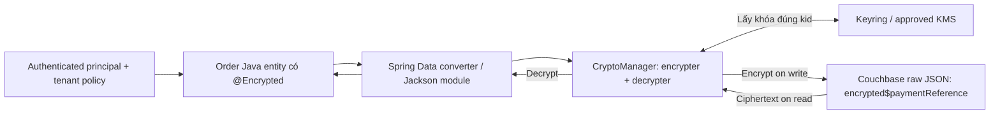
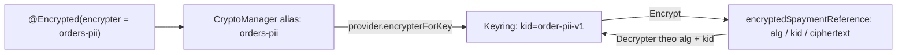
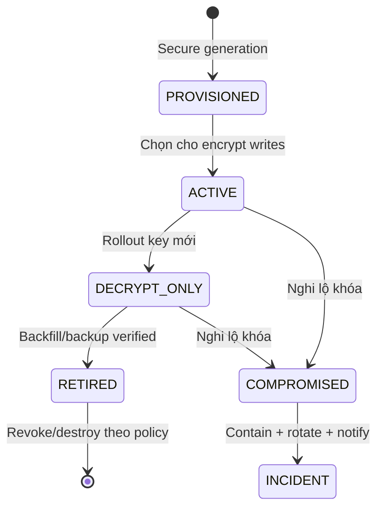
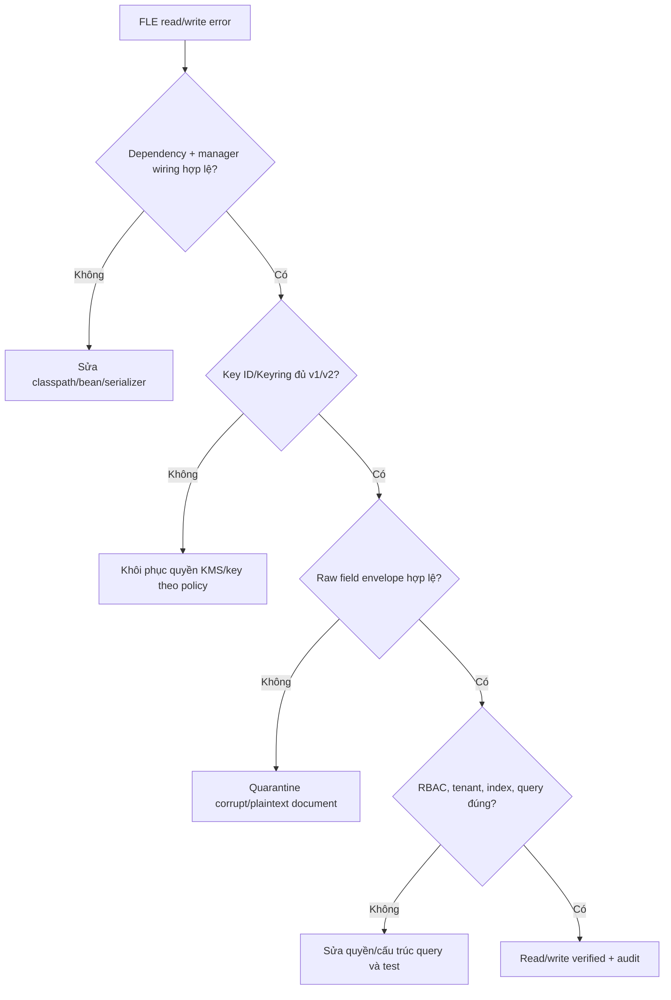

# @Encrypted, CryptoManager và vòng đời khóa mã hóa

## Mục tiêu và phạm vi

Trong module **SPRING_DATA_COUCHBASE**, ứng dụng Spring Boot sử dụng Spring Data Couchbase để ánh xạ JSON document, thao tác `CouchbaseRepository`, `CouchbaseTemplate` và truy vấn SQL++ trên bucket/scope/collection. Một số field nghiệp vụ như `status`, `createdAt` cần hiển thị cho Query Service để lọc hoặc index; nhưng `paymentReference`, một mã bí mật nội bộ hay thông tin nhận diện cá nhân có thể cần **mã hóa trước khi lưu trong Couchbase**.

**Field Level Encryption (FLE)** cho Java SDK mã hóa các field JSON được chọn trong process ứng dụng. Trên Spring Data Couchbase, hai thành phần trọng tâm là:

1. **`@Encrypted`** xác định field nào được mã hóa/giải mã trong đường mapping thích hợp và, nếu cần, tên encrypter alias hoặc chế độ migration.
2. **`CryptoManager`** xác định **encrypter/decrypter**, nhà cung cấp thuật toán và cách lấy đúng encryption key từ **Keyring**. Nó quyết định có thể đọc ciphertext cũ sau khi thay khóa hay không.

Chỉ có annotation mà thiếu CryptoManager hoặc ghi document qua một đường JSON thô bỏ qua annotation **không tạo ra bảo đảm bảo mật**. Chỉ có CryptoManager mà không đánh dấu field hoặc không dùng API mã hóa cũng không tự mã hóa mọi string.

Học xong bài này, bạn có thể:

- Đặt `@Encrypted` lên entity và giải thích `encrypter`, `migration`, default alias và giới hạn khi dùng Jackson/MappingCouchbaseConverter.
- Phân biệt **encrypter alias**, **`kid` (key ID)**, **thuật toán `alg`**, **key material** và **CryptoManager instance**.
- Cấu hình Spring Data `AbstractCouchbaseConfiguration.cryptoManager()` hoặc SDK `ClusterEnvironment.cryptoManager(...)` với keyring thật.
- Thiết kế **cấp khóa → kích hoạt → xoay v1/v2 → backfill → retire/revoke**, không làm mất dữ liệu do xóa khóa cũ quá sớm.
- Xác định đường ghi có thể bypass FLE: KV `JsonObject`, sub-document, SQL++ `UPDATE`, custom serialization, template/projection và reactive operations.
- Giữ nguyên TTL/CAS, tenant authorization, RBAC và kiểm soát index/query khi ciphertext thay thế plaintext.
- Viết kiểm thử xác nhận **raw JSON đã mã hóa**, typed read giải mã được, negative tests khi khóa sai/tampered data và key rotation.

> **Phạm vi kỹ thuật:** Couchbase Java SDK ≥ 3.0.5, thư viện `com.couchbase.client:couchbase-encryption` ≥ 3.0.0, Spring Data Couchbase có tích hợp FLE từ 5.0.0-RC1. Đây là **ngưỡng tài liệu hóa**, không phải chỉ định dùng bản release cũ. `@Encrypted.Migration` xuất hiện theo version SDK cụ thể; kiểm tra API của dependency thực dùng. Thư viện FLE là **optional**, có điều kiện Couchbase Enterprise Subscription License; xác minh entitlement và compatibility matrix trước production. Các lệnh/fixture dùng `training.commerce.orders` hoặc bucket `it_fle_keys` **chỉ để học/kiểm thử**, không chứa dữ liệu thật.

## 1. Sơ đồ trách nhiệm: mapping, crypto, database và KMS



### 1.1. Các lớp bảo vệ là độc lập

| Cơ chế | Nó bảo vệ | Nó **không** thay thế |
| --- | --- | --- |
| FLE | Field nhạy cảm trước khi Couchbase nhận dữ liệu | TLS, RBAC, API authorization, backup/host security |
| `couchbases://` / TLS | Bytes trên đường mạng SDK ↔ Server | Mã hóa field trong JSON Server có thể query |
| Encryption at rest | File/ổ đĩa/backup theo tính năng Server và policy | FLE trên field hoặc hạn chế user đọc qua SDK |
| RBAC | Thao tác trên bucket/scope/collection | Row-level tenant ownership trong shared collection |
| API authorization | User/tenant nào được đọc, sửa hoặc decrypt field | Quản lý khóa, bảo vệ ciphertext và logs |

**Threat model điển hình:** Một operator có quyền đọc raw document nhưng **không có FLE key** chỉ quan sát ciphertext ở field bảo vệ. Ngược lại, một backend có quyền đọc và key decrypt vẫn nhìn được plaintext trong memory; nó phải kiểm tra quyền người dùng cuối trước khi trả DTO, log hoặc export.

FLE không tự mã hóa document ID, tên collection, các field chưa được đánh dấu, `_class`, CAS hay TTL metadata. **Không** đặt số thẻ/PII trong document ID hoặc trong một field plaintext phụ rồi kỳ vọng `@Encrypted` che được. Đối với mật khẩu đăng nhập, dùng **password hashing** có tham số phù hợp, không dùng mã hóa có thể đảo ngược như FLE để xác minh password.

### 1.2. Dữ liệu mẫu và hợp đồng truy vấn

Một document trước FLE:

```json
{
  "tenantId": "tenant-a",
  "status": "PAID",
  "createdAt": "2026-11-01T10:00:00Z",
  "paymentReference": "LAB-PAY-REF-1001"
}
```

Sau khi bật FLE đúng và persist, raw JSON minh họa:

```json
{
  "tenantId": "tenant-a",
  "status": "PAID",
  "createdAt": "2026-11-01T10:00:00Z",
  "encrypted$paymentReference": {
    "alg": "AEAD_AES_256_CBC_HMAC_SHA512",
    "kid": "order-pii-v1",
    "ciphertext": "<base64-encoded-encrypted-payload>"
  }
}
```

`tenantId`, `status` và `createdAt` vẫn có thể tham gia `WHERE`/`ORDER BY` theo chính sách thiết kế. Còn `paymentReference` không còn là plaintext để Query Service so sánh hoặc lập index tìm kiếm theo giá trị gốc. Envelope `encrypted$...` chứa metadata và ciphertext; nó không phải một JSON object do ứng dụng tự dựng bằng cách đổi tên field.

## 2. Hiểu chính xác `@Encrypted`

Annotation chính thức:

```java
import com.couchbase.client.java.encryption.annotation.Encrypted;
```

Spring Data Couchbase có thể encrypt trước khi write/decrypt sau khi read trên đường mapping được tích hợp. Java SDK có thể xử lý annotation nhờ Jackson `EncryptionModule` và `CryptoManager`. **Hai đường serialization không đồng nghĩa mọi API KV/Query đều tự chạy annotation**.

### 2.1. Cú pháp mặc định, alias và migration

```java
public class PaymentDetails {
    // Dùng default encrypter của CryptoManager.
    @Encrypted
    private String paymentReference;

    // Dùng encrypter alias riêng đã đăng ký trong CryptoManager.
    @Encrypted(encrypter = "orders-pii")
    private String internalMemo;

    // Chỉ dùng trong giai đoạn chuyển field PLAINTEXT cũ sang encrypted.
    @Encrypted(migration = Encrypted.Migration.FROM_UNENCRYPTED)
    private String legacyCustomerCode;
}
```

| Thành phần | Ý nghĩa | Lỗi dễ gặp |
| --- | --- | --- |
| `@Encrypted` | Dùng **default encrypter** do CryptoManager cung cấp | Không có default encrypter hoặc writer không dùng FLE |
| `encrypter = "orders-pii"` | Chọn **alias encrypter** đã đăng ký | Nghĩ `orders-pii` tự động là tên key/algorithm |
| `migration = FROM_UNENCRYPTED` | Có thể đọc giá trị plaintext cũ trong giai đoạn chuyển đổi; ghi lại có encryption | Dùng vĩnh viễn, vô tình cho phép downgrade về plaintext |
| Không có `@Encrypted` | Mapper xử lý như field thường | Tưởng mọi field sẽ được mã hóa vì CryptoManager tồn tại |

Default encrypter alias trong API có tên nội bộ `__DEFAULT__`; bạn **không cần** viết chuỗi đó trong annotation. `@Encrypted(encrypter = "orders-pii")` phải trỏ đến **encrypter alias có thật**, không phải `kid` được đặt vào ciphertext, không phải tên keystore và không phải `alg`. Một alias có thể được cấu hình để mã hóa bằng `key-v1` ở thời điểm A và `key-v2` ở thời điểm B.

**Migration** không dành cho tình huống “đổi key v1 sang v2” thông thường: dữ liệu v1 vốn đã ciphertext hợp lệ, nên vấn đề là **keyring/decrypter còn truy xuất v1**. `FROM_UNENCRYPTED` chỉ thích hợp khi dữ liệu **chưa từng được mã hóa** cần chuyển sang encrypted form.

### 2.2. Annotation được đặt ở đâu?

Java SDK Jackson data binding cho phép đặt `@Encrypted` tại **field** hoặc getter/setter thích hợp theo cách cấu hình serializer. Spring Data Couchbase đọc metadata entity theo mapping của phiên bản; cách ít mơ hồ là đặt annotation trực tiếp trên field Java và kiểm tra thực tế trong test. Với Java records, Lombok, immutable constructors và custom `@Field` mapping, không suy tính tương thích từ ví dụ JavaBean đơn giản: cần integration test đọc/ghi.

**Không dùng annotation nhầm package.** Một annotation `@Encrypted` từ thư viện khác có thể compile nhưng không được Couchbase `CryptoManager` xử lý. Không giả định một annotation trên DTO HTTP có hiệu lực với entity thực sự được persist.

### 2.3. Một entity tối thiểu có `@Encrypted`

```java
package example.orders;

import com.couchbase.client.java.encryption.annotation.Encrypted;
import org.springframework.data.annotation.Id;
import org.springframework.data.couchbase.core.mapping.Document;
import org.springframework.data.couchbase.core.mapping.Scope;
import org.springframework.data.couchbase.core.mapping.Collection;

@Document
@Scope("commerce")
@Collection("orders")
public class Order {
    @Id
    private String id;
    private String tenantId;
    private String status;
    private String createdAt;

    @Encrypted
    private String paymentReference;

    protected Order() {}

    public Order(String id, String tenantId, String status,
                 String createdAt, String paymentReference) {
        this.id = id;
        this.tenantId = tenantId;
        this.status = status;
        this.createdAt = createdAt;
        this.paymentReference = paymentReference;
    }

    public String getId() { return id; }
    public String getTenantId() { return tenantId; }
    public String getStatus() { return status; }
    public String getCreatedAt() { return createdAt; }
    public String getPaymentReference() { return paymentReference; }
}
```

`@Scope("commerce")` và `@Collection("orders")` xác định resource mapping; chúng **không tạo quyền DB** và không bảo vệ tenant. Khi dùng shared collection, mọi `findById`/query phải xác minh ownership trước khi đưa `paymentReference` đã giải mã ra API.

### 2.4. Nested fields, nulls và versioning

Java SDK 3 cho phép FLE trên field nested sâu hơn SDK 2. Với object lồng nhau, kiểm tra tên trường vật lý, serialization behavior, null/missing semantics và schema migration bằng test raw JSON. `null`/missing không nên được suy đoán sẽ sinh ciphertext giống string non-null trong mọi version; policy nghiệp vụ cần xác định điều gì xảy ra khi field không tồn tại.

Nếu entity có `@Version` để dùng CAS/optimistic locking, nó bảo vệ **trạng thái cập nhật cạnh tranh**, không xác thực ciphertext. Một write được mã hóa lại có thể tạo ciphertext khác dù plaintext không đổi, nên diffing ở raw JSON và CDC cần được hiểu đúng.

Nguồn: [Spring Data Couchbase — Field Level Encryption](https://docs.spring.io/spring-data/couchbase/reference/couchbase/fieldlevelencryption.html), [Java SDK — Encrypted API](https://docs.couchbase.com/sdk-api/couchbase-java-client/com/couchbase/client/java/encryption/annotation/Encrypted.html).

## 3. Envelope, `alg`, `kid`, alias và key bytes

**Năm khái niệm khác nhau:**

| Tên | Ví dụ | Vai trò |
| --- | --- | --- |
| **Logical property** | `paymentReference` | Field mà Java entity hiểu |
| **Encrypter alias** | `orders-pii` | Tên lookup trong CryptoManager khi **ghi** |
| **Key ID (kid)** | `order-pii-v1` | Định danh key trong ciphertext để **đọc** và audit |
| **Algorithm ID (alg)** | `AEAD_AES_256_CBC_HMAC_SHA512` | Để decrypter chọn thuật toán |
| **Key material** | 64 byte bí mật | Thực sự dùng cho encryption và integrity; không đưa vào JSON |



### 3.1. Thuật toán tiêu chuẩn

Provider mặc định có tên **`AEAD_AES_256_CBC_HMAC_SHA512`**, dùng một key **64 byte** (phần dành cho AES-256 và phần dành cho HMAC-SHA512). Đây là cơ chế authenticated encryption do thư viện triển khai; **không tự chọn AES-256-CBC trần** rồi coi là tương đương. Đừng tự viết mã “mã hóa nhanh” bằng `Cipher.getInstance("AES/CBC/...")` và bỏ kiểm tra integrity.

Tài liệu Couchbase nói các primitive của provider chuẩn có thể là FIPS-approved; điều này **không tự chứng nhận toàn bộ ứng dụng đạt FIPS**. Kiểm tra cryptographic module/provider, chế độ vận hành, yêu cầu pháp lý và evidence theo chuẩn mà tổ chức áp dụng.

### 3.2. Lỗi thường gặp khi hiểu `kid`

1. Gọi encrypter alias `orders-pii` không có nghĩa trường `kid` sẽ bằng `orders-pii`. Nếu alias này dùng key `order-pii-v2`, ciphertext được ghi với ID key tương ứng.
2. **Không** hardcode vào code rằng `kid` luôn là v1. Decrypter phải đọc `kid` từ envelope và keyring phải tìm được key thực sự.
3. **Không** để client HTTP tùy chọn `kid`/encrypter alias để tìm cách dùng key của tenant khác.
4. `kid` có thể được nhìn thấy bởi những account đọc raw document; nó **không** là secret nhưng có thể chứa tên tenant hoặc phân loại nhạy cảm nếu đặt tên thiếu cân nhắc. Thiết kế ID không tiết lộ PII.
5. Chỉ đổi tên `kid` trong JSON không tạo key mới; có thể làm mất khả năng decrypt hoặc khiến kiểm tra integrity thất bại.

### 3.3. Không xem `encrypted$` là phép kiểm tra duy nhất

Một field được đặt tên `encrypted$paymentReference` **chưa chứng minh** nó chứa ciphertext hợp lệ. Một writer sai có thể tự copy plaintext hoặc tạo envelope giả. Cần đồng thời:

- Khẳng định **không có field `paymentReference` plaintext** còn trong raw document.
- Envelope có `alg`/`kid`/`ciphertext` đúng shape và key ID mong đợi.
- Typed read giải mã thành công bằng **đúng keyring được cấp**, không có plaintext fallback.
- Negative test sai key/tampering thất bại; positive test được cô lập theo tenant và môi trường.

Nguồn: [Java SDK — FLE Concepts](https://docs.couchbase.com/java-sdk/current/concept-docs/encryption.html).

## 4. Dependencies, license và cấu hình chạy thực

### 4.1. Một dependency không phải là một cấu hình hoàn chỉnh

| Thành phần | Cần thiết để làm gì? | Cách kiểm tra |
| --- | --- | --- |
| `spring-boot-starter-data-couchbase` | Spring Data mapping/repository/template | Dependency tree và context test |
| `couchbase-encryption` | Implementation FLE, provider/keyring | Khai báo explicit; kiểm tra runtime classpath |
| `CryptoManager` | Chọn encrypter/decrypter và field-name strategy | Đường Spring Data/SDK thực sự dùng bean/config |
| `Keyring` | Truy xuất key theo `kid` | Test đọc/ghi với key v1, v2 và không có key |
| `@Encrypted` hoặc `JsonObjectCrypto` | Chỉ rõ field và write/read API áp mã hóa | Raw JSON inspection trên collection test |
| DB connection/roles | KV/SQL++ truy cập collection | Tách user runtime khỏi provisioning/migration admin |
| KMS/secret store | Phân phối key/keystore password | ACL, audit, DR, rotation, environment isolation |
| License/compatibility | Quyền sử dụng FLE và API đúng phiên bản | Pin versions, phê duyệt và regression tests |

Trong Gradle:

```groovy
dependencies {
    implementation 'org.springframework.boot:spring-boot-starter-data-couchbase'

    // Version do dependency management của dự án phê duyệt.
    implementation 'com.couchbase.client:couchbase-encryption:<approved-version>'

    testImplementation 'org.springframework.boot:spring-boot-starter-test'
}
```

`<approved-version>` là placeholder **cần thay**, không phải version có thể resolve. Không thêm mọi optional dependency theo ví dụ tài liệu một cách máy móc: ví dụ **Spring Vault** chỉ cần khi chọn một integration `Vault Transit` tương ứng và phải kiểm tra version tương thích với Boot BOM. Maven coordinates tương đương là `com.couchbase.client:couchbase-encryption` với version được duyệt.

**Không kiểm tra bằng cách thấy code compile rồi kết luận FLE bật.** SDK core/Boot starter không bắt buộc tích hợp thư viện optional này. Phải có runtime classpath, CryptoManager được đăng ký, đúng entity/serialization path và bằng chứng ciphertext vật lý.

### 4.2. Biến cấu hình runtime cần tách

```text
CB_CONNECTION_STRING=<endpoint của cluster>
CB_APP_USERNAME=<runtime DB username>
CB_APP_PASSWORD=<DB secret>
CB_BUCKET_NAME=<bucket dành cho môi trường>

FLE_KEYSTORE_PATH=<read-only mounted keystore>
FLE_KEYSTORE_PASSWORD=<key store integrity password>
FLE_KEY_ENTRY_PASSWORD=<key entry protection password>
FLE_ACTIVE_KEY_ID=order-pii-v1
```

Các dòng là **tên biến và placeholder**, không phải file `.env` chứa secret để commit. Với production, có thể dùng Vault/KMS/HSM thay JCEKS. **DB password**, **FLE data key**, **keystore password**, **KMS token** và **TLS private key** là các secrets khác mục đích; không reuse một giá trị cho nhiều loại.

Biến `FLE_ACTIVE_KEY_ID` nếu được phép cấu hình runtime phải đi qua một **allowlist phiên bản/keyring đã provision**, không lấy từ một request client để chọn arbitrary key. Kiểm tra startup fail nếu môi trường đặt `order-pii-v9` nhưng keyring chỉ có v1/v2.

## 5. Keyring: cấp khóa, lưu khóa và nạp khóa

### 5.1. Mô hình vòng đời một key



| Trạng thái | Cho encrypt dữ liệu mới? | Cho decrypt dữ liệu cũ? | Điều kiện |
| --- | --- | --- | --- |
| **PROVISIONED** | Chưa | Chỉ test | Key có ID, ACL, metadata và owner rõ |
| **ACTIVE** | Có | Có | Key vừa được phê duyệt làm write key |
| **DECRYPT_ONLY** | Không trong writer mới | Có | Dữ liệu lịch sử/backup còn dựa vào key |
| **RETIRED** | Không | Không đối với online app | Chỉ khi không còn dữ liệu/retention hợp lệ cần key |
| **COMPROMISED** | Không | Xử lý theo IR, tối thiểu | Cần đánh giá exposure và phục hồi khẩn cấp |

Đây là **state machine chính sách** để thiết kế hệ thống; API `Keyring` trong thư viện không mặc định có một enum state như vậy. Policy được thực thi bằng cấu hình encrypter, khả năng truy xuất khóa, quyền KMS và quy trình provisioning.

### 5.2. Key 64 byte với provider chuẩn

Provider **`AeadAes256CbcHmacSha512Provider`** cần **64 byte key material**. Không dùng một secret là “123456”, giá trị thời gian hệ thống, hash password chưa có KDF chuẩn hoặc mã định danh tenant làm key. Nguồn phải là CSPRNG/HSM/KMS được phê duyệt.

Ví dụ **chỉ dùng trong provisioning job biệt lập** để tạo JCEKS keyring test:

```java
import java.nio.file.Files;
import java.nio.file.Path;
import java.nio.file.StandardOpenOption;
import java.security.KeyStore;
import java.security.SecureRandom;
import java.util.Arrays;

// KeyStoreKeyring: class thuộc thư viện couchbase-encryption.
// Bài này giả định FLE_KEYSTORE_PATH là đường dẫn FILE MỚI ở môi trường test.
char[] storePassword =
    System.getenv("FLE_KEYSTORE_PASSWORD").toCharArray();
char[] entryPassword =
    System.getenv("FLE_KEY_ENTRY_PASSWORD").toCharArray();
byte[] key = new byte[64];
new SecureRandom().nextBytes(key);

try {
    KeyStore keyStore = KeyStore.getInstance("JCEKS");
    keyStore.load(null, storePassword);
    KeyStoreKeyring.setSecretKey(
        keyStore, "order-pii-v1", key, entryPassword);

    Path target = Path.of(System.getenv("FLE_KEYSTORE_PATH"));
    try (var stream = Files.newOutputStream(
            target, StandardOpenOption.CREATE_NEW,
            StandardOpenOption.WRITE)) {
        keyStore.store(stream, storePassword);
    }
} finally {
    Arrays.fill(key, (byte) 0);
    Arrays.fill(storePassword, '\0');
    Arrays.fill(entryPassword, '\0');
}
```

**Cách đọc code:** Đây là **mảnh provisioning** để đặt trong một class/test utility đã import đúng `KeyStoreKeyring`, không phải API HTTP hay lệnh cần chạy trong container production. Phải validate biến môi trường và filesystem permissions **trước khi chạy**; `CREATE_NEW` tránh ghi đè accidental nhưng không thay cơ chế cấp phát khóa. Không đưa bytes/password ra stdout, shell history, log hoặc Git. Java có thể vẫn giữ bản sao secret trong provider/keystore; xóa mảng cục bộ chỉ giảm thời gian tồn tại, không bảo đảm xóa mọi bản sao trong heap.

Trong production, giải pháp KMS/HSM/Vault có thể kiểm soát generation, exportability và audit tốt hơn. **Không bảo đảm** mọi KMS cho phép xuất 64 byte dưới dạng raw symmetric key; chọn API/keyring provider phù hợp với thiết kế FLE và policy của nhà cung cấp.

### 5.3. Load JCEKS làm keyring (tối giản)

```java
import java.nio.file.Files;
import java.nio.file.Path;
import java.security.KeyStore;
import java.util.Arrays;

char[] storePassword =
    System.getenv("FLE_KEYSTORE_PASSWORD").toCharArray();

KeyStore store = KeyStore.getInstance("JCEKS");
try (var input = Files.newInputStream(
        Path.of(System.getenv("FLE_KEYSTORE_PATH")))) {
    store.load(input, storePassword);
} finally {
    Arrays.fill(storePassword, '\0');
}

Keyring keyring = new KeyStoreKeyring(
    store,
    keyName -> System.getenv("FLE_KEY_ENTRY_PASSWORD")
);
```

`KeyStoreKeyring` nhận một cách tìm **entry password theo keyName**; ví dụ dùng một entry password cho lab. Production có thể khác password/ACL theo từng key, secret version và service. `System.getenv` trả String còn sống trong bộ nhớ, nên không tự nhận đây là giải pháp bảo vệ secret hoàn hảo; nếu hệ thống cần secret rotation mạnh, thiết kế loader/secret provider theo API hỗ trợ và security review.

**Không mount cả keyring test vào production**, và không sao chép keystore có v1 khi hệ thống đã dùng v2 nếu nó khiến v2 decrypt lỗi. Kiểm tra read-only filesystem mounts, process identity, secret version và khả năng khôi phục sau mất node.

### 5.4. Quy tắc bất biến về `kid`

- `kid` phải ổn định và duy nhất trong phạm vi key registry; cùng `kid` không được trỏ tới bytes khác tùy máy/tùy pod.
- Encrypt v2 phải tạo envelope ghi `kid=v2`, còn decrypt v1 phải tìm **đúng bytes v1** qua keyring.
- Đổi tên key alias trong code không tự đổi `kid` của documents đã tồn tại.
- Không gắn tên người dùng, số định danh hoặc secret vào `kid`.
- Kiểm tra cùng một document v1 đọc được trên **mọi replica** trong rollout, không chỉ trên một pod có keystore đúng.
- Khi key bị nghi compromise, chạy **incident response**, không kéo dài thời hạn trust v1 một cách mặc định chỉ để tránh downtime.

Nguồn: [Java SDK — Encrypting Your Data](https://docs.couchbase.com/java-sdk/current/howtos/encrypting-using-sdk.html), [Java Encryption Library](https://github.com/couchbase/java-couchbase-encryption).

## 6. Tạo `CryptoManager`: một writer key, nhiều reader keys

### 6.1. Factory tối giản

Sau khi có một `Keyring` đã load từ secret store:

```java
// Đoạn trong lớp cấu hình FLE; tham số keyring đến từ provider
// đã quản lý vòng đời, không tạo key mới ở mỗi startup.
static CryptoManager buildCryptoManager(
        Keyring keyring, String activeKeyId) {
    var provider = AeadAes256CbcHmacSha512Provider.builder()
        .keyring(keyring)
        .build();

    return DefaultCryptoManager.builder()
        .decrypter(provider.decrypter())
        .defaultEncrypter(provider.encrypterForKey(activeKeyId))
        .build();
}
```

Các class `Keyring`, `AeadAes256CbcHmacSha512Provider`, `DefaultCryptoManager` đến từ phần FLE Java library; `CryptoManager` là API trừu tượng ở `com.couchbase.client.core.encryption`. Imports đầy đủ và package của implementation classes phải theo **release FLE đã pin**; đoạn này chủ ý mô tả một **method factory** để đặt trong module cấu hình thay vì một file Java standalone.

**Phân tích:**

1. `provider.encrypterForKey(activeKeyId)` tạo encrypter ghi dữ liệu mới bằng key ID đã chọn, ví dụ `order-pii-v2`.
2. `provider.decrypter()` dùng `alg` và `kid` trên envelope để truy vấn keyring, nên vẫn có thể giải mã v1 **nếu keyring còn v1**.
3. `defaultEncrypter(...)` phục vụ những field `@Encrypted` không chỉ định alias.
4. Khi `@Encrypted(encrypter = "orders-pii")`, phải **đăng ký named encrypter alias tương ứng** bằng builder API của đúng FLE version; alias này không được tự suy từ `activeKeyId`.

Không hardcode `activeKeyId` từ HTTP header hoặc body. Ở production, key lifecycle config do security/platform team triển khai và có policy rõ về canary, rollout, rollback. Kiểm tra startup fail khi `activeKeyId` chưa provision.

### 6.2. Named alias: mục đích và cách chuyển phiên bản

Giả sử entity có hai field:

```java
@Encrypted(encrypter = "orders-pii")
private String paymentReference;

@Encrypted(encrypter = "support-secret")
private String internalSupportNote;
```

Đây là **hai tên alias ổn định** theo mục đích dữ liệu. Một chính sách quản lý có thể map:

| Thời điểm | Alias | Key ID để encrypt mới |
| --- | --- | --- |
| Trước rotation | `orders-pii` | `order-pii-v1` |
| Sau canary rollout | `orders-pii` | `order-pii-v2` |
| Không đổi | `support-secret` | `support-note-v3` |

Không cần sửa annotation trên mọi entity khi đổi key v1 → v2; phần mapping encrypter trong CryptoManager thay đổi. **Decrypter** phải giữ khả năng đọc `kid=v1` trong khi dữ liệu cũ còn sống. Alias dành cho **write policy**, key ID trong envelope dành cho **read key resolution**.

**Quan trọng:** API Builder đăng ký alias có thể khác theo phiên bản; tài liệu Spring Data chỉ nói tên được cấu hình khi **adding the encrypter to CryptoManager**. Trước khi dùng `@Encrypted(encrypter = "...")` trong production, phải kiểm tra Java API của version pin, test cả default + named encrypters và khẳng định `kid` đúng sau write. Đừng tự bịa method tên `registerEncrypter` nếu builder đang dùng cung cấp method khác.

### 6.3. Tại sao không tạo `CryptoManager` ở mỗi request?

`CryptoManager` là chính sách crypto và những provider/keyring có lifecycle; Java SDK `Cluster` là client **dài hạn**, có connection pools, bootstrap và quản lý tài nguyên. Tạo cả Cluster/CryptoManager/Keyring trong một handler HTTP:

- Gây overhead tạo kết nối/đọc keystore, tăng latency và lãng phí tài nguyên.
- Khó quản lý key v1/v2 nhất quán giữa requests.
- Khó đảm bảo KMS audit/ACL và cleanup không rò tài nguyên.
- Có thể sinh đường đọc thiếu key hoặc hai cấu hình FLE không đồng bộ.

Thay vào đó, tạo một **crypto configuration per application instance** với keyring an toàn, gắn vào đúng Spring Data/SDK client và có rollout/refresh mechanism được kiểm chứng. Nếu key provider hỗ trợ reload, cần xác minh SDK giữ reference hay snapshot và khi nào phải tạo/restart client mới.

## 7. Tích hợp `CryptoManager` với Spring Data Couchbase

### 7.1. `AbstractCouchbaseConfiguration.cryptoManager()`

Spring Data Couchbase tài liệu hóa integration bằng override:

```java
import com.couchbase.client.core.encryption.CryptoManager;
import org.springframework.context.annotation.Configuration;
import org.springframework.data.couchbase.config.AbstractCouchbaseConfiguration;
import org.springframework.data.couchbase.repository.config.EnableCouchbaseRepositories;

@Configuration
@EnableCouchbaseRepositories(basePackages = "example.orders")
public class OrdersCouchbaseConfiguration
        extends AbstractCouchbaseConfiguration {

    private final CryptoManager manager;

    public OrdersCouchbaseConfiguration(CryptoManager manager) {
        this.manager = manager;
    }

    @Override
    public String getConnectionString() {
        return require("CB_CONNECTION_STRING");
    }
    @Override
    public String getUserName() {
        return require("CB_APP_USERNAME");
    }
    @Override
    public String getPassword() {
        return require("CB_APP_PASSWORD");
    }
    @Override
    public String getBucketName() {
        return require("CB_BUCKET_NAME");
    }

    @Override
    protected CryptoManager cryptoManager() {
        return manager;
    }

    private static String require(String name) {
        String value = System.getenv(name);
        if (value == null || value.isBlank()) {
            throw new IllegalStateException("Missing config: " + name);
        }
        return value;
    }
}
```

Đây là **cấu hình minh họa một đường Spring Data**. `CryptoManager manager` được tạo/cấp từ một bean provisioning riêng, không tạo key v1 ngẫu nhiên mỗi lần ứng dụng khởi động. Nếu project đã sử dụng `AbstractCouchbaseConfiguration`, **sửa class đó** chứ không thêm một cấu hình thứ hai; nếu dự án phụ thuộc hoàn toàn vào Spring Boot auto-configuration, phải xác minh cách cung cấp FLE manager mà **không nhân đôi Cluster/client factory beans**.

**Tại sao không chỉ đánh dấu `@Component` cho CryptoManager?** Một Bean có mặt trong ApplicationContext không bảo đảm `MappingCouchbaseConverter` hoặc `ClusterEnvironment` thực sự dùng nó. Hãy kiểm chứng bằng cách `repository.save` rồi đọc raw document như test mục 14. Khi dùng `CouchbaseTemplate` hoặc reactive repository, test riêng đường serialization đó.

### 7.2. Phân biệt đường Spring Data và Java SDK

| Đường ghi/đọc | Cơ chế FLE cần có | Ví dụ |
| --- | --- | --- |
| `CouchbaseRepository.save(Order)` | Spring Data converter tích hợp `@Encrypted` + CryptoManager | Entity typed |
| `CouchbaseTemplate` typed operation | Mapping converter đúng đã được cấu hình | Verify ở runtime version |
| SDK `collection.upsert(id, Order)` | Jackson `EncryptionModule` + SDK environment CryptoManager | POJO binding |
| SDK `collection.upsert(id, JsonObject)` | Không tự động theo annotation ở một entity khác | Cần `JsonObjectCrypto` |
| SDK `collection.mutateIn(...)` | Không tự apply FLE annotation trên subdoc payload | Encrypt-aware path/thiết kế riêng |
| SQL++ `UPDATE SET ...` | Query Service không có client-side Keyring | Không dùng raw plaintext DML cho protected field |
| SDK `cluster.query(...).rowsAsObject()` | Trả JSON query result, không tự dùng entity decryption | Projection/raw ciphertext |

### 7.3. Tránh cấu hình xung đột với Spring Boot starter

Một dự án có thể có:

- Boot `spring.couchbase.*` và `spring.data.couchbase.*` properties.
- `AbstractCouchbaseConfiguration` do developer tự dựng.
- Một `Cluster` bean custom hoặc `ClusterEnvironment` singleton.
- Integration tests dùng `@ServiceConnection`/Testcontainers override connection.

Không đặt cùng lúc nhiều cơ chế mà chưa xác minh **bean precedence**. Nếu FLE được đăng ký cho cluster A nhưng repository dùng cluster B, typed save có thể ghi plaintext dù `CryptoManager` bean tồn tại. Dùng **startup checks**, bean wiring test và raw data test. Không tự ý kích hoạt debug log chứa key/plaintext để kiểm tra.

### 7.4. Custom Jackson ObjectMapper trên SDK trực tiếp

Java SDK docs mô tả việc đăng ký các modules khi app tự cung cấp `ObjectMapper`:

```java
// Trong chương trình Java SDK tự cấu hình, không phải yêu cầu
// bắt buộc đối với mọi Spring Data Couchbase repository.
ObjectMapper mapper = new ObjectMapper();
mapper.registerModule(new JsonValueModule());
mapper.registerModule(new EncryptionModule(cryptoManager));

ClusterEnvironment environment = ClusterEnvironment.builder()
    .cryptoManager(cryptoManager)
    .jsonSerializer(JacksonJsonSerializer.create(mapper))
    .build();
```

`JsonValueModule` dành cho các kiểu JSON SDK; `EncryptionModule` xử lý annotation trong Jackson data binding. Nếu bạn override serializer và **quên EncryptionModule**, POJO `@Encrypted` có thể không được xử lý như kỳ vọng. Cũng đừng nhầm `ObjectMapper` của Spring MVC/HTTP response với SDK serializer hoặc `MappingCouchbaseConverter` của Spring Data.

### 7.5. Lập `Cluster` với CryptoManager khi không dùng Spring Data

```java
// Chương trình thuần SDK, không dùng chung với Spring-managed Cluster.
Cluster cluster = Cluster.connect(
    System.getenv("CB_CONNECTION_STRING"),
    ClusterOptions.clusterOptions(
        System.getenv("CB_APP_USERNAME"),
        System.getenv("CB_APP_PASSWORD")
    ).environment(env -> env.cryptoManager(cryptoManager))
);
try {
    // Truy cập collection qua cluster dài hạn.
    var orders = cluster.bucket("training")
        .scope("commerce").collection("orders");
    // ... typed POJO / JsonObjectCrypto ops ...
} finally {
    cluster.disconnect();
}
```

Đừng đặt `cluster.disconnect()` trong HTTP request nếu cluster thuộc shared Spring container. Nếu ứng dụng tự cấp `ClusterEnvironment` thay vì dùng environment customization, theo API phiên bản đã pin mà quản lý cả vòng đời environment riêng. FLE **không yêu cầu** tạo mới Cluster mỗi khi chọn một key ID.

Nguồn: [Spring Data — FLE Configuration](https://docs.spring.io/spring-data/couchbase/reference/couchbase/fieldlevelencryption.html), [Java SDK — FLE Usage](https://docs.couchbase.com/java-sdk/current/howtos/encrypting-using-sdk.html).

## 8. Vòng đời khóa đầy đủ: từ provisioning đến hủy bỏ

Với field đã mã hóa, **thay cấu hình chỉ ảnh hưởng các lần ghi mới**; ciphertext cũ không tự thay key. Chiến lược rotation phải xét **toàn bộ writers, readers, backups, batch jobs, exports và dữ liệu có TTL dài**.

### 8.1. Bốn tài sản phải được quản lý độc lập

| Tài sản | Ví dụ | Người chịu trách nhiệm | Tác động khi thay |
| --- | --- | --- | --- |
| **Key material** | 64 bytes của `order-pii-v1` | Security/KMS team | Mất hoặc thay bytes dưới cùng ID gây decrypt lỗi |
| **Key ID** | `order-pii-v1`, `order-pii-v2` | Key registry | Được lưu trong ciphertext, là định danh để đọc |
| **Encrypter alias** | `orders-pii` | Ứng dụng/security config | Lựa chọn key cho lần ghi mới |
| **CryptoManager deployment config** | Default encrypter=v2; decrypter supports v1+v2 | App/platform deployment | Pods rollout không đồng nhất có thể đọc thất bại |

**Không thay bytes của key v1 rồi giữ nguyên tên `order-pii-v1`** để thực hiện rotation. Đó là đổi nghĩa một ID đã được ciphertext cũ tham chiếu; decryption sẽ thất bại. Rotation đúng tạo **key ID mới**.

### 8.2. Timeline rotation v1 → v2

```mermaid
flowchart LR
    INV["0. Inventory documents & consumers"]
    ISSUE["1. Provision v2, giữ v1"]
    DUAL["2. Roll out readers: read v1+v2"]
    CANARY["3. Canary writes với v2"]
    WRITERS["4. Roll out all writers -> v2"]
    REKEY["5. Re-encrypt old documents"]
    SCAN["6. Verify: no live kid=v1"]
    RETIRE["7. Retire v1 khi DR/retention cho phép"]
    INV --> ISSUE --> DUAL --> CANARY --> WRITERS --> REKEY --> SCAN --> RETIRE
```



| Mốc | Writer key | Reader keys | Bằng chứng để tiến hành |
| --- | --- | --- | --- |
| T0 | v1 | v1 | Biết ai đang tạo/đọc dữ liệu v1 |
| T1 | v1 | v1 + v2 | Keyring mới load ở mọi node; typed test vẫn đọc v1 |
| T2 | v2 (canary) và v1 (còn lại) | v1 + v2 | Canary v2 write rồi read ở cả replicas |
| T3 | v2 (tất cả writers) | v1 + v2 | Không còn writer v1 qua service/batch/job |
| T4 | v2 | v1 + v2 | Re-encryption có CAS, bảo toàn TTL/tenant |
| T5 | v2 | v1 + v2 | Không còn ciphertext v1 trong **live scope** và DR plan rõ |
| T6 | v2 | v2 | Security approval retire v1; rollback/backup policy cho phép |

**Vì sao deploy readers trước writers?** Trong rolling deployment, pod còn cũ có thể chưa biết key v2. Nếu writer mới tạo ciphertext v2 trước khi tất cả readers có khả năng decrypt v2, những pod cũ sẽ lỗi khi đọc. Khi T1 đã đạt, một phần writer lên v2 sẽ không làm readers mất khả năng đọc. Có thể cần staged flags và keyring version pin thay vì chỉ dựa trên thứ tự Kubernetes RollingUpdate.

### 8.3. Canary cần kiểm tra những gì?

Trong môi trường staging và trên bản production canary được cho phép:

1. Đọc document v1 bằng phiên bản pod mới có keyring v1+v2.
2. Ghi document **mới** bằng `@Encrypted` qua writer v2.
3. Đọc raw JSON, kiểm tra `kid=order-pii-v2`, không có plaintext `paymentReference`.
4. Đọc typed Java object bằng **reader v1+v2 ở replica khác**, so nội dung nghiệp vụ và tenant.
5. Kiểm tra rollback binary/config trong khi readers còn hỗ trợ v2. Không rollback sang một binary **chỉ biết v1** nếu đã có ciphertext v2, trừ khi đã giải quyết compatibility.
6. Kiểm tra behavior của `CouchbaseTemplate`, `JsonObjectCrypto`, reactive/batch writers và các job tồn tại lâu.
7. Đo latency encryption/decryption, KMS errors, `unknown kid`, RBAC và memory/connection pools.

Một test chỉ thực hiện trên cùng pod ghi v2 **không chứng minh** toàn cụm có thể đọc v2. Kiểm tra topology các replicas, batch workers và schedules chậm hoạt động.

### 8.4. Khi nào `kid=v1` có thể được hủy?

Chỉ sau khi chứng minh:

- Không còn **live documents** cần key v1.
- Không còn backup/restore/snapshot/archived exports hợp lệ dự kiến sẽ cần decrypt v1; nếu có thì key escrow phải theo retention.
- Không còn offline device/consumer/job tạo dữ liệu v1.
- Rollback deployment không đòi reader chỉ biết v1, hoặc có plan migrate ngược được kiểm chứng.
- Không có legal hold, audit, compliance policy yêu cầu giữ dữ liệu lịch sử.
- Chính sách key deletion đã được phê duyệt và có evidence.

**Crypto-shredding** (hủy key để dữ liệu không thể giải mã) là hành động **khó/không thể đảo ngược**. Không dùng nó như một thao tác cleanup mặc định nếu vẫn có dữ liệu phải được giữ; dữ liệu có thể còn cần khôi phục sau sự cố hạ tầng.

### 8.5. Nếu v1 bị nghi compromise

Rotation bình thường có thể duy trì dual-key decryption trong một khoảng overlap. Với **key compromise**, giữ khả năng decrypt v1 nghĩa là tiếp tục có vật liệu khóa nhạy cảm; việc xử lý cần theo **incident response**: cách ly identity/key, đánh giá lịch sử truy cập, thay key, re-encrypt ưu tiên theo rủi ro, quản lý restore/backups và thông báo theo policy. Không áp timeline T0–T6 cứng nhắc nếu cần revoke gấp.

## 9. Migration dữ liệu chưa mã hóa và legacy SDK

### 9.1. Từ plaintext sang ciphertext với `FROM_UNENCRYPTED`

Trong hệ thống cũ, document có thể lưu:

```json
{
  "tenantId": "tenant-a",
  "status": "PAID",
  "paymentReference": "LAB-OLD-PLAINTEXT-001"
}
```

Khi mới thêm `@Encrypted` và cấu hình CryptoManager, dữ liệu cũ **không tự được mã hóa**. Spring Data và Java SDK hỗ trợ migration annotation:

```java
import com.couchbase.client.java.encryption.annotation.Encrypted;

// Chỉ ở phase migration, có ngày kết thúc.
@Encrypted(migration = Encrypted.Migration.FROM_UNENCRYPTED)
private String paymentReference;
```

Nó cho phép **đọc cả plaintext cũ lẫn ciphertext hợp lệ**, trong khi **lần ghi bằng mapper hỗ trợ FLE** tạo ciphertext. Đây là cơ chế chuyển đổi, **không phải** lựa chọn mặc định vĩnh viễn. Nó có thể chấp nhận một field plaintext thay cho dữ liệu có integrity-protected envelope, tạo rủi ro downgrade/tampering nếu tồn tại mãi.

### 9.2. Quy trình chuyển đổi bằng bằng chứng

| Bước | Mục tiêu | Acceptance gate |
| --- | --- | --- |
| M0 — Inventory | Xác định field, namespace, số document plaintext | Có baseline, owner, backup/restore policy |
| M1 — Chuẩn bị | Provision CryptoManager, keyring, readers/writers | Test plaintext/ciphertext trong staging PASS |
| M2 — Dual-read tạm thời | Cho ứng dụng hỗ trợ data cũ | `FROM_UNENCRYPTED` chỉ bật trong phase được duyệt |
| M3 — Backfill | Đọc → xác minh → ghi qua FLE-aware path | CAS/TTL/tenant giữ đúng; không sinh plaintext mới |
| M4 — Audit | Đếm ciphertext, plaintext, unknown kid, errors | Không còn plaintext trong phạm vi bắt buộc |
| M5 — Strict mode | Bỏ migration flag, chỉ nhận encrypted field | Negative plaintext test FAIL đúng mong đợi |
| M6 — Cleanup/DR | Xử lý backups/caches/raw exports cũ | Có kế hoạch retention/khôi phục hợp lệ |

**Không backfill bằng cách SQL++ `UPDATE SET o.paymentReference = ...`**: Server không có client-side CryptoManager/keyring. Nó chỉ copy hay đặt plaintext. Một job backfill hợp lệ **phải dùng FLE-aware serialization** hoặc một pipeline mã hóa riêng đã được kiểm toán.

### 9.3. Phân biệt plaintext migration với key rotation

- **Plaintext migration:** không có envelope mã hóa cũ; cần `FROM_UNENCRYPTED` tạm thời.
- **Key rotation v1 → v2:** tất cả document đã có envelope `kid=v1`/`kid=v2`; cần keyring hiểu cả hai, không cần chấp nhận plaintext.
- **Legacy SDK 2 migration:** SDK 2 dùng prefix `__crypt_` và thuật toán legacy; SDK 3 dùng `encrypted$`. SDK 3 cần cấu hình decrypter legacy để đọc field cũ; SDK 2 không đọc được ciphertext SDK 3.
- **Schema alias migration:** đổi field/key mapping khác với đổi key; phải kiểm tra nested fields và index/query/projection tương thích.

Nếu vẫn có các writers SDK 2 và SDK 3 chạy song song, cần kế hoạch staged upgrade hoặc maintenance/blue-green phù hợp, không chỉ đổi prefix tên field một cách thủ công và coi ciphertext đã tương thích.

### 9.4. `CryptoManager` hỗ trợ data legacy theo phạm vi

Tài liệu SDK 3 minh họa cách cấu hình decrypters legacy với `legacyAesDecrypters(...)` và `legacyRsaDecrypter(...)` khi cần đọc dữ liệu SDK 2; algorithms cũ **không được dùng để encrypt mới**. Đường migration này phải xác định rõ signing/private keys cũ và mối quan hệ với field prefix. Không bật decrypter legacy trên toàn bộ hệ thống nếu chỉ một tập dữ liệu nhỏ cần chuyển đổi, và phải có kế hoạch gỡ sau khi hoàn tất.

Nguồn: [Java SDK — SDK 2 Migration](https://docs.couchbase.com/java-sdk/current/howtos/encrypting-using-sdk.html), [Spring Data — Migration Flag](https://docs.spring.io/spring-data/couchbase/reference/couchbase/fieldlevelencryption.html).

## 10. Backfill/re-encryption bằng CAS và retention-safe writes

### 10.1. Rủi ro ghi đè dữ liệu đồng thời

Một job re-encrypt đọc document `order::123` ở phiên bản CAS c1, giải mã bằng v1, đổi sang v2 rồi replace. Trong khoảng đó, request khác sửa `status`/`paymentReference` và CAS chuyển sang c2. Nếu backfill dùng `upsert(id, staleBody)` mà không kiểm tra, nó có thể **ghi đè thay đổi mới nhất**.

**Cơ chế tối thiểu:** dùng KV `get` lấy CAS, xác minh tenant/resource/retention, chuẩn bị payload FLE và `replace` với CAS cũ. Nếu gặp `CasMismatchException`, **đọc lại và tính lại**, không retry lệnh replace cũ với CAS mới một cách mù quáng.

### 10.2. Thuật toán backfill ở cấp nghiệp vụ

```text
for each document key in APPROVED_SCOPE:
    if key already processed in current migration epoch:
        continue

    read current document (including CAS and expiry metadata)
    authorize resource/tenant for this migration job
    decrypt protected field with v1+v2 keyring
    verify schema and expected plaintext field semantics
    write through encryption-aware mapper using active v2 encrypter
    use original CAS and preserve expiry per SDK/version contract
    on CAS mismatch:
        re-read, re-check owner and key ID, retry boundedly
    on unknown key / corrupt ciphertext:
        quarantine + alert; NEVER write null or plaintext fallback
    record doc reference + oldKid + newKid, NOT sensitive values
```

Đây là **pseudocode có chủ ý**, không phải một lệnh SQL++ chạy trên Server. Thực tế có thể dùng Spring Data entity với `@Version` hoặc SDK `ReplaceOptions.cas(...)`, nhưng **FLE-aware writer và CAS** phải cùng xuất hiện trong thao tác thực. Nếu code chuyển qua `JsonObject` raw rồi `replace`, annotation ở Java entity sẽ **không tự được áp dụng**.

### 10.3. Bảo toàn TTL và `@Version`

Expiry/TTL là metadata cấp **document**, không phải field `@Encrypted`. Re-save/replace có thể thay đổi TTL tùy API và options. Test trước việc:

- Replace có giữ original expiry không? Có cần `preserveExpiry` option theo SDK version?
- Có nguy cơ reset TTL về vô hạn, khiến dữ liệu nhạy cảm được giữ quá lâu?
- Nếu document sắp hết hạn giữa thao tác, có xử lý `DocumentNotFound`/`CasMismatch` đúng?
- Spring Data `@Version` có mapping CAS giống kỳ vọng khi FLE converter serialize entity không?

Ví dụ SDK **khi payload đã được encrypt bằng đường được kiểm chứng**:

```java
var current = collection.get(id);
long originalCas = current.cas();
// preparedEncryptedValue: object đã đi qua approved FLE serializer.
collection.replace(
    id,
    preparedEncryptedValue,
    com.couchbase.client.java.kv.ReplaceOptions.replaceOptions()
        .cas(originalCas)
        .preserveExpiry(true)
);
```

**Không copy nguyên đoạn như chương trình hoàn chỉnh**: `preparedEncryptedValue` phải được tạo bằng FLE-aware writer; `preserveExpiry` cần đối chiếu khả năng hỗ trợ theo Server/SDK và test thực tế. CAS không bảo đảm **tenant ownership**; phải kiểm tra tenant trước khi mutate và trên mỗi lần retry.

### 10.4. Audit không gây lộ plaintext

Một dòng audit sau migration nên ghi:

```text
event=fle_reencrypt
collection_ref=orders
document_ref=<approved-pseudonymous-id>
old_kid=order-pii-v1
new_kid=order-pii-v2
result=SUCCESS
request_id=<correlation-id>
```

Không ghi `Order.toString()`, raw `paymentReference`, encryption key bytes, Base64 key, password hoặc raw ciphertext ở log truy cập rộng. `kid` không phải secret nhưng vẫn có thể là metadata nhạy cảm về kiến trúc; policy log phải cân nhắc.

## 11. Các đường truy cập có thể vô tình bypass FLE

### 11.1. POJO binding khác `JsonObject`

Với Java SDK `Cluster` đã có CryptoManager và Jackson serializer tích hợp:

```java
var orders = cluster.bucket("training")
    .scope("commerce").collection("orders");

Order typedOrder = new Order(
    "order::demo-fle-001",
    "tenant-a",
    "PAID",
    "2026-11-01T10:00:00Z",
    "LAB-FLE-REF-001"
);

// POJO @Encrypted phải được xử lý bởi serializer crypto-aware.
orders.insert("order::demo-fle-001", typedOrder);

// Raw JSON: quan sát envelope; không tự giải mã.
var raw = orders.get("order::demo-fle-001").contentAsObject();

// Typed data binding: giải mã nếu CryptoManager/mapping đúng.
Order restored = orders.get("order::demo-fle-001")
    .contentAs(Order.class);
```

`contentAsObject()` trả JSON thô được lưu, **không giải mã field**. `contentAs(Order.class)` dùng POJO binding và `@Encrypted` khi serializer được cấu hình đúng. Hai cách đọc khác nhau là chủ ý, không phải lỗi Couchbase.

**Không làm**:

```java
// Writer raw JSON này KHÔNG tự đọc @Encrypted của Order.class.
var rawPayload = com.couchbase.client.java.json.JsonObject.create()
    .put("tenantId", "tenant-a")
    .put("paymentReference", "LAB-PLAINTEXT");
orders.upsert("order::unsafe-001", rawPayload);
```

Kết quả có thể là `paymentReference` plaintext trong DB. Nếu app có nhiều writers, test/analyze cả những nơi dùng raw `JsonObject`, bulk loader, migration, template custom converter, subdoc và query DML.

### 11.2. `JsonObjectCrypto` cho JSON tree

Khi cố ý làm việc với `JsonObject`, dùng view chính thức:

```java
var orders = cluster.bucket("training")
    .scope("commerce").collection("orders");

var doc = com.couchbase.client.java.json.JsonObject.create()
    .put("tenantId", "tenant-a")
    .put("status", "NEW");

var crypto = doc.crypto(orders);
crypto.put("paymentReference", "LAB-SECRET-001");
orders.insert("order::demo-json-001", doc);

var raw = orders.get("order::demo-json-001").contentAsObject();
String decrypted = crypto.withObject(raw)
    .getString("paymentReference");
```

`JsonObjectCrypto` xử lý field được gọi qua `crypto.put`/`crypto.getString`; nó **không** tự động mã hóa mọi field khác trong object. Nếu cần named alias, `withEncrypter("orders-pii")` phải trỏ đến alias được đăng ký trong CryptoManager. Không lấy alias từ HTTP request hoặc dùng alias một cách không kiểm soát.

### 11.3. `CouchbaseTemplate`, `ReactiveCouchbaseRepository`

Spring Data `CouchbaseTemplate` và reactive repository có thể áp entity mapping khi dùng typed operations, nhưng **không** giả định API raw operation nào cũng đi qua cùng converter. Một custom `@Query` trả raw `JsonObject` hoặc projection chỉ chứa `encrypted$...` không nhất thiết được chuyển thành entity đã giải mã. Tốt nhất mỗi API được **đánh dấu rõ kiểu trả và mức nhạy cảm**, có test dữ liệu thô.

Trong reactive pipeline:

- Không tạo `CryptoManager`/keyring mới trong mỗi `Mono`/`Flux` subscription.
- Nếu KMS connector có blocking I/O, không chạy I/O đồng bộ trên event loop; dùng integration phù hợp và test backpressure/timeouts.
- Không phụ thuộc `ThreadLocal` để chọn tenant/key alias trong môi trường Reactor có thread switch; truyền context rõ ràng hoặc dùng `Reactor Context`.
- Không dùng `doOnNext` để log toàn bộ entity sau decrypt.
- Với retry, tránh một writer dùng key không nhất quán/tenant context sai giữa các attempts.

### 11.4. Sub-document và SQL++ DML

Hai anti-pattern:

```java
// KHÔNG LÀM trên field cần FLE: bỏ qua POJO encryption.
orders.mutateIn("order::demo-fle-001", java.util.List.of(
    com.couchbase.client.java.kv.MutateInSpec.upsert(
        "paymentReference", "SENSITIVE-PLAINTEXT")));
```

```sql
-- KHÔNG LÀM: Query Service không có keyring Java FLE.
UPDATE `training`.`commerce`.`orders` AS o
USE KEYS "order::demo-fle-001"
SET o.paymentReference = "SENSITIVE-PLAINTEXT";
```

Cả hai có thể sinh **field plaintext song song với `encrypted$paymentReference`**. Không cho rằng `@Encrypted` trên entity sẽ chi phối mọi SDK/API command. Cần dùng FLE-aware writer được test hoặc mã hóa field bằng SDK encryption API trước subdoc mutation theo thiết kế đã duyệt.

### 11.5. Transaction, CAS và access control

Một Couchbase transaction có thể xử lý atomically nhiều writes nhưng **không tự chèn encryption** vào SQL++ UPDATE/DELETE hoặc raw JSON mutation. Nếu quy trình có transaction `orders + payments`:

1. Xác minh principal/tenant và ownership trước khi đọc/ghi.
2. Mọi protected field trong mọi collection cần write path FLE tương ứng.
3. Crypto failure phải làm transaction thất bại, không thay bằng plaintext/null.
4. Transaction retry phải idempotent; không gọi external side effect không idempotent trong callback.
5. Kiểm tra Query roles khi transaction vào query mode và quyền với transaction metadata/ATR collection.
6. Khi re-encrypt với CAS ngoài transaction, giữ TTL đúng như mục 10.

**CAS bảo vệ optimistic concurrency, không bảo vệ keyring hoặc quyền tenant.** TLS bảo vệ đường truyền, RBAC bảo vệ resources, còn `@Encrypted` bảo vệ field. Không thay cái này bằng cái khác.

## 12. SQL++, index và schema sau khi mã hóa field

### 12.1. SQL++ không có plaintext để so sánh

Document sau khi mã hóa chỉ lưu `encrypted$paymentReference`. Vì thế câu:

```sql
SELECT META(o).id AS id, o.status
FROM `training`.`commerce`.`orders` AS o
WHERE o.paymentReference = $reference;
```

**không** tự giải mã envelope. Parameter `$reference` được bind an toàn chống SQL++ injection, nhưng nó không khiến Query Service có quyền/khóa FLE. Một câu Query `SELECT o.\`encrypted$paymentReference\`` trả encrypted node, không tự trả plaintext; application chỉ giải mã nếu dùng đường mapper/API phù hợp.

### 12.2. Quyết định query theo mức độ nhạy cảm

| Nhu cầu | FLE có hỗ trợ trực tiếp theo plaintext tại Query Service? | Định hướng |
| --- | --- | --- |
| KV GET theo ID | Có thể tìm document bằng ID, sau đó client decrypt | Kiểm tra ownership trước khi trả field |
| `WHERE tenantId = ...` | Có, nếu tenantId không mã hóa theo thiết kế | Bind tenant đã xác minh và dùng RBAC |
| `ORDER BY createdAt` | Có nếu createdAt còn plaintext | Có index phù hợp và tie-breaker ổn định |
| `WHERE paymentReference = ...` | **Không mặc nhiên** | Dùng ID lookup hoặc thiết kế blind index có security review |
| `LIKE`/full-text search trên paymentReference | **Không theo plaintext** | Đổi contract search hoặc kiến trúc chuyên dụng |
| `SUM(total)` nếu total được FLE mã hóa | **Không theo số plaintext** | Materialized aggregate đã phê duyệt hoặc xử lý client giới hạn |
| `ORDER BY paymentReference` | **Không theo plaintext** | Chọn sort field khác trong allowlist |

Không tự dùng **deterministic encryption** rồi khẳng định “có thể index an toàn”. Một **blind index/token** phục vụ equality lookup cần HMAC/key riêng, chuẩn hóa dữ liệu, domain separation, rotation và đánh giá leakage từ tần suất/correlation. Đây **không phải tính năng tự động** của `@Encrypted`.

### 12.3. Index phục vụ field không mã hóa

Ví dụ index cho list orders:

```sql
-- Chỉ provisioning identity được quyền CREATE INDEX.
CREATE INDEX idx_orders_tenant_status_created_desc
ON `training`.`commerce`.`orders`
    (tenantId, status, createdAt DESC);
```

Query:

```sql
SELECT META(o).id AS id, o.status, o.createdAt
FROM `training`.`commerce`.`orders` AS o
WHERE o.tenantId = $tenantId
  AND o.status = $status
ORDER BY o.createdAt DESC, META(o).id ASC
LIMIT $limit;
```

`$tenantId` phải lấy từ **verified tenant context**, không từ raw header/HTTP query. `$status` và `$limit` là parameter values, giới hạn nghiệp vụ và chi phí. Không cấp Query Manage Index cho runtime app chỉ để FLE chạy. Check `EXPLAIN`, scan consistency, index visibility và performance: việc thêm `META(o).id` làm tie-breaker có thể ảnh hưởng plan; không hứa index trên `createdAt` sẽ tự loại mọi sort.

### 12.4. Dữ liệu nhạy cảm tồn tại ngoài field chính

FLE không che:

- Document IDs nếu chứa email/PII, scope/collection names, `_class`/type metadata.
- Các trường plaintext như `tenantId`, timestamps, status, count; dữ liệu này vẫn cần phân loại.
- Raw ciphertext/`kid`/`alg` có thể được xuất qua `SELECT o.*`, CSV, backup hoặc HTTP debug.
- Plaintext trong cache, search index cũ, audit/event/outbox, application heap hoặc log sau decrypt.

Khi một field chuyển sang FLE, cần **inventory dữ liệu phụ/exports/index cũ** và dọn theo retention policy. Chỉ đổi entity annotation rồi bỏ lại bản plaintext trong một collection khác chưa giải quyết threat model.

## 13. Tenant isolation và quyền giải mã

**FLE không phải row-level ACL.** Một backend dùng CryptoManager chứa keys của nhiều tenant có thể decrypt mọi ciphertext mà DB credential đọc được. Nếu API có lỗi `findById(id)` không kiểm tra tenant thì dữ liệu có thể bị lộ **plaintext ngay trong API response** dù Couchbase lưu ciphertext đúng.

### 13.1. Chọn key theo security boundary

| Mô hình key | Ưu điểm | Rủi ro/chi phí |
| --- | --- | --- |
| Một key chung cho toàn service | Ít keys, dễ vận hành | Blast radius lớn; lộ một key ảnh hưởng nhiều tenant |
| Key riêng theo loại field | Phân tách `paymentReference` và notes | Tăng aliases, key registry, rotation |
| Key per tenant | Có thể giảm phạm vi lộ nếu KMS policy tách đúng | Nhiều keys, KMS throughput/cost, key selection và migration phức tạp |
| Key per environment + field | Không dùng chung prod/staging, giảm cross-env risk | Vẫn cần tenant ownership checks |

Không suy “per-tenant key” là hệ thống tự an toàn. Nếu cùng process có quyền KMS decrypt tất cả keys và cho request tùy chọn tenant/key alias, ranh giới vẫn có thể vỡ. Key selection phải dựa trên **authorized tenant/resource registry**, không tin client `kid` hoặc raw `X-Tenant-Id`.

### 13.2. Không cho API thay alias/key qua request

**Anti-pattern:**

```text
POST /decrypt?tenant=tenant-b&keyId=order-pii-tenant-b
```

Việc client biết key ID không phải authorization. Nếu API có chức năng decrypt, server phải kiểm tra user/tenant/object-level policy, field-level permission và resource mapping; không expose một endpoint decrypt arbitrary ciphertext với shared CryptoManager.

### 13.3. Đường đọc phải giới hạn DTO

```java
public record OrderListItem(
    String id, String status, String createdAt) {}

public static OrderListItem toListItem(Order order) {
    return new OrderListItem(
        order.getId(), order.getStatus(), order.getCreatedAt());
}
```

`Order` đã giải mã có thể chứa `paymentReference` trong memory, nên không serialize trực tiếp `Order` vào response của người dùng không có quyền xem field đó. Kết hợp DTO/authorization, rate limits và audit có kiểm soát. Không log full entity trong `toString()`/exception/trace.

## 14. Test contract: chứng minh encrypt, decrypt và fail closed

### 14.1. Chọn môi trường test biệt lập

Tạo một bucket test `it_fle_keys`, scope `commerce`, collection `orders`. Runtime account test chỉ có KV Reader/Writer trên collection test; **không** dùng credential/keystore production. Nạp keyring test với `order-pii-it-v1`, gắn default encrypter tương ứng. Test profile và network policy phải **không thể ghi vào production**.

Biến môi trường minh họa:

```text
CB_CONNECTION_STRING=<endpoint cluster test>
CB_APP_USERNAME=<dedicated test user>
CB_APP_PASSWORD=<test secret from CI vault>
CB_BUCKET_NAME=it_fle_keys
FLE_KEYSTORE_PATH=<read-only test keystore>
FLE_KEYSTORE_PASSWORD=<test-only password>
FLE_KEY_ENTRY_PASSWORD=<test-only entry password>
FLE_ACTIVE_KEY_ID=order-pii-it-v1
```

**Không** commit giá trị thực trong file `.env`, Gradle flags, GitHub Actions logs hoặc test reports. Trong dự án dùng `application-fle-it.yml`, có thể dùng placeholders:

```yaml
spring:
  config:
    activate:
      on-profile: fle-it
  couchbase:
    connection-string: ${CB_CONNECTION_STRING}
    username: ${CB_APP_USERNAME}
    password: ${CB_APP_PASSWORD}
  data:
    couchbase:
      bucket-name: ${CB_BUCKET_NAME}
```

Nếu test dùng `AbstractCouchbaseConfiguration` đọc trực tiếp env như mục 7, nó có thể không tự đọc properties trên; chỉ dùng **một configuration path nhất quán**, rồi xác minh bean wiring và resource target trước mutation.

### 14.2. Repository dùng entity đã annotate

```java
package example.orders;

import org.springframework.data.couchbase.repository.CouchbaseRepository;

public interface OrderRepository
        extends CouchbaseRepository<Order, String> {
}
```

Entity `Order` ở mục 2 có field `@Encrypted paymentReference`. Test sẽ sử dụng **same Spring Data converter** mà production service dùng. Test không làm thay phần code này để tránh một test-only serializer vô tình che bug.

### 14.3. JUnit kiểm tra raw JSON, `kid` và typed read

```java
package example.orders;

import com.couchbase.client.java.Cluster;
import com.couchbase.client.java.json.JsonObject;
import org.junit.jupiter.api.Test;
import org.springframework.beans.factory.annotation.Autowired;
import org.springframework.boot.test.context.SpringBootTest;
import org.springframework.test.context.ActiveProfiles;

import java.util.UUID;
import static org.junit.jupiter.api.Assertions.*;

@SpringBootTest
@ActiveProfiles("fle-it")
class EncryptedKeyLifecycleIT {

    @Autowired OrderRepository repository;
    @Autowired Cluster cluster;

    @Test
    void encryptedFieldHasEnvelopeAndRestoresOnlyViaTypedMapper() {
        String bucket = System.getenv("CB_BUCKET_NAME");
        assertEquals("it_fle_keys", bucket,
            "Refuse destructive test outside isolated FLE bucket");

        String id = "order::fle-it-" + UUID.randomUUID();
        String sensitive = "LAB-PAY-REF-1001";
        var collection = cluster.bucket(bucket)
            .scope("commerce").collection("orders");
        boolean inserted = false;

        try {
            repository.save(new Order(id, "tenant-a", "PAID",
                "2026-11-01T10:00:00Z", sensitive));
            inserted = true;

            JsonObject raw = collection.get(id).contentAsObject();
            assertFalse(raw.containsKey("paymentReference"),
                "Plaintext field must NOT exist in raw document");

            JsonObject envelope =
                raw.getObject("encrypted$paymentReference");
            assertNotNull(envelope, "FLE envelope missing");
            assertNotNull(envelope.getString("ciphertext"));
            assertEquals("order-pii-it-v1",
                envelope.getString("kid"));
            assertEquals("AEAD_AES_256_CBC_HMAC_SHA512",
                envelope.getString("alg"));

            Order restored = repository.findById(id).orElseThrow();
            assertEquals(sensitive, restored.getPaymentReference());
            assertEquals("tenant-a", restored.getTenantId());
        } finally {
            if (inserted) {
                repository.deleteById(id);
            }
        }
    }
}
```

**Tại sao đây là test bắt buộc?** Một round-trip `save` → `findById` trả đúng Java String có thể vẫn PASS nếu writer không mã hóa gì. Kiểm tra raw document xác nhận field plaintext vắng mặt và ciphertext envelope xuất hiện; typed read kiểm tra decrypter/keyring thật sự hoạt động.

**Giới hạn của snippet:** Nó giả định `CB_BUCKET_NAME` được cấu hình nhất quán và `Cluster`/`OrderRepository` đang dùng cùng bucket; test guard kiểm tra tên bucket nhưng production safety còn cần **network/credential isolation**. Cleanup trong `finally` có thể che lỗi gốc nếu delete cũng fail; test harness production nên preserve original exception/suppressed cleanup. Bài này **chưa chạy Gradle/cluster thật** vì STEP 4 chỉ yêu cầu soạn bài.

### 14.4. Negative tests cần có

| ID | Thao tác ở cluster test | Kỳ vọng |
| --- | --- | --- |
| K1 | Đọc ciphertext v1 với keyring **v1** | Đúng plaintext |
| K2 | Đọc ciphertext v1 với keyring **không có v1** | **Decrypt failure**; không trả null/plaintext |
| K3 | Reader có v1+v2, writer dùng v2 | Raw `kid=v2`; đọc được cả v1/v2 |
| K4 | Reader chỉ có v1 đọc document v2 | **Fail**; minh chứng cần rollout readers trước |
| K5 | Tamper ciphertext/envelope trên **fixture test** | Verify/decrypt failure; không im lặng chấp nhận |
| W1 | `repository.save(Order)` | Không còn raw `paymentReference` plaintext |
| W2 | `collection.upsert(JsonObject)` không qua crypto | **Security test FAIL** nếu protected field plaintext còn xuất hiện |
| W3 | `JsonObjectCrypto.put` | Raw envelope hợp lệ; typed hoặc crypto view decrypt được |
| W4 | Subdoc/SQL++ UPDATE raw protected field | Test phát hiện bypass và ngăn deploy |
| M1 | Plaintext cũ ở chế độ migration được duyệt | Đọc cũ, ghi lại ciphertext |
| M2 | Sau khi bỏ migration flag, plaintext cũ | Không được chấp nhận như encrypted |
| R1 | Key v1+v2 cùng tồn tại trong keyring | Ghi bằng v2, đọc bằng đúng kid |
| R2 | Backfill gặp CAS mismatch | Reread/retry có giới hạn, không overwrite |
| R3 | Backfill document có TTL | TTL không bị kéo dài ngoài chính sách |
| T1 | Alice tenant A yêu cầu field của tenant B | API từ chối dù CryptoManager có key |
| Q1 | `WHERE status` trên plaintext field | Query chạy đúng index/filter |
| Q2 | `WHERE paymentReference` trực tiếp | Không coi là searchable plaintext |

Negative tests liên quan tampered ciphertext hoặc key missing phải dùng **keyring và collection giả lập/cô lập**. Không thử hủy thật key production hoặc sửa live ciphertext để kiểm tra. Lỗi không có key phải được phân biệt với DB `DocumentNotFound`, RBAC deny, TLS failure và Query Service indexing.

### 14.5. Test rotation v1 → v2

Thiết kế một fixture gồm 3 document:

| ID | Trạng thái ban đầu |
| --- | --- |
| `order::old-1` | `kid=order-pii-it-v1` |
| `order::old-2` | `kid=order-pii-it-v1` |
| `order::new-1` | Ghi mới bằng v2 |

Kiểm thử tuần tự:

1. Reader chỉ v1 đọc được `old-1`/`old-2`; không đọc được `new-1`.
2. Reader dual-key đọc được cả ba.
3. Backfill mỗi `old-*` qua FLE v2 và CAS; raw JSON ghi `kid=v2`, typed value không đổi.
4. Khi tất cả có v2 và restore/backup policy cho phép, reader chỉ v2 đọc được toàn tập.
5. Một test negative đảm bảo **không còn writer v1** trong toàn bộ ứng dụng; deployment phải có key version evidence.

**Không viết test giả định ciphertext bytes của hai lần encrypt bằng nhau.** Provider dùng authenticated encryption có thể có yếu tố ngẫu nhiên; so kết quả **giải mã, key ID, schema, role và data integrity**, không hardcode một ciphertext expected string.

## 15. Observability, error handling và runbook

### 15.1. Metric và audit nên có

| Metric/Event | Mục tiêu |
| --- | --- |
| `fle_encrypt_success/failure` theo service/field class | Phát hiện writer bị lỗi |
| `fle_decrypt_failure`, `unknown_kid` | Phát hiện thiếu key/tampering/rollout sai |
| `fle_active_key_id` theo deployment version | Biết writers đang dùng v1/v2 |
| `fle_keyring_version` theo pod/worker | Phát hiện replica thiếu v2 |
| `fle_backfill_progress` theo collection và key version | Theo dõi migration không ghi PII |
| `kms_latency_ms`, throttling/unavailable | Đánh giá ảnh hưởng KMS tới latency |
| `plaintext_field_detected` | Chặn regression khi writer bypass encryption |
| `fle_retire_approval` và restore test result | Evidence trước khi revoke key |

Không expose nội dung key, password, token KMS, raw plaintext, full entity hoặc document body trong metrics labels/logs. `kid` chỉ được ghi ở kênh audit nếu security policy cho phép; tên key không phải secret nhưng có thể để lộ kiến trúc/key rotation state.

### 15.2. Bảng chẩn đoán nhanh

| Triệu chứng | Khả năng | Hành động |
| --- | --- | --- |
| `@Encrypted` được khai báo nhưng raw field plaintext | Runtime thiếu FLE dependency/manager hoặc writer dùng `JsonObject` raw | Kiểm tra classpath, mapping và raw test; không tắt annotation |
| `NoClassDefFoundError` liên quan crypto | Artifact `couchbase-encryption` vắng hoặc version conflict | Xem dependency tree/BOM/packaging; pin version |
| Bean CryptoManager tồn tại nhưng repository lưu plaintext | Repository dùng converter/client factory khác | Sửa wiring, tránh duplicate clusters, test trên actual repository |
| Encrypt error `unknown key` | Active key ID chưa provision | Fail startup/writer, sửa registry/secret mount |
| Decrypt `unknown kid=v1` sau rollout v2 | v1 bị bỏ khỏi keyring quá sớm | Phục hồi read access v1 theo incident/policy; chạy dual-key |
| Ciphertext tampered/mac validation error | Raw payload bị sửa, key sai hoặc corrupt data | Quarantine, audit; không trả plaintext hoặc null |
| Java typed read thành công, SQL++ projection không có plaintext | Query Service không biết FLE key | Đó là behavior mong đợi; chuyển data access contract |
| `@Encrypted(encrypter="orders-pii")` lỗi | Alias không được đăng ký trong manager | Kiểm tra named encrypter mapping phiên bản đang dùng |
| `FROM_UNENCRYPTED` đọc plaintext ngoài dự kiến | Migration mode để lâu hoặc writer cũ còn hoạt động | Kiểm tra inventory/rollout và tắt migration mode |
| `mutateIn`/SQL++ UPDATE tạo thêm raw plaintext | Writer bypass FLE serialization | Ngăn writer, remediation dữ liệu đã lộ, regression test |
| Backfill tăng TTL và có mất dữ liệu | Replace/upsert không preserve expiry hoặc thiếu CAS | Sửa write options, CAS retry và TTL tests |
| FLE đúng nhưng API lộ paymentReference | Service deserialize rồi trả entity/log toàn body | Sửa authorization/DTO/log redaction; incident response |
| KMS tạm mất, service muốn ghi plaintext | Thiết kế fallback không an toàn | Fail closed; chỉ degraded path không dùng protected field |
| Staging đọc được ciphertext production | Dùng chung key/secret giữa environment | Cô lập keyring và identity theo env, review exposure |
| Index query status trả rỗng sau save | Index lag hoặc Spring Data `_class` metadata | Kiểm tra scan consistency/mapping, không tắt FLE |
| Xoay v2 nhưng 1 pod không đọc được | Pod còn keyring version cũ | Reader-first rollout, canary đa replica |
| Dữ liệu restore từ backup không decrypt được | Key v1 đã bị destroy trước retention | DR incident; xem key escrow/backup policy |

### 15.3. Quy trình xử lý lỗi có thứ tự



**Không chữa lỗi crypto bằng cách** hardcode key, chuyển plaintext fallback, cấp Administrator cho app, tắt tenant authorization, bỏ TLS, log raw entity hoặc tự sửa `kid` trong database. Các hành động đó có thể biến một sự cố khả dụng thành rò rỉ dữ liệu.

## 16. Bài tập và câu hỏi tình huống có đáp án

### Bài 1 — Chỉ có `@Encrypted`

Entity đã gắn `@Encrypted` lên `paymentReference`, nhưng Gradle chỉ có `spring-boot-starter-data-couchbase`. Test `repository.save` rồi `findById` trả đúng giá trị. Có chứng minh FLE đang hoạt động không?

**Đáp án gợi ý:** Không. Cần explicit `couchbase-encryption`, keyring và CryptoManager được nối vào mapping; raw document phải có envelope `encrypted$paymentReference` và **không có plaintext field**. Round-trip đúng là cần nhưng không đủ.

### Bài 2 — Alias và `kid`

`@Encrypted(encrypter = "orders-pii")`, CryptoManager dùng `orders-pii` alias để encrypt bằng key `order-pii-v2`. Raw envelope dự kiến chứa `kid` nào?

**Đáp án gợi ý:** `kid` do keyring/provider xác định theo **key ID** được chọn, ở đây là `order-pii-v2`, không mặc định là alias `orders-pii`. Alias chọn encrypter cho lần ghi mới, còn decrypter dựa trên `alg` và `kid` để tìm key.

### Bài 3 — Cùng key ID nhưng bytes khác

Pod A và pod B cùng có `kid=order-pii-v1` nhưng secret manager vô tình cấp hai keyBytes khác nhau. A ghi, B đọc báo decrypt failure. Sửa bằng cách disable integrity check có hợp lệ không?

**Đáp án gợi ý:** Không. Một `kid` phải ánh xạ tới **cùng key material** trên mọi consumers. Sửa registry/secret version và xử lý dữ liệu bị ghi sai qua quy trình incident/migration; không bỏ qua authentication/integrity.

### Bài 4 — Reader-first rotation

Team bật writer dùng v2 trên 10% pods, nhưng 90% readers còn chỉ có v1. Vì sao người dùng đôi khi đọc đơn bị lỗi?

**Đáp án gợi ý:** Readers cũ không có key v2, không thể giải mã envelope `kid=v2`. Rollout **dual-key readers trước**, kiểm chứng trên mọi replica/batch jobs, rồi mới chuyển writers v2/canary.

### Bài 5 — Key retirement sớm

Sau khi đổi default encrypter v2, DBA xóa v1 để giảm chi phí KMS. Raw documents cũ vẫn có `kid=v1`. Điều gì xảy ra?

**Đáp án gợi ý:** Chúng có thể không decrypt được. Phải giữ v1 ở chế độ decrypt-only, backfill với CAS/TTL, xác minh không còn live/backup data cần v1 và nhận phê duyệt retire.

### Bài 6 — Dùng migration flag như rotation key

Team bật `@Encrypted(migration = Encrypted.Migration.FROM_UNENCRYPTED)` để giải quyết chuyện thiếu key v1 sau khi deploy v2. Cách này đúng không?

**Đáp án gợi ý:** Sai. Flag hỗ trợ **field plaintext cũ**, không giải mã ciphertext bằng một key không còn trong keyring. Cần khôi phục v1 key đúng và rollout decrypter v1+v2 theo policy.

### Bài 7 — JCEKS và encryption key

Một developer dùng password keystore dài 20 ký tự làm `keyBytes` cho thuật toán FLE standard, vì cho rằng password đủ mạnh. Sai ở đâu?

**Đáp án gợi ý:** Key FLE là **64 byte entropy/key material** được sinh an toàn cho provider này. Keystore password có mục đích bảo vệ store/entry, không thay thế data key. Không tự tạo key bằng cách chuyển trực tiếp mật khẩu thành bytes.

### Bài 8 — SQL++ query theo field mã hóa

Sau khi FLE, query `WHERE paymentReference = $value` không trả dữ liệu, trong khi `repository.findById` giải mã thành công. Có phải CryptoManager bị cấu hình sai?

**Đáp án gợi ý:** Không nhất thiết. SQL++ chạy ở Server và không có FLE key. Raw field giờ là `encrypted$paymentReference`; cần sửa contract truy vấn thay vì tắt FLE hoặc tự triển khai deterministic encryption.

### Bài 9 — `JsonObject` và POJO

`collection.upsert(id, new Order(...))` tạo envelope đúng, nhưng một batch job `collection.upsert(id, JsonObject.create().put("paymentReference", value))` ghi plaintext. Vì sao?

**Đáp án gợi ý:** Batch job bỏ qua POJO annotation/crypto-aware serialization. Phải dùng một write path FLE-aware như `JsonObjectCrypto` hoặc typed mapping đã test; thêm regression test raw JSON cho batch.

### Bài 10 — Backfill thiếu CAS

Job đọc Order v1, user cập nhật status, job dùng `upsert` body cũ đã encrypt v2. Sau đó status bị quay lại. Cách sửa?

**Đáp án gợi ý:** Giữ CAS khi đọc, replace với CAS và preserve expiry theo API; khi mismatch thì đọc/verify lại, retry boundedly. Không dùng upsert stale object, không nhầm encryption với optimistic concurrency.

### Bài 11 — TTL bị kéo dài

Document có TTL một ngày nhưng job re-encrypt làm nó tồn tại vĩnh viễn. FLE có thay đổi retention policy không?

**Đáp án gợi ý:** FLE không tự quản lý TTL; API write có thể thay expiry nếu không yêu cầu preserve. Test `preserveExpiry`/retention semantics theo SDK, không làm backfill khiến dữ liệu nhạy cảm sống lâu ngoài policy.

### Bài 12 — Per-tenant keys và BOLA

Backend dùng key riêng mỗi tenant, nhưng mọi KMS keys được mount vào cùng app và `findById` không kiểm tra tenant. Alice dùng ID của Bob và API trả paymentReference đã giải mã. Đã có cách ly tenant bằng FLE chưa?

**Đáp án gợi ý:** Chưa. Per-tenant key không thay thế principal/membership/object-level authorization. Phải kiểm tra ownership trên mọi đường KV/SQL++/cache/export trước khi trả dữ liệu, hạn chế KMS/DB quyền nếu threat model yêu cầu.

### Bài 13 — KMS bị gián đoạn

Keyring không truy xuất được key lúc ghi Order. Đội vận hành đề xuất tạm lưu field `paymentReference` plaintext và đánh dấu sẽ mã hóa vào ban đêm. Có nên?

**Đáp án gợi ý:** Không đối với field bắt buộc được bảo vệ bằng FLE. Fail closed hoặc dùng degraded mode **không đụng protected field** đã được security review. Bất kỳ plaintext fallback nào cũng tạo dữ liệu rò và độ phức tạp cleanup/incident cao.

### Bài 14 — Exports và logging

DB chỉ có ciphertext, nhưng debug log `Order.toString()` và CSV export sau `repository.findById` chứa plaintext. FLE có lỗi không?

**Đáp án gợi ý:** FLE đúng ở storage nhưng access control/logging sau giải mã sai. Dùng DTO theo field permission, audit access, redact logs và review exports/retention; không cho người gọi tùy ý lấy raw entity.

### Bài 15 — Sửa `kid` bằng SQL++

Kỹ sư muốn tăng tốc rotation bằng câu SQL++ thay `encrypted$paymentReference.kid` từ v1 sang v2 mà không re-encrypt. Có hợp lệ?

**Đáp án gợi ý:** Không. Key ID metadata phải phản ánh key thực sự dùng tạo ciphertext/MAC. Sửa string không thay khóa và có thể làm decrypt thất bại. Phải decrypt bằng v1, encrypt bằng v2 qua FLE-aware writer rồi verify.

### Bài 16 — Compliance

Nhóm phát triển nói rằng `AEAD_AES_256_CBC_HMAC_SHA512` dùng approved primitives nên toàn bộ hệ thống đã đạt chứng nhận FIPS. Điều đó có chính xác không?

**Đáp án gợi ý:** Không. Phải xác minh cryptographic provider/module và cấu hình FIPS của deployment, ranh giới chứng nhận và policy tổ chức; tên thuật toán không phải chứng chỉ compliance.

## 17. Checklist nghiệm thu và quyết định GO/NO-GO

### 17.1. Trước lần deploy đầu tiên

- [ ] Đã kiểm tra Java SDK, Spring Data Couchbase và `couchbase-encryption` version tương thích, cùng license/Enterprise subscription.
- [ ] Dependency `com.couchbase.client:couchbase-encryption` có mặt ở **runtime**, không chỉ test classpath.
- [ ] Một đường cấu hình Spring Data/SDK rõ ràng, không có các `Cluster`/`CryptoManager` beans trùng hoặc serializer khác nhau không chủ ý.
- [ ] `@Encrypted` có đúng package; default encrypter hoặc named aliases đã đăng ký thực sự.
- [ ] Key IDs/materials được provision bằng CSPRNG/KMS đáng tin, có owner, secret ACL, audit, recovery/DR.
- [ ] Không có data key, KMS token, keystore password hoặc DB secret trong Git, Docker build layer, log, Java constants hoặc public config.
- [ ] Keyring khác nhau cho dev/test/staging/prod; startup fail nếu key ID không hợp lệ.
- [ ] Có threat model cho từng protected field, đặc biệt khi cần SQL++ search/index/sort/aggregate.

### 17.2. Mọi đường ghi/đọc

- [ ] `repository.save/findById` được kiểm tra bằng typed round-trip **và raw JSON**.
- [ ] Raw JSON không còn `paymentReference` plaintext, có `encrypted$paymentReference` envelope và `kid` mong đợi.
- [ ] `CouchbaseTemplate`, custom Jackson serialization, reactive repository và Java SDK được test riêng nếu sử dụng.
- [ ] `JsonObject` writers dùng `JsonObjectCrypto`/FLE-aware path; không tin annotation ở entity bị bỏ qua.
- [ ] Sub-document `mutateIn` và SQL++ `UPDATE` không ghi plaintext field; có negative regression tests.
- [ ] Projection/SQL++ `rowsAsObject` không được tự coi là typed/decrypted entity.
- [ ] API authorization kiểm tra tenant/object/field trước khi trả plaintext; DTO không chứa field ngoài quyền.
- [ ] TTL, CAS, `@Version`, transaction retries và metadata permissions được kiểm tra riêng.

### 17.3. Rotation và migration

- [ ] Có key inventory/`kid` registry và ngày kích hoạt, owner, môi trường, dữ liệu cần bảo vệ.
- [ ] Dual-key readers được rollout **trước** v2 writers; canary hoạt động đa pod/batch.
- [ ] Không có writer còn dùng v1 sau key switch, hoặc đã có chiến lược tương thích trong cửa sổ chuyển đổi.
- [ ] Backfill giữ CAS/expiry, giới hạn retries, phân loại unknown key/corrupt data và không fallback plaintext.
- [ ] Có raw scan/metrics chứng minh không còn v1 trong live data, và có kế hoạch backups/legal hold.
- [ ] `FROM_UNENCRYPTED` chỉ dùng để chuyển plaintext có thời hạn, đã tắt sau khi chuyển xong.
- [ ] Legacy SDK 2/prefix `__crypt_` nếu có được xử lý trong một migration riêng.
- [ ] Retire/revoke key được security team phê duyệt, không chỉ dựa trên việc đổi environment variable.
- [ ] Đã diễn tập restore backup và xác nhận có keys cần thiết để decrypt dữ liệu khôi phục.

### 17.4. Kiểm thử, giám sát và sự cố

- [ ] JUnit integration test ghi vào bucket biệt lập, có guard tên bucket và network/credential isolation.
- [ ] Positive: typed read đúng; negative: key thiếu/tampered payload/đường raw writer bị phát hiện.
- [ ] Security test có hai tenant và xác nhận FLE không cho phép bypass BOLA/IDOR.
- [ ] KMS outage không khiến service lưu field plaintext hoặc trả raw secret.
- [ ] Alerts cho `unknown_kid`, encrypt/decrypt failure, KMS latency và `plaintext_field_detected`.
- [ ] Không có plaintext trong Actuator/logging, CSV export, cache, tracing, search/analytics bản sao không được kiểm soát.
- [ ] Runbook cho key compromise, rollback, backfill failure, KMS outage và restore có owner rõ.

**GO:** Config/keys thực sự được dùng bởi mapping; field thô lưu ciphertext, typed read đúng, rotation/restore được kiểm chứng và RBAC/tenant/field-level authorization không bị bỏ qua. **NO-GO:** Chỉ có annotation mà không có CryptoManager, raw writer còn lưu plaintext, key v1 đã bị xóa khi ciphertext v1 chưa chuyển, hoặc service cần tắt integrity/authorization để hoạt động.

## 18. Tài liệu chính thức và nguồn tham khảo

1. [Spring Data Couchbase — Field Level Encryption](https://docs.spring.io/spring-data/couchbase/reference/couchbase/fieldlevelencryption.html) — `@Encrypted`, alias/migration, `cryptoManager()`.
2. [Couchbase Java SDK — Encrypting Your Data](https://docs.couchbase.com/java-sdk/current/howtos/encrypting-using-sdk.html) — Java SDK, CryptoManager, keyring và migration từ SDK 2.
3. [Couchbase Java SDK — Field Level Encryption Concepts](https://docs.couchbase.com/java-sdk/current/concept-docs/encryption.html) — thuật toán, format, key ID và safeguard.
4. [Java Couchbase Encryption Library / README](https://github.com/couchbase/java-couchbase-encryption) — artifact, Enterprise Subscription License và KeyStoreKeyring.
5. [Java SDK — `@Encrypted` Annotation API](https://docs.couchbase.com/sdk-api/couchbase-java-client/com/couchbase/client/java/encryption/annotation/Encrypted.html) — default alias, migration behavior và annotation targets.
6. [Java SDK — `JsonObjectCrypto` API](https://docs.couchbase.com/sdk-api/couchbase-java-client/com/couchbase/client/java/json/JsonObjectCrypto.html) — JSON tree encryption/decryption.
7. [Java SDK — `CryptoManager` API](https://docs.couchbase.com/sdk-api/couchbase-core-io/com/couchbase/client/core/encryption/CryptoManager.html) — encrypt/decrypt, field mangling, default alias.
8. [Spring Data Couchbase — Entity Mapping](https://docs.spring.io/spring-data/couchbase/reference/couchbase/entity.html) — entity lifecycle và metadata.
9. [Spring Data Couchbase — Repository Support](https://docs.spring.io/spring-data/couchbase/reference/couchbase/repository.html) — repository đọc/ghi entity.
10. [Spring Data Couchbase — Template](https://docs.spring.io/spring-data/couchbase/reference/couchbase/template.html) — typed/template operations.
11. [Java SDK — KV Operations](https://docs.couchbase.com/java-sdk/current/howtos/kv-operations.html) — `insert`, `replace` và serialization.
12. [Java SDK — Sub-Document Operations](https://docs.couchbase.com/java-sdk/current/howtos/subdocument-operations.html) — lưu ý raw field mutation.
13. [Java SDK — Concurrent Document Mutations](https://docs.couchbase.com/java-sdk/current/howtos/concurrent-document-mutations.html) — CAS và retry.
14. [Java SDK — SQL++ Queries](https://docs.couchbase.com/java-sdk/current/howtos/sqlpp-queries-with-sdk.html) — binding và giới hạn Query Service.
15. [Java SDK — Transactions](https://docs.couchbase.com/java-sdk/current/concept-docs/transactions.html) — transaction semantics/metadata.
16. [Spring Boot — Externalized Configuration](https://docs.spring.io/spring-boot/reference/features/external-config.html) — secret mounts/profile/overrides.
17. [OWASP — Cryptographic Storage Cheat Sheet](https://cheatsheetseries.owasp.org/cheatsheets/Cryptographic_Storage_Cheat_Sheet.html) — key handling và storage.
18. [OWASP — Secrets Management Cheat Sheet](https://cheatsheetseries.owasp.org/cheatsheets/Secrets_Management_Cheat_Sheet.html) — secret lifecycle và rotation.

## Tổng kết

**`@Encrypted` chỉ xác định field cần bảo vệ; `CryptoManager` mới cung cấp encrypter/decrypter, còn Keyring/KMS quyết định khả năng tiếp tục đọc dữ liệu theo `kid`.** Trong Spring Data Couchbase, cả ba phải được kết nối với **đúng đường entity mapping và client thực sự sử dụng**, rồi xác minh bằng raw document và typed read.

Vòng đời key phải được thiết kế **từ lúc cấp khóa**, không chỉ khi key sắp hết hạn: reader-first dual-key rollout, encrypter v2, canary, backfill bằng FLE-aware writer với CAS/expiry, kiểm kê backups và retire v1 khi có bằng chứng. `FROM_UNENCRYPTED` phục vụ plaintext migration, không thay decrypter của key v1.

Trên những đường Java SDK `JsonObject`, sub-document, SQL++ DML, reactive và transaction, annotation không tự bảo vệ nếu serialization bị bypass. Bảo vệ dữ liệu nhạy cảm đòi hỏi **FLE + TLS + RBAC + tenant/field authorization + key lifecycle và audit** cùng hoạt động. Khi những điều kiện đó được chứng minh, Spring Data Couchbase mới có thể thao tác document, repository và query trên các field nhạy cảm mà vẫn duy trì khả năng vận hành và khôi phục dữ liệu.
