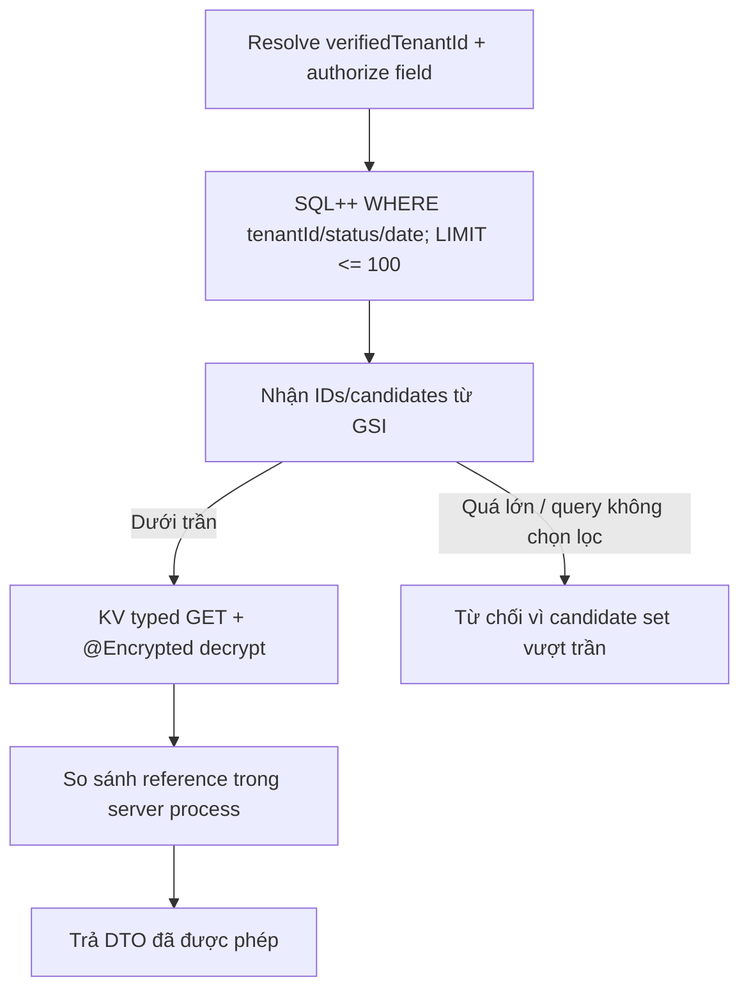
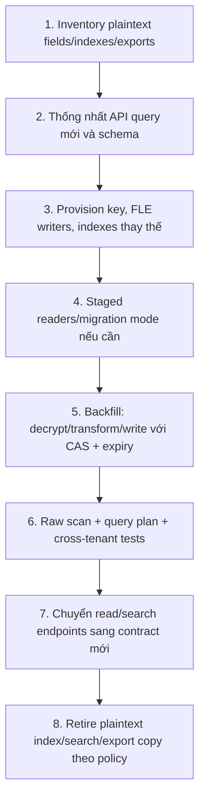
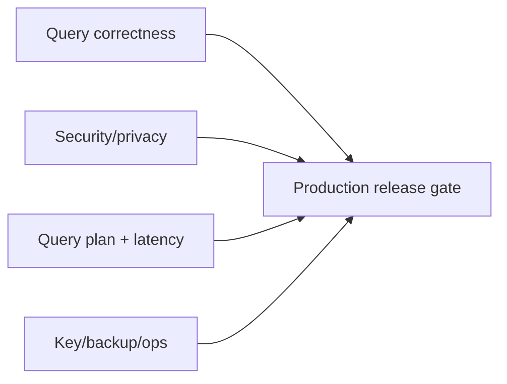

# Ảnh hưởng của trường mã hóa đến truy vấn và chỉ mục

## Mục tiêu bài học

Khi xây dựng tầng truy cập dữ liệu bằng **Spring Data Couchbase**, ta thường kết hợp **document mapping**, `CouchbaseRepository`, `CouchbaseTemplate`, truy vấn SQL++ và các **Global Secondary Index (GSI)** để lọc, sắp xếp, phân trang hoặc tổng hợp dữ liệu. Tuy nhiên, quyết định gắn `@Encrypted` lên một trường của entity không chỉ thay đổi cách JSON được lưu: nó còn thay đổi **những phép truy vấn nào có ý nghĩa**, **chỉ mục có thể giúp được gì**, **chi phí đọc/giải mã ở client** và cả **mức rò rỉ thông tin qua metadata**.

Trong bài thuộc chương **Bảo mật** của module `SPRING_DATA_COUCHBASE`, ta khảo sát hệ quả cụ thể đối với SQL++, Index Service, Search Service, Analytics, các repository method và đường đọc bằng Java SDK. Trọng tâm là **thiết kế mô hình truy vấn cho dữ liệu đã mã hóa**, không phải triển khai lại toàn bộ vòng đời khóa ở các bài trước.

Hoàn thành bài, bạn có thể:

- Giải thích vì sao một field được mã hóa phía Java SDK thường trở thành envelope `encrypted$<field>` và **Query Service chỉ nhìn thấy ciphertext**.
- Phân biệt `WHERE`, `ORDER BY`, `GROUP BY`, `DISTINCT`, `SUM`, `JOIN`, `LIKE`, Search/FTS và SQL++ projection khi thao tác trên trường đã mã hóa.
- Thiết kế **chỉ mục GSI** cho những field còn plaintext được phê duyệt, tránh lập index “tìm plaintext” trên ciphertext.
- Nhận diện khi nào repository derived query/`@Query`/projection trả kết quả trống, metadata thô hoặc deserialize sai kỳ vọng.
- So sánh ba phương án tìm kiếm: **thay đổi yêu cầu truy vấn**, **lọc trên trường không mã hóa rồi decrypt có giới hạn**, và **lookup token/blind index** được security review.
- Hiểu blind index chỉ hỗ trợ equality ở hợp đồng cụ thể, tạo **rò rỉ sự bằng nhau/tần suất** và có lifecycle khóa riêng.
- Xử lý index rebuild, migration từ plaintext, key rotation, CAS/TTL, tenant authorization, reactive và giao dịch mà không làm lộ trường nhạy cảm.
- Viết kiểm thử phân biệt **lỗi mã hóa**, **query semantics**, **missing index**, **index lag** và **RBAC denial**.

> **Giả định ví dụ:** Couchbase Server có scope/collection, bucket `training`, scope `commerce`, collection `orders`; ứng dụng Spring Boot dùng Spring Data Couchbase và Java SDK tương thích, với `CryptoManager`/keyring đã cấu hình. Trường `paymentReference` là ví dụ dữ liệu giả, không phải thông tin thanh toán thật. Bài dùng SQL++ của các phiên bản Server hiện đại. **Không thực hiện truy vấn dữ liệu nhạy cảm trên production để thử nghiệm.**

## 1. Từ một Java property đến hai hình dạng JSON

### 1.1. Entity trước và sau khi bật FLE

Entity Spring Data:

```java
package com.example.orders;

import com.couchbase.client.java.encryption.annotation.Encrypted;
import org.springframework.data.annotation.Id;
import org.springframework.data.couchbase.core.mapping.Document;
import org.springframework.data.couchbase.core.mapping.Scope;
import org.springframework.data.couchbase.core.mapping.Collection;

@Document
@Scope("commerce")
@Collection("orders")
public class Order {
    @Id
    private String id;
    private String tenantId;
    private String status;
    private String createdAt;
    private long total;

    @Encrypted
    private String paymentReference;

    protected Order() {}

    public Order(String id, String tenantId, String status,
                 String createdAt, long total, String paymentReference) {
        this.id = id;
        this.tenantId = tenantId;
        this.status = status;
        this.createdAt = createdAt;
        this.total = total;
        this.paymentReference = paymentReference;
    }

    public String getId() { return id; }
    public String getTenantId() { return tenantId; }
    public String getStatus() { return status; }
    public String getCreatedAt() { return createdAt; }
    public long getTotal() { return total; }
    public String getPaymentReference() { return paymentReference; }
}
```

Ứng dụng giữ `paymentReference` là `String` trong bộ nhớ. Nhưng khi **write path thực sự có FLE-aware serialization**, raw document lưu trên Couchbase có dạng:

```json
{
  "tenantId": "tenant-a",
  "status": "PAID",
  "createdAt": "2026-11-01T10:00:00Z",
  "total": 250000,
  "encrypted$paymentReference": {
    "alg": "AEAD_AES_256_CBC_HMAC_SHA512",
    "kid": "order-pii-key-v1",
    "ciphertext": "<base64-ciphertext>"
  }
}
```

`encrypted$` là prefix mặc định của FLE Java SDK 3. `alg` là định danh thuật toán; `kid` chỉ key được dùng; `ciphertext` chứa nội dung đã mã hóa. Server biết cấu trúc JSON này nhưng **không nhận FLE keyring của client**. Nếu raw document vẫn có `"paymentReference": "..."` thì một đường ghi có thể đã bỏ qua encryption; **đừng coi chỉ việc có `@Encrypted` trên class là bằng chứng lưu ciphertext**.

**Đổi schema vật lý:** Trước mã hóa, SQL++ nhìn `o.paymentReference` như chuỗi. Sau mã hóa, property ấy thường là **MISSING**, còn dữ liệu được lưu dưới field vật lý `encrypted$paymentReference`. Vì tên field có ký tự `$`, khi viết SQL++ hãy dùng **backtick identifier**, ví dụ truy cập từ alias `o` theo cú pháp được minh họa trong các câu SQL++ bên dưới.

### 1.2. Ai có thể giải mã?

```mermaid
flowchart LR
    HTTP["User/tenant được xác minh"]
    API["Spring service + field permission"]
    MODEL["Order entity có @Encrypted"]
    FLE["FLE-aware converter / CryptoManager"]
    RAW["Couchbase JSON ciphertext"]
    QUERY["Query / Index / Search Service"]
    HTTP --> API --> MODEL --> FLE --> RAW
    RAW --> QUERY
    QUERY -.->|"Không có khóa FLE của client"| RAW
    RAW -->|"Đọc ciphertext"| FLE
    FLE -->|"Typed read giải mã"| MODEL
```



Ba tình huống độc lập:

1. **KV typed read:** `repository.findById(id)` hoặc `collection.get(id).contentAs(Order.class)`, khi mapping/serializer đã bật FLE, có thể trả `Order.paymentReference` dưới dạng plaintext trong process.
2. **Raw KV:** `collection.get(id).contentAsObject()` trả JSON envelope thô; `JsonObject` không tự có phép giải mã field nếu không dùng `JsonObjectCrypto` tương ứng.
3. **SQL++ query:** Query Service chạy `WHERE`, `ORDER BY`, GSI scan, projection và aggregate **trên giá trị lưu vật lý**. Nó không gọi Java `CryptoManager` để biến ciphertext thành plaintext.

**Giới hạn an ninh:** Backend có key giải mã nhưng quên kiểm tra tenant hoặc field permission vẫn có thể làm lộ plaintext trong REST response, logs hoặc export. FLE, TLS, RBAC, SQL++ parameter binding và API authorization bảo vệ **những lớp khác nhau**.

### 1.3. Quyết định bảo vệ phải đi từ nhu cầu truy vấn

| Field | Nhu cầu sử dụng | Hướng thiết kế ban đầu |
| --- | --- | --- |
| `tenantId` | Mọi query tenant-scoped, join ownership | Thường giữ plaintext có kiểm soát; bảo vệ bằng app authorization/RBAC |
| `status` | `WHERE status`, thống kê trạng thái | Giữ plaintext khi phân loại dữ liệu cho phép |
| `createdAt` | `ORDER BY`, range, retention reporting | Giữ plaintext nếu rủi ro metadata chấp nhận |
| `total` | `SUM`, `AVG`, lọc khoảng giá trị | Quyết định bảo mật/analytics; mã hóa sẽ làm mất tính toán SQL++ thường |
| `paymentReference` | Hiển thị sau xác thực, ít search | Ứng viên FLE, không dựa vào query plaintext |
| `documentId` | KV lookup, log correlation | Không đưa PII vào document key; FLE field không che metadata ID |

Chọn mã hóa toàn bộ `tenantId`/`status`/`createdAt` mà không thiết kế lại API có thể khiến chức năng tìm kiếm/tenant isolation bị phá vỡ, chứ không chỉ “chạy chậm hơn”.

## 2. Ma trận tác động của FLE lên SQL++ và chỉ mục

| Tính năng | Khi field là plaintext | Khi field dùng FLE client-side | Kết luận |
| --- | --- | --- | --- |
| `WHERE x = $value` | So sánh giá trị x | x có thể `MISSING`, ciphertext ở field khác | **Không tự so sánh plaintext** |
| `WHERE x BETWEEN ...` | Range theo number/date | Ciphertext không giữ thứ tự/range gốc | **Không khả dụng theo plaintext** |
| `LIKE`/`LOWER(x)` | Pattern/string processing | Query Service không có chuỗi gốc | **Không tự tìm chuỗi gốc** |
| `ORDER BY x` | Sắp theo x | x missing hoặc envelope là object | **Không sắp theo plaintext** |
| `GROUP BY x`/`DISTINCT x` | Gom nhóm giá trị rõ | Có thể nhóm ciphertext/object, không đồng nghĩa nhóm plaintext | **Kết quả khác ý nghĩa** |
| `COUNT(*)` | Đếm rows | Vẫn đếm rows nếu filter trên field khác | **Dùng được theo phạm vi đúng** |
| `SUM(x)`/`AVG(x)` | Tính aggregate number | x missing/ciphertext không phải number | **Không tính số gốc** |
| `JOIN ON a.x = b.x` | Join theo x | Hai ciphertext không tạo equality đáng tin | **Phải đổi join key** |
| `USE KEYS $id` | Lấy document bằng key | Vẫn định vị document được | **Có**, decrypt ở client sau authorization |
| GSI trên x | Lập index giá trị rõ | Index trên tên x có thể bỏ qua nếu MISSING | **Không tạo plaintext index** |
| GSI trên `encrypted$x` | Index encrypted JSON envelope/metadata | Không biến thành plaintext-searchable | **Chỉ phục vụ use case ciphertext/metadata được duyệt** |
| Search/FTS | Text analyzer có plaintext | Chỉ thấy field plaintext được lưu hoặc ciphertext envelope | **Không có full-text theo plaintext** |
| Analytics/Eventing | Có thể xử lý raw values | Nhìn ciphertext nếu không có client decrypter riêng | **Không mặc nhiên giải mã** |

**Cần phân biệt hai thứ**: “có thể lập index” là một khả năng vật lý, còn “index giúp tìm đúng giá trị nghiệp vụ gốc” là một yêu cầu khác. Tạo GSI trên `encrypted$paymentReference` không làm `WHERE o.paymentReference = $reference` hoạt động.

### 2.1. Ví dụ: câu WHERE vẫn hợp lệ về cú pháp nhưng sai ngữ nghĩa

```sql
SELECT META(o).id AS id
FROM `training`.`commerce`.`orders` AS o
WHERE o.paymentReference = $reference;
```

Trong collection chỉ có `encrypted$paymentReference`, biểu thức `o.paymentReference` thường là **MISSING**. Kết quả rỗng không phải dấu hiệu parameter binding bị sai. Nó phản ánh **schema đã thay đổi**. Đừng tạo một field plaintext `paymentReference` song song để “fix query” mà không có threat review: đó có thể là rò dữ liệu.

### 2.2. Ví dụ: ORDER BY ciphertext không phải ORDER BY nghiệp vụ

```sql
-- KHÔNG có ý nghĩa sắp theo paymentReference đã giải mã.
SELECT META(o).id AS id,
       o.status
FROM `training`.`commerce`.`orders` AS o
ORDER BY o.paymentReference ASC;
```

Khi `paymentReference` không còn tồn tại vật lý, các rows cùng `MISSING` nên thứ tự không đáp ứng hợp đồng. Nếu thay bằng sort trên envelope ciphertext, kết quả được quyết định bởi cấu trúc/bytes mã hóa, **không** phải thứ tự alphabet của plaintext. Nếu encryption có ngẫu nhiên, hai lần encrypt cùng plaintext còn có thể tạo ciphertext khác nhau.

### 2.3. Cảnh báo GROUP BY/COUNT DISTINCT

`COUNT(DISTINCT o.paymentReference)` không phản ánh số giá trị reference duy nhất nếu field đã FLE và tên plaintext missing. Đếm ciphertext/envelope cũng không ổn: **ciphertext không phải một định danh business ổn định**. Không dùng `DISTINCT encrypted...` để suy equality hoặc phát hiện duplicate của plaintext.

Nguồn: [Java SDK — Field Level Encryption Concepts](https://docs.couchbase.com/java-sdk/current/concept-docs/encryption.html), [SQL++ ORDER BY](https://docs.couchbase.com/server/current/n1ql/n1ql-language-reference/orderby.html).

## 3. Vì sao GSI không tự “giải mã để lập index”?

Global Secondary Index của Couchbase Server lưu **index keys được tính từ biểu thức SQL++ trên JSON đang có tại Server**. Index Service không được cấp Java FLE keyring, nên:

- Index on `paymentReference` không thấy một string rõ nếu field đó đã biến thành `encrypted$paymentReference`.
- Index on `encrypted$paymentReference` có thể xử lý một JSON object, nhưng không tạo B-tree/ordered index theo plaintext tương ứng.
- Một index trên `encrypted$paymentReference.kid` (nếu truy vấn hợp lệ và được cho phép) chỉ phản ánh **key ID metadata**, không phải giá trị nghiệp vụ.
- Chỉ mục có thể làm **lộ metadata hoặc bản sao của field plaintext** nếu thiết kế sai, đặc biệt với covering index và Query Service projections.

### 3.1. Index trước khi bật FLE

Giả sử hệ thống trước đây dùng:

```sql
-- Trạng thái TRƯỚC FLE: không nên tiếp tục dựa vào index này.
CREATE INDEX idx_orders_legacy_payment_reference
ON `training`.`commerce`.`orders`(paymentReference);
```

Sau khi migrate thành ciphertext, một query so sánh `paymentReference` sẽ không tự được cứu bởi index. Việc **index definition vẫn còn tồn tại** không có nghĩa dữ liệu index hiện có tương thích schema mới; cần đánh giá khả năng các document chưa migrate vẫn giữ plaintext và dữ liệu tồn dư/index replicas/backups theo chính sách.

### 3.2. Index vào envelope có giúp truy vấn plaintext?

```sql
-- Chỉ để minh họa cấu trúc; KHÔNG khuyến nghị lập index này mặc định.
CREATE INDEX idx_orders_encryption_keyid
ON `training`.`commerce`.`orders`
    (`encrypted$paymentReference`.`kid`);
```

Index này có thể hữu ích cho **báo cáo quản trị key version** trong workflow được duyệt, nhưng không giúp tìm `paymentReference = "LAB-..."`. Truy cập `kid` cũng có thể tiết lộ sự phân bố version/key theo tenant; việc index nó cần privacy/security review và role reporting riêng.

**Không tạo index trên `ciphertext` để tra một raw secret do client gửi**. Trước hết client cần có ciphertext tương ứng; một hệ mã hóa có nonce/randomness và authenticated encryption không tạo lookup equality đáng tin bằng cách encrypt plaintext lần nữa rồi so bytes. Thậm chí khi thuật toán có tính chất xác định, việc lộ equality/frequency cần được đánh giá riêng.

### 3.3. Query planner và lỗi sai lớp

| Triệu chứng | Dấu hiệu | Chẩn đoán |
| --- | --- | --- |
| Truy vấn trả 0 rows nhanh | Field plaintext đã MISSING | **Schema/query contract**, không phải thiếu index |
| Truy vấn `WHERE status = ...` báo no index | Chưa có GSI phù hợp/không có scan được phép | **Provisioning/index**, không phải FLE trên paymentReference |
| Truy vấn trả 403 | User không có Query Select trên collection | **RBAC**, không phải CryptoManager |
| Typed `findById` lỗi decrypt | Key/algorithm/ciphertext không hợp lệ | **FLE keyring/serializer** |
| SQL++ `rowsAsObject()` hiện envelope | Query Service trả raw JSON | **Hành vi dự kiến**, cần typed decrypt sau nếu hợp đồng cho phép |
| Query mới trả thiếu rows ngay sau KV save | Index chưa bắt kịp mutation | **Scan consistency**, không tự suy FLE lỗi |

Đừng “khắc phục” một field mã hóa bằng cách cấp Query Manage Index/Administrator cho runtime, hoặc tắt `@Encrypted` để query hiện kết quả. Cần thiết kế lại cách tìm.

Nguồn: [Couchbase Server — CREATE INDEX](https://docs.couchbase.com/server/current/n1ql/n1ql-language-reference/createindex.html), [Java SDK — Querying with SQL++](https://docs.couchbase.com/java-sdk/current/howtos/sqlpp-queries-with-sdk.html).

## 4. Thiết kế chỉ mục cho những trường vẫn được phép truy vấn

Với nhu cầu chính của endpoint:

```text
GET /orders?status=PAID&sort=createdAt&direction=DESC&size=20
```

ta có thể để **tenantId**, **status** và **createdAt** ở dạng plaintext đã được đánh giá rủi ro, và mã hóa `paymentReference`. Ví dụ GSI:

```sql
-- Chỉ provisioning/migration identity có quyền Index DDL được chạy.
CREATE INDEX idx_orders_tenant_status_created_desc
ON `training`.`commerce`.`orders`
    (tenantId, status, createdAt DESC);
```

Query:

```sql
SELECT META(o).id AS documentId,
       o.status, o.createdAt, o.total
FROM `training`.`commerce`.`orders` AS o
WHERE o.tenantId = $tenantId
  AND o.status = $status
ORDER BY o.createdAt DESC, META(o).id ASC
LIMIT $limit;
```

`$tenantId` phải đến từ **server-verified authentication/membership context**, không chỉ raw header/client request. `$status` được validate và bind. `$limit` là JSON number có giới hạn nghiệp vụ. `META(o).id ASC` giúp thứ tự tổng quát hơn khi có nhiều rows cùng `createdAt`; nó có thể ảnh hưởng khả năng tận dụng index ordering, nên phải đo `EXPLAIN` và latency thực.

### 4.1. Kiểm tra index bằng EXPLAIN

```sql
EXPLAIN
SELECT META(o).id AS documentId,
       o.status, o.createdAt
FROM `training`.`commerce`.`orders` AS o
WHERE o.tenantId = "tenant-a"
  AND o.status = "PAID"
ORDER BY o.createdAt DESC, META(o).id ASC
LIMIT 20;
```

**Phép kiểm này không thay parameter binding của runtime.** `EXPLAIN` minh họa giá trị test cố định để hiểu plan. Xem index được chọn, các toán tử scan/fetch/sort, estimate/actual metrics tùy Server version. Không khẳng định index có `createdAt DESC` sẽ chắc chắn loại toàn bộ sort khi ORDER BY có thêm `META(o).id` hoặc projection cần `Fetch`.

### 4.2. Covering index và rò rỉ dữ liệu

Một covering index có thể phục vụ query hoàn toàn từ index entries mà không Fetch document, **nếu** projection/filters phù hợp; việc thêm field vào index để cover nhiều cột **không phải miễn phí**. Nếu team cố thêm `paymentReference` plaintext vào covering index trước FLE rồi không xử lý migration, đó có thể tạo bản sao dữ liệu nhạy cảm ở vùng index/backup và tăng blast radius.

Quy tắc: **chỉ index những thuộc tính đã được cho phép rời khỏi encryption boundary**. Không tạo các “shadow fields” plaintext như `paymentReferenceSearchable` chỉ để query nhanh mà bỏ qua security review.

### 4.3. Index một phần và giới hạn chiến lược

SQL++ hỗ trợ **partial index** khi có `WHERE` trong `CREATE INDEX`. Nó hữu ích cho business predicates tĩnh, nhưng không tự phân quyền tenant hoặc decrypt FLE. Ví dụ khi chỉ query đơn hàng active:

```sql
CREATE INDEX idx_orders_active_tenant_created
ON `training`.`commerce`.`orders`
    (tenantId, createdAt DESC)
WHERE status = "PAID";
```

Optimizer chỉ có thể sử dụng một partial index nếu điều kiện query chứng minh nó phù hợp theo phiên bản/plan; do đó phải `EXPLAIN` các query production thật (bao gồm dynamic status/parameterized filters). Đừng giả định một index partial tự được chọn cho mọi status. Mọi lệnh DDL thuộc **migration/provisioning**, runtime `orders-api` chỉ có role Query Select thích hợp.

### 4.4. Secondary index consistency độc lập với FLE

Sau KV insert/replace, GSI có thể chưa phản ánh mutation nếu query dùng scan consistency mặc định. Với một bài test cần thấy rows vừa ghi:

```java
import com.couchbase.client.java.query.QueryScanConsistency;
import com.couchbase.client.java.query.QueryOptions;
import com.couchbase.client.java.json.JsonObject;

var result = cluster.query(
    "SELECT META(o).id AS id FROM " +
    "`training`.`commerce`.`orders` AS o " +
    "WHERE o.tenantId = $tenantId AND o.status = $status LIMIT 20",
    QueryOptions.queryOptions()
        .parameters(JsonObject.create()
            .put("tenantId", "tenant-a")
            .put("status", "PAID"))
        .scanConsistency(QueryScanConsistency.REQUEST_PLUS)
        .readonly(true));
```

`REQUEST_PLUS` có thể tăng latency vì chờ index cập nhật. Dùng theo semantics nghiệp vụ, không bật toàn bộ query mà chưa benchmark. Nó **không làm Server giải mã encrypted field**.

## 5. Spring Data repository, derived query và `@Query`

### 5.1. Repository method nào tiếp tục có ý nghĩa?

```java
package com.example.orders;

import java.util.List;
import java.util.Optional;
import org.springframework.data.couchbase.repository.CouchbaseRepository;
import org.springframework.data.couchbase.repository.Query;
import org.springframework.data.repository.query.Param;

public interface OrderRepository
        extends CouchbaseRepository<Order, String> {

    // Query trên field plaintext được phép, vẫn cần tenant authorization.
    List<Order> findByTenantIdAndStatus(
        String tenantId, String status);

    // Về mặt method name có thể được Spring Data xử lý,
    // nhưng KHÔNG được giả định tự rewrite sang ciphertext search.
    List<Order> findByPaymentReference(String paymentReference);

    @Query("#{#n1ql.selectEntity} WHERE #{#n1ql.filter} " +
           "AND tenantId = $tenantId AND status = $status")
    List<Order> findPaidOrdersForTenant(
        @Param("tenantId") String verifiedTenantId,
        @Param("status") String status);
}
```

**Nhận xét:**

- `findByTenantIdAndStatus` hợp lý **khi** fields vẫn lưu plaintext. Tuy nhiên caller phải truyền `verifiedTenantId` do server xác minh; Spring Data không tự thực hiện business authorization theo tenant.
- Method `findByPaymentReference` được đưa vào **để cảnh báo anti-pattern**: người viết method kỳ vọng SQL++ có thể tìm theo plaintext, nhưng field vật lý đã mã hóa. Không tự suy rằng Spring Data sẽ biến input thành cùng ciphertext hoặc tạo blind index. **Không đưa method này vào endpoint production** nếu chưa có cơ chế tìm kiếm được thiết kế riêng, đã được kiểm thử và được tài liệu hóa theo version.
- `@Query` với `$tenantId`, `$status` giữ values được bind; `#{#n1ql.selectEntity}`/`#{#n1ql.filter}` là các fragment do Spring Data mapping cung cấp. SpEL/type metadata (`_class`) có thể ảnh hưởng tập rows nếu dữ liệu được nhập thủ công; đừng nhầm query trống do type filter với lỗi mã hóa.

Một `findById(id)` inherited thường dùng KV và có thể deserialize `@Encrypted` đúng nếu mapper đã cấu hình. Nhưng nó **không tự kiểm tra tenant owner**: phải đi qua service `getOwnedOrder(verifiedTenant, id)` trước khi xuất trường nhạy cảm.

### 5.2. Có thể biến `@Query` thành decrypt-at-query-time không?

Không phải bằng cách thông thường. Query Service chạy trong Couchbase, còn `CryptoManager`/Keyring của FLE client-side ở process Spring Boot. Các biểu thức SQL++ `LOWER`, `SUBSTR`, `META`, `TOSTRING` và tương tự **không có quyền truy xuất key FLE**. Nếu ứng dụng định viết:

```java
@Query("#{#n1ql.selectEntity} WHERE #{#n1ql.filter} " +
       "AND paymentReference = $reference")
List<Order> searchByReference(
    @Param("reference") String reference);
```

thì annotation có thể dẫn đến query hợp lệ về cú pháp nhưng **không tương đương tìm kiếm theo plaintext đã mã hóa**. Không thêm một custom SQL++ function mang encryption key lên Server chỉ để chạy tìm kiếm mà chưa có threat model và security approval — nó thay đổi hoàn toàn ranh giới bảo mật FLE.

### 5.3. Spring Data `Sort`/`Pageable`

```java
import org.springframework.data.domain.PageRequest;
import org.springframework.data.domain.Sort;

// sortKey đã được allowlist ở service, không lấy raw từ HTTP.
var pageable = PageRequest.of(
    0, 20, Sort.by(Sort.Direction.DESC, "createdAt"));

// repository.findByTenantIdAndStatus(...) có thể được khai báo
// phiên bản nhận Pageable theo Spring Data Repository API.
```

**Không** cung cấp `Sort.by("paymentReference")` rồi kỳ vọng sắp theo plaintext sau FLE. Spring Data `Sort` là lựa chọn cấu trúc truy vấn; với field bị mã hóa, nó còn có thể sinh biểu thức trên tên property không tồn tại. Allowlist các fields được sort phải phản ánh **schema vật lý** và mức nhạy cảm đã phê duyệt, không chỉ tên Java entity.

Tương tự, `Page<Order>` có thể sinh **COUNT query** bổ sung; cả query list và count đều phải lọc tenant/status giống nhau. Nếu không cần tổng số rows, `Slice` hoặc keyset pagination có thể giảm tải. Không decrypt hàng triệu document ở application chỉ để sắp xếp rồi mới phân trang 20 rows.

### 5.4. Projection có thể trả envelope không giải mã

Với `@Query`/custom query:

```sql
SELECT META(o).id AS id,
       o.status,
       o.`encrypted$paymentReference` AS paymentEnvelope
FROM `training`.`commerce`.`orders` AS o
WHERE o.tenantId = $tenantId
LIMIT 20;
```

**Lưu ý:** Identifier chứa ký tự `$` phải được quote đúng theo SQL++. Câu query trên trả **JSON object envelope**, không phải plaintext. `rowsAsObject()` của Java SDK không biết entity `Order` nếu không được yêu cầu mapping phù hợp. Một projection DTO không chứa đúng encrypted field, `_class` hoặc metadata mà mapper kỳ vọng có thể trả field null hoặc lỗi khi typed conversion.

**Phương án nên dùng:** Query **ID và field plaintext đã được phép** trước, sau đó KV GET các IDs với **FLE-aware mapper** để giải mã đúng những document người dùng được xem. Hoặc để Spring Data trả entity hoàn chỉnh qua một query mapping đã được kiểm thử; không suy từ một trường hợp cụ thể mà mọi projection sẽ tự decrypt.

### 5.5. `CouchbaseTemplate` và custom conversions

Spring Data `CouchbaseTemplate` có thể dùng fluent query API và typed mapping. Hãy kiểm tra đường `findByQuery(Order.class)`, `findById`, projection và custom `ReadingConverter`/`WritingConverter` riêng. Một đường custom converter có thể bỏ qua `@Encrypted` hoặc tạo ciphertext hai lần nếu bị dùng lẫn với FLE. Với SQL++ read, điều kiện WHERE/ORDER BY vẫn chạy **ở Server trước khi mapper giải mã**, nên converter chỉ tác động đến **giai đoạn sau query**, không biến chỉ mục thành plaintext index.

**Đừng dùng global `Converter<String,String>` để giải mã mọi string**; nó dễ ảnh hưởng `tenantId`, `status` và làm sai query/index. Ưu tiên tích hợp FLE chính thức, hoặc một domain type converter được security review và test trên mọi đường truy cập.

Nguồn: [Spring Data Couchbase — Field Level Encryption](https://docs.spring.io/spring-data/couchbase/reference/couchbase/fieldlevelencryption.html), [Spring Data Couchbase — Repositories](https://docs.spring.io/spring-data/couchbase/reference/couchbase/repository.html), [Spring Data Couchbase — Template](https://docs.spring.io/spring-data/couchbase/reference/couchbase/template.html).

## 6. Ba chiến lược tìm kiếm sau khi mã hóa field

Không có “một lệnh CREATE INDEX đúng” giải quyết mọi trường mã hóa. Hãy định nghĩa lại **yêu cầu truy vấn và mức chấp nhận rò rỉ thông tin**.

**Lựa chọn theo nhu cầu nghiệp vụ:**

| Chiến lược | Dùng khi | Ưu điểm | Đánh đổi |
| --- | --- | --- | --- |
| **A. Không search theo field mã hóa** | Field chỉ hiển thị khi đã biết ID | Giữ bí mật tốt hơn; giản đơn | API không còn lookup/range/LIKE theo field ấy |
| **B. Query trường được phép → decrypt có giới hạn → lọc chính xác ở client** | Có filter khác đủ chọn lọc, kết quả nhỏ | Không tạo thêm token index có linkability | Tải KV/KMS/CPU client; paging và COUNT khó |
| **C. Blind index/lookup token riêng** | Bắt buộc tra cứu **equality** và đã security review | Dùng GSI tìm candidates theo token | Rò equality/frequency, thêm key/rotation/schema phức tạp |

### 6.1. Chiến lược A: thay đổi hợp đồng API

Ví dụ endpoint:

```text
GET /orders/{orderId}
GET /orders?status=PAID&sort=createdAt
```

Backend lọc theo tenant/status, trả list DTO không có `paymentReference`. Khi cần chi tiết, backend nhận `orderId`, xác minh tenant/ownership và field permission rồi **typed KV read/decrypt**. Đây thường là hướng ít rủi ro nhất cho dữ liệu nhạy cảm không cần search.

### 6.2. Chiến lược B: lọc trên trường cho phép rồi decrypt

Giả sử API muốn tìm một reference bên trong **một tập nhỏ đơn hàng cùng ngày**:



**Cần chấp nhận tradeoff về tính đúng đắn:**

- Nếu chỉ lấy `LIMIT 100` rồi tìm trong 100 rows, **không được** tuyên bố “không tìm thấy trên toàn collection” khi thực tế có nhiều hơn 100 candidates. API phải định nghĩa rõ phạm vi tìm kiếm và trả trạng thái không hỗ trợ/đòi thêm filter nếu tập quá lớn.
- Không decrypt trong Java rồi `Collections.sort` toàn bộ hàng triệu rows; kết quả pagination/COUNT sẽ khó đúng khi chỉ xử lý một subset.
- Dữ liệu plaintext tồn tại tạm thời trong app process; không log stream/body/DTO chưa kiểm tra quyền.
- Cần chọn index phù hợp cho filter trước bước decrypt, và rate limits/timeout cho KMS/Keyring.

### 6.3. Chiến lược C: blind index nếu equality thật sự cần thiết

Một **blind index** là field phụ chứa **token được tính phía ứng dụng** theo chính sách crypto riêng, ví dụ `paymentReferenceLookupV2`. Query Service so sánh **token**, không so plaintext `paymentReference`. Nhưng token cố định có thể tiết lộ **hai document có cùng giá trị** và phân bố tần suất; với dữ liệu miền nhỏ, attacker có thông tin phụ có thể đoán.

**Không coi đây là tính năng mặc định của Couchbase `@Encrypted`**. Thiết kế blind index đòi hỏi:

1. Security approval, xác định dữ liệu/rủi ro và giới hạn loại query (equality, không phải range/LIKE).
2. Key **riêng** cho lookup token, không reuse FLE encryption key.
3. Canonicalization chính xác theo business semantics, domain separation và tenant scoping.
4. Schema/index với version, multi-key rotation và phương án backfill.
5. Decrypt + verify kết quả cuối trước khi trả response, để tránh lỗi mapping hoặc token drift.
6. Authorization cho mỗi tenant/field; không expose endpoint tính HMAC token tùy ý cho người ngoài.

Những phương án khác như **searchable encryption**, **order-preserving encryption**, **homomorphic encryption** không tự có trong `@Encrypted`; không tự triển khai bằng một vài dòng SQL++ nếu không có chuyên gia mã hóa và threat review.

## 7. Thiết kế blind index/HMAC token có kiểm soát

### 7.1. Schema minh họa

```json
{
  "tenantId": "tenant-a",
  "status": "PAID",
  "encrypted$paymentReference": {
    "alg": "AEAD_AES_256_CBC_HMAC_SHA512",
    "kid": "order-pii-key-v2",
    "ciphertext": "<base64-ciphertext>"
  },
  "paymentReferenceLookupV2": "<hmac-sha256-hex-token>"
}
```

Hai keys độc lập:

- **FLE key** với `kid=order-pii-key-v2` để encrypt/decrypt field.
- **Lookup HMAC key** (ví dụ ID ngoài schema `order-ref-lookup-key-v2`) chỉ để tạo token; không đưa key bytes vào document.

Nếu token cần được lưu theo tenant, canonicalization phải xác định chính xác cách xử lý case, khoảng trắng, Unicode và dấu phân cách. **Không tự động lowercase** những mã mà chữ hoa/chữ thường mang ý nghĩa khác. Nếu normalization logic thay đổi ở release sau, dữ liệu token cũ cần migration.

### 7.2. Java HMAC-SHA256 ví dụ với key do Secret Provider cấp

```java
package com.example.orders.security;

import javax.crypto.Mac;
import javax.crypto.spec.SecretKeySpec;
import java.nio.charset.StandardCharsets;
import java.security.GeneralSecurityException;
import java.util.HexFormat;

/**
 * Minh họa tính equality-lookup token, KHÔNG phải Couchbase FLE API.
 * Caller đã xác minh tenantId, lookupKey đến từ approved secret store.
 */
public final class ReferenceLookupToken {
    private static final String DOMAIN = "orders.paymentReference.lookup.v2";
    private ReferenceLookupToken() {}

    public static String compute(
            byte[] lookupKey, String verifiedTenantId, String reference) {
        if (lookupKey == null || lookupKey.length < 32
                || verifiedTenantId == null || verifiedTenantId.isBlank()
                || reference == null || reference.isBlank()) {
            throw new IllegalArgumentException("Invalid lookup request");
        }
        try {
            Mac mac = Mac.getInstance("HmacSHA256");
            mac.init(new SecretKeySpec(lookupKey, "HmacSHA256"));

            // Canonicalization được định nghĩa bởi business policy:
            // ví dụ này giữ nguyên case và whitespace của reference.
            // Tách tenant và reference bằng độ dài để không nhập nhằng.
            String message = DOMAIN + ":"
                + verifiedTenantId.length() + ":" + verifiedTenantId
                + ":" + reference.length() + ":" + reference;
            byte[] token = mac.doFinal(
                message.getBytes(StandardCharsets.UTF_8));
            return HexFormat.of().formatHex(token);
        } catch (GeneralSecurityException ex) {
            throw new IllegalStateException("Lookup token unavailable", ex);
        }
    }
}
```

**Điểm cần review:** `lookupKey` phải là secret đủ entropy do KMS/Secret Manager cấp, **không** được lấy từ `paymentReference` hoặc DB password. Giá trị token có thể xuất hiện trong GSI/query logs/backup; không công khai nó cho client hoặc coi nó là authentication token. Nếu ứng dụng cho phép client tự yêu cầu tính token với arbitrary plaintext và tự chọn tenant, nó có thể thành **oracle** giúp dò các giá trị nhạy cảm.

**Mục đích minh họa:** Tính token ở cùng process được phép ghi dữ liệu, sau khi đã xác minh tenant. Đây là implementation **tự thiết kế**, không được Couchbase SDK mặc nhiên triển khai. Cần security review về canonicalization, mã hóa, key storage, versioning và data exposure. Không dùng trực tiếp cho định danh ít giá trị khả dĩ (ví dụ boolean/status) nếu chưa đánh giá nguy cơ leakage.

### 7.3. Index và query trên token, không trên plaintext

```sql
-- Chỉ migration identity được tạo index.
CREATE INDEX idx_orders_tenant_paymentref_lookup_v2
ON `training`.`commerce`.`orders`
    (tenantId, paymentReferenceLookupV2);
```

Runtime SQL++:

```sql
SELECT META(o).id AS documentId
FROM `training`.`commerce`.`orders` AS o
WHERE o.tenantId = $tenantId
  AND o.paymentReferenceLookupV2 = $lookupToken
LIMIT $limit;
```

`$tenantId` phải do backend xác minh; `$lookupToken` do **backend** tự tính bằng HMAC key đã phê duyệt; `$limit` bị giới hạn và bind như số. **Không** cho client trực tiếp cung cấp token để tìm tùy ý hoặc chọn query keyspace không được phép.

Sau khi nhận IDs, service cần:

1. KV typed GET các candidates theo đúng collection.
2. Xác minh tenant/ownership của từng document.
3. Decrypt `paymentReference` bằng FLE-aware mapper.
4. So sánh chính xác plaintext với reference theo canonicalization contract.
5. Chỉ trả DTO đã được phép; xử lý missing/tampered ciphertext bằng lỗi không tiết lộ dữ liệu.

Token có thể trùng theo giá trị và tần suất, còn kết quả index có thể bị trễ do GSI. `REQUEST_PLUS` chỉ xử lý index consistency khi cần, **không** thay business ownership hay cryptographic check.

### 7.4. Dual-token khi xoay lookup key

Xoay **FLE encryption key** (`kid=v1→v2`) và xoay **HMAC lookup key** là **hai lifecycle riêng**. Nếu đổi HMAC key, token cũ không thể tra bằng HMAC key mới. Một chiến lược:

| Giai đoạn | Field lookup trong DB | Query app | Điều kiện |
| --- | --- | --- | --- |
| L0 | `paymentReferenceLookupV1` | Chỉ v1 | Inventory, chuẩn bị v2 |
| L1 | v1 + v2 khi dual-write | v1 OR v2 có giới hạn/plan review | Readers/writers đồng bộ |
| L2 | Backfill v2 cho legacy | Ưu tiên v2, hỗ trợ v1 có hạn | CAS/TTL, rate limit |
| L3 | Chỉ v2 | Chỉ v2 | Không còn record cần v1 |
| L4 | Xóa field/index v1 theo policy | Chỉ v2 | DDL/backup cleanup, audit |

Tránh một câu `OR` dài không dùng được index hoặc tạo nhiều queries fan-out không giới hạn. Đo `EXPLAIN`/latency cho transitional query, và luôn giữ tenant predicate. **Không xóa old lookup key** trước khi hoàn tất migration; đây là khóa **khác** với FLE decryption key.

### 7.5. Giới hạn nghiêm trọng của blind index

HMAC token ổn định **cố ý** để lộ sự bằng nhau; dù không trực tiếp để lộ plaintext, nó có thể cho phép quan sát cụm cùng giá trị, số lần xuất hiện, lịch sử thay đổi và quan hệ giữa records. Với giá trị ít entropy, attacker có thể suy luận từ phân bố hoặc từ khả năng dùng token computation oracle. **Token không cung cấp range, prefix, substring, fuzzy search hay thứ tự số**. Nếu yêu cầu là `ORDER BY paymentReference` hoặc `BETWEEN` trên reference, blind index equality **không giải quyết**.

Trước khi dùng phương án này, cần có báo cáo threat model/approval độc lập và kiểm thử xâm nhập có phạm vi được cho phép, không triển khai “cách mã hóa tìm kiếm” tự chế trên production.

## 8. Search Service, Full-Text Search và Vector Search

### 8.1. Analyzer không có FLE decryption key

Couchbase **Search Service** xây search index dựa trên dữ liệu JSON được cung cấp cho nó từ bucket/scope/collection. Nếu một field chỉ tồn tại dưới dạng `encrypted$paymentReference`, text analyzer **không** nhận `paymentReference` plaintext để tokenize, stem, n-gram hoặc fuzzy match. Một Search query tìm chuỗi thật **không** tự hoạt động vì encryption đã diễn ra trước khi Server nhận document.

Nếu team bật dynamic Search mapping trên cả collection, một số thành phần của envelope như `alg`/`kid`/`ciphertext` có thể được index/store tùy mapping. Điều này có thể tăng kích thước index, làm lộ metadata hoặc mang ciphertext vào một search surface không cần thiết; **không** tạo tìm kiếm có ý nghĩa trên plaintext.

### 8.2. Cấu hình mapping nên bắt đầu từ allowlist field

Ví dụ một Search index cho đơn hàng chỉ cần:

- `status`: keyword/filter theo trạng thái.
- `createdAt`: datetime/sort theo thời gian, nếu use case cần.
- `tenantId`: tenant-scoped filter bắt buộc, với authorization từ API.
- Một field mô tả **không nhạy cảm** đã được content/security review, ví dụ `publicDescription` nếu thực sự có.

**Không** để Search index mặc định tự thu thập mọi trường trong document khi schema chứa FLE envelopes. Ưu tiên **static field mapping** và tắt dynamic indexing đối với các vùng dữ liệu nhạy cảm; xem cấu hình `dynamic`, `index`, `store`, `include_in_all`, `docvalues` theo phiên bản Couchbase đang chạy. `store=false` với một field **không thay thế** authorization; field có thể vẫn tồn tại trong nguồn Couchbase hoặc backup.

### 8.3. Search/Vector là hai bề mặt dữ liệu riêng

Nếu app tạo **embedding** từ nội dung bí mật rồi lưu vector **plaintext** để Vector Search, vector có thể tiết lộ thông tin hoặc mối liên hệ suy ra từ văn bản gốc. Mã hóa `paymentReference` **không tự bảo vệ embedding** tạo từ field này. Đây là một luồng xử lý dữ liệu mới cần review rủi ro, quyền API, retention và đánh giá riêng; không suy “input đã mã hóa ở DB thì mọi derived data đều an toàn”.

Các pipelines Search/Vector/Analytics có thể tạo **bản sao dữ liệu** ngoài collection nguồn. Khi bật FLE hoặc migration, kiểm kê cả search index cũ, stored fields, embeddings và backups, không chỉ kiểm tra raw KV JSON hiện tại.

Nguồn: [Couchbase Search Index JSON Properties](https://docs.couchbase.com/server/current/search/search-index-params.html), [Couchbase Java SDK — Field Level Encryption](https://docs.couchbase.com/java-sdk/current/concept-docs/encryption.html).

## 9. Analytics, Eventing, cache và dữ liệu dẫn xuất

### 9.1. Analytics không tự khôi phục số gốc đã mã hóa

Khi Analytics Service hoặc một công cụ BI đọc document đã FLE, các trường vật lý là ciphertext envelope. Một phép `SUM(o.total)` vẫn hoạt động **nếu total là số plaintext được phê duyệt**; nếu `total` cũng được mã hóa, Analytics không có number gốc để cộng theo cách thông thường.

**Ba lựa chọn nghiệp vụ:**

1. Giữ `total` plaintext có kiểm soát nếu chính sách phân loại cho phép và analytics yêu cầu.
2. Tạo **materialized aggregate** từ một pipeline có quyền giải mã, chỉ lưu số tổng hợp được phê duyệt và bảo vệ khỏi suy ngược/nhóm quá nhỏ.
3. Không cung cấp aggregate đó nếu privacy requirement không cho phép.

Không kỳ vọng chỉ tạo một Analytics index/dataset là SQL++ Analytics có thể gọi Java `CryptoManager`. Keyring của FLE thuộc client trust boundary; trao khóa lên một pipeline mới phải qua thiết kế bảo mật riêng.

### 9.2. Eventing và SQL++ mutations

Eventing Functions có thể phản ứng với các thay đổi dữ liệu, nhưng event payload của document FLE thường mang **encrypted JSON**. Không coi một trigger là công cụ giải mã sẵn có. Nếu Eventing dùng SQL++ `UPDATE` để tạo/cập nhật field plaintext có cùng tên protected field, có thể hình thành **đường bypass FLE**.

**Cẩn thận cả cache và message broker:** Một service đọc entity đã giải mã rồi publish `Order` dưới dạng JSON plaintext sang Kafka/Redis/HTTP có thể vô tình tái tạo bản sao bí mật. Dùng **domain events tối thiểu**, DTO đã redact/authorization, namespace tenant, encryption riêng của downstream khi cần; không đổ mọi entity sau decrypt vào outbox theo mặc định.

### 9.3. Backup/restore và legacy indexes

Khi chuyển một field từ plaintext sang FLE, kiểm tra:

- Existing indexes trên plaintext field trước migration và cách index scan/cleanup phản ánh thay đổi.
- Stored search fields, Analytics datasets và exports đã chứa plaintext trước khi mã hóa.
- Cache TTL hoặc logs/CDC đã ghi giá trị cũ, không tự biến mất khi document nguồn đổi schema.
- Backups/snapshots tạo trước migration có thể còn plaintext theo retention policy.
- Restore dữ liệu FLE cần keyring/`kid` còn khả dụng; mất key có thể khiến dữ liệu không thể phục hồi.

Chỉ sau khi đã inventoried và xử lý các bản sao cần thiết mới có thể kết luận phạm vi dữ liệu nhạy cảm đã được bảo vệ theo mục tiêu đề ra.

## 10. JOIN, GROUP BY, ORDER BY và thống kê nhạy cảm

### 10.1. JOIN không nên phụ thuộc ciphertext

Thiết kế quan hệ giữa orders/payments có thể dùng `orderId` và `tenantId` được kiểm soát:

```sql
SELECT META(o).id AS orderId, o.status, p.paymentState
FROM `training`.`commerce`.`orders` AS o
JOIN `training`.`commerce`.`payments` AS p
  ON p.orderId = META(o).id
 AND p.tenantId = o.tenantId
WHERE o.tenantId = $tenantId
LIMIT $limit;
```

Trong query này, `paymentReference` có thể vẫn mã hóa, nhưng quan hệ JOIN không cần biết plaintext của nó. **Cả hai phía JOIN đều phải được ràng buộc tenant** nếu dữ liệu có thể liên kết chéo hoặc ID không globally unique. Query Select phải được cấp trên **các collections thực sự dùng**, không cấp Administrator chỉ để JOIN hoạt động.

Nếu nghiệp vụ bắt buộc liên kết bằng một field nhạy cảm, cân nhắc **surrogate ID** ngẫu nhiên, không chứa PII hoặc một token/link key được threat review. Không JOIN theo raw ciphertext; tính ngẫu nhiên của encryption và key rotations khiến equality không ổn định.

### 10.2. GROUP BY và aggregate “ẩn danh” chưa chắc an toàn

Ngay cả khi chỉ dùng field plaintext `status`, một query:

```sql
SELECT o.tenantId, o.status, COUNT(*) AS totalOrders
FROM `training`.`commerce`.`orders` AS o
GROUP BY o.tenantId, o.status;
```

có thể tiết lộ **số đơn của tenant khác** nếu endpoint không được phân quyền. FLE trên `paymentReference` **không bảo vệ các aggregate metadata này**. Trong tenant-scoped API:

```sql
SELECT o.status, COUNT(*) AS totalOrders
FROM `training`.`commerce`.`orders` AS o
WHERE o.tenantId = $tenantId
GROUP BY o.status;
```

`$tenantId` phải đến từ server-side authorization. Khi nhóm quá nhỏ, có thể vẫn có re-identification risk; thiết kế minimum group size/redaction theo chính sách dữ liệu. **Không coi COUNT/AVG theo field khác là vô hại chỉ vì một PII field đã mã hóa**.

### 10.3. Sắp xếp dữ liệu đã decrypt ở client: giới hạn đúng đắn

Nếu ứng dụng cần sắp xếp theo plaintext reference, lấy `LIMIT 20` từ SQL++ rồi decrypt/sort 20 rows **không tạo đúng top 20 toàn collection**. Phép toán đúng về mặt toán học phải xét toàn bộ candidate set trước khi chọn top K, có thể rất tốn kém và làm lộ nhiều dữ liệu trong app memory.

Các lựa chọn hợp lý hơn:

- Bỏ sort này khỏi public API và chỉ sort theo field plaintext được phê duyệt.
- Giới hạn một candidate set nhỏ, có hợp đồng rõ ràng rằng sort áp trong tập đó, không phải toàn corpus.
- Dùng một **derived sort key** được phân loại và security review riêng; chấp nhận nó có thể tiết lộ thông tin.

**Không** xây order-preserving encryption tự chế để giải quyết yêu cầu sort: nó có thể rò rỉ thứ tự/phân bố giá trị và không nằm trong tích hợp FLE mặc định.

### 10.4. LIMIT/OFFSET và COUNT khi có bước post-decrypt

Nếu query vật lý trả 50 rows rồi client decrypt, lọc theo `paymentReference` và chỉ còn 3, không thể mặc nhiên nói có **3 kết quả trên toàn database**. `COUNT(*)` ở Server không biết bộ lọc plaintext diễn ra ở client. Các phân trang `page=1/2` có thể chồng lấn/bỏ sót dữ liệu sau lọc.

API phải chọn rõ một trong hai contract: **bounded candidate search** có thể trả trạng thái “bộ lọc quá rộng”, hoặc **equality index token** được duyệt để filter trước paging. Tránh đưa một API làm “search toàn bộ” nhưng chỉ quét phần đầu của index rồi silently bỏ rows còn lại.

## 11. CAS, TTL, transactions và reactive operations

### 11.1. CAS: bảo đảm không overwrite dữ liệu mới trong migration

`@Encrypted` không ngăn mất cập nhật. Khi một migration job đọc document có ciphertext v1, decrypt rồi re-encrypt v2, một request khác có thể sửa status/field cùng lúc. Backfill nên dùng `CAS` hoặc Spring Data `@Version` với optimistic locking:

```java
// PSEUDOCODE: "encryptWithApprovedWriter" phải dùng đúng FLE serializer.
var fetched = collection.get(documentId);
var updated = encryptWithApprovedWriter(fetched.contentAsObject());
collection.replace(
    documentId, updated,
    com.couchbase.client.java.kv.ReplaceOptions.replaceOptions()
        .cas(fetched.cas())
        .preserveExpiry(true));
```

**Không copy đoạn này như class chạy được:** helper chỉ là ký hiệu kiến trúc; nếu bạn đọc `JsonObject` rồi dùng `replace` raw mà chưa encrypt lại trường đúng cách, có thể tạo schema lỗi. Khi CAS mismatch, đọc/kiểm tra lại tenant, field/key version và retry có giới hạn. Không dùng `upsert` đè một snapshot cũ lên document mới.

### 11.2. TTL có thể bị thay trong lần ghi lại

TTL/expiry là metadata document, không nằm trong encrypted field. Một `save`/`replace`/`upsert` trong migration có thể thay expiry tùy API/options; việc backfill vô tình reset TTL về vô hạn có thể vi phạm retention policy. Test cách **preserve expiry** với Server/SDK version cụ thể, đặc biệt khi document gần hết hạn. CAS/TTL bảo vệ những thứ **khác** encryption.

### 11.3. Transactions và query mode

Một transaction đảm bảo atomicity/rollback theo semantics Couchbase, **không tự biến SQL++ DML thành FLE-aware writer**. Nếu transaction chứa:

```sql
-- KHÔNG DÙNG trên protected field: Query Service không có client keyring.
UPDATE `training`.`commerce`.`orders` AS o
SET o.paymentReference = $plaintext
WHERE META(o).id = $id;
```

thì có nguy cơ tạo plaintext field bên cạnh ciphertext. Các transaction dùng SQL++ có thể chuyển sang **query mode**, cần review Query Update/Select roles và transaction metadata/ATR collection ngoài KV Data roles. Với mọi document liên quan, tenant/ownership, read/write path và encryption đều phải được kiểm tra, không chỉ document đầu tiên.

### 11.4. Reactive query không giải mã trong Server

`ReactiveCouchbaseRepository`/`ReactiveCouchbaseTemplate`/Java SDK reactive API thay đổi mô hình lập trình, **không** thay semantics SQL++: database vẫn chỉ có ciphertext. FLE-aware typed deserialization vẫn phải được cấu hình và test, secret/key access có thể làm tăng latency; tránh KMS blocking I/O trên event loop, giới hạn concurrency và timeout.

Trong Reactor, **không dùng ThreadLocal tùy tiện** cho tenant/key alias vì scheduler có thể thay đổi thread. Truyền `VerifiedTenantContext` tường minh hoặc `Reactor Context` có cơ chế security phù hợp. Một publisher được subscribe sau khi HTTP request đã thay context vẫn phải dùng tenant/credential đúng.

### 11.5. RBAC và access control

Account chỉ cần KV read/write hoặc Query Select/Update theo thực tế; **không cần Query Manage Index** để dùng một index đã provision. FLE không ngăn một backend có keyring giải mã dữ liệu tenant khác nếu app quên kiểm tra ownership. **Document ID không phải bằng chứng quyền**: mọi `findById`/`deleteById` và query/export phải xác minh tenant/field-level permission.

Nguồn: [Java SDK — Concurrent Mutations](https://docs.couchbase.com/java-sdk/current/howtos/concurrent-document-mutations.html), [Java SDK — SQL++ Queries](https://docs.couchbase.com/java-sdk/current/howtos/sqlpp-queries-with-sdk.html), [Spring Data — FLE Integration](https://docs.spring.io/spring-data/couchbase/reference/couchbase/fieldlevelencryption.html).

## 12. Migration khi một field bắt đầu được mã hóa

**Thay annotation không tự migrate schema và indexes.** Nếu collection đã có một triệu documents với plaintext `paymentReference`, deployment mới có thể tạo dữ liệu hỗn hợp:

- Document cũ: `paymentReference` plaintext.
- Document mới: `encrypted$paymentReference` envelope.
- Document lỗi: **cả hai fields** cùng tồn tại do sub-document/raw writer.
- Document được mã hóa bằng key v1 nhưng reader chỉ còn key v2.
- GSI cũ vẫn tồn tại trên field plaintext, Search index cũ có stored fields và backup có raw values.

### 12.1. Kế hoạch theo giai đoạn



| Gate | Phải chứng minh | Dấu hiệu NO-GO |
| --- | --- | --- |
| Inventory | Biết field/collections/backup/index nào còn plaintext | Chỉ kiểm tra entity annotation |
| Schema/query | API không còn dựa vào `WHERE paymentReference` | Query cùng tên vẫn trả dữ liệu cũ một cách tình cờ |
| Writer rollout | Mọi đường KV/Template/SDK/Subdoc/SQL++ được bảo vệ | Một batch job tiếp tục ghi plaintext |
| Backfill | Mỗi doc tồn tại đúng encrypted envelope, không có plaintext | Chỉ đổi tên field bằng SQL++ |
| Index | GSI mới cho tenant/status/createdAt hoặc token riêng đã online | DDL chưa xong, app được cấp Admin để vượt lỗi |
| Integrity | Typed decrypt đúng, CAS/TTL không đổi trái policy | Silent-null khi decrypt lỗi |
| Cutover | Counts/paging/exports đúng theo contract mới | Chỉ query một subset rồi báo “không tìm thấy” trên toàn DB |
| Cleanup | Old index/Search/Analytics/backup có kế hoạch retention | Plaintext còn trong snapshot/index mà team coi đã xóa |

### 12.2. `FROM_UNENCRYPTED`: chỉ giai đoạn chuyển plaintext

Spring Data/Java SDK có annotation:

```java
import com.couchbase.client.java.encryption.annotation.Encrypted;

// Chỉ sử dụng ở giai đoạn migration được giới hạn thời gian.
@Encrypted(migration = Encrypted.Migration.FROM_UNENCRYPTED)
private String paymentReference;
```

Chế độ này có thể đọc cả plaintext cũ và ciphertext mới rồi mã hóa khi ghi qua **FLE-aware mapper**. Do nó cho phép đọc dữ liệu không được authenticated encryption, **không để bật vĩnh viễn**. Sau khi không còn plaintext document và mọi writer đã nâng cấp, quay lại `@Encrypted` strict; thêm negative test cho plaintext cũ bị từ chối.

**Đừng nhầm với key rotation:** Nếu ciphertext chứa `kid=v1`, reader phải có đúng key v1 để giải mã; `FROM_UNENCRYPTED` không thay được key bị thiếu. Với SDK 2 legacy prefix/algorithms, cần compatibility migration riêng theo tài liệu, không đổi JSON field name thủ công.

### 12.3. Vấn đề mixed data trong query

Trong giai đoạn chuyển đổi, `WHERE o.paymentReference = $reference` có thể trả một số **document cũ plaintext** nhưng bỏ qua document mới FLE. Đây là tình trạng nguy hiểm: API vẫn có vài kết quả khiến team tưởng query hoạt động bình thường.

Một chiến lược an toàn là **khóa contract tìm theo plaintext trước khi bật writer FLE**, hoặc chuyển toàn bộ endpoint sang ID-based/bounded search/approved token design theo một rollout có canary. Không duy trì đường tìm không đầy đủ mà không công bố trạng thái rõ ràng.

### 12.4. Tại sao reindex không phải re-encrypt?

Rebuild GSI (ví dụ tạo index mới, chờ online) chỉ tính lại index keys từ JSON **đang lưu**, không chạy Java `CryptoManager` trên mỗi document. Vì vậy reindex **không** chuyển plaintext thành ciphertext hay ngược lại.

Re-encryption phải chạy trong client có FLE key và đường write hợp lệ; reindex phải được provision bằng quyền Index DDL theo schema mới. Hai việc có dependencies và acceptance criteria riêng. Sau khi chuyển `paymentReference` sang `encrypted$paymentReference`, có thể cần bỏ index legacy sau khi xác minh không còn query dùng nó và đáp ứng retention/security policy.

### 12.5. Key rotation và các chỉ mục có token

- **FLE key v1 → v2:** Raw envelope `kid` thay đổi; index trên tenant/status thường **không cần thay**, nếu những plaintext fields không đổi. Index vào envelope `kid` (nếu có) sẽ phản ánh version mới sau các mutations.
- **Lookup HMAC key v1 → v2:** Token được tính lại; cần tạo field/index mới hoặc dual-write theo kế hoạch, rollout query cùng lúc và backfill tokens.
- **Business canonicalization đổi:** Có thể cần reindex token cả khi key không đổi, vì `"ABC"` và `"abc"`/Unicode normalization là một contract nghiệp vụ khác.
- **Tenant chuyển collection:** Cần cập nhật keyspace resolver, roles, indexes và key policy; không suy key v1/v2 tự tương ứng với collection migration.

## 13. Bộ kiểm thử query/index khi có encrypted field

### 13.1. Fixture tiêu chuẩn

Để đo đúng, dùng bucket **chuyên dụng cho integration tests** `it_fle_query`, scope `commerce`, collection `orders`. Fixture tối thiểu:

| Key | Tenant | Status | CreatedAt | PaymentReference (trước encrypt) |
| --- | --- | --- | --- | --- |
| `order::a-fle-001` | tenant-a | PAID | 2026-11-01T10:00:00Z | LAB-REF-A1 |
| `order::a-fle-002` | tenant-a | NEW | 2026-11-02T10:00:00Z | LAB-REF-A2 |
| `order::b-fle-001` | tenant-b | PAID | 2026-11-01T10:00:00Z | LAB-REF-B1 |
| `order::a-fle-003` | tenant-a | PAID | 2026-11-03T10:00:00Z | LAB-REF-A1 |

Các document phải được ghi qua **repository/SDK FLE-aware writer**, không seed ciphertext giả hay dùng production data. Từ raw KV, xác nhận `paymentReference` plaintext **không xuất hiện**; `encrypted$paymentReference` có `alg`, `kid`, `ciphertext`. Nếu test cần `_class` của Spring Data, seed qua repository thay vì raw JSON không có metadata.

Phân quyền: test runtime account có KV Reader/Writer và Query Select trên **chính collection test**; index provisioning chạy riêng bằng migration identity. **Không** chạy CREATE/DROP INDEX trong test với tài khoản ứng dụng production.

### 13.2. Profile môi trường test

```yaml
# src/test/resources/application-fle-query-it.yml
spring:
  config:
    activate:
      on-profile: fle-query-it
  couchbase:
    connection-string: ${CB_IT_CONNECTION_STRING}
    username: ${CB_IT_USERNAME}
    password: ${CB_IT_PASSWORD}
  data:
    couchbase:
      bucket-name: ${CB_IT_BUCKET}
```

Config FLE phải được cung cấp theo **cùng Spring Data client factory** đang dùng trong integration tests, với **keyring test**, không lấy KMS/keystore production. Nếu project dùng `AbstractCouchbaseConfiguration` tự lấy env thay Boot properties, cần bảo đảm profile/test client sử dụng đúng cấu hình, không tạo thêm bean `Cluster` gây lệch.

### 13.3. JUnit integration: raw ciphertext nhưng query field công khai vẫn hoạt động

Ví dụ dùng entity `Order` ở mục 1, và `OrderRepository` với `CouchbaseRepository` đã cấu hình CryptoManager:

```java
package com.example.orders;

import com.couchbase.client.java.Cluster;
import com.couchbase.client.java.json.JsonObject;
import com.couchbase.client.java.query.QueryOptions;
import com.couchbase.client.java.query.QueryScanConsistency;
import org.junit.jupiter.api.Test;
import org.springframework.beans.factory.annotation.Autowired;
import org.springframework.boot.test.context.SpringBootTest;
import org.springframework.test.context.ActiveProfiles;

import java.util.UUID;
import static org.junit.jupiter.api.Assertions.*;

@SpringBootTest
@ActiveProfiles("fle-query-it")
class EncryptedQueryIndexIT {

    @Autowired OrderRepository repository;
    @Autowired Cluster cluster;

    @Test
    void encryptedFieldIsNotPlaintextButStatusIsSearchable() {
        String bucket = System.getenv("CB_IT_BUCKET");
        assertEquals("it_fle_query", bucket,
            "Integration test must use isolated bucket");
        var collection = cluster.bucket(bucket)
            .scope("commerce").collection("orders");

        String id = "order::it-fle-" + UUID.randomUUID();
        String sensitive = "LAB-REF-ONLY-IT";
        boolean written = false;
        try {
            repository.save(new Order(
                id, "tenant-it", "PAID",
                "2026-11-01T10:00:00Z", 250000, sensitive));
            written = true;

            JsonObject raw = collection.get(id).contentAsObject();
            assertFalse(raw.containsKey("paymentReference"));
            JsonObject envelope =
                raw.getObject("encrypted$paymentReference");
            assertNotNull(envelope);
            assertNotNull(envelope.getString("ciphertext"));
            assertNotNull(envelope.getString("kid"));

            // USE KEYS tránh lệ thuộc GSI khi kiểm tra semantics field.
            var rows = cluster.query(
                "SELECT META(o).id AS documentId, o.status " +
                "FROM `it_fle_query`.`commerce`.`orders` AS o " +
                "USE KEYS $id " +
                "WHERE o.tenantId = $tenantId AND o.status = $status",
                QueryOptions.queryOptions()
                    .parameters(JsonObject.create()
                        .put("id", id)
                        .put("tenantId", "tenant-it")
                        .put("status", "PAID"))
                    .readonly(true)
            ).rowsAsObject();

            assertEquals(1, rows.size());
            assertEquals(id, rows.get(0).getString("documentId"));
            assertEquals("PAID", rows.get(0).getString("status"));

            // Typed mapper vẫn có thể giải mã với keyring test.
            assertEquals(sensitive, repository.findById(id)
                .orElseThrow().getPaymentReference());
        } finally {
            if (written) {
                repository.deleteById(id);
            }
        }
    }
}
```

**Giải thích kiểm thử:** `USE KEYS` chứng minh SQL++ có thể thấy field `status` trong chính document đã FLE mà không cần GSI để chọn row. Test này **không** chứng minh Index Service hoạt động, nên **phải có test GSI riêng**. Cleanup `deleteById` là phù hợp chỉ trong test bucket cô lập; một test harness production-grade nên giữ lỗi gốc nếu cleanup cũng lỗi.

### 13.4. Test riêng GSI/EXPLAIN

Với fixture/index đã provision:

```java
var rows = cluster.query(
    "SELECT META(o).id AS id, o.status, o.createdAt " +
    "FROM `it_fle_query`.`commerce`.`orders` AS o " +
    "WHERE o.tenantId = $tenantId AND o.status = $status " +
    "ORDER BY o.createdAt DESC LIMIT $limit",
    QueryOptions.queryOptions()
        .parameters(JsonObject.create()
            .put("tenantId", "tenant-a")
            .put("status", "PAID")
            .put("limit", 20))
        .scanConsistency(QueryScanConsistency.REQUEST_PLUS)
        .readonly(true)
).rowsAsObject();
```

Mục đích: xác nhận chỉ mục query theo `tenantId/status/createdAt` hoạt động ngay cả khi `paymentReference` được mã hóa. Kỳ vọng số rows phụ thuộc fixture được seed, type metadata và index readiness; nếu có nhiều test đồng thời, cần isolation/seed cleanup trước. Tương tự, một `EXPLAIN` read-only nên được dùng để kiểm tra optimizer chọn GSI nào; don't assert cứng toàn bộ JSON plan vì Server versions có thể đổi operator names/metadata.

### 13.5. Negative tests bắt buộc

| Test | Điều kiện | Kỳ vọng |
| --- | --- | --- |
| Q1 | SQL++ `WHERE paymentReference = $reference` với chỉ ciphertext field | Không tìm plaintext theo field đã mất; không xem 0 rows là lỗi keyring |
| Q2 | Query `USE KEYS` lấy metadata ciphertext | Có envelope, **không** trả plaintext tự động |
| Q3 | `ORDER BY paymentReference` | Không thể chứng minh sắp xếp đúng plaintext |
| Q4 | Derived `findByPaymentReference` | Không assume Spring Data rewrite sang searchable encryption |
| Q5 | Query `status` sau KV insert với consistency phù hợp | Đúng rows khi index ready, phân biệt lag với FLE |
| I1 | Chỉ có GSI trên plaintext field cũ | Không “cứu” query theo schema ciphertext mới |
| I2 | GSI trên tenant/status/createdAt | Query kế hoạch dùng đúng index theo thực tế |
| S1 | Search index dynamic có encrypted envelope | Không có full-text theo plaintext; review index field mappings |
| B1 | Lookup token v2 đúng key/tenant | Trả candidates đúng tenant, decrypt và verify cuối |
| B2 | Sai token key hoặc khác tenant | Không match; không lộ key/oracle |
| B3 | Token HMAC version thay mà chưa backfill | Test phát hiện missing matches theo scope |
| A1 | GET ID của tenant khác với app có key FLE | Service trả deny/404, không leak plaintext |
| M1 | Migration có cả plaintext và encrypted document | Test phát hiện incomplete contract, có staged handling |
| C1 | CAS mismatch khi backfill | Retry đúng logic, không lost update/TTL reset |
| R1 | Thiếu FLE key/`kid` | Typed decrypt lỗi, không silently trả plaintext |
| P1 | API yêu cầu sort/range theo ciphertext plaintext-equivalent | Reject/đổi API contract, không trả kết quả giả |

**Đánh giá kết quả theo lớp:** `authorization denied` khác `missing document`; `no index` khác `MISSING field`; `decrypt failure` khác `query empty`. Không coi mọi exception là “test chặn được” hoặc cấp Admin để làm test xanh.

## 14. Hiệu năng, observability và ngân sách giải mã

### 14.1. FLE tác động đến workload theo cách nào?

| Thành phần | Thay đổi có thể thấy | Cần đo/giới hạn |
| --- | --- | --- |
| Payload document | Envelope `alg`/`kid`/`ciphertext` có overhead so với plaintext | Kích thước JSON, KV network, storage |
| CPU client | Encrypt/decrypt + authenticated verification | CPU/throughput khi save/findById/batch |
| Key store/KMS | Key lookup/authentication, caching và phiên bản | Latency, retry/backoff, rate limit, outage |
| Query/GSI | Query theo field mã hóa không còn dùng plaintext index | Lọc theo field khác, `EXPLAIN`, index IO |
| Post-decrypt filtering | Phải đọc nhiều candidates để tìm match | Max candidates, bytes, time, pages, KMS calls |
| Lookup token | Thêm HMAC tính toán, GSI token, token rotation | GSI size/write amplification/leakage |
| Reactive | Nhiều publisher cùng decrypt hoặc gọi KMS | Concurrency, blocking I/O, backpressure |
| Migration | Re-encrypt + CAS/TTL + index updates | Throttle, checkpoint, rollback và compaction |

**Không đánh giá hiệu năng chỉ theo query latency**. Một endpoint từng thực hiện `WHERE reference = ...` với GSI, nay chuyển sang decrypt 100 candidates ở Java, có thể làm thời gian CPU/KMS tăng dù Query Service rất nhanh.

### 14.2. Giới hạn tài nguyên theo loại endpoint

Ví dụ **policy minh họa**, cần benchmark theo workload:

- List query chỉ dùng tenant/status/date với `LIMIT <= 100`.
- Bounded post-decrypt search: tối đa 100 candidates, từ chối/tư vấn thêm filter nếu vượt trần thay vì báo “không tồn tại”.
- Giới hạn số request decrypt/s, số bytes/response và concurrent KMS operations.
- HMAC lookup dùng `LIMIT` nhỏ theo nghiệp vụ, nhưng vẫn verify plaintext của mọi candidate trước khi trả.
- Sort/paging trên dữ liệu rõ phải có unique tie-breaker như `META(o).id` khi hợp đồng yêu cầu.
- Nếu cần totalCount sau bước lọc client, không giả định COUNT(*) Server là kết quả cuối; mô tả rõ giới hạn tính toán.

**Quan sát long tail:** Document có ciphertext lớn hoặc nhiều protected fields có thể tăng latency; KMS outage/unknown kid có thể khiến nhiều rows cùng lỗi. Thiết kế partial failure responses phải **không** trả plaintext fallback hoặc dữ liệu người dùng ngoài quyền.

### 14.3. Metrics và logs

Các chỉ số nên có (names là ví dụ của ứng dụng, không phải Couchbase metrics mặc định):

```text
orders_query_duration_ms{query_template="list-by-tenant-status"}
orders_query_rows_scanned
orders_query_rows_returned
orders_decrypt_duration_ms{field_class="payment-reference"}
orders_decrypt_errors{reason="unknown-kid"}
orders_blind_index_candidate_count{version="v2"}
orders_fle_plaintext_detected{collection="orders"}
orders_migration_progress{phase="backfill"}
```

**Không** đưa plaintext reference, HMAC secret, raw HMAC token, full ciphertext, user email, password hoặc `tenantId` nhạy cảm vào metric labels. Dùng mã correlation/pseudonymous tenant phù hợp policy để điều tra. Một log query ở chế độ debug có thể in parameters chứa dữ liệu nhạy cảm; hạn chế logging toàn câu SQL++/JSON document khi vận hành.

### 14.4. Query plan và security đều là acceptance criteria

Một plan tốt nhưng có `WHERE paymentReference` trả 0 không phải một API search đúng. Một API đúng nghiệp vụ nhưng phải decrypt toàn collection có thể không đáp ứng SLO và tạo rủi ro privacy. Chấp nhận production khi **cả tính đúng, security, chi phí và vận hành** đều đạt:



## 15. Khắc phục sự cố theo đúng lớp lỗi

| Hiện tượng | Nguồn lỗi thường gặp | Cách xác minh/khắc phục |
| --- | --- | --- |
| `findByPaymentReference` luôn rỗng | Trường đã mã hóa, property plaintext không tồn tại trong JSON | Kiểm tra raw schema, đổi search contract |
| `WHERE paymentReference = $x` chỉ trả một phần document cũ | Migration hỗn hợp plaintext/ciphertext | Inventory/backfill, staged cutover; không giữ query sai âm thầm |
| `EXPLAIN` cho thấy index trên paymentReference | Index legacy còn đó, không có plaintext mới | Đừng nhầm index tồn tại với query đúng, review DDL cleanup |
| `ORDER BY paymentReference` có thứ tự khó hiểu | MISSING/ciphertext không giữ plaintext order | Chọn sort field được phê duyệt hoặc đổi API |
| `GROUP BY encrypted$...` trả quá nhiều groups | Non-deterministic ciphertext/metadata | Không dùng ciphertext để đại diện plaintext equality |
| `SUM(total)` trả thiếu hoặc không có số | `total` đã được encrypt hoặc type mismatch | Quyết định aggregate contract, không decrypt trong SQL++ |
| Search/FTS không match paymentReference | Analyzer chỉ thấy ciphertext | Chỉnh index mapping/API, không cấp KMS key tùy tiện lên Server |
| Search index kích thước lớn sau FLE | Dynamic mapping index encrypted envelopes | Static mapping/allowlist fields, rebuild theo policy |
| Repository `findById` trả plaintext đúng, `rowsAsObject` trả envelope | Typed FLE mapper vs raw JSON | Hành vi đúng; dùng DTO/typed read phù hợp |
| Typed projection field null | Không đủ envelope/type metadata hoặc mapping sai | Kiểm tra projection, `_class`, serializer, raw JSON |
| KV save thành công nhưng SQL++ query chưa thấy row | GSI lag/index not ready | `REQUEST_PLUS` khi cần, kiểm tra index/consistency |
| Runtime query báo no index | Chỉ mục GSI chưa được provision/không đủ quyền scan | Provision index bằng admin identity riêng; không tắt FLE |
| Runtime query báo 403 | Thiếu Query Select trên collection | Sửa RBAC đúng phạm vi, không cấp Administrator |
| FLE typed read báo unknown `kid` | Keyring thiếu key version, rotation sai | Khôi phục decrypter/key v1+v2 theo policy |
| Cùng plaintext cho hai ciphertext khác nhau | Encryption có tính ngẫu nhiên | Không dùng ciphertext equality; yêu cầu token thiết kế riêng nếu cần |
| Blind index match sai/không có match | Canonicalization, key version, tenant mismatch | Kiểm tra HMAC input/version, migration token và verified tenant |
| Blind index lookup lộ kết quả tenant khác | Token hoặc query thiếu tenant predicate; ownership check thiếu | Bind tenant server-side, verify ID/field authorization sau decrypt |
| API trả 20 rows nhưng post-decrypt chỉ còn 2 | Filter diễn ra sau LIMIT | Sửa search contract, không báo totalCount sai |
| Backfill làm mất status update | Upsert stale doc không CAS | CAS/`@Version`, retry đọc lại và preserve expiry |
| FLE bật nhưng logs vẫn lộ reference | Entity đã decrypt bị log/serialize | Redact/DTO, audit leak và incident response |
| Key rotation làm index lookup v1 mất tác dụng | Lookup HMAC key đổi chưa dual-write/backfill | Tách lookup token rotation khỏi FLE key rotation |

### 15.1. Runbook sáu câu hỏi

1. **Document vật lý đang có gì?** `paymentReference` plaintext, `encrypted$paymentReference` envelope hay cả hai?
2. **Operation là gì?** KV by key, SQL++ SELECT, Search, Analytics, Eventing hay client-side decrypt?
3. **Query đang dùng field nào?** Một tên Java property chưa chắc là JSON field thực sau FLE.
4. **Index có đúng use case?** GSI theo tenant/status/createdAt, hoặc token nếu đã thiết kế; `EXPLAIN` có chứng minh plan đúng?
5. **Authorization đã đúng?** Tenant/field permission, Couchbase RBAC và keyring/KMS rights là các phép kiểm riêng.
6. **Dữ liệu mới ghi/keys/migration đang ở phiên bản nào?** Kiểm tra consistency, key ID, lookup token version, legacy plaintext, backup và TTL.

**Không** sửa theo cách tắt FLE, xóa tenant predicate, mở `SELECT *` toàn cluster, cấp admin cho app, ghi plaintext shadow field hoặc hardcode encryption key. Những “cách chữa nhanh” ấy làm suy giảm ranh giới bảo mật và có thể tạo lỗi khó phục hồi.

## 16. Bài tập tình huống có đáp án

### Bài 1 — Có index nhưng query vẫn trả rỗng

Developer đã có GSI `idx_orders_reference ON orders(paymentReference)` và endpoint `findByPaymentReference`. Sau khi gắn `@Encrypted`, câu query không còn trả đơn hàng mới. Bạn kiểm tra điều gì trước?

**Đáp án:** Kiểm tra raw document: trường vật lý đã thành `encrypted$paymentReference`, còn `paymentReference` có thể MISSING. GSI cũ không phải plaintext index trên ciphertext. Quyết định lại search contract (ID/field lọc khác/approved lookup token), không sửa bằng cách bỏ FLE.

### Bài 2 — Một GSI trên ciphertext có “giải mã” được không?

Đội phát triển tạo GSI trên field vật lý `encrypted$paymentReference` rồi chạy `WHERE paymentReference = $ref`. Có tự hoạt động không?

**Đáp án:** Không. Index Service lưu/tính biểu thức trên JSON vật lý; không có Java FLE keyring. Index envelope chỉ hỗ trợ các phép trên encrypted JSON/metadata, không tự tìm plaintext.

### Bài 3 — SUM trên số đã mã hóa

Team quyết định FLE cả `total` nhưng vẫn yêu cầu `SELECT SUM(total)` theo tháng trong Analytics. Có thể giữ nguyên query không?

**Đáp án:** Không kỳ vọng được. `total` không còn number plaintext tại Server. Cần xem có thể giữ một aggregate/field số ít nhạy cảm đã được phân loại cho Analytics, hoặc tính aggregate trong một pipeline được ủy quyền và bảo vệ riêng. Không tự cung cấp keyring FLE cho Query/Analytics Server.

### Bài 4 — Sort sau LIMIT

Service thực hiện `LIMIT 20` từ SQL++ rồi giải mã `paymentReference` và sort trên 20 kết quả. UI tuyên bố đây là 20 reference nhỏ nhất toàn bộ 100.000 rows. Đúng không?

**Đáp án:** Sai. Sort sau giới hạn chỉ sắp một subset, không tạo global top-K. Thay đổi hợp đồng sort hoặc chấp nhận bounded search với phạm vi được mô tả rõ, không trả kết quả sai ngầm.

### Bài 5 — Repository typed read khác SQL++ raw projection

`repository.findById` trả `Order.paymentReference` plaintext, nhưng `cluster.query(...).rowsAsObject()` có `encrypted$paymentReference`. Có cần tắt CryptoManager không?

**Đáp án:** Không. Java entity mapping có FLE-aware deserialization; Query Service trả JSON vật lý. Dùng typed mapper đúng và DTO/authorization khi cần plaintext, không kỳ vọng raw query result tự decrypt.

### Bài 6 — Search index dynamic

Một Search index dùng dynamic mapping trên toàn collection, sau migration ciphertext, index size tăng và người quản trị thấy nhiều `kid`. Có vấn đề?

**Đáp án:** Có thể index metadata/envelope không cần thiết, tăng storage và exposure. Thiết kế static allowlist field mappings, đánh giá `index/store/include_in_all/docvalues` và xử lý index cũ, không nghĩ analyzer có khả năng tìm plaintext FLE.

### Bài 7 — Blind index là encryption hoàn chỉnh?

Một developer tính HMAC-SHA256(reference) rồi lưu token trong `paymentReferenceLookupV2`. Họ nói đã thay thế được `@Encrypted` và bảo vệ mọi thông tin của reference. Đúng không?

**Đáp án:** Không. HMAC token là **derived equality lookup marker**, không là ciphertext reversible để hiển thị; nó có thể rò equality/frequency. Nếu nghiệp vụ cần hiển thị reference bí mật, FLE/field protection vẫn cần. Token phải dùng key riêng, domain separation, tenant binding và security review.

### Bài 8 — HMAC trên boolean/status

Đội muốn tạo blind index cho `isVip` chỉ nhận true/false để “ẩn” thông tin. Liệu dữ liệu có hoàn toàn bí mật?

**Đáp án:** Không. Miền giá trị rất nhỏ, token ổn định để lộ grouping/frequency; có thể suy ra qua dữ liệu phụ. Nên xem lại nhu cầu query và mô hình rủi ro thay vì mặc định HMAC mọi field.

### Bài 9 — Hai tenant dùng cùng reference

Nếu token chỉ là HMAC(reference) và cùng HMAC key dùng toàn hệ thống, hai tenants có cùng reference sẽ có cùng token. Rủi ro?

**Đáp án:** Có thể link các documents cross-tenant qua token. Có thể đưa verified tenant ID vào HMAC input/domain theo thiết kế đã review và luôn filter tenant; key per tenant chỉ giúp khi key isolation thật sự được thực thi. Không lấy tenant ID từ raw header.

### Bài 10 — Canonicalization sai

Reference có case-sensitive semantics, nhưng hàm tính token tự `toLowerCase()`. Tại sao một search có thể trả sai?

**Đáp án:** Hai reference khác nhau theo nghiệp vụ bị gộp thành một token. Chọn canonicalization đúng semantics, version contract và test Unicode/whitespace/case; khi thay canonicalization phải reindex tokens, sau đó decrypt+verify plaintext.

### Bài 11 — Lookup key rotation không phải FLE key rotation

Nhóm đổi `order-pii-key-v1` sang v2 trong CryptoManager nhưng quên chuyển `paymentReferenceLookupV1` token. API lookup có tự tiếp tục dùng HMAC token cũ được không?

**Đáp án:** FLE key rotation và HMAC lookup key rotation **độc lập**. Nếu chỉ đổi FLE key, token có thể giữ nguyên theo chính sách (không cần đồng bộ version bằng tên). Nếu HMAC key đổi, phải dual-read/write, backfill và chuyển index/query contract; không suy alias hay `kid` encryption quyết định HMAC token.

### Bài 12 — Query đọc document mới nhưng không hiện

Sau KV insert đã mã hóa, `findById` đọc được row, `findByTenantIdAndStatus` ngay lập tức trả rỗng. Lỗi FLE?

**Đáp án:** Chưa chắc. Xem GSI scan consistency (index cập nhật bất đồng bộ), index readiness, metadata `_class`, mapping và tenant predicate. Dùng `REQUEST_PLUS` khi nghiệp vụ yêu cầu để kiểm tra, không xóa tenant filter hay mã hóa.

### Bài 13 — JOIN trên ciphertext

Hai collections có cùng plaintext `paymentReference`, cùng FLE key, nhưng `JOIN ON a.encrypted... = b.encrypted...` không match. Vì sao?

**Đáp án:** Authenticated encryption có thể dùng randomness; ciphertext equality không phải business equality ổn định. Thiết kế surrogate ID/relationship key không chứa PII, hoặc token liên kết có threat review nếu thật cần. JOIN còn phải kiểm tra tenant ở cả hai phía.

### Bài 14 — Migration không đồng nhất

Trong rollout, document cũ còn `paymentReference` plaintext và document mới có `encrypted$paymentReference`. `WHERE paymentReference` vẫn trả một số kết quả khiến QA nghĩ tính năng ổn. Bạn yêu cầu điều gì?

**Đáp án:** Một cutover rõ ràng và kiểm kê mixed schema; test cả old/new documents; backfill qua FLE-aware client với CAS/expiry; thay API search contract và kiểm tra index cũ trước retire. Không dựa vào vài hits cũ để kết luận query hỗ trợ encrypted field.

### Bài 15 — Count và row-level permission

Endpoint tenant A chỉ trả list đúng đơn của A, nhưng `COUNT(*)` tổng hợp không có tenant predicate và trả toàn bộ số đơn của hệ thống. FLE đã bảo vệ PII. Có coi là an toàn?

**Đáp án:** Không. Aggregate metadata cũng có thể rò thông tin tenant khác. Count/group/search/export phải có tenant predicate từ verified context và authorization hợp lệ; FLE bảo vệ field chứ không tự kiểm soát số lượng records.

### Bài 16 — Reindex có tương đương re-encrypt không?

Operations rebuild GSI và Search index sau khi bật FLE, nhưng raw document vẫn có field plaintext. Họ nói migration đã xong vì index build thành công.

**Đáp án:** Sai. Reindex chỉ đọc schema đang lưu; không chạy Java CryptoManager. Phải backfill/re-encrypt bằng FLE-aware writer, xác minh raw JSON, và kiểm kê exports/indexes/backup theo retention.

### Bài 17 — Test âm tính không có fixture

Một test SQL++ `WHERE paymentReference = $ref` trả 0 rows, QA coi là PASS vì field đã mã hóa. Tuy nhiên test không seed document chứa reference đó. Có đủ bằng chứng?

**Đáp án:** Không. Phải có positive control xác nhận document tồn tại và typed decrypt đúng, sau đó raw query không thấy plaintext; phân biệt empty fixture với schema change. GSI tests cần index readiness riêng.

### Bài 18 — Writer raw làm lộ field

Repository entity có `@Encrypted`, nhưng một SQL++ `UPDATE` trong transaction đặt `paymentReference=$value`, tạo thêm plaintext field. Transaction có rollback semantics, vậy dữ liệu an toàn chưa?

**Đáp án:** Chưa. Transaction atomicity không tự mã hóa client-side; DML Server không có FLE Keyring. Phải dùng encryption-aware write path, kiểm tra raw schema, CAS/TTL/tenant và xử lý các document bị lộ.

## 17. Checklist nghiệm thu GO/NO-GO

### Phân loại và hợp đồng truy vấn

- [ ] Đã liệt kê rõ protected fields, field cần truy vấn, index, Search/Analytics và mức nhạy cảm metadata.
- [ ] Không kỳ vọng SQL++ `WHERE/ORDER BY/GROUP BY/SUM/LIKE/JOIN` hoạt động trên plaintext của field đã FLE mã hóa.
- [ ] Public API có search/sort contract rõ: ID-based, bounded client post-decrypt hoặc approved token; không silently lọc một subset rồi gọi là global result.
- [ ] Không tạo shadow plaintext field/index để khôi phục tính năng mà thiếu security review.
- [ ] Hợp đồng COUNT, pagination và tenant-scoped exports vẫn đúng sau migration.

### SQL++, Spring Data và Index Service

- [ ] Spring Data `@Encrypted`/CryptoManager chạy trong đúng writer/reader, raw document có envelope và không có plaintext field.
- [ ] `CouchbaseRepository` derived methods và `@Query` không dựa vào field vật lý đã biến mất; `findById` còn kiểm tra tenant/ownership.
- [ ] `CouchbaseTemplate`, custom projections, raw `rowsAsObject` và reactive operations được kiểm thử đường deserialize thật.
- [ ] GSI trên tenant/status/createdAt hoặc field được phép đã provision, optimizer plan/`EXPLAIN` được kiểm tra.
- [ ] Không dùng GSI trên encrypted envelope như một plaintext-search index.
- [ ] Không cấp Index DDL/Admin cho runtime chỉ để sửa lỗi query; migration identity tách riêng.
- [ ] `REQUEST_PLUS`/mutation consistency được chọn theo nghiệp vụ; index lag không bị chẩn đoán nhầm thành FLE failure.

### Search/Analytics/derived data

- [ ] Search index mappings chỉ index/store fields cần thiết; không dynamic-index/enumerate mọi encryption envelope vô cớ.
- [ ] Analytics/BI/Eventing/search không giả định có plaintext key từ SDK; dữ liệu dẫn xuất và embeddings đã được phân loại riêng.
- [ ] Logs/cache/export/backup và Search index cũ có kế hoạch xử lý bản sao plaintext theo retention.
- [ ] Tenant-based counts/aggregation và nhỏ-group privacy được đánh giá; FLE không thay app-level authorization.

### Blind index nếu sử dụng

- [ ] Blind index chỉ được chọn sau threat model/security approval; không coi là tính năng mặc định của `@Encrypted`.
- [ ] HMAC lookup key **tách khỏi FLE key**, được cấp bởi secret store/KMS và có versioning.
- [ ] Canonicalization, domain separation, tenant binding và low-entropy/equality leakage được review.
- [ ] Token chỉ được backend tính sau xác minh tenant; không expose HMAC oracle/token cho client.
- [ ] GSI token và query parameter binding được kiểm tra, candidates được decrypt/verify trước khi trả.
- [ ] Key/token version rotation, dual queries, backfill CAS/TTL và retirement được test đầy đủ.
- [ ] Không tuyên bố token equality hỗ trợ range, prefix/LIKE, sorting hoặc full-text search.

### Migration, testing và vận hành

- [ ] Có inventory document plaintext/ciphertext, GSI cũ, Search/Analytics indexes, cache/export và backups.
- [ ] Staged migration dùng `FROM_UNENCRYPTED` chỉ khi cần, đã có ngày tắt, raw schema validation trước cutover.
- [ ] Backfill qua FLE-aware writer, bảo toàn CAS/expiry/tenant và không tạo plaintext hoặc lost update.
- [ ] Test có ít nhất hai tenant, seed fixture đúng, typed decrypt positive control và negative tests raw query/authorization.
- [ ] Index test dùng query GSI riêng, không lấy `USE KEYS` success làm bằng chứng index readiness.
- [ ] Có benchmark Query Service latency, KV/KMS costs, batch/decrypt rate và các trường hợp candidate cap.
- [ ] Logs/metrics redact plaintext, keys, tokens và ciphertext; alerts cho raw plaintext regression/unknown kid.
- [ ] Restore từ backup được thử với đúng keyring và index/schema migration tương ứng.

**GO:** Mã hóa field đúng trên raw storage; query/index chỉ sử dụng những giá trị được phép; search contract rõ, đúng tenant/authorization, index plan và độ trễ đáp ứng SLA; các migration/tokens/keys/backup có bằng chứng và tests. **NO-GO:** Một API vẫn truy vấn field plaintext đã mã hóa và trả kết quả thiếu, index Search còn lưu plaintext không được đánh giá, hoặc runtime phải tắt FLE/tenant checks để có kết quả.

## 18. Tài liệu chính thức để tiếp tục học

1. [Couchbase Java SDK — Field Level Encryption](https://docs.couchbase.com/java-sdk/current/concept-docs/encryption.html) — client-side FLE, envelope, thuật toán và safeguards.
2. [Couchbase Java SDK — Encrypting Your Data](https://docs.couchbase.com/java-sdk/current/howtos/encrypting-using-sdk.html) — dependencies, `@Encrypted`, `CryptoManager`, JsonObjectCrypto và migration.
3. [Spring Data Couchbase — Field Level Encryption](https://docs.spring.io/spring-data/couchbase/reference/couchbase/fieldlevelencryption.html) — mapping và reader/writer.
4. [Spring Data Couchbase — Repository Support](https://docs.spring.io/spring-data/couchbase/reference/couchbase/repository.html) — derived/`@Query` và entity mapping.
5. [Spring Data Couchbase — Query Methods](https://docs.spring.io/spring-data/couchbase/reference/repositories/query-methods-details.html) — `Pageable`/`Sort`/`Slice`.
6. [Spring Data Couchbase — Template](https://docs.spring.io/spring-data/couchbase/reference/couchbase/template.html) — fluent/typed operations.
7. [Couchbase Server — CREATE INDEX](https://docs.couchbase.com/server/current/n1ql/n1ql-language-reference/createindex.html) — index keys, partial indexes và DDL.
8. [Couchbase Server — ORDER BY](https://docs.couchbase.com/server/current/n1ql/n1ql-language-reference/orderby.html) — expressions, ASC/DESC, index ordering.
9. [Couchbase Server — SELECT](https://docs.couchbase.com/server/current/n1ql/n1ql-language-reference/select-syntax.html) — query clauses và projection.
10. [Couchbase Server — JOIN](https://docs.couchbase.com/server/current/n1ql/n1ql-language-reference/join.html) — multi-collection queries.
11. [Couchbase Java SDK — Query SQL++](https://docs.couchbase.com/java-sdk/current/howtos/sqlpp-queries-with-sdk.html) — QueryOptions parameters, consistency.
12. [Couchbase Search — Index JSON Properties](https://docs.couchbase.com/server/current/search/search-index-params.html) — static/dynamic mapping, store/index/field flags.
13. [Couchbase Java SDK — KV Operations](https://docs.couchbase.com/java-sdk/current/howtos/kv-operations.html) — raw vs typed JSON.
14. [Couchbase Java SDK — Concurrent Mutations](https://docs.couchbase.com/java-sdk/current/howtos/concurrent-document-mutations.html) — CAS và lost-update prevention.
15. [Couchbase Java SDK — Transactions](https://docs.couchbase.com/java-sdk/current/concept-docs/transactions.html) — query mode, transaction metadata.
16. [Couchbase Server — Roles and Privileges](https://docs.couchbase.com/server/current/learn/security/roles.html) — Query Select và Index DDL.
17. [OWASP — Cryptographic Storage Cheat Sheet](https://cheatsheetseries.owasp.org/cheatsheets/Cryptographic_Storage_Cheat_Sheet.html) — key separation, encryption design.
18. [OWASP — Secrets Management Cheat Sheet](https://cheatsheetseries.owasp.org/cheatsheets/Secrets_Management_Cheat_Sheet.html) — secret lifecycle/KMS.
19. [OWASP — Authorization Cheat Sheet](https://cheatsheetseries.owasp.org/cheatsheets/Authorization_Cheat_Sheet.html) — authorization theo resource/tenant.

## Tổng kết

**Field Level Encryption biến một Java property nhạy cảm thành ciphertext ở schema vật lý**. Vì Query Service, Index Service, Search và Analytics xử lý dữ liệu đang lưu mà không có Java `CryptoManager`, các phép `WHERE`, `ORDER BY`, `GROUP BY`, `SUM`, `JOIN` hay full-text trên **plaintext của field mã hóa** không còn hoạt động theo cách thông thường. Có thể tạo index trên ciphertext/metadata, nhưng **index ấy không giải mã và không biến thành plaintext lookup**.

Thiết kế an toàn thường **để lại một tập field không nhạy cảm được phê duyệt** cho tenant filter/status/date index; đọc/giải mã protected field qua đường typed mapper sau authorization. Khi equality lookup là yêu cầu không thể bỏ, một lookup HMAC token riêng có thể được xem xét **sau security review**, với rủi ro equality/frequency leakage, key lifecycle và index migration riêng; nó không thay FLE và không giải quyết range/sort.

Cuối cùng, kết quả đúng phải được chứng minh **trên cả raw JSON, typed read, SQL++ GSI query plan, tenant isolation và restore/migration**. Chỉ khi query contract, quyền truy cập, chỉ mục và hiệu năng cùng đạt, `CouchbaseRepository`, `CouchbaseTemplate` và các API reactive mới có thể cung cấp truy vấn hữu ích trên document có field nhạy cảm mà không phá vỡ mục tiêu mã hóa.
