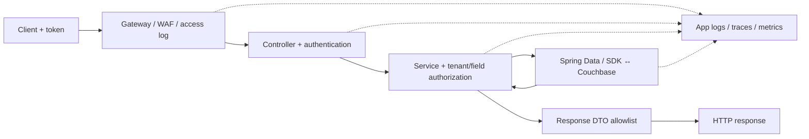
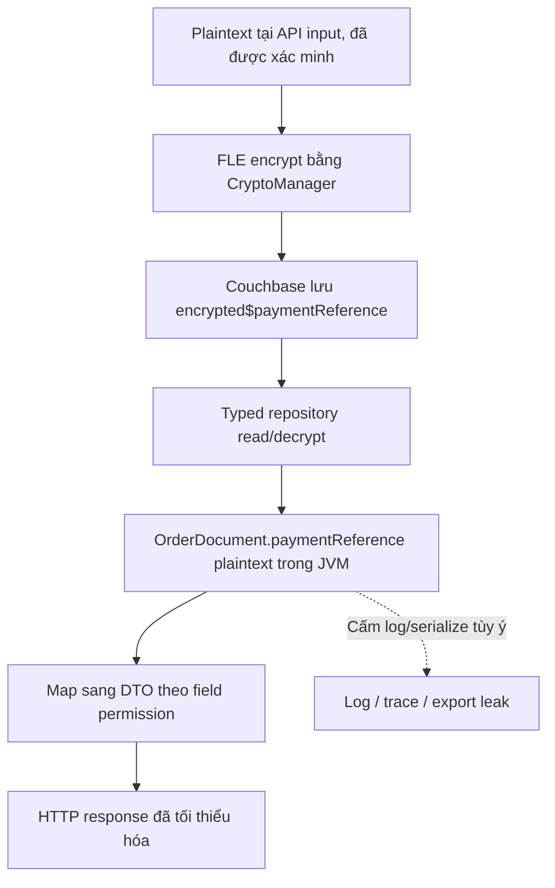
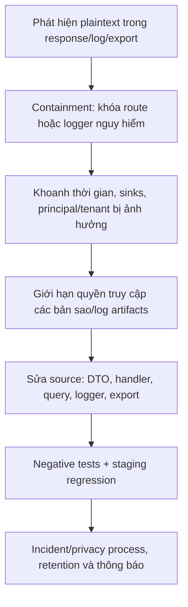

# Giới hạn dữ liệu nhạy cảm trong log, lỗi và kết quả trả về

## Mục tiêu bài học

Trong hệ thống **Spring Data Couchbase**, một document có thể chứa `tenantId`, `status`, `createdAt` và những trường bí mật như `paymentReference`, thông tin định danh hay token nghiệp vụ. Ứng dụng có thể lưu dữ liệu đúng quyền và thậm chí mã hóa field bằng `@Encrypted`, nhưng vẫn làm lộ dữ liệu khi gọi `logger.debug("{}", entity)`, trả trực tiếp entity qua REST hoặc để exception chứa câu SQL++, parameter và document ID đi ra HTTP response.

Bài **“Giới hạn dữ liệu nhạy cảm trong log, lỗi và kết quả trả về”**, thuộc chương **Bảo mật** của module `SPRING_DATA_COUCHBASE`, tập trung vào **data minimization**, **redaction**, **error contract** và **response shaping** trong toàn bộ vòng đời request. Các ví dụ kết nối với document mapping, `CouchbaseRepository`, `CouchbaseTemplate`, Java SDK KV/SQL++, TTL/CAS, transactions, reactive access, RBAC và tenant isolation.

Sau bài này bạn có thể:

- Nhận diện thông tin nhạy cảm trong **HTTP request/response, application logs, SDK errors, query profiles, traces, metrics, audit events, exports** và dữ liệu đã giải mã từ FLE.
- Thiết kế **DTO allowlist** không trả entity Couchbase trực tiếp; kiểm tra tenant/object/field authorization trước khi serialize.
- Dùng structured logging **chỉ với các trường được phép**, correlation ID do server tạo và nguyên tắc không log payload/secret.
- Tạo **HTTP error contract** dùng mã lỗi ổn định, `ProblemDetail`, generic message và request ID; không trả SQL++, stack trace, Couchbase error context, keyspace, secret hay owner tenant khác.
- Phân biệt lỗi **401, 403, 404, 409, 400/422, 429, 503 và 500** theo contract mà không tạo existence oracle cross-tenant.
- Kiểm soát thông tin nhạy cảm trong `clientContextId`, log level, HTTP access logs, gateway, actuator, traces và hệ thống giám sát.
- Viết negative tests trên response và log để phát hiện rò rỉ, kể cả khi repository/FLE hoạt động đúng.
- Lập checklist và runbook cho sự cố dữ liệu nhạy cảm bị ghi vào log hoặc trả sai cho người dùng.

> **Giả định lab:** Bucket `training`, scope `commerce`, collection `orders`; Spring Boot/Spring Data Couchbase và Java SDK phiên bản tương thích. Các giá trị bí mật trong ví dụ đều **giả**, không dùng dữ liệu thật. Cấu hình `@Encrypted`/`CryptoManager` là một điều kiện phụ trợ khi dùng Field Level Encryption (FLE), không phải yêu cầu để triển khai nguyên tắc data minimization. Quy tắc về thời hạn lưu log, dữ liệu cá nhân và thông báo sự cố phải được điều chỉnh theo chính sách pháp lý/tổ chức thực tế.

## 1. Ranh giới dữ liệu: lưu an toàn không có nghĩa trả an toàn

Một request đơn hàng thường đi qua nhiều điểm có thể ghi/hiển thị dữ liệu:



**Bốn kênh rò rỉ chính:**

1. **Đầu ra thành công:** Controller trả `Order` entity, raw `JsonObject`, `SELECT o.*` hoặc `ResponseEntity<Object>` chứa field mà user không có quyền xem.
2. **Đầu ra lỗi:** Exception message/stack trace, Couchbase `ErrorContext`, SQL++ statement/parameters hay field validation errors được trả như `detail` trong JSON.
3. **Quan sát vận hành:** Application/access/security/audit logs, request/response body logging, tracing spans, query profiles, metrics labels hoặc support bundles.
4. **Hệ thống phụ:** Cache, search/analytics, message broker, CSV export, email, screenshots/tickets và dashboards nhận một bản sao entity đã giải mã.

**Nguyên tắc cốt lõi:** Dữ liệu một service *có thể đọc* không đồng nghĩa service *nên ghi log* hay người gọi *được xem*. RBAC Couchbase giới hạn tài khoản database theo resource; authorization ứng dụng giới hạn end user theo tenant/object/field. FLE có thể bảo vệ field lúc lưu nhưng **sau decrypt trong Java, field lại là plaintext**.

### 1.1. Các loại dữ liệu cần phân loại

| Loại | Ví dụ | Mặc định cho log/response |
| --- | --- | --- |
| **Credentials/secret** | DB password, API key, JWT, session cookie, KMS key, FLE key material | **Không log, không echo**; không đưa vào URL |
| **Dữ liệu định danh** | Email, điện thoại, tên đầy đủ, số giấy tờ | Không log raw; response chỉ khi có mục đích/quyền |
| **Dữ liệu nghiệp vụ nhạy cảm** | `paymentReference`, số dư, thông tin giao dịch, địa chỉ | Field-level authorization + DTO minimization |
| **Dữ liệu tenant/object** | `tenantId`, document ID, owner, scope/collection | Có thể nhạy cảm; không echo owner của tenant khác |
| **Metadata vận hành** | Template ID, request ID ngẫu nhiên, latency, outcome, error code | Được phép theo allowlist và retention |
| **Ciphertext/FLE envelope** | `encrypted$paymentReference`, `kid`, `alg`, ciphertext | Không tự coi là public; tránh trả/log raw |
| **Query diagnostics** | SQL++ text, parameters, index name, error context, retry history | Chỉ trong kênh chẩn đoán kiểm soát, đã redact |

Không nhất thiết mọi `tenantId` đều là bí mật tuyệt đối, nhưng nó có thể tiết lộ quan hệ khách hàng. `documentId` có thể chứa email hoặc order reference. Vì vậy **một field không chứa mật khẩu** vẫn có thể cần pseudonymization và giới hạn truy cập log.

### 1.2. Data minimization khác masking

- **Minimization:** không đưa field vào response/log ngay từ đầu. Đây là ưu tiên số một.
- **Redaction:** loại bỏ hoàn toàn một giá trị nhạy cảm trước khi gửi (ví dụ `[REDACTED]`).
- **Masking:** chỉ giữ một phần giá trị nếu nghiệp vụ thật sự cho phép, ví dụ bốn ký tự cuối của mã tham chiếu. Phần còn lại vẫn có thể là dữ liệu nhạy cảm.
- **Pseudonymization:** thay ID bằng một tham chiếu không trực tiếp nhận diện, có kiểm soát key/salt/khả năng liên kết. **Hash SHA-256 không muối của email** có thể bị dò bằng từ điển; không tự coi nó là ẩn danh.
- **Encryption:** bảo vệ nội dung khi lưu/truyền trong phạm vi thiết kế; **không tự giảm lượng thông tin mà service trả ra sau decrypt**.

> Một chính sách ghi log tốt bắt đầu bằng **allowlist các fields có ích để điều tra**, không phải `toString()` toàn object rồi regex “che password”.

## 2. Thiết kế đầu ra từ một hợp đồng công khai hẹp

### 2.1. Entity lưu trữ khác HTTP response model

Ví dụ entity chỉ dùng trong tầng persistence:

```java
package com.example.orders.domain;

import com.couchbase.client.java.encryption.annotation.Encrypted;
import org.springframework.data.annotation.Id;
import org.springframework.data.couchbase.core.mapping.Document;
import org.springframework.data.couchbase.core.mapping.Scope;
import org.springframework.data.couchbase.core.mapping.Collection;

@Document
@Scope("commerce")
@Collection("orders")
public class OrderDocument {
    @Id
    private String id;
    private String tenantId;
    private String status;
    private String createdAt;
    private long total;
    @Encrypted
    private String paymentReference;

    protected OrderDocument() {}

    public OrderDocument(
            String id, String tenantId, String status,
            String createdAt, long total, String paymentReference) {
        this.id = id;
        this.tenantId = tenantId;
        this.status = status;
        this.createdAt = createdAt;
        this.total = total;
        this.paymentReference = paymentReference;
    }

    public String getId() { return id; }
    public String getTenantId() { return tenantId; }
    public String getStatus() { return status; }
    public String getCreatedAt() { return createdAt; }
    public long getTotal() { return total; }
    public String getPaymentReference() { return paymentReference; }
}
```

Nếu FLE đã cấu hình hợp lệ, Spring Data có thể **giải mã** `paymentReference` khi đọc thành entity. **Đừng** để `OrderDocument` là HTTP JSON contract. Tách response DTO hẹp:

```java
package com.example.orders.api;

public record OrderSummaryResponse(
    String id, String status, String createdAt, long total
) {}

public record OrderPaymentReferenceResponse(
    String id, String paymentReference
) {}
```

Hai DTO dành cho **hai mục đích và cấp quyền khác nhau**:

- `OrderSummaryResponse` không có `paymentReference` hoặc `tenantId` nên serializer không thể vô tình xuất những fields ấy chỉ vì entity bổ sung getter mới.
- `OrderPaymentReferenceResponse` chỉ được tạo ở **use case riêng**, sau khi principal có quyền xem thông tin thanh toán và document thuộc tenant được ủy quyền.
- Trong JSON response, `id` chỉ được phép xuất nếu document ID không chứa dữ liệu nhạy cảm và caller được phép thấy. Nếu key nội bộ chứa PII, dùng public opaque ID riêng.

**Không dựa duy nhất vào `@JsonIgnore` trên entity**: nó kiểm soát một số đường JSON serialization, nhưng không tự ngăn logging `toString()`, raw SQL++ results, Jackson mapper khác, gRPC/protobuf, CSV exports hay các getters được gọi trong template. DTO allowlist làm hợp đồng rõ và giảm blast radius khi entity schema phát triển.

### 2.2. Vì sao Lombok `@Data` và record `toString` dễ nguy hiểm?

```java
// KHÔNG LÀM trong code production có sensitive fields:
log.debug("Loaded order: {}", orderDocument);
log.info("Request payload: {}", createOrderRequest);
log.error("Search result: {}", result.rowsAsObject());
```

Lombok `@Data` có thể sinh `toString()` chứa fields, kể cả field `@Encrypted` **đã được giải mã** vào object Java. Java record cũng sinh `toString()` từ record components. Khi bắt exception, logging `ex` nguyên object có thể include SDK diagnostics và request data. **Không** coi mức `DEBUG` là an toàn: log level có thể được bật tạm, output lưu trong collector và backup lâu hơn dự kiến.

Nếu dự án vẫn cần `toString()` phục vụ debugging, hãy thiết kế **safe representation** chỉ chứa các trường cố định được phép; tránh để default `toString()` hoặc serialization framework quyết định thay security policy.

### 2.3. Field-level permission phải được kiểm tra ở service

Một người được đọc danh sách đơn **không mặc định** có quyền xem `paymentReference`. Có thể thiết kế:

```text
read:orders:summary       -> trả OrderSummaryResponse
read:orders:payment-ref   -> trả OrderPaymentReferenceResponse
export:orders             -> riêng, có approval/audit và retention
```

Role names là **quyền ứng dụng minh họa**, không phải role name Couchbase. Permission cho protected field phải được kiểm tra **cùng với tenant/object ownership**; không chỉ kiểm tra DB account có Data Reader trên collection. Nếu user không đủ quyền, không tạo DTO chứa secret rồi dựa vào client tự ẩn.

### 2.4. Kiểm soát response theo API contract

| Endpoint | Những gì trả về | Những gì không được lộ |
| --- | --- | --- |
| `GET /orders` | Public ID, status, thời gian, tổng tiền nếu được phép | FLE envelope, reference, document metadata, query plan |
| `GET /orders/{id}` | Summary hoặc detail DTO phù hợp quyền | Tenant owner của document khác, field bí mật |
| `GET /orders/{id}/payment-reference` | Reference khi đủ quyền riêng + ownership | Trả cho user chỉ có summary permission |
| `POST /orders` | Created ID, status, URL ổn định nếu có | Request body chứa PII, credential, internal keyspace |
| `PATCH /orders/{id}` | Status mới, version công khai theo contract | Raw CAS/exception internals nếu không cần |
| `GET /exports/{jobId}` | URL tải được ủy quyền, thời hạn ngắn, audit | Export toàn tenant khác, presigned URL trong log |

Phân trang/`COUNT` cũng có thể làm lộ số record của tenant khác dù response không chứa PII. Cần cùng **verified tenant filter** cho list, count, search, export và cache.

## 3. Chặn BOLA/IDOR trước khi tạo response DTO

Một document key là địa chỉ dữ liệu, **không là chứng cứ quyền sở hữu**. Trong shared collection, `CouchbaseRepository.findById(id)` có thể lấy document tenant khác nếu DB credential đủ role; service phải xác minh tenant owner **trước khi map sang DTO**.

### 3.1. Verified context và exception có chủ đích

```java
package com.example.orders.security;

public record VerifiedTenantContext(
    String tenantId, String principalRef
) {
    public VerifiedTenantContext {
        if (tenantId == null || tenantId.isBlank()
                || principalRef == null || principalRef.isBlank()) {
            throw new IllegalArgumentException(
                "Verified tenant context required");
        }
    }
}

public final class ResourceNotVisibleException
        extends RuntimeException {
    // Không đưa real owner, document content hoặc ID vào message.
    public ResourceNotVisibleException() {
        super("Resource not visible");
    }
}
```

**Lưu ý về Java:** Khi đưa vào project, `VerifiedTenantContext` và `ResourceNotVisibleException` phải là **hai file Java riêng** vì cả hai đều public top-level types. `record` bất biến **không tự chứng minh** tenant đã được xác minh: chỉ tạo object ở resolver/factory chạy sau authentication và membership/entitlement check, không tạo từ raw HTTP `X-Tenant-Id`.

### 3.2. Service chỉ phát hành summary của owner

Repository được Spring Data tạo bean khi bật repository scanning:

```java
package com.example.orders.repository;

import com.example.orders.domain.OrderDocument;
import org.springframework.data.couchbase.repository.CouchbaseRepository;

public interface OrderRepository
        extends CouchbaseRepository<OrderDocument, String> {
}
```

```java
package com.example.orders.service;

import com.example.orders.api.OrderSummaryResponse;
import com.example.orders.domain.OrderDocument;
import com.example.orders.repository.OrderRepository;
import com.example.orders.security.VerifiedTenantContext;
import com.example.orders.security.ResourceNotVisibleException;
import org.springframework.stereotype.Service;

@Service
public final class OrderSummaryService {
    private final OrderRepository orders;

    public OrderSummaryService(OrderRepository orders) {
        this.orders = orders;
    }

    public OrderSummaryResponse getSummary(
            String id, VerifiedTenantContext tenant) {
        if (tenant == null || id == null || id.isBlank()) {
            throw new IllegalArgumentException("Invalid request");
        }
        OrderDocument document = orders.findById(id)
            .orElseThrow(ResourceNotVisibleException::new);

        if (!tenant.tenantId().equals(document.getTenantId())) {
            // Cùng loại lỗi với ID không tồn tại.
            throw new ResourceNotVisibleException();
        }

        // Không gọi document.toString(), không log raw JSON,
        // không trả nguyên document đã có thể được FLE decrypt.
        return new OrderSummaryResponse(
            document.getId(), document.getStatus(),
            document.getCreatedAt(), document.getTotal());
    }
}
```

**Hai đường truy cập khác nhau** — ID không tồn tại và ID thuộc tenant khác — cùng đi tới lỗi “not visible”, thường được map sang **404** theo hợp đồng API để tránh existence oracle. Tính thống nhất của HTTP status/message/body cũng cần áp dụng cho headers và những thông tin có thể đoán qua thời gian đáp ứng theo threat model; không tiết lộ `tenantId` thật của document khác.

Một service đọc `paymentReference` phải thực hiện **thêm field permission check** trước khi map sang `OrderPaymentReferenceResponse`. Đừng đưa cờ `includeSensitive=true` do client điều khiển vào cùng method mà không kiểm tra authorization.

### 3.3. Kiểm tra quyền trước khi log lỗi

Anti-pattern:

```java
// KHÔNG LÀM: thông tin cross-tenant đã đi ra log.
log.warn("Wrong tenant: requested={}, actual={}, doc={}",
    tenant.tenantId(), document.getTenantId(), document);
throw new ResourceNotVisibleException();
```

Trong code này response đã được ẩn nhưng **log lại tiết lộ owner và full document**. Nếu cần audit quyết định deny, ghi một `reasonCode=OWNERSHIP_MISMATCH` và correlation ID, không ghi raw owner ID, body hay field bí mật. Mọi denial event phải có rate limit và retention phù hợp để không tạo log amplification/DoS.

Nguồn: [OWASP API1 — Broken Object Level Authorization](https://owasp.org/API-Security/editions/2023/en/0xa1-broken-object-level-authorization/), [OWASP Authorization Cheat Sheet](https://cheatsheetseries.owasp.org/cheatsheets/Authorization_Cheat_Sheet.html).

## 4. SQL++ query: chỉ SELECT fields được phép và không log parameters

### 4.1. Tránh `SELECT o.*` ở endpoint public

```sql
-- KHÔNG khuyến nghị cho REST summary endpoint:
SELECT o.*, META(o).id AS documentId
FROM `training`.`commerce`.`orders` AS o
WHERE o.tenantId = $tenantId;
```

Kết quả có thể chứa `encrypted$paymentReference`, `kid`, các field nhạy cảm plaintext chưa mã hóa và metadata/schema fields của ứng dụng. **Ciphertext không tự là dữ liệu được phép công khai**: envelope có metadata, có thể bị sao chép để sử dụng sai hoặc lộ qua exports.

Query hẹp hơn:

```sql
SELECT META(o).id AS documentId,
       o.status,
       o.createdAt,
       o.total
FROM `training`.`commerce`.`orders` AS o
WHERE o.tenantId = $tenantId
  AND o.status = $status
ORDER BY o.createdAt DESC, META(o).id ASC
LIMIT $limit;
```

**Điều kiện tenant** do server xác minh. `LIMIT` cần giới hạn trước khi bind. `ORDER BY` chỉ dùng allowlist, không nối raw request thành identifier/keyword. Query ít fields chỉ là một lớp minimization; nếu `total` không được phép cho role hiện tại, phải có **query/DTO khác** thay vì luôn SELECT rồi xóa bằng cách thủ công ở Controller.

### 4.2. Java SDK QueryOptions và correlation không chứa PII

```java
import com.couchbase.client.java.Cluster;
import com.couchbase.client.java.json.JsonObject;
import com.couchbase.client.java.query.QueryOptions;
import java.util.List;

// verifiedTenantId được cấp từ resolver đã kiểm tra membership.
public List<JsonObject> listSafe(
        Cluster cluster, String verifiedTenantId,
        String status, int limit, String requestId) {
    if (!java.util.Set.of("NEW", "PAID", "CANCELLED").contains(status)
            || limit < 1 || limit > 100) {
        throw new IllegalArgumentException("Invalid filter");
    }
    String sql = """
        SELECT META(o).id AS documentId, o.status, o.createdAt, o.total
        FROM `training`.`commerce`.`orders` AS o
        WHERE o.tenantId = $tenantId AND o.status = $status
        LIMIT $limit
        """;
    return cluster.query(sql, QueryOptions.queryOptions()
        .parameters(JsonObject.create()
            .put("tenantId", verifiedTenantId)
            .put("status", status)
            .put("limit", limit))
        .clientContextId(requestId)
        .readonly(true)).rowsAsObject();
}
```

`clientContextId` được SDK/Query Service dùng liên kết diagnostics, không phải trường mã hóa hay nơi chứa principal/secret. **Dùng một ID opaque, ngẫu nhiên do server tạo**, không đặt `userEmail`, `JWT`, `paymentReference` hoặc raw `tenantId` vào đó. Nếu `requestId` từ client gửi, phải kiểm tra/chuẩn hóa hoặc thay bằng ID server-generated để tránh log injection/PII.

**Quan trọng:** SQL++ parameter binding chống chèn cú pháp nhưng **không khiến parameter values vô hại khi ghi log**. `parameters(JsonObject)` có thể chứa `tenantId` hoặc thông tin nhạy cảm; không log toàn bộ object `QueryOptions`, câu query đã nội suy giá trị hoặc exception diagnostics theo mặc định.

### 4.3. Query profiling và slow-query logs

Trong quá trình điều tra, Query Service/SDK có thể cung cấp query text, parameter information, warnings, execution profile và client context. `EXPLAIN`/`PROFILE` hỗ trợ tối ưu index nhưng không nên bật profile/tracing chi tiết cho mọi request production rồi chuyển sang dashboard công khai. Nếu có một truy vấn phải dùng `paymentReference` làm bound parameter, **đừng đưa nó vào tên span, metric label hay log của statement**.

Kiểm soát query access ở **cả hai phía**: application logging và Couchbase Server Query/Index/Analytics/audit log configuration. Một ứng dụng không ghi parameters vẫn có thể để gateway, proxy, debugger hoặc Server diagnostic collection ghi chúng theo cấu hình cụ thể.

### 4.4. Query một field mã hóa có thể trả envelope

`@Encrypted`/`CryptoManager` giải mã trong **typed client mapping**; `rowsAsObject()` của raw SQL++ thường phản ánh JSON vật lý. Không gắn `SELECT encrypted$paymentReference` trực tiếp vào public endpoint, dù nó chỉ là ciphertext. Query projection/mapper chỉ nên lấy fields có contract rõ; đừng suy rằng raw SQL++ result tự chạy FLE decrypt vì một entity Java có annotation.

Nguồn: [Couchbase Java SDK — SQL++ Queries](https://docs.couchbase.com/java-sdk/current/howtos/sqlpp-queries-with-sdk.html), [Spring Data Couchbase — Querying](https://docs.spring.io/spring-data/couchbase/reference/couchbase/querying.html).

## 5. Structured logging với danh sách trường cho phép

### 5.1. Chỉ ghi sự kiện và kết quả, không ghi object

Một log có ích để điều tra không cần chứa nội dung đơn hàng:

```text
event=order_summary_read outcome=allow requestId=6bafc5f2-xxxx
operation=kv_get resource=orders result=not_visible requestId=6bafc5f2-xxxx
event=sqlpp_list durationMs=42 resultCount=20 queryTemplate=orders-by-tenant-status
event=crypto_decrypt_error reason=unknown_kid fieldClass=payment-reference requestId=...
```

Trong source code:

```java
import org.slf4j.Logger;
import org.slf4j.LoggerFactory;

public final class OrderEvents {
    private static final Logger log =
        LoggerFactory.getLogger(OrderEvents.class);

    public void summaryRead(String requestId, long elapsedMs) {
        // Mọi field đều được kiểm soát kiểu dữ liệu/nguồn.
        log.info("event=order_summary_read outcome=allow "
            + "requestId={} elapsedMs={}", requestId, elapsedMs);
    }

    public void readDenied(String requestId) {
        // Không log tenant thực, document ID hoặc object body.
        log.warn("event=order_read_denied reason=NOT_VISIBLE "
            + "requestId={}", requestId);
    }
}
```

`queryTemplate=orders-by-tenant-status` là **tên logic cố định do developer đặt**, không phải SQL++ statement đã ghép parameters. `requestId` phải là ID sinh/validate phía server, không phải một header tùy ý chứa email. `elapsedMs`/`resultCount` là số đã xác minh, tránh đưa high-cardinality PII vào labels.

### 5.2. Danh sách cấm và danh sách cho phép

| Nên log theo policy | Không log theo mặc định |
| --- | --- |
| Event name, outcome, duration, status class | Request/response body |
| Query template identifier | SQL++ statement có raw values/parameters |
| Database operation category `KV_GET`/`SQLPP_SELECT` | Document JSON hoặc entity `toString()` |
| Error category ổn định `DB_TIMEOUT`/`CAS_CONFLICT` | `ex.getMessage()`/`ex.toString()` chưa kiểm tra |
| Service/version/environment đã phê duyệt | DB password, JWT, session ID/cookie, FLE key/KMS token |
| Server-generated request ID | Email, điện thoại, `paymentReference`, raw document ID nhạy cảm |
| Counter/latency phân nhóm | Raw query plan/profiles, stack trace trong kênh phổ thông |

**Điểm khó:** Một exception “chỉ là kỹ thuật” vẫn có thể mang **documentId, bucket/scope/collection, query text, parameters, node address hoặc retry context**. Không tự động log `ex` kèm stack trace vào mọi log aggregator có quyền rộng; chẩn đoán chi tiết cần kênh **truy cập giới hạn, retention ngắn, redaction và quy trình điều tra**.

### 5.3. Vì sao regex masking ở appender không đủ?

Giả sử log đã ghi:

```text
paymentReference=LAB-REF-001
payload={"billing":{"reference":"LAB-REF-001"}}
Authorization: Bearer eyJ...
query={"parameters":{"reference":"LAB-REF-001"}}
```

Một regex che `password=...` không xử lý nested JSON, Base64/JWT, field đổi tên, giá trị nằm trong exception cause hoặc message có newline. Masking ở logback/collector có thể là **lớp phòng vệ bổ sung**, nhưng nguyên tắc bền vững là **không tạo log event có dữ liệu bí mật ngay từ đầu**. Nếu phải lưu một phần reference để hỗ trợ khách hàng, cần chính sách masking riêng, test và review rủi ro khôi phục thông tin.

### 5.4. Chống log injection

Một chuỗi do client kiểm soát có thể chứa newline, control characters hoặc nội dung giả dòng log:

```text
status=PAID
event=login_success principal=admin
```

SLF4J placeholders `{}` **không tự xóa CR/LF** trong argument. Tốt nhất không log raw headers, URL query, user-agent không cần thiết, search text hoặc comments. Nếu buộc phải ghi một thuộc tính client-controlled đã được phép, cần **validate/normalize, giới hạn độ dài, escape control chars** bằng structured encoder phù hợp, không coi một chuỗi “được wrap trong JSON” là đã an toàn ở mọi downstream.

### 5.5. Khi cần liên kết với principal/tenant

Đôi khi cần điều tra denied events theo principal/tenant. Không nên đưa email hoặc raw JWT subject vào logs phổ thông. Một tùy chọn là **pseudonymous reference** được tạo tại security boundary bằng key/lookup map được bảo vệ, không phải `sha256(email)` trần:

```text
event=tenant_access_denied
principalRef=p_7d2a...
tenantRef=t_1c0b...
reason=TENANT_MEMBERSHIP_DENIED
requestId=6bafc5f2-...
```

Pseudonym vẫn có thể là **dữ liệu cá nhân có thể liên kết**, nên phải phân quyền truy cập và retention. Nếu chính sách không cần join theo principal, **bỏ hẳn các tham chiếu này** thay vì cố hash mọi ID.

Nguồn: [OWASP Logging Cheat Sheet](https://cheatsheetseries.owasp.org/cheatsheets/Logging_Cheat_Sheet.html), [OWASP Secrets Management Cheat Sheet](https://cheatsheetseries.owasp.org/cheatsheets/Secrets_Management_Cheat_Sheet.html).

## 6. Correlation ID và MDC không tiết lộ yêu cầu

### 6.1. Sinh ID do server kiểm soát

`X-Request-Id` do client gửi có thể hữu ích để đối soát nhưng **không tự được tin**. Nếu nhận một giá trị quá dài, chứa newline/PII hoặc cố tình trùng, nó có thể gây log injection và sai correlation. Một lựa chọn đơn giản: **sinh UUID mới tại ingress**, truyền tiếp sang service downstream qua header nội bộ được quản lý.

Ví dụ Spring MVC Servlet Filter:

```java
package com.example.orders.web;

import jakarta.servlet.FilterChain;
import jakarta.servlet.ServletException;
import jakarta.servlet.http.HttpServletRequest;
import jakarta.servlet.http.HttpServletResponse;
import java.io.IOException;
import java.util.UUID;
import org.slf4j.MDC;
import org.springframework.stereotype.Component;
import org.springframework.web.filter.OncePerRequestFilter;

@Component
public class RequestCorrelationFilter
        extends OncePerRequestFilter {

    @Override
    protected void doFilterInternal(
            HttpServletRequest request,
            HttpServletResponse response,
            FilterChain chain)
            throws ServletException, IOException {

        String requestId = UUID.randomUUID().toString();
        request.setAttribute("serverRequestId", requestId);
        response.setHeader("X-Request-Id", requestId);

        // Đóng MDC scope để thread pool không rò context request.
        try (MDC.MDCCloseable ignored =
                 MDC.putCloseable("requestId", requestId)) {
            chain.doFilter(request, response);
        }
    }
}
```

Đây là **ví dụ cho Servlet/MVC**, không phải cấu hình WebFlux. Với distributed tracing, có thể sử dụng W3C `traceparent`/trace ID đã được framework kiểm tra, đồng thời giữ request ID theo hợp đồng gateway. Trace ID là correlation, **không nên chứa principal hay reference**.

### 6.2. Không truyền bí mật qua MDC

**Không làm:**

```java
// KHÔNG LÀM:
MDC.put("jwt", authorizationHeader);
MDC.put("tenant", request.getHeader("X-Tenant-Id"));
MDC.put("order", orderDocument.toString());
```

MDC có thể được mọi log statement sau đó đính kèm và được gửi tới nhiều collectors. Khi cần context cho kiểm toán, dùng values đã xác minh, pseudonymized và scope rõ. Trong thread pool, phải cleanup MDC ở `finally` hoặc dùng scope tương ứng. Nếu async work sống lâu hơn request, chỉ truyền **correlation ID và policy context tối thiểu**, không giữ nguyên HTTP body.

### 6.3. Reactive: không dựa vào ThreadLocal truyền xuyên scheduler

Với `ReactiveCouchbaseRepository` và WebFlux, Reactor có thể thay thread trong khi pipeline chạy. `MDC` truyền thống dùng `ThreadLocal` nên không bảo đảm tự đi theo subscription. Hướng thiết kế:

- Dùng `Reactor Context` hoặc tracing integration được hỗ trợ, thay vì mutable singleton giữ request/tenant.
- Truyền `VerifiedTenantContext` (từ authentication) tường minh tới service/query.
- Không đặt plaintext field vào `Context` chỉ để logging.
- Trong `doOnError`, chỉ ghi **error category + server-generated request ID**, không `Throwable.toString()` hoặc raw `onNext` entity.
- Dùng retry có giới hạn và context đúng; không làm lỗi 403/404 trở thành thành công do `onErrorResume` trả dữ liệu cache ngoài tenant.

Ví dụ logic reactive an toàn:

```java
// Method của reactive service đã có VerifiedTenantContext tenant
// và ReactiveOrderRepository repository phù hợp.
return repository.findById(id)
    .filter(order -> tenant.tenantId().equals(order.getTenantId()))
    .switchIfEmpty(Mono.error(new ResourceNotVisibleException()))
    .map(order -> new OrderSummaryResponse(
        order.getId(), order.getStatus(),
        order.getCreatedAt(), order.getTotal()))
    .doOnError(error -> log.warn(
        "event=order_lookup_failed requestId={} errorType={}",
        requestId, error.getClass().getSimpleName()));
```

**Đây là method fragment**, cần import `reactor.core.publisher.Mono`, logger, repository và domain classes. `doOnError` không ghi exception message/cause, không log order. Đối với WebFlux integration thực, middleware/auth/filter cần gắn requestId đúng Reactor Context và tránh thiết kế luôn truy xuất MDC trực tiếp từ thread hiện tại.

## 7. HTTP error contract bằng `ProblemDetail`

### 7.1. Những gì người gọi cần và không cần

Một lỗi HTTP nên cho client biết **loại lỗi, hướng xử lý hợp lệ và correlation ID**. Nó không cần nêu keyspace, SQL++ query, database hostname, tenant owner, document body, stack trace hay password.

Ví dụ response public:

```json
{
  "type": "about:blank",
  "title": "Resource not found",
  "status": 404,
  "detail": "Resource not found",
  "instance": "urn:request:6bafc5f2-9ed0-4621-a948-879e76b0a743",
  "errorCode": "RESOURCE_NOT_VISIBLE",
  "requestId": "6bafc5f2-9ed0-4621-a948-879e76b0a743"
}
```

`ProblemDetail`/`ErrorResponse` trong Spring Framework 6+ hỗ trợ chuẩn **RFC 9457** và có thể được dùng với Spring MVC/WebFlux theo API phiên bản. `requestId` là metadata custom allowlisted; tuyệt đối không đặt `query`, `body`, `tenantOwner` hoặc `exceptionMessage` vào properties.

### 7.2. Exception handler đơn giản, không echo nguyên nhân

```java
package com.example.orders.web;

import com.example.orders.security.ResourceNotVisibleException;
import jakarta.servlet.http.HttpServletRequest;
import java.net.URI;
import org.slf4j.Logger;
import org.slf4j.LoggerFactory;
import org.springframework.http.HttpStatus;
import org.springframework.http.ProblemDetail;
import org.springframework.http.ResponseEntity;
import org.springframework.web.bind.annotation.ExceptionHandler;
import org.springframework.web.bind.annotation.RestControllerAdvice;

@RestControllerAdvice
public class SafeApiExceptionHandler {
    private static final Logger log =
        LoggerFactory.getLogger(SafeApiExceptionHandler.class);

    @ExceptionHandler(ResourceNotVisibleException.class)
    public ResponseEntity<ProblemDetail> notVisible(
            ResourceNotVisibleException ex,
            HttpServletRequest request) {
        return problem(HttpStatus.NOT_FOUND, "Resource not found",
            "RESOURCE_NOT_VISIBLE", request);
    }

    @ExceptionHandler(Exception.class)
    public ResponseEntity<ProblemDetail> unexpected(
            Exception ex, HttpServletRequest request) {
        String id = requestId(request);
        // Không gửi ex.message, SQL++, Couchbase ErrorContext,
        // request body hoặc full stack trace ra log phổ thông.
        log.error("event=unhandled_request_error requestId={} "
            + "errorType={}", id, ex.getClass().getSimpleName());

        return problem(HttpStatus.INTERNAL_SERVER_ERROR,
            "Request could not be completed",
            "INTERNAL_ERROR", request);
    }

    private static ResponseEntity<ProblemDetail> problem(
            HttpStatus status, String detail,
            String code, HttpServletRequest request) {
        String id = requestId(request);
        ProblemDetail body =
            ProblemDetail.forStatusAndDetail(status, detail);
        body.setTitle(detail);
        body.setInstance(URI.create("urn:request:" + id));
        body.setProperty("requestId", id);
        body.setProperty("errorCode", code);
        return ResponseEntity.status(status).body(body);
    }

    private static String requestId(HttpServletRequest request) {
        Object raw = request.getAttribute("serverRequestId");
        // Chỉ tin filter nội bộ; không đọc raw X-Request-Id.
        return raw instanceof String id && !id.isBlank()
            ? id : "unavailable";
    }
}
```

**Lý do đặt `instance` tường minh:** Spring có thể dùng request path làm `ProblemDetail.instance` khi còn trống. Nếu URL chứa một document ID/PII, việc lặp path vào error body/log có thể làm tăng exposure. `urn:request:<UUID>` minh họa một định danh an toàn; filter sinh ID để client liên hệ hỗ trợ.

**Giới hạn code ví dụ:** Handler `Exception.class` là một **fallback policy tối giản**, không phải bộ ánh xạ lỗi hoàn chỉnh. Trong ứng dụng thực, cần xử lý riêng validation, conflict, security và transient DB errors; phải review sự tương tác với Spring MVC `ResponseEntityExceptionHandler`/Boot autoconfig, đặc biệt để không biến lỗi client thành 500. Tuyệt đối không dùng `@ExceptionHandler(Throwable.class)` để nuốt JVM `Error`.

### 7.3. Bảng phân loại HTTP status và thông điệp

| Trường hợp | HTTP thường dùng | Public detail | Điều không được tiết lộ |
| --- | --- | --- | --- |
| Chưa xác thực | **401** | Authentication required | Nội dung token, lý do chữ ký/secret chi tiết |
| Thiếu permission với tài nguyên đã công khai | **403** | Access denied | Role policy nội bộ, chủ sở hữu document khác |
| ID không tồn tại hoặc ngoài tenant | **404** | Resource not found | Document có thực ở tenant nào, object body |
| Input sai schema/limit | **400** hoặc **422** theo contract | Invalid request | Password/PII đã nhập, raw binding rejected value |
| CAS version cũ, mutation conflict | **409** | Resource has changed | Raw CAS/SDK stack trace |
| Rate limit/quota | **429** | Too many requests | Token, user email, config quota nhạy cảm |
| DB/KMS tạm không sẵn sàng | **503** khi phù hợp | Service temporarily unavailable | Node hostname, KMS key, retry context |
| Bug chưa phân loại | **500** | Request could not be completed | Exception class/cause và stack trace trong HTTP |

**Không** trả 404 cho mọi lỗi: một timeout không đồng nghĩa document không tồn tại. **Không** trả 403 cho user đang hỏi một ID tenant khác nếu policy muốn chống dò existence; xử lý 404 nhất quán theo threat model. 401/403 do Spring Security filter chain phát sinh **có thể không đi qua `@RestControllerAdvice`**, nên cần cấu hình `AuthenticationEntryPoint` và `AccessDeniedHandler` với cùng hợp đồng redaction.

### 7.4. Đừng phản hồi message từ exception thẳng cho client

```java
// KHÔNG LÀM:
return ResponseEntity.status(500).body(
    Map.of("error", ex.toString(), "details", ex.getMessage()));
```

`ex.getMessage()` có thể chứa Query Service error, keyspace, SDK `ErrorContext`, document ID, parameters hoặc secrets. Không đặt raw exception làm `ProblemDetail.detail`, `title`, custom `properties`, header, Server-Sent Event hay WebSocket error packet.

### 7.5. Security và validation errors cũng có thể lộ dữ liệu

Bean Validation có thể tạo message với `rejectedValue`; một binding error có thể chứa email, token hay paymentReference mà client vừa gửi. Response chỉ nên nêu **field name đã được phép và lỗi tổng quát**, ví dụ `"Invalid payment reference format"`, không echo full invalid value. Với enum/path validation, dùng allowlist messages cố định, không concat raw request.

Nguồn: [Spring Framework — Error Responses](https://docs.spring.io/spring-framework/reference/web/webmvc/mvc-ann-rest-exceptions.html), [OWASP Error Handling Cheat Sheet](https://cheatsheetseries.owasp.org/cheatsheets/Error_Handling_Cheat_Sheet.html).

## 8. Couchbase SDK exceptions và `ErrorContext`

### 8.1. Vì sao log `ex` nguyên vẹn có thể lộ dữ liệu?

Couchbase Java SDK có các exception kế thừa `CouchbaseException` và một `ErrorContext` tùy thao tác. Tài liệu SDK nêu context có thể chứa **service, bucket, scope, collection, document ID, request ID, retry reasons, timings** và các chi tiết phục vụ debug; Query Service còn có statement/parameters/profiles tùy loại lỗi và cấu hình.

```java
// KHÔNG LÀM trong log phổ thông:
log.error("Couchbase failed: {}", ex.toString());
log.error("Couchbase failed", ex);
responseBody.put("error", ex.getMessage());
```

Gọi `logger.error("...", ex)` thường in **stack trace và exception message**, mà Couchbase SDK có thể đính kèm context JSON. Đây có thể là thông tin cực kỳ hữu ích cho SRE nhưng **không mặc định an toàn để ghi ra một log collection mà nhiều nhóm có quyền đọc**.

**Thiết kế hai tầng:**

1. **Operational event phổ thông:** `event=db_operation_failed`, `operation=KV_GET`/`SQLPP_SELECT`, error category, correlation ID, elapsed time; không có document data/parameters.
2. **Restricted diagnostics (khi thực sự cần):** context chi tiết sau kiểm duyệt/redaction, chỉ được bật theo incident procedure, có access control, encryption/retention và kiểm soát các secrets trong SDK/Server logs.

Không tự tạo rule chỉ regex `"password"`/`"token"` trong `ErrorContext` rồi khẳng định đã sanitize mọi field: SDK có thể bổ sung context keys qua phiên bản, và query parameters có thể chứa PII mà tên field không hề chứa từ “secret”.

### 8.2. Phân biệt lỗi để tránh trả thông tin sai

| SDK/ứng dụng | Ý nghĩa thường gặp | API/observability policy |
| --- | --- | --- |
| `DocumentNotFoundException` | KV key không tồn tại | Khi API đã có tenant policy, trả 404 generic |
| Ownership mismatch trong service | Document tồn tại nhưng tenant khác | Cùng response 404 như ID không tồn tại |
| `DocumentExistsException` | Insert trùng key | Tùy nghiệp vụ: 409 generic, không tiết lộ chủ sở hữu ID khác |
| `CasMismatchException` | Mutation dựa trên CAS cũ | 409, retry có kiểm soát, không echo CAS nội bộ |
| `UnambiguousTimeoutException` | SDK xác định thao tác timeout không có side effect theo semantics tương ứng | Transient error; xử lý theo idempotency contract |
| `AmbiguousTimeoutException` | Không biết thao tác ghi đã được Server áp dụng chưa | Không tự retry mutation không idempotent; reconcile |
| Query planning/index failure | SQL++/index/role/statement không hợp lệ | Không trả query/error context; sửa provisioning/query |
| Auth/RBAC denied từ database | DB account thiếu quyền | 5xx hoặc service failure tùy contract; **không coi là end-user 403 mặc định** |
| Crypto/decrypt/keyring failure | Key thiếu/sai, ciphertext lỗi | Fail closed, không log plaintext hay gửi `kid` chi tiết |

**Quan trọng về timeout ghi:** Một `AmbiguousTimeoutException` không có nghĩa insert/replace/remove chắc chắn thất bại. Tự động retry một charge/event/order mutation có thể tạo duplicate hoặc trạng thái không nhất quán. Cần idempotency key, CAS hoặc cơ chế đối soát theo nghiệp vụ; public error chỉ nêu trạng thái có thể kiểm tra lại theo contract, không chứa stack trace.

### 8.3. Mã lỗi nội bộ nên độc lập exception class

Ví dụ:

```text
SDK DocumentNotFoundException + ownership policy  -> RESOURCE_NOT_VISIBLE
SDK CasMismatchException                          -> CONCURRENT_UPDATE
SDK timeout (transient)                          -> DATA_STORE_UNAVAILABLE
Keyring missing kid                              -> PROTECTED_DATA_UNAVAILABLE
Unknown application exception                    -> INTERNAL_ERROR
```

Mã `DATA_STORE_UNAVAILABLE` là **API/application error code**, không phải class/HTTP code của Couchbase. Một hệ thống có thể chọn 503 hoặc 500 tùy phân loại và retry contract, nhưng không để tên SDK exception trở thành public API khi thư viện được nâng cấp.

### 8.4. Không log query bindings và document JSON để debug

```java
// KHÔNG LÀM:
log.debug("Query: {} params: {}", statement, queryParameters);
log.warn("KV get error on id={}, payload={}, ex={}",
    documentId, jsonDocument, ex);
```

`statement` có thể chứa literal lộ bí mật nếu developer ghép chuỗi sai; `queryParameters` có thể chứa PII/tenant. `jsonDocument` có thể đã bị giải mã hoặc còn ciphertext metadata. `documentId` có thể chứa email/order reference. Dùng `queryTemplateId`/`operationType`, `requestId` và loại lỗi cố định thay thế.

### 8.5. Giao diện quản trị và diagnostics của Couchbase

Phạm vi bảo vệ không dừng ở application log:

- Query Workbench, query history, slow queries, index profiles và SDK diagnostics có thể lưu SQL++ text/parameters theo cấu hình/version.
- Couchbase Server audit logs có thể chứa identity, resource names, statement hoặc metadata; cần review field policy/access.
- Support bundles, debug exports và cluster snapshots thường có giới hạn bảo mật riêng, không được đính vào tickets công khai.
- Khi cần thu thập diagnostics, **chỉ thực hiện theo quy trình phê duyệt**; dùng account/collection test khi tái hiện lỗi chứa dữ liệu nhạy cảm.

Nguồn: [Couchbase Java SDK — Error Handling](https://docs.couchbase.com/java-sdk/current/howtos/error-handling.html), [Couchbase Java SDK — Error Codes](https://docs.couchbase.com/java-sdk/current/ref/error-codes.html).

## 9. Spring Boot error properties và Actuator

### 9.1. Cấu hình an toàn cho default error response

Spring Boot có các thuộc tính điều khiển mức chi tiết lỗi mặc định; ví dụ cho Spring Boot 3.x, xác minh lại theo phiên bản đang dùng:

```yaml
server:
  error:
    include-exception: false
    include-message: never
    include-binding-errors: never
    include-stacktrace: never
    # Chỉ bật nếu phiên bản Boot hỗ trợ, để tránh phản chiếu path
    # chứa ID hoặc PII vào response lỗi.
    include-path: never

spring:
  mvc:
    problemdetails:
      enabled: true
```

`spring.mvc.problemdetails.enabled` kích hoạt hỗ trợ Problem Details cho các lỗi Spring MVC được Boot cấu hình khi tương thích; nếu ứng dụng có `@RestControllerAdvice` tùy biến, cần thử xem **handler nào thắng theo order**. Các thuộc tính `server.error.*` chủ yếu ảnh hưởng **default error handling**, **không thay thế** việc kiểm tra code tự tạo `ProblemDetail`/`ResponseEntity` và có thể không bảo vệ một custom exception handler đang gửi raw exception.

Nếu dùng WebFlux, property/framework path có thể khác. Không sao chép cấu hình MVC và giả định nó bao phủ WebFlux/GraphQL/WebSocket error responses. Từng transport cần policy và integration test riêng.

### 9.2. Hạn chế endpoints quan sát của Actuator

Ví dụ khi có `spring-boot-starter-actuator`:

```yaml
management:
  endpoints:
    web:
      exposure:
        include: health,info
  endpoint:
    health:
      show-details: never
```

Đây là **allowlist tối thiểu minh họa**; môi trường production có thể cần metrics/prometheus trên mạng giám sát riêng. Không expose công khai `env`, `configprops`, `beans`, `loggers`, `heapdump`, `httpexchanges`, `threaddump` hoặc endpoints tùy biến chứa query/secret. Ngay cả khi Actuator có cơ chế masking một số keys, nó không đảm bảo mọi custom property/password hay plaintext trong heap đều được bảo vệ.

**`/actuator/loggers` là một rủi ro vận hành riêng:** Nếu ai đó nâng DEBUG/TRACE cho package ứng dụng hoặc SDK, dữ liệu có thể bắt đầu xuất hiện trong logs dù code không đổi. Giới hạn quyền gọi endpoint và có runbook bật/tắt log level, TTL/cửa sổ điều tra nếu công cụ hỗ trợ.

### 9.3. Logging level và debug có kiểm soát

```yaml
logging:
  level:
    root: INFO
    com.example.orders: INFO
    org.springframework.data.couchbase: INFO
    com.couchbase.client: INFO
```

Cấu hình này **không bảo đảm mọi event là an toàn**: một `INFO` log vẫn có thể chứa dữ liệu nhạy cảm, và SDK/Framework logging behavior thay đổi theo version. Ưu tiên không ghi raw payload trong mã nguồn; khi cần DEBUG để điều tra, giới hạn scope, thời gian và output sink, rồi kiểm tra/thu hồi diagnostic artifacts.

### 9.4. Đừng để configuration secret xuất hiện trong exception

Một lỗi startup như “missing environment value” có thể ghi **tên biến** được phép (ví dụ `CB_APP_PASSWORD`), không được ghi giá trị. Không tạo:

```java
// KHÔNG LÀM:
throw new IllegalStateException(
    "Invalid Couchbase password: " + dbPassword);
```

Tương tự, `application.yml`, Gradle command line, JVM system properties và Kubernetes environment/secret mounts phải được cấu hình để tránh lộ qua `ps`/debug UI/CI logs. Không dùng trực tiếp key FLE, DB password hoặc access token làm metric label, correlation ID hay span tag.

Nguồn: [Spring Boot — Common Application Properties](https://docs.spring.io/spring-boot/appendix/application-properties/index.html), [Spring Boot — Actuator Endpoints](https://docs.spring.io/spring-boot/reference/actuator/endpoints.html).

## 10. HTTP access log, gateway, reverse proxy và WAF

### 10.1. URL và header có thể chứa bí mật trước khi vào ứng dụng

Một đường dẫn:

```text
GET /orders?paymentReference=LAB-REF-SECRET&token=abc
```

có thể bị lưu trong **proxy access log, browser history, analytics, referrer, load balancer, WAF hoặc APM**. Dù Controller không log, bí mật đã bị phơi bày ở những tầng trước đó. Đối với giá trị nhạy cảm, không thiết kế API đưa password/token/paymentReference vào query string. Dùng request body trên TLS và authorization chặt, đồng thời **không log body**.

### 10.2. Những header phải loại khỏi log mặc định

```text
Authorization
Cookie
Set-Cookie
X-API-Key
Proxy-Authorization
X-Auth-Token
```

Đây là **ví dụ phổ biến**, không phải danh sách đầy đủ; sản phẩm có thể có custom headers mang OAuth assertions, session IDs, signed URLs, client certificates hoặc integration credentials. Với HTTP headers không phải secret nhưng chứa PII như `User-Agent`, `Referer`, `X-Forwarded-For`, vẫn cần privacy/retention review.

### 10.3. Bộ lọc request/response logging

Các filter/interceptor thường có lựa chọn “include payload”, “include headers” hoặc “log full URL”. Không bật `CommonsRequestLoggingFilter` ở chế độ ghi payload/headers trên production mà chưa có allowlist và negative tests. Một `ContentCachingRequestWrapper` còn giữ request bytes trong bộ nhớ; không nên bọc mọi request chỉ để có thể in raw body khi lỗi.

**Điều cần rà soát ngoài app:** API gateway, ingress controller, Envoy/Nginx, WAF, service mesh, cloud load balancer, tracing agent và frontend telemetry. Quy tắc “không log secrets” phải được thực hiện trên **mọi hop**, không chỉ `log.info` trong Java.

### 10.4. Link tải và export URL

Một pre-signed URL, reset-password link hoặc object-storage export URL có thể chứa token truy cập trong query string. Không ghi nguyên URL vào logs, tickets hoặc metrics; log **exportJobRef + outcome + expiry class** thay vì signed URL. Khi gửi URL cho người dùng, giới hạn scope, TTL, một lần sử dụng nếu phù hợp và bảo vệ bằng HTTPS/correct tenant permission.

Nguồn: [OWASP REST Security Cheat Sheet](https://cheatsheetseries.owasp.org/cheatsheets/REST_Security_Cheat_Sheet.html), [OWASP Logging Cheat Sheet](https://cheatsheetseries.owasp.org/cheatsheets/Logging_Cheat_Sheet.html).

## 11. Field Level Encryption không tự bảo vệ log và API

### 11.1. Một secret có thể đi qua ba dạng

Với entity:

```java
@Encrypted
private String paymentReference;
```

quá trình có thể là:



**FLE bảo vệ ở ranh giới lưu trữ được cấu hình**. Khi `repository.findById` dùng FLE-aware mapper trả entity, plaintext đã có trong memory. Nếu gọi `log.debug("{}", entity)` hoặc trả entity thẳng từ Controller, FLE không giúp tránh rò qua đường đó.

### 11.2. Ciphertext envelope cũng không tự là public

Raw SDK `collection.get(id).contentAsObject()` thường trả trường `encrypted$paymentReference` chứa `alg`, `kid`, `ciphertext`. Những giá trị này không phải key bí mật, nhưng có thể tiết lộ **kiểu dữ liệu, thuật toán, key version, tần suất và kích thước tương đối**, hoặc được copy sang một hệ thống không cần biết. Vì vậy không trả raw JSON chỉ vì “nó đã encrypted”.

### 11.3. Khi decrypt thất bại

Một lỗi `unknown kid`/tampered ciphertext/KMS outage phải được xử lý **fail closed**. Không:

- Gửi raw `kid`/ciphertext và stack trace cho client.
- Trả plaintext từ một field dự phòng để “giữ dịch vụ chạy”.
- Ghi JSON với `paymentReference = null` rồi `save` làm mất dữ liệu cũ.
- Log toàn entity cùng `CryptoManager`/keyring khi debug.

Public response nên dùng mã ổn định `PROTECTED_DATA_UNAVAILABLE` với generic detail và request ID; operational log chỉ có class/category được kiểm soát. Incident diagnostic khi cần có quyền và retention riêng.

### 11.4. TTL, CAS, transaction và audit

- **TTL** quyết định tuổi thọ document, không quyết định tuổi thọ **log/export/copy**; logs có thể tồn tại sau khi Couchbase document hết hạn.
- **CAS** là số phiên bản/optimistic locking, không là secret và không chứng minh user có quyền. Không tự trả raw CAS/metadata nếu API không cần version công khai.
- **Transaction** bảo vệ atomicity, không làm exception/logs an toàn; một callback có thể bị retry và in payload nhiều lần nếu logging sai.
- **Reactive streams** có thể log plaintext trong `doOnNext` sau decrypt; masking ở sink không thay kiểm soát nguồn.
- **RBAC database** bảo vệ collection, không xác định user cuối được xem `paymentReference`. Phải kiểm tra **tenant và field permission** trước response/export.

Nguồn: [Couchbase Java SDK — Field Level Encryption](https://docs.couchbase.com/java-sdk/current/howtos/encrypting-using-sdk.html), [Spring Data Couchbase — Field Level Encryption](https://docs.spring.io/spring-data/couchbase/reference/couchbase/fieldlevelencryption.html).

## 12. Metrics, tracing và profiling cũng cần giới hạn dữ liệu

### 12.1. Metrics labels phải ít chiều và không chứa PII

Một metric có ích:

```text
orders_requests_total{operation="summary",outcome="allow"}
orders_repository_latency_ms{operation="kv_get",result="ok"}
orders_sqlpp_latency_ms{query_template="orders-by-tenant-status"}
orders_errors_total{error_code="DATA_STORE_UNAVAILABLE"}
orders_fle_errors_total{category="decrypt",reason="unknown_kid"}
```

Các tên metric/label trên là **đề xuất của ứng dụng**, không phải tên metric được Couchbase SDK phát ra mặc định. Không dùng:

```text
orders_requests_total{user_email="alice@example.com"}
orders_requests_total{document_id="user-email@example.com"}
orders_query_latency_ms{sql="SELECT ... paymentReference=..."}
```

Ngoài rủi ro PII, high-cardinality labels làm tăng memory/storage của Prometheus/metrics backend. Với nhiều tenant, chỉ thêm label tenant nếu có **quyền và mục đích rõ**, cơ chế pseudonymization, cardinality budget và retention. Thường metric theo service/route-template/outcome là đủ cho SLO.

### 12.2. Tracing span attributes và baggage

OpenTelemetry/Micrometer observation có thể ghi span name, attributes, events, baggage và exceptions. Không:

- Gắn `paymentReference`, JWT, toàn URL query, request/response body, raw SQL++ parameters vào span attributes.
- Đặt document ID nhạy cảm vào tên span hoặc `traceparent`.
- Chuyển email/tenant/credential qua baggage gửi sang mọi service downstream.
- Bật automatic capture of exception stack/context mà chưa kiểm tra destination/access.

Nếu cần database query diagnostics, dùng **template identifier** như `orders.list-by-status`, thời lượng và result status, không raw statement/parameter values. Sampling **không thay anonymization**: một trace được chọn mẫu vẫn có thể ghi bí mật vĩnh viễn trong collector nếu retention không kiểm soát.

### 12.3. Client/Server profiling khi truy vấn chậm

`QueryOptions.metrics(true)` và các tùy chọn profiling của Java SDK/Query Service có thể cung cấp timings, scan counts, operators và metadata. Dùng chúng để kiểm tra hiệu năng khi cần, nhưng **không dump nguyên profile/raw query result** vào một log channel chung. Tránh đặt input nhạy cảm vào `clientContextId` để nó lặp lại trong Server traces.

Khi tạo slow-query diagnostics:

1. Ghi `queryTemplateId`, duration, row/scan counts được phép.
2. Kết hợp correlation ID server-generated với trace ID do tracing framework tạo.
3. Chỉ ở kênh restricted diagnostics, cân nhắc statement/profiles đã redact và thời hạn thu thập.
4. Không tạo log event chứa named parameters `$paymentReference`/`$token` với giá trị thật.
5. Sau incident, tắt overrides, kiểm tra/tẩy dữ liệu tạm theo retention hợp lệ.

### 12.4. Exceptions trong span

Các tracing integrations có thể tự thêm `exception.type`, `exception.message`, `stacktrace` hoặc SDK context; không giả định ứng dụng `log.error` sạch đồng nghĩa trace cũng sạch. Cần kiểm tra exporter configuration, processor/filter/sampling và **negative test kiểm tra tracing data** ở staging với sentinel giả. Một message đến từ `CouchbaseException` có thể mang document IDs/keyspace như mục 8.

## 13. Audit log và security events: đúng mục đích, đúng quyền

### 13.1. Audit log khác debug log

Operational log trả lời: “hệ thống có chạy, nhanh, lỗi không?” Audit log trả lời: “ai đã yêu cầu thao tác gì trên resource và quyết định có được phép hay không?”. Audit có thể cần tham chiếu principal/tenant, nhưng **vẫn không cần document body, password, FLE key hoặc SQL++ parameters**.

Ví dụ một audit event tối thiểu:

```json
{
  "eventType": "SENSITIVE_FIELD_ACCESS",
  "requestId": "6bafc5f2-9ed0-4621-a948-879e76b0a743",
  "principalRef": "pseudonym:p-04d2",
  "tenantRef": "pseudonym:t-a19e",
  "resourceType": "order",
  "fieldClass": "payment-reference",
  "operation": "READ",
  "decision": "DENY",
  "reasonCode": "FIELD_PERMISSION_MISSING"
}
```

`principalRef`/`tenantRef` là **giá trị minh họa** được tạo bởi một cơ chế pseudonymization có governance; không phải bằng chứng không thể truy ngược. Tùy quy định kiểm toán, có thể cần giữ mapping riêng trong một hệ thống được mã hóa, có ACL và thủ tục truy cập. Không log document `toString()` để “có bằng chứng đầy đủ hơn”.

### 13.2. Những hành động nên audit

- Lần truy cập trường nhạy cảm theo purpose, allow/deny.
- Denial do thiếu tenant membership/field permission hoặc ID thuộc tenant khác, không ghi actual owner.
- Xuất báo cáo chứa dữ liệu hạn chế, tạo/chia sẻ/tải export, thay quyền.
- Thay đổi Couchbase RBAC/group, secrets/key IDs, cấu hình CryptoManager, bật debug/trace.
- Các thao tác quản trị batch migration, backup restore, offboarding/retention deletion.
- Incident access tới restricted diagnostics và người phê duyệt.

Audit cần **integrity protection**, quyền ghi/đọc tách biệt nếu threat model yêu cầu, giám sát việc bị tắt/xóa và retention thích hợp. Một service runtime có quyền ghi audit không nên mặc nhiên có quyền xóa/sửa audit đã lưu.

### 13.3. Pseudonymization và khả năng điều tra

| Cách lưu tham chiếu | Lợi ích | Rủi ro |
| --- | --- | --- |
| Không lưu principal ID | Giảm exposure | Giảm khả năng điều tra theo user |
| Random opaque ref với secure lookup | Giảm PII trực tiếp, có thể điều tra khi được cấp quyền | Cần quản lý mapping và lifecycle |
| HMAC-based ref với key riêng | Pseudonym ổn định trong phạm vi kiểm soát | Có thể link hành vi, key compromise gây exposure |
| Plain email/username | Dễ tìm kiếm | PII trong log, mở rộng blast radius |
| Unsalted SHA-256(email) | Dễ triển khai | Dễ dictionary attack; không tương đương ẩn danh |

Độ chi tiết audit phải phục vụ **mục đích được chấp thuận**, không chỉ vì log “có thể ghi nhiều hơn”. Trong các workflow cần chứng minh ai duyệt xuất dữ liệu, có thể cần danh tính thật trong **audit store hạn chế truy cập**, không ở application log phổ thông. Phân biệt data access policy của audit với của Couchbase documents.

### 13.4. Retention, xóa và legal hold

TTL của Couchbase document có thể là 30 phút hoặc 30 ngày, nhưng audit/log collector có retention riêng. Tùy quy định, một bản ghi có thể phải được giữ hoặc xóa; **không tự gán cùng TTL cho mọi loại log**. Nếu cần xóa dữ liệu cá nhân khỏi log:

1. Xác định hệ thống, backup, cold storage và replicas đang giữ bản sao.
2. Đánh giá legal hold và nghĩa vụ giữ chứng cứ.
3. Giảm dữ liệu đầu vào tương lai, rồi xử lý artifacts đã phát sinh theo runbook.
4. Ghi nhận việc xóa/ẩn trong audit được phép, không tạo thêm bản sao plaintext.

## 14. Các bản sao bên ngoài HTTP: cache, export, events, email

### 14.1. Cache không được trả raw entity

Một endpoint summary có thể được cache bằng `orderId`. Nếu key không namespace theo **tenant và permission context**, user khác có thể nhận data đã cache của người dùng trước dù Couchbase query có tenant filter đúng. Tương tự, cache chứa full `OrderDocument` đã decrypt có thể tạo bản sao plaintext ngoài Couchbase.

Hướng an toàn:

- Cache `OrderSummaryResponse` hoặc dữ liệu tối thiểu theo quyền, không full entity.
- Namespace cache keys bằng tenant đã xác minh + operation/version/access policy khi cần.
- Kiểm tra authorization trước khi trả cache hit; không coi cache presence là permission.
- Cấu hình TTL/eviction, encryption/ACL cho Redis/object store, và kiểm tra logs của cache clients.
- Khi user bị thu hồi quyền/tenant offboard, invalidate hoặc kiểm tra policy tại API ngay cả khi cache còn dữ liệu.

### 14.2. CSV/Excel/JSON export

Export là một **API khác** với scope/retention khác, không chỉ một vòng `repository.findAll()` trả toàn bộ entity. Cần:

1. Xác minh principal/tenant/export permission ở cả lúc tạo job và lúc worker chạy.
2. Chọn **cột allowlist** theo export purpose, không dùng `SELECT *` hay serialization trực tiếp entity.
3. Giới hạn số rows, rate/quota, masking, expiry của file và signed URL.
4. Không ghi export CSV/JSON hoặc signed URL trong log/job message.
5. Kiểm tra **CSV formula injection** nếu cột có dữ liệu do user nhập bắt đầu bằng ký tự đặc biệt; escaping CSV thông thường không tự loại bỏ công thức khi mở trong spreadsheet.
6. Audit job reference, người phê duyệt, tenant scope, kết quả và thời hạn lưu theo policy.

Đối với số tiền hoặc tài liệu nhạy cảm, “tải được vì có link” không thay thế quyền; pre-signed URL cần bảo vệ và expiry. Thực hiện kiểm soát tại object storage/CDN và không để link lộ qua HTTP Referer/log.

### 14.3. Event, outbox, message queue và webhook

Một service đọc `OrderDocument` bằng FLE-aware mapper, rồi publish nguyên entity như một message:

```java
// KHÔNG LÀM:
messagePublisher.publish("orders.updated", orderDocument);
```

có thể đưa `paymentReference` plaintext sang Kafka/RabbitMQ, queue dead-letter, webhook hay hệ thống analytics. Dùng domain event có schema tối thiểu:

```json
{
  "eventType": "ORDER_STATUS_CHANGED",
  "publicOrderId": "ord_82d1",
  "newStatus": "PAID",
  "eventVersion": 1
}
```

Event mẫu cố ý không chứa FLE key, paymentReference, tenant internal ID hoặc cả Couchbase raw document. Trong hệ thống multi-tenant, consumer vẫn cần xác minh producer identity/authorized tenant scope qua metadata an toàn và namespace, không coi một event body có `tenantId` là bằng chứng quyền.

### 14.4. Email, notification, frontend telemetry

Template email, SMS và push notification nên nhận một DTO riêng chỉ chứa trường thực sự được duyệt. Client telemetry/RUM/crash reports có thể tự gửi HTTP response body, URL path, error detail hoặc exception stack — cần cấu hình frontend logging tương ứng. Không thể giải quyết toàn bộ leak bằng cách chỉ sửa Java backend nếu browser/app mobile vẫn tự upload response chứa PII.

### 14.5. Cache-Control cho response chứa dữ liệu nhạy cảm

Khi endpoint thật sự được phép trả protected field:

```java
// Fragment của @RestController sau khi đã xác minh cả tenant
// và quyền xem paymentReference:
return ResponseEntity.ok()
    .cacheControl(org.springframework.http.CacheControl.noStore())
    .body(authorizedPaymentReferenceDto);
```

`Cache-Control: no-store` giảm nguy cơ intermediary/browser caches giữ response; nó **không thay server-side authorization**, TLS hay kiểm soát screenshot/download ở client. Đánh giá caching policy theo ứng dụng và các thành phần proxy/CDN thực tế.

## 15. Kiểm thử phát hiện rò rỉ bằng sentinel giả

Một test chỉ kiểm tra endpoint trả 200/404 **không đủ**. Cần biết liệu payload/HTTP error/log/trace/export có chứa **chuỗi nhạy cảm giả** được seed vào fixture không. Không dùng dữ liệu production làm “secret thử nghiệm”.

### 15.1. Bộ fixture tối thiểu

| Document ID trong test | Tenant | PaymentReference giả | User gọi | Kỳ vọng |
| --- | --- | --- | --- | --- |
| `order::a-1001` | tenant-a | `LAB-SECRET-A-DELTA-901` | Alice/tenant-a | Summary **không có** reference |
| `order::b-1001` | tenant-b | `LAB-SECRET-B-OMEGA-902` | Alice/tenant-a | 404 generic, không tiết lộ B |
| `order::b-1001` | tenant-b | `LAB-SECRET-B-OMEGA-902` | Bob/tenant-b | Summary hợp lệ, không có reference |
| `order::a-1001` | tenant-a | `LAB-SECRET-A-DELTA-901` | Alice có quyền payment field | Protected response khi đủ quyền và audit |

**Giả định:** `OrderRepository`/`OrderSummaryService`/`VerifiedTenantContext`/`SafeApiExceptionHandler` đã được định nghĩa ở mục 2, 3 và 7; test dùng dữ liệu fake và Mockito. Với integration test thật, seed hai tenant vào **bucket test riêng**, xác minh Bob đọc fixture B thành công để chắc chắn Alice bị chặn **do ownership**, không phải do document không tồn tại.

### 15.2. JUnit: DTO không chứa field nhạy cảm

```java
package com.example.orders;

import com.example.orders.api.OrderSummaryResponse;
import com.example.orders.domain.OrderDocument;
import com.example.orders.repository.OrderRepository;
import com.example.orders.security.ResourceNotVisibleException;
import com.example.orders.security.VerifiedTenantContext;
import com.example.orders.service.OrderSummaryService;
import com.fasterxml.jackson.databind.ObjectMapper;
import java.util.Optional;
import org.junit.jupiter.api.Test;
import static org.junit.jupiter.api.Assertions.*;
import static org.mockito.Mockito.*;

class OrderSummaryPrivacyTest {

    private final OrderRepository repository =
        mock(OrderRepository.class);
    private final OrderSummaryService service =
        new OrderSummaryService(repository);
    private final ObjectMapper mapper = new ObjectMapper();

    @Test
    void publicSummaryContainsOnlyAllowedFields() throws Exception {
        String sentinel = "LAB-SECRET-A-DELTA-901";
        when(repository.findById("order::a-1001"))
            .thenReturn(Optional.of(new OrderDocument(
                "order::a-1001", "tenant-a", "PAID",
                "2026-11-01T09:00:00Z", 250000L, sentinel)));

        OrderSummaryResponse summary = service.getSummary(
            "order::a-1001",
            new VerifiedTenantContext("tenant-a", "test-alice"));

        String json = mapper.writeValueAsString(summary);
        assertTrue(json.contains("PAID"));
        assertFalse(json.contains(sentinel));
        assertFalse(json.contains("paymentReference"));
        assertFalse(json.contains("tenantId"));
        assertFalse(json.contains("encrypted$"));
    }

    @Test
    void foreignTenantDocumentHasSameExceptionTypeAsMissingKey() {
        when(repository.findById("order::b-1001"))
            .thenReturn(Optional.of(new OrderDocument(
                "order::b-1001", "tenant-b", "PAID",
                "2026-11-01T09:00:00Z", 150000L,
                "LAB-SECRET-B-OMEGA-902")));
        when(repository.findById("order::missing"))
            .thenReturn(Optional.empty());

        var alice = new VerifiedTenantContext(
            "tenant-a", "test-alice");
        var foreign = assertThrows(
            ResourceNotVisibleException.class,
            () -> service.getSummary("order::b-1001", alice));
        var absent = assertThrows(
            ResourceNotVisibleException.class,
            () -> service.getSummary("order::missing", alice));

        assertEquals(foreign.getMessage(), absent.getMessage());
        assertFalse(foreign.getMessage().contains("tenant-b"));
    }
}
```

**Đây là unit test minh họa**, không chạm Couchbase thật. Nó chứng minh DTO allowlist và cùng **loại lỗi/message** ở service khi ID sai tenant và ID không tồn tại. Test HTTP phải mở rộng để so cả status, body, headers, caching và timing theo threat model. Unit test cũng không tự kiểm tra Spring Security authentication/membership resolver: cần integration tests riêng.

### 15.3. JUnit: Error body và log không có secret của exception

Spring Boot cung cấp `OutputCaptureExtension`/`CapturedOutput` để kiểm tra output của test:

```java
package com.example.orders.web;

import org.junit.jupiter.api.Test;
import org.junit.jupiter.api.extension.ExtendWith;
import org.springframework.boot.test.system.CapturedOutput;
import org.springframework.boot.test.system.OutputCaptureExtension;
import org.springframework.http.HttpStatus;
import org.springframework.mock.web.MockHttpServletRequest;

import static org.junit.jupiter.api.Assertions.*;

@ExtendWith(OutputCaptureExtension.class)
class SafeApiExceptionHandlerTest {

    @Test
    void internalErrorDoesNotEchoExceptionContents(
            CapturedOutput output) {
        String sentinel = "LAB-SECRET-FROM-SQLPP-PARAM-903";
        MockHttpServletRequest request =
            new MockHttpServletRequest("GET", "/api/orders/test");
        request.setAttribute(
            "serverRequestId",
            "6bafc5f2-9ed0-4621-a948-879e76b0a743");

        SafeApiExceptionHandler handler =
            new SafeApiExceptionHandler();
        var response = handler.unexpected(
            new IllegalStateException(
                "SQL++ params reference=" + sentinel),
            request);

        assertEquals(HttpStatus.INTERNAL_SERVER_ERROR,
            response.getStatusCode());
        assertNotNull(response.getBody());
        String body = response.getBody().toString();
        assertFalse(body.contains(sentinel));
        assertFalse(body.contains("SQL++ params"));
        assertEquals("INTERNAL_ERROR",
            response.getBody().getProperties().get("errorCode"));

        // CapturedOutput chứa console output được cấu hình trong test.
        assertFalse(output.toString().contains(sentinel));
        assertFalse(output.toString().contains("SQL++ params"));
    }
}
```

**Điều test chưa bao phủ:** `CapturedOutput` kiểm tra console appenders trong test, **không tự kiểm tra** remote log collector, OpenTelemetry exporter, gateway access logs, Couchbase Server audit logs hay support bundles. Với các sinks đó, cần integration/staging tests có quyền phù hợp và sentinel riêng; nếu logger backend không ghi ra console, phải cấu hình test appender để output capture meaningful.

### 15.4. End-to-end test cho Spring Security và lỗi xác thực

| ID | Tình huống | Kết quả cần chứng minh |
| --- | --- | --- |
| H1 | Không có token | 401 generic; không trả auth configuration hoặc stack trace |
| H2 | Token sai chữ ký/hết hạn | 401 generic; không echo token |
| H3 | Alice chọn tenant B không thuộc membership | Deny theo policy; không lộ membership B |
| H4 | Alice GET ID thuộc tenant B | 404 như ID không tồn tại, không lộ owner |
| H5 | Alice có summary permission | Response chỉ public fields |
| H6 | Alice chưa có payment permission gọi endpoint field | 403/404 theo policy, không lộ reference |
| H7 | User được phép payment field | Trả đúng field, không trả nguyên Couchbase entity |
| H8 | Invalid JSON/Bean Validation với sentinel | 400/422 tổng quát, không echo `rejectedValue` |
| H9 | CAS conflict | 409 generic, không trả raw CAS hoặc SDK stack |
| H10 | DB timeout có context chứa documentId | 503/500 theo policy, body/log phổ thông sạch |
| H11 | FLE key unavailable | Fail closed, không raw ciphertext/`kid` trong response |
| H12 | Trace/Audit/API gateway thu thập request | Không thấy sentinel hoặc token/PII |
| H13 | Export job chứa record A/B | Đúng tenant/columns; log không chứa file/URL/token |
| H14 | Cache hit sau khi revoke quyền | Vẫn bị chặn; không trả entity đã decrypt |
| H15 | Reactive `doOnError` sau decrypt | Không log entity/ex.getMessage() |
| H16 | SQL++ named params có secret giả | Query params không xuất trong application log/trace |

**Quy tắc PASS:** Có positive control chứng minh sentinel thật sự tồn tại trong fixture. Một 404 do document không được seed hoặc một empty log sink **không tự chứng minh** cơ chế không rò dữ liệu. Cần kiểm tra request đã đi đúng code path và sink thực sự nhận **một event vô hại** để tránh false positive.

### 15.5. Security regression test với hai mức

**Mức 1 — Code/unit test:** DTO allowlist, exception handler mapping, safe logging policy, validation messages, pseudonymization và response headers.

**Mức 2 — Integration/staging:** Chạy fixture hai tenant; dùng token/role khác nhau; thu thập HTTP response, app/gateway log, tracing spans/metrics, Couchbase SDK diagnostics, queue/export/caches theo cấu hình thật. Dùng sentinel giả; chặn deploy nếu bất kỳ sink không được phép chứa sentinel.

Không bật Full Request/Response logging trên production chỉ để chứng minh test. Khi phải tái hiện incident có dữ liệu thật, áp quy trình restricted diagnostics, phạm vi/cửa sổ thời gian cụ thể, approval và cleanup.

## 16. Bảng chẩn đoán và xử lý sự cố

| Triệu chứng | Ranh giới bị lỗi | Cách điều tra/khắc phục |
| --- | --- | --- |
| API summary trả `paymentReference` | Controller trả entity hoặc mapper DTO quá rộng | Dùng response DTO allowlist, field permission test |
| `@JsonIgnore` đã bật nhưng log vẫn có PII | `toString()`/logger không đi qua Jackson policy | Không log object, structured event với allowlist |
| Spring `ProblemDetail.detail` chứa SQL++ | Handler dùng `ex.getMessage()` | Static public detail + stable errorCode + correlation ID |
| Error response chứa raw path có PII | `ProblemDetail.instance` hoặc Boot default path | Dùng opaque request identifier, cân nhắc `include-path: never` |
| Bean Validation error echo toàn raw input | `rejectedValue` xuất ra binding errors | Không render rejected value, sanitize validation messages |
| Auth error ghi JWT trong logs | Security filter/access log ghi `Authorization` | Tắt header logging, cấu hình Security handlers |
| `CouchbaseException` in documentId/bucket | `ErrorContext` nằm trong `toString()/stack trace` | Log category, restricted diagnostics có redaction |
| 404 chứa `belongs to tenant-b` | Ownership guard giải thích actual owner | Same generic 404 với missing ID |
| SDK timeout bị map 404 | Bắt mọi exception thành `NotFound` | Phân biệt timeout/network với missing key |
| CAS mismatch lộ raw CAS | Handler trả SDK message | Map 409 generic, retry bounded với owner check |
| Query code bind parameter đúng nhưng log PII | Log `QueryOptions`/parameters | Chỉ log template ID, không values |
| SQL++ response có `encrypted$...` | Raw projection hoặc `SELECT o.*` | Explicit columns, typed FLE mapping, DTO |
| FLE save đúng nhưng log chứa secret | Entity đã được decrypt và log | Bỏ `toString`; field allowlist |
| MDC xuất tenant/request của request trước | Không cleanup ThreadLocal ở thread pool | `try-with-resources`/`finally`, Reactor Context |
| Reactive lỗi in toàn order ở `doOnError` | Logging publisher data/Throwable raw | Chỉ errorType/operation/requestId |
| Metrics backend chứa email trong labels | High-cardinality/PII attributes | Bỏ/dùng pseudonym theo policy, rotate labels/retention |
| Trace chứa SQL++ parameter | Exception capture hoặc query instrumentation | Span attribute allowlist, exporter redaction |
| Actuator `/env` hiện secrets/headers | Expose endpoints quá rộng | Health/info allowlist, auth/network ACL, mask |
| Gateway access log ghi token query | API đặt secret trong URL | Đổi API, sanitize gateway/proxy logs |
| Cache trả đơn tenant B cho tenant A | Key thiếu tenant/permission context | Kiểm tra policy trước cache hit, invalidate và namespace |
| CSV chứa mọi field của entity | Export serialize `OrderDocument` | Export-specific DTO/column allowlist + auth |
| Message queue chứa secret plaintext | Outbox publish entity sau decrypt | Domain event tối thiểu, kiểm soát schemas/consumers |
| Document đã TTL-expire nhưng log còn PII | Retention của log độc lập | Log retention/deletion policy và audit |
| Error details vẫn xuất dù `server.error.include-message=never` | Custom handler hoặc filter trả raw exception | Test actual error route; properties không sửa custom code |
| Test bảo mật PASS nhưng gateway thật lộ headers | Test chỉ đọc console/app response | Bổ sung sink-level staging tests, không chỉ mock service |

### 16.1. Khi phát hiện dữ liệu nhạy cảm bị ghi log hoặc trả sai



**Bước xử lý cụ thể:**

1. **Chặn phát sinh thêm:** tắt endpoint/debug logging/export path có lỗi; nếu không thể tắt toàn bộ dịch vụ, triển khai feature flag/rate limit an toàn cho đúng chức năng.
2. **Khoanh vùng:** phân biệt plaintext trong HTTP responses, application logs, gateway, traces, Couchbase/query diagnostics, backups, object storage, cache và queue.
3. **Bảo toàn chứng cứ theo policy:** không xóa ngay log/backup nếu đang chịu legal hold; hạn chế access, encryption và sao lưu evidence trong kênh điều tra được duyệt.
4. **Đánh giá nội dung và exposure:** fields nào lộ, ai có quyền truy cập sink, thời gian lưu, đã bị export/tải xuống hay không. Không copy plaintext vào ticket để hỏi đồng nghiệp.
5. **Xử lý secret:** nếu lộ password/API key/JWT hoặc FLE/KMS key, kích hoạt rotation/revocation và containment theo loại secret; không chỉ “mask log” rồi coi sự cố đã hết.
6. **Sửa gốc:** thay entity response bằng DTO, thay raw error bằng generic ProblemDetail, bỏ raw logging, sửa query projection, tenant check và sinks phụ.
7. **Thử lại:** dùng fake sentinels trong integration tests, xác nhận app/gateway/trace/export không còn lộ; kiểm tra các loggers đang bật.
8. **Thông báo/tuân thủ:** thực hiện incident response và privacy obligations theo quy định thực tế; tài liệu hóa thay đổi/owner/postmortem.

**Không thực hiện “khắc phục nhanh” bằng cách** tắt toàn bộ audit cần thiết, nâng Couchbase account lên Administrator để lấy thêm debug, log raw DB dump để tiện so sánh, hay xóa evidence không có approval. Mục tiêu là giảm exposure mà vẫn giữ khả năng điều tra hợp lệ.

### 16.2. Phân biệt bảo mật dữ liệu với độ tin cậy vận hành

Giới hạn log quá mức đến mức không thể biết hệ thống lỗi ở đâu cũng không phải phương án tốt. Thay vì ghi payload, hãy thiết kế **error categories, request ID, query template ID, index/operation category, timings, result counts** và một kênh restricted diagnostics. Có thể debug sự cố index/CAS/timeout dựa trên metadata có kiểm soát, không cần công khai `paymentReference` hay owner tenant khác.

Đối với một sự cố DB, kiểm tra metrics/status/plan trên **dữ liệu test và câu query có parameters giả** trước. Chỉ khi thông tin đó không đủ mới yêu cầu diagnostics tăng độ chi tiết theo thủ tục được phê duyệt.

## 17. Bài tập tình huống có đáp án

### Bài 1 — Trả thẳng entity đã bật FLE

`OrderDocument` có `@Encrypted paymentReference` và repository giải mã đúng. Controller thực hiện `return repository.findById(id).orElseThrow()`. Có an toàn vì DB chỉ lưu ciphertext không?

**Đáp án gợi ý:** Không. Khi entity được giải mã trong JVM, Jackson có thể serialize plaintext qua getter. Phải kiểm tra tenant/field permission rồi chuyển sang DTO allowlist. FLE chỉ bảo vệ trường trong storage path, không tự bảo vệ HTTP output.

### Bài 2 — Exception message “chỉ để debug”

Trong `catch (Exception ex)`, developer đặt `ProblemDetail.detail = ex.getMessage()` vì muốn hỗ trợ khách hàng gửi lỗi. Rủi ro gì?

**Đáp án gợi ý:** `ex.getMessage()` có thể chứa SQL++, Query parameters, keyspace, documentId, KMS details hoặc SDK `ErrorContext`. Trả generic error code + request ID, ghi diagnostics có redaction trong kênh hạn chế khi cần.

### Bài 3 — App log sạch, gateway log vẫn rò

Java service không log JWT nhưng khách hàng gửi `GET /orders?token=abc&paymentReference=LAB-REF`. Nginx access log giữ nguyên URL. Bảo vệ tại Java đã đủ chưa?

**Đáp án gợi ý:** Chưa. Dữ liệu đã bị ghi trước khi vào Controller. Thiết kế lại API để không đưa secret vào URL, kiểm tra ingress/WAF/LB/referrer/proxy logs, giới hạn sinks và retention.

### Bài 4 — `@JsonIgnore` là giải pháp duy nhất?

Team thêm `@JsonIgnore` cho `paymentReference` rồi tiếp tục `log.debug("{}", order)` và publish `OrderDocument` sang queue. Đã giải quyết leak chưa?

**Đáp án gợi ý:** Chưa. `@JsonIgnore` chỉ ảnh hưởng một số đường JSON serialization; `toString`, DTO khác, raw query, message conversion hoặc exports vẫn có thể chứa dữ liệu. Dùng response/event DTO allowlist và structured logs không có entity.

### Bài 5 — BOLA nhưng log tiết lộ chủ sở hữu

Alice yêu cầu ID thuộc tenant B. API trả 404 chung, nhưng log có `actualOwner=tenant-b` và body B. Hệ thống đã an toàn chưa?

**Đáp án gợi ý:** Chưa. Response có thể chống existence oracle nhưng logs đã lộ owner/body cho người có access logs. Ghi `reasonCode=OWNERSHIP_MISMATCH` và request ID; kiểm soát quyền đọc audit và không log actual owner raw.

### Bài 6 — Client context ID có chứa email

Để dễ debug, developer dùng `QueryOptions.clientContextId("alice@example.com-" + UUID)`. Có nên?

**Đáp án gợi ý:** Không. Context ID có thể xuất hiện trong Query Service diagnostics và traces. Dùng UUID opaque do server tạo, liên kết principal trong audit store hạn chế nếu cần.

### Bài 7 — Exception 404 từ tất cả lỗi Couchbase

Controller catch mọi `CouchbaseException` rồi trả 404 để tránh leak. Điều gì sai?

**Đáp án gợi ý:** Timeout, RBAC deny, missing index, cluster unavailable và CAS conflict **khác** `DocumentNotFoundException`. 404 sai làm hỏng retry/monitoring và che lỗi hạ tầng. Phân loại đúng, trả generic public detail mà không lộ context.

### Bài 8 — Lỗi CAS in toàn `ErrorContext`

Khi `replace` bị `CasMismatchException`, handler in `ex` vào HTTP JSON để frontend hiển thị “phiên bản cũ”. Đã phù hợp?

**Đáp án gợi ý:** Không. Có thể map sang 409 `CONCURRENT_UPDATE` mà không gửi SDK context/raw CAS. Client có thể refetch theo contract sau khi xác minh owner.

### Bài 9 — Log chỉ ở DEBUG

`log.debug("Request {}", createOrderRequest)` được coi là vô hại vì production thường chạy INFO. Có cần sửa không?

**Đáp án gợi ý:** Có. Debug có thể bật khi incident, có thể được collector lưu và `toString` của record chứa secrets. Không ghi raw request vào bất kỳ log level; dùng event summary allowlist.

### Bài 10 — Metrics với email

`orders_requests_total{userEmail="..."}` giúp điều tra từng user. Vấn đề là gì?

**Đáp án gợi ý:** PII đi vào metrics backend, tăng cardinality và exposure/retention. Dùng operation/outcome/route-template; nếu cần điều tra theo user, dùng restricted audit/pseudonymous reference có governance, không đưa email vào label phổ thông.

### Bài 11 — MDC qua thread pool

Một async worker dùng `MDC.put("tenantId", tenant)` rồi không clear. Request sau có thể thấy tenant cũ trong log. Khắc phục?

**Đáp án gợi ý:** Dùng scope `MDC.putCloseable`/`finally`, không chứa raw PII. Với Reactor, dùng Context/integration thay vì dựa vào ThreadLocal xuyên schedulers. Test concurrency với nhiều tenant.

### Bài 12 — `ProblemDetail.instance` chứa ID

Client gửi request tới `/orders/customer-email@example.com`, Spring tự đưa request path vào `instance` của ProblemDetail. Có cần cân nhắc?

**Đáp án gợi ý:** Có. Path vốn đã chứa PII và bị lặp lại trong response/log/traces. Không dùng PII làm URL ID; có thể đặt `instance` thành opaque `urn:request:UUID` hoặc policy path redaction theo version.

### Bài 13 — Validation message echo rejected value

Một field input paymentReference sai định dạng. Handler trả `"Invalid paymentReference: LAB-REF-SECRET"` và ghi cùng thông báo vào logs. Có đúng không?

**Đáp án gợi ý:** Không cần echo value để hướng dẫn client. Trả `"Invalid payment reference format"` với field name đã được duyệt; giữ raw input ngoài error body và logs.

### Bài 14 — Cache full entity

Service cache `OrderDocument` sau FLE decrypt theo `orderId`, rồi summary API lấy cache và trả thẳng cho tenant khác vì key không có tenant. Đâu là lỗi?

**Đáp án gợi ý:** Cả hai: cache chứa plaintext ngoài Couchbase và không có tenant/permission boundary. Cache DTO tối thiểu, namespace/authorization per tenant, invalidate khi revoke; không coi cache hit là quyền.

### Bài 15 — CSV export `findAll()`

HTTP list endpoint chỉ trả `OrderSummaryResponse`, nhưng CSV job gọi `repository.findAll()` rồi serialize mọi field. Có an toàn?

**Đáp án gợi ý:** Không. Export bypass tenant/field authorization và cho phép toàn bộ protected values rời DB. Export phải có principal/job entitlement, tenant filter, column allowlist, file expiry và audit; không log signed URL hoặc nội dung.

### Bài 16 — SDK context chứa document ID

Một lỗi timeout KV có JSON context chứa `documentId`. Developer nói đây là metadata kỹ thuật nên có thể lưu bất kỳ log sink nào. Đúng không?

**Đáp án gợi ý:** Không. Document ID có thể chứa PII hoặc là định danh liên kết dữ liệu nhạy cảm. SDK context phải được kiểm tra/redact, dùng loại lỗi/operation và request ID trong log phổ thông; diagnostics chi tiết chỉ ở kênh hạn chế.

### Bài 17 — KMS lỗi, service gửi ciphertext như fallback

Khi decrypt `paymentReference` lỗi, API trả raw `encrypted$paymentReference` envelope để “client tự xử lý”. Có phù hợp?

**Đáp án gợi ý:** Không mặc định. Endpoint có thể không được phép tiết lộ ciphertext/kid/metadata và client không phải chủ thể được cấp FLE key. Fail closed với generic error và request ID; không ghi/đẩy raw envelope ra kênh không được duyệt.

### Bài 18 — Test log luôn xanh

Test gọi API rồi assert `CapturedOutput` không chứa sentinel, nhưng logger trong test không cấu hình console appender và fixture không có sentinel. Có chứng minh không rò rỉ?

**Đáp án gợi ý:** Chưa. Cần positive control document có sentinel và log sink thật sự ghi được một event vô hại; test response, exception handler, logger và các sink gateway/tracing/export trong staging với cùng contract.

### Bài 19 — App log không có secret nhưng trace exporter có

Một tracing agent tự ghi `exception.message` và SQL++ parameters khi query lỗi, dù `log.error` của ứng dụng chỉ ghi category. Cách xử lý?

**Đáp án gợi ý:** Xem toàn bộ telemetry pipeline, cấu hình instrumentation/span attributes/exception recording, processors/exporters, redaction và ACL. Log app sạch không đảm bảo trace sạch; phải test sentinel ở các sinks thực.

### Bài 20 — Phát hiện leak trong log production

SRE phát hiện một file logs chứa paymentReference thật. Một đồng nghiệp đề xuất xóa ngay mọi log rồi bật DEBUG chi tiết để tái hiện. Nên làm gì?

**Đáp án gợi ý:** Contain nguồn phát sinh, giới hạn quyền đọc log, xác định phạm vi/retention và theo incident/privacy policy bảo toàn chứng cứ hợp lệ; sửa code và test bằng sentinel giả. Không tạo thêm leak bằng DEBUG raw hoặc xóa evidence trái quy trình.

## 18. Checklist GO/NO-GO trước triển khai

### 18.1. Phân loại dữ liệu và thiết kế response

- [ ] Có data classification cho fields trong Couchbase documents, API inputs/outputs, logs, audit, telemetry và exports.
- [ ] Biết những field được FLE bảo vệ tại storage nhưng **sẽ là plaintext trong JVM sau decrypt**.
- [ ] Controller không trả `CouchbaseRepository` entity, raw `JsonObject` hoặc `SELECT o.*` cho endpoint public.
- [ ] Mỗi endpoint có DTO/schema allowlist phù hợp role/field permission; public IDs không chứa PII.
- [ ] Có tenant/object-level authorization trước khi map sang DTO; protected field cần permission riêng.
- [ ] Danh sách, phân trang, `COUNT`, cache và export có cùng tenant-scoping policy.
- [ ] Đối với ID không tồn tại và ngoài tenant, public response không lộ owner hoặc sự tồn tại theo threat model.
- [ ] Không tin chỉ `@JsonIgnore` hoặc masking ở frontend là security boundary.
- [ ] Đối với protected response, Cache-Control/authorization/TLS và intermediary caching được đánh giá.

### 18.2. Logging và correlation

- [ ] Structured logging dùng **allowlist event fields**, không log `toString`/body/raw headers/SQL++ parameters.
- [ ] Exception ở log phổ thông chỉ có error category/type + request ID; không in full SDK `ErrorContext` tự động.
- [ ] Request ID do server tạo hoặc được validate/chuẩn hóa; không dùng email/JWT/tenant ID raw làm `clientContextId`.
- [ ] `MDC`/ThreadLocal được cleanup ở thread pool; Reactor Context truyền đúng trong reactive code.
- [ ] Các giá trị client-controlled nếu buộc phải ghi được giới hạn độ dài và escape control chars.
- [ ] Có policy tách operational logs khỏi restricted diagnostics và audit; retention/access phù hợp từng sink.
- [ ] Không có password, API key, token, FLE key/KMS secret, credential hay signed URL trong logs.
- [ ] Log level DEBUG/TRACE/SDK diagnostic có cơ chế approval và thu hồi; không bật vĩnh viễn.
- [ ] Có test sentinel trên app console **và** staging log collector/gateway nếu hệ thống thực có các sinks đó.

### 18.3. HTTP errors và Spring Security

- [ ] Spring Boot `server.error.include-message/include-stacktrace/include-binding-errors` đã được cấu hình an toàn cho version.
- [ ] Custom `@RestControllerAdvice`/`ProblemDetail` không echo `ex.getMessage()`/`ex.toString()`/cause/stacktrace.
- [ ] `ProblemDetail.instance`, status, detail và properties không phản chiếu URL path chứa PII hoặc internal data.
- [ ] 401/403 từ Spring Security filter chain có policy redaction tương ứng, không chỉ dựa vào ControllerAdvice.
- [ ] 404 cho cross-tenant ID không lộ owner; 409 CAS/503 transient/500 internal được phân loại đúng.
- [ ] Validation response không chứa rejected value; parameter names/messages được allowlist.
- [ ] Couchbase KV, SQL++, transaction, FLE/KMS errors được map thành **stable application error codes**.
- [ ] Ambiguous timeout trên write được xử lý theo idempotency/reconciliation contract, không auto-retry mù.

### 18.4. Gateway, metrics, tracing và Actuator

- [ ] URL query/path không mang secret/PII không cần thiết; Authorization/Cookie/API key headers không bị access logs ghi.
- [ ] Gateway/Ingress/WAF/LB/service mesh/tracing agent đã review capture payload/query/header.
- [ ] Metrics labels giới hạn cardinality; không chứa email, raw document ID, SQL++ statement hoặc secret.
- [ ] Tracing spans/baggage không chứa request/response body, PII, QueryOptions parameters hoặc SDK exception contexts raw.
- [ ] Actuator endpoints được allowlist, bảo vệ network/auth; không expose `env`, `heapdump`, `httpexchanges` mặc định.
- [ ] Slow-query profiles và Couchbase Server diagnostics chỉ ở kênh được phê duyệt; có retention và redaction.
- [ ] Tracing/metrics/gateway integration tests có positive controls, không chỉ assert sink rỗng.

### 18.5. Async, export và vận hành dữ liệu

- [ ] Batch/export workers xác minh tenant/entitlement khi tạo **và** khi chạy job, không dùng `repository.findAll()` vô điều kiện.
- [ ] CSV/JSON export có column allowlist, formula-injection review, file TTL và signed URL không bị log.
- [ ] Cache không giữ full entity plaintext nếu không có nhu cầu và policy; authorization được kiểm tra cả cache hits.
- [ ] Message queues/outbox/webhooks chỉ publish domain events tối thiểu, không full entity đã decrypt.
- [ ] Frontend crash/RUM telemetry không tự upload dữ liệu nhạy cảm trong response, URL hoặc error body.
- [ ] Log retention/deletion policy độc lập với Couchbase TTL, có xử lý backups/cold storage và legal hold.
- [ ] Audit events chứa decision/action/purpose và pseudonymous references cần thiết, không chứa document body hoặc secrets.
- [ ] Đã diễn tập incident response: containment, phân loại sinks, secret rotation khi cần, evidence retention và regression tests.

### 18.6. Nghiệm thu bằng kiểm thử

- [ ] Test fixture có ít nhất hai tenant, secret **giả** và positive control xác nhận fixture thật sự tồn tại.
- [ ] Unit tests chứng minh DTO JSON không chứa sensitive field; service chặn ID tenant khác.
- [ ] Handler tests chứng minh ProblemDetail và log không chứa exception message có sentinel.
- [ ] Security E2E tests cho 401/403/404/409/500 không trả raw token, tenant owner, SDK context hay stack trace.
- [ ] Staging tests kiểm tra các sink thật: app/gateway/trace/metrics/export/cache/queue.
- [ ] Không chạy thử với PII/secrets production hoặc mở debug logging production để kiểm chứng.

**GO:** Endpoint trả đúng fields người gọi được phép xem, tenant/field permissions được kiểm tra, logs và error bodies chỉ chứa metadata allowlisted, SDK/query diagnostics được quản trị tách biệt, và thử nghiệm sentinel chứng minh không rò qua các sinks đã liệt kê. **NO-GO:** Bất kỳ đường HTTP/log/export/trace nào còn có thể phản chiếu plaintext bí mật, token, SQL++ parameters, Couchbase raw `ErrorContext` hoặc dữ liệu tenant khác.

## 19. Tài liệu tham khảo và đọc tiếp

1. [OWASP — Logging Cheat Sheet](https://cheatsheetseries.owasp.org/cheatsheets/Logging_Cheat_Sheet.html) — sự kiện cần log, data minimization, log injection và bảo vệ logs.
2. [OWASP — Error Handling Cheat Sheet](https://cheatsheetseries.owasp.org/cheatsheets/Error_Handling_Cheat_Sheet.html) — giới hạn error details, xử lý exception an toàn.
3. [OWASP — REST Security Cheat Sheet](https://cheatsheetseries.owasp.org/cheatsheets/REST_Security_Cheat_Sheet.html) — HTTP authentication, URL/headers và API protections.
4. [OWASP — Authorization Cheat Sheet](https://cheatsheetseries.owasp.org/cheatsheets/Authorization_Cheat_Sheet.html) — object/tenant/field authorization.
5. [OWASP API1:2023 — Broken Object Level Authorization](https://owasp.org/API-Security/editions/2023/en/0xa1-broken-object-level-authorization/) — owner checks trước response.
6. [OWASP — Secrets Management Cheat Sheet](https://cheatsheetseries.owasp.org/cheatsheets/Secrets_Management_Cheat_Sheet.html) — secret/token/key lifecycle và audit.
7. [Spring Framework — Error Responses](https://docs.spring.io/spring-framework/reference/web/webmvc/mvc-ann-rest-exceptions.html) — `ProblemDetail`, `ErrorResponse`, `ResponseEntityExceptionHandler`.
8. [Spring Boot — Common Application Properties](https://docs.spring.io/spring-boot/appendix/application-properties/index.html) — `server.error.*`, logging/Actuator configuration.
9. [Spring Boot — Actuator Endpoints](https://docs.spring.io/spring-boot/reference/actuator/endpoints.html) — exposure/health information.
10. [Spring Boot — Test Utilities](https://docs.spring.io/spring-boot/reference/testing/test-utilities.html) — `OutputCaptureExtension` và `CapturedOutput`.
11. [Spring Security — Servlet Exception Handling](https://docs.spring.io/spring-security/reference/servlet/architecture.html) — filter chain, authentication/authorization boundaries.
12. [Spring Data Couchbase — Entity Mapping](https://docs.spring.io/spring-data/couchbase/reference/couchbase/entity.html) — entity metadata/converter.
13. [Spring Data Couchbase — Repository Support](https://docs.spring.io/spring-data/couchbase/reference/couchbase/repository.html) — repository methods và typed entities.
14. [Spring Data Couchbase — Template](https://docs.spring.io/spring-data/couchbase/reference/couchbase/template.html) — template operations/queries.
15. [Spring Data Couchbase — Field Level Encryption](https://docs.spring.io/spring-data/couchbase/reference/couchbase/fieldlevelencryption.html) — `@Encrypted`, `CryptoManager` và mapping.
16. [Couchbase Java SDK — Error Handling](https://docs.couchbase.com/java-sdk/current/howtos/error-handling.html) — `ErrorContext`, retries và ambiguous/unambiguous timeouts.
17. [Couchbase Java SDK — Error Codes](https://docs.couchbase.com/java-sdk/current/ref/error-codes.html) — exception categories và context.
18. [Couchbase Java SDK — SQL++ Queries](https://docs.couchbase.com/java-sdk/current/howtos/sqlpp-queries-with-sdk.html) — named parameters, `clientContextId`, metrics/profiling.
19. [Couchbase Java SDK — KV Operations](https://docs.couchbase.com/java-sdk/current/howtos/kv-operations.html) — raw `JsonObject`/typed mapping và lỗi KV.
20. [Couchbase Java SDK — Field Level Encryption](https://docs.couchbase.com/java-sdk/current/howtos/encrypting-using-sdk.html) — client-side protected fields và giải mã.
21. [Couchbase Java SDK — Transactions](https://docs.couchbase.com/java-sdk/current/concept-docs/transactions.html) — transaction retry/metadata.
22. [OpenTelemetry — Semantic Conventions](https://opentelemetry.io/docs/specs/semconv/) — thiết kế telemetry attributes có cấu trúc; vẫn phải áp chính sách privacy riêng.

## Tổng kết

**Giới hạn dữ liệu nhạy cảm trong log, lỗi và kết quả trả về là một yêu cầu xuyên suốt tầng truy cập dữ liệu**, không phải cấu hình một regex che password. Với Spring Data Couchbase, một `OrderDocument` đã được đọc từ repository có thể chứa plaintext sau FLE decrypt, còn SQL++ raw result hoặc `CouchbaseException` có thể chứa ciphertext metadata, document ID, keyspace và diagnostics. Những giá trị này **không được tự động coi là dữ liệu công khai** chỉ vì database account có quyền đọc.

Thiết kế an toàn bắt đầu bằng **authorization theo principal/tenant/object/field**, sau đó dùng **response DTO allowlist**, SQL++ projections tối thiểu và **structured logs chỉ có event metadata được duyệt**. Public error response có status/mã lỗi ổn định và request ID do server sinh; error cause, stack trace, Query parameters, Couchbase `ErrorContext` và secrets được giới hạn trong kênh điều tra có kiểm soát khi thật sự cần.

Cuối cùng, mọi đường gateway, app, Couchbase SDK/Server, metrics, traces, cache, exports và async events phải được thử bằng **sentinel giả và positive control**. Chỉ khi chứng minh các kênh này không tiết lộ thêm thông tin ngoài hợp đồng API, hệ thống mới vừa đủ khả năng quan sát vận hành, vừa giữ được **bí mật dữ liệu và ranh giới tenant**.
