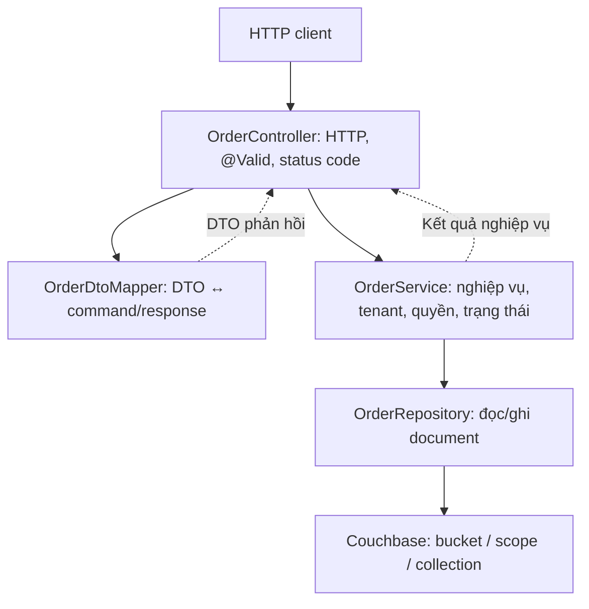
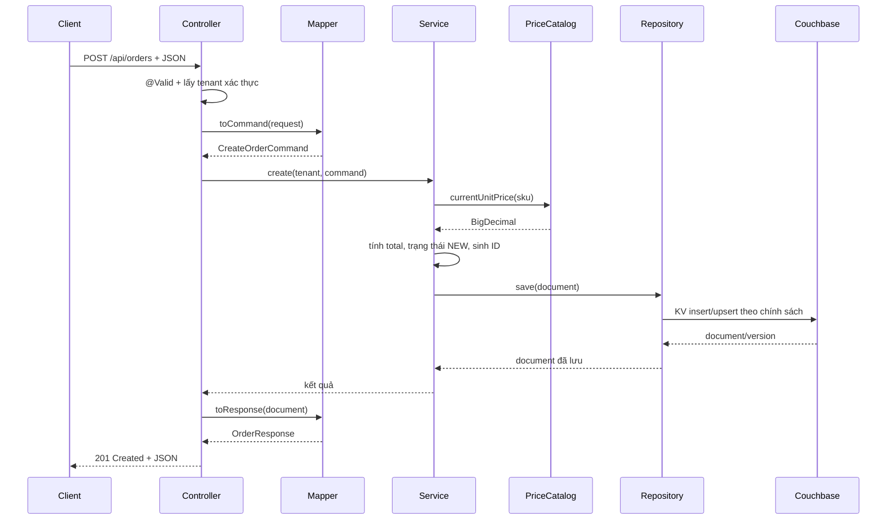
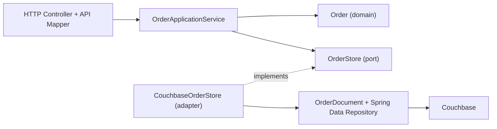

# Phân chia Controller, Service, Repository và lớp ánh xạ DTO

## 1. Vì sao cần chia tầng khi ứng dụng sử dụng Couchbase?

Hãy xét API bán hàng với ba thao tác:

- `POST /api/orders`: khách hàng đặt đơn theo SKU và số lượng.
- `GET /api/orders/{id}`: lấy chi tiết đơn đã tạo.
- `GET /api/orders?status=PAID&page=0&size=20`: tìm đơn theo trạng thái trong cửa hàng đang đăng nhập.

Một cách viết nhanh là cho `@RestController` nhận JSON, tự ghép SQL++, truy cập trực tiếp `Cluster`, tính giá, lưu document rồi trả chính `OrderDocument`. Cách này có thể hoạt động lúc đầu, nhưng tạo ra nhiều vấn đề: endpoint biết chi tiết bucket/scope/collection; quy tắc nghiệp vụ bị lặp ở các API; thay đổi JSON field làm thay đổi hợp đồng HTTP; khó kiểm thử độc lập; và dữ liệu nội bộ như tenant, CAS/version hoặc giá nhập có thể vô tình lộ ra ngoài.

Chương **Thiết kế ứng dụng** của **SPRING_DATA_COUCHBASE** hướng tới một cấu trúc dễ phát triển, kiểm thử và vận hành. Spring Data Couchbase cung cấp document mapping, repository, `CouchbaseTemplate` và khả năng truy vấn SQL++; hệ thống vẫn phải tự xác định ranh giới giữa HTTP, nghiệp vụ, dữ liệu, ánh xạ DTO và các đặc tính Couchbase như bucket/scope/collection, secondary index, TTL, CAS, giao dịch và lựa chọn API reactive.

**Quy tắc trung tâm:**

> **Controller xử lý giao thức HTTP; Service quyết định nghiệp vụ; Repository chịu trách nhiệm lưu/đọc dữ liệu; Mapper chuyển đổi hình dạng dữ liệu giữa các ranh giới.**

Kết thúc bài, bạn sẽ có thể:

1. Giải thích trách nhiệm của từng tầng và chiều phụ thuộc hợp lý.
2. Thiết kế request/response DTO không gắn trực tiếp vào document lưu trữ.
3. Tổ chức service bảo vệ tenant, tính giá và điều phối thao tác tạo/tìm/cập nhật đơn.
4. Dùng Spring Data repository cho CRUD, `CouchbaseTemplate` cho bộ lọc động và SDK khi cần khả năng chuyên biệt.
5. Đặt CAS, TTL, consistency và transaction ở tầng phù hợp.
6. Kiểm thử riêng Controller, Service, Mapper và tích hợp Couchbase.

> **Phạm vi phiên bản:** Ví dụ dùng Java 17+, Spring Boot 3+/4+ và Spring Data Couchbase dòng tương thích với Spring Boot của dự án; import validation theo `jakarta.validation`. Các đoạn mã là những mảnh kiến trúc có chủ đích, không phải project runnable hoàn chỉnh. Hãy kiểm tra cấu hình bucket, annotation và API theo bản Spring Data thực tế.

## 2. Sơ đồ trách nhiệm và hướng phụ thuộc



| Tầng | Nên biết | Không nên đảm nhiệm |
| --- | --- | --- |
| **Controller** | URL, phương thức HTTP, mã trạng thái, `@RequestBody`, `@RequestParam`, `@Valid`, ngữ cảnh xác thực | SQL++, tính tiền, chọn index, gọi KV/SDK trực tiếp |
| **Service** | Use case, quy tắc nghiệp vụ, phân quyền theo tenant, trạng thái, điều phối dữ liệu, quyết định mức nhất quán | Cú pháp HTTP/JSON, `ResponseEntity`, chi tiết câu SQL++ không cần thiết |
| **Repository** | Entity/Document, truy vấn theo khóa, predicate, `Pageable`, `CouchbaseTemplate`, query options cần thiết | Quyết định ai được đặt đơn, chuyển trạng thái hợp lệ hay tính giá bán |
| **DTO Mapper** | Cấu trúc DTO, chuyển kiểu ngày/tiền/trạng thái, tên thuộc tính mà tầng biên dùng | Truy vấn Couchbase, xác thực quyền, gọi network, quy tắc tính giá |
| **Document model** | Schema lưu trữ, `@Id`, `@Field`, `@Version`, scope/collection | Quy tắc HTTP, validation message dành cho client |

Không phải mọi ứng dụng phải có đúng bốn class. Một màn hình đọc đơn giản có thể có một service mỏng; hệ thống phức tạp có thể thêm domain model và persistence adapter theo kiến trúc hexagonal. Điều quan trọng là **phần chịu trách nhiệm thay đổi vì một lý do được giữ riêng**:

- Thay đường dẫn REST → chủ yếu sửa Controller/DTO.
- Thay cách tính giá → sửa logic Service/domain, không sửa Repository.
- Chuyển tên JSON field `tenant_id` hoặc đổi collection → sửa mapping/query/index ở data layer, không làm thay đổi hợp đồng HTTP.
- Thay trình bày thời gian từ epoch milliseconds sang ISO-8601 → sửa Mapper/DTO, không sửa quy tắc tìm đơn.

### 2.1. Luồng một request tạo đơn



Điểm quan trọng: **giá tiền không phải trường client tự ghi vào document**, còn `tenantId` xuất phát từ ngữ cảnh đã xác thực. Mapper không được tự suy đoán giá hoặc tenant.

## 3. Cấu trúc package tham khảo

```text
com.example.shop.orders/
├── api/
│   ├── OrderController.java
│   ├── OrderDtoMapper.java
│   ├── OrderApiExceptionHandler.java
│   └── dto/
│       ├── CreateOrderRequest.java
│       ├── ChangeOrderStatusRequest.java
│       ├── OrderResponse.java
│       └── OrderPageResponse.java
├── application/
│   ├── OrderService.java
│   ├── CreateOrderCommand.java
│   ├── PriceCatalog.java
│   └── OrderNotFoundException.java
├── persistence/
│   ├── OrderDocument.java
│   ├── OrderRepository.java
│   └── OrderSearchAdapter.java
└── security/
    └── CurrentTenant.java
```

Đây là tổ chức theo **tính năng** (feature-first), với các tầng bên trong tính năng `orders`. Khi sản phẩm lớn, cách này thường giúp tìm mã nhanh hơn việc để toàn bộ controller của mọi nghiệp vụ vào một package `controller` chung và toàn bộ repository vào một package `repository` chung.

Với ứng dụng nhiều module Gradle/Maven, tầng domain/application có thể định nghĩa `OrderStore` như một **port** và để persistence implement nó. Bài này chọn thiết kế Spring Data thực dụng, trong đó Service biết kiểu `OrderDocument`; phần cuối sẽ chỉ ra khi nào nên tách thêm domain model.

## 4. DTO là hợp đồng HTTP, không phải Couchbase document

### 4.1. Request DTO chỉ chứa những gì client được phép đề xuất

```java
package com.example.shop.orders.api.dto;

import jakarta.validation.constraints.Min;
import jakarta.validation.constraints.NotBlank;
import jakarta.validation.constraints.NotNull;
import com.example.shop.orders.application.OrderStatus;

public record CreateOrderRequest(
        @NotBlank String customerId,
        @NotBlank String sku,
        @Min(1) int quantity
) {}

public record ChangeOrderStatusRequest(
        @NotNull OrderStatus status,
        @NotNull Long expectedVersion
) {}
```

Mỗi `public record` là một kiểu Java và cần nằm trong **file riêng** khi áp dụng vào dự án thật; chúng được đặt chung một code block để so sánh input cho hai endpoint. `@Valid` ở Controller kích hoạt Bean Validation khi dự án có dependency validation tương ứng.

DTO cố ý **không có** `id`, `tenantId`, `unitPrice`, `total`, `createdAtMillis` hoặc `version` trong request tạo đơn:

- `id` sinh phía server theo chính sách key.
- `tenantId` lấy từ security context, không tin một `X-Tenant-Id` tùy ý.
- `unitPrice` lấy từ catalog/nguồn giá đáng tin cậy và `total` tính ở Service.
- `createdAtMillis` lấy từ `Clock` của server để test được.
- `expectedVersion` chỉ xuất hiện ở request cập nhật, phục vụ kiểm tra stale update; nó **không** thay thế quyền sửa đơn.

`OrderStatus` được khai báo trong tầng application/domain (xem mục 8) và được DTO tái sử dụng để ví dụ gọn hơn. Nếu API cần giá trị tên trạng thái khác domain, định nghĩa enum DTO riêng và ánh xạ tường minh; **Service không nên import DTO của tầng API**.

`@Min(1)` trên `int quantity` sẽ chặn cả `0` khi trường bị thiếu và deserialize thành giá trị mặc định. Nếu cần phân biệt “thiếu trường” với “gửi 0”, dùng `Integer` cùng `@NotNull` và `@Min(1)`. Enum status trong request cũng phải được kiểm tra quyền chuyển đổi và các quy tắc trạng thái ở **Service**, chứ không chỉ được chấp nhận vì Jackson parse được.

### 4.2. Response DTO trả những gì client cần

```java
package com.example.shop.orders.api.dto;

import java.math.BigDecimal;
import java.time.Instant;
import java.util.List;
import com.example.shop.orders.application.OrderStatus;

public record OrderResponse(
        String id,
        String orderNumber,
        String customerId,
        OrderStatus status,
        int quantity,
        BigDecimal total,
        Instant createdAt,
        long version
) {}

public record OrderPageResponse(
        List<OrderResponse> items,
        int page,
        int size,
        long totalElements,
        boolean hasNext
) {}
```

Response sử dụng `Instant` thay cho số epoch trong JSON và không trả trường `tenantId` (nếu UI không cần). Dù `version` có thể trả để hỗ trợ optimistic concurrency, client **không nhận quyền cập nhật** chỉ vì biết version đó. Nếu dùng ETag/`If-Match`, phải triển khai chuyển đổi và kiểm tra nhất quán với CAS/version trong toàn bộ endpoint.

| Loại | Nhiệm vụ | Không nên chứa |
| --- | --- | --- |
| `CreateOrderRequest` | Validate hình dạng input client | Field server quản lý, annotation Couchbase |
| `ChangeOrderStatusRequest` | Status mong muốn và token kiểm soát phiên bản | Logic chuyển trạng thái |
| `OrderResponse` | Hợp đồng JSON trả ra | `@Document`, `@Id`, `@Version`, field nội bộ |
| `OrderPageResponse` | Metadata phân trang ổn định | Đối tượng `Page<OrderDocument>` raw |

Vì DTO là API công khai, việc thêm/xóa trường cần xét tương thích client. Việc đổi schema Couchbase có thể diễn ra độc lập nếu Mapper chuyển đổi đủ.

## 5. Document model phản ánh cấu trúc được lưu

```java
package com.example.shop.orders.persistence;

import java.math.BigDecimal;
import org.springframework.data.annotation.Id;
import org.springframework.data.annotation.Version;
import org.springframework.data.couchbase.core.mapping.Collection;
import org.springframework.data.couchbase.core.mapping.Document;
import org.springframework.data.couchbase.core.mapping.Field;
import org.springframework.data.couchbase.core.mapping.Scope;

@Document
@Scope("sales")
@Collection("orders")
public class OrderDocument {
    @Id
    private String id;

    @Field("tenant_id")
    private String tenantId;

    @Field("order_number")
    private String orderNumber;

    @Field("customer_id")
    private String customerId;

    private String sku;
    private int quantity;
    private BigDecimal unitPrice;
    private BigDecimal total;
    private String status;

    @Field("created_at_ms")
    private long createdAtMillis;

    @Version
    private long version;

    public OrderDocument() {
        // Constructor không tham số cho mapping.
    }

    // Bổ sung constructor dùng khi tạo đơn, getters và setters phù hợp.
    // @Version biểu diễn CAS; không dùng như một field giá trị JSON tùy ý.
}
```

Giải thích:

- `@Document` đánh dấu entity được Spring Data Couchbase quản lý.
- `@Scope("sales")` và `@Collection("orders")` chọn scope/collection theo khả năng mapping của phiên bản đang dùng; **bucket** thường đến từ cấu hình Couchbase của ứng dụng. Phải xác minh keyspace thực tế khi chạy integration test.
- `@Field("tenant_id")`, `@Field("created_at_ms")` biểu diễn tên JSON được lưu. Derived repository dùng **property Java** `tenantId`, `createdAtMillis`; câu SQL++ tự viết phải dùng **tên field JSON**.
- `@Id` là document key, thường truy cập bằng `META(o).id` trong SQL++. Đừng mặc định document JSON cũng chứa một field `id`.
- `@Version` được Spring Data Couchbase dùng cho optimistic locking dựa trên CAS. Sau khi ghi, version có thể thay đổi; **không tự tính lại** trường này từ business DTO.

Ví dụ body JSON được lưu:

```json
{
  "tenant_id": "store-01",
  "order_number": "SO-71FE09",
  "customer_id": "customer-42",
  "sku": "SKU-42",
  "quantity": 2,
  "unitPrice": 125000,
  "total": 250000,
  "status": "NEW",
  "created_at_ms": 1792992000000
}
```

Đây là hình dạng dữ liệu minh họa, không bao gồm type discriminator `_class` hoặc metadata do converter thêm tùy cấu hình. Bản thân **CAS là metadata của document**, không nên xem là một thuộc tính JSON do client gửi lên.

### 5.1. Đặt document key và tránh lộ chéo tenant

Một quy ước có thể là `order::<tenant-id>::<random-id>`, ví dụ:

```text
order::store-01::f719bc69-9c3c-4bfe-97d5-13d19a6f568a
```

Key có chứa tenant giúp tổ chức dữ liệu, nhưng **không đủ để phân quyền**. Người dùng biết key không đồng nghĩa có quyền xem document; Service vẫn phải kiểm tra tenant từ ngữ cảnh xác thực. Không dùng số thứ tự dễ đoán làm key nếu điều đó tăng rủi ro enumeration.

### 5.2. Có cần tách domain model khỏi document?

Trong CRUD nhỏ, `OrderDocument` có thể được dùng như model nghiệp vụ nội bộ và Service dùng repository trực tiếp. Với domain phức tạp, có thể định nghĩa:

```text
Order (domain model)
  → OrderStore (port/interface)
  → CouchbaseOrderAdapter (persistence implementation)
  → OrderDocument (storage representation)
```

Khi đó thêm một **persistence mapper** `Order ↔ OrderDocument`, tách khỏi **API mapper** `HTTP DTO ↔ command/result`. Đổi Couchbase schema sẽ không bắt domain thay đổi. Cách này có thêm mã, nên sử dụng khi lợi ích về nghiệp vụ, test hoặc nhiều loại storage đủ lớn.

## 6. Repository: truy vấn và thao tác dữ liệu, không xử lý HTTP

```java
package com.example.shop.orders.persistence;

import org.springframework.data.couchbase.repository.CouchbaseRepository;
import org.springframework.data.domain.Page;
import org.springframework.data.domain.Pageable;

public interface OrderRepository
        extends CouchbaseRepository<OrderDocument, String> {

    Page<OrderDocument> findByTenantId(
            String tenantId, Pageable pageable);

    Page<OrderDocument> findByTenantIdAndStatus(
            String tenantId, String status, Pageable pageable);
}
```

Repository tập trung vào **cách truy cập dữ liệu**:

- `findById(id)`/ `save(document)` theo key và metadata thích hợp.
- Derived query `findByTenantIdAndStatus` cho bộ lọc phổ biến.
- `Pageable` hỗ trợ sắp xếp và phân trang; Service kiểm soát `page`, `size` và sort được phép.
- Nếu có nhiều điều kiện động, tạo custom repository adapter dùng `CouchbaseTemplate` và `QueryCriteria`; nếu cần `ANY ... SATISFIES`, JOIN, aggregate hoặc query options đặc thù, dùng SQL++ tham số hóa hay SDK **bên trong adapter**, không đưa thẳng vào Controller.

Không để Repository quyết định rằng `NEW → SHIPPED` có hợp lệ hay không; đây là **business rule**. Repository chỉ chịu trách nhiệm persisted state, optimistic locking và truy vấn.

### 6.1. Dữ liệu lớn đòi index phù hợp

Với mẫu `tenantId + status`, sắp theo `createdAtMillis DESC`, xét index SQL++ trên **tên JSON thực tế**:

```sql
CREATE INDEX ix_orders_tenant_status_created
ON `shop`.`sales`.`orders`(
    tenant_id,
    status,
    created_at_ms DESC,
    order_number DESC
);
```

Nếu API còn hỗ trợ chỉ lọc tenant (không có status), xem xét thêm:

```sql
CREATE INDEX ix_orders_tenant_created
ON `shop`.`sales`.`orders`(
    tenant_id,
    created_at_ms DESC,
    order_number DESC
);
```

Index đầu không nhất thiết tối ưu cho toàn bộ trạng thái khi không lọc `status`. Chạy `EXPLAIN` với câu SQL++ thực tế từ derived repository/`CouchbaseTemplate` để kiểm tra plan. **Tốc độ không được quyết định bởi việc query nằm trong Repository hay Service**, mà bởi truy vấn, index, phân bố dữ liệu và cấu hình server.

### 6.2. Khi nào dùng `CouchbaseTemplate`?

Đưa truy vấn động vào một adapter, ví dụ:

```java
@Repository
public class OrderSearchAdapter {
    private final CouchbaseTemplate template;

    public OrderSearchAdapter(CouchbaseTemplate template) {
        this.template = template;
    }

    public List<OrderDocument> find(
            String trustedTenantId, String optionalStatus, int limit) {
        if (trustedTenantId == null || trustedTenantId.isBlank()) {
            throw new IllegalArgumentException("Thiếu tenant");
        }
        if (limit < 1 || limit > 100) {
            throw new IllegalArgumentException("limit không hợp lệ");
        }

        Query query = Query.query(
                QueryCriteria.where("tenantId").is(trustedTenantId));

        if (optionalStatus != null && !optionalStatus.isBlank()) {
            query.addCriteria(
                    QueryCriteria.where("status").is(optionalStatus));
        }
        query.with(Sort.by(
                Sort.Order.desc("createdAtMillis"),
                Sort.Order.desc("orderNumber")));
        query.limit(limit);

        return template.findByQuery(OrderDocument.class)
                .matching(query)
                .all();
    }
}
```

Các import tương ứng là `CouchbaseTemplate`, `Query`, `QueryCriteria` từ `org.springframework.data.couchbase.core` và `.core.query`; `Sort` từ `org.springframework.data.domain`; `@Repository` từ Spring Framework. Đoạn mã cho thấy **vòng đời Query nằm trong một lời gọi**; không cache mutable `Query` làm field singleton.

**Ghi chú mapping:** với `@Field("tenant_id")`, một số đường dẫn DSL cần được kiểm tra xem converter/serializer của bản Spring Data đang dùng chuyển tên property Java thành field JSON như mong đợi hay chưa. Test trên Couchbase thật và đối chiếu SQL++ được sinh là cách phát hiện sai lệch đáng tin cậy.

## 7. Mapper chuyển đổi, nhưng không được quyết định nghiệp vụ

Một Mapper thuần nên xác định đầu vào và đầu ra, không phụ thuộc SDK hay network. Có thể viết thủ công hoặc dùng MapStruct khi số DTO lớn; với bài học ta viết tay để thấy ranh giới.

```java
package com.example.shop.orders.api;

import java.time.Instant;
import com.example.shop.orders.api.dto.*;
import com.example.shop.orders.application.CreateOrderCommand;
import com.example.shop.orders.application.OrderStatus;
import com.example.shop.orders.persistence.OrderDocument;
import org.springframework.data.domain.Page;
import org.springframework.stereotype.Component;

@Component
public class OrderDtoMapper {

    public CreateOrderCommand toCommand(CreateOrderRequest request) {
        return new CreateOrderCommand(
                request.customerId().trim(),
                request.sku().trim(),
                request.quantity());
    }

    public OrderResponse toResponse(OrderDocument doc) {
        return new OrderResponse(
                doc.getId(),
                doc.getOrderNumber(),
                doc.getCustomerId(),
                OrderStatus.valueOf(doc.getStatus()),
                doc.getQuantity(),
                doc.getTotal(),
                Instant.ofEpochMilli(doc.getCreatedAtMillis()),
                doc.getVersion());
    }

    public OrderPageResponse toPageResponse(Page<OrderDocument> page) {
        return new OrderPageResponse(
                page.getContent().stream().map(this::toResponse).toList(),
                page.getNumber(),
                page.getSize(),
                page.getTotalElements(),
                page.hasNext());
    }
}
```

Mapper này chỉ chuyển kiểu và chọn trường:

- `Long createdAtMillis` hoặc `long` → `Instant` cho API.
- `status` dạng chuỗi trong document → `OrderStatus` trong DTO; nếu dữ liệu cũ có trạng thái không nằm trong enum, cần chính sách di trú hoặc xử lý lỗi dữ liệu, **không nuốt lỗi** rồi tự xem là NEW.
- Không đưa `tenantId` ra response nếu API không cần.
- Không cập nhật `@Version`, tính tiền, điều chỉnh TTL, truy vấn hoặc kiểm tra tenant.

Hàm `toCommand` giả định Controller đã qua `@Valid`; Service vẫn cần kiểm tra những invariant quan trọng vì nó có thể được gọi từ job, message consumer hoặc test, không chỉ từ HTTP.

**Nếu phải kiểm tra giá tiền, giảm giá, tồn kho hoặc trạng thái đơn khi ánh xạ**, đó không còn là chuyển đổi thuần túy. Hãy đưa quyết định nghiệp vụ sang Service/domain, rồi để Mapper nhận **kết quả đã được quyết định**.

## 8. Service là nơi thực hiện use case và bảo vệ bất biến nghiệp vụ

Service có thể được gọi từ Controller HTTP, consumer của hàng đợi, scheduled job hoặc chức năng nội bộ. Vì vậy:

- Không dựa **duy nhất** vào `@Valid` của Controller để bảo vệ các quy tắc quan trọng.
- Không nhận `tenantId` tùy ý từ DTO client. Phạm vi phải xuất phát từ danh tính đáng tin cậy hoặc ngữ cảnh đã được ủy quyền.
- Không tính lại giá bằng dữ liệu người dùng tự truyền.
- Không để Repository quyết định workflow trạng thái đơn.
- Không dùng `@Transactional` như lời hứa rằng một quy trình đa hệ thống tự trở nên nguyên tử.

### 8.1. Kiểu dữ liệu đầu vào cho nghiệp vụ

```java
package com.example.shop.orders.application;

import java.math.BigDecimal;

public record CreateOrderCommand(
        String customerId,
        String sku,
        int quantity
) {}

public enum OrderStatus {
    NEW, PAID, SHIPPED, CANCELLED
}

// Port truy vấn catalog: triển khai có thể đọc từ DB hoặc dịch vụ riêng.
public interface PriceCatalog {
    BigDecimal currentUnitPrice(String sku);
}
```

Các khai báo trên đặt ở **file Java riêng** khi đưa vào dự án thật. Service chỉ biết `CreateOrderCommand` và `OrderStatus` ở tầng application; nó **không import `CreateOrderRequest`** hoặc `HttpServletRequest`. Nếu dịch vụ catalog ở ngoài hệ thống, adapter của `PriceCatalog` cần timeout, retry phù hợp và policy về giá snapshot tại thời điểm đặt đơn.

### 8.2. Một `OrderService` minh họa trọn use case

```java
package com.example.shop.orders.application;

import java.math.BigDecimal;
import java.time.Clock;
import java.util.UUID;

import com.example.shop.orders.persistence.OrderDocument;
import com.example.shop.orders.persistence.OrderRepository;
import org.springframework.data.domain.Page;
import org.springframework.data.domain.PageRequest;
import org.springframework.data.domain.Pageable;
import org.springframework.data.domain.Sort;
import org.springframework.stereotype.Service;

@Service
public class OrderService {
    private final OrderRepository repository;
    private final PriceCatalog prices;
    private final Clock clock;

    public OrderService(
            OrderRepository repository,
            PriceCatalog prices,
            Clock clock) {
        this.repository = repository;
        this.prices = prices;
        this.clock = clock;
    }

    public OrderDocument create(
            String trustedTenantId,
            CreateOrderCommand command) {

        requireTenant(trustedTenantId);
        if (command == null
                || command.customerId() == null
                || command.customerId().isBlank()
                || command.sku() == null
                || command.sku().isBlank()
                || command.quantity() < 1) {
            throw new IllegalArgumentException("Đơn hàng không hợp lệ");
        }

        String sku = command.sku().trim();
        BigDecimal unitPrice = prices.currentUnitPrice(sku);
        if (unitPrice == null || unitPrice.signum() < 0) {
            throw new IllegalStateException("Không xác định được giá hợp lệ");
        }

        BigDecimal total = unitPrice.multiply(
                BigDecimal.valueOf(command.quantity()));

        OrderDocument doc = new OrderDocument();
        doc.setId("order::" + trustedTenantId + "::" + UUID.randomUUID());
        doc.setTenantId(trustedTenantId);
        doc.setOrderNumber("SO-" + UUID.randomUUID());
        doc.setCustomerId(command.customerId().trim());
        doc.setSku(sku);
        doc.setQuantity(command.quantity());
        doc.setUnitPrice(unitPrice);
        doc.setTotal(total);
        doc.setStatus(OrderStatus.NEW.name());
        doc.setCreatedAtMillis(clock.millis());

        // Với khóa mới và @Version, Spring Data lưu document.
        // Nếu hợp đồng bắt buộc insert-only, dùng thao tác insertById
        // trong adapter thay vì coi save là bảo đảm chống overwrite.
        return repository.save(doc);
    }

    public OrderDocument get(
            String trustedTenantId, String documentId) {
        requireTenant(trustedTenantId);
        if (documentId == null || documentId.isBlank()) {
            throw new IllegalArgumentException("Thiếu documentId");
        }
        OrderDocument doc = repository.findById(documentId)
                .orElseThrow(OrderNotFoundException::new);

        // Không để việc biết key dẫn đến quyền đọc chéo tenant.
        if (!trustedTenantId.equals(doc.getTenantId())) {
            throw new OrderNotFoundException();
        }
        return doc;
    }

    public Page<OrderDocument> list(
            String trustedTenantId,
            OrderStatus optionalStatus,
            int page,
            int size) {

        requireTenant(trustedTenantId);
        if (page < 0 || size < 1 || size > 100
                || (long) page * size > 10_000L) {
            throw new IllegalArgumentException("page/size không hợp lệ");
        }

        Pageable pageable = PageRequest.of(page, size,
                Sort.by(
                        Sort.Order.desc("createdAtMillis"),
                        Sort.Order.desc("orderNumber")));

        return optionalStatus == null
                ? repository.findByTenantId(trustedTenantId, pageable)
                : repository.findByTenantIdAndStatus(
                        trustedTenantId,
                        optionalStatus.name(), pageable);
    }

    public OrderDocument changeStatus(
            String trustedTenantId,
            String documentId,
            OrderStatus target,
            Long expectedVersion) {

        if (target == null || expectedVersion == null) {
            throw new IllegalArgumentException(
                    "Thiếu trạng thái hoặc version");
        }

        OrderDocument doc = get(trustedTenantId, documentId);
        if (doc.getVersion() != expectedVersion.longValue()) {
            throw new StaleOrderException();
        }

        OrderStatus current = OrderStatus.valueOf(doc.getStatus());
        if (!canTransition(current, target)) {
            throw new InvalidOrderTransitionException();
        }

        doc.setStatus(target.name());
        // @Version/CAS bảo vệ thêm nếu ghi đồng thời sau khi đã đọc.
        return repository.save(doc);
    }

    private static boolean canTransition(
            OrderStatus current, OrderStatus target) {
        return switch (current) {
            case NEW -> target == OrderStatus.PAID
                    || target == OrderStatus.CANCELLED;
            case PAID -> target == OrderStatus.SHIPPED
                    || target == OrderStatus.CANCELLED;
            case SHIPPED, CANCELLED -> false;
        };
    }

    private static void requireTenant(String tenantId) {
        if (tenantId == null || tenantId.isBlank()) {
            throw new IllegalArgumentException("Thiếu tenant xác thực");
        }
    }
}
```

Trong mã trên, `OrderNotFoundException`, `StaleOrderException` và `InvalidOrderTransitionException` là **exception nghiệp vụ của ứng dụng** (có thể kế thừa `RuntimeException`), sẽ được chuyển thành HTTP status ở Controller advice. `OrderDocument` cần getters/setters phù hợp; đoạn entity mục 5 đã lược bỏ accessor để tập trung vào mapping.

Để inject `Clock`, cấu hình một bean trong tầng bootstrap/configuration của Spring; `PriceCatalog` cũng phải có implementation phù hợp với hệ thống:

```java
@Configuration
public class TimeConfiguration {
    @Bean
    public Clock applicationClock() {
        return Clock.systemUTC();
    }
}
```

Ở đây `Clock` là `java.time.Clock`, `@Configuration`/`@Bean` thuộc `org.springframework.context.annotation`. Khi test, có thể truyền `Clock.fixed(...)` trực tiếp mà không cần khởi động toàn bộ Spring context.

**Những điểm thể hiện ranh giới rõ ràng:**

1. Controller/DTO chỉ đề xuất `sku`, `quantity`; Service lấy đơn giá qua `PriceCatalog`, tính `total` và quyết định trạng thái ban đầu.
2. `Clock` được inject để unit test có thể cố định thời gian thay vì gọi `System.currentTimeMillis()` trực tiếp.
3. `get()` kiểm tra cả sự tồn tại và phạm vi tenant **trước khi** trả document. Trả cùng lỗi không tìm thấy cho “không tồn tại” và “không thuộc tenant” giúp giảm khả năng dò ID.
4. `list()` giới hạn page size/offset, đặt khóa sắp xếp phụ. Giả định `orderNumber` không trùng và không thay đổi trong một tenant; nếu không, phải chọn khóa thứ hai thực sự duy nhất.
5. `changeStatus()` kiểm tra version từ client lẫn quy tắc chuyển trạng thái. `repository.save()` cùng `@Version` giúp phát hiện ghi cạnh tranh sau lần đọc, thay vì tin rằng bước so sánh version ban đầu đã loại mọi race condition.
6. Service có thể cần thêm `InventoryReservation`, `PaymentPort` hoặc event/outbox nếu quy trình đặt đơn phức tạp. Các thao tác bên ngoài không nên được gọi ngẫu nhiên từ Mapper hoặc Repository.

### 8.3. CAS và version không phải một tầng phân quyền

Giả sử hai người quản trị cùng đọc version của đơn rồi yêu cầu cập nhật:

```text
T0: Cả A và B đọc version V.
T1: A đổi NEW → PAID, ghi thành công, document có CAS mới.
T2: B cố ghi NEW → CANCELLED với CAS V đã cũ.
T3: B nhận xung đột optimistic locking, phải đọc lại trước khi quyết định.
```

`@Version` của Spring Data Couchbase biểu diễn CAS cho document. Nếu persistence báo `OptimisticLockingFailureException`, tầng HTTP có thể chuyển thành **409 Conflict**. Đừng bắt lỗi này rồi retry vô điều kiện với object cũ, vì sẽ ghi đè quyết định nghiệp vụ mới hơn.

Trường `expectedVersion` giúp phát hiện stale client; **CAS vẫn là chốt bảo vệ ở thời điểm ghi**. Nếu ứng dụng dùng `If-Match`/ETag thay vì body version, controller là nơi giải mã HTTP header; Service nhận token phiên bản có ý nghĩa nghiệp vụ, không đọc trực tiếp servlet header.

### 8.4. Thao tác tạo phải xác định chính sách trùng key

`repository.save(document)` phù hợp với nhiều ứng dụng nhưng phải xác định rõ ngữ nghĩa insert/update và `@Version` của phiên bản thư viện. Nếu yêu cầu **không bao giờ ghi đè document đã tồn tại**, đặt một thao tác insert-only trong persistence adapter (ví dụ fluent `CouchbaseTemplate.insertById(...)` ở phiên bản hỗ trợ) và xử lý lỗi key trùng có chủ đích.

UUID giảm xác suất trùng ID nhưng **không thay thế idempotency**. Khi client retry một POST sau timeout, có thể tạo hai đơn với hai UUID khác nhau. Nếu nghiệp vụ yêu cầu một yêu cầu chỉ sinh một đơn, cần idempotency key được kiểm soát, lưu dấu kết quả một cách an toàn và xử lý trường hợp yêu cầu đồng thời.

## 9. Controller: giao thức HTTP và chuyển đổi vào/ra

Một Controller gọn nên nhìn giống một danh sách endpoint chứ không giống trình biên dịch SQL++.

```java
package com.example.shop.orders.api;

import java.net.URI;
import com.example.shop.orders.api.dto.*;
import com.example.shop.orders.application.OrderService;
import com.example.shop.orders.application.OrderStatus;
import com.example.shop.orders.security.CurrentTenant;
import jakarta.validation.Valid;
import org.springframework.http.ResponseEntity;
import org.springframework.web.bind.annotation.*;

@RestController
@RequestMapping("/api/orders")
public class OrderController {
    private final OrderService service;
    private final OrderDtoMapper mapper;
    private final CurrentTenant currentTenant;

    public OrderController(
            OrderService service,
            OrderDtoMapper mapper,
            CurrentTenant currentTenant) {
        this.service = service;
        this.mapper = mapper;
        this.currentTenant = currentTenant;
    }

    @PostMapping
    public ResponseEntity<OrderResponse> create(
            @Valid @RequestBody CreateOrderRequest request) {
        var created = service.create(
                currentTenant.requireTenantId(),
                mapper.toCommand(request));

        return ResponseEntity
                .created(URI.create("/api/orders/" + created.getId()))
                .body(mapper.toResponse(created));
    }

    @GetMapping("/{id}")
    public OrderResponse get(@PathVariable String id) {
        return mapper.toResponse(
                service.get(currentTenant.requireTenantId(), id));
    }

    @GetMapping
    public OrderPageResponse list(
            @RequestParam(required = false) OrderStatus status,
            @RequestParam(defaultValue = "0") int page,
            @RequestParam(defaultValue = "20") int size) {
        var result = service.list(
                currentTenant.requireTenantId(), status, page, size);
        return mapper.toPageResponse(result);
    }

    @PatchMapping("/{id}/status")
    public OrderResponse changeStatus(
            @PathVariable String id,
            @Valid @RequestBody ChangeOrderStatusRequest request) {
        return mapper.toResponse(service.changeStatus(
                currentTenant.requireTenantId(),
                id,
                request.status(),
                request.expectedVersion()));
    }
}
```

`CurrentTenant` là interface application/security của dự án, ví dụ:

```java
package com.example.shop.orders.security;

public interface CurrentTenant {
    String requireTenantId();
}
```

Một implementation thực tế sẽ lấy tenant từ **authenticated principal/claims được server xác thực và ủy quyền**, có thể qua Spring Security. Không tạo implementation chỉ trả nguyên giá trị `X-Tenant-Id` từ client mà không xác minh quyền của principal đối với tenant đó. Nếu người dùng được quyền chọn trong nhiều tenant, service có thể nhận tenant đã qua bước ủy quyền rõ ràng.

Controller chịu trách nhiệm ánh xạ:

| Trường hợp | HTTP dự kiến | Ai quyết định |
| --- | --- | --- |
| Tạo đơn hợp lệ | `201 Created` và `Location` | Controller |
| Lấy đơn hợp lệ | `200 OK` | Controller |
| Query parameter, request JSON sai kiểu/validation thất bại | `400 Bad Request` | Validation/Controller advice |
| Không có hoặc không được truy cập ID | `404 Not Found` trong hợp đồng ví dụ | Service ném lỗi, advice chuyển mã |
| Trạng thái chuyển đổi không hợp lệ | `409 Conflict` | Service quyết định lỗi, advice chuyển mã |
| CAS/version cũ | `409 Conflict` | Persistence/Service phát hiện, advice chuyển mã |
| Lỗi kết nối Couchbase tạm thời | `503 Service Unavailable` hoặc chính sách ứng dụng phù hợp | Infrastructure/exception translation |

Mã lỗi cụ thể là quyết định API contract; dùng `403` hay `404` cho truy cập không thuộc tenant cần chính sách bảo mật nhất quán. **Không trả stack trace, query SQL++ hoặc tên bucket nội bộ** trong response lỗi.

### 9.1. Một `@RestControllerAdvice` minh họa

```java
import org.springframework.dao.OptimisticLockingFailureException;
import org.springframework.http.HttpStatus;
import org.springframework.http.ProblemDetail;
import org.springframework.web.bind.annotation.*;

@RestControllerAdvice
public class OrderApiExceptionHandler {

    @ExceptionHandler(IllegalArgumentException.class)
    @ResponseStatus(HttpStatus.BAD_REQUEST)
    public ProblemDetail badRequest(IllegalArgumentException error) {
        return ProblemDetail.forStatusAndDetail(
                HttpStatus.BAD_REQUEST, "Tham số không hợp lệ");
    }

    @ExceptionHandler(OrderNotFoundException.class)
    @ResponseStatus(HttpStatus.NOT_FOUND)
    public ProblemDetail notFound(OrderNotFoundException error) {
        return ProblemDetail.forStatusAndDetail(
                HttpStatus.NOT_FOUND, "Không tìm thấy đơn hàng");
    }

    @ExceptionHandler({
        StaleOrderException.class,
        InvalidOrderTransitionException.class,
        OptimisticLockingFailureException.class
    })
    @ResponseStatus(HttpStatus.CONFLICT)
    public ProblemDetail conflict(RuntimeException error) {
        return ProblemDetail.forStatusAndDetail(
                HttpStatus.CONFLICT,
                "Đơn hàng đã thay đổi hoặc trạng thái không hợp lệ");
    }
}
```

Trong mã thực, import các exception thuộc package application tương ứng. Ví dụ này dùng `IllegalArgumentException` cho đầu vào sai nên quy về `400`; một ứng dụng lớn nên định nghĩa **exception validation/domain riêng** để không vô tình biến lỗi lập trình thành lỗi client. Lỗi thiếu xác thực/không được ủy quyền cần được Spring Security/CurrentTenant xử lý đúng `401`/`403`, không gộp vào lỗi request thông thường. Spring MVC/Spring Boot có cơ chế xử lý validation và conversion error; ứng dụng có thể bổ sung handler để trả lỗi đồng nhất. Không nên gắn `@ExceptionHandler(Exception.class)` rồi trả `200 OK` hoặc nuốt mọi ngoại lệ dưới một thông điệp “thành công”.

**Giới hạn của mẫu:** Controller không có bất kỳ lời gọi `Cluster.query`, `CouchbaseTemplate`, `QueryCriteria` hoặc câu SQL++ nào. Nó chỉ chuyển HTTP thành lời gọi use case rồi chuyển kết quả thành DTO.

## 10. Các quyết định Couchbase đặt ở tầng nào?

Một thiết kế phân tầng tốt không che giấu rằng Couchbase có những ngữ nghĩa riêng. Thay vào đó, **đặt quyết định ở nơi có đủ thông tin và trách nhiệm**:

| Vấn đề | Nơi quyết định chính | Cách triển khai và giới hạn |
| --- | --- | --- |
| Bucket/scope/collection | Persistence/configuration | `@Scope`, `@Collection`, config bucket; không lấy keyspace tùy ý từ HTTP |
| Document ID | Service/domain và persistence contract | ID mới được tạo theo quy ước, không cho client ghi đè tùy ý |
| Field alias `@Field` | Document mapping/persistence | Mapper API không cần biết `tenant_id` khác `tenantId` |
| Derived query/`QueryCriteria`/SQL++ | Repository hoặc persistence adapter | Tách query cho đọc dữ liệu và đếm; bind tham số |
| Secondary index | Thiết kế dữ liệu và triển khai hạ tầng | Đo `EXPLAIN` theo query thực tế; không tạo index tùy tiện trong Controller |
| TTL/expiration | Policy nghiệp vụ + persistence adapter | Service chọn thời gian sống; adapter áp dụng SDK/Template option phù hợp |
| CAS/version | Application service + persistence | Service xử lý xung đột; Repository/Spring Data dùng CAS để ghi có điều kiện |
| Read-your-writes/scan consistency | Yêu cầu use case tại Service; option tại Repository | Lựa chọn `REQUEST_PLUS`/mutation state phù hợp, đánh đổi latency |
| Giao dịch nhiều document | Thiết kế use case + transaction boundary được hỗ trợ | Phải kiểm tra phạm vi Couchbase transactions và tác dụng phụ ngoài DB |
| Reactive | Quyết định kiến trúc end-to-end | Controller, service, data adapter đều non-blocking; không `.block()` |

### 10.1. TTL là chính sách vòng đời, không chỉ là một annotation

Giả sử đơn `CANCELLED` được lưu 90 ngày vì yêu cầu lưu trữ, còn đơn `PAID` cần giữ lâu hơn. Đây là quyết định nghiệp vụ hoặc compliance. Service nên diễn đạt **thời hạn cần lưu** dựa trên chính sách; persistence adapter thực hiện bằng tính năng expiration của Couchbase, có thể qua document mapping, `CouchbaseTemplate` hoặc SDK tùy phiên bản và nhu cầu.

Không cho client truyền tùy ý `expirySeconds` rồi tự đặt TTL. Cũng không giả định **mọi** thao tác `save` giữ nguyên TTL cũ: quy tắc xử lý expiry có thể phụ thuộc API và tùy chọn ghi. Nếu TTL quan trọng, kiểm thử thao tác **tạo → cập nhật → đọc metadata expiry** theo SDK/phiên bản đang dùng.

TTL ảnh hưởng cả truy vấn phân trang: document có thể hết hạn giữa `GET page=0` và `GET page=1`. Service và API cần thống nhất rằng danh sách có thể thay đổi theo thời gian.

### 10.2. Giao dịch không bao gồm mọi tác dụng phụ ngoài Couchbase

Một đơn hàng thực tế có thể cần trừ hàng tồn, ghi sự kiện và gọi hệ thống thanh toán. Một `@Transactional` chung đặt lên Service **không tự biến** email, HTTP API hoặc message broker thành giao dịch nguyên tử cùng với Couchbase.

Đặt quy tắc nghiệp vụ ở Service nhưng thiết kế rõ:

- Trường hợp các document Couchbase cần được cập nhật nguyên tử: xem **Couchbase transactions** và API/transaction manager được phiên bản Spring Data hỗ trợ; cần integration test commit/rollback.
- Trường hợp phối hợp với hệ thống ngoài Couchbase: dùng outbox, saga, idempotency và cơ chế retry phù hợp, thay vì gọi bên thứ ba trong mapper hoặc giả định một transaction chung che phủ mọi thứ.
- Không giữ transaction mở xuyên nhiều HTTP request để làm quy trình phân trang dài.

### 10.3. Ghi xong rồi truy vấn không luôn thấy ngay cùng một tập

`repository.findById(id)` theo document key thường dùng KV, trong khi `findByTenantIdAndStatus(...)` thường dùng SQL++/secondary index. Sau khi tạo đơn, truy vấn SQL++ với mức scan consistency mặc định có thể chưa thấy ngay mutation mới nếu index chưa bắt kịp.

Điều cần tách:

1. **Service quyết định** use case cần đảm bảo read-your-writes hay có thể chấp nhận độ trễ hội tụ.
2. **Persistence adapter cấu hình** scan consistency phù hợp (`REQUEST_PLUS` hoặc mutation-state khi API hỗ trợ).
3. **Test tích hợp xác minh** với dataset và index thật.

`REQUEST_PLUS` có thể tăng thời gian chờ index; nó không tạo snapshot bất biến giữa hai yêu cầu trang khác nhau. Không gán mặc định mức consistency cao nhất cho mọi truy vấn mà chưa đo tải thực.

### 10.4. Chọn KV, Query Service hay phân tích dữ liệu

Các endpoint không nhất thiết dùng cùng một API lưu trữ:

- `GET /api/orders/{id}`: thường phù hợp **KV** vì đã biết document key.
- `GET /api/orders?status=PAID`: thường cần **SQL++** và secondary index.
- Dashboard thống kê theo tháng: có thể cần SQL++ aggregation, `UNNEST`/array index, hoặc pipeline phân tích chuyên biệt.

Đưa những cách truy cập này về các method trong repository/adapter. Tầng Service chỉ biết nó cần **lấy một đơn**, **tìm nhiều đơn** hoặc **tính báo cáo**; không cần đưa `QueryResult`/`JsonObject` SDK lên Controller.

## 11. Khi nào nên thêm port và tách persistence mapping?

Thiết kế ở trên thực dụng cho một dịch vụ CRUD, nhưng Service đang trả và thao tác trực tiếp `OrderDocument`. Điều này có nghĩa một phần ứng dụng biết annotation/mapping của persistence, dù Controller đã được Mapper tách khỏi chúng.

Khi domain lớn hơn hoặc cần thay storage, có thể chuyển sang cấu trúc:



Ví dụ port trong application/domain:

```java
public interface OrderStore {
    Order save(Order order);
    java.util.Optional<Order> findById(String documentId);
    OrderPage search(OrderSearchCriteria criteria);
}
```

Tại đây, `Order` là domain model, `OrderPage` là kết quả phân trang **không phụ thuộc `Page<OrderDocument>`** và `OrderSearchCriteria` là bộ lọc của ứng dụng. `CouchbaseOrderStore` chuyển `Order ↔ OrderDocument` rồi dùng Spring Data repository.

| Trường hợp | Cách đủ dùng |
| --- | --- |
| CRUD đơn giản, một data store, ít logic | Controller → Service → Spring Data Repository + API Mapper |
| Domain có nhiều quy tắc/aggregate, cần unit test độc lập persistence | Application Service → domain port → Couchbase adapter |
| Một domain đọc từ Couchbase, ghi sang nhiều backend | Port/adapter rõ ràng, mapper riêng theo storage |
| Báo cáo đọc nhiều nguồn và projection khác entity | Query/read-model adapter riêng, trả DTO nội bộ phù hợp |

Không tạo hàng chục mapper/port chỉ để tuân thủ sơ đồ lý tưởng. Hãy dùng chúng khi bảo vệ ranh giới **thực sự làm giảm thay đổi dây chuyền**.

## 12. Reactive: mọi tầng liên quan phải cùng phong cách xử lý

Nếu hệ thống dùng Spring WebFlux, `ReactiveCouchbaseRepository` và `ReactiveCouchbaseTemplate`, Controller thường trả `Mono<OrderResponse>` hoặc `Flux<OrderResponse>`. Không thể coi một Controller trả `Mono` nhưng gọi repository blocking rồi bọc kết quả bằng `Mono.just(...)` là một đường truy cập non-blocking hoàn chỉnh.

Ví dụ thiết kế reactive **với các thành phần reactive thật sự**:

```java
// Trong ReactiveOrderController: currentTenant.requireTenantId()
// trả String đã xác thực; service.get(...) trả Mono<OrderDocument>.
@GetMapping("/{id}")
public Mono<OrderResponse> get(@PathVariable String id) {
    String tenant = currentTenant.requireTenantId();
    return reactiveOrderService.get(tenant, id)
            .map(mapper::toResponse);
}
```

Service reactive tương ứng:

```java
public Mono<OrderDocument> get(String tenantId, String id) {
    return reactiveOrderRepository.findById(id)
            .filter(doc -> tenantId.equals(doc.getTenantId()))
            .switchIfEmpty(Mono.error(new OrderNotFoundException()));
}
```

Trong ví dụ trên, `ReactiveOrderService` và `reactiveOrderRepository` là những thành phần được thiết kế riêng, không phải cùng object từ ví dụ blocking của mục 8. `OrderDtoMapper` có thể được dùng lại nếu hàm map là **thuần và nhẹ**. Nếu có phép chuyển đổi tốn CPU hoặc blocking network, cần tách và lên lịch phù hợp.

Những nguyên tắc không thay đổi khi reactive:

- Tenant/authorization check vẫn bắt buộc.
- Không đưa `@Version` hoặc entity raw ra API; CAS vẫn phải được xử lý ở tầng ghi.
- Bộ lọc động vẫn cần tạo `Query` mới cho từng luồng đăng ký khi có trạng thái mutable.
- Không gọi `.block()` trong request path reactive.
- Không trộn một repository blocking trong chuỗi reactive chỉ vì API trả `Mono`.

## 13. Kiểm thử theo đúng ranh giới

Phân tầng không chỉ để “mã sạch” mà để mỗi loại test có phạm vi chính xác.

| Lớp test | Phụ thuộc thật/giả | Kiểm tra điều gì | Không cần |
| --- | --- | --- | --- |
| **Mapper unit test** | Object Java thuần | Field được/không được xuất, time, enum, tiền, version | Couchbase, HTTP |
| **Service unit test** | Repository/PriceCatalog fake hoặc mock, `Clock.fixed` | Tính tổng, tenant, status transition, phân trang hợp lệ, thao tác repo | HTTP server |
| **Controller test** | MockMvc/WebTestClient, mock Service, CurrentTenant | Validation, route, status code, body, JSON contract | Couchbase thật |
| **Repository integration** | Couchbase test instance, index, converter | `@Field`, keyspace, derived query, CAS, TTL, query consistency | HTTP endpoints |
| **End-to-end/API integration** | Các tầng thực | Không lộ tenant, quy trình tạo → lấy → cập nhật, lỗi và concurrency | Mock toàn bộ persistence |

### 13.1. Unit test Service: giá lấy từ nguồn đáng tin cậy

Ví dụ kiểm thử với Mockito và AssertJ (giả định repository mock trả lại entity được lưu và các accessor đã được định nghĩa):

```java
import static org.assertj.core.api.Assertions.assertThat;
import static org.mockito.ArgumentMatchers.any;
import static org.mockito.Mockito.when;

import java.math.BigDecimal;
import java.time.Clock;
import java.time.Instant;
import java.time.ZoneOffset;
import org.junit.jupiter.api.Test;

@Test
void createUsesCatalogPriceAndServerClock() {
    Clock fixedClock = Clock.fixed(
            Instant.parse("2026-11-25T00:00:00Z"), ZoneOffset.UTC);
    when(prices.currentUnitPrice("SKU-42"))
            .thenReturn(new BigDecimal("125000"));
    when(repository.save(any(OrderDocument.class)))
            .thenAnswer(invocation -> invocation.getArgument(0));

    OrderService service =
            new OrderService(repository, prices, fixedClock);
    OrderDocument created = service.create(
            "store-01",
            new CreateOrderCommand("customer-42", "SKU-42", 2));

    assertThat(created.getTenantId()).isEqualTo("store-01");
    assertThat(created.getTotal()).isEqualByComparingTo("250000");
    assertThat(created.getCreatedAtMillis())
            .isEqualTo(fixedClock.millis());
    assertThat(created.getStatus()).isEqualTo("NEW");
}
```

Trong test thực, `repository` và `prices` phải là mock do `@Mock`/Mockito cung cấp. Test này không cần kết nối Couchbase; nó kiểm tra **logic Service**, không kiểm tra CAS của server.

### 13.2. Unit test Service: tenant khác phải bị từ chối

`assertThatThrownBy` được import từ `org.assertj.core.api.Assertions`; đoạn dưới dùng lại các mock `repository`, `prices` và import Mockito của class test ở mục 13.1, nhưng tạo một instance `service` riêng.

```java
@Test
void cannotReadAnotherTenantsDocument() {
    OrderService service =
            new OrderService(repository, prices, Clock.systemUTC());
    OrderDocument foreign = new OrderDocument();
    foreign.setId("order::store-02::other");
    foreign.setTenantId("store-02");

    when(repository.findById(foreign.getId()))
            .thenReturn(java.util.Optional.of(foreign));

    assertThatThrownBy(() ->
            service.get("store-01", foreign.getId()))
            .isInstanceOf(OrderNotFoundException.class);
}
```

**Quan trọng:** Kiểm thử không chỉ rằng một truy vấn tìm kiếm có điều kiện tenant; phải thử cả đường `findById` dùng KV vì đây thường là nơi dễ xuất hiện lỗi IDOR (insecure direct object reference).

### 13.3. Controller test không cần biết SQL++

Với Spring MVC, có thể dùng `@WebMvcTest(OrderController.class)` cùng mock/bean cho `OrderService`, `OrderDtoMapper` và `CurrentTenant`. Những assertion cần có:

- `POST` thiếu `customerId` hoặc `quantity=0` → `400`.
- `POST` hợp lệ → `201`, `Location`, response DTO không có field nội bộ.
- `GET` khi Service báo không tìm thấy → `404`.
- `PATCH` thiếu `expectedVersion` → `400`; stale version → `409`.
- `GET list` với `size=101` → lỗi do Service quy định, không truy vấn không giới hạn.
- `CurrentTenant` được lấy từ ngữ cảnh xác thực, không lấy từ tham số query tùy ý.

Không dùng `@WebMvcTest` để tuyên bố đã kiểm chứng mapper Couchbase hoặc secondary index. Tương tự, integration test repository không đủ để xác nhận Controller đã ẩn field `tenantId` ra khỏi JSON.

### 13.4. Repository integration test phải có Couchbase thực

Tối thiểu cần:

1. Cấu hình bucket/scope/collection thử nghiệm được xác định rõ; index online.
2. Ghi rồi đọc `OrderDocument`, kiểm chứng alias `@Field("tenant_id")` và document key `@Id`.
3. Chèn nhiều document thuộc hai tenant, kiểm tra `findByTenantIdAndStatus` không trả sai phạm vi.
4. Kiểm chứng sort và page khi nhiều đơn cùng `createdAtMillis`; `orderNumber` được giả định duy nhất.
5. Mở hai bản sao của cùng document, cập nhật một bản, rồi xác minh bản thứ hai ghi với CAS cũ bị từ chối.
6. Nếu có TTL, test cả create và update để phát hiện expiry bị đặt lại ngoài ý muốn.
7. Nếu yêu cầu read-after-write qua query, kiểm thử scan consistency và thời gian chờ index.

Đây là nơi phù hợp để dùng Couchbase chạy trên môi trường tích hợp hoặc Testcontainers nếu dự án hỗ trợ. Không chạy integration test lên bucket production hoặc xóa toàn bộ collection dùng chung để dọn fixture.

### 13.5. Ma trận lỗi cần cố tình tạo

| Tình huống | Tầng cần bắt/biểu diễn | Kết quả mong đợi |
| --- | --- | --- |
| JSON malformed, quantity âm | Controller/validation | `400`, không ghi document |
| Giá catalog không tồn tại | Service/application | Trả lỗi domain rõ, không tạo đơn “giá 0” tùy tiện |
| Trạng thái `NEW → SHIPPED` bị cấm | Service | `409` theo hợp đồng |
| Document ID đúng nhưng sai tenant | Service | `404` hoặc chính sách bảo mật tương đương |
| Client đọc version cũ | Service | Không ghi, trả conflict |
| Ghi cùng lúc làm CAS thay đổi | Persistence → Service/advice | Optimistic locking conflict, không lost update |
| `@Field` đổi tên nhưng index cũ | Repository integration | Phát hiện query không còn khớp |
| Controller trả nguyên `OrderDocument` | API/contract test | Phát hiện lộ field hoặc metadata nội bộ |
| Query status không có index | Integration/observability | `EXPLAIN`/latency cho thấy cần cải thiện |
| TTL làm mất document giữa hai trang | API/domain policy test | Hành vi tập dữ liệu động được xác định rõ |

## 14. Anti-pattern thường gặp và cách sửa

### 14.1. Controller làm tất cả

```java
// KHÔNG NÊN: SQL++, tính tiền và ghi dữ liệu ngay trong Controller.
@PostMapping("/orders")
public Object create(@RequestBody java.util.Map<String, Object> body) {
    // Lấy tenant từ body; tự tin total do client gửi;
    // ghép query và gọi cluster; trả nguyên JsonObject.
    throw new UnsupportedOperationException("Ví dụ anti-pattern");
}
```

**Sửa:** Request DTO chỉ chứa dữ liệu được phép nhập; Controller lấy tenant xác thực; Service tính tiền, phân quyền và quyết định trạng thái; Repository xử lý Couchbase; Mapper tạo response DTO ổn định.

### 14.2. Service trả `ResponseEntity<OrderDocument>`

Service khi đó biết HTTP và document persistence. Đổi response contract có thể kéo theo thay đổi nghiệp vụ, và kiểm thử service phải giả lập HTTP. **Sửa:** Service trả kết quả nghiệp vụ hoặc model nội bộ; Controller/Mapper quyết định body và status.

### 14.3. Mapper gọi repository để “bổ sung thông tin”

Một Mapper gọi DB trong mỗi `toResponse` dễ gây truy vấn N+1 và làm mapping không còn thuần. **Sửa:** Service hoặc query adapter quyết định dữ liệu cần tải theo use case; Mapper chỉ chuyển dữ liệu đã có. Nếu cần enrich từ nhiều nguồn, có thể định nghĩa một response projection/read model trong application.

### 14.4. Repository chứa điều kiện phân quyền như một lựa chọn tùy ý

Một method `findByStatus("PAID")` được gọi nhầm từ endpoint nhiều tenant có thể làm lộ đơn của tenant khác. **Sửa:** Service yêu cầu tenant đáng tin cậy; interface truy vấn ở luồng nhiều tenant nhận tenant bắt buộc; test bảo vệ cả đường KV và SQL++.

### 14.5. Dùng chung một `Query` khả biến trong singleton

```java
// KHÔNG LÀM: một Query chung bị thêm criteria của nhiều request.
private final Query sharedQuery =
        Query.query(QueryCriteria.where("status").is("PAID"));
```

`addCriteria`, `with(Pageable)`, `limit`, `skip` làm thay đổi query. **Sửa:** Tái sử dụng factory method, tạo `Query`/`QueryCriteria` mới cho mỗi lần thực thi. Không mang query đã phân trang sang phép đếm.

### 14.6. Bỏ qua khác biệt `NULL` và `MISSING`

Một DTO Java `null` không chứng minh document JSON chứa `null`; field có thể **MISSING**. Khi query động theo field tùy chọn, xác định rõ hợp đồng đầu vào và cách biểu diễn `IS NULL`, `IS MISSING` trong SQL++. Test fixture cho dữ liệu thiếu khóa, khóa null, chuỗi rỗng và tập đầu vào rỗng.

## 15. Checklist thiết kế và vận hành

Trước khi merge một endpoint dùng Spring Data Couchbase, tự kiểm tra:

1. **API:** Controller chỉ biết DTO và use case, có `@Valid`, HTTP status đúng, không trả raw `OrderDocument`?
2. **Security:** tenant lấy từ principal được xác thực/ủy quyền, không từ field mà client tự chọn? Đường `findById` cũng được bảo vệ?
3. **Business:** quy tắc giá, trạng thái, version và idempotency ở Service/domain?
4. **DTO:** request không có field server quản lý; response không lộ metadata/PII ngoài hợp đồng? Mapper chỉ chuyển đổi?
5. **Storage:** document key, `@Id`, `@Version`, `@Field`, scope/collection đã kiểm chứng qua integration test?
6. **Query:** dùng KV cho ID, SQL++/index cho bộ lọc; `QueryCriteria` sinh mới mỗi request; `Pageable` bị giới hạn?
7. **Index:** index tương ứng với tên JSON thực; đã xem `EXPLAIN` và đo latency trên dữ liệu đại diện?
8. **Consistency:** yêu cầu read-after-write, TTL, CAS và giao dịch đã được ghi thành hợp đồng và kiểm thử?
9. **Reactive:** nếu chọn WebFlux, cả đường data access có non-blocking; không `.block()`?
10. **Observability:** log theo correlation ID, có metrics cho truy vấn chậm và lỗi CAS nhưng không log tràn dữ liệu cá nhân?

Tùy quy mô, nên đặt một **request ID** trong log/tracing, đo thời gian từng use case và từng query, thống kê lỗi validation/optimistic lock, và thiết lập timeout/retry có chủ đích. Retry một phép tạo đơn không idempotent có thể tạo bản ghi trùng; retry cập nhật CAS mà không đọc lại có thể che mất xung đột nghiệp vụ.

## 16. Bài tập tự luyện

**Bài 1 — Chia trách nhiệm.** Một Controller hiện tại có 120 dòng, tự sinh document ID, lấy giá bán, viết SQL++, gọi `Cluster.query` rồi trả JSON kết quả. Hãy chia lại những việc này vào Controller, Service, Repository/adapter, Mapper và nêu lợi ích kiểm thử của từng phần.

**Gợi ý:** Controller chuyển HTTP, Service kiểm tra tenant/tính giá/sinh ID, adapter truy vấn SQL++, Mapper chuyển kết quả sang DTO. Không di chuyển toàn bộ 120 dòng sang Service rồi coi là đã hoàn thành.

**Bài 2 — Sửa lỗi IDOR.** Một endpoint gọi `repository.findById(id)` rồi trả ngay cho người dùng. Vì sao điều này nguy hiểm trong hệ thống nhiều tenant? Viết điều kiện bổ sung và xác định nên trả `403` hay `404` theo hợp đồng nào.

**Đáp án gợi ý:** Document key biết được không phải bằng chứng quyền. Sau khi đọc, phải so sánh tenant với ngữ cảnh xác thực; chọn cùng `404` cho cả không tồn tại và sai tenant nếu chính sách muốn tránh tiết lộ sự tồn tại.

**Bài 3 — Chống ghi đè trạng thái.** Người A và B cùng đọc đơn version V. A cập nhật thành công, B gửi request version V. Hãy giải thích vì sao kiểm tra expected version trong Service chưa đủ và `@Version`/CAS bảo vệ thêm điều gì ở Repository.

**Bài 4 — API DTO hay entity?** Khi dữ liệu Couchbase đổi `created_at_ms` sang trường mới, nhưng REST contract vẫn phải trả `createdAt` là ISO-8601, cần sửa những tầng nào? Có cần thay URL và response DTO không?

**Đáp án gợi ý:** Thay mapping lưu trữ, xử lý migration nếu có document cũ, chỉnh mapper nếu kiểu giá trị nội bộ đổi; API không bắt buộc đổi nếu hợp đồng vẫn giữ nguyên.

**Bài 5 — Reactive.** Một WebFlux Controller trả `Mono.just(orderRepository.findById(id).orElseThrow())`. Vì sao đây chưa phải truy cập non-blocking? Đề xuất cách dùng repository/template reactive thực sự và chuyển đổi DTO bằng `.map(mapper::toResponse)`.

**Bài 6 — Chiến lược test.** Thiết kế ba loại test khác nhau cho một use case tạo đơn: (a) tính giá ở Service, (b) JSON response không chứa `tenantId`, (c) `@Version`/CAS ghi cạnh tranh. Cho biết test nào cần Couchbase thật.

**Bài 7 — Chọn index.** API `GET /api/orders?status=PAID` giới hạn tenant, sort theo `createdAtMillis DESC`. Đề xuất index theo tên field JSON, giải thích tại sao Service không nên khai báo câu `CREATE INDEX` lúc xử lý HTTP request.

## 17. Tổng kết và nguồn tra cứu

Kiến trúc Controller–Service–Repository–Mapper không phải mục tiêu tự thân; nó giúp **giữ nguyên hợp đồng API khi schema thay đổi, tập trung bất biến nghiệp vụ, hạn chế rò dữ liệu nhiều tenant và kiểm thử được từng quyết định**. Spring Data Couchbase cung cấp nhiều cách truy cập KV/SQL++ nhưng không thay thế thiết kế ứng dụng. Hãy để Controller mỏng, Service rõ use case, Repository chuyên lưu trữ, Mapper chuyển đổi minh bạch; đặt TTL/CAS/consistency/index đúng ranh giới và kiểm chứng trên Couchbase thực.

Tài liệu tra cứu chính thức:

- [Spring Data Couchbase — Modeling Entities](https://docs.spring.io/spring-data/couchbase/reference/couchbase/entity.html): `@Document`, `@Id`, `@Field`, type mapping và optimistic locking.
- [Spring Data Couchbase — Collection Support](https://docs.spring.io/spring-data/couchbase/reference/couchbase/collections.html): cách chọn scope/collection qua annotation và cấu hình.
- [Spring Data Couchbase — Repositories](https://docs.spring.io/spring-data/couchbase/reference/couchbase/repository.html): derived queries, `Pageable`, `@Query`.
- [Spring Data Couchbase — Template Operations](https://docs.spring.io/spring-data/couchbase/reference/couchbase/template.html): `CouchbaseTemplate`, các fluent operation.
- [Spring Data Couchbase — Optimistic Locking](https://docs.spring.io/spring-data/couchbase/reference/couchbase/entity.html): `@Version` và CAS trong mục Modeling Entities.
- [Spring Framework — Validation](https://docs.spring.io/spring-framework/reference/core/validation/beanvalidation.html): Bean Validation cho API đầu vào.
- [Spring Framework — REST Exception Handling](https://docs.spring.io/spring-framework/reference/web/webmvc/mvc-controller/ann-exceptionhandler.html): `@ExceptionHandler` và Controller Advice.
- [Couchbase Java SDK — KV Operations](https://docs.couchbase.com/java-sdk/current/howtos/kv-operations.html): đọc/ghi document theo key, CAS và expiration.
- [Couchbase Java SDK — SQL++ Queries](https://docs.couchbase.com/java-sdk/current/howtos/sqlpp-queries-with-sdk.html): truy vấn tham số hóa, consistency.
- [Couchbase Server — Indexes](https://docs.couchbase.com/server/current/indexes/indexing-overview.html): secondary indexes và `EXPLAIN`.
