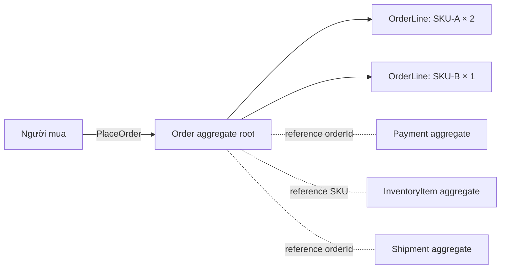
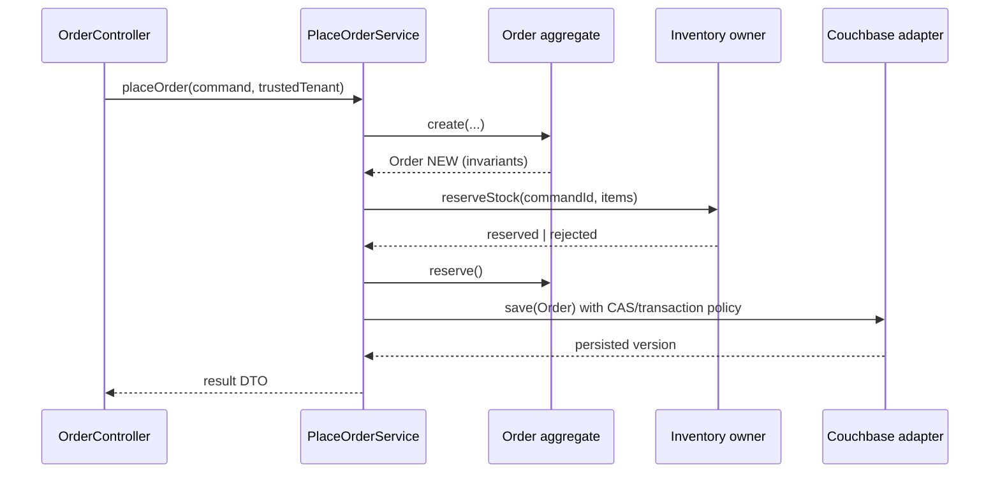
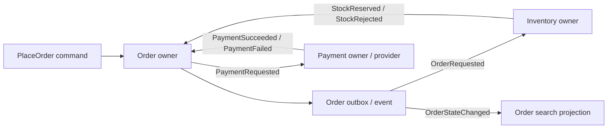

# Đặt ranh giới aggregate, transaction và quyền sở hữu cập nhật

## 1. Bài toán: một thao tác nghiệp vụ chạm bao nhiêu document?

Giả sử hệ thống bán hàng có các use case:

- Tạo đơn gồm nhiều dòng hàng và tính tổng tiền.
- Chuyển trạng thái đơn từ `NEW` sang `PAID`, rồi `SHIPPED`.
- Trừ hàng tồn kho khi đơn được xác nhận.
- Gửi yêu cầu thu tiền, hoàn tiền hoặc thông báo cho khách hàng.
- Tìm đơn hàng theo tenant, khách hàng và trạng thái.

Đưa tất cả dữ liệu vào một document Couchbase duy nhất giúp cập nhật nguyên tử nhưng sẽ làm document quá lớn, có quá nhiều đối tượng cùng sửa và gây tranh chấp CAS. Tách mọi dòng hàng thành document riêng thì mỗi thao tác lại cần cập nhật nhiều document để bảo vệ những quy tắc vốn thuộc một đơn. Cả hai cực đoan đều khiến hệ thống khó vận hành.

Trong chương **Thiết kế ứng dụng** của **SPRING_DATA_COUCHBASE**, ta sẽ dùng tư duy **aggregate của Domain-Driven Design (DDD)** để xác định dữ liệu nào cần được cập nhật cùng nhau, **transaction boundary** để xác định ranh giới nguyên tử, và **write ownership** để xác định ai được phép ra quyết định thay đổi trạng thái.

Module Spring Data Couchbase xây dựng tầng truy cập bằng document mapping, repository, `CouchbaseTemplate` và SQL++; bài này đặt các công cụ đó trong bối cảnh bucket/scope/collection, index, TTL, CAS, giao dịch và API reactive. Mục đích không phải dùng mọi tính năng trong một request, mà chọn **độ mạnh của cơ chế nhất quán đúng với bất biến nghiệp vụ**.

Sau bài học, bạn có thể:

1. Phân biệt aggregate, document JSON, collection, service và giao dịch.
2. Xác định bất biến nào buộc nhiều field nằm trong một aggregate, bất biến nào đòi phối hợp nhiều aggregate.
3. Thiết kế một đường ghi có chủ sở hữu với `@Version`/CAS để ngăn lost update.
4. Biết khi nào cập nhật một document là đủ, khi nào cần giao dịch nhiều document, khi nào nên dùng saga/outbox.
5. Xử lý retry, timeout, commit ambiguity và idempotency mà không nhân đôi tác dụng phụ.
6. Thiết kế test kiểm chứng tính nguyên tử, quyền tenant, xung đột đồng thời và thứ tự event.

> **Giới hạn của ví dụ:** Java 17+, Spring Data Couchbase dòng tương thích với Spring Boot đang dùng và Couchbase Java SDK 3.x. Mỗi code block tập trung vào một phần thiết kế; chúng không phải một project build độc lập. Với giao dịch, cần đối chiếu tài liệu **đúng phiên bản** server/SDK/Spring Data trước khi triển khai production.

## 2. Ba khái niệm cần tách bạch

| Khái niệm | Câu hỏi thiết kế | Ví dụ |
| --- | --- | --- |
| **Aggregate** | Những quy tắc nhất quán nào phải đúng ngay sau **một lệnh nghiệp vụ**? | `Order` và `OrderLine`: tổng tiền bằng tổng các dòng hàng |
| **Transaction** | Những thao tác lưu trữ nào phải **cùng commit hoặc cùng rollback**? | Giảm tồn kho và tạo reservation trên hai document |
| **Write owner** | Thành phần nào có thẩm quyền kiểm tra và thay đổi trạng thái chính thức? | `OrderService` sở hữu workflow của đơn; `InventoryService` sở hữu lượng hàng |

Đừng đồng nhất các khái niệm này:

- **Một aggregate không nhất thiết đồng nghĩa một collection**. Collection có thể chứa nhiều aggregate instances, và một ứng dụng có nhiều aggregate types trong các collection khác nhau.
- **Một aggregate không nhất thiết luôn bằng một document** trong mọi hệ thống. Tuy nhiên, với Couchbase, **một aggregate thường được lưu trong một document** là điểm xuất phát hiệu quả vì ghi một document đã nguyên tử.
- **Một transaction có thể bao trùm nhiều aggregate** khi bất biến xuyên aggregate thật sự yêu cầu. Nhưng việc phải dùng giao dịch nhiều document thường là một tín hiệu cần đánh giá lại ranh giới hoặc quy trình nghiệp vụ.
- **Write owner không phải mutex hay một tiến trình duy nhất**. Nhiều instance của cùng service có thể nhận lệnh cập nhật, miễn tất cả cùng thực thi quy tắc nghiệp vụ và cơ chế đồng thời (ví dụ CAS).

### 2.1. Phân biệt ba loại nhất quán

1. **Nhất quán nội bộ aggregate:** tổng tiền không thể lệch các dòng hàng sau khi một lệnh `changeQuantity` thành công; trạng thái `SHIPPED` không thể trở về `NEW` trái quy tắc.
2. **Nhất quán giữa aggregate:** số lượng hàng còn trong kho không được âm khi nhiều đơn cạnh tranh cùng SKU; payment receipt phải gắn với một đơn được nhận diện.
3. **Nhất quán đọc và sự hội tụ:** sau khi ghi thành công qua KV, một SQL++ query dùng secondary index có thể chưa phản ánh ngay thay đổi; read model tìm kiếm có thể hội tụ chậm hơn aggregate nguồn.

Ba loại này có cơ chế khác nhau: **thiết kế aggregate + cập nhật nguyên tử**, **CAS/giao dịch/saga**, và **scan consistency/event projection**.

## 3. Xác định ranh giới từ các bất biến, không từ màn hình

Giả sử domain có `Order`, `OrderLine`, `InventoryItem`, `Payment` và `Shipment`.

| Bất biến | Phải đúng khi nào? | Aggregate/owner gợi ý | Cơ chế thường hợp lý |
| --- | --- | --- | --- |
| Tổng tiền bằng tổng `quantity × unitPrice` của các dòng đơn | Ngay sau lệnh sửa dòng | `Order` | Một document + CAS |
| Không thêm dòng hàng sau khi đã thanh toán | Ngay sau lệnh sửa | `Order` | Service/domain kiểm tra trạng thái, CAS |
| Không cho `SHIPPED → NEW` | Ngay sau lệnh đổi trạng thái | `Order` | State machine trong aggregate |
| Stock không âm dù hai đơn mua cùng SKU | Ngay khi giữ chỗ/trừ kho | `InventoryItem` hoặc `StockReservation` | CAS, atomic decrement có điều kiện hoặc transaction |
| Thanh toán từ cổng bên ngoài được ghi nhận đúng một lần về mặt nghiệp vụ | Qua nhiều lần callback/retry | `Payment` owner | Idempotency key + xử lý event |
| Màn hình danh sách đơn hiển thị trạng thái mới | Theo SLA đọc đã công bố | Read model | Index consistency, cập nhật projection |
| Email xác nhận chỉ phát hành khi đơn được chấp nhận | Có thể sau commit | Notification worker | Outbox/event + deduplication |

**Phương pháp đặt ranh giới:** với mỗi lệnh, viết ra các điều kiện *trước* và *sau*; xác định field nào phải đổi cùng nhau; tìm trường bị các luồng nghiệp vụ khác sửa độc lập. Chỉ gom vào một aggregate những dữ liệu thuộc cùng quyền sở hữu và cùng chu kỳ thay đổi.

### 3.1. Thí dụ Order là aggregate root



Để đảm bảo `total` nhất quán với các dòng hàng, có thể **nhúng OrderLine vào OrderDocument**. Nhưng `InventoryItem` là nguồn sự thật của số lượng hàng trên toàn cửa hàng; không nhúng hàng tồn của SKU vào mỗi đơn, vì mỗi đơn sẽ có một bản sao dễ xung đột.

Payment và Shipment có workflow, retry, vòng đời và người quản lý khác nhau. Chúng thường là aggregate riêng và chỉ tham chiếu bằng `orderId`, thay vì để dịch vụ thanh toán sửa trực tiếp cả document đơn hàng.

### 3.2. Khi nào nên nhúng, khi nào nên tách?

| Dấu hiệu | Nhúng vào một document aggregate | Tách thành aggregate/document riêng |
| --- | --- | --- |
| Hai phần dữ liệu phải đổi cùng một lệnh | Thường phù hợp | Cần transaction/điều phối nếu tách |
| Dữ liệu con luôn đọc cùng root | Thường phù hợp | Có thêm lượt đọc |
| Dữ liệu con được sửa độc lập rất thường xuyên | Gây CAS contention | Thường phù hợp |
| Mảng con tăng không giới hạn | Rủi ro kích thước và chi phí ghi | Tách/paging |
| Owner và vòng đời khác nhau | Dễ làm lẫn trách nhiệm | Phù hợp |
| Cần truy cập riêng theo khóa | Có thể dùng sub-document nếu vẫn chung root | KV trực tiếp theo ID riêng |
| Cần truy vấn nhiều root theo field con | Cần array index/SQL++ nếu nhúng | Có thể thiết kế index riêng ở collection con |

**Giới hạn kích thước:** không thiết kế aggregate như một mảng lịch sử vô hạn. Đối với các event, audit trail, telemetry, payment attempts hoặc hàng trăm nghìn line item, cân nhắc tách thành document theo khóa/sự kiện hoặc projection riêng. Ngay cả khi document còn nằm trong giới hạn server, thay đổi rất thường xuyên có thể làm CAS contention tăng cao.

## 4. Từ aggregate sang bucket/scope/collection và khóa document

Một tổ chức dữ liệu có thể là:

```text
bucket shop
└── scope sales
    ├── collection orders         → Order aggregate
    ├── collection inventory      → InventoryItem aggregate
    ├── collection payments       → Payment aggregate
    ├── collection reservations   → StockReservation aggregate
    └── collection outbox         → IntegrationEvent (nếu dùng outbox riêng)
```

Ví dụ key ổn định:

```text
order::store-01::7b2abf3e-...
inventory::store-01::SKU-42
reservation::store-01::order-7b2abf3e::SKU-42
payment::provider-abc::receipt-9021
outbox::event-2f93c6...
```

Key phải phục vụ **định danh và idempotency**; không xem việc key có `tenantId` là bằng chứng phân quyền. Client có thể đoán key hoặc truyền key người khác. Application Service phải so sánh tenant đáng tin cậy từ principal/authorization context với tenant của document, trước khi lộ nội dung hoặc ghi dữ liệu.

### 4.1. Aggregate và collection không quyết định tự động transaction

Một thao tác `Order.changeQuantity(...)` trên **một document** được Couchbase lưu nguyên tử. Một thao tác tạo `Order` và giảm `InventoryItem` nằm ở **hai document**, dù hai collection cùng scope/bucket, không tự nguyên tử.

Ngược lại, transaction Couchbase có thể trải qua nhiều document và cả nhiều collection/bucket được hỗ trợ, nhưng đắt hơn một thao tác KV và có các điều kiện về server/durability/timeout. Vì vậy **đặt ranh giới trước, chọn giao dịch sau**.

## 5. Thiết kế aggregate chứa quy tắc thay vì cho caller sửa field tùy ý

Ví dụ dưới đây là domain model thuần Java, không có annotation Couchbase. Nó buộc mọi lệnh thay đổi đơn đi qua phương thức có kiểm tra bất biến.

```java
package com.example.shop.domain.order;

import java.math.BigDecimal;
import java.util.List;

public final class Order {
    public enum State { NEW, RESERVED, PAID, SHIPPED, CANCELLED }

    public record Line(String sku, int quantity, BigDecimal unitPrice) {
        public Line {
            if (sku == null || sku.isBlank()
                    || quantity < 1 || unitPrice == null
                    || unitPrice.signum() < 0) {
                throw new IllegalArgumentException("Dòng hàng không hợp lệ");
            }
        }
        public BigDecimal subtotal() {
            return unitPrice.multiply(BigDecimal.valueOf(quantity));
        }
    }

    private final String id;
    private final String tenantId;
    private final List<Line> lines;
    private final State state;
    private final BigDecimal total;

    private Order(String id, String tenantId,
                  List<Line> lines, State state) {
        if (id == null || id.isBlank() || tenantId == null
                || tenantId.isBlank() || lines == null || lines.isEmpty()
                || state == null) {
            throw new IllegalArgumentException("Aggregate không hợp lệ");
        }
        this.id = id;
        this.tenantId = tenantId;
        this.lines = List.copyOf(lines);
        this.state = state;
        this.total = this.lines.stream()
                .map(Line::subtotal)
                .reduce(BigDecimal.ZERO, BigDecimal::add);
    }

    public static Order create(String id, String tenantId,
                               List<Line> lines) {
        return new Order(id, tenantId, lines, State.NEW);
    }

    public static Order restore(String id, String tenantId,
                                List<Line> lines, State state) {
        return new Order(id, tenantId, lines, state);
    }

    public Order reserve() {
        if (state != State.NEW) {
            throw new IllegalStateException("Chỉ NEW được reserve");
        }
        return new Order(id, tenantId, lines, State.RESERVED);
    }

    public Order pay() {
        if (state != State.RESERVED) {
            throw new IllegalStateException("Chỉ RESERVED được thanh toán");
        }
        return new Order(id, tenantId, lines, State.PAID);
    }

    public Order ship() {
        if (state != State.PAID) {
            throw new IllegalStateException("Chỉ PAID được giao");
        }
        return new Order(id, tenantId, lines, State.SHIPPED);
    }

    public Order cancel() {
        if (state == State.SHIPPED || state == State.CANCELLED) {
            throw new IllegalStateException("Không thể hủy");
        }
        return new Order(id, tenantId, lines, State.CANCELLED);
    }

    public String id() { return id; }
    public String tenantId() { return tenantId; }
    public List<Line> lines() { return lines; }
    public State state() { return state; }
    public BigDecimal total() { return total; }
}
```

Lớp `Order` ở đây:

- Có **aggregate root** sở hữu state và line items, không có public setter để vượt state machine.
- Dùng `List.copyOf` và immutable `Line` để tránh caller thay nội dung aggregate từ ngoài.
- Tính lại `total` từ line items, không cho API truyền một `total` tùy ý.
- Mọi thao tác `reserve/pay/ship/cancel` trả một `Order` mới, khiến business logic dễ unit test và ít chia sẻ trạng thái mutable.
- **Không** gửi email, gọi ngân hàng hay ghi Couchbase trong domain method.

Khi một lệnh nghiệp vụ cần hai aggregate, domain method vẫn chỉ bảo vệ bất biến **của aggregate mà nó sở hữu**; tầng application điều phối và đặt mức bảo đảm nhất quán xuyên aggregate.

### 5.1. Đừng đặt quy tắc kho vào Order

Không nên thêm một hàm `order.reserve(inventoryRepository)` vào domain `Order` nếu nó tự giảm tồn kho bằng I/O. Việc giữ kho thuộc aggregate/owner Inventory. Application Service có thể gọi Inventory theo một giao thức đã định, hoặc phối hợp các thao tác trong transaction nếu hai aggregate ở cùng Couchbase.

Sơ đồ trách nhiệm:



Đây là **luồng ý định**, chưa tự đảm bảo nguyên tử xuyên các hệ thống. Nếu Inventory nằm ở database/service khác, giữa `reserveStock` và `save(Order)` có cửa sổ lỗi; phải dùng saga/compensation hoặc thay đổi thiết kế. Nếu cả hai document trong một cluster Couchbase, có thể dùng transaction theo các điều kiện ở mục sau.

## 6. Document mapping và `@Version`: bảo vệ aggregate khi ghi

Persistence model là **hình dạng lưu trữ**, không phải API DTO. Một mapping giản lược:

```java
package com.example.shop.persistence;

import java.math.BigDecimal;
import java.util.List;
import org.springframework.data.annotation.Id;
import org.springframework.data.annotation.Version;
import org.springframework.data.couchbase.core.mapping.Document;
import org.springframework.data.couchbase.core.mapping.Scope;
import org.springframework.data.couchbase.core.mapping.Collection;
import org.springframework.data.couchbase.core.mapping.Field;

@Document
@Scope("sales")
@Collection("orders")
public class OrderDocument {
    @Id
    private String id;

    @Field("tenant_id")
    private String tenantId;

    private String state;
    private BigDecimal total;
    private List<LineValue> lines;

    @Version
    private Long version;

    public static class LineValue {
        private String sku;
        private int quantity;
        private BigDecimal unitPrice;
        // Constructor mặc định, getters/setters cho mapping.
    }

    // Constructor mặc định, getters/setters cho mapping.
}
```

**Quan trọng:**

- `@Id` là key của document (có thể dùng `META().id` trong SQL++), **không** có nghĩa luôn có JSON field `id`.
- `@Field("tenant_id")` map tên property Java sang key JSON. Câu SQL++ tự viết dùng `tenant_id`.
- `@Version Long` dùng CAS, phù hợp với yêu cầu version entity trong tài liệu transaction của Spring Data Couchbase. CAS là **metadata opaque** do Couchbase cấp, không phải counter do ứng dụng tự tăng.
- `OrderDocument.lines` nhúng các line items để một lần ghi document không thể làm `total` và `lines` thuộc các snapshot khác nhau.
- `OrderDocument` phải được tạo từ domain state qua **persistence mapper**; mapper này không quyết định chuyển trạng thái hay cho phép update.

Với Spring Data, có thể bắt đầu bằng:

```java
import org.springframework.data.couchbase.repository.CouchbaseRepository;

public interface OrderRepository
        extends CouchbaseRepository<OrderDocument, String> {
}
```

Khi `OrderRepository.findById(id)` tải entity, Spring Data điền CAS vào `@Version`. Nếu hai request cùng đọc version rồi cập nhật, lần ghi dựa trên CAS đã cũ phải thất bại bằng lỗi optimistic locking (tùy API có thể được dịch thành `OptimisticLockingFailureException`).

### 6.1. Quyền sở hữu một aggregate không có nghĩa không được đọc từ nơi khác

Các service/reporting job khác **được phép đọc** nếu đúng RBAC/tenant và phù hợp mục đích; cái cần kiểm soát là **đường ghi chính thức**:

| Thành phần | Quyền hợp lý |
| --- | --- |
| Order application service | Nhận lệnh `create/pay/ship/cancel`, kiểm tra state machine, ghi Order |
| Inventory application service | Giữ/chốt/hoàn trả reservation, ghi Inventory |
| Payment integration | Nhận callback và gửi lệnh/event để Order owner xử lý; không tự sửa Order |
| Search projection worker | Cập nhật read model riêng dựa trên sự kiện, không tự viết trạng thái Order |
| Controller | Chuyển HTTP thành command, không gọi trực tiếp `repository.save` để “patch status” |
| Admin script/migration | Đường ghi đặc quyền có quy trình, audit, kiểm soát CAS và rollback |

Nếu có nhiều pod `OrderService`, tất cả vẫn là cùng **logical owner** của invariant. CAS và lệnh idempotent bảo vệ concurrency, chứ không phải dựa vào “chỉ một pod đang chạy”.

## 7. Cập nhật một document: nguyên tử nhưng không tự chống lost update

Couchbase KV đảm bảo một document được ghi nguyên tử: không có trạng thái nửa cập nhật `total` nhưng chưa cập nhật `lines` trong cùng một mutation. Sub-document `mutateIn` cũng có tính nguyên tử **trong cùng một document**.

Tuy nhiên, một lượt **đọc → tính toán → ghi** gồm hai request KV vẫn có thể tranh chấp:

```text
T0  A đọc Order NEW, CAS=c1
T1  B đọc Order NEW, CAS=c1
T2  A ghi Order PAID với CAS=c1 → thành công, CAS=c2
T3  B ghi Order CANCELLED với CAS=c1 → CAS mismatch
```

Nếu không gửi CAS/điều kiện version, B có thể ghi đè trạng thái vừa được A chuyển. Đó là **lost update**. Transaction đa document không cần thiết chỉ để chống xung đột **một document**: dùng CAS phù hợp và xử lý lỗi.

### 7.1. SDK Java với `get`/`replace` và CAS

```java
import com.couchbase.client.java.Collection;
import com.couchbase.client.java.kv.GetResult;
import com.couchbase.client.java.json.JsonObject;
import static com.couchbase.client.java.kv.ReplaceOptions.replaceOptions;

public void markPaid(Collection orders, String id, String trustedTenantId) {
    GetResult found = orders.get(id);
    JsonObject body = found.contentAsObject();

    if (!trustedTenantId.equals(body.getString("tenant_id"))) {
        throw new OrderNotFoundException();
    }
    if (!"RESERVED".equals(body.getString("state"))) {
        throw new InvalidStateTransitionException();
    }

    body.put("state", "PAID");
    orders.replace(id, body, replaceOptions().cas(found.cas()));
}
```

Đây là ví dụ tầng persistence hoặc application adapter, **không phải Controller**. `replaceOptions().cas(found.cas())` chỉ ghi nếu phiên bản document chưa thay đổi kể từ lúc đọc. Cần xử lý `CasMismatchException` và mapping sang lỗi nghiệp vụ phù hợp.

**Không được** tự sinh CAS bằng timestamp, `version + 1` hoặc lấy CAS từ client rồi xem là quyền truy cập. CAS là một token cạnh tranh **opaque**; authorization vẫn phải kiểm tra độc lập.

### 7.2. Khi xung đột CAS, có nên retry?

| Lệnh | Có thể retry không? | Điều kiện |
| --- | --- | --- |
| Đổi trạng thái `RESERVED → PAID` | Cần đọc lại và quyết định | Nếu đã `CANCELLED`, không được áp lại mù quáng |
| Cập nhật một số đếm giao hoán | Có thể retry có giới hạn | Đọc trạng thái mới, tính lại, backoff, trần số lần thử |
| Thêm một line item | Chỉ sau khi đọc lại | Có thể làm đổi tổng/khuyến mãi, nên cần đánh giá lại invariant |
| Gửi email/thu tiền | Không retry bằng cách gọi lại trong vòng CAS | Dùng idempotency và cơ chế xử lý tác dụng phụ riêng |

Không biến xung đột thành một vòng `while(true)` vô hạn, và không retry trên mọi lỗi network. Timeout sau một mutation có thể mang trạng thái kết quả **chưa rõ**; lệnh phải có định danh ổn định để kiểm tra trước khi làm lại.

### 7.3. Sub-document không bỏ qua aggregate rules

Nếu chỉ cần thay một field JSON và vẫn nằm trong cùng document, `mutateIn` giảm lượng dữ liệu truyền qua mạng:

```java
import java.util.List;
import static com.couchbase.client.java.kv.MutateInSpec.replace;

orders.mutateIn(orderId, List.of(
        replace("delivery_note", "Giao giờ hành chính")
));
```

Trong một `mutateIn`, các mutation specs áp dụng **nguyên tử** cho document. Tuy nhiên, việc ghi một path riêng **không tự kiểm tra** rằng đơn đã `SHIPPED` có được phép sửa `delivery_note` hay không. Nếu field gắn với state machine hoặc một invariant liên quan nhiều field, vẫn phải kiểm tra và dùng CAS/transaction policy tương ứng. Không để một service khác “lách” qua sub-document để sửa field aggregate nó không sở hữu.

## 8. Khi nào phải dùng giao dịch nhiều document?

Hãy phân biệt ba use case:

| Use case | Document cập nhật | Ràng buộc | Cơ chế gợi ý |
| --- | --- | --- | --- |
| Sửa số lượng dòng hàng và tính lại tổng đơn | `order::<id>` | `total = Σ(line subtotal)` | Một document + CAS |
| Ghi một order reservation và giảm tồn SKU cùng lúc | `order::<id>` và `inventory::<sku>` | Cả hai có hiệu lực hoặc đều không | Couchbase distributed transaction nếu trong cùng ranh giới sở hữu |
| Thu tiền bằng cổng thanh toán bên ngoài và đổi trạng thái đơn | Couchbase + API bên ngoài | Không thể commit nguyên tử cả hai bằng giao dịch Couchbase | Saga/step orchestration + idempotency + outbox |

**Đừng bắt đầu bằng `@Transactional` rồi mới tìm lý do dùng nó.** Trước tiên hãy đặt câu hỏi: có bất biến nào bị phá vỡ nếu thao tác A thành công nhưng thao tác B thất bại không? Bất biến đó cần đúng **ngay lập tức** hay có thể hội tụ theo quy trình?

### 8.1. Atomicity của document so với transaction

Couchbase cung cấp:

- **KV mutation đơn document:** một document được cập nhật nguyên tử. Không cần distributed transaction cho việc ghi đồng thời nhiều field trong cùng document.
- **Sub-document `mutateIn`:** một tập phép thay đổi path trong cùng document được thực hiện nguyên tử.
- **Distributed transaction:** nhiều document/collection được commit/rollback như một đơn vị theo cơ chế transaction của Couchbase. Có chi phí nhiều thao tác và metadata hơn, khả năng retry, giới hạn thời gian, yêu cầu durability/cluster và quy tắc đọc bên trong transaction.

Couchbase transactions áp dụng **read-committed** và bảo vệ lost update; tài liệu server mô tả thêm **Monotonic Atomic View** cho transactional reads. Điều này **không** có nghĩa giao dịch cung cấp serializable isolation hoặc khiến mọi KV reader ngoài transaction nhìn một snapshot toàn hệ thống tại mọi thời điểm. Nếu độ nhất quán đọc rất quan trọng, cần kiểm tra đường đọc transactional/non-transactional thực tế.

### 8.2. Điều kiện tiền đề của transaction

Trước khi chọn transaction, kiểm tra:

1. Phiên bản **Couchbase Server** hỗ trợ giao dịch phân tán (tài liệu Spring Data và SDK yêu cầu server **6.6.1+** cho cách tích hợp được mô tả).
2. SDK/Spring Data Couchbase đang dùng hỗ trợ API và cấu hình transaction tương ứng.
3. Cluster có cấu hình **durability/replica** khả thi. Ví dụ cluster tự quản lý một node nhưng bucket mặc định yêu cầu replica có thể làm durable KV writes và transaction thất bại.
4. Đồng bộ thời gian giữa nodes bằng **NTP** và có quyền RBAC phù hợp cho các collection.
5. Có chiến lược **timeout, retry, commit ambiguity**, quan sát latency và xử lý metadata/cleanup.
6. Những document tham gia transaction không bị đường ghi **ngoài transaction** đụng đồng thời một cách thiếu kiểm soát.

Không sử dụng transaction như một lựa chọn “cứ thêm vào cho an toàn”: số lần ghi, latency và mức tranh chấp thường tăng. Không giữ transaction mở khi chờ người dùng xác nhận, gọi HTTP chậm hoặc chờ callback bất đồng bộ từ hệ thống khác.

## 9. Ví dụ SDK: giảm tồn và tạo đơn trong cùng giao dịch Couchbase

Giả sử `Order` và `InventoryItem` đều nằm trong một **bounded context/service sở hữu chung** và một cluster Couchbase. Khi nhận lệnh mua một SKU, ta cần:

- Kiểm tra tồn kho `available >= quantity`.
- Giảm `available`.
- Tạo đơn trạng thái `RESERVED` với document ID do command định danh ổn định.
- Nếu bất kỳ bước nào thất bại, không để lại tình trạng “đã trừ kho nhưng chưa có đơn”.

### 9.1. Vì sao phải chuẩn bị dữ liệu ngoài callback?

SDK transaction có thể **chạy lại lambda** sau lỗi xung đột tạm thời. Do đó:

- `commandId`, `orderId`, `now`, các field request và giá đã chốt phải **ổn định** giữa các attempt.
- Không gọi `paymentGateway.charge()`, gửi email, publish Kafka trực tiếp, sinh ID ngẫu nhiên mới trong lambda hoặc ghi file ngoài Couchbase trong callback.
- Mọi truy cập document cần tham gia transaction phải dùng **`ctx.get`, `ctx.insert`, `ctx.replace`, `ctx.remove`**, không gọi `collection.upsert` thông thường bên trong callback.
- Thực thi logic điều kiện từ bản ghi vừa đọc **trong transaction**, không dựa vào giá trị stock lấy trước đó rất lâu.

### 9.2. Mẫu giao dịch Java SDK 3.x

```java
import com.couchbase.client.java.Cluster;
import com.couchbase.client.java.Collection;
import com.couchbase.client.java.json.JsonObject;
import com.couchbase.client.java.transactions.TransactionGetResult;
import com.couchbase.client.java.transactions.error.TransactionCommitAmbiguousException;
import com.couchbase.client.java.transactions.error.TransactionFailedException;

public final class ReserveOrderAdapter {
    private final Cluster cluster;
    private final Collection inventory;
    private final Collection orders;

    public ReserveOrderAdapter(Cluster cluster) {
        this.cluster = cluster;
        var scope = cluster.bucket("shop").scope("sales");
        this.inventory = scope.collection("inventory");
        this.orders = scope.collection("orders");
    }

    public void reserve(
            String trustedTenantId,
            String orderId,
            String sku,
            int quantity,
            long createdAtMillis) {

        if (trustedTenantId == null || trustedTenantId.isBlank()
                || orderId == null || orderId.isBlank()
                || sku == null || sku.isBlank()
                || quantity < 1) {
            throw new IllegalArgumentException("Lệnh đặt giữ kho không hợp lệ");
        }
        // orderId phải được service tạo từ commandId/idempotency key đã
        // xác thực; không nhận ID tùy ý để ghi đè tài liệu tenant khác.
        String stockId = "inventory::" + trustedTenantId + "::" + sku;

        JsonObject newOrder = JsonObject.create()
                .put("tenant_id", trustedTenantId)
                .put("sku", sku)
                .put("quantity", quantity)
                .put("state", "RESERVED")
                .put("created_at_ms", createdAtMillis);

        try {
            cluster.transactions().run(ctx -> {
                TransactionGetResult stock = ctx.get(inventory, stockId);
                JsonObject stockBody = stock.contentAs(JsonObject.class);

                if (!trustedTenantId.equals(
                        stockBody.getString("tenant_id"))) {
                    throw new IllegalStateException("Stock sai tenant");
                }
                int available = stockBody.getInt("available");
                if (available < quantity) {
                    throw new InsufficientStockException();
                }

                stockBody.put("available", available - quantity);
                ctx.replace(stock, stockBody);

                // insert-only: nếu orderId đã tồn tại, transaction
                // thất bại; không tạo đơn khác với ID mới một cách mù quáng.
                ctx.insert(orders, orderId, newOrder);
            });
        } catch (TransactionCommitAmbiguousException ambiguous) {
            // Có thể đã commit! Chuyển cho tầng application kiểm tra
            // kết quả theo orderId/commandId, KHÔNG tự lập tức chạy lại
            // một giao dịch với orderId mới.
            throw new OrderOutcomeUnknownException(ambiguous);
        } catch (TransactionFailedException failed) {
            // Cần phân loại: stock thiếu, order trùng, xung đột, v.v.
            throw new ReservationFailedException(failed);
        }
    }
}
```

Các exception `InsufficientStockException`, `OrderOutcomeUnknownException`, `ReservationFailedException` là **exception ứng dụng cần tự định nghĩa**. Các import và cách truy cập `TransactionGetResult` dựa trên SDK 3.x; phiên bản thực tế có thể có các biến thể của transaction options hoặc exception hierarchy.

**Quan trọng về ownership:** mẫu này phù hợp khi **một ứng dụng chịu trách nhiệm thống nhất** cho cả việc đặt đơn và tài nguyên stock trong giao dịch. Nếu `Inventory` do một microservice khác sở hữu độc lập, đừng cho Order Service kết nối trực tiếp DB và sửa stock của service đó chỉ để tiện dùng transaction. Khi đó cần API/command phối hợp, thiết kế reservation và saga/outbox.

### 9.3. Xử lý idempotency và lỗi kết quả chưa rõ

Giả sử request `placeOrder` timeout sau khi gửi mutation nhưng trước khi nhận response. Ở client không thể kết luận chắc chắn rằng giao dịch đã thất bại. Nếu lần retry tạo ID ngẫu nhiên mới, stock có thể bị giảm lần hai và đơn bị tạo trùng.

Thiết kế lại:

```text
trustedTenantId + idempotencyKey
    └──> commandId ổn định
           └──> orderId ổn định: order::<tenant>::<commandId>
```

Một trình xử lý idempotent phải:

1. Ràng buộc `idempotencyKey` với tenant, loại command và request fingerprint.
2. Kiểm tra command đã hoàn thành chưa; nếu đã hoàn thành với cùng fingerprint thì trả **cùng kết quả nghiệp vụ**.
3. Nếu request trùng key nhưng payload khác, từ chối bằng lỗi conflict.
4. Dùng cơ chế **insert-only/unique key** hoặc giao dịch thích hợp để hai request đồng thời không cùng thực thi.
5. Khi gặp commit ambiguity, **đối chiếu trạng thái server bằng key ổn định** trước khi quyết định có thể retry.
6. Không đánh dấu `SUCCEEDED` chỉ vì gọi API trả về một timeout. Kết quả vẫn có thể `UNKNOWN` cho tới khi kiểm tra.

Ví dụ SDK trên chỉ trình bày **phần transaction mutation**; nó chưa phải giải pháp idempotency hoàn chỉnh. Một cổng API production cần thêm command receipt/inbox, xử lý trùng lệnh, trạng thái pending/unknown và chính sách kiểm tra kết quả.

### 9.4. Retry và ngoại lệ bên trong callback

SDK tự thực hiện retry ở một số trường hợp thất bại tạm thời. **Không giả định mọi exception đều tự retry**. Exception nghiệp vụ “không đủ kho” có thể phải hủy giao dịch và trả lỗi, không cố trừ kho đến khi được.

Trong lambda transaction, đừng âm thầm nuốt lỗi khiến callback kết thúc bình thường dù invariant đã bị phá vỡ. Xác định ranh giới lỗi:

- **Conflict tạm thời:** SDK có thể retry attempt theo cấu hình.
- **Bất biến nghiệp vụ không thỏa:** phải từ chối command hoặc dùng logic chuyển trạng thái rõ ràng.
- **Commit ambiguous:** trạng thái cuối cần được tra cứu/idempotency recovery.
- **Lỗi hệ thống chưa rõ:** có thể trả kết quả pending, không phát tín hiệu “đã tạo đơn” khi chưa có bằng chứng.

Một transaction cũng không bảo vệ những giá trị được tính từ hệ thống ngoài **trước đó** khỏi thay đổi. Chẳng hạn `PriceCatalog` có thể đổi giá trong lúc transaction đang chạy; nếu nghiệp vụ phải cố định giá, đưa price snapshot/version vào command và xác định thời điểm chốt giá.

## 10. Tích hợp Spring Data Couchbase với `@Transactional`

Tài liệu Spring Data Couchbase cho phép một số thao tác template/repository như find, insert, replace, delete **tham gia transaction** thông qua `@Transactional`, `CouchbaseTransactionalOperator` hoặc SDK transaction lambda, tùy phiên bản. Không có nghĩa mọi phương thức, mọi query, mọi call đến SDK và mọi hệ thống bên ngoài mặc nhiên tham gia cùng transaction.

### 10.1. Transaction Manager và proxy invocation

Với cấu hình thích hợp, Spring Data Couchbase cung cấp `CouchbaseTransactionManager`; cần bật transaction management và có bean manager phù hợp. Ví dụ rút gọn:

```java
import org.springframework.stereotype.Service;
import org.springframework.transaction.annotation.Transactional;

@Service
public class InventoryTransferService {
    private final InventoryRepository repository;

    public InventoryTransferService(InventoryRepository repository) {
        this.repository = repository;
    }

    @Transactional
    public void transfer(
            String trustedTenantId,
            String fromId, String toId, int quantity) {
        if (trustedTenantId == null || trustedTenantId.isBlank()
                || fromId == null || toId == null
                || quantity < 1 || fromId.equals(toId)) {
            throw new IllegalArgumentException("Transfer không hợp lệ");
        }
        InventoryDocument from = repository.findById(fromId)
                .orElseThrow(InventoryNotFoundException::new);
        InventoryDocument to = repository.findById(toId)
                .orElseThrow(InventoryNotFoundException::new);

        if (!trustedTenantId.equals(from.getTenantId())
                || !trustedTenantId.equals(to.getTenantId())
                || from.getAvailable() < quantity) {
            throw new InvalidInventoryTransferException();
        }
        from.setAvailable(from.getAvailable() - quantity);
        to.setAvailable(to.getAvailable() + quantity);

        repository.save(from);
        repository.save(to);
    }
}
```

Ví dụ giả định `InventoryDocument` có `@Id`, `@Version Long`, tenant và stock; `InventoryRepository` là `CouchbaseRepository<InventoryDocument, String>`; các exception nghiệp vụ được ứng dụng định nghĩa. `trustedTenantId` phải được lấy từ **ngữ cảnh đã xác thực/ủy quyền**, không phải request body tùy ý. Cả document nguồn và đích đều phải thuộc tenant đó; nếu chính sách phân quyền còn ràng buộc warehouse, phải kiểm tra thêm quyền theo warehouse.

Khi đặt `@Transactional` lên method:

- Method phải được gọi **qua Spring proxy**, thường từ một bean khác. Gọi `this.transfer(...)` từ cùng class có thể bỏ qua interceptor, dẫn đến tưởng có transaction nhưng thực tế không.
- `@EnableTransactionManagement` và cấu hình manager tương ứng phải có hiệu lực; khi ứng dụng có nhiều transaction manager, cần xác định manager được chọn.
- Tài liệu Spring Data Couchbase ở một số dòng nêu rõ các thuộc tính **rollback rules** của `@Transactional` bị bỏ qua, và isolation là **read committed**. Không sao chép thói quen từ JPA vào đây mà không đọc tài liệu đúng release.
- Body method có thể bị **thực thi lại** khi transaction retry. Không đặt external HTTP call, gửi email hoặc sinh ID bất ổn bên trong method.
- Nếu ứng dụng dùng repository reactive, phải dùng transaction boundary và reactive operator đúng mô hình Reactor; không bọc code blocking bằng `Mono.just(...)`.

### 10.2. `@Version Long` là một phần của điều kiện transaction

Tài liệu Spring Data Couchbase Transaction có yêu cầu entity `@Version Long` để chứa CAS. Với document tham gia giao dịch, cần kiểm tra:

```java
@Version
private Long version;
```

Không coi `Long version` là một counter domain được tăng bằng phép `version++`. CAS là giá trị opaque; Spring Data đọc và ghi thông qua metadata. Không nên tự sửa giá trị này trong business method hoặc mapper.

### 10.3. Không trộn thao tác ngoài transaction trong cùng method

Một ví dụ nguy hiểm:

```java
@Transactional
public void reserveAndCharge(OrderDocument order) {
    repository.save(order);
    paymentGateway.charge(order.getId(), order.getTotal());
    inventoryRepository.save(...);
}
```

Lệnh `paymentGateway.charge(...)` **không được rollback** khi bước `inventoryRepository.save(...)` thất bại. Thậm chí transaction callback có thể được chạy lại và thu tiền lần hai. **Giải pháp:** trong transaction chỉ ghi dữ liệu Couchbase cần nguyên tử, rồi phát tác vụ thanh toán sau commit qua outbox/saga với idempotency key.

### 10.4. Điều kiện để chọn SDK transaction hay Spring transaction

| Tiêu chí | Spring Data `@Transactional` | SDK `cluster.transactions().run(...)` |
| --- | --- | --- |
| Phần lớn CRUD dùng repository/template | Thường dễ tích hợp | Dùng được nhưng nhiều mã trực tiếp |
| Truy vấn/mutation đặc thù SDK | Phải kiểm tra đường API có tham gia transaction không | Rõ ràng qua `ctx.get/insert/replace/remove/query` |
| Đơn vị transaction nằm trong service | Dễ biểu đạt trên method | Dễ biểu đạt qua lambda |
| Khả năng retry callback | Cần thiết kế idempotent | Cần thiết kế idempotent |
| Reactive | Dùng operator/annotation theo phiên bản | SDK reactive transaction API |
| Kiểm chứng thời điểm commit | Phải test tích hợp | Phải test tích hợp |
| Khóa chặt với Couchbase SDK | Ít hơn ở application layer | Nhiều hơn, thích hợp trong adapter |

Không triển khai cả hai cách trên **cùng một luồng** một cách ngẫu nhiên. Chọn một transaction boundary rõ ràng và viết integration test chứng minh mọi mutation mong đợi thực sự tham gia nó.

## 11. Khi aggregate thuộc các service khác nhau: saga và outbox

Giả sử `OrderService` và `InventoryService` được phát triển, triển khai và quản trị độc lập; thêm `PaymentService` gọi cổng thanh toán. Mỗi service có write owner và quyền RBAC dữ liệu riêng.



Ở đây giao dịch Couchbase trong `OrderService` **không thể bao trùm việc một cổng thanh toán bên ngoài đã trừ tiền**. Đặt `@Transactional` trên method gọi ba service không biến toàn bộ hệ thống thành một ACID transaction.

### 11.1. Một saga đặt hàng có trạng thái rõ ràng

Ví dụ state machine:

```text
NEW
  ├──> RESERVING_STOCK
  │      ├── StockRejected --> CANCELLED
  │      └── StockReserved --> PAYMENT_PENDING
  │                              ├── PaymentSucceeded --> PAID
  │                              └── PaymentFailed --> CANCELLING_RESERVATION
  │                                                          └── CANCELLED
  └──> CANCELLED (hủy trước khi giữ kho)
```

**Chuyển trạng thái chỉ được thực hiện bởi Order owner** sau khi nhận command/event hợp lệ. Inventory owner không sửa trực tiếp `OrderDocument.state`; nó phản hồi kết quả `StockReserved` hoặc `StockRejected` qua API/event. Payment owner cũng không cập nhật Order bằng truy vấn SQL++ trực tiếp.

Khi thất bại:

- Nếu chưa giữ kho thành công, chuyển trạng thái đơn sang `CANCELLED`.
- Nếu đã giữ kho nhưng thanh toán thất bại, phát lệnh **release reservation** có idempotency key.
- Nếu thanh toán thành công nhưng event đến chậm, Order phải lưu một trạng thái `PAYMENT_PENDING` có thể tái đối soát; không tự xem đơn thất bại chỉ vì một timeout.
- Nếu event được giao hai lần, handler phải phát hiện `eventId` đã xử lý hoặc kiểm tra `commandId`/revision trước khi áp dụng.

Saga cho **eventual consistency** giữa các aggregate, đổi lại phải chấp nhận các trạng thái trung gian có ý nghĩa và có quy trình khôi phục. Đừng che trạng thái `PENDING` bằng cách luôn trả “thanh toán xong” ngay sau khi gửi request.

### 11.2. Transactional outbox: ghi trạng thái và ý định phát event cùng lúc

Một lỗi phổ biến:

```java
repository.save(order);
eventPublisher.publish(new OrderReserved(order.getId()));
```

Nếu process chết sau `save()` nhưng trước `publish()`, downstream không nhận event. Nếu publish trước save, downstream có thể nhận event cho một thay đổi chưa bao giờ được commit.

Có hai cách thường xem xét:

**Cách A — Gắn outbox event vào document aggregate** trong cùng một thao tác KV/CAS:

```json
{
  "tenant_id": "store-01",
  "state": "RESERVED",
  "revision": 7,
  "pending_events": [
    {
      "event_id": "evt-7",
      "type": "OrderReserved",
      "aggregate_id": "order::store-01::abc",
      "revision": 7
    }
  ]
}
```

Ưu điểm: state và ý định phát event là một mutation nguyên tử trên **một document**. Nhược điểm: mảng event không nên tăng vô hạn; worker đánh dấu đã phát cũng có thể tranh chấp CAS với lệnh update Order. Cần chiến lược dọn/compaction an toàn.

**Cách B — Outbox document riêng** trong cùng Couchbase transaction:

```text
Transaction:
  1) ctx.replace(orderDoc, state=RESERVED, revision=7)
  2) ctx.insert(outboxCollection, eventId, eventBody)
Commit
```

Ưu điểm: outbox được phân trang/quét/xóa độc lập và có thể giữ lịch sử riêng. Nhược điểm: cần transaction đa document, index/worker cleanup, và phải tránh dispatch sớm trước commit.

Sau commit, worker đọc outbox và publish sự kiện. **Publisher thường chỉ bảo đảm at-least-once**, nên consumer cần idempotency/inbox. `eventId` cố định cho cùng một domain event; không tạo `eventId` mới mỗi lần retry gửi.

### 11.3. Idempotent consumer và revision chống event đến sai thứ tự

Một consumer có thể ghi nhận:

```text
inbox::<consumer-name>::<event-id> → xử lý rồi
```

Nếu update read model và ghi inbox thuộc **cùng một Couchbase owner**, có thể transaction hóa hai thao tác khi cần exactly-once effect trong phạm vi database. Khi consumer còn gọi hệ thống ngoài, vẫn cần idempotency protocol của phía nhận.

Với projection theo đơn:

```java
// Pseudocode: aggregate revision là số thứ tự logic do owner tạo,
// KHÔNG phải CAS metadata.
if (event.revision() <= projection.lastAppliedRevision()) {
    return; // Event cũ hoặc đã áp dụng.
}
// Nếu revision nhảy từ 4 lên 7, cần chiến lược phát hiện gap
// và nạp lại snapshot/replay, không bỏ qua im lặng.
projection.apply(event);
projection.setLastAppliedRevision(event.revision());
```

**CAS và `revision` không đồng nghĩa.** CAS dùng để xác nhận cập nhật cạnh tranh ở storage; `revision` là số thứ tự nghiệp vụ/event phục vụ replay, idempotency, projection và kiểm tra thứ tự. Không suy ra thứ tự thời gian toàn hệ thống bằng cách so số CAS của các document khác nhau.

## 12. Quyền sở hữu cập nhật: thiết kế command chứ không mở API patch tùy ý

Một REST endpoint nguy hiểm:

```http
PATCH /orders/order-42
Content-Type: application/json

{"state":"PAID","total":1000,"tenant_id":"another-tenant"}
```

Nếu controller dùng một mapper tổng quát để ghi đè mọi field, caller có thể bypass quy tắc trạng thái, thay giá và thay tenant. **Không nên dùng document model làm một bag of mutable fields được expose trực tiếp**.

Thay bằng các command có mục đích:

```text
POST  /orders                    → PlaceOrder
POST  /orders/{id}/reserve       → ReserveOrder
POST  /orders/{id}/confirm-paid  → ConfirmPayment (được ủy quyền riêng)
POST  /orders/{id}/ship          → ShipOrder
POST  /orders/{id}/cancel        → CancelOrder
```

Mỗi command:

1. Có actor/tenant đã xác thực và được ủy quyền **theo thao tác**.
2. Có validation của input và state transition.
3. Nhận `expectedVersion` hoặc `If-Match` nếu cần optimistic concurrency phía API.
4. Có `commandId`/idempotency key khi có retry hoặc tác dụng phụ.
5. Được thực thi bởi **write owner của aggregate**, không phải service khác cập nhật JSON trực tiếp.

### 12.1. Phân biệt write authority và physical access

Nhân viên hỗ trợ khách hàng có thể được quyền xem trạng thái nhưng không được xác nhận thanh toán. Service payment có thể có quyền xác minh biên lai nhưng không được sửa giá đơn. Một job migration có quyền kỹ thuật đặc biệt nhưng vẫn phải áp dụng chính sách audit/approval.

| Actor/đường truy cập | Được đọc Order? | Được ghi Order? | Ràng buộc |
| --- | --- | --- | --- |
| Người mua thuộc tenant | Chỉ đơn mình có quyền | Cancel theo trạng thái | Authorization ở application, không chỉ dựa trên key |
| Nhân viên vận hành kho | Các đơn cần giao | `ship` qua Order command | Không sửa trực tiếp `total`, `tenant_id` |
| Payment webhook handler | Dữ liệu đủ để xác nhận callback | Gửi `ConfirmPayment` đã verify chữ ký | Deduplicate payment event |
| Search/read model worker | Projection theo quyền | Chỉ read model | Không overwrite aggregate nguồn |
| Admin migration | Theo phê duyệt | Backfill/migrate theo kịch bản | CAS, audit, dry-run, kế hoạch rollback |

**RBAC của Couchbase** bảo vệ quyền truy cập vật lý, nhưng logic “đơn đã giao không thể quay về mới” vẫn thuộc application/domain. Phòng thủ nhiều lớp: quyền DB tối thiểu theo service, kiểm tra tenant, command validation, state machine và CAS.

### 12.2. CQRS nhẹ: một chủ sở hữu ghi, nhiều mô hình đọc

Đối với nhu cầu hiển thị danh sách đơn nhanh, có thể tạo `OrderSearchProjection` chứa:

```json
{
  "tenant_id": "store-01",
  "order_id": "order::store-01::abc",
  "customer_id": "customer-42",
  "status": "PAID",
  "created_at_ms": 1792992000000,
  "last_applied_revision": 7
}
```

Projection được cập nhật từ event/CDC, phục vụ SQL++ index theo các filter thường dùng. **Order owner vẫn là nguồn sự thật**. Việc index hoặc projection chậm có thể làm danh sách tạm thời chưa thấy trạng thái mới, dù `GET /orders/{id}` qua KV trả trạng thái hiện tại.

Nếu cần read-your-writes:

- Sau một mutation Order, trả ngay thông tin trạng thái trong **response của command**, không bắt client query lại chỉ để nhìn dữ liệu vừa ghi.
- Với truy vấn SQL++ trên collection gốc, chọn mức **scan consistency** phù hợp nếu SLA yêu cầu.
- Với projection bất đồng bộ, xác định latency hội tụ và cung cấp cơ chế đọc từ aggregate nguồn khi cần độ chính xác tức thì.
- Không gọi `REQUEST_PLUS` rồi tin rằng **một projection được cập nhật bằng event ngoài Query Service** chắc chắn đã bắt kịp.

## 13. Ranh giới của transaction với consistency, TTL và index

### 13.1. Index là công cụ tìm kiếm, không phải lock nghiệp vụ

Một truy vấn chọn tất cả đơn `NEW` theo tenant có thể dùng secondary index:

```sql
CREATE INDEX ix_orders_tenant_state_time
ON `shop`.`sales`.`orders`(
    tenant_id, state, created_at_ms DESC
);
```

Nhưng index không đảm bảo một lệnh đặt hàng sẽ không làm tồn kho âm. Một workflow `SELECT stock WHERE available >= quantity` rồi `UPDATE stock` mà không bảo vệ cạnh tranh có thể để hai luồng cùng nhìn đủ hàng. Cần kiểm tra **điều kiện tại lúc mutation** bằng CAS/transaction hoặc một thao tác cập nhật nguyên tử có kiểm chứng.

Với query nghiệp vụ, `EXPLAIN` giúp đánh giá index scan, sort/fetch và số bản ghi. Với transaction, cần quan sát cả số document chạm đến, thời gian attempt, retries và contention, không chỉ hiệu năng `SELECT`.

### 13.2. TTL không thể thay thế cancellation/release

Một reservation có thể hết hạn sau 15 phút, nhưng việc tự hết TTL của `ReservationDocument` **không tự tăng lại `InventoryItem.available`**. Nếu bất biến stock phụ thuộc reservation, cần workflow expiry/release có thể chạy lại an toàn:

```text
Reserved(quantity=2)
    │
    ├── Confirm → Consumed
    │
    └── Expire/Cancel → Released
                            └──> Inventory owner tăng available đúng một lần
```

Có thể dùng TTL để dọn dữ liệu phụ trợ *sau khi* nghiệp vụ đã xử lý, nhưng không dựa vào “document tự biến mất” như một callback giao dịch chính xác. TTL của Couchbase là cơ chế vòng đời document; không có nghĩa một command `ReleaseStock` đã xảy ra.

Khi cập nhật document có expiry, phải kiểm tra API xử lý giữ hoặc reset expiry như thế nào. Nếu reservation có thời hạn nghiệp vụ, lưu riêng `expiresAt` để worker quyết định, và đặt TTL dọn dẹp với đủ khoảng dự phòng.

### 13.3. Durability không đồng nghĩa read-your-writes qua secondary index

- **Durability** mô tả điều kiện replication/persistence khi mutation được xác nhận.
- **CAS** bảo vệ ghi tranh chấp trên một document.
- **Transaction** phối hợp nhiều mutation dưới một ranh giới commit/rollback.
- **Scan consistency** mô tả mức đồng bộ index khi truy vấn SQL++.

Không dùng một trong bốn cơ chế thay cho ba cơ chế kia. Một transaction commit thành công chưa có nghĩa query `NOT_BOUNDED` ngay sau đó chắc chắn nhìn thấy một index được cập nhật hoàn toàn tại thời điểm yêu cầu.

### 13.4. Bucket/scope/collection là địa chỉ lưu, không phải aggregate boundary

Đưa tất cả aggregate vào cùng bucket không biến chúng thành cùng aggregate. Đưa hai aggregate vào hai collection khác nhau cũng không bắt buộc chúng phải dùng saga: một distributed transaction Couchbase có thể cập nhật cả hai **nếu** nằm trong ranh giới sở hữu/điều phối cho phép và cấu hình server hỗ trợ.

Quyết định transaction phải dựa trên bất biến và ownership, không dựa duy nhất vào cấu trúc thư mục hay tên collection.

## 14. Reactive: transaction boundary theo thời điểm subscribe

Trong ứng dụng Spring WebFlux, không nên trộn một repository blocking vào pipeline reactive rồi bọc kết quả trong `Mono.just(...)`. Với Couchbase SDK 3.x có API transaction reactive; Spring Data cũng có các API transaction reactive/operator theo phiên bản.

Ví dụ định hướng SDK Reactor (phần tử `reactiveInventory` và `reactiveOrders` là collection reactive được tạo từ đúng scope):

```java
import reactor.core.publisher.Mono;

Mono<?> reserveReactive(String orderId, String stockId, int qty) {
    return cluster.reactive().transactions().run(ctx ->
        ctx.get(reactiveInventory, stockId)
            .flatMap(found -> {
                JsonObject stock = found.contentAs(JsonObject.class);
                int available = stock.getInt("available");
                if (available < qty) {
                    return Mono.error(new InsufficientStockException());
                }
                stock.put("available", available - qty);
                return ctx.replace(found, stock);
            })
            .then(ctx.insert(
                    reactiveOrders, orderId,
                    JsonObject.create().put("state", "RESERVED")))
    );
}
```

Mẫu reactive chỉ diễn đạt **cấu trúc transaction publisher**: một lambda trả về publisher hoàn tất các thao tác. Khi triển khai, bổ sung tenant validation, nội dung Order đầy đủ, idempotency và phân loại lỗi như ví dụ blocking. Có thể dùng kiểu `Mono<TransactionResult>` do SDK trả về nếu phù hợp với dependency đã khóa.

Hai điểm cần chú ý:

1. **Không đặt side effect ngoài Couchbase trong hàm `flatMap` có thể được chạy lại bởi transaction retry**, và không chia sẻ `JsonObject` mutable giữa các lần subscribe nếu bản ghi bị sửa trực tiếp.
2. Với `Mono<Void>` của thao tác như `remove`, dùng `.then(...)` để xâu chuỗi phần việc sau khi hoàn tất; `.flatMap(...)` không được kích hoạt nếu publisher không phát phần tử.

Đừng tự gắn `@Transactional` cho một method `Mono` mà không kiểm tra transaction manager/operator reactive tương thích, context propagation và các thao tác thực sự tham gia transaction.

## 15. Kiểm thử ranh giới aggregate, CAS và transaction

**Test đúng phải chứng minh bất biến khi có lỗi hoặc ghi đồng thời**, không chỉ kiểm tra một đường đi thành công.

| Nhóm test | Mô phỏng | Kỳ vọng |
| --- | --- | --- |
| **Domain unit** | Sửa trạng thái đơn trái quy tắc | Throw, aggregate không đổi |
| **Domain unit** | Đơn có 3 line items | `total = sum(subtotal)` |
| **Mapping integration** | Lưu/đọc `OrderDocument` có nested line | Restore đúng value object, CAS `@Version` |
| **CAS concurrency** | A/B đọc cùng version, cùng ghi | Một thành công, một conflict, không lost update |
| **Transaction success** | Stock=5, đặt 2 | Stock=3 và Order RESERVED cùng tồn tại |
| **Transaction business failure** | Stock=1, đặt 2 | Stock=1, không có Order |
| **Transaction retry** | Tạo xung đột tạm thời | Không phát email/charge hai lần |
| **Commit ambiguity** | Inject timeout/mạng gián đoạn | Không tạo order ID mới tùy ý; đối soát theo commandId |
| **Duplicate command** | Gửi lại cùng idempotency key | Cùng kết quả nghiệp vụ, không trừ stock lần hai |
| **Mismatch payload** | Cùng key nhưng quantity khác | Conflict, không âm thầm chấp nhận |
| **Cross-tenant access** | Key thuộc tenant B được gửi bởi A | Không đọc/ghi, không lộ trạng thái |
| **Outbox publish** | Process chết sau commit, trước publish | Event còn trong outbox để retry |
| **Consumer duplicate** | Cùng event giao 2 lần | Projection/counter chỉ áp dụng một lần |
| **Out-of-order event** | Rev 8 đến trước Rev 7 | Không áp dụng đảo thứ tự; phát hiện gap |
| **TTL** | Reservation đến hạn | Release command chạy đúng một lần, không chỉ xóa doc |
| **SQL++ consistency** | Ghi rồi query status ngay | Đúng theo scan-consistency SLA đã chọn |

### 15.1. Unit test bất biến Order

```java
import static org.assertj.core.api.Assertions.*;
import java.math.BigDecimal;
import java.util.List;
import org.junit.jupiter.api.Test;

@Test
void cannotShipNewOrderAndTotalComesFromLines() {
    var order = Order.create(
            "order::store-01::A", "store-01",
            List.of(
                    new Order.Line("SKU-42", 2, new BigDecimal("125000")),
                    new Order.Line("SKU-99", 1, new BigDecimal("80000"))));

    assertThat(order.total()).isEqualByComparingTo("330000");
    assertThat(order.state()).isEqualTo(Order.State.NEW);
    assertThatThrownBy(order::ship)
            .isInstanceOf(IllegalStateException.class);
    assertThat(order.state()).isEqualTo(Order.State.NEW);
}
```

Test này chạy thuần Java, **không cần Couchbase**. Nó chứng minh quy tắc nội bộ aggregate; nó không chứng minh CAS hoặc transaction.

### 15.2. Integration test CAS: hai bản sao không thể cùng ghi cũ

Mẫu hành vi:

```java
// Giả định đã seed document với @Version và tải được OrderRepository.
OrderDocument first = repo.findById(id).orElseThrow();
OrderDocument second = repo.findById(id).orElseThrow();

first.setState("PAID");
repo.save(first);

second.setState("CANCELLED");
assertThatThrownBy(() -> repo.save(second))
        .isInstanceOf(OptimisticLockingFailureException.class);
```

Nếu cập nhật qua SDK thay vì Spring Data, đọc CAS từ `collection.get(id)` rồi ghi `collection.replace(id, body, replaceOptions().cas(cas))`; kiểm tra exception CAS mismatch tương ứng. Trường `@Version Long` không được sửa bằng tay trong test để ép kết quả.

### 15.3. Transaction integration: kiểm tra rollback thật

Khởi tạo stock với `available=1`; gửi lệnh đặt `quantity=2` và bắt lỗi nghiệp vụ. Sau khi transaction kết thúc, đọc **qua KV** cả stock và order ID để xác nhận:

```text
inventory.available == 1
order::<tenant>::<commandId> không tồn tại
```

Chỉ bắt được exception chưa đủ; nếu code lỡ gọi `collection.replace` **ngoài** transaction trước khi throw, stock có thể đã bị giảm. Tương tự, khi success, kiểm tra cả hai document sau commit.

Để test consistency của SQL++ ngay sau transaction, cần xác định scan consistency và index online; không dùng kết quả rỗng do index lag để kết luận transaction rollback.

### 15.4. Test retry và side effect

Dùng fake `PaymentGateway` đếm số lần gọi, tạo xung đột CAS/transaction retry có kiểm soát và xác minh **không có lời gọi payment gateway bên trong transaction callback**. Event worker phải dựa vào outbox và idempotency key. Đừng kiểm tra “chạy chính xác một lần callback”, vì SDK có quyền retry; thay vào đó kiểm tra **tác dụng phụ nghiệp vụ chỉ xảy ra đúng một lần**.

Với load test, tạo nhiều client cạnh tranh cùng `InventoryItem` (SKU bán chạy) để đo p95/p99 latency, số retry, transaction timeout, CAS conflict và thông lượng. Nếu tranh chấp quá cao, cân nhắc phân mảnh allocation/quota theo bất biến được phép, không chỉ tăng số thread và timeout.

## 16. Anti-pattern và tiêu chí lựa chọn kiến trúc

### 16.1. “Chỉ có một collection nên không cần transaction”

Sai. Collection có thể chứa hàng triệu document. Mutation trên `order::A` và `inventory::SKU-42` vẫn là **hai document**, dù ở cùng collection. Nếu cần all-or-nothing, phải sử dụng transaction nhiều document hoặc đổi mô hình.

### 16.2. “Đã có `@Transactional` nên gọi payment được rollback”

Sai. Giao dịch Couchbase chỉ điều phối các thao tác Couchbase được hỗ trợ và tham gia transaction. Một API thanh toán, email hay message broker bên ngoài không tự rollback. Đặt tác dụng phụ **sau commit** thông qua outbox/saga và bảo vệ bằng idempotency.

### 16.3. “CAS conflict cứ retry là xong”

Sai. Retry nguyên xi một lệnh `markPaid` sau khi người khác `cancel` có thể phá state machine. Đọc lại aggregate, xác minh actor/tenant/quy tắc hiện hành và quyết định **retry, reject hoặc compensate**. Với lệnh giao hoán như tăng counter, retry có giới hạn có thể phù hợp hơn.

### 16.4. “Mỗi microservice cứ cập nhật chung document cho nhanh”

Sai. Khi Order, Inventory, Payment đều ghi trực tiếp `OrderDocument`, quyền sở hữu trạng thái bị phân tán; migration và CAS conflict khó kiểm soát. Thay bằng **command/event contract**: một owner xác nhận transition, service khác phát yêu cầu hoặc sự kiện có định danh ổn định.

### 16.5. “Tách hết dữ liệu thành document riêng là sạch”

Không hẳn. Nếu `OrderLine` nào cũng thuộc đúng một Order và được sửa cùng tổng tiền, tách tất cả line ra document độc lập buộc dùng transaction/compensation cho một invariant đơn giản. Chọn ranh giới theo hành vi thay đổi, không theo số lượng class Java.

### 16.6. “Nhúng tất cả vào một document để khỏi cần transaction”

Không hẳn. Nhúng payment attempts, audit events, stock dùng chung và toàn bộ shipment history vào Order có thể gây document lớn, CAS contention và nhiều chủ sở hữu cùng chỉnh một object. Khi data con có vòng đời hoặc write owner riêng, tách aggregate hợp lý hơn.

### 16.7. “Chỉ cần TTL cho reservation”

Sai. TTL xóa document, **không tự chạy lệnh trả hàng về kho**. Cần deadline trong domain, worker/saga xử lý release idempotent, lưu outcome/audit và chỉ dùng TTL để dọn dữ liệu theo chính sách.

### 16.8. “Giao dịch commit xong thì mọi trang tìm kiếm chắc chắn thấy ngay”

Không chắc. Secondary index hoặc projection cập nhật bất đồng bộ; khả năng quan sát phụ thuộc Query Service, scan consistency và pipeline event. Xác định SLA hiển thị, dùng KV sau command khi cần xem trạng thái nguồn, hoặc cấu hình query consistency phù hợp.

### 16.9. Bảng ra quyết định

| Câu hỏi | Nếu “Có” | Hướng lựa chọn |
| --- | --- | --- |
| Các field phải đổi nguyên tử thuộc một entity có cùng owner và vòng đời? | Có | Nhúng trong một aggregate/document, dùng CAS |
| Một lệnh sửa hai document nhưng không chấp nhận trạng thái nửa hoàn thành? | Có | Đánh giá transaction nhiều document **trong cùng ranh giới quyền ghi** |
| Một bước gọi hệ thống thanh toán/message broker bên ngoài? | Có | Saga/outbox + idempotency, không trông chờ Couchbase rollback |
| Các phần dữ liệu được nhiều service ghi độc lập? | Có | Tách owner/aggregate và thiết kế command/event |
| Dữ liệu con tăng không giới hạn hoặc chỉ đọc độc lập? | Có | Cân nhắc document/collection riêng, projection/index phù hợp |
| Nhiều yêu cầu cạnh tranh cùng một SKU hot? | Có | Quan sát contention; xem lại reservation, allocation và giới hạn thông lượng |
| Cần ghi chính xác một lần về mặt nghiệp vụ khi client retry? | Có | Stable commandId + dedupe receipt + tra cứu outcome |
| Cần phát event sau khi state thay đổi mà không mất event? | Có | Outbox trong cùng mutation/transaction, consumer idempotent |
| Cần trả trạng thái ngay sau ghi nhưng tìm kiếm có thể chậm cập nhật? | Có | Response từ aggregate nguồn + định nghĩa consistency của read model |

**Nguyên tắc thực hành:** chọn cơ chế **nhẹ nhất vẫn bảo vệ được bất biến**. CAS trên một document thường rẻ và dễ quản lý hơn transaction đa document. Nhưng nếu phân tách do quyền sở hữu và vòng đời, đừng cố ép mọi thay đổi vào một aggregate khổng lồ chỉ để giảm số transaction.

## 17. Checklist trước khi triển khai production

### 17.1. Aggregate design

1. Mỗi aggregate có root, ID, owner và danh sách command hợp lệ?
2. Bất biến nội bộ có thể được kiểm chứng bằng unit test **không phụ thuộc DB**?
3. Các dữ liệu nhúng có cùng lifecycle, cùng tần suất ghi, cùng lý do thay đổi?
4. Có giới hạn tăng trưởng document và chiến lược tách audit/event/line items khi lớn?
5. Không cho Controller, mapper hay consumer của service khác bypass root bằng generic patch?

### 17.2. Storage và concurrency

1. Key có định dạng ổn định, tenant được kiểm tra từ context tin cậy?
2. Document mapping `@Id`/`@Field`/`@Version` được integration test trên Couchbase thật?
3. Có phân biệt **insert-only**, replace với CAS và upsert theo hợp đồng nghiệp vụ?
4. Có handler cho `OptimisticLockingFailureException` hoặc SDK CAS mismatch?
5. Retry có giới hạn và đọc lại state? Không có vòng retry vô hạn?
6. Nguồn sự thật, projection và event revision được phân biệt khỏi CAS?

### 17.3. Transaction

1. Chỉ transaction hóa những bước **phải all-or-nothing** trong phạm vi Couchbase?
2. Phiên bản server/SDK/Spring Data, durability/replica, RBAC và NTP đã xác minh?
3. `@Transactional` có manager đúng, được gọi qua proxy; các thao tác thực sự tham gia transaction?
4. Không gọi email, thanh toán, Kafka hoặc network bên ngoài trong callback có thể retry?
5. ID/command snapshot đã cố định trước attempt?
6. Có xử lý `TransactionCommitAmbiguousException` bằng reconciliation/idempotency?
7. Có test failure giữa các bước và kiểm tra **cả hai phía** sau transaction?

### 17.4. Vận hành

1. Có metrics cho CAS conflict rate, transaction retries, aborts, ambiguous outcomes, p95/p99 latency?
2. Có alert cho outbox backlog, event gap, reservation quá hạn và lỗi release stock?
3. Query/index `EXPLAIN` đúng schema và tenant? Không tạo secondary index chỉ vì có transaction?
4. TTL của document và deadline nghiệp vụ được quản lý riêng?
5. Có tracing theo `commandId`/`eventId` nhưng không log credential hoặc PII nhạy cảm?
6. Đã thử khởi động lại service, timeout mạng, duplicate request, duplicate event và version conflict?

## 18. Bài tập tự luyện

### Bài 1 — Chọn aggregate boundary

Một hệ thống có `Order`, `OrderLine`, `ProductCatalog`, `Inventory` và `PaymentAttempt`. Hãy phân loại đâu là aggregate root, đâu là value object/child entity và đâu nên được tham chiếu bằng ID. Nêu ít nhất ba bất biến để bảo vệ quyết định.

**Đáp án gợi ý:** `Order` root chứa `OrderLine` vì tính tổng và chuyển trạng thái đơn cần nhất quán; `InventoryItem` root riêng vì stock cho nhiều đơn; `Payment` root riêng vì callback và vòng đời thanh toán khác. Catalog price được **snapshot vào line item** tại thời điểm chốt đơn, không đặt giá mutable của catalog làm một field được cập nhật trong mọi Order.

### Bài 2 — Phân tích lost update

Hai request A/B cùng đọc Order phiên bản CAS X. A đổi trạng thái, ghi CAS X thành công. B sau đó ghi bằng CAS X. Dự đoán kết quả nếu:

1. B dùng `collection.replace(id, body)` không CAS.
2. B dùng `replaceOptions().cas(X)`.
3. B dùng repository Spring Data với `@Version` nhưng code tự ghi đè version từ request.

**Đáp án gợi ý:** (1) có nguy cơ ghi đè A; (2) bị từ chối vì CAS cũ; (3) phá cơ chế tự quản lý CAS hoặc gây lỗi, không bao giờ cho mapper tùy ý đặt version. Sau conflict cần đọc lại và xét state machine.

### Bài 3 — Transaction hay saga?

Đánh giá các use case:

- Giảm `inventory::SKU-A` và tăng `inventory::SKU-B` trong cùng cluster, hai key luôn phải bảo toàn tổng.
- Ghi Order và gửi yêu cầu charge tới ngân hàng.
- Tạo Order và Reservation trong cùng bounded context Couchbase, yêu cầu không có order không được reserve.
- Đồng bộ Order sang Elasticsearch/search index sau commit.

**Đáp án gợi ý:** Trường hợp 1 và 3 có thể phù hợp transaction Couchbase nếu quyền sở hữu/độ trễ cho phép; trường hợp 2 cần saga/idempotency, trường hợp 4 dùng event/projection hội tụ (và đối soát), không giữ transaction mở chờ external index.

### Bài 4 — Thiết kế idempotency

Client gửi `PlaceOrder(commandId=K)` và timeout, sau đó retry ba lần. Hãy thiết kế key và state của command receipt; mô tả cách xử lý khi cùng key nhưng quantity khác, và khi commit outcome ở trạng thái unknown.

**Gợi ý:** Dùng `trustedTenantId + commandId`, lưu payload fingerprint, trạng thái `PENDING/SUCCEEDED/FAILED/UNKNOWN` với quy trình reconciliation; không tạo orderId mới và không tự trừ kho lần hai nếu chưa biết kết quả trước.

### Bài 5 — Outbox và event đến sai thứ tự

Order owner phát `OrderPaid(revision=8)` trước khi worker khác nhận `OrderReserved(revision=7)`. Làm thế nào để search projection không quay từ `PAID` về `RESERVED`? Nếu mất event revision 7 thì xử lý ra sao?

**Gợi ý:** Mỗi event có `aggregateId`, `eventId`, `revision`. Bỏ event đã áp dụng/cũ; phát hiện gap và rebuild/replay từ source; ghi inbox/projection nhất quán theo mức đảm bảo cần thiết.

### Bài 6 — TTL không giải phóng stock

Một reservation `quantity=2` hết hạn và Couchbase tự xóa document. Vì sao stock có thể bị giữ vĩnh viễn? Hãy thiết kế một worker xử lý `expiresAt`, chuyển reservation sang `RELEASED` bằng CAS, gửi `ReleaseStock` idempotent và dọn dữ liệu sau khi hoàn tất.

### Bài 7 — Kiểm thử transaction callback retry

Cho một callback transaction vừa giảm stock vừa gọi `sendEmail()`. Hãy nêu lỗi khi callback chạy lại. Viết sơ đồ bước sửa sao cho email được gửi từ outbox worker sau commit, và có `eventId` dùng để dedupe.

### Bài 8 — So sánh chi phí vận hành

Với một SKU bán rất chạy (mỗi giây có nhiều đơn), hãy so sánh:

1. Mỗi đơn dùng transaction để sửa chung một `inventory::SKU`.
2. Chia stock thành một số quota/shards theo cửa hàng hoặc vùng.
3. Ghi reservation command vào hàng đợi và xử lý theo owner với thứ tự có kiểm soát.

Phương án nào bảo vệ invariant stock không âm? Đánh đổi của mỗi phương án về contention, độ trễ, complexity, capacity planning và khả năng khôi phục là gì?

## 19. Kết luận

Trong Spring Data Couchbase, **aggregate boundary là ranh giới của bất biến nghiệp vụ**, **transaction boundary là ranh giới nguyên tử của thao tác lưu trữ**, còn **write ownership là quyền quyết định cập nhật trạng thái nguồn sự thật**. Ba ranh giới có liên hệ nhưng không trùng nhau một cách máy móc.

Ưu tiên đặt dữ liệu cần đổi nguyên tử cùng nhau trong một aggregate/document; dùng `@Version`/CAS để chống lost update. Khi thật sự phải thay đổi nhiều document trong cùng quyền sở hữu và yêu cầu all-or-nothing, dùng Couchbase transaction với callback idempotent, kiểm soát retry và xử lý commit ambiguity. Khi đi qua nhiều service hoặc hệ thống bên ngoài, dùng command/event, saga/outbox và idempotency thay vì giả vờ có một giao dịch phân tán toàn hệ thống. Các read projection, secondary index và TTL có hợp đồng nhất quán/vòng đời riêng, không được dùng để thay thế business invariant.

## 20. Tài liệu tham khảo

- [Spring Data Couchbase — Modeling Entities, Optimistic Locking](https://docs.spring.io/spring-data/couchbase/reference/couchbase/entity.html): `@Document`, `@Version` và CAS.
- [Spring Data Couchbase — Transactions](https://docs.spring.io/spring-data/couchbase/reference/couchbase/transactions.html): `@Transactional`, `CouchbaseTransactionManager`, operator và transaction callback.
- [Couchbase Server — Transactions Overview](https://docs.couchbase.com/server/current/learn/data/transactions.html): ACID, cách đọc dữ liệu, cross-document transaction, durability và triển khai.
- [Couchbase Java SDK — Using Distributed ACID Transactions](https://docs.couchbase.com/java-sdk/current/howtos/distributed-acid-transactions-from-the-sdk.html): `cluster.transactions().run`, `ctx.get/insert/replace/remove`, retry.
- [Couchbase Java SDK — Transaction Concepts](https://docs.couchbase.com/java-sdk/current/concept-docs/transactions.html): staged mutations, commit/cleanup và isolation.
- [Couchbase Java SDK — KV Operations](https://docs.couchbase.com/java-sdk/current/howtos/kv-operations.html): `get`, `replace`, CAS, expiry.
- [Couchbase Java SDK — Sub-document Operations](https://docs.couchbase.com/java-sdk/current/howtos/subdocument-operations.html): `mutateIn`, atomicity trong một document.
- [Spring Data Couchbase — Repository Operations](https://docs.spring.io/spring-data/couchbase/reference/couchbase/repository.html): repository và query theo document/criteria.
- [Spring Data Couchbase — Template Operations](https://docs.spring.io/spring-data/couchbase/reference/couchbase/template.html): lựa chọn Fluent API.
- [Couchbase Server — Indexing Overview](https://docs.couchbase.com/server/current/indexes/indexing-overview.html): secondary indexes và `EXPLAIN`.
