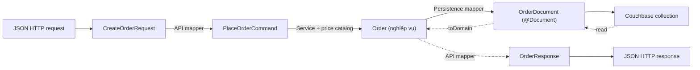
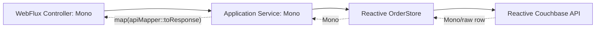

# Tách mô hình API khỏi cấu trúc tài liệu lưu trữ

## 1. Vấn đề: một JSON có thể phục vụ hai hợp đồng rất khác nhau

Xét một API bán hàng cung cấp:

```http
POST /api/v1/orders
GET  /api/v1/orders/{id}
GET  /api/v1/orders?status=PAID
PATCH /api/v1/orders/{id}/shipping-note
```

Lúc mới xây, người phát triển có thể đưa trực tiếp `OrderDocument` vào `@RequestBody` và trả chính entity này làm response. Lợi ích trước mắt là ít class và ít mã chuyển đổi. Nhưng điều gì xảy ra khi đội dữ liệu đổi tên khóa JSON từ `customer_id` thành `buyer_id`, thêm metadata `@Version`, chuyển đơn sang collection khác hoặc bỏ trường giá vốn? API sẽ bị kéo theo thay đổi của **cách lưu**, trong khi client chỉ muốn xem hoặc đặt đơn.

Hai loại hợp đồng này có mục tiêu khác nhau:

- **Hợp đồng API** trả lời: client được phép gửi những gì, nhận dữ liệu với tên/định dạng nào, cách xử lý phiên bản API, lỗi và phân quyền ra sao?
- **Hợp đồng lưu trữ** trả lời: document có key nào, field JSON nào, type metadata nào, được đặt ở bucket/scope/collection nào, cách đọc/ghi và concurrency/TTL hoạt động thế nào?

Bài thuộc chương **Thiết kế ứng dụng** của **SPRING_DATA_COUCHBASE**. Module này xây dựng tầng truy cập Couchbase bằng document mapping, repository, `CouchbaseTemplate` và truy vấn SQL++; đồng thời học bucket/scope/collection, chỉ mục, TTL, CAS, giao dịch, API reactive để bảo đảm hiệu năng, nhất quán và khả năng vận hành. Tách mô hình API khỏi document là cách giữ các mối quan tâm này đúng ranh giới, tránh để một thay đổi tối ưu storage trở thành breaking change cho client.

**Sau bài này, bạn có thể:**

1. Phân biệt **request DTO**, **application command/result**, **domain model** và **persistence document**.
2. Thiết kế mapper mà không cho client tự sửa `tenantId`, giá tiền, trạng thái hay CAS.
3. Sử dụng `@Document`, `@Id`, `@Field`, `@Scope`, `@Collection`, `@Version` mà không đưa chúng vào hợp đồng REST.
4. Xử lý `PATCH`, `null`, field vắng mặt và cập nhật một phần mà không làm mất dữ liệu nội bộ.
5. Duy trì API khi đổi tên field, đổi schema document, di trú dữ liệu hoặc đổi cơ chế truy vấn.
6. Kiểm thử riêng contract HTTP, mapper, truy vấn Couchbase, CAS/TTL và nhiều tenant.

> **Phạm vi phiên bản:** Ví dụ dùng Java 17+, Spring MVC và Spring Data Couchbase 5.x/6.x theo BOM phù hợp, Couchbase Java SDK 3.x; annotation validation sử dụng `jakarta.validation`. Code block là các mảnh tự chứa theo vai trò (không phải một project chạy được bằng cách nối tất cả block vào một file). Khi triển khai, kiểm chứng API và cách converter lưu trữ theo **phiên bản phụ thuộc thực tế**.

## 2. Bốn biểu diễn của cùng một đơn hàng

Ví dụ khách hàng muốn đặt hai sản phẩm SKU-42 với địa chỉ giao hàng. Hệ thống có thể cần bốn biểu diễn:

| Mô hình | Sở hữu bởi | Mục đích | Ví dụ field |
| --- | --- | --- | --- |
| `CreateOrderRequest` | Tầng API | Dữ liệu client **được phép yêu cầu** | `customerId`, `lines[sku,quantity]` |
| `PlaceOrderCommand` / `Order` | Tầng application/domain | Diễn đạt nghiệp vụ, tenant đáng tin cậy, snapshot giá | `tenantId`, `lines`, `total`, `state` |
| `OrderDocument` | Tầng persistence | Biểu diễn document lưu trong Couchbase | `tenant_id`, `buyer_id`, `total_amount`, `schema_version`, CAS |
| `OrderResponse` | Tầng API | Dữ liệu client cần đọc theo contract | `id`, `customerId`, `total.amount`, `status`, `createdAt` |

Sơ đồ hướng đi:



Không phải hệ thống nào cũng cần tách đủ bốn class cho CRUD đơn giản. Tuy nhiên, **khi muốn domain độc lập storage**, một model/application command riêng giúp tránh Service phải biết annotation, tên JSON và lỗi SDK. Có thể rút gọn chỉ còn DTO + document + mapper cho một service nhỏ; điều kiện tiên quyết là **không đưa document thẳng ra HTTP** và business rules vẫn có nơi thực thi rõ ràng.

### 2.1. So sánh cùng một bản ghi qua hai JSON

API response ổn định:

```json
{
  "id": "ord_7b2a",
  "customerId": "customer-42",
  "status": "PAID",
  "total": { "amount": "250000", "currency": "VND" },
  "createdAt": "2026-11-25T08:30:00Z"
}
```

Document lưu trong `shop.sales.orders`:

```json
{
  "schema_version": 2,
  "tenant_id": "store-01",
  "buyer_id": "customer-42",
  "state": "PAID",
  "total_amount": 250000,
  "currency": "VND",
  "created_at_ms": 1795595400000,
  "internal_fraud_score": 0.06,
  "lines": [
    { "sku": "SKU-42", "qty": 2, "price": 125000 }
  ]
}
```

Đây chỉ là ví dụ về **hình dạng JSON**. Document key thực sự có thể là `order::store-01::7b2a` và không nằm trong body; CAS là metadata Couchbase và cũng không phải một field client được phép đặt. `_class` (type discriminator Spring Data) có thể được converter thêm tùy cấu hình. API ID `ord_7b2a` là một **public identifier**; ứng dụng có thể quyết định ánh xạ sang document key nội bộ, không bắt buộc public ID trùng key.

Đổi `buyer_id` thành `customer_ref` hoặc chuyển `created_at_ms` sang một cấu trúc timestamp khác **không bắt buộc** làm đổi `customerId` hay `createdAt` trong API.

### 2.2. Bảng trường nào thuộc ranh giới nào

| Thông tin | Client gửi lúc tạo? | API trả? | Trong document? | Ai quyết định |
| --- | :---: | :---: | :---: | --- |
| SKU, quantity | Có | Tùy endpoint | Có | Client đề xuất, Service validate |
| `customerId` | Có, sau kiểm tra quyền | Có nếu được phép | `buyer_id` | API contract + authorization |
| `tenantId` | **Không** | Thường không | `tenant_id` | Principal/Service |
| Đơn giá, tổng tiền | **Không tin từ client** | Có | Có | PriceCatalog + business rule |
| `status` | Không trong create | Có | `state` | State machine của Order |
| `createdAt` | Không | Có dạng ISO-8601 | `created_at_ms` | Clock của server |
| `@Version`/CAS | Không trong create | Có thể thành opaque ETag | Metadata KV | Couchbase/persistence |
| `schema_version` | Không | Không | Có | Storage migration |
| `internal_fraud_score` | Không | Không | Có nếu policy cho phép | Internal risk service |
| TTL/expiry | Không tùy ý | Không mặc định | Metadata expiry | Data retention policy |

Tách mô hình không chỉ là đổi tên field. Nó là cơ chế **giảm quyền ghi ngoài ý muốn (mass assignment)** và bảo vệ contract lâu dài.

## 3. Thiết kế package và chiều phụ thuộc

```text
com.example.shop.orders
├── api/
│   ├── OrderController.java
│   ├── OrderApiMapper.java
│   └── dto/
│       ├── CreateOrderRequest.java
│       ├── OrderResponse.java
│       ├── MoneyResponse.java
│       └── ShippingNotePatchRequest.java
├── application/
│   ├── OrderService.java
│   ├── PlaceOrderCommand.java
│   ├── OrderView.java
│   └── OrderStore.java
├── domain/
│   ├── Order.java
│   ├── OrderLine.java
│   └── OrderStatus.java
├── infrastructure/couchbase/
│   ├── OrderDocument.java
│   ├── CouchbaseOrderRepository.java
│   ├── CouchbaseOrderStore.java
│   └── OrderDocumentMapper.java
└── security/
    └── CurrentTenant.java
```

Hai nguyên tắc:

1. **API DTO không import `OrderDocument` và không chứa annotation Couchbase.** Repository không nhận `CreateOrderRequest` và không trả `ResponseEntity`.
2. Nếu dùng **port/adapter**, tầng `application` định nghĩa `OrderStore` để tách data access; tầng `infrastructure` triển khai bằng Spring Data. Module nhỏ có thể để Service sử dụng `CouchbaseRepository` trực tiếp, nhưng khi đó domain/service sẽ phụ thuộc persistence nhiều hơn; lựa chọn phải có chủ đích.

Mapper cũng có **hai công việc khác nhau**:

- `OrderApiMapper`: chuyển giữa HTTP DTO và command/view.
- `OrderDocumentMapper`: chuyển giữa domain/application model và cấu trúc Couchbase.

Không dùng một mapper khổng lồ mang cả `HttpServletRequest`, `Cluster` và `@Document` để làm mọi thứ.

## 4. API request DTO: chỉ mô tả quyền đề xuất của client

### 4.1. DTO tạo đơn và validation

```java
package com.example.shop.orders.api.dto;

import java.util.List;
import jakarta.validation.Valid;
import jakarta.validation.constraints.NotBlank;
import jakarta.validation.constraints.NotEmpty;
import jakarta.validation.constraints.Min;
import jakarta.validation.constraints.NotNull;

public record CreateOrderRequest(
        @NotBlank String customerId,
        @NotEmpty List<@Valid CreateLineRequest> lines
) {}

public record CreateLineRequest(
        @NotBlank String sku,
        @NotNull @Min(1) Integer quantity
) {}
```

Mỗi `public record` trong ví dụ phải đặt ở **file Java riêng** khi đưa vào dự án. `@Valid` kích hoạt cascade validation của phần tử danh sách, và dự án cần có Bean Validation provider tương thích (ví dụ starter validation của Spring Boot).

DTO **cố ý không có** `tenantId`, `total`, `status`, `createdAt`, `expiry`, `version`, `documentKey`. Nếu client gửi những field không được khai báo, cần xác định chính sách từ chối hoặc bỏ qua **một cách có kiểm soát** ở tầng JSON binding; không xem việc “DTO không có field” là đủ để mọi security issue được loại bỏ.

### 4.2. Request là syntax, command là ý định nghiệp vụ

```java
package com.example.shop.orders.application;

import java.util.List;

public record PlaceOrderCommand(
        String trustedTenantId,
        String customerId,
        List<RequestedLine> lines
) {
    public PlaceOrderCommand {
        lines = List.copyOf(lines);
    }
}

public record RequestedLine(String sku, int quantity) {}
```

`trustedTenantId` đến từ principal hoặc đối tượng đã được application xác thực quyền tenant. Không đưa một `tenantId` từ request body vào command rồi tin đó là đúng. Command không có annotation `@RequestBody`, `@Field` hoặc dependency SDK: cùng use case có thể được gọi từ HTTP, queue consumer hoặc scheduled job.

Khi nghiệp vụ có quyền xem/đặt đơn theo khách hàng cụ thể, tầng application cần thêm **authorization port**, không nhét điều kiện quyền truy cập vào Mapper:

```java
public interface OrderAccessPolicy {
    void assertMayPlace(String trustedTenantId, String customerId);
    void assertMayRead(String trustedTenantId, String customerId);
}
```

Implementation phải ràng buộc hành động với **authenticated principal** hoặc context đáng tin cậy, không chỉ so sánh hai chuỗi được client gửi. Với job nội bộ không có HTTP principal, phải dùng actor/service identity có quyền được cấp rõ ràng.

### 4.3. Mapper API cho create

```java
package com.example.shop.orders.api;

import com.example.shop.orders.api.dto.CreateOrderRequest;
import com.example.shop.orders.application.PlaceOrderCommand;
import com.example.shop.orders.application.RequestedLine;
import org.springframework.stereotype.Component;

@Component
public class OrderApiMapper {
    public PlaceOrderCommand toCommand(
            String trustedTenantId, CreateOrderRequest request) {

        return new PlaceOrderCommand(
                trustedTenantId,
                request.customerId().trim(),
                request.lines().stream()
                        .map(line -> new RequestedLine(
                                line.sku().trim(), line.quantity()))
                        .toList());
    }
}
```

Hàm chuyển đổi này **không** tính giá tiền, không quyết định người dùng được mua SKU nào và không gọi repository. Logic giá, stock, trạng thái, giới hạn số dòng/khối lượng đơn, quyền `customerId` thuộc Service/domain. Mapper được gọi sau validation HTTP nhưng Service phải giữ invariant vì còn caller không qua HTTP.

**Defensive copy:** `PlaceOrderCommand` dùng `List.copyOf` nên danh sách request có bị thay đổi sau thời điểm mapping cũng không thay đổi cấu trúc command. Nếu các phần tử là object mutable, phải copy sâu hơn; `record RequestedLine` ở đây dùng các giá trị bất biến.

## 5. Response DTO: hợp đồng hiển thị độc lập document

```java
package com.example.shop.orders.api.dto;

import java.time.Instant;
import java.util.List;

public record MoneyResponse(String amount, String currency) {}

public record OrderLineResponse(
        String sku, int quantity, MoneyResponse unitPrice
) {}

public record OrderResponse(
        String id,
        String customerId,
        String status,
        MoneyResponse total,
        Instant createdAt,
        List<OrderLineResponse> lines
) {}
```

Các `public record` phải nằm trong file riêng. `amount` là **chuỗi thập phân có quy ước rõ ràng** để tránh mất chính xác khi client dùng kiểu floating-point; đây là lựa chọn API, không phải yêu cầu của Couchbase. Có thể dùng decimal number nếu client hỗ trợ, nhưng cần thống nhất cách biểu diễn tiền tệ.

Tầng application có thể cung cấp một read model không phụ thuộc storage:

```java
package com.example.shop.orders.application;

import java.math.BigDecimal;
import java.time.Instant;
import java.util.List;

public record OrderView(
        String publicId,
        String customerId,
        String status,
        BigDecimal total,
        String currency,
        Instant createdAt,
        List<OrderLineView> lines
) {}

public record OrderLineView(
        String sku, int quantity, BigDecimal unitPrice
) {}
```

Một mapper đầu ra:

```java
public OrderResponse toResponse(OrderView view) {
    var lines = view.lines().stream()
            .map(line -> new OrderLineResponse(
                    line.sku(),
                    line.quantity(),
                    new MoneyResponse(
                            line.unitPrice().toPlainString(),
                            view.currency())))
            .toList();

    return new OrderResponse(
            view.publicId(),
            view.customerId(),
            view.status(),
            new MoneyResponse(
                    view.total().toPlainString(), view.currency()),
            view.createdAt(),
            lines);
}
```

Method trên được đặt cùng `OrderApiMapper`, với các import record cần thiết. Đây là phép chuyển đổi thuần túy, **không truy vấn Couchbase** để bổ sung field. Nếu muốn trả thêm `customerName` từ hệ thống khác, Service/read-model adapter phải tải hoặc cung cấp dữ liệu; nếu mapper tự gọi API cho từng đơn sẽ dễ phát sinh N+1 request.

### 5.1. Response DTO kiểm soát dữ liệu nhạy cảm

Không trả trực tiếp các field như `tenant_id`, `internal_fraud_score`, CAS metadata, ghi chú điều tra, thông tin thanh toán nội bộ hoặc schema version. Trường nào được công khai là quyết định **product/security contract**, không phải do `ObjectMapper` tìm thấy getter trong `OrderDocument`.

Một cách làm nguy hiểm:

```java
// KHÔNG LÀM: entity có thể lộ field mới khi schema thay đổi.
@GetMapping("/{id}")
public OrderDocument get(@PathVariable String id) {
    return repository.findById(id).orElseThrow();
}
```

Thay bằng **allowlist trường phản hồi** qua `OrderResponse`. Khi persistence thêm field `fraudScore`, DTO không tự phát sinh một thuộc tính JSON mới.

## 6. Document model Couchbase: tối ưu storage mà không rò ra API

### 6.1. Mapping entity

```java
package com.example.shop.orders.infrastructure.couchbase;

import java.math.BigDecimal;
import java.util.List;
import org.springframework.data.annotation.Id;
import org.springframework.data.annotation.Version;
import org.springframework.data.couchbase.core.mapping.Document;
import org.springframework.data.couchbase.core.mapping.Field;
import org.springframework.data.couchbase.core.mapping.Scope;
import org.springframework.data.couchbase.core.mapping.Collection;

@Document
@Scope("sales")
@Collection("orders")
public class OrderDocument {
    @Id
    private String id;

    @Field("schema_version")
    private Integer schemaVersion;

    @Field("tenant_id")
    private String tenantId;

    @Field("buyer_id")
    private String buyerId;

    @Field("public_id")
    private String publicId;

    @Field("state")
    private String state;

    @Field("total_amount")
    private BigDecimal totalAmount;

    private String currency;

    @Field("created_at_ms")
    private Long createdAtMillis;

    private List<StoredLine> lines;

    @Version
    private Long version;

    // No-arg constructor và getters/setters cho mapper.
}

class StoredLine {
    private String sku;
    @Field("qty") private Integer quantity;
    @Field("price") private BigDecimal price;

    // No-arg constructor và getters/setters.
}
```

Document model biết metadata lưu trữ:

- `@Document`: entity được Spring Data Couchbase quản lý.
- `@Scope("sales")`, `@Collection("orders")`: keyspace khi phiên bản hỗ trợ; bucket thường cấu hình riêng.
- `@Field("buyer_id")`: Java property là `buyerId`, JSON key là `buyer_id`. Truy vấn SQL++ thủ công dùng **tên JSON**, không suy đoán từ tên Java.
- `@Id`: document key, không nhất thiết có field JSON `id`.
- `@Version`: metadata CAS dùng optimistic locking, không phải `schema_version` và không tự phản ánh thứ tự nghiệp vụ.
- `schemaVersion`: **phiên bản cấu trúc document** do ứng dụng quản lý cho migration; khác `@Version` hoàn toàn.

Chỉ dùng `@Field` không giúp dữ liệu cũ tự được đổi tên. Nếu document cũ có `customer_id` còn entity mới dùng `buyer_id`, cần migration hoặc adapter đọc hai phiên bản trong giai đoạn chuyển tiếp.

### 6.2. Phân biệt các loại phiên bản

| Giá trị | Mục đích | Ai cập nhật | Có công khai trực tiếp? |
| --- | --- | --- | --- |
| API version `/api/v1` | Tương thích HTTP client | API owner | Có |
| `schema_version` trong document | Biết cách decode/migrate dữ liệu lưu | Persistence/migration owner | Không mặc định |
| CAS qua `@Version` | Chống ghi đè trên một document | Couchbase/Spring Data | Có thể ánh xạ thành opaque ETag, không cho client sửa tùy ý |
| Domain `revision` | Theo dõi event/order transition | Domain owner | Tùy yêu cầu |
| Spring Data/Couchbase SDK version | Tính tương thích thư viện | Build/deployment | Không là field của đơn |

Đặc biệt **CAS không phải một bộ đếm** để so sánh “đơn nào mới hơn” giữa nhiều document. Đừng gán `schema_version = CAS` hoặc tự `version++` rồi mong optimistic locking hoạt động đúng.

### 6.3. Dùng ID công khai độc lập key nội bộ khi cần

```text
API public ID: ord_7b2a
KV document ID: order::store-01::7b2a
```

Có thể tính key từ tenant đã xác thực + public ID theo một quy ước **cố định và không nhập nhằng**, hoặc tra cứu mapping qua chỉ mục. Nếu phải tra cứu `publicId` bằng SQL++, hãy đánh giá secondary index và consistency. Đừng đưa key `order::<tenant>::...` ra API chỉ vì repository dùng nó.

Việc biết public ID cũng **không tự cấp quyền xem đơn**. Dù chọn KV hay query theo ID, service phải kiểm tra tenant và authorization trên dữ liệu thật.

## 7. Persistence mapper: một tầng chuyển đổi khác API mapper

`OrderApiMapper` chuyển JSON-facing DTO sang command/view. `OrderDocumentMapper` làm việc riêng với entity Couchbase. Tách hai chức năng này khiến việc thay tên field JSON hoặc đổi collection không bắt Controller đổi theo.

Giả sử tầng application tạo một draft đã được kiểm tra và định giá:

```java
package com.example.shop.orders.application;

import java.math.BigDecimal;
import java.time.Instant;
import java.util.List;

public record PricedLine(
        String sku, int quantity, BigDecimal unitPrice
) {}

public record OrderDraft(
        String documentId,
        String publicId,
        String tenantId,
        String customerId,
        List<PricedLine> lines,
        BigDecimal total,
        String currency,
        Instant createdAt
) {
    public OrderDraft {
        lines = List.copyOf(lines);
    }
}
```

Đây là dữ liệu **đã được Service/domain chuẩn hóa**, không phải đối tượng được khởi tạo trực tiếp từ request JSON. Chỉ có một nơi quyết định `total` từ các dòng hàng có đơn giá đã xác thực.

Persistence mapper:

```java
package com.example.shop.orders.infrastructure.couchbase;

import java.time.Instant;
import com.example.shop.orders.application.OrderDraft;
import com.example.shop.orders.application.OrderView;
import com.example.shop.orders.application.OrderLineView;
import org.springframework.stereotype.Component;

@Component
public class OrderDocumentMapper {
    public OrderDocument toNewDocument(OrderDraft draft) {
        OrderDocument doc = new OrderDocument();
        doc.setId(draft.documentId());
        doc.setSchemaVersion(2);
        doc.setPublicId(draft.publicId());
        doc.setTenantId(draft.tenantId());
        doc.setBuyerId(draft.customerId());
        doc.setState("NEW");
        doc.setTotalAmount(draft.total());
        doc.setCurrency(draft.currency());
        doc.setCreatedAtMillis(draft.createdAt().toEpochMilli());

        doc.setLines(draft.lines().stream().map(line -> {
            StoredLine stored = new StoredLine();
            stored.setSku(line.sku());
            stored.setQuantity(line.quantity());
            stored.setPrice(line.unitPrice());
            return stored;
        }).toList());

        // Không tự set CAS/@Version cho document mới.
        return doc;
    }

    public OrderView toView(OrderDocument doc) {
        var lines = doc.getLines().stream()
                .map(line -> new OrderLineView(
                        line.getSku(),
                        line.getQuantity(),
                        line.getPrice()))
                .toList();

        return new OrderView(
                doc.getPublicId(),
                doc.getBuyerId(),
                doc.getState(),
                doc.getTotalAmount(),
                doc.getCurrency(),
                Instant.ofEpochMilli(doc.getCreatedAtMillis()),
                lines);
    }
}
```

Trong code thật, `OrderDocument`/`StoredLine` phải có constructor/getter/setter thích hợp với converter, và import các record ở application. `OrderView` không chứa `schemaVersion`, bucket name hay CAS. Mapper ở đây **không kiểm tra quyền tenant**: nó chỉ nhận document đã qua Service/adapter chọn lọc. Không biến Mapper thành nơi gọi network hoặc giữ mutable cache của document.

### 7.1. Quy tắc khi chuyển dữ liệu

| Chuyển đổi | Cần bảo vệ |
| --- | --- |
| `Instant → Long epoch millis` | Đơn vị **milliseconds**, không nhầm seconds |
| `BigDecimal → Couchbase JSON number` | Không qua `double` trước khi ghi; test độ chính xác và scale |
| `Long epoch millis → Instant` | Null/missing policy khi đọc document cũ |
| `StoredLine.qty → OrderLineView.quantity` | Mapping field alias, không biến quantity null thành 0 tùy tiện |
| `state → API status` | Mapping enum/alias có kiểm soát, không tự cho phép trạng thái lạ |
| `buyer_id → customerId` | API không phụ thuộc tên JSON storage |
| `@Version` | Không sao chép tùy tiện từ API vào CAS của document |
| `schema_version` | Kiểm tra hỗ trợ phiên bản, không trả lên HTTP |

**Chính xác tiền tệ:** `BigDecimal` giúp tránh lỗi biểu diễn nhị phân trong phép tính Java, nhưng khi lưu/đọc JSON number phải xác minh transcoder và client không tự chuyển qua `double`. Với yêu cầu rất nghiêm ngặt, có thể lưu **số nguyên đơn vị nhỏ nhất** (`amountMinor`) cộng mã tiền tệ/scale; đó là quyết định schema storage có thể đổi mà không thay response API `amount`.

### 7.2. Mapper không được dùng để vá dữ liệu hỏng một cách im lặng

Khi gặp document cũ thiếu `currency`, có ba lựa chọn có chủ đích:

1. **Dùng default hợp lệ** nếu có bằng chứng mọi document cũ thuộc `VND` và migration plan cho phép.
2. **Đi qua decoder phiên bản cũ** có logic tương thích được kiểm thử.
3. **Từ chối/đánh dấu lỗi dữ liệu** để xử lý migration, không đưa lên API số tiền thiếu currency.

Không đặt `catch (Exception) { return emptyOrder(); }` trong mapper. Đó là cách che mất lỗi schema và có thể làm client hành động dựa trên thông tin sai.

## 8. Service và repository: một ví dụ luồng hai chiều

Tầng application không cần biết `@Field("buyer_id")` hoặc collection `orders`. Nó chỉ cần một giao diện lưu/đọc:

```java
package com.example.shop.orders.application;

import java.util.Optional;

public interface OrderStore {
    OrderView insert(OrderDraft draft);
    Optional<OrderView> findByPublicId(
            String trustedTenantId, String publicId);
}
```

### 8.1. Service quyết định nghiệp vụ, không quyết định JSON field

```java
package com.example.shop.orders.application;

import java.math.BigDecimal;
import java.time.Clock;
import java.util.List;
import java.util.UUID;
import org.springframework.stereotype.Service;

@Service
public class OrderService {
    private final OrderStore orders;
    private final PriceCatalog prices;
    private final OrderAccessPolicy accessPolicy;
    private final Clock clock;

    public OrderService(
            OrderStore orders, PriceCatalog prices,
            OrderAccessPolicy accessPolicy, Clock clock) {
        this.orders = orders;
        this.prices = prices;
        this.accessPolicy = accessPolicy;
        this.clock = clock;
    }

    public OrderView place(PlaceOrderCommand command) {
        if (command == null
                || command.trustedTenantId() == null
                || command.trustedTenantId().isBlank()
                || command.customerId() == null
                || command.customerId().isBlank()
                || command.lines() == null
                || command.lines().isEmpty()
                || command.lines().size() > 100) {
            throw new IllegalArgumentException("Lệnh tạo đơn không hợp lệ");
        }

        accessPolicy.assertMayPlace(
                command.trustedTenantId(), command.customerId());
        List<PricedLine> lines = command.lines().stream()
                .map(line -> {
                    if (line.sku() == null || line.sku().isBlank()
                            || line.quantity() < 1) {
                        throw new IllegalArgumentException("Dòng hàng lỗi");
                    }
                    BigDecimal price =
                            prices.currentPrice(line.sku().trim(), "VND");
                    if (price == null || price.signum() < 0) {
                        throw new IllegalStateException("Giá không hợp lệ");
                    }
                    return new PricedLine(
                            line.sku().trim(), line.quantity(), price);
                })
                .toList();

        BigDecimal total = lines.stream()
                .map(line -> line.unitPrice()
                        .multiply(BigDecimal.valueOf(line.quantity())))
                .reduce(BigDecimal.ZERO, BigDecimal::add);

        String publicId = "ord_" + UUID.randomUUID();
        String documentId = "order::"
                + command.trustedTenantId() + "::" + publicId;

        OrderDraft draft = new OrderDraft(
                documentId,
                publicId,
                command.trustedTenantId(),
                command.customerId().trim(),
                lines,
                total,
                "VND",
                clock.instant());

        return orders.insert(draft);
    }

    public OrderView get(
            String trustedTenantId, String publicId) {
        if (trustedTenantId == null || trustedTenantId.isBlank()
                || publicId == null || publicId.isBlank()) {
            throw new IllegalArgumentException("Tenant/ID không hợp lệ");
        }
        OrderView view = orders.findByPublicId(trustedTenantId, publicId)
                .orElseThrow(OrderNotFoundException::new);
        accessPolicy.assertMayRead(trustedTenantId, view.customerId());
        return view;
    }
}
```

Ví dụ giả định `PriceCatalog` là port application với chữ ký `BigDecimal currentPrice(String sku, String currency)`; `OrderNotFoundException` là exception nghiệp vụ do ứng dụng định nghĩa. `OrderAccessPolicy` kiểm tra quyền theo principal đáng tin cậy cả khi **tạo** lẫn **đọc**, không chỉ kiểm tra tenant trong KV key. `Clock` được cấu hình bean hoặc truyền vào khi unit test.

Chính sách idempotency cần xử lý thêm: hai lần POST lặp sau timeout có thể tạo hai UUID/đơn khác nhau. Nếu use case yêu cầu exactly-once *effect*, dùng `idempotencyKey` ổn định, receipt và insert-only bên store; không mặc định UUID là đủ.

### 8.2. Adapter lưu trữ chỉ biết Couchbase

```java
package com.example.shop.orders.infrastructure.couchbase;

import com.example.shop.orders.application.*;
import java.util.Optional;
import org.springframework.data.couchbase.repository.CouchbaseRepository;
import org.springframework.stereotype.Repository;

interface SpringOrderRepository
        extends CouchbaseRepository<OrderDocument, String> {
}

@Repository
public class CouchbaseOrderStore implements OrderStore {
    private final SpringOrderRepository repository;
    private final OrderDocumentMapper mapper;

    public CouchbaseOrderStore(
            SpringOrderRepository repository,
            OrderDocumentMapper mapper) {
        this.repository = repository;
        this.mapper = mapper;
    }

    @Override
    public OrderView insert(OrderDraft draft) {
        OrderDocument doc = mapper.toNewDocument(draft);
        // Bản tối giản: save với ID mới sinh và @Version null.
        // Nếu hợp đồng bắt buộc insert-only, dùng adapter/template insertById
        // và xử lý DocumentExists thay vì coi save là kiểm tra duy nhất.
        return mapper.toView(repository.save(doc));
    }

    @Override
    public Optional<OrderView> findByPublicId(
            String trustedTenantId, String publicId) {
        String documentId =
                "order::" + trustedTenantId + "::" + publicId;
        return repository.findById(documentId)
                .filter(doc -> trustedTenantId.equals(doc.getTenantId()))
                .map(mapper::toView);
    }
}
```

Hai kiểu `SpringOrderRepository` và `CouchbaseOrderStore` trong ví dụ cần nằm **file riêng** nếu `CouchbaseOrderStore` là `public`. Với `publicId` do server tạo, quy tắc xây key phải nhất quán giữa create/get và không cho client đưa các ký tự tùy ý tạo key ngoài namespace mong muốn. Phải validate format publicId nếu sử dụng key synthesis.

**Lưu ý bảo mật:** Lấy key theo tenant giúp tránh một số truy cập nhầm nhưng không thay thế quyền theo **đơn cụ thể**. Trong hệ thống người dùng chỉ được xem đơn của mình, ngoài tenant còn cần kiểm tra `customerId`/principal ownership. Không trả document nếu chỉ biết đúng publicId của người khác cùng tenant.

### 8.3. Vì sao adapter không trả thẳng `OrderDocument`?

Nếu port trả `OrderDocument`, application phải biết `schemaVersion`, `@Version`, aliases và hành vi converter. Việc đổi từ Couchbase sang storage khác hoặc chia một document thành nhiều document sẽ ảnh hưởng service. `OrderView` hoặc domain model giúp giữ method `get` ổn định. Đổi lại, adapter cần chuyển đổi — một chi phí nhỏ so với lợi ích khi schema thường xuyên tiến hóa.

## 9. Controller: chỉ kết nối HTTP và use case

```java
package com.example.shop.orders.api;

import com.example.shop.orders.api.dto.*;
import com.example.shop.orders.application.OrderService;
import com.example.shop.orders.security.CurrentTenant;
import jakarta.validation.Valid;
import java.net.URI;
import org.springframework.http.ResponseEntity;
import org.springframework.web.bind.annotation.*;

@RestController
@RequestMapping("/api/v1/orders")
public class OrderController {
    private final OrderService service;
    private final OrderApiMapper mapper;
    private final CurrentTenant tenant;

    public OrderController(
            OrderService service,
            OrderApiMapper mapper,
            CurrentTenant tenant) {
        this.service = service;
        this.mapper = mapper;
        this.tenant = tenant;
    }

    @PostMapping
    public ResponseEntity<OrderResponse> create(
            @Valid @RequestBody CreateOrderRequest request) {
        var result = service.place(
                mapper.toCommand(tenant.requireTenantId(), request));

        return ResponseEntity.created(
                URI.create("/api/v1/orders/" + result.publicId()))
                .body(mapper.toResponse(result));
    }

    @GetMapping("/{publicId}")
    public OrderResponse get(@PathVariable String publicId) {
        return mapper.toResponse(
                service.get(tenant.requireTenantId(), publicId));
    }
}
```

Trong dự án thật, `CurrentTenant` lấy tenant từ principal đã xác thực và kiểm tra quyền; đừng triển khai bằng cách tin một `X-Tenant-Id` do client tự gửi. Controller không import `OrderDocument`, `Cluster`, `QueryCriteria` hoặc `JsonObject`. Khi tên field storage đổi, endpoint và hợp đồng JSON vẫn có thể giữ nguyên.

Controller advice chuyển lỗi thành HTTP status, ví dụ `400` cho request không hợp lệ, `404` cho đơn không tồn tại/không được xem theo chính sách chống dò ID, `409` cho xung đột CAS hoặc chuyển trạng thái. Không trả thông tin bucket, CAS nội bộ, SQL++ hoặc stack trace vào `ProblemDetail`.

## 10. PATCH: phân biệt thiếu trường, `null` và giá trị thật

`PUT` thường diễn đạt một biểu diễn thay thế, trong khi `PATCH` diễn đạt thay đổi một phần. Không nên dùng `@RequestBody OrderDocument` với `save` cho PATCH:

```json
{"shippingNote": "Giao trước 17h"}
```

Nếu deserialize vào một entity mới, các field không gửi có thể trở thành `null` hoặc giá trị mặc định. Lưu nguyên entity đó có nguy cơ xóa `total_amount`, `tenant_id`, lines, thậm chí ghi đè giá trị mới hơn. Chưa kể client có thể thử gửi `schema_version` hoặc `state` dù không được phép.

### 10.1. Thiết kế ba trạng thái thay đổi

Giả sử nghiệp vụ cho phép:

- **Không có key `shippingNote`**: giữ nguyên.
- **Key `shippingNote` có `null`**: xóa ghi chú (nếu có quyền).
- **Key `shippingNote` có chuỗi**: đặt ghi chú mới; chuỗi trống có thể bị từ chối theo hợp đồng.

Một mô hình command tách ba ý nghĩa:

```java
public sealed interface ShippingNoteChange
        permits ShippingNoteChange.Unchanged,
                ShippingNoteChange.Clear,
                ShippingNoteChange.SetValue {

    record Unchanged() implements ShippingNoteChange {}
    record Clear() implements ShippingNoteChange {}
    record SetValue(String value) implements ShippingNoteChange {}
}
```

API parser dùng `JsonNode` để phân biệt **absent** với **explicit null**:

```java
import com.fasterxml.jackson.databind.JsonNode;

public ShippingNoteChange parsePatch(JsonNode body) {
    if (body == null || !body.isObject()) {
        throw new IllegalArgumentException("Body PATCH phải là object");
    }
    // Kiểm tra whitelist field: body chỉ được có shippingNote,
    // không cho client sửa tenant, total, status hoặc schemaVersion.
    var fields = body.fieldNames();
    while (fields.hasNext()) {
        if (!"shippingNote".equals(fields.next())) {
            throw new IllegalArgumentException("Field PATCH không cho phép");
        }
    }
    if (!body.has("shippingNote")) {
        return new ShippingNoteChange.Unchanged();
    }
    JsonNode value = body.get("shippingNote");
    if (value.isNull()) {
        return new ShippingNoteChange.Clear();
    }
    if (!value.isTextual() || value.asText().isBlank()
            || value.asText().length() > 500) {
        throw new IllegalArgumentException("Ghi chú không hợp lệ");
    }
    return new ShippingNoteChange.SetValue(value.asText().trim());
}
```

Mã sử dụng Jackson `JsonNode` trong tầng API **có chủ đích** để đọc presence. Trong dự án thật, parser nên nằm trong lớp chuyển đổi riêng và trả lỗi API nhất quán. `JsonNode.has("shippingNote")` trả true ngay cả khi giá trị là JSON null; đó là khác biệt cốt lõi với một `String shippingNote` nullable thông thường.

### 10.2. Service quyết định transition, không phải mapper

Ví dụ:

```java
public OrderView changeShippingNote(
        String trustedTenantId,
        String publicId,
        ShippingNoteChange change,
        String expectedEtag) {

    if (change instanceof ShippingNoteChange.Unchanged) {
        return store.getView(trustedTenantId, publicId); // Đường đọc riêng.
    }
    // Có thể cấm sửa ghi chú sau khi đã SHIPPED.
    // Store phải đọc trạng thái, so quyền tenant và ghi bằng CAS.
    return store.changeShippingNote(
            trustedTenantId, publicId, change, expectedEtag);
}
```

`store.getView` và `store.changeShippingNote` là các **port method minh họa mở rộng**; không có trong interface `OrderStore` tối giản mục 8, phải khai báo thêm khi triển khai PATCH. Store không được tự cho phép mọi thay đổi: Service/domain định nghĩa rule, persistence thực thi CAS. Nếu một lệnh `Unchanged` vẫn cần kiểm tra `If-Match` theo hợp đồng, phải áp dụng chính sách đó thay vì return sớm như mẫu.

### 10.3. Vì sao `NULL` và `MISSING` của SQL++ vẫn quan trọng?

Trong Couchbase, document có thể chứa:

```json
{"shipping_note": null}
```

hoặc **không có field `shipping_note`**. Chúng khác nhau ở SQL++: `IS NULL` và `IS MISSING`. Tầng API có thể chọn `Clear` luôn **remove key** (MISSING) hoặc đặt JSON null, nhưng phải ghi rõ hợp đồng và migration. Đừng mặc định Java field null sẽ luôn được converter ghi thành JSON null — điều đó phụ thuộc mapping/serialization thực tế.

Một test quan trọng là đọc raw document qua SDK để xác minh PATCH không vô tình xóa field khác. Nếu ứng dụng dùng sub-document `mutateIn` để thay một path, việc ghi vẫn cần điều kiện CAS khi một state machine hoặc invariant liên quan nhiều field đang được kiểm tra.

## 11. Tiến hóa cấu trúc Couchbase mà không phá vỡ API

Đây là lý do lớn nhất để tách DTO khỏi document: **một thay đổi về cách lưu không nhất thiết là thay đổi nghiệp vụ mà client phải biết**.

Giả sử storage ban đầu (schema version 1):

```json
{
  "tenant_id": "store-01",
  "customer_id": "customer-42",
  "status": "PAID",
  "total": 250000,
  "created_at_ms": 1795595400000
}
```

Sau tối ưu cấu trúc dữ liệu (schema version 2):

```json
{
  "schema_version": 2,
  "tenant_id": "store-01",
  "buyer_id": "customer-42",
  "state": "PAID",
  "total_amount": 250000,
  "currency": "VND",
  "created_at_ms": 1795595400000
}
```

API vẫn có thể giữ:

```json
{
  "customerId": "customer-42",
  "status": "PAID",
  "total": { "amount": "250000", "currency": "VND" }
}
```

Trên thực tế, việc đổi field `status` thành `state` có thể kéo theo index, truy vấn SQL++ và document converter phải sửa. Nhưng **không bắt buộc** đổi đường dẫn `GET /api/v1/orders/{id}`, tên `status` trong response hoặc SDK của client.

### 11.1. Expand → migrate → contract

| Giai đoạn | Hành động | Điều kiện nghiệm thu |
| --- | --- | --- |
| **0. Khảo sát** | Kiểm kê document version, field thiếu/null, query/index đang dùng | Biết tỷ lệ schema cũ/mới và điểm phụ thuộc |
| **1. Expand reader** | Adapter đọc được cả V1 và V2, chuyển thành cùng `OrderView` | Test fixture hai phiên bản đều trả cùng API |
| **2. Upgrade writer** | Writer mới tạo V2; lệnh update đối với V1 có chính sách migrate-on-write hoặc update an toàn | Không xuất hiện document lai thiếu dữ liệu |
| **3. Backfill** | Chạy job có phân trang, CAS/retry giới hạn, đo tiến độ | V1 giảm dần, không ghi đè mutation mới |
| **4. Index/query cutover** | Tạo index theo field mới; chuyển query có kiểm soát và `EXPLAIN` | Query kết quả đúng, độ trễ đạt mục tiêu |
| **5. Contract** | Sau khi tất cả writer/reader đã nâng cấp, ngừng hỗ trợ field cũ và dọn index cũ | Không còn client/job đọc/ghi V1 |

**Không** đổi annotation `@Field("customer_id")` sang `@Field("buyer_id")` rồi cho rằng mọi document sẽ tự được di trú. Annotation chỉ nói converter đọc/ghi **key nào từ thời điểm triển khai**, không tự sửa JSON lịch sử.

### 11.2. Khi đọc song song V1/V2, dùng adapter phiên bản rõ ràng

Nếu đang xử lý raw JSON từ SDK, có thể định nghĩa decoder:

```java
public final class OrderStorageDecoder {
    public OrderView decode(String publicId, JsonObject body) {
        Integer version = body.getInt("schema_version");

        if (version == null || version == 1) {
            // Có chính sách rõ ràng đối với dữ liệu legacy thiếu currency.
            return decodeV1(publicId, body);
        }
        if (version == 2) {
            return decodeV2(publicId, body);
        }
        throw new UnsupportedSchemaVersionException(version);
    }
}
```

`decodeV1` và `decodeV2` là hai **phương thức minh họa cần triển khai, kiểm thử**; không phải API Couchbase. `JsonObject` đến từ `com.couchbase.client.java.json`. Vì V1 không có `currency`, chỉ đặt mặc định `VND` nếu có chứng cứ business rằng toàn bộ dữ liệu legacy thực sự dùng đồng này. Nếu không, phải đánh dấu lỗi/migrate dựa trên dữ liệu bổ sung.

Một SQL++ projection có thể hỗ trợ giai đoạn chuyển tiếp:

```sql
SELECT META(o).id AS documentKey,
       IFMISSINGORNULL(o.buyer_id, o.customer_id) AS customerId,
       IFMISSINGORNULL(o.state, o.status) AS status,
       IFMISSINGORNULL(o.total_amount, o.total) AS amount
FROM `shop`.`sales`.`orders` AS o
WHERE o.tenant_id = $tenantId;
```

`IFMISSINGORNULL(a,b)` dùng giá trị b khi a là `NULL` hoặc `MISSING`. Nó **không** tương đương “field V2 có mặt thì ưu tiên dù giá trị null có ý nghĩa nghiệp vụ”. Nếu `null` là trạng thái hợp lệ cần bảo tồn, phải dùng điều kiện presence rõ ràng, ví dụ `CASE WHEN o.buyer_id IS MISSING THEN o.customer_id ELSE o.buyer_id END`. Mọi quy tắc fallback phải có unit/integration test cho document thiếu field, field null và field rỗng.

**Cảnh báo Spring Data:** đoạn SQL++ projection trên trả các cột tùy chọn, **không được giả định** Spring Data `@Query` trên repository sẽ tự dựng một DTO phức tạp như khi trả entity. Dùng projection API đã được xác minh trong phiên bản đang dùng, hoặc SDK/query adapter với mapper kết quả tường minh; khi cần trả entity nguyên vẹn, xem macro `#{#n1ql.selectEntity}` và metadata mapper.

### 11.3. Backfill phải tôn trọng CAS, TTL và owner

Với mỗi document cần migrate:

1. Đọc document, schema version và CAS bằng KV.
2. Nếu đã là V2, **bỏ qua** để job chạy lại an toàn.
3. Chuyển đổi dữ liệu, không tự thay tenant, order state hoặc số tiền dựa trên giả định thiếu kiểm chứng.
4. Ghi `replace` với **CAS đã đọc**; nếu CAS mismatch, đọc lại và xử lý theo dữ liệu mới, không cố ghi đè.
5. Giữ expiry nếu document có TTL và retention policy yêu cầu.
6. Ghi metrics số bản ghi migrate/thất bại/xung đột, có checkpoint và kế hoạch rollback.

Đoạn minh họa SDK Java:

```java
import com.couchbase.client.java.Collection;
import com.couchbase.client.java.kv.GetResult;
import com.couchbase.client.java.json.JsonObject;
import static com.couchbase.client.java.kv.ReplaceOptions.replaceOptions;

public boolean upgradeOne(Collection collection, String documentId) {
    GetResult result = collection.get(documentId);
    JsonObject body = result.contentAsObject();

    Integer version = body.getInt("schema_version");
    if (version != null && version >= 2) {
        return false;
    }
    if (!body.containsKey("customer_id")
            || !body.containsKey("status")
            || !body.containsKey("total")) {
        throw new InvalidLegacyDocumentException(documentId);
    }

    // Chỉ an toàn nếu quy tắc currency V1=VND đã được xác minh.
    body.put("buyer_id", body.getString("customer_id"));
    body.put("state", body.getString("status"));
    body.put("total_amount", body.get("total"));
    body.put("currency", "VND");
    body.put("schema_version", 2);

    // Trong giai đoạn chuyển tiếp có thể giữ field cũ để old reader chạy.
    // Chỉ xóa key legacy sau khi các reader/writer cũ đã được loại bỏ.
    collection.replace(
            documentId,
            body,
            replaceOptions().cas(result.cas()).preserveExpiry(true));
    return true;
}
```

**Điều kiện rất quan trọng:** `preserveExpiry(true)` khi replace phụ thuộc Couchbase Server **7.0+**; với server cũ hơn cần đọc expiry và đặt lại expiry theo API được hỗ trợ. Ví dụ trên minh họa **một attempt**, chưa có vòng CAS retry, phân trang, index scan, backoff hoặc quyền owner. Không chạy vô điều kiện trên production; job phải có dry-run, quota/tốc độ, giám sát và mẫu dữ liệu đủ nhiều. Nếu loại JSON tiền cũ không map được sang schema mới, không ép đổi kiểu bằng `double`.

### 11.4. Khi nào cần API v2?

Đổi `customer_id → buyer_id` ở storage **không** buộc API v2. Nhưng nếu business thay `total` từ “giá chưa thuế” sang “giá đã thuế”, hoặc đổi ý nghĩa `status` đối với client, đó có thể là thay đổi **semantic contract** cần version/feature negotiation và migration phía client.

Tóm lại: **API version phản ánh thay đổi hợp đồng với người dùng API; schema version phản ánh thay đổi biểu diễn nội bộ.** Không buộc chúng tăng cùng lúc.

## 12. Truy vấn danh sách: không phải cứ trả entity là tiết kiệm công sức

Màn hình danh sách đơn chỉ cần ID, trạng thái, tổng tiền và thời điểm tạo; chi tiết đơn cần line items. Nếu lấy toàn bộ `OrderDocument` cho mỗi dòng danh sách, hệ thống có thể tốn băng thông và converter time không cần thiết.

### 12.1. Read model cho danh sách

```java
package com.example.shop.orders.application;

import java.math.BigDecimal;
import java.time.Instant;

public record OrderSummary(
        String publicId,
        String status,
        BigDecimal total,
        String currency,
        Instant createdAt
) {}
```

Tầng API có thể có `OrderSummaryResponse` riêng; không phải thêm flag `includeLines=false` vào entity rồi serialize theo tình huống. API mapper quyết định hình dạng response, adapter query chỉ trả những field nó thực sự đã chọn.

### 12.2. SDK projection với mapping tường minh

```sql
SELECT o.public_id AS publicId,
       o.state AS status,
       o.total_amount AS totalAmount,
       o.currency AS currency,
       o.created_at_ms AS createdAtMillis
FROM `shop`.`sales`.`orders` AS o
WHERE o.tenant_id = $tenantId
  AND o.state = $status
ORDER BY o.created_at_ms DESC, META(o).id DESC
LIMIT $limit;
```

Trên SDK Java 3.x, adapter có thể dùng:

```java
import com.couchbase.client.java.Cluster;
import com.couchbase.client.java.json.JsonObject;
import static com.couchbase.client.java.query.QueryOptions.queryOptions;

String sql = """
    SELECT o.public_id AS publicId, o.state AS status,
           o.total_amount AS totalAmount, o.currency AS currency,
           o.created_at_ms AS createdAtMillis
    FROM `shop`.`sales`.`orders` AS o
    WHERE o.tenant_id = $tenantId AND o.state = $status
    ORDER BY o.created_at_ms DESC, META(o).id DESC
    LIMIT $limit
    """;

JsonObject params = JsonObject.create()
        .put("tenantId", trustedTenantId)
        .put("status", "PAID")
        .put("limit", 20);

var rows = cluster.query(sql,
        queryOptions().parameters(params).readonly(true))
        .rowsAsObject();

var summaries = rows.stream()
        .map(row -> new OrderSummary(
                row.getString("publicId"),
                row.getString("status"),
                row.getBigDecimal("totalAmount"),
                row.getString("currency"),
                java.time.Instant.ofEpochMilli(
                        row.getLong("createdAtMillis"))))
        .toList();
```

Đây là **SDK projection**, không phải Spring Data entity mapping. `rowsAsObject()` trả `JsonObject`; conversion sang `OrderSummary` là việc của **read adapter** và phải kiểm tra giá trị thiếu/null cùng kiểu số thực tế. `getBigDecimal` là API phụ thuộc phiên bản `JsonObject`; nếu SDK đã chọn không cung cấp method đó, dùng cách chuyển `JsonNumber`/giá trị số mà phiên bản hỗ trợ, nhưng **không** đi qua `double` nếu yêu cầu chính xác tuyệt đối.

Tầng API vẫn chuyển `OrderSummary` sang JSON response ổn định. Thay vì trả thẳng `JsonObject`, ứng dụng kiểm soát trường nào được xuất hiện. Nếu API cần `Page`, truy vấn count phải dùng cùng filter (và cùng tenant) nhưng không có `LIMIT/OFFSET`; kiểm tra semantics khi dữ liệu thay đổi giữa hai query.

### 12.3. Giữ query trong data adapter, không nhúng vào Controller

Với Spring Data, có thể dùng:

- **Derived repository** cho điều kiện ổn định như `findByTenantIdAndState`.
- **`CouchbaseTemplate` + `QueryCriteria`** cho các bộ lọc tùy chọn.
- **`@Query`** cho SQL++ tường minh và macro `#{#n1ql.selectEntity}`/`#{#n1ql.filter}` khi cần trả entity.
- **Java SDK SQL++** cho projection và option phức tạp, qua adapter chuyên biệt.

Không ép mọi query thành một `OrderDocument` có 30 field chỉ để dùng một mapper, cũng không cho Controller tự ghép `SELECT`. Nếu một field storage đổi tên, chỉ data adapter/query/index chịu ảnh hưởng trực tiếp.

### 12.4. Index bám theo JSON field, không theo API DTO

Với `tenant_id`, `state`, `created_at_ms` của V2, một index thử nghiệm:

```sql
CREATE INDEX ix_orders_tenant_state_time
ON `shop`.`sales`.`orders`(
    tenant_id, state, created_at_ms DESC
);
```

Nó **không** có field `status`/ `createdAt` như tên API. Trong quá trình V1/V2 cùng tồn tại, query đọc V1 có thể cần index khác hoặc kế hoạch migration. Hãy đo `EXPLAIN` cho SQL++ thực tế sau khi đổi field, không chỉ xác minh Java compile được.

## 13. CAS, ETag và TTL nằm ở ranh giới storage/API nào?

### 13.1. CAS dành cho concurrency, API có thể dùng opaque ETag

Couchbase gán CAS cho mỗi phiên bản document. Spring Data Couchbase có thể ánh xạ CAS qua `@Version`; SDK trực tiếp có `GetResult.cas()` và `replaceOptions().cas(...)`. Nếu client cần **optimistic concurrency** khi `PATCH`, nên thiết kế cơ chế `If-Match`/ETag hoặc token tương đương trong API.

```http
GET /api/v1/orders/ord_7b2a
ETag: "rev-opaque-a1b2"
```

```http
PATCH /api/v1/orders/ord_7b2a/shipping-note
If-Match: "rev-opaque-a1b2"
Content-Type: application/json

{"shippingNote": "Giao trước 17h"}
```

**Thiết kế đúng:**

1. ETag là một **token do server cấp**, không phải giá trị client được tự chọn.
2. Persistence adapter xác minh token ứng với bản ghi hiện hành trước khi ghi, và dùng CAS để chặn cập nhật đồng thời tại server.
3. Nếu token lỗi thời, trả `412 Precondition Failed` cho `If-Match` không thỏa theo hợp đồng HTTP; nếu thiếu `If-Match` mà API yêu cầu, có thể trả `428 Precondition Required`.
4. Với xung đột nghiệp vụ khác (ví dụ đơn đã giao, không được sửa), có thể dùng `409 Conflict`.
5. Token phải gắn đúng **resource representation** và thay đổi khi bản ghi liên quan được cập nhật; ETag từ version/CAS cần được biểu diễn là opaque, không coi nó là số thứ tự nghiệp vụ.

Ví dụ `"rev-opaque-a1b2"` chỉ mang tính minh họa. Nếu chọn mã hóa CAS thành ETag, phải đảm bảo encode/decode đối xứng, không nhận một CAS bất kỳ như quyền truy cập và test hành vi khi document bị sửa giữa đọc và ghi. Chỉ check ETag ở Service mà **không** gửi CAS trong mutation còn có race condition.

### 13.2. `@Version` khác `schema_version`

```java
@Version
private Long version; // Couchbase CAS metadata.

@Field("schema_version")
private Integer schemaVersion; // Phiên bản schema do ứng dụng quản lý.
```

Khi migrate V1 → V2, `schemaVersion` tăng theo chính sách schema; CAS cũng thay đổi vì có mutation nhưng chúng **không cần** tăng theo cùng nhịp. Không sao chép `expectedVersion` từ HTTP vào field `@Version` mà không xác minh logic precondition.

### 13.3. TTL/expiry không nên lộ thành một field tùy ý của API

Couchbase cho phép expiry của document. Ví dụ session có thể hết hạn sau 30 phút, nhưng đơn hàng có chính sách retention khác. API user không nên gửi `expirySeconds` để quyết định document nào tự xóa. Application/retention policy chọn tuổi thọ; persistence adapter đặt expiry qua SDK/Template.

Một ví dụ SDK khi **cập nhật** document đã có TTL:

```java
import static com.couchbase.client.java.kv.ReplaceOptions.replaceOptions;

var found = collection.get(documentId);
var body = found.contentAsObject();
body.put("shipping_note", "Giao trước 17h");
collection.replace(
        documentId,
        body,
        replaceOptions()
                .cas(found.cas())
                .preserveExpiry(true));
```

`preserveExpiry(true)` cần Couchbase Server **7.0+**. Với bản cũ, phải đọc expiry (ví dụ `getOptions().withExpiry(true)`) và đặt lại nó theo SDK. Nếu không, mutation có thể làm reset expiry ngoài ý muốn. Dù DTO không chứa expiry, kiểm thử persistence phải xác nhận retention thực tế khi create/update/migrate.

### 13.4. Đọc ngay sau ghi và danh sách tìm kiếm

`GET` theo document key thường đi qua KV, trong khi `GET /orders?status=PAID` có thể đi qua SQL++/secondary index. Một mutation đã được ghi thành công chưa bảo đảm câu SQL++ dùng scan consistency mặc định sẽ thấy nó ngay lập tức.

- Khi cần read-your-writes trên SQL++, chọn scan consistency thích hợp (`REQUEST_PLUS` hoặc mutation-state theo API/version), và đo latency.
- Nếu dùng projection bất đồng bộ, ngay cả scan consistency mạnh của **index nguồn** cũng không đồng nghĩa projection worker đã xử lý event.
- Tầng API nên công bố kỳ vọng nhất quán cho màn hình tìm kiếm; không lẫn độ trễ hội tụ với lỗi mapping DTO.
- Trả kết quả command sau `POST` là một cách để client biết trạng thái vừa tạo, thay vì bắt client lập tức dùng search query chưa hội tụ.

Các lựa chọn consistency là quyết định của use case, không phải do `OrderResponse` biết Couchbase Query Service.

## 14. Validation, authorization và bảo vệ dữ liệu khi có nhiều mô hình

Tách DTO không tự động bảo đảm an toàn. Phải xác định **ai được quyết định trường nào** ở mỗi ranh giới.

| Điểm vào | Điều kiện cần kiểm tra | Chủ sở hữu |
| --- | --- | --- |
| JSON request | Đúng kiểu, giới hạn kích thước, ràng buộc `@Valid` | API/controller |
| `PlaceOrderCommand` | Tenant đáng tin cậy, số lượng, giá và quyền customer | Application Service |
| `Order` domain | Trạng thái chuyển đổi, tổng tiền, quantity invariant | Domain |
| `OrderStore` | Không ghi chéo tenant, ID hợp lệ, insert-only/CAS | Persistence adapter |
| `OrderDocument` | Schema version, alias JSON, keyspace, TTL | Persistence + migration |
| `OrderResponse` | Allowlist trường, format tiền/thời gian, không lộ nội bộ | API mapper |
| Read projection | Scope tenant, field policy, index/consistency | Query adapter |

### 14.1. Mass assignment: không bind client vào entity lưu trữ

Ví dụ request độc hại:

```json
{
  "customerId": "customer-42",
  "lines": [{"sku":"SKU-42","quantity":2}],
  "tenantId": "another-tenant",
  "state": "PAID",
  "totalAmount": 1,
  "schemaVersion": 99,
  "version": 0
}
```

Nếu controller bind vào `OrderDocument` có setter và lưu trực tiếp, caller có thể cố sửa tenant, trạng thái, giá, schema hay concurrency token. **Request DTO allowlist**, business validation và storage adapter có phương thức chỉ nhận command hợp lệ làm giảm rủi ro này.

Trên hệ thống thực, quyết định `FAIL_ON_UNKNOWN_PROPERTIES` hoặc chiến lược báo lỗi tương đương theo API policy, và viết contract test để biết ứng dụng **từ chối** hay **bỏ qua** các field không công bố. Đừng mặc định mọi cấu hình Jackson đều từ chối unknown field.

### 14.2. Multi-tenant: key không đồng nghĩa quyền

Giả sử hai người dùng cùng thuộc `store-01`, chỉ một người được xem đơn có `customerId=customer-42`. Một adapter chỉ lọc tenant là **chưa đủ** cho quy tắc đó. Service/authorization port cần kiểm tra:

```text
authenticated principal
   └── được phép truy cập tenant store-01?
         └── được phép xem đúng order/customer này?
               └── được phép thực hiện command này?
```

Có thể trả cùng `404 Not Found` cho ID không tồn tại và ID không có quyền xem để giảm khả năng dò tài nguyên, nếu đó là chính sách API. Với hành vi quản trị, có thể cần `403` có kiểm toán. Đây là quyết định security contract, không do tên class mapper quyết định.

Không dùng một câu SQL++ `WHERE public_id = $id` thiếu tenant nếu nhiều tenant chia sẻ collection. Khi truy cập bằng KV, validate key namespace **và** quyền sau khi đọc. Không trả raw key, CAS hay `_class` ra error response.

### 14.3. Không để mapper quyết định nghiệp vụ

Những việc sau **không phải mapping**:

- `unitPrice = requestedUnitPrice` lấy từ JSON của client.
- `if (total == null) total = 0` trong mapper để “cho qua”.
- `if (state == "PAID") ship()` khi chỉ đang chuyển document thành view.
- Tự gọi `PaymentGateway` hoặc `PriceCatalog` trong từng phép `toResponse`.
- Bỏ qua lỗi schema và trả `status="NEW"` để “UI vẫn chạy”.

Mapper nên là hàm **thuần, xác định**, có thể kiểm thử mà không khởi động Couchbase; Service/domain mới quyết định giá, quyền và transition.

### 14.4. Hợp đồng lỗi cũng phải độc lập storage

Không gửi nội dung `CasMismatchException` của SDK hoặc tên collection trực tiếp ra client. Một API có thể chuẩn hóa lỗi:

```json
{
  "type": "https://example.invalid/problems/order-conflict",
  "title": "Order conflict",
  "status": 409,
  "detail": "Đơn hàng đã thay đổi; hãy tải lại trước khi cập nhật."
}
```

Với `If-Match` sai có thể dùng HTTP 412. Với tài nguyên không có/không được phép xem, dùng 404 theo policy. Mã lỗi domain ổn định ngay cả khi persistence thay từ repository sang SDK hoặc thay exception class.

## 15. Reactive: tách mô hình vẫn giữ nguyên, cách thực thi thay đổi

Một ứng dụng WebFlux dùng `ReactiveCouchbaseRepository`, `ReactiveCouchbaseTemplate` hoặc `cluster.reactive()` vẫn cần bốn vai trò: request DTO, command, domain/view, persistence document.



Đường đọc ví dụ:

```java
@GetMapping("/{publicId}")
public Mono<OrderResponse> get(@PathVariable String publicId) {
    String trustedTenant = currentTenant.requireTenantId();
    return reactiveOrderService.get(trustedTenant, publicId)
            .map(apiMapper::toResponse);
}
```

Tại đây `reactiveOrderService.get` phải thực sự dùng data adapter reactive, không phải:

```java
// KHÔNG LÀM: gọi blocking trước khi tạo publisher.
return Mono.just(blockingOrderService.get(tenant, publicId));
```

Nếu mapper chỉ tạo object Java và không I/O, `.map(apiMapper::toResponse)` phù hợp; không cần một “reactive mapper” chỉ để gọi `Mono.just`. Với query builder hoặc `JsonObject` mutable, tạo **instance mới mỗi lần subscription** khi cần, ví dụ `Mono.defer(() -> ...)`, không giữ một `Query`/request mutable dùng chung.

### 15.1. Kết quả không đồng bộ vẫn có cùng security contract

Trong WebFlux, tenant/principal có thể nằm trong Reactor context thay vì thread-local thông thường. Cần giải quyết tenant trong ngữ cảnh reactive đúng cách, rồi truyền vào Service. Không giả định một `ThreadLocal` luôn theo cùng một request qua mọi thread.

Lỗi CAS và mapping cần được đưa qua `onErrorMap`/exception handler phù hợp, không nuốt lỗi bằng `onErrorReturn(emptyOrder)` làm API trả sai dữ liệu. Không gọi `.block()` trong pipeline request để tái sử dụng repository blocking.

## 16. Kiểm thử theo từng ranh giới

Mục tiêu của test không chỉ là “API trả JSON đúng hôm nay” mà còn chứng minh **storage schema có thể đổi mà contract API không đổi**.

| Loại kiểm thử | Fixture/đầu vào | Assertion bắt buộc | Có cần Couchbase thật? |
| --- | --- | --- | :---: |
| **API mapper unit** | `OrderView` có tiền, thời gian và line items | `OrderResponse` đúng format, không lộ metadata | Không |
| **Request validation** | Body thiếu SKU/quantity, unknown fields | 400 hoặc policy đã công bố, không ghi document | Không |
| **Service unit** | Command và `PriceCatalog` giả | Không tin giá/tenant từ client, tổng đúng, Clock cố định | Không |
| **Persistence mapper unit** | `OrderDocument` V2 giả | Alias/createdAt/amount được chuyển đúng | Không |
| **Legacy decoder unit** | JSON V1, V2, NULL/MISSING | Đọc ra cùng `OrderView`, lỗi version không hỗ trợ | Không |
| **Repository integration** | Document JSON thực, CAS, field alias | `@Id`, `@Version`, `@Field` hoạt động | **Có** |
| **Projection query integration** | Nhiều tenant và trạng thái | Đúng tập ID, không trả field ngoài projection | **Có** |
| **PATCH integration** | Document có fields nội bộ | Chỉ đổi `shipping_note`, không mất total/tenant, CAS đúng | **Có** |
| **Migration integration** | V1/V2 xen kẽ, có expiry | Backfill idempotent, không mất field, TTL giữ đúng | **Có** |
| **Contract snapshot** | API response trước/sau migration | Cùng JSON schema và semantics | HTTP server, có thể dùng fake store |
| **Read-after-write** | Ghi KV rồi query | Đúng theo scan consistency yêu cầu | **Có** |
| **Reactive** | Publisher với fake/reactive store | Đúng mapping, error và quyền sau subscribe | Tùy lớp test |

### 16.1. Unit test mapper đầu ra

Giả sử `OrderApiMapper apiMapper` đã tạo:

```java
import static org.assertj.core.api.Assertions.assertThat;
import java.math.BigDecimal;
import java.time.Instant;
import java.util.List;
import org.junit.jupiter.api.Test;

@Test
void mapsApplicationViewWithoutStorageMetadata() {
    OrderView view = new OrderView(
            "ord_7b2a",
            "customer-42",
            "PAID",
            new BigDecimal("250000"),
            "VND",
            Instant.parse("2026-11-25T08:30:00Z"),
            List.of(new OrderLineView(
                    "SKU-42", 2, new BigDecimal("125000"))));

    OrderResponse response = apiMapper.toResponse(view);

    assertThat(response.id()).isEqualTo("ord_7b2a");
    assertThat(response.total().amount()).isEqualTo("250000");
    assertThat(response.createdAt())
            .isEqualTo(Instant.parse("2026-11-25T08:30:00Z"));
    assertThat(response.lines()).hasSize(1);
}
```

Test này không biết `@Field("buyer_id")`, `@Version` hay Couchbase. Để kiểm chứng **không lộ field**, bổ sung test serialize response bằng Jackson và so tên JSON (hoặc snapshot/OpenAPI contract test); unit test object thuần chưa chứng minh chính xác JSON serialized.

### 16.2. Test ranh giới create

Kiểm tra từ HTTP đến application:

```json
{
  "customerId": "customer-42",
  "lines": [{ "sku": "SKU-42", "quantity": 2 }],
  "totalAmount": 1,
  "tenantId": "other-store",
  "state": "PAID",
  "schemaVersion": 99
}
```

Test phải xác nhận endpoint **không lấy** `totalAmount` hoặc tenant từ client, không cho đổi state bằng trường dư. Tùy policy, unknown fields phải dẫn tới `400` hoặc được bỏ qua mà **không tác động** đến command. Cách nào được chọn phải có assertion, tránh phụ thuộc ngẫu nhiên vào cấu hình ObjectMapper.

Service unit test có thể mock `PriceCatalog` trả `125000` VND cho `SKU-42`, mock `OrderStore.insert`, truyền `Clock.fixed`, rồi kiểm tra draft có:

```text
tenantId = tenant từ CurrentTenant/trusted principal
state mặc định = NEW (được mapper persistence chọn từ command mới)
quantity = 2
total = 250000
createdAt = thời điểm Clock.fixed
```

Với thiết kế domain phức tạp, trạng thái NEW nên được tạo bởi aggregate factory, không phải để persistence mapper tùy ý chọn. Ví dụ ở mục 7 chỉ giản lược đường create để dễ thấy phép chuyển đổi; **không chuyển quyền quyết định state machine sang mapper** trong hệ thống có workflow nhiều bước.

### 16.3. Test mapping V1/V2 và SQL++ alias

Seed hai document với cùng semantics nhưng field khác:

```json
{"tenant_id":"store-IT", "customer_id":"C-42",
 "status":"PAID", "total":250000, "created_at_ms":1795595400000}
```

```json
{"schema_version":2, "tenant_id":"store-IT", "buyer_id":"C-42",
 "state":"PAID", "total_amount":250000, "currency":"VND",
 "created_at_ms":1795595400000}
```

Assertions:

1. Decoder V1 và V2 đều tạo `OrderView(customerId="C-42",status="PAID",total=250000)`.
2. Response API cùng schema dù raw JSON khác.
3. Query SQL++ V2 dùng `buyer_id`/`state`, legacy compatibility query dùng fallback theo policy.
4. Index `tenant_id,state,created_at_ms` chỉ phục vụ đúng đường V2; kiểm tra `EXPLAIN`.
5. Không dùng chỉ `getString("buyer_id") == null` để phân biệt thiếu key với JSON null: dùng `containsKey` và fixture phù hợp.
6. Backfill chạy lần hai phải bỏ qua V2, không làm đổi API hoặc mất expiry.

**Đừng chỉ test một document mới do Spring Data converter tạo.** Document cũ và document tạo bằng SDK/ETL có thể thiếu `_class` hoặc khác naming; test cả raw JSON rồi kiểm tra repository mapping thực tế.

### 16.4. Test PATCH và optimistic concurrency

Chuẩn bị document:

```json
{
  "tenant_id": "store-IT",
  "state": "PAID",
  "total_amount": 250000,
  "shipping_note": "Giao buổi sáng",
  "internal_fraud_score": 0.06
}
```

Kiểm tra:

| PATCH | Kỳ vọng |
| --- | --- |
| `{}` | Không thay field hoặc thực hiện precondition theo hợp đồng |
| `{"shippingNote":null}` | Xóa ghi chú theo chính sách, giữ total/tenant/fraud field |
| `{"shippingNote":"Giao trước 17h"}` | Chỉ thay ghi chú |
| `{"shippingNote":""}` | 400 nếu contract cấm chuỗi rỗng |
| `{"state":"CANCELLED"}` | 400 vì field không cho sửa trong endpoint này |
| `{"tenantId":"other"}` | 400 hoặc ignore mà không đổi tenant |
| ETag cũ / CAS mismatch | 412/409 phù hợp, dữ liệu hiện hành không bị ghi đè |
| Key của tenant khác | Không đọc/ghi, không lộ giá trị nội bộ |

Với integration test, dùng SDK KV đọc lại body **sau PATCH** để xác minh những field không có trong request vẫn còn nguyên. Không chỉ assertion rằng response trả `shippingNote` mới.

### 16.5. Test retention/TTL và read consistency

Đối với document có expiry:

1. Ghi document với TTL xác định vào collection test.
2. Lấy metadata expiry (qua SDK option khi được hỗ trợ).
3. Cập nhật field qua adapter PATCH.
4. Đọc lại expiry, xác minh không bị reset ngoài policy.
5. Trên server cũ hơn 7.0, test nhánh thay thế không dùng `preserveExpiry(true)` khi chưa được hỗ trợ.

Với SQL++ sau mutation, kiểm tra scan consistency và index online. Đừng hiểu kết quả search rỗng do index lag là chứng minh DTO mapper sai; trước tiên so KV document body với câu SQL++/index thực tế.

## 17. Những anti-pattern cần tránh

### 17.1. Một class cho HTTP request và `@Document`

```java
// KHÔNG NÊN:
@Document
public class OrderDocument {
    @Id String id;
    String tenantId;
    String state;
    BigDecimal total;
}

@PostMapping
public OrderDocument create(@RequestBody OrderDocument request) {
    return repository.save(request);
}
```

**Vấn đề:** client có thể đề xuất field server sở hữu; DTO thay khi schema thay; response có thể lộ metadata; không có use case kiểm tra giá/state/tenant.

**Sửa:** request DTO nhỏ, command application, service tính giá/xác thực quyền, repository/mapper persistence, response DTO riêng.

### 17.2. Dùng `BeanUtils.copyProperties` hai chiều không kiểm soát

Sao chép tất cả property theo tên khiến field mới trong document hoặc DTO tự động đi qua ranh giới. Điều này nguy hiểm với `tenantId`, CAS/version, `total`, `state`, `schemaVersion`. **Sửa:** map field tường minh, viết contract tests; nếu dùng MapStruct thì cấu hình mapping/ignore có kiểm soát và review sau mỗi lần thêm field.

### 17.3. Dùng thẳng `Page<OrderDocument>` làm API

Client bị buộc vào representation persistence và metadata phân trang của framework. **Sửa:** tạo `OrderPageResponse` rõ field, dùng summary DTO, kiểm soát page size/sort/total. Không expose cả `PageImpl` như một hợp đồng JSON lâu dài nếu không chủ đích.

### 17.4. Coi `@Field` là migration tự động

Đổi alias chỉ ảnh hưởng ánh xạ; document cũ, SQL++ thủ công và secondary index không tự đổi. **Sửa:** compatibility decoder, backfill CAS, kiểm thử trước/sau, index cutover, giữ API contract.

### 17.5. Dùng một `Query` mutable cho mọi request

`Query.addCriteria`, `with(Pageable)`, `limit`, `skip` có thể thay đổi trạng thái query. Nếu cache instance trong singleton, điều kiện request trước có thể ảnh hưởng request sau. **Sửa:** tạo query mới mỗi lần, truyền tenant đã xác thực, tách list query và count query.

### 17.6. Bỏ qua khác biệt `MISSING`, `NULL` và chuỗi rỗng

JSON field thiếu, field null và field `""` không đồng nghĩa. PATCH dùng DTO nullable không thể phân biệt “giữ nguyên” và “xóa field” nếu không có policy/presence tracking. **Sửa:** dùng command kiểu ba trạng thái, SQL++ `IS NULL`/`IS MISSING` khi nghiệp vụ cần, và bộ fixture kiểm thử.

### 17.7. Trộn storage errors vào API response

Không trả raw SDK exception hay SQL++ plan. **Sửa:** exception translation sang lỗi domain/API ổn định; log nội bộ có request ID và redaction, không gửi credentials/PII cho client.

## 18. Checklist nghiệm thu

Trước khi merge một endpoint trong Spring Data Couchbase:

1. **API request:** chỉ chứa trường client được phép đề xuất; có Bean Validation, giới hạn payload và chính sách unknown fields?
2. **Application command:** tenant/principal đáng tin cậy; dữ liệu được snapshot và kiểm tra business rules?
3. **API response:** chỉ chứa allowlist field; tiền/thời gian có format/semantics ổn định; không lộ `@Version`, `_class`, `schema_version`, field nội bộ?
4. **Document mapping:** `@Id`, `@Field`, `@Scope`, `@Collection`, `@Version` được test với raw JSON và keyspace đúng?
5. **Mapper:** không làm I/O, không tính giá, không tự sửa status; xử lý legacy NULL/MISSING có policy rõ?
6. **PATCH:** phân biệt missing/null/value; không gọi `save` trên một entity chỉ có vài field được deserialize rồi làm mất dữ liệu?
7. **CAS/ETag:** xung đột được phát hiện ở mutation, status HTTP phù hợp; CAS không bị dùng như domain revision?
8. **TTL:** thao tác update/backfill bảo toàn expiry khi policy cần, và tương thích phiên bản server?
9. **Migration:** expand-reader, writer V2, backfill idempotent, index cutover và contract cleanup có test/metrics?
10. **Query:** dùng KV cho key, SQL++/secondary index cho tìm kiếm; query dùng tên field JSON đúng?
11. **Security:** kiểm tra quyền tenant và đúng customer/order; không dùng key làm chứng cứ quyền?
12. **Reactive:** nếu WebFlux, đường persistence non-blocking, không `.block()` trong request path?
13. **Test:** có unit mapper, HTTP contract, integration với Couchbase, negative mass assignment, concurrency và legacy data?
14. **Observability:** theo dõi mapper failures, schema unknown, migration progress, CAS mismatch, query latency, không log tràn dữ liệu khách hàng?

## 19. Bài tập thực hành

### Bài 1 — Phân loại field

Với request chứa `customerId`, `sku`, `quantity`, `total`, `tenantId`, `schemaVersion`, `version`, hãy xác định những trường client được phép gửi để tạo đơn và ai phải quyết định từng trường còn lại.

**Gợi ý:** request chỉ đề xuất customer, SKU, quantity; Service lấy tenant từ context, tính total/giá; persistence quản lý schemaVersion/CAS.

### Bài 2 — Viết mapper tường minh

Cho document dùng `buyer_id` và `created_at_ms`, yêu cầu API trả `customerId` và `createdAt` theo ISO-8601. Viết mapper và kiểm thử mốc thời gian, nhầm seconds/milliseconds và giá trị null.

### Bài 3 — PATCH ba trạng thái

Thiết kế JSON và command cho ba thao tác: không gửi `shippingNote`, gửi `null` để xóa, gửi một chuỗi để cập nhật. Vì sao `record PatchRequest(String shippingNote)` không đủ để phân biệt mọi trường hợp?

**Đáp án gợi ý:** absent và explicit null có thể cùng thành Java null; dùng `JsonNode.has` hoặc kiểu presence/patch riêng; validation không được chuyển null thành “xóa” ngoài ý định.

### Bài 4 — Migration không breaking API

Đổi `customer_id` thành `buyer_id`, `status` thành `state`. Viết trình tự triển khai cho hệ thống có hàng triệu document và nhiều instance app chạy song song. Cần làm gì với index và query SDK đang dùng tên field cũ?

**Gợi ý:** expand reader, writer mới, backfill idempotent với CAS/expiry, index/query cutover, kiểm tra dữ liệu cũ và chỉ sau đó bỏ field/index cũ. API response có thể giữ nguyên.

### Bài 5 — ETag khác schema version

Tại sao `schema_version=2` không thể dùng như optimistic concurrency token? Khi hai người cùng sửa shipping note, `@Version`/CAS và `If-Match` phối hợp ra sao? Kết quả khi token cũ nên có HTTP status nào?

**Đáp án gợi ý:** schema version không đổi ở mỗi mutation, CAS thay mỗi lần ghi document. Với `If-Match` lỗi thời, HTTP 412 theo policy precondition; không áp dụng mutation nếu CAS mismatch.

### Bài 6 — Projection không lộ entity

Màn hình danh sách chỉ cần `id`, `status`, `total`, `createdAt`. Hãy thiết kế `OrderSummary`, SQL++ parameterized với tenant bắt buộc và API response; chỉ rõ vì sao không cần chọn toàn bộ `lines` hoặc trả `JsonObject` trực tiếp.

### Bài 7 — Security

Một controller cho phép gửi `tenantId` và `state=PAID` trong request tạo đơn. Hãy chỉ ra các đường tấn công và nơi cần kiểm tra quyền. Nếu hai khách hàng cùng tenant nhưng chỉ được xem đơn của chính họ, kiểm tra tenant đã đủ chưa?

### Bài 8 — Kiểm thử hai schema

Tạo fixture V1, V2 và document hỏng thiếu `currency`; viết kỳ vọng của decoder với mỗi trường hợp. Thiết kế test chứng minh response API vẫn như cũ khi backend đọc dữ liệu mới, đồng thời unknown schema version không bị nuốt lỗi.

## 20. Tổng kết

**Tách mô hình API khỏi cấu trúc tài liệu lưu trữ** giúp hệ thống Spring Data Couchbase giữ hợp đồng HTTP ổn định ngay cả khi storage đổi tên JSON field, thêm metadata, thay collection, tối ưu index hoặc chuyển schema. Request DTO là allowlist quyền đề xuất của client; application/domain sở hữu business invariant; document model chịu trách nhiệm Couchbase mapping; response DTO chỉ công bố dữ liệu được phép đọc. Hai mapper ở hai ranh giới được kiểm thử độc lập.

Khi áp dụng, chú ý ba vùng dễ phát sinh lỗi: **mass assignment** khi bind JSON vào entity, **partial update** làm mất field do nhầm absent/null, và **migration** chỉ đổi `@Field` nhưng bỏ quên dữ liệu cũ/index. CAS/ETag, TTL và consistency cần được cấu hình/test ở tầng thích hợp, không đẩy chi tiết storage vào API chỉ vì tiện.

## 21. Nguồn tham khảo

- [Spring Data Couchbase — Modeling Entities](https://docs.spring.io/spring-data/couchbase/reference/couchbase/entity.html): constructor mapping, `@Field`, metadata, `@Version`/optimistic locking.
- [Spring Data Couchbase — Collection Support](https://docs.spring.io/spring-data/couchbase/reference/couchbase/collections.html): bucket, scope và collection mapping.
- [Spring Data Couchbase — Repositories](https://docs.spring.io/spring-data/couchbase/reference/couchbase/repository.html): derived query, `@Query`, entity metadata, projections.
- [Spring Data Couchbase — Template Operations](https://docs.spring.io/spring-data/couchbase/reference/couchbase/template.html): Fluent API cho KV và truy vấn động.
- [Couchbase Java SDK — Data Operations](https://docs.couchbase.com/java-sdk/current/howtos/kv-operations.html): KV, CAS, TTL và `preserveExpiry`.
- [Couchbase Java SDK — SQL++ Queries](https://docs.couchbase.com/java-sdk/current/howtos/sqlpp-queries-with-sdk.html): named parameters, query consistency và projection JSON.
- [Couchbase Java SDK — `JsonObject` API](https://docs.couchbase.com/sdk-api/couchbase-java-client/com/couchbase/client/java/json/JsonObject.html): `containsKey`, `getBigDecimal`, `removeKey`.
- [Couchbase Server — Indexing Overview](https://docs.couchbase.com/server/current/indexes/indexing-overview.html): index và `EXPLAIN` khi đổi field.
- [Spring Framework — Bean Validation](https://docs.spring.io/spring-framework/reference/core/validation/beanvalidation.html): constraint validation ở API.
- [HTTP Semantics — Conditional Requests](https://www.rfc-editor.org/rfc/rfc9110.html#name-conditional-requests): ETag, `If-Match`, HTTP 412.
