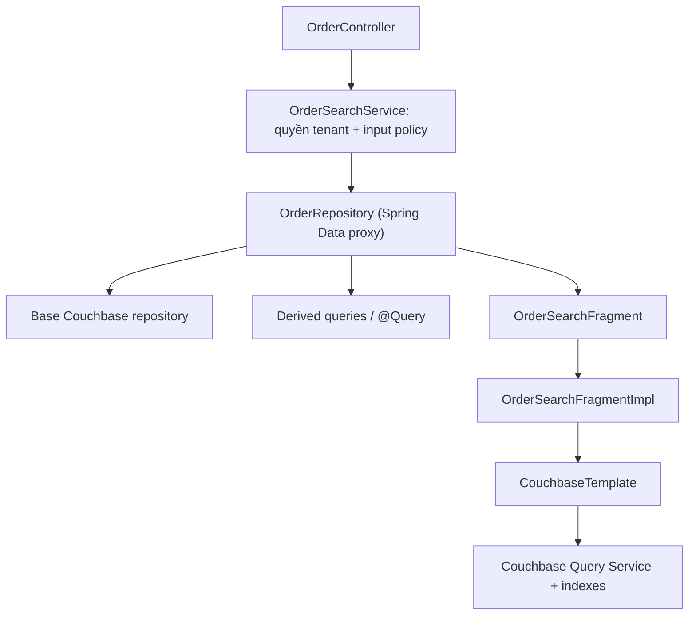

# Repository fragment và cài đặt truy vấn tùy chỉnh bằng Template

## 1. Khi các phương thức repository có sẵn không còn đủ

Giả sử ứng dụng bán hàng lưu đơn hàng trong Couchbase và có endpoint:

```http
GET /api/orders?status=PAID&customerId=C-42&from=1790000000000&page=0&size=20
```

Ở giai đoạn đầu, repository có thể chỉ cần:

```java
List<OrderDocument> findByTenantIdAndStatus(
        String tenantId, String status);
```

Nhưng sau đó màn hình tìm kiếm cho phép chọn nhiều trạng thái, khách hàng, tổng tiền tối thiểu, khoảng thời gian, sắp xếp và phân trang. Nếu tạo riêng một phương thức `findByTenantIdAndStatusAndCustomerIdAnd...` cho từng tổ hợp, số tên phương thức sẽ bùng nổ. Đặt truy vấn SQL++ hoặc `CouchbaseTemplate` vào Controller thì lại làm tầng HTTP phụ thuộc storage.

**Repository fragment** giải quyết khoảng trống đó: mở rộng một Spring Data repository bằng các phương thức và phần triển khai tùy chỉnh, **không thay thế** những thao tác CRUD, derived query và query method vốn có.

Bài này thuộc chương **Thiết kế ứng dụng** của module **SPRING_DATA_COUCHBASE**. Phạm vi module bao gồm document mapping, repository, `CouchbaseTemplate`, SQL++, thiết kế bucket/scope/collection, secondary index, TTL, CAS, giao dịch và lựa chọn API reactive. Ở đây ta tập trung vào cách đặt truy vấn linh hoạt đúng **ranh giới persistence**, giữ quyền tenant, tính nhất quán và khả năng kiểm thử.

**Sau bài học, bạn có thể:**

1. Phân biệt repository fragment với derived query, `@Query`, custom base repository và service.
2. Khai báo interface fragment, implementation theo hậu tố `Impl`, và ghép fragment vào `CouchbaseRepository`.
3. Dùng `CouchbaseTemplate`, `Query`, `QueryCriteria` để xây truy vấn động từ bộ lọc đã xác thực.
4. Thực hiện `Page` gồm truy vấn lấy dữ liệu và truy vấn `count` có cùng điều kiện.
5. Tránh rò dữ liệu nhiều tenant, sort/offset tùy tiện, query mutable dùng chung và sai lệch mapping `@Field`.
6. Thiết kế fragment reactive, kiểm thử repository composition và phân tích hiệu năng SQL++.

> **Lưu ý phiên bản:** ví dụ hướng tới Java 17+, Spring Data Couchbase 5.x/6.x và Java SDK 3.x. Các API `Query`, `QueryCriteria`, `findByQuery` và cơ chế fragment được kiểm chứng từ tài liệu Spring Data; khi đưa vào dự án phải khóa BOM phiên bản tương thích và kiểm thử với Couchbase Server thật. Những code block ở các package khác nhau cần đặt thành file Java riêng.

## 2. Repository fragment nằm ở đâu trong kiến trúc?

Một Spring Data repository thực tế là **composition** của nhiều chức năng:

- **Base repository:** `save`, `findById`, `deleteById`, v.v.
- **Query methods:** derived query từ tên phương thức hoặc `@Query`.
- **Aspects:** các phần mở rộng do module hỗ trợ, chẳng hạn Querydsl khi phiên bản và cấu hình cho phép.
- **Custom fragments:** các interface và implementation do dự án định nghĩa.



Fragment **không phải một repository độc lập** mà application phải tự ghép bằng `new`. Spring Data nhận diện fragment khi repository kế thừa interface và tìm implementation theo quy ước cấu hình. Phần implementation là một Spring bean bình thường nên có thể dùng constructor injection cho `CouchbaseTemplate` và các dependency khác.

### 2.1. Chọn kỹ thuật nào?

| Nhu cầu | Cách triển khai thường phù hợp | Điểm cần lưu ý |
| --- | --- | --- |
| CRUD theo document ID | `CouchbaseRepository` | Đi đường KV khi biết key; kiểm tra authorization |
| Tìm theo 2–3 thuộc tính cố định | Derived repository | Tên phương thức ngắn, dễ đọc |
| SQL++ ổn định, có `ANY`, aggregation hoặc projection | Repository `@Query` hoặc adapter SDK | Phải bind tham số và dùng đúng tên JSON |
| Bộ lọc tùy chọn có nhiều tổ hợp | **Fragment + `CouchbaseTemplate`** | Tạo criteria/query mới mỗi request |
| Nhiều repository cùng cần một hành vi tùy chỉnh | Fragment có thiết kế tái sử dụng | Xem generic domain type, naming, metadata |
| Thay đổi cách thực hiện **mọi** repository trong module | Custom base repository / repository factory | Độ phức tạp cao; không nên dùng cho một màn hình |
| Ranh giới domain độc lập Spring Data | Application port + Couchbase adapter | Có thể dùng fragment **bên trong** adapter |

**Không có API nào tự động nhanh nhất.** Derived query, fragment Template và `@Query` đều có thể tạo SQL++ tới Query Service. Hiệu năng đến từ câu SQL++ cuối, secondary index, phép sort, projection, scan consistency, kích thước dataset và phân bố tenant.

## 3. Bài toán xuyên suốt: tìm đơn hàng động và an toàn

Giả sử bucket `shop`, scope `sales`, collection `orders` có document:

```json
{
  "tenant_id": "store-01",
  "customer_id": "customer-42",
  "status": "PAID",
  "total": 250000,
  "created_at_ms": 1792992000000,
  "sort_key": "order::store-01::71af"
}
```

Để minh họa `@Field` alias, entity dùng tên Java khác JSON:

```java
package com.example.shop.orders.persistence;

import java.math.BigDecimal;
import org.springframework.data.annotation.Id;
import org.springframework.data.annotation.Version;
import org.springframework.data.couchbase.core.mapping.Document;
import org.springframework.data.couchbase.core.mapping.Field;
import org.springframework.data.couchbase.core.mapping.Scope;
import org.springframework.data.couchbase.core.mapping.Collection;

@Document
@Scope("sales")
@Collection("orders")
public class OrderDocument {
    @Id
    private String id;

    @Field("tenant_id")
    private String tenantId;

    @Field("customer_id")
    private String customerId;

    private String status;
    private BigDecimal total;

    @Field("created_at_ms")
    private Long createdAtMillis;

    @Field("sort_key")
    private String sortKey;

    @Version
    private Long version;

    public OrderDocument() {}

    // Constructor/getters/setters cần thiết được lược bỏ.
}
```

`sortKey` là **giá trị lưu trữ duy nhất và bất biến** được gán khi tạo đơn, thường có thể trùng document key. Nó làm khóa sort phụ khi nhiều đơn cùng `createdAtMillis`. Không mặc định `Sort.by("id")` luôn có nghĩa `META().id` trên mọi đường truy vấn/phiên bản; một field `sort_key` rõ ràng giúp ví dụ ít phụ thuộc cách converter xử lý `@Id`.

### 3.1. Hợp đồng tìm kiếm

| Field | Bắt buộc? | Quy tắc trong bài |
| --- | --- | --- |
| Tenant | **Có** | Lấy từ principal đã xác thực và được ủy quyền, **không nhận từ query parameter** |
| `customerId` | Không | `null` = không lọc; chuỗi trắng = lỗi |
| `statuses` | Không | `null` = không lọc; tập rỗng `[]` = lỗi; phần tử không trong whitelist = lỗi |
| `minTotal` | Không | `null` = không lọc; `0` hợp lệ; số âm = lỗi |
| `fromInclusive` | Không | Epoch milliseconds, lọc `createdAtMillis >= from` |
| `beforeExclusive` | Không | Epoch milliseconds, lọc `createdAtMillis < before` |
| `page`, `size` | Có giá trị mặc định | `page >= 0`; `1 <= size <= 100`; không cho offset quá sâu |
| Sắp xếp | Server quyết định | `createdAtMillis DESC, sortKey DESC` |

Điều kiện tenant được áp dụng **trên tất cả các nhánh**; nếu sau này thêm `OR`, phải nhóm rõ biểu thức tùy chọn sau `tenant = ... AND (...)`.

### 3.2. Một kiểu filter dành cho application, không phải HTTP DTO

```java
package com.example.shop.orders.application;

import java.math.BigDecimal;
import java.util.Set;

public record OrderSearchFilter(
        String customerId,
        Set<String> statuses,
        BigDecimal minTotal,
        Long fromInclusive,
        Long beforeExclusive
) {
    public OrderSearchFilter {
        // Snapshot; Set.copyOf cũng từ chối phần tử null.
        statuses = statuses == null ? null : Set.copyOf(statuses);
    }
}
```

`OrderSearchFilter` có thể được tạo từ query parameter bằng API mapper, nhưng **không** gắn `@RequestParam` hoặc `@Field` lên kiểu này. Service chịu trách nhiệm quyền truy cập và chọn chính sách pagination. Fragment là một phần tầng persistence, không phải nơi đọc cookie/JWT.

## 4. Bước 1 — Khai báo fragment interface

Chỉ khai báo một khả năng truy vấn chuyên biệt:

```java
package com.example.shop.orders.persistence;

import com.example.shop.orders.application.OrderSearchFilter;
import org.springframework.data.domain.Page;
import org.springframework.data.domain.Pageable;

public interface OrderSearchFragment {
    Page<OrderDocument> searchForTenant(
            String trustedTenantId,
            OrderSearchFilter filter,
            Pageable pageable);
}
```

Đặt tên theo **khả năng được bổ sung** — `OrderSearchFragment` — thay vì tên “repository triển khai tất cả”. Interface chỉ công bố contract cho người sử dụng repository; nó không tự chứa SQL++ hay `CouchbaseTemplate`.

### 4.1. Repository chính mở rộng cả base và fragment

```java
package com.example.shop.orders.persistence;

import org.springframework.data.couchbase.repository.CouchbaseRepository;
import java.util.List;

public interface OrderRepository
        extends CouchbaseRepository<OrderDocument, String>,
                OrderSearchFragment {

    // Truy vấn đơn giản vẫn khai báo như bình thường.
    List<OrderDocument> findByTenantIdAndStatus(
            String trustedTenantId, String status);
}
```

Service chỉ cần inject `OrderRepository`, gọi cả `findById`, `save`, derived query và `searchForTenant`:

```java
Page<OrderDocument> found =
        orderRepository.searchForTenant(
                trustedTenantId, filter, pageable);
```

**Không phải tạo một `OrderRepositoryImpl` mới rồi viết lại mọi CRUD.** Phần implementation của fragment sẽ được Spring Data ghép vào repository proxy.

### 4.2. Tên implementation và vị trí file

```text
com.example.shop.orders.persistence
├── OrderDocument.java
├── OrderRepository.java
├── OrderSearchFragment.java
└── OrderSearchFragmentImpl.java   <-- khớp tên FRAGMENT + Impl
```

Theo Spring Data, tên mặc định được tìm là **`OrderSearchFragmentImpl`**, tức *tên interface fragment + hậu tố `Impl`*, không phải `OrderRepositoryImpl`. Tên `OrderRepositoryImpl` là mẫu “một custom implementation gắn với repository” theo cơ chế cũ, hiện được Spring Data coi là **không còn được khuyến nghị** vì dễ gây nhập nhằng/va chạm tên.

Implementation nên nằm trong vùng package mà repository scanning nhìn thấy. Nếu đặt implementation ở một package ngoài phạm vi được quét hoặc trong module thư viện riêng, cần cấu hình/discovery theo tài liệu Spring Data, không giả định Spring sẽ tự tìm mọi class trong classpath.

## 5. Bước 2 — Viết implementation dùng `CouchbaseTemplate`

### 5.1. Fragment có thể là bean inject Template

```java
package com.example.shop.orders.persistence;

import com.example.shop.orders.application.OrderSearchFilter;
import java.math.BigDecimal;
import java.util.List;
import java.util.Set;
import org.springframework.data.couchbase.core.CouchbaseTemplate;
import org.springframework.data.couchbase.core.query.Query;
import org.springframework.data.couchbase.core.query.QueryCriteria;
import org.springframework.data.domain.Page;
import org.springframework.data.domain.PageImpl;
import org.springframework.data.domain.PageRequest;
import org.springframework.data.domain.Pageable;
import org.springframework.data.domain.Sort;
import org.springframework.stereotype.Component;

@Component
public class OrderSearchFragmentImpl implements OrderSearchFragment {

    private static final Set<String> VALID_STATUSES =
            Set.of("NEW", "PAID", "SHIPPED", "CANCELLED");

    private static final Sort STABLE_SORT = Sort.by(
            Sort.Order.desc("createdAtMillis"),
            Sort.Order.desc("sortKey"));

    private final CouchbaseTemplate template;

    public OrderSearchFragmentImpl(CouchbaseTemplate template) {
        this.template = template;
    }

    @Override
    public Page<OrderDocument> searchForTenant(
            String trustedTenantId,
            OrderSearchFilter filter,
            Pageable pageable) {

        validate(trustedTenantId, filter, pageable);

        // Không để client tự chọn trường Sort hoặc kích thước quá lớn.
        Pageable safePageable = PageRequest.of(
                pageable.getPageNumber(),
                pageable.getPageSize(),
                STABLE_SORT);

        // Hai Query khác nhau, cùng logic bộ lọc.
        Query pageQuery = newFilterQuery(trustedTenantId, filter)
                .with(safePageable);
        Query countQuery = newFilterQuery(trustedTenantId, filter);

        List<OrderDocument> content = template
                .findByQuery(OrderDocument.class)
                .matching(pageQuery)
                .all();

        long total = template
                .findByQuery(OrderDocument.class)
                .matching(countQuery)
                .count();

        return new PageImpl<>(content, safePageable, total);
    }

    private static Query newFilterQuery(
            String tenantId, OrderSearchFilter filter) {

        // Property Java; mapping JSON cần integration test.
        Query query = Query.query(
                QueryCriteria.where("tenantId").is(tenantId));

        if (filter.customerId() != null) {
            query.addCriteria(QueryCriteria.where("customerId")
                    .is(filter.customerId().trim()));
        }
        if (filter.statuses() != null) {
            query.addCriteria(QueryCriteria.where("status")
                    .in(filter.statuses().toArray(String[]::new)));
        }
        if (filter.minTotal() != null) {
            query.addCriteria(QueryCriteria.where("total")
                    .gte(filter.minTotal()));
        }
        if (filter.fromInclusive() != null) {
            query.addCriteria(
                    QueryCriteria.where("createdAtMillis")
                            .gte(filter.fromInclusive()));
        }
        if (filter.beforeExclusive() != null) {
            query.addCriteria(
                    QueryCriteria.where("createdAtMillis")
                            .lt(filter.beforeExclusive()));
        }
        return query;
    }

    private static void validate(
            String tenantId,
            OrderSearchFilter filter,
            Pageable pageable) {

        if (tenantId == null || tenantId.isBlank()
                || filter == null || pageable == null
                || pageable.isUnpaged()) {
            throw new IllegalArgumentException(
                    "Tenant/filter/pageable không hợp lệ");
        }
        if (pageable.getPageNumber() < 0
                || pageable.getPageSize() < 1
                || pageable.getPageSize() > 100
                || pageable.getOffset() > 10_000L) {
            throw new IllegalArgumentException("Giới hạn trang không hợp lệ");
        }
        if (filter.customerId() != null
                && filter.customerId().isBlank()) {
            throw new IllegalArgumentException("customerId rỗng");
        }
        if (filter.statuses() != null
                && (filter.statuses().isEmpty()
                    || !VALID_STATUSES.containsAll(filter.statuses()))) {
            throw new IllegalArgumentException("statuses không hợp lệ");
        }
        if (filter.minTotal() != null
                && filter.minTotal().compareTo(BigDecimal.ZERO) < 0) {
            throw new IllegalArgumentException("minTotal âm");
        }
        if (filter.fromInclusive() != null
                && filter.beforeExclusive() != null
                && filter.fromInclusive() >= filter.beforeExclusive()) {
            throw new IllegalArgumentException("Khoảng ngày không hợp lệ");
        }
    }
}
```

Tác giả cố tình không giữ `Query` hoặc `QueryCriteria` trong field của singleton fragment: chúng được tạo **mới theo từng lần gọi**. `CouchbaseTemplate` là dependency có thể inject và tái sử dụng; đối tượng query chứa bộ lọc của từng request thì không nên dùng chung.

### 5.2. Giải thích từng quyết định

1. **`OrderSearchFragmentImpl` implements `OrderSearchFragment`**: repository factory nhận diện nó theo tên và package khi quét, rồi ghép phương thức `searchForTenant` vào `OrderRepository`.
2. **`CouchbaseTemplate.findByQuery(OrderDocument.class)`**: template biết entity type để chạy SQL++ và dùng Spring Data converter tạo `OrderDocument`; không phải `JsonObject` SDK raw.
3. **`Query.query(QueryCriteria.where(...))`** khởi đầu bằng điều kiện tenant bắt buộc; các filter tùy chọn chỉ được thêm nếu thực sự có.
4. **`.matching(pageQuery).all()`** trả `List<OrderDocument>`; **`.matching(countQuery).count()`** trả `long`. Hai phương thức nằm trong fluent Template query API của Spring Data Couchbase.
5. **`PageImpl`** kết hợp content, `safePageable` và count để trả `Page`. `Page` cung cấp total elements/pages; nó có chi phí query đếm và không nhất thiết cần cho API chỉ muốn “có trang tiếp theo không”.
6. **`safePageable`** buộc sort theo hai khóa ổn định, ngăn client tạo biểu thức sort tùy ý và tránh `ORDER BY` không đầy đủ khi nhiều document cùng timestamp.
7. **`fromInclusive`/`beforeExclusive`** dùng khoảng nửa mở `[from,before)`, giúp phân chia các khoảng thời gian liên tiếp không bị trùng mốc biên.
8. **`statuses=[]` bị từ chối**, không âm thầm bỏ điều kiện để trả mọi trạng thái; `minTotal=0` vẫn thêm `>= 0` vì `null` mới nghĩa là “không lọc”.

**Một chi tiết mang tính thiết kế:** interface fragment không bắt buộc phải trả `Page<OrderDocument>`. Với kiến trúc phân tách domain/storage nghiêm ngặt, có thể trả `OrderSummary` hoặc một page model của application thông qua adapter. Bài dùng `Page<OrderDocument>` để minh họa rõ cách **Spring Data composition** hoạt động.

## 6. Bước 3 — Service kiểm soát phân quyền, đầu vào và kết quả trả về

Fragment nằm ở tầng repository, không phải đối tượng tự đọc security context. Một service cần giải quyết:

- Lấy tenant từ principal/session đáng tin cậy và kiểm tra quyền truy cập phạm vi này.
- Chuyển filter HTTP thành `OrderSearchFilter` của application; không cho client tự ghép SQL++.
- Giới hạn trang/sort, xác định hành vi filter vắng mặt, tập rỗng hoặc giá trị ngoài domain.
- Quyết định quyền xem đơn của từng khách hàng nếu một tenant có nhiều người dùng với quyền khác nhau.
- Ánh xạ `OrderDocument` thành response/read model được phép công khai; không trả raw entity/CAS hoặc `_class`.

Ví dụ service tối giản:

```java
package com.example.shop.orders.application;

import com.example.shop.orders.persistence.OrderDocument;
import com.example.shop.orders.persistence.OrderRepository;
import org.springframework.data.domain.Page;
import org.springframework.data.domain.PageRequest;
import org.springframework.stereotype.Service;

@Service
public class OrderSearchService {
    private final OrderRepository repository;
    private final OrderAccessPolicy access;

    public OrderSearchService(
            OrderRepository repository, OrderAccessPolicy access) {
        this.repository = repository;
        this.access = access;
    }

    public Page<OrderDocument> search(
            String trustedTenantId, OrderSearchFilter filter,
            int page, int size) {
        access.assertMaySearchTenant(trustedTenantId);
        if (page < 0 || size < 1 || size > 100) {
            throw new IllegalArgumentException("Trang không hợp lệ");
        }
        return repository.searchForTenant(
                trustedTenantId, filter, PageRequest.of(page, size));
    }
}
```

`OrderAccessPolicy` là interface của ứng dụng có phương thức `assertMaySearchTenant`; phải triển khai qua identity/authorization context. Nếu quyền truy cập của người dùng còn giới hạn theo **nhóm khách hàng/đơn hàng**, service cần truyền các giới hạn đó thành **predicate bắt buộc** hoặc trả lỗi: không thể chỉ dùng tenant và hy vọng API mapper sẽ lọc kết quả sau khi truy vấn.

**Lọc quyền sau pagination là không đủ.** Ví dụ query lấy 20 đơn cả tenant rồi service bỏ 15 đơn người dùng không được xem sẽ tạo trang sai, count rò thông tin và gây phân trang không ổn định. Điều kiện security cần xuất hiện **trước `LIMIT`/count** ở đường truy vấn hoặc dùng store method có phạm vi quyền rõ ràng.

### 6.1. Không gắn annotation HTTP vào fragment

Không làm:

```java
public interface OrderSearchFragment {
    Page<OrderDocument> search(
            @RequestParam String tenantId,
            @RequestParam String status,
            Pageable pageable);
}
```

Fragment là abstraction truy cập dữ liệu, không phải Controller. `@RequestParam` thuộc HTTP adapter, còn `tenantId` phải được xác nhận từ identity trước khi đi vào tầng dữ liệu. Một scheduler/job nội bộ cũng có thể dùng fragment nếu có ngữ cảnh quyền hợp lệ, không cần giả lập HTTP request.

### 6.2. Đưa dữ liệu ra DTO thay vì entity

Ví dụ response:

```java
public record OrderSummaryResponse(
        String id,
        String status,
        java.math.BigDecimal total,
        java.time.Instant createdAt
) {}
```

API mapper chọn các trường:

```java
public OrderSummaryResponse toSummary(OrderDocument doc) {
    return new OrderSummaryResponse(
            doc.getId(),
            doc.getStatus(),
            doc.getTotal(),
            java.time.Instant.ofEpochMilli(doc.getCreatedAtMillis()));
}
```

Một system lớn có thể chuyển từ entity `OrderDocument` sang `OrderSummary` ở adapter, rồi API mapper chuyển thành DTO. Mục tiêu là không để `OrderDocument.version`, `tenantId`, schema metadata và field nội bộ tự lộ ra JSON chỉ vì entity có getter.

## 7. Cơ chế fragment: tên, quét bean, độ ưu tiên và mở rộng

### 7.1. Tại sao `OrderSearchFragmentImpl` được tìm thấy?

Theo cơ chế **Spring Data repository composition**:

1. `OrderRepository` kế thừa `OrderSearchFragment`.
2. Repository infrastructure tạo một proxy cho `OrderRepository`.
3. Hệ thống tìm custom fragment implementation theo interface, trong vùng được repository scan, với hậu tố mặc định `Impl`.
4. Nó ghép fragment implementation vào composition, song song với base CRUD/query aspects.
5. Lời gọi `orderRepository.searchForTenant(...)` được chuyển tới implementation tương ứng.

Mẫu chuẩn:

```text
OrderSearchFragment.java
  public interface OrderSearchFragment

OrderSearchFragmentImpl.java
  public class OrderSearchFragmentImpl implements OrderSearchFragment

OrderRepository.java
  interface OrderRepository
      extends CouchbaseRepository<OrderDocument, String>,
              OrderSearchFragment
```

Đây là **fragment-based programming model** được tài liệu Spring Data khuyến nghị. Không nên dùng `OrderRepositoryImpl` theo mẫu custom implementation duy nhất gắn với tên repository nếu không có lý do tương thích code cũ.

### 7.2. Hậu tố `Impl` có thể cấu hình

Nếu dự án không dùng hậu tố mặc định, annotation cấu hình repository có thể chỉ định:

```java
import org.springframework.context.annotation.Configuration;
import org.springframework.data.couchbase.repository.config.EnableCouchbaseRepositories;

@Configuration
@EnableCouchbaseRepositories(
        basePackages = "com.example.shop.orders.persistence",
        repositoryImplementationPostfix = "Custom")
class RepositoryConfiguration {
}
```

Khi đó implementation phải được tìm dưới tên `OrderSearchFragmentCustom` thay vì `OrderSearchFragmentImpl`. **Đừng thêm cấu hình này chỉ để tạo một fragment**: nếu giữ hậu tố mặc định, không cần sửa cấu hình repository.

Nếu bật `@EnableCouchbaseRepositories` thủ công trong Spring Boot, phải kiểm tra phạm vi quét và tránh vô tình tạo repository factory trùng hoặc bỏ sót những repository khác. Trong đa module/multi-tenant cluster, cấu hình bean/template còn cần nhất quán với keyspace và `CouchbaseClientFactory` được lựa chọn.

### 7.3. Một repository có thể có nhiều fragment

```java
public interface OrderReportFragment {
    java.util.Map<String, Long> countByStatusForTenant(
            String trustedTenantId);
}

public interface OrderRepository
        extends CouchbaseRepository<OrderDocument, String>,
                OrderSearchFragment,
                OrderReportFragment {
}
```

Implementation tương ứng là `OrderReportFragmentImpl`. Thứ tự kế thừa fragment quan trọng **nếu các fragment trùng signature**; custom fragments có độ ưu tiên cao hơn base repository/aspects và Spring Data dùng thứ tự composition để giải quyết ambiguity. Đừng cố override `save`/ `delete` vô ý, nhất là khi chúng mang logic CAS, audit hoặc TTL.

### 7.4. Những tên dễ gây lỗi

| Tên/kết cấu | Hậu quả | Cách xử lý |
| --- | --- | --- |
| `OrderRepositoryImpl` thay vì `OrderSearchFragmentImpl` | Có thể rơi vào cơ chế legacy hoặc không bind như mong muốn | Đặt tên theo **fragment interface** |
| Interface fragment chưa được `OrderRepository extends` | Repository không có method fragment | Thêm interface vào danh sách extends |
| `OrderSearchFragmentImple` (sai hậu tố) | Method có thể bị diễn giải như query method, khởi tạo repository lỗi | Dùng đúng `Impl` hoặc hậu tố đã cấu hình |
| Implementation ở package không được quét | Spring Data không tìm thấy bean fragment | Đặt trong phạm vi scan hoặc wiring/documented registration |
| Có hai bean implementation cùng tên quy ước | Ambiguous lookup | Đặt bean name/qualifier rõ và kiểm soát wiring |
| Implementation inject chính `OrderRepository` | Dễ tạo vòng phụ thuộc, khó dự đoán behavior | Inject `CouchbaseTemplate` hoặc port thích hợp |
| Dùng `@NoRepositoryBean` nhầm cho `OrderRepository` cuối | Repository cụ thể không được tạo | Chỉ dùng annotation đó cho base interface không được instantiate |

### 7.5. Không inject lại repository vào chính fragment

Anti-pattern:

```java
@Component
class OrderSearchFragmentImpl implements OrderSearchFragment {
    private final OrderRepository orderRepository; // Tránh!
    // ...
}
```

Lúc Spring tạo proxy repository, nó lại cần fragment; fragment lại yêu cầu repository, tạo nguy cơ circular dependency. Fragment đã được đặt để **làm việc ở tầng thấp hơn**; dùng `CouchbaseTemplate`, SDK hoặc một data access dependency khác. Nếu cần một thao tác repository nền tảng, cân nhắc service orchestration hoặc thiết kế port/adapter cho rõ, không tạo vòng gọi proxy.

## 8. Mapping entity, type discriminator và chọn đúng keyspace

Khi dùng `CouchbaseTemplate` trong fragment, phải nhớ nó là tầng mapping của Spring Data, **không phải raw Couchbase SDK**.

| Lớp biểu diễn | Dùng tên nào? |
| --- | --- |
| Property Java và derived method | `tenantId`, `customerId`, `createdAtMillis` |
| `QueryCriteria.where(...)` của ví dụ | Property Java; cần xác minh converter theo version |
| SQL++ `@Query` tự viết | `tenant_id`, `customer_id`, `created_at_ms` |
| SQL++ SDK trực tiếp | Tên JSON thực tế và `META(o).id` khi cần key |
| API response | Theo hợp đồng HTTP: `customerId`, `createdAt` |

### 8.1. Một SQL++ tương ứng để soi behavior

Ví dụ khi filter tenant = `store-01`, status = `PAID`, thời gian từ `1790000000000`, SQL++ tương đương về nghiệp vụ là:

```sql
SELECT META(o).id AS documentId,
       o.tenant_id, o.customer_id, o.status,
       o.total, o.created_at_ms, o.sort_key
FROM `shop`.`sales`.`orders` AS o
WHERE o.tenant_id = $tenantId
  AND o.status = $status
  AND o.created_at_ms >= $fromMillis
ORDER BY o.created_at_ms DESC, o.sort_key DESC
LIMIT $limit OFFSET $offset;
```

Đây là **SQL++ minh họa semantics**, không phải cam kết SQL++ **y hệt** do `CouchbaseTemplate` phát sinh: Spring Data có thể thêm metadata để dựng entity, type discriminator, alias và cấu trúc SELECT/WHERE khác. Hãy quan sát **query thực tế** trong integration test và đối chiếu tên JSON, phạm vi tenant, type filter và index.

### 8.2. Raw fixture có thể bị lọc vì type metadata

Spring Data có thể lưu type discriminator như `_class` để phân biệt các entity chia sẻ cùng collection. Khi tạo fixture trực tiếp bằng SDK, nếu quên metadata mà converter/repository chờ đợi, query qua Template có thể trả khác truy vấn SQL++ raw.

Quy trình test nên có:

1. Ghi một fixture bằng Spring Data repository, đọc body qua KV để xem `_class`/field thực tế.
2. Ghi fixture JSON có kiểm soát, chứa đúng type alias hoặc xác định chính sách mapping không dùng discriminator.
3. Chạy repository fragment và raw SQL++ so sánh các **document ID**.
4. Phân biệt lỗi type filter với lỗi điều kiện tenant hoặc secondary index.

**`_class`/type filter không thay thế authorization tenant.** Loại entity đúng vẫn có thể thuộc tenant khác.

### 8.3. `@Scope` và `@Collection` không phải filter tenant

`@Scope("sales")` và `@Collection("orders")` chỉ định nơi chứa entity theo cấu hình mapping. Nhiều tenant có thể cùng ở collection `orders`, nên phải lọc tenant trong query.

Một cách làm sai:

```java
// Không nhận bucket/scope/collection tùy ý từ HTTP request.
String collectionFromClient = request.getParameter("collection");
```

Nếu hệ thống có nhiều Couchbase clusters hoặc templates, fragment phải inject **template tương ứng** với repository/đối tượng domain của nó. Dùng nhầm `CouchbaseTemplate` nối cluster khác có thể tạo truy vấn đúng syntax nhưng sai dữ liệu hoặc vi phạm ranh giới tenant.

### 8.4. Tên field đổi cần migration, không chỉ đổi annotation

Đổi `@Field("customer_id")` thành `@Field("buyer_id")` khiến code mới trỏ vào key khác; dữ liệu lịch sử, SQL++ tùy chỉnh và index không tự di trú. Fragment thường là **nơi chịu ảnh hưởng**, nên hãy có test mapping V1/V2 và kế hoạch expand/migrate/contract.

Repository fragment không nên che lỗi schema bằng việc im lặng bỏ qua tất cả điều kiện customer; nếu field thiếu ở document cũ, xác định rõ `MISSING`/`NULL`/fallback policy và xử lý migration có kiểm soát.

## 9. Phân trang, đếm và giới hạn dữ liệu

### 9.1. Vì sao phải dựng hai `Query`?

Một `Query` sau khi gọi `.with(pageable)` thường mang:

```text
filter: tenant + các điều kiện tùy chọn
ORDER BY: createdAtMillis DESC, sortKey DESC
OFFSET: page * size
LIMIT: size
```

Trong khi `count` cần đếm **toàn bộ** tập thỏa filter:

```text
filter: tenant + các điều kiện tùy chọn
ORDER BY: không cần
OFFSET: không có
LIMIT: không có
```

Nếu tái sử dụng chính instance `Query` đã phân trang cho count, semantics có thể bị sai hoặc phụ thuộc cách framework tối ưu. Hai lời gọi `newFilterQuery(...)` đảm bảo cùng điều kiện, nhưng trạng thái truy vấn độc lập.

**Không lưu `Query` trong bean field:** việc thêm criteria/limit/sort là có tính chất thay đổi object. Fragment `@Component` là singleton, nhiều request có thể chạy đồng thời; rò điều kiện giữa request là lỗi dữ liệu và bảo mật nghiêm trọng.

### 9.2. `Page` có chi phí; đôi khi `Slice` là đủ

`Page<OrderDocument>` có `getTotalElements()` và `getTotalPages()`, vì vậy cần count (trong ví dụ ta gọi count chủ động). Nếu UI chỉ có nút “Xem thêm”, không cần toàn bộ tổng số:

- Lấy tối đa `size + 1` phần tử.
- Nếu có phần tử thứ `size + 1`, `hasNext = true`.
- Trả tối đa `size` phần tử cho UI.
- Không chạy count trong luồng request này.

Cần kiểm tra phạm vi offset và sort khi triển khai logic `Slice`; đừng đặt `size+1` vượt trần giới hạn query của hệ thống. Nếu cần khoảng nhiều triệu dòng, **keyset/cursor pagination** thường hợp lý hơn offset sâu.

### 9.3. Một cách hình thành `Slice` riêng

```java
import java.util.ArrayList;
import java.util.List;
import org.springframework.data.domain.Slice;
import org.springframework.data.domain.SliceImpl;

public Slice<OrderDocument> searchSlice(
        String tenantId, OrderSearchFilter filter, Pageable pageable) {

    validate(tenantId, filter, pageable);
    Pageable safePageable = PageRequest.of(
            pageable.getPageNumber(), pageable.getPageSize(), STABLE_SORT);
    Query query = newFilterQuery(tenantId, filter)
            .with(safePageable);
    query.limit(safePageable.getPageSize() + 1);

    List<OrderDocument> received = template
            .findByQuery(OrderDocument.class)
            .matching(query)
            .all();
    boolean hasNext = received.size() > safePageable.getPageSize();
    List<OrderDocument> content = hasNext
            ? new ArrayList<>(
                    received.subList(0, safePageable.getPageSize()))
            : received;
    return new SliceImpl<>(content, safePageable, hasNext);
}
```

Phương thức này là **ví dụ mở rộng** trong `OrderSearchFragmentImpl` (nếu dùng, phải khai báo thêm trong interface fragment và cân nhắc giới hạn size+1). Nên tạo query từ factory trong mỗi lời gọi; **không mutate `Pageable` shared**. Để phương thức không bị nhầm với một derived query mới, khai báo nó rõ ràng ở fragment interface.

### 9.4. `Page` không phải snapshot trong lúc có ghi

Hai lần thực thi `pageQuery` và `countQuery` không tự nằm trong một transaction/snapshot chung. Nếu document được tạo, xóa hoặc đổi trạng thái giữa chúng:

- `content.size()` có thể không tương ứng với `totalElements` tại cùng một thời điểm.
- Tính `hasNext` có thể thay đổi giữa request trang 1 và trang 2.
- Sort phụ giúp cố định thứ tự **trên một tập dữ liệu ổn định**, không ngăn insert/delete giữa các request.

Nếu use case đòi snapshot hoặc read-your-writes nghiêm ngặt, phải thiết kế rõ transaction/consistency/versioned read model. Không gán mặc định rằng `PageImpl` đồng nghĩa dữ liệu được chụp tức thời.

## 10. Secondary index và hiệu năng của truy vấn fragment

`findByQuery(...)` dùng Query Service/SQL++ thay vì tự động tận dụng KV Get. Điều kiện `tenantId`, `status`, `customerId`, `createdAtMillis` và `ORDER BY` cần **secondary index phù hợp với câu query thật**.

### 10.1. Hai shape query nên được quan sát riêng

Khi lọc tenant + một status:

```sql
EXPLAIN SELECT o.tenant_id, o.status,
               o.created_at_ms, o.sort_key
FROM `shop`.`sales`.`orders` AS o
WHERE o.tenant_id = "store-01"
  AND o.status = "PAID"
ORDER BY o.created_at_ms DESC, o.sort_key DESC
LIMIT 20 OFFSET 0;
```

Một index thử nghiệm:

```sql
CREATE INDEX ix_orders_tenant_status_time
ON `shop`.`sales`.`orders`(
    tenant_id, status, created_at_ms DESC, sort_key DESC
);
```

Khi chỉ có tenant, **không có status**, kế hoạch có thể cần index khác để tránh sort/scan quá nhiều:

```sql
CREATE INDEX ix_orders_tenant_time
ON `shop`.`sales`.`orders`(
    tenant_id, created_at_ms DESC, sort_key DESC
);
```

Hai index trên minh họa **các đường truy cập khác nhau**. Không nhất thiết phải triển khai cả hai trong production; quyết định dựa trên thống kê truy cập, chi phí ghi/index, phân bố trạng thái và `EXPLAIN` trên dữ liệu đại diện.

Nếu filter `customerId` xuất hiện thường xuyên và có tính chọn lọc cao, cần kiểm tra liệu index `tenant_id, customer_id, ...` hoặc query shape mới hiệu quả hơn. Một index tối ưu cho lọc status chưa chắc tối ưu khi status vắng mặt và customer có mặt. Tránh tạo index mới cho mọi tổ hợp filter một cách cơ học.

### 10.2. Index phải dùng tên JSON, không phải tên DTO

| Thuộc tính Java | Key JSON do `@Field` | Trong SQL++/index |
| --- | --- | --- |
| `tenantId` | `tenant_id` | `tenant_id` |
| `customerId` | `customer_id` | `customer_id` |
| `createdAtMillis` | `created_at_ms` | `created_at_ms` |
| `sortKey` | `sort_key` | `sort_key` |
| `status` | `status` | `status` |

Đổi alias `@Field` hoặc mapping nested document là thay đổi schema truy vấn. **Kiểm tra câu SQL++ cuối**, vì các biểu thức string-based trong QueryCriteria hay cú pháp SQL++ thủ công không phải lúc nào cũng được xử lý như người viết mong đợi. Một test với raw fixture V1 và V2 giúp phát hiện filter nhầm key, không chỉ kiểm tra code compile.

### 10.3. Projection có thể tiết kiệm nhiều hơn thay API

Nếu list API chỉ cần ID, status, total, thời gian, tải đủ `OrderDocument` với mảng `lineItems` lớn sẽ tốn network và chuyển đổi. Có thể thiết kế fragment trả `OrderSummary`:

```java
public record OrderSummary(
        String id,
        String status,
        java.math.BigDecimal total,
        java.time.Instant createdAt
) {}

public interface OrderSummaryFragment {
    org.springframework.data.domain.Page<OrderSummary> searchSummaries(
            String trustedTenantId,
            OrderSearchFilter filter,
            org.springframework.data.domain.Pageable pageable);
}
```

Khi triển khai, có thể dùng **projection API đã được hỗ trợ trong Spring Data version đang dùng** hoặc SDK SQL++ với `SELECT` các field cần thiết rồi map kết quả tường minh. Không assume `template.findByQuery(OrderDocument.class)` có thể trả mọi DTO tùy ý chỉ vì DTO có field trùng tên: kiểm tra cách `.project(...)`, `.as(...)` và converter xử lý constructor/metadata.

Tách read model khỏi entity cũng giúp REST API không vô tình lộ `tenantId`, `@Version` hay type discriminator.

### 10.4. Đọc `EXPLAIN` một cách có mục tiêu

Khi review một truy vấn fragment, ghi lại:

1. SQL++ thực tế, keyspace bucket/scope/collection và tập tham số đã che dữ liệu nhạy cảm.
2. Index được chọn, predicate được đẩy vào index scan, số document fetch.
3. Có bước sort lớn hay `ORDER BY` được index hỗ trợ?
4. Count query có thể dùng index hiệu quả không?
5. Offset sâu có làm server phải quét/bỏ qua quá nhiều kết quả không?
6. Chi phí của filter optional `OR`, `IN`, khoảng thời gian và truy vấn nested array.

Đừng tối ưu dựa trên cảm nhận rằng “Template chậm hơn repository”: cả hai có thể tạo SQL++ rất giống nhau. Cần đo p50/p95/p99, số index scans/fetch, độ lớn result và thời gian converter ở Java.

## 11. Scan consistency, TTL, CAS và giao dịch trong fragment

### 11.1. Read-after-write: vì sao truy vấn vừa ghi chưa thấy dữ liệu?

`OrderRepository.save(document)` hoặc `CouchbaseTemplate.insertById(...)` thường thao tác qua KV. Nhưng một query tìm theo status dùng **secondary index**, vốn có thể chưa bắt kịp mutation mới. Nếu test tạo đơn rồi lập tức search không thấy, đó **có thể là index lag**, không nhất thiết là fragment bind sai.

Spring Data `Query` có thể chọn consistency:

```java
import com.couchbase.client.java.query.QueryScanConsistency;

Query pageQuery = newFilterQuery(trustedTenantId, filter)
        .with(safePageable)
        .scanConsistency(QueryScanConsistency.REQUEST_PLUS);

Query countQuery = newFilterQuery(trustedTenantId, filter)
        .scanConsistency(QueryScanConsistency.REQUEST_PLUS);
```

`REQUEST_PLUS` yêu cầu index bắt kịp các mutation được xác nhận đến thời điểm query bắt đầu trước khi trả kết quả; đổi lại có thể tăng latency. **Không áp dụng mặc định cho mọi request** mà không cân nhắc SLA và tải. Trong cấu hình yêu cầu consistency theo mutation state, dùng API có hỗ trợ mutation token/consistentWith và kiểm thử cụ thể.

Lưu ý: hai query cùng `REQUEST_PLUS` vẫn thực hiện **ở hai thời điểm khác nhau**; không đảm bảo content/count cùng snapshot khi có ghi đồng thời.

### 11.2. TTL có thể làm page/count khác nhau

Couchbase hỗ trợ expiry cho document. Nếu một số đơn/reservation có TTL, chúng có thể hết hạn giữa truy vấn page và count, hoặc giữa hai HTTP requests. Fragment **không quyết định** một đơn phải tồn tại bao lâu; chính sách retention thuộc Service/domain và được áp dụng ở persistence write adapter.

Đừng coi query count khác content vì TTL là lỗi framework. Phải xác định hợp đồng của danh sách dữ liệu động: chấp nhận độ lệch tạm thời hay dùng một mô hình snapshot/versioned read để đáp ứng yêu cầu kiểm toán.

### 11.3. `@Version`/CAS thuộc đường ghi, không phải điều kiện filter

Fragment tìm kiếm chỉ đọc; `@Version` trên `OrderDocument` giúp Spring Data lưu metadata CAS để ghi có điều kiện về sau. Nếu Service đọc document từ fragment rồi thay status, nó **phải** kiểm tra quyền/state transition và để repository xử lý CAS. Không cập nhật trạng thái bằng một câu `UPDATE` SQL++ tùy ý chỉ vì fragment đang ở tầng query.

Ví dụ phân chia đúng:

```text
OrderSearchFragment.searchForTenant(...)
    → tìm document phù hợp và trả read model

OrderApplicationService.confirmPaid(orderId)
    → kiểm tra tenant và state machine
    → persistence save/update với CAS
    → xử lý optimistic locking conflict
```

Không dùng `version` từ API như bằng chứng quyền truy cập, và không cho mapper copy toàn bộ request vào entity để ghi đè CAS.

### 11.4. Transaction nhiều document không tự hình thành từ fragment

Spring Data Couchbase hỗ trợ transaction ở các API/configuration thích hợp, nhưng **một lời gọi `searchForTenant` không tự tạo transaction** hay snapshot trên toàn bộ Query Service. Nếu Service đặt `@Transactional`, cần xác minh transaction manager đúng, API template/repository nào thực sự tham gia transaction, giới hạn read consistency và cách callback retry trên phiên bản đang dùng.

Không mở transaction kéo dài chỉ để giữ nguyên các trang tìm kiếm giữa nhiều request người dùng. Khi thao tác nghiệp vụ cập nhật nhiều aggregate, thiết kế transaction/saga ở **Service/owner**, không đặt logic commit/rollback trong một fragment chuyên tìm kiếm.

## 12. Tái sử dụng fragment và giới hạn generic

Một fragment có thể được dùng chung nếu nhiều repository cần cùng hành vi. Tuy nhiên, không nên viết generic quá mức khiến nó phải tự suy đoán domain type, collection và metadata từ một class không liên quan.

### 12.1. Fragment được thiết kế theo năng lực

Ví dụ hai repository đều cần một số phép kiểm tra:

```java
public interface TenantScopedCountFragment {
    long countForTenant(String trustedTenantId);
}
```

Nó có thể có implementation `TenantScopedCountFragmentImpl` chuyên dùng cho một domain type, nhưng nếu dùng y nguyên ở `OrderRepository` và `InvoiceRepository`, **đếm loại entity nào**? Một `CouchbaseTemplate` luôn cần biết `Class<T>` và metadata/collection liên quan; chỉ dựa vào tên interface là không đủ.

Các phương án:

1. **Fragment riêng theo aggregate**, ví dụ `OrderSearchFragment` và `InvoiceSearchFragment`: rõ domain type, index, predicate và type filter.
2. **Generic fragment có factory/metadata được wiring tường minh**, ví dụ constructor nhận `Class<T>`/typed converter được chọn, tránh hardcode domain type sai.
3. **Application service chung trên nhiều port**, nếu mong muốn tái sử dụng business validation/query policy thay vì tái sử dụng chi tiết Spring Data.
4. **`spring.factories` fragment registration** khi đóng gói extension từ module thư viện ngoài repository package, theo hướng dẫn Spring Data hiện hành.

Không chọn generic vì “ít dòng code” nếu điều đó gây truy vấn sai collection hoặc khó bảo vệ tenant.

### 12.2. Khi cần một extension được đóng gói thành library

Spring Data có cơ chế đăng ký fragment qua `META-INF/spring.factories` cho implementation nằm ngoài vùng quét, nhất là một thư viện chia sẻ cho nhiều repository. Mẫu khai báo về mặt ý tưởng:

```properties
com.example.shared.SearchExtension=com.example.shared.DefaultSearchExtension
```

Đây là **mẫu cho extension được đóng gói**, không phải file bắt buộc của ví dụ `OrderSearchFragmentImpl`. Implement một generic extension đòi thiết kế cách lấy domain type, index name và repository metadata; tài liệu Spring Data còn có `RepositoryMethodContext`/metadata exposure với chi phí nhất định. Không bật metadata exposure cho toàn bộ repository nếu chỉ một chức năng cần.

### 12.3. Khi nào nên dùng một application port thay fragment?

Fragment vẫn đưa Spring Data types như `Page<OrderDocument>` lên service. Nếu domain cần tách hoàn toàn storage, hãy định nghĩa:

```java
// Tầng application:
public interface OrderSearchPort {
    OrderSearchPage search(
            AuthorizedOrderScope scope,
            OrderSearchFilter filter,
            PageRequestSpec pageRequest);
}
```

Trong đó `AuthorizedOrderScope`, `OrderSearchPage`, `PageRequestSpec` là kiểu application do dự án định nghĩa, không phải Spring Data API. `CouchbaseOrderSearchAdapter` implement port, gọi `OrderRepository.searchForTenant(...)`, chuyển entity/page sang model ứng dụng.

Cách này có thêm mã nhưng giúp chuyển storage hoặc kiểm thử nghiệp vụ mà không mock Spring Data repository. Với CRUD nhỏ, sử dụng fragment trực tiếp trong Service vẫn là thiết kế thực dụng.

## 13. Fragment reactive: không chỉ đổi `Page` thành `Mono`

Nếu ứng dụng dùng WebFlux, hãy dùng **reactive repository và reactive template** đúng phiên bản, thay vì gọi blocking Template rồi bọc `Mono.just(...)`.

### 13.1. Interface và repository reactive

```java
import reactor.core.publisher.Mono;
import org.springframework.data.domain.Page;
import org.springframework.data.domain.Pageable;
import org.springframework.data.couchbase.repository.ReactiveCouchbaseRepository;

public interface ReactiveOrderSearchFragment {
    Mono<Page<OrderDocument>> searchForTenantReactive(
            String trustedTenantId,
            OrderSearchFilter filter,
            Pageable pageable);
}

public interface ReactiveOrderRepository
        extends ReactiveCouchbaseRepository<OrderDocument, String>,
                ReactiveOrderSearchFragment {
}
```

Đặt `ReactiveOrderSearchFragment` và `ReactiveOrderRepository` vào **hai file Java riêng**. Implementation cần tên `ReactiveOrderSearchFragmentImpl` và dependency `ReactiveCouchbaseTemplate`.

### 13.2. Implementation không chia sẻ `Query` giữa các lần subscribe

```java
import java.util.List;
import org.springframework.data.couchbase.core.ReactiveCouchbaseTemplate;
import org.springframework.data.couchbase.core.query.Query;
import org.springframework.data.domain.Page;
import org.springframework.data.domain.PageImpl;
import org.springframework.data.domain.PageRequest;
import org.springframework.data.domain.Pageable;
import org.springframework.data.domain.Sort;
import reactor.core.publisher.Mono;

public class ReactiveOrderSearchFragmentImpl
        implements ReactiveOrderSearchFragment {

    private final ReactiveCouchbaseTemplate reactiveTemplate;

    public ReactiveOrderSearchFragmentImpl(
            ReactiveCouchbaseTemplate reactiveTemplate) {
        this.reactiveTemplate = reactiveTemplate;
    }

    @Override
    public Mono<Page<OrderDocument>> searchForTenantReactive(
            String tenantId, OrderSearchFilter filter, Pageable pageable) {

        // validate và criteria factory là các hàm thuần có thể tái sử dụng.
        return Mono.defer(() -> {
            validate(tenantId, filter, pageable);
            Pageable safe = PageRequest.of(
                    pageable.getPageNumber(),
                    pageable.getPageSize(),
                    Sort.by(Sort.Order.desc("createdAtMillis"),
                            Sort.Order.desc("sortKey")));

            Query pageQuery = newFilterQuery(tenantId, filter).with(safe);
            Query countQuery = newFilterQuery(tenantId, filter);

            Mono<List<OrderDocument>> rows = reactiveTemplate
                    .findByQuery(OrderDocument.class)
                    .matching(pageQuery)
                    .all()
                    .collectList();

            Mono<Long> total = reactiveTemplate
                    .findByQuery(OrderDocument.class)
                    .matching(countQuery)
                    .count();

            return Mono.zip(rows, total)
                    .map(tuple -> (Page<OrderDocument>) new PageImpl<>(
                            tuple.getT1(), safe, tuple.getT2()));
        });
    }

    private static void validate(
            String tenantId, OrderSearchFilter filter, Pageable page) {
        // Áp dụng cùng validation/authorization policy như blocking fragment.
        // Ví dụ đầy đủ ở mục 5; không bỏ qua kiểm tra khi chuyển reactive.
    }

    private static Query newFilterQuery(
            String tenantId, OrderSearchFilter filter) {
        // Áp dụng cùng factory nghiệp vụ (tenant bắt buộc).
        // Có thể tách lớp OrderSearchQueryFactory dùng chung hai fragment.
        return Query.query(QueryCriteria.where("tenantId").is(tenantId));
    }
}
```

**Cảnh báo:** Mẫu reactive phía trên là **khung cấu trúc**, không phải implementation hoàn chỉnh tương đương blocking: `validate` và `newFilterQuery` phải được thay bằng logic thật ở mục 5, bao gồm toàn bộ trạng thái/customer/amount/time filters. Không triển khai production với `validate` rỗng hoặc query chỉ lọc tenant. Đây là chủ đích minh họa cách **publisher defer + hai query riêng**. Nếu dùng chung query factory, không chia sẻ instance `Query`; chỉ chia sẻ logic tạo mới.

`Mono.defer` đảm bảo tạo query khi subscription xảy ra, giúp tránh dùng lại query mutable qua nhiều subscriber. **Nhưng** input `OrderSearchFilter` cũng cần snapshot bất biến (`Set.copyOf`) trước khi publisher được tạo. Nếu một caller giữ object mutable rồi thay đổi giữa subscribe, `Mono.defer` không tự bảo vệ dữ liệu đó.

### 13.3. Count và list có thể chạy song song

`Mono.zip(rows,total)` có thể khiến hai subscription được khởi chạy gần nhau; chúng **không phải một transaction** và không có snapshot chung. Nếu cần sequential execution, có thể chain `rows.flatMap(...)`; tuy nhiên điều đó không tự bảo đảm snapshot.

Đối với reactive pipeline:

- Không dùng `.block()` trong request thread.
- Không gọi `CouchbaseTemplate` blocking trong `Mono.defer` và nghĩ nó đã thành non-blocking.
- Map entity thành response DTO bằng các phép chuyển đổi thuần.
- Dùng `StepVerifier` để test emission/error/termination và truy vấn thực với Couchbase integration khi cần.
- Kiểm tra phiên bản Spring Data có hỗ trợ fragment reactive tương ứng, tránh giả định một method mới có sẵn trong bản cũ.

## 14. Kiểm thử thành phần: fragment thực sự được ghép vào repository chưa?

Trong Spring Data, code compile được **chưa chứng minh** proxy nhận đúng fragment. Một trong những lỗi khó chịu nhất là interface có method tùy chỉnh nhưng Spring Data không tìm thấy implementation, khiến nó thử phân tích tên method như một derived query và khởi tạo context thất bại.

### 14.1. Checklist trước khi chạy test

```text
src/main/java/com/example/shop/orders/persistence/
    OrderDocument.java
    OrderSearchFragment.java
    OrderSearchFragmentImpl.java
    OrderRepository.java
```

Xác minh:

1. Class `OrderSearchFragmentImpl` có `implements OrderSearchFragment`.
2. Chữ ký method, kiểu filter, return type khớp chính xác interface.
3. `OrderRepository` thực sự `extends OrderSearchFragment`.
4. Implementation nằm trong package được Spring Data quét hoặc được wiring đúng theo convention.
5. Hậu tố là `Impl` (hoặc hậu tố đã cấu hình), không đặt nhầm theo tên repository.
6. Có bean `CouchbaseTemplate` phù hợp domain, hoặc rõ qualifier nếu có nhiều template.
7. `OrderDocument` nằm trong entity scan, `@Scope`/`@Collection` hợp lệ theo phiên bản.
8. Bean `OrderSearchFragmentImpl` không inject chính proxy `OrderRepository` gây vòng.

Một test khởi động Spring context thực và gọi method fragment sẽ phát hiện vấn đề naming/wiring. Không dùng mỗi `new OrderSearchFragmentImpl(mockTemplate)` để kết luận repository composition đã hoạt động: cách đó bỏ qua proxy/discovery hoàn toàn.

### 14.2. Kiểm thử proxy không cần query thành công để nhận diện method

Trong integration test, truyền một filter **không hợp lệ**, vì fragment của bài phải validate **trước khi** đụng Template:

```java
import static org.assertj.core.api.Assertions.assertThatThrownBy;
import org.junit.jupiter.api.Test;
import org.springframework.beans.factory.annotation.Autowired;
import org.springframework.boot.test.context.SpringBootTest;
import org.springframework.data.domain.PageRequest;

@SpringBootTest
class OrderRepositoryCompositionTest {

    @Autowired
    OrderRepository repository;

    @Test
    void customFragmentIsDispatchedByRepositoryProxy() {
        var invalidFilter = new OrderSearchFilter(
                null, java.util.Set.of(), null, null, null);

        assertThatThrownBy(() ->
                repository.searchForTenant(
                        "store-IT", invalidFilter, PageRequest.of(0, 20)))
                .isInstanceOf(IllegalArgumentException.class)
                .hasMessageContaining("statuses");
    }
}
```

Test này yêu cầu Spring context có bean repository/template đúng cấu hình; nó chủ yếu chứng minh proxy gọi **validation của custom fragment** thay vì tìm derived method. Nó chưa kiểm chứng SQL++ hay Couchbase index; các test dưới đây mới kiểm tra database.

Nếu quá trình tạo Spring context thất bại với lỗi kiểu `No property 'searchForTenant' found for type 'OrderDocument'` hoặc `QueryCreationException`, hãy kiểm tra **tên implementation và scan package** trước khi sửa tên field của entity.

## 15. Unit test validation: không được gửi query khi đầu vào sai

Một yêu cầu sai phải bị từ chối **trước** khi gây I/O hoặc chạy một truy vấn quá rộng. Vì `validate` được gọi đầu tiên trong `searchForTenant`, có thể dùng mock Template để xác nhận:

```java
import static org.assertj.core.api.Assertions.assertThatThrownBy;
import static org.mockito.Mockito.mock;
import static org.mockito.Mockito.verifyNoInteractions;
import java.math.BigDecimal;
import java.util.Set;
import org.junit.jupiter.api.Test;
import org.springframework.data.couchbase.core.CouchbaseTemplate;
import org.springframework.data.domain.PageRequest;

@Test
void emptyStatusesFailsBeforeTemplateIsCalled() {
    CouchbaseTemplate template = mock(CouchbaseTemplate.class);
    OrderSearchFragmentImpl fragment =
            new OrderSearchFragmentImpl(template);

    OrderSearchFilter invalid = new OrderSearchFilter(
            null, Set.of(), null, null, null);

    assertThatThrownBy(() ->
            fragment.searchForTenant(
                    "store-IT", invalid, PageRequest.of(0, 20)))
            .isInstanceOf(IllegalArgumentException.class)
            .hasMessageContaining("statuses");

    verifyNoInteractions(template);
}

@Test
void absentTenantFailsBeforeTemplateIsCalled() {
    CouchbaseTemplate template = mock(CouchbaseTemplate.class);
    OrderSearchFragmentImpl fragment =
            new OrderSearchFragmentImpl(template);

    OrderSearchFilter noFilters = new OrderSearchFilter(
            null, null, null, null, null);

    assertThatThrownBy(() ->
            fragment.searchForTenant(
                    "  ", noFilters, PageRequest.of(0, 20)))
            .isInstanceOf(IllegalArgumentException.class);

    verifyNoInteractions(template);
}
```

Đây là **hai method test minh họa** bên trong một class JUnit, không phải một file Java độc lập có thể compile khi đặt hai method ở top-level. Khi đưa vào dự án, đặt trong `OrderSearchFragmentImplTest` với import các class ứng dụng tương ứng.

### 15.1. Ma trận test validation

| Đầu vào | Kỳ vọng | Rủi ro nếu thiếu |
| --- | --- | --- |
| Tenant null/blank | Lỗi trước I/O | Trả đơn tenant khác |
| Filter null | Lỗi trước I/O | `NullPointerException` không kiểm soát |
| `statuses=null` | Không lọc status | Nhầm null với `status IS NULL` |
| `statuses=[]` | Lỗi | Vô tình trả mọi status |
| Status không thuộc whitelist | Lỗi | Truy vấn trạng thái ngoài domain |
| `customerId=""` hoặc blank | Lỗi | Truy vấn vô nghĩa hoặc quá rộng |
| `minTotal=null` | Không lọc tổng tiền | Gắn điều kiện không cần thiết |
| `minTotal=0` | Được chấp nhận, có `>= 0` | Bỏ mất ranh giới 0 hợp lệ |
| `minTotal<0` | Lỗi | Lọc sai domain |
| `fromInclusive >= beforeExclusive` khi cả hai có | Lỗi | Khoảng ngày trống/ngược |
| `page<0`, `size=0` | Lỗi | Truy vấn không hợp lệ |
| `size>100`, `offset>10000` | Lỗi | Query tải quá nhiều hoặc offset sâu |
| Caller yêu cầu sort field lạ | Bị thay bằng sort server cho phép | SQL++ sort không kiểm soát |

**Với authorization:** một `trustedTenantId` hợp lệ về cú pháp chưa chứng minh caller được quyền truy cập tenant đó. Test service riêng phải xác minh `OrderAccessPolicy` được gọi và có thể chặn trước khi fragment được thực thi. Nếu ứng dụng có quyền theo từng khách hàng, test quyền này như một filter bắt buộc hoặc một phương thức riêng, không lọc thủ công sau pagination.

## 16. Integration test: SQL++ thực, converter thực và dữ liệu hai tenant

Một bài kiểm thử fragment **phải có ít nhất một bộ fixture trên Couchbase thực** hoặc môi trường integration tương đương, vì unit test không chứng minh:

- `@Field("customer_id")` được sử dụng đúng trong SQL++ sinh ra.
- Type discriminator/mapping có đúng với raw JSON không.
- SQL++ query có secondary index hợp lệ không.
- `Pageable` tạo `ORDER BY`, `LIMIT`, `OFFSET` đúng không.
- Count query có dùng cùng tenant và filters không.
- Scan consistency có khiến fixture mới tạo nhìn thấy được không.

### 16.1. Dataset có chủ ý

Giả sử các document đều có `sort_key` duy nhất:

| ID | Tenant | Status | Customer | Total | Time (ms) | Mục đích |
| --- | --- | --- | --- | ---: | ---: | --- |
| A | store-IT | PAID | C-42 | 100 | 1000 | Trường hợp nhỏ |
| B | store-IT | PAID | C-42 | 250 | 2000 | Trường hợp cùng status |
| C | store-IT | SHIPPED | C-99 | 300 | 2000 | Status khác, cùng timestamp |
| D | **other-IT** | PAID | C-42 | 300 | 3000 | Phát hiện rò tenant |
| E | store-IT | PAID | C-42 | **0** | 2000 | Biên số 0, sort phụ |
| F | store-IT | PAID | **MISSING** | 500 | 4000 | Field thiếu trong dữ liệu cũ |

Đặt `sort_key` lần lượt là chuỗi duy nhất như `A`, `B`, `C`, `D`, `E`, `F`. Trong hệ thống thật, có thể dùng document key hoặc một ID duy nhất ổn định; test phải kiểm soát dữ liệu cố định để dự đoán thứ tự.

### 16.2. Bảng kỳ vọng

| Filter (tenant luôn store-IT) | ID kỳ vọng | Ghi chú |
| --- | --- | --- |
| Không có filter nào khác | A, B, C, E, F | D sai tenant |
| `statuses={PAID}` | A, B, E, F | C sai status |
| `customerId=C-42` | A, B, E | F thiếu customer |
| `statuses={PAID}`, `customerId=C-42`, `minTotal=0` | A, B, E | Min bằng 0 hợp lệ |
| `statuses={PAID}`, `minTotal=200` | B, F | E/A dưới 200 |
| `fromInclusive=2000`, `beforeExclusive=3000` | B, C, E | Mốc 3000 bị loại |
| `statuses={PAID}`, page=0,size=2 | F, E | Timestamp giảm dần, sortKey E lớn hơn B |
| `statuses={PAID}`, page=1,size=2 | B, A | Total vẫn là 4 |

Đối với `Page`, hãy assert cả **thứ tự ID**, `getTotalElements()`, `getNumber()`, `getSize()`, `hasNext()`. Nếu chỉ assert `getTotalElements()==4`, query có thể trả nhầm hai document mà vẫn đếm đúng.

### 16.3. Một test integration minh họa

```java
import static org.assertj.core.api.Assertions.assertThat;
import java.util.Set;
import org.junit.jupiter.api.Test;
import org.springframework.beans.factory.annotation.Autowired;
import org.springframework.boot.test.context.SpringBootTest;
import org.springframework.data.domain.PageRequest;

@SpringBootTest
class OrderSearchFragmentIntegrationTest {

    @Autowired
    OrderRepository repository;

    @Test
    void paginatesPaidOrdersWithinTenant() {
        // Thiết lập A-F tại đây hoặc @BeforeEach:
        // 1) seed đúng document JSON và _class/type metadata nếu cần;
        // 2) index đã ONLINE;
        // 3) query consistency đã được kiểm soát;
        // 4) ID/tenant thử nghiệm là riêng biệt với test khác.

        OrderSearchFilter filter = new OrderSearchFilter(
                null, Set.of("PAID"), null, null, null);

        var first = repository.searchForTenant(
                "store-IT", filter, PageRequest.of(0, 2));
        var second = repository.searchForTenant(
                "store-IT", filter, PageRequest.of(1, 2));

        assertThat(first.getContent())
                .extracting(OrderDocument::getId)
                .containsExactly("F", "E");
        assertThat(second.getContent())
                .extracting(OrderDocument::getId)
                .containsExactly("B", "A");
        assertThat(first.getTotalElements()).isEqualTo(4L);
        assertThat(second.getTotalElements()).isEqualTo(4L);
        assertThat(first.hasNext()).isTrue();
        assertThat(second.hasNext()).isFalse();
    }
}
```

Đây là **test skeleton**: hàm seed fixture, tạo index và các import domain chưa được trình bày thành một project runnable. Trước khi chạy thật, dùng document ID có tiền tố tenant/UUID test, nhưng assert so đúng các ID thực tế được tạo, thay vì hardcode `"A"`–`"F"` nếu đã thêm prefix. Với `@Version`/converter, nên seed qua repository rồi kiểm tra raw JSON hoặc seed qua SDK với đầy đủ type metadata phù hợp.

**Quan trọng về consistency:** template mặc định có thể chạy scan consistency `NOT_BOUNDED`; một mutation KV vừa seed có thể chưa vào secondary index. Chọn `REQUEST_PLUS` cho query integration hoặc chờ cho index hội tụ bằng điều kiện có timeout trước khi assert, tránh dùng `Thread.sleep` tùy tiện và coi test chập chờn là lỗi predicate.

### 16.4. Kiểm tra count và kết quả bằng hai nhóm test

Test `Page` cần xác nhận:

1. Content query và count query **cùng tenant** và cùng bộ lọc.
2. Count **không** bị `OFFSET/LIMIT` của page truyền sang.
3. Với filter vắng mặt, không vô tình tạo điều kiện `field = null`.
4. `statuses=[]` bị từ chối chứ không trả tất cả đơn.
5. Với `minTotal=0`, các đơn có total bằng 0 vẫn nằm trong kết quả.
6. Khi tất cả document thuộc tenant khác, page rỗng và total bằng 0.
7. Thứ tự của các đơn cùng timestamp được quyết định bởi `sortKey`.

Không tuyên bố “tìm đúng” chỉ vì Spring context khởi động được: proxy wiring, SQL++ semantics và data consistency là ba lớp kiểm thử khác nhau.

### 16.5. Dọn dữ liệu test

Không xóa toàn bộ collection bằng `DELETE FROM `shop`.`sales`.`orders`` trong một bộ integration test dùng chung. Tạo key/tenant test riêng, ghi lại ID đã seed, xóa đúng ID trong `finally`/`@AfterEach`. Nếu dùng Testcontainers, chờ cluster/index readiness theo health check; chạy test với một version server tương thích và nhận diện chi phí khởi động.

Khi test song song, mỗi case phải có tenant prefix/ID riêng; đừng dùng chung `store-IT` trong cùng environment nếu các test có thể chạy đồng thời. Bảng A–F dùng tên ngắn để dễ đọc, không phải naming convention bắt buộc trong thực tế.

## 17. Khi fragment gặp những yêu cầu vượt quá DSL

`QueryCriteria` phù hợp với lọc scalar tùy chọn, nhưng không phải mọi SQL++ phức tạp đều nên bị nhồi vào `where("...")`.

### 17.1. `ANY ... SATISFIES` trên phần tử mảng

Giả sử đơn có mảng:

```json
{
  "line_items": [
    { "sku": "SKU-42", "quantity": 1 },
    { "sku": "SKU-99", "quantity": 5 }
  ]
}
```

Muốn cùng một item có `sku=SKU-42` và `quantity>=2`, SQL++ đúng:

```sql
WHERE o.tenant_id = $tenantId
  AND ANY li IN o.line_items
      SATISFIES li.sku = $sku
             AND li.quantity >= $minQuantity
      END
```

Hai `ANY` tách rời có thể khớp trên **hai item khác nhau**. Khi DSL hiện tại không hỗ trợ rõ cùng semantics, có thể dùng `@Query` của repository hoặc SDK SQL++ trong **một custom adapter/fragment**. Vẫn phải bind values bằng named parameters và whitelist mọi identifier/sort.

### 17.2. Truy vấn aggregation, JOIN, UNNEST

Nếu cần báo cáo tổng doanh thu theo trạng thái hoặc `UNNEST` dòng hàng, hãy xác định rõ return type là DTO/projection thay vì cố map mọi kết quả về `OrderDocument`. Fragment có thể trả:

```java
public record SalesByStatus(
        String status, java.math.BigDecimal totalSales
) {}
```

Với SDK SQL++, tự map `JsonObject`/query rows sang kiểu này; với Spring Data `@Query`, dùng projection được hỗ trợ của version đang dùng. Không trả raw SDK result hoặc SQL++ fragment ra Controller.

### 17.3. Đặt giới hạn giữa query-building và business logic

Một fragment nên nhận các điều kiện **đã hợp lệ và có ngữ nghĩa rõ**, rồi chuyển thành SQL++. Nó **không**:

- Quyết định status `PAID → SHIPPED` có hợp lệ hay không.
- Tự sửa `tenantId` từ request thành “admin tenant”.
- Gọi payment gateway khi đọc danh sách.
- Tự tạo secondary index trong mỗi HTTP request.
- Sửa TTL của document chỉ vì query search có filter thời gian.
- Tự publish domain event sau khi đếm kết quả.

Những hành động này thuộc Service/domain, infrastructure setup hoặc integration workflow.

## 18. Troubleshooting: phân biệt lỗi composition, lỗi query và lỗi vận hành

| Triệu chứng | Nguyên nhân thường gặp | Cách điều tra |
| --- | --- | --- |
| Startup báo `No property searchForTenant found` | Implementation fragment không được nhận diện, Spring cố phân tích tên method | Kiểm tra `OrderSearchFragmentImpl`, `extends`, package scan, hậu tố cấu hình |
| Có hai fragment implementation cùng tên | Bean name/scan ambiguity | Kiểm tra bean names, package, `@Component`/manual wiring |
| `UnsatisfiedDependencyException` liên quan repository/fragment | Constructor injection vào proxy tạo vòng, thiếu bean Template | Bỏ dependency `OrderRepository` trong Impl, inject Template đúng |
| Repository được tạo nhưng trả dữ liệu từ cluster khác | Inject nhầm `CouchbaseTemplate` | Rà lại `CouchbaseClientFactory`, qualifier, bucket/scope/collection |
| `@Field("customer_id")` không lọc đúng | Sai tên field trong SQL++ hoặc converter mapping | Đọc raw JSON, so SQL++ cuối, viết integration test |
| SDK SQL++ raw thấy document, Template không thấy | Type discriminator/`_class` khác nhau, mapping/collection sai | So fixture Spring Data và raw SDK, xác minh type alias |
| `No index available` hoặc Query Service báo index error | Thiếu secondary index hợp lệ | `EXPLAIN`, tạo index theo tên JSON và query shape thực |
| Query mới ghi chưa thấy document | Index lag hoặc consistency chưa phù hợp | Kiểm tra index online, dùng `REQUEST_PLUS` có chọn lọc |
| Count = 10 nhưng page chỉ có 2 và không phải trang cuối | Filter/count khác nhau hoặc dữ liệu biến đổi | So SQL++ page/count, timestamps, tenant và offset |
| Hai người dùng thấy đơn của nhau | Tenant optional/không đáng tin cậy, `OR` không nhóm | Buộc tenant từ principal; test fixture tenant khác |
| Trang lặp bản ghi khi các timestamp bằng nhau | Thiếu khóa sort phụ duy nhất | Thêm `sortKey` bất biến, xác minh order index |
| Thời gian query tăng theo số trang | OFFSET quá sâu, sort không dùng index | Giới hạn offset, cân nhắc keyset/cursor |
| `Query` có điều kiện của request trước | Dùng shared mutable `Query` trong singleton | Tạo query mới per-call/per-subscription |
| Reactive publisher không chạy hoặc block event loop | Dùng blocking template hoặc quên subscribe | Dùng `ReactiveCouchbaseTemplate`, `StepVerifier`, không `.block()` |
| Đổi `@Field` làm query cũ trả rỗng | Dữ liệu lịch sử và index chưa migrate | Expand/migrate/contract, test V1/V2 |

### 18.1. Kỹ thuật chẩn đoán theo thứ tự

Khi một query qua fragment trả kết quả sai, đi theo thứ tự:

1. **Composition:** proxy có đang gọi đúng implementation không? Có thể cho filter invalid để test validate của fragment được kích hoạt.
2. **Input contract:** tenant có từ principal đáng tin cậy? `null`, tập rỗng và khoảng thời gian đã chuẩn hóa đúng?
3. **Mapping:** entity type/collection/`@Field`/type discriminator có phù hợp dữ liệu JSON thực?
4. **Query:** SQL++ cuối dùng đúng predicate, ngoặc AND/OR, params, ORDER BY, LIMIT/OFFSET?
5. **Index:** `EXPLAIN` có index và plan phù hợp không?
6. **Consistency:** vừa ghi dữ liệu hay vừa cập nhật index? Có cần REQUEST_PLUS/mutation token?
7. **Môi trường:** dataset test có bị test khác xóa/TTL/ghi đồng thời không?
8. **Kết quả:** DTO mapper có vô tình bỏ record hoặc chuyển dữ liệu sai không?

Đừng sửa tên fragment chỉ vì query rỗng khi context đã khởi tạo thành công; và đừng tạo primary index bừa bãi chỉ để che một lỗi mapping.

## 19. Checklist kiến trúc và chất lượng trước khi merge

### 19.1. Thiết kế interface và repository composition

1. Fragment có trách nhiệm rõ như `OrderSearchFragment`, không trở thành “repository thứ hai” triển khai CRUD trùng lặp?
2. `OrderRepository` kế thừa đúng interface fragment; implementation tên đúng hậu tố `Impl`?
3. Package/bean scan đúng; tránh legacy `OrderRepositoryImpl` nếu không cần tương thích?
4. Không có dependency cycle fragment → repository → fragment?
5. Không override `save`/`delete` hoặc phương thức aspect một cách vô tình?
6. Nếu có nhiều fragment, method signatures không va chạm và thứ tự composition được hiểu rõ?

### 19.2. Hợp đồng lọc và bảo mật

1. Tenant **bắt buộc** và đến từ identity đã xác thực; không được phép bỏ điều kiện khi filter null?
2. Quyền customer/order cụ thể được áp dụng **trước** paging/count?
3. `statuses=[]`, blank string, số âm, `minTotal=0`, khoảng thời gian biên có semantics và test?
4. Mọi input dùng parameter binding hoặc Criteria; không ghép SQL++ identifier từ client nếu không whitelist?
5. API DTO/response không lộ `OrderDocument`, CAS, `_class` và field nội bộ?

### 19.3. Truy vấn và lưu trữ

1. Mỗi request tạo `Query`/`QueryCriteria` mới, không cache mutable object?
2. Query list và count có **cùng bộ lọc**, nhưng không dùng chung object đã thêm `Pageable`?
3. Sort phụ duy nhất và bất biến; size/offset có trần?
4. `@Field`, `@Scope`, `@Collection`, type discriminator đã xác minh với raw fixture?
5. Index theo tên JSON và shape query; đã đọc `EXPLAIN` và đo latency?
6. Chính sách scan consistency phù hợp read-after-write; chấp nhận count/page không có snapshot nếu không dùng cơ chế riêng?
7. TTL, CAS và transaction thuộc use case/write owner, không bị fragment tìm kiếm ngầm thay đổi?
8. Nếu reactive, dùng template non-blocking và tạo query trong từng subscription?

### 19.4. Vận hành và kiểm thử

1. Có test startup Spring context chứng minh method tùy chỉnh thực sự được dispatch?
2. Có unit test từ chối input không hợp lệ trước I/O?
3. Có integration test với **ít nhất hai tenant**, field alias JSON, filter null/blank, count và page?
4. Có test tạo document rồi search với consistency được kiểm soát?
5. Có metrics/tracing cho SQL++ và query chậm nhưng không log tràn parameters nhạy cảm?
6. Có khả năng đối soát query cuối từ Template với `EXPLAIN` khi tối ưu?
7. Có kế hoạch index/migration khi đổi schema, không chỉ sửa Java property?

## 20. Bài tập thực hành

### Bài 1 — Tạo fragment đúng quy ước

Repository `OrderRepository extends CouchbaseRepository<OrderDocument,String>` cần thêm method `searchForTenant(...)`. Hãy viết đúng **ba** khai báo/định nghĩa: interface fragment, implementation class và repository composition. Giải thích vì sao đặt tên `OrderRepositoryImpl` là lựa chọn kém ưu tiên cho fragment mới.

**Đáp án gợi ý:** `OrderSearchFragment` khai báo method, `OrderSearchFragmentImpl implements OrderSearchFragment` inject `CouchbaseTemplate`, `OrderRepository extends CouchbaseRepository<...>, OrderSearchFragment`. Hậu tố `Impl` gắn với fragment interface theo convention mới.

### Bài 2 — Thêm bộ lọc có biên

Mở rộng `OrderSearchFilter` bằng `maxTotal`. Điều kiện cần:

- `null` nghĩa là không lọc.
- `maxTotal` không âm.
- Nếu có cả `minTotal` và `maxTotal`, xác định rõ khoảng `[min,max]` hay `[min,max)` và validate mốc biên.

Viết code thêm `QueryCriteria.where("total").lte(maxTotal)` nếu chọn khoảng đóng. Hãy bổ sung test cho `minTotal=0`, `maxTotal=0`, min>max và document có total đúng bằng biên.

### Bài 3 — Sửa lỗ hổng tenant với OR

Một người viết query:

```sql
WHERE tenant_id = $tenantId AND status = "PAID"
   OR status = "SHIPPED"
```

**Đáp án:** phải nhóm `AND (status = "PAID" OR status = "SHIPPED")` sau điều kiện tenant; test bằng fixture tenant khác có trạng thái SHIPPED. Đối với `QueryCriteria`, cần kiểm tra chính xác cách grouping DSL của phiên bản đang dùng.

### Bài 4 — Vì sao count sai?

Một fragment xây một `Query`, thêm `PageRequest.of(5,20)`, dùng nó để gọi cả `.all()` và `.count()`. Hãy refactor thành `newFilterQuery` gọi hai lần, giải thích tại sao list và count không nên chia sẻ query đã bị thay đổi và vì sao vẫn có thể chênh lệch do dữ liệu biến đổi giữa hai lần thực thi.

### Bài 5 — Chuyển từ Page sang Slice

Màn hình chỉ có nút “Xem thêm”. Viết fragment `searchSlice` lấy `size+1` dòng và xác định `hasNext` mà không count. Chỉ rõ điều kiện để không vi phạm trần size/offset; test trang cuối có ít hơn size và trang đầy nhưng vẫn còn một dòng tiếp theo.

### Bài 6 — Chẩn đoán lỗi startup

Sau khi thêm `searchForTenant`, ứng dụng lỗi:

```text
No property 'searchForTenant' found for type 'OrderDocument'
```

Hãy liệt kê thứ tự kiểm tra: interface extends, tên `OrderSearchFragmentImpl`, postfix `Impl`, package scan, bean construction và signature. Vì sao tăng timeout Query Service không giúp lỗi này?

### Bài 7 — Index theo mẫu truy vấn

Ứng dụng có hai truy vấn phổ biến:

```sql
WHERE tenant_id = $tenantId AND status = $status
ORDER BY created_at_ms DESC, sort_key DESC
```

```sql
WHERE tenant_id = $tenantId
ORDER BY created_at_ms DESC, sort_key DESC
```

Đề xuất hai index khả dĩ, chạy `EXPLAIN` trên dữ liệu đại diện và giải thích vì sao index `(tenant_id,status,created_at_ms)` không nhất thiết thay thế hoàn toàn index `(tenant_id,created_at_ms)`.

### Bài 8 — Kiểm thử hai tenant và `@Field`

Thiết kế fixture có hai tenant, hai trạng thái, cùng timestamp và một document thiếu `customer_id`. So sánh kết quả từ fragment và raw SQL++ với cùng filter. Phải lưu ý điều gì về `_class` do Spring Data converter và cách tạo fixture SDK?

### Bài 9 — Fragment reactive

Viết lại `ReactiveOrderSearchFragmentImpl` dùng `ReactiveCouchbaseTemplate` và một `OrderSearchQueryFactory` **thực sự đầy đủ**, không để placeholder validate/query chỉ tenant. Dùng `Mono.defer`, `StepVerifier`, test rằng một filter lỗi không phát I/O và hai subscription không dùng chung mutable `Query`.

### Bài 10 — Khi nào không dùng fragment?

Bạn phải triển khai một query thống kê sử dụng `UNNEST`, `GROUP BY`, JOIN và projection JSON. Hãy so sánh:

1. Thêm method trong fragment rồi dùng SDK SQL++ với named parameters.
2. Dùng `@Query` repository và projection phù hợp.
3. Tạo một read-model adapter riêng trả `SalesByStatus`.

**Gợi ý:** chọn dựa trên độ ổn định SQL++, quyền tái sử dụng, nhu cầu kết quả DTO, testability và ranh giới application. Không ép mọi kết quả về `OrderDocument`.

## 21. Tổng kết

**Repository fragment** là cách chính thức để mở rộng một Spring Data Couchbase repository mà vẫn giữ base CRUD, derived queries và các aspect sẵn có. Interface của fragment mô tả năng lực truy vấn; class `<FragmentName>Impl` inject `CouchbaseTemplate` và dùng `Query`/`QueryCriteria` để xây bộ lọc động. Repository kế thừa fragment, Spring Data ghép các thành phần qua proxy và Service vẫn chịu trách nhiệm authorization, nghiệp vụ và API contract.

Trong production, giá trị của fragment không chỉ ở việc “viết ít method dài”: nó giúp **đóng gói SQL++/mapping trong data layer**, dùng chung logic lọc cho page/count, tránh trạng thái query dùng chung và tạo vị trí rõ ràng để đo `EXPLAIN`, nâng cấp index, thay consistency và kiểm thử Couchbase thật. Hãy tạo query mới mỗi lần, buộc tenant trước khi phân trang, giới hạn page/size, giữ sort ổn định và không trộn business state transition vào phương thức tìm kiếm.

## 22. Tài liệu tham khảo chính thức

- [Spring Data Couchbase — Custom Repository Implementations](https://docs.spring.io/spring-data/couchbase/reference/repositories/custom-implementations.html): fragment interface, `Impl` naming, composition, scanning, thứ tự ưu tiên, manual wiring và `spring.factories`.
- [Spring Data Couchbase — Template & Direct Operations](https://docs.spring.io/spring-data/couchbase/reference/couchbase/template.html): `CouchbaseTemplate` và fluent access.
- [Spring Data Couchbase — `Query` Java API](https://docs.spring.io/spring-data/couchbase/reference/api/java/org/springframework/data/couchbase/core/query/Query.html): `with(Pageable)`, `addCriteria`, `limit`, `scanConsistency`.
- [Spring Data Couchbase — `QueryCriteria` Java API](https://docs.spring.io/spring-data/couchbase/reference/api/java/org/springframework/data/couchbase/core/query/QueryCriteria.html): `where`, `is`, `in`, `gte`, `lt`.
- [Spring Data Couchbase — FindByQuery `all`/`count`](https://docs.spring.io/spring-data/couchbase/reference/api/java/org/springframework/data/couchbase/core/ExecutableFindByQueryOperation.TerminatingFindByQuery.html): terminal operations của Template.
- [Spring Data Couchbase — Modeling Entities](https://docs.spring.io/spring-data/couchbase/reference/couchbase/entity.html): `@Document`, `@Field`, `@Id`, `@Version` và converter.
- [Spring Data Couchbase — Collection Support](https://docs.spring.io/spring-data/couchbase/reference/couchbase/collections.html): mapping bucket/scope/collection.
- [Spring Data Couchbase — Repository Query Methods](https://docs.spring.io/spring-data/couchbase/reference/repositories/query-methods-details.html): lựa chọn derived/`@Query`, `Page`, `Slice` và sort.
- [Couchbase Java SDK — SQL++ Queries](https://docs.couchbase.com/java-sdk/current/howtos/sqlpp-queries-with-sdk.html): parameter binding, scan consistency khi cần SDK.
- [Couchbase Server — Indexing Overview](https://docs.couchbase.com/server/current/indexes/indexing-overview.html): secondary indexes, query planner và `EXPLAIN`.
