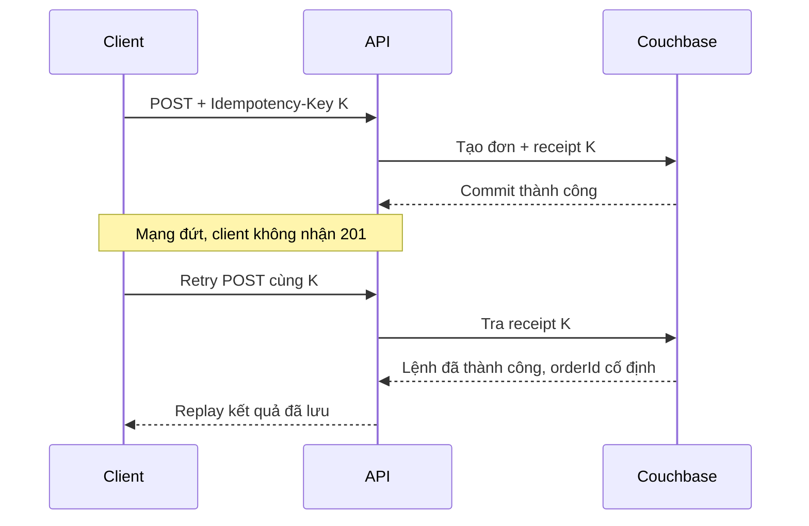
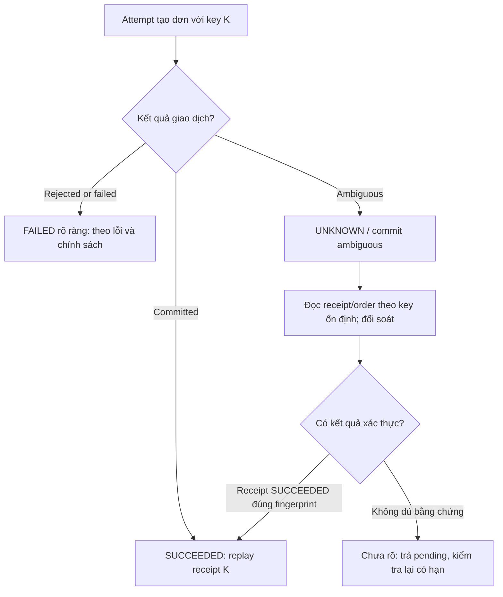
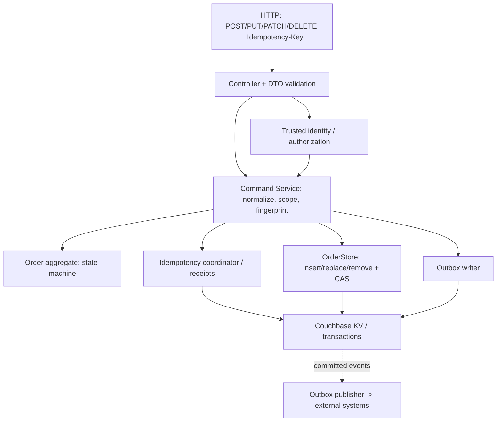
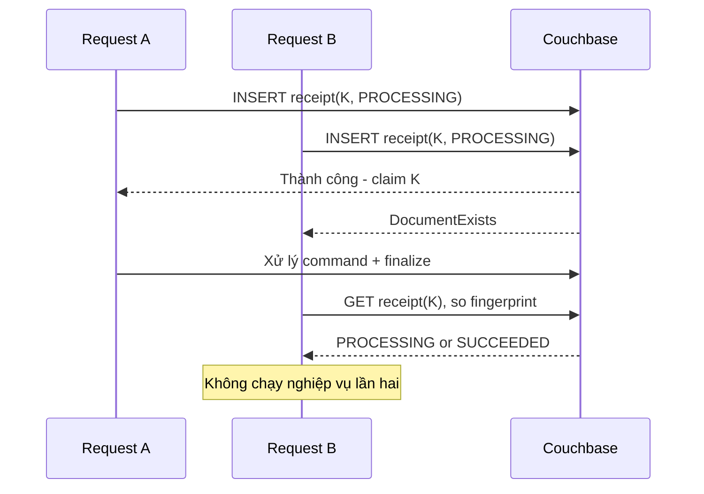

# Thiết kế thao tác tạo, sửa và xóa có tính lũy đẳng

## 1. Bài toán: request timeout không cho biết lệnh đã thành công hay chưa

Một ứng dụng bán hàng gọi API:

```http
POST /api/orders
Content-Type: application/json

{
  "customerId": "customer-42",
  "items": [{"sku": "SKU-42", "quantity": 2}]
}
```

Server đã lưu đơn vào Couchbase, nhưng kết nối đứt trước khi client nhận `201 Created`. Client retry cùng request. Nếu mỗi lần xử lý lại sinh một UUID mới và gọi `repository.save`, người mua có thể nhận **hai đơn**, tồn kho bị giữ hai lần, hoặc cổng thanh toán bị gọi lặp.

Tình huống tương tự xảy ra với thao tác sửa/xóa:

- Retry `PATCH quantity += 1` làm số lượng tăng **hai lần**.
- Retry `DELETE` sau khi bản ghi bị xóa trả `404`; trạng thái cuối có thể đúng nhưng client không biết liệu lệnh xóa ban đầu có được thực hiện không.
- Hai request cập nhật cùng một document ghi đè nhau nếu không có CAS/`@Version`.
- Truy vấn SQL++ ngay sau khi ghi qua KV chưa thấy bản ghi vì secondary index chưa bắt kịp; client hiểu nhầm thành “chưa tạo” và tạo lần nữa.
- Một `@Transactional` commit thành công nhưng trả về lỗi **commit ambiguous**; retry bên ngoài transaction tạo thêm side effect.

Trong chương **Thiết kế ứng dụng** của **SPRING_DATA_COUCHBASE**, bài này hướng dẫn thiết kế lệnh **tạo, sửa và xóa có tính lũy đẳng (idempotent)**. Phạm vi module gồm document mapping, repository, `CouchbaseTemplate`, SQL++, bucket/scope/collection, chỉ mục, TTL, CAS, giao dịch và reactive API; mỗi công cụ có vai trò riêng trong việc giữ đúng hiệu ứng nghiệp vụ khi request bị gửi lại.

**Sau bài này, bạn có thể:**

1. Phân biệt tính lũy đẳng của **hiệu ứng** với HTTP status/response, atomicity và optimistic concurrency.
2. Chọn đúng `insert`, `upsert`, `replace`, `remove`, `@Version`/CAS cho các kiểu lệnh.
3. Thiết kế `Idempotency-Key`, dấu vân tay payload, command receipt và kết quả có thể replay.
4. Xử lý create-only, cập nhật kiểu **set** so với **increment**, và delete lặp có tombstone.
5. Giải quyết timeout, duplicate requests, lỗi commit chưa rõ, transaction/outbox và side effect ngoài Couchbase.
6. Viết kiểm thử cạnh tranh và fault injection để chứng minh **một lệnh nghiệp vụ chỉ có một hiệu ứng**.

> **Bối cảnh kỹ thuật:** Java 17+, Spring Data Couchbase với Spring Boot tương thích và Couchbase Java SDK 3.x. Các ví dụ chia thành mảnh ở tầng Controller, Service, persistence adapter; không phải project hoàn chỉnh để dán vào một file. Khi triển khai phải đối chiếu version server/SDK, cấu hình converter, `@Version`, transaction và expiry của hệ thống thật.

## 2. Định nghĩa đúng: lũy đẳng không đồng nghĩa “chỉ chạy một lần”

Một thao tác `f` có tính lũy đẳng về trạng thái nếu:

\[
f(f(S)) = f(S)
\]

Nghĩa là thực hiện lại cùng thao tác trên trạng thái đã được cập nhật **không làm thay đổi thêm kết quả mong muốn**.

Ví dụ:

```text
SET status = "PAID"
  Lần 1: NEW  -> PAID
  Lần 2: PAID -> PAID  (không đổi thêm)

INCREMENT quantity BY 1
  Lần 1: 2 -> 3
  Lần 2: 3 -> 4  (không lũy đẳng)
```

Tuy nhiên, nghiệp vụ thực tế còn có:

- **Side effects**: gửi email, thu tiền, trừ hàng tồn, phát event.
- **Concurrency**: hai command khác nhau cùng sửa một document.
- **Response**: lần đầu có thể trả `201`, lần sau có thể trả `200`, `204` hoặc `404` tùy hợp đồng.

Do đó cần phân biệt ba yêu cầu:

| Mức bảo đảm | Nghĩa là gì? | Cách đạt |
| --- | --- | --- |
| **Lũy đẳng của phép biến đổi** | Ghi lại cùng giá trị không làm thay đổi trạng thái hơn nữa | `SET status=PAID`, replace với cùng nội dung |
| **Lũy đẳng của lệnh nghiệp vụ** | Cùng `commandId`/request không tạo thêm đơn, giao dịch tiền, event | Key ổn định, command receipt, kiểm tra fingerprint, transaction/outbox |
| **An toàn trước ghi đồng thời** | Hai lệnh khác nhau không âm thầm ghi đè nhau | CAS/`@Version`, kiểm tra state machine, transaction khi cần |

Một câu `UPDATE status = "PAID"` có thể lũy đẳng ở **field trạng thái**, nhưng nếu mỗi lần chạy lại gọi `sendPaymentEmail()` thì **use case không lũy đẳng**. Ngược lại, CAS giúp phát hiện xung đột nhưng **không tự nhận biết** hai HTTP requests có phải cùng một lệnh retry.

### 2.1. At-least-once delivery và exactly-once effect

Client, message broker hoặc load balancer có thể gửi một command **nhiều lần** do retry. Hệ thống phân tán khó đảm bảo “mã xử lý chỉ được gọi đúng một lần” khi mất mạng; mục tiêu thực tế là **hiệu ứng nghiệp vụ quan sát được không bị nhân đôi** trong một phạm vi/key và thời hạn đã cam kết.



**Đơn vị lũy đẳng là một lệnh được định danh**, ví dụ `(tenantId, actor, operation, idempotencyKey)`; không phải tất cả request có JSON trông giống nhau. Hai người đặt cùng SKU và quantity có thể là **hai đơn thật sự khác nhau** nếu dùng hai key khác nhau.

### 2.2. HTTP method và business idempotency

Theo HTTP semantics, `PUT` và `DELETE` được định nghĩa là các method lũy đẳng, còn `POST` không mặc định lũy đẳng. Điều này mô tả **hiệu ứng dự kiến của nhiều request giống hệt**, không cam kết response status, log, metrics hay event nội bộ đều giống nhau.

| Method/use case | Mức lũy đẳng có thể thiết kế | Cần làm thêm |
| --- | --- | --- |
| `PUT /orders/{id}` thay toàn bộ state đích | Có nếu cùng biểu diễn luôn đưa tài nguyên tới cùng state | Preconditions, authorization, tránh thay server fields tùy ý |
| `POST /orders` sinh ID server | **Không mặc định** | `Idempotency-Key` + receipt hoặc deterministic ID |
| `PATCH /orders/{id}` set `note` | Có thể lũy đẳng về state | CAS, validation, bảo vệ side effects |
| `PATCH /orders/{id}` `quantity += 1` | Không lũy đẳng | Command ID và dedupe từng phép cộng |
| `DELETE /orders/{id}` | Xóa lặp không làm tài nguyên “xóa thêm” | Xử lý `404`/`204`/tombstone, ABA và side effects |
| `POST /payments/capture` | Phụ thuộc giao thức bên ngoài | Provider idempotency key, receipt, reconciliation |

Không dùng HTTP verb như **bằng chứng** rằng một handler đã an toàn với duplicate request. Client retry `DELETE` có thể không gây thêm mất dữ liệu nhưng một handler gửi email “đơn bị hủy” mỗi lần vẫn tạo tác dụng phụ lặp.

## 3. Phân biệt các thao tác KV của Couchbase

Couchbase cung cấp các thao tác trên document key; chúng không thay thế hợp đồng nghiệp vụ.

| API KV | Ý nghĩa ở mức document | Nếu lặp cùng request? | Rủi ro |
| --- | --- | --- | --- |
| `collection.insert(id, body)` | **Tạo nếu chưa có**, lỗi khi key đã tồn tại | Lần sau thường `DocumentExistsException` | Phải phân biệt retry cùng payload với key bị dùng cho payload khác |
| `collection.upsert(id, body)` | Tạo **hoặc** thay thế không cần biết có tồn tại | Có thể ghi lại body và đổi CAS/TTL | Không tự chống mất update, duplicate side effects |
| `collection.replace(id, body, options)` | Ghi đè document **đã tồn tại** | Không CAS có thể ghi đè thay đổi người khác | Cần `cas(...)` và invariant nghiệp vụ |
| `collection.remove(id, options)` | Xóa document hiện có | Lần sau có thể `DocumentNotFoundException` | Không đủ biết ai đã xóa, có recreate/ABA hay không |
| `collection.mutateIn(...)` | Cập nhật một/vài path, nguyên tử **trong một document** | Tùy spec: replace giá trị khác increment | Cần CAS khi ràng buộc với trạng thái đã đọc |
| `@Version` + Spring Data `save` | Mapping CAS/optimistic locking cho entity | Có thể conflict nếu version cũ | Không phải command deduplication |

**CAS (Compare-And-Swap)** là metadata opaque của document. Nó phục vụ “chỉ ghi nếu bản ghi chưa thay đổi từ lần đọc”, **không phải business revision, UUID, idempotency key hay quyền truy cập**.

### 3.1. Chọn API theo mục đích

- **Create-only:** ưu tiên `insert` hoặc thao tác insert-only của `CouchbaseTemplate`; xử lý key đã tồn tại theo receipt/payload.
- **Set/update có kiểm soát:** đọc current state, kiểm tra tenant/state, ghi với CAS bằng SDK hoặc Spring Data `@Version`.
- **Upsert cho projection/cache:** phù hợp khi dữ liệu thực sự có thể được thiết lập lại từ source of truth và có cơ chế chống event cũ ghi đè mới.
- **Delete:** chỉ xóa cứng khi không cần giữ lịch sử/dedupe; ngược lại dùng trạng thái `DELETED`/tombstone có thời gian lưu rõ ràng.
- **Multi-document effect:** dùng Couchbase transaction khi cần cùng commit trong phạm vi DB; dùng saga/outbox cho hệ thống bên ngoài.

**Không dùng `upsert` để “biến POST thành lũy đẳng”** nếu mỗi lần POST tạo ID khác nhau. Kể cả ID giống nhau, upsert có thể ghi đè dữ liệu đã được lệnh khác cập nhật hoặc reset expiry theo option/version.

### 3.2. Đưa cùng nguyên tắc vào Spring Data Couchbase

Một entity có thể ánh xạ document và CAS:

```java
import org.springframework.data.annotation.Id;
import org.springframework.data.annotation.Version;
import org.springframework.data.couchbase.core.mapping.*;
import org.springframework.data.couchbase.repository.CouchbaseRepository;

@Document
@Scope("sales")
@Collection("orders")
public class OrderDocument {
    @Id
    private String id;

    @Field("tenant_id")
    private String tenantId;

    @Field("command_id")
    private String commandId;

    @Field("request_fingerprint")
    private String requestFingerprint;

    private String status;

    @Version
    private Long version;

    public OrderDocument() {}
    // Constructor nghiệp vụ, getters/setters dùng cho converter.
}

public interface OrderRepository
        extends CouchbaseRepository<OrderDocument, String> {}
```

Hai kiểu `public` ở trên cần được đặt trong **hai file Java riêng**. `@Version` ánh xạ **CAS metadata** của document; `commandId` và `requestFingerprint` là **thông tin lũy đẳng do ứng dụng quản lý**, không phải các giá trị CAS. Một entity có `version=null` thường là entity mới theo cơ chế state detection, nhưng **không nên dựa duy nhất vào suy luận về `save`** khi hợp đồng là create-only.

Với phiên bản Spring Data Couchbase có fluent insert:

```java
import org.springframework.data.couchbase.core.CouchbaseTemplate;

OrderDocument inserted = template
        .insertById(OrderDocument.class)
        .one(newOrderDocument);
```

`insertById(...).one(...)` cho biết **ý định chỉ tạo**, khác `save`/upsert tổng quát. Khi document ID đã tồn tại, xử lý lỗi duplicate theo **key scope và fingerprint**; đừng catch mọi exception rồi coi là thành công. Với cập nhật, đọc entity hiện hành, kiểm tra tenant và quy tắc nghiệp vụ rồi `repository.save(entity)` để tận dụng `@Version`/CAS. Cần integration test vì cách converter phát hiện entity mới, exception translation và TTL có thể khác theo dependency version.

**Lưu ý type mapping:** Spring Data có thể ghi `_class`/type discriminator để dựng `OrderDocument`. Nếu lệnh tạo dùng SDK raw nhưng lệnh sửa dùng repository, phải đảm bảo body chứa metadata/mapping phù hợp hoặc dùng một adapter chuyển đổi rõ ràng; một document hợp lệ với SDK không nhất thiết được repository trả về như mong đợi.

## 4. Một mô hình đơn hàng tối giản và hợp đồng API

Giả sử lưu đơn trong bucket `shop`, scope `sales`, collection `orders`. Mỗi đơn có key:

```text
order::<trustedTenantId>::<stableCommandId>
```

Body lưu trữ (tạo bởi server, không bind trực tiếp từ client):

```json
{
  "tenant_id": "store-01",
  "actor_scope": "customer-42",
  "command_id": "cmd-8934",
  "request_fingerprint": "sha256:....",
  "customer_id": "C-42",
  "items": [{"sku": "SKU-42", "quantity": 2, "price": 125000}],
  "total": 250000,
  "status": "NEW",
  "created_at_ms": 1795595400000,
  "creation_result": {
    "id": "ord-8934",
    "status": "NEW",
    "total": {"amount": "250000", "currency": "VND"}
  }
}
```

Request DTO chỉ cho client gửi dữ liệu được phép đề xuất:

```java
import jakarta.validation.Valid;
import jakarta.validation.constraints.*;
import java.util.List;

public record CreateOrderRequest(
        @NotBlank String customerId,
        @NotEmpty List<@Valid ItemRequest> items
) {}

public record ItemRequest(
        @NotBlank String sku,
        @NotNull @Min(1) Integer quantity
) {}
```

Các record `public` phải nằm trong **file Java riêng**. Server nhận `Idempotency-Key` ở HTTP header (hoặc command ID rõ ràng của hệ thống message), lấy tenant/actor từ principal đáng tin cậy và tra giá bằng nguồn nghiệp vụ; không nhận `tenant_id`, `status`, `price`, `created_at_ms`, `@Version` từ JSON tùy ý.

### 4.1. Idempotency key thuộc phạm vi nào?

Một cách đặt phạm vi:

```text
scope = (tenantId, principalOrCustomerScope, operation="PLACE_ORDER")
idempotencyKey = "K-7e9a..."
receiptKey = H(scope || idempotencyKey)
```

`H` là phép mã hóa ra key Couchbase an toàn, xác định và khó va chạm; tránh ghép chuỗi mơ hồ không có dấu phân tách hoặc length prefix. **Không dùng key client tự chọn như một quyền truy cập**: lookup receipt vẫn phải kiểm tra principal/tenant và loại thao tác, và key phải đủ entropy để khó đoán.

Hợp đồng endpoint cần nêu rõ:

1. Client tạo **một key mới cho một ý định mới** và giữ nguyên key cho mọi retry.
2. Cùng key + cùng payload đã chuẩn hóa → trả kết quả của lần đầu, **không tạo thêm đơn**.
3. Cùng key + payload khác → **409 Conflict** hoặc lỗi rõ ràng, không ghi đè đơn cũ.
4. Cùng key đang xử lý → phản hồi **in-progress** có `Retry-After` hoặc chính sách chờ bounded; không chạy một handler thứ hai.
5. Key được giữ trong **thời hạn dedupe** công bố; sau thời hạn đó, hệ thống có thể không nhận diện retry trừ khi resource ID/unique constraint vẫn bảo vệ.
6. Không hứa lũy đẳng vô hạn nếu receipt/tombstone có TTL ngắn và key có thể tái sử dụng.

### 4.2. Fingerprint phải dựa trên ý định chuẩn hóa

Hai JSON có thể giống về ngữ nghĩa dù khác thứ tự property/whitespace:

```json
{"customerId":"C-42","items":[{"sku":"SKU-42","quantity":2}]}
```

```json
{"items":[{"quantity":2,"sku":"SKU-42"}],"customerId":"C-42"}
```

Không nên hash raw JSON bytes nếu hợp đồng coi hai payload trên là một yêu cầu. **Chuẩn hóa** bằng một DTO/command đã validation, sắp xếp key JSON, chuẩn hóa cách biểu diễn number/Unicode/whitespace theo quy tắc nghiệp vụ, rồi tính fingerprint ổn định.

Tuy nhiên, **không tự sắp xếp mảng** nếu thứ tự item có ý nghĩa. Với đơn hàng, có thể xác định rõ thứ tự dòng hàng có quan trọng hay không trước khi canonicalize. Nếu giá được lấy từ catalog sau khi client gửi request, fingerprint thường đại diện **ý định request**; giá snapshot/response của lần đầu được lưu lại, retry không tính lại giá mới.

```text
normalized command:
  tenant: store-01
  operation: PLACE_ORDER
  customer: C-42
  lines: [(SKU-42, quantity=2)]
fingerprint = SHA-256(canonical payload)
```

Nếu canonical payload có thông tin cá nhân hoặc giá trị dễ đoán, fingerprint không nhất thiết che được dữ liệu; không công khai fingerprint, có thể dùng HMAC với secret phù hợp và không đưa raw payload vào logs.

## 5. Hai cấp độ chống tạo trùng: stable resource ID và command receipt

Không phải bài toán nào cũng cần một bảng receipt riêng. Hãy bắt đầu từ mức bảo đảm thực tế.

### 5.1. Cách A: cùng lệnh luôn dùng cùng document ID

Thay vì tạo ID mới khi mỗi HTTP attempt đến:

```text
KHÔNG NÊN:
  HTTP attempt #1 -> UUID-A -> order A
  HTTP attempt #2 -> UUID-B -> order B

NÊN:
  commandId K -> deterministic order key X
  attempt #1  -> insert X
  attempt #2  -> X đã tồn tại, xác minh fingerprint và trả kết quả
```

Nguyên tắc:

1. `commandId` phải giữ nguyên qua các lần retry cùng một ý định.
2. Document key được **tính xác định** từ tenant + loại thao tác + command ID. Không cho caller truyền nguyên key Couchbase tùy ý.
3. Dùng **insert-only**, không dùng `upsert`, để tránh ghi đè bản ghi đã tồn tại.
4. Khi key tồn tại, đọc resource và **so fingerprint**; cùng fingerprint có thể coi là lệnh tạo đã được chấp nhận, khác fingerprint phải báo conflict.
5. Nếu client cần **replay đúng response lần đầu**, phải lưu một snapshot bất biến của kết quả tạo hoặc dùng receipt riêng. Chỉ đọc **trạng thái hiện tại** của đơn không phải lúc nào cũng trả đúng body `201` ban đầu, vì đơn có thể đã được thanh toán hoặc hủy.

Đây là mô hình tốt khi **một document là hiệu ứng duy nhất** và không cần tính tiền bên ngoài, ghi reservation hay phát event liên quan. Nó không tự bảo đảm idempotency của side effects ngoài document.

### 5.2. SDK example: insert-only, đối chiếu key và fingerprint

Giả sử application service đã:

- Xác thực `trustedTenantId` và quyền tạo đơn.
- Validate input; chuẩn hóa request; tạo fingerprint ổn định.
- Chốt đơn giá và `createdAtMillis` **một lần** cho lệnh mới.
- Chuẩn bị `JsonObject orderBody` với `tenant_id`, `request_fingerprint` và một `creation_result` bất biến.

Persistence adapter:

```java
import com.couchbase.client.core.error.DocumentExistsException;
import com.couchbase.client.java.Collection;
import com.couchbase.client.java.json.JsonObject;
import java.nio.charset.StandardCharsets;
import java.security.MessageDigest;
import java.security.NoSuchAlgorithmException;
import java.util.HexFormat;

public final class InsertOnceOrderStore {
    private final Collection orders;

    public InsertOnceOrderStore(Collection orders) {
        this.orders = orders;
    }

    public record CreateResult(
            String documentId, JsonObject originalResponse) {}

    public CreateResult insertOrReplay(
            String trustedTenantId,
            String trustedActorScope,
            String idempotencyKey,
            String fingerprint,
            JsonObject orderBody) {

        if (trustedTenantId == null || trustedTenantId.isBlank()
                || trustedActorScope == null || trustedActorScope.isBlank()
                || idempotencyKey == null
                || !idempotencyKey.matches("[A-Za-z0-9_-]{16,128}")
                || fingerprint == null || fingerprint.isBlank()) {
            throw new IllegalArgumentException("Định danh lệnh không hợp lệ");
        }
        if (!trustedTenantId.equals(
                orderBody.getString("tenant_id"))
                || !trustedActorScope.equals(
                        orderBody.getString("actor_scope"))
                || !fingerprint.equals(
                        orderBody.getString("request_fingerprint"))) {
            throw new IllegalArgumentException("Body sai phạm vi");
        }

        String id = "order::" + digest(
                frame("PLACE_ORDER")
                        + frame(trustedTenantId)
                        + frame(trustedActorScope)
                        + frame(idempotencyKey));

        try {
            orders.insert(id, orderBody);
        } catch (DocumentExistsException duplicate) {
            // Không xem mọi duplicate key là retry hợp lệ.
            // Cần kiểm tra quyền tenant và fingerprint của bản đã lưu.
        }

        JsonObject persisted = orders.get(id).contentAsObject();
        if (!trustedTenantId.equals(
                    persisted.getString("tenant_id"))
                || !trustedActorScope.equals(
                    persisted.getString("actor_scope"))
                || !fingerprint.equals(
                    persisted.getString("request_fingerprint"))) {
            throw new IdempotencyConflictException();
        }

        // Lấy snapshot gốc, không tái tạo response từ trạng thái hiện hành.
        return new CreateResult(
                id, persisted.getObject("creation_result"));
    }

    private static String digest(String data) {
        try {
            byte[] bytes = MessageDigest.getInstance("SHA-256")
                    .digest(data.getBytes(StandardCharsets.UTF_8));
            return HexFormat.of().formatHex(bytes);
        } catch (NoSuchAlgorithmException impossibleOnModernJdk) {
            throw new IllegalStateException(impossibleOnModernJdk);
        }
    }

    private static String frame(String value) {
        return value.length() + ":" + value;
    }
}
```

`IdempotencyConflictException` là exception ứng dụng cần định nghĩa. Ví dụ sử dụng `DocumentExistsException` của SDK 3.x và `JsonObject.getObject`; khi copy sang hệ thống thật, áp dụng defensive copying nếu body có thể bị thay đổi từ một luồng khác. Với Java 17, `HexFormat` có sẵn.

**Giới hạn quan trọng của code minh họa:**

- Sau `orders.insert`, một lần `get` bổ sung được dùng để lấy snapshot đã lưu và xác minh kết quả; không phải tối ưu cuối cùng. Nếu muốn tránh đọc thừa, có thể trả snapshot từ dữ liệu đã ghi khi nhận được ACK chắc chắn và đọc lại **chỉ khi duplicate/retry**.
- **Không** dùng `catch (Exception)` rồi coi mọi lỗi là key đã tồn tại. Timeout/network failure có thể khiến **kết quả mutation chưa rõ**. Khi đó cần reconciliation theo **cùng key**, không sinh ID mới; có thể tra cứu có backoff/timeout và trả trạng thái pending nếu chưa xác nhận.
- Nếu command từ client B đoán được key của client A thì fingerprint và tenant phải được kiểm tra **trước khi replay response**. Dù `tenant_id` trùng, hệ thống có phân quyền theo customer cũng phải kiểm tra thêm quyền actor đối với đơn.
- Một document có `creation_result` bất biến chứa nhiều dữ liệu có thể tốn dung lượng. Nếu payload/response lớn, dùng **receipt riêng** với thông tin tối thiểu và response snapshot an toàn.
- Việc hash key không thay thế kiểm tra quyền hoặc độ dài/entropy của idempotency key. Ví dụ tạo key từ các thành phần có length prefix bằng `frame(...)` để tránh nhập nhằng khi ghép scope. Trong hệ thống thật, `trustedActorScope` phải đến từ **identity đã xác thực**; không nhận từ request body rồi coi là quyền truy cập.

### 5.3. Vì sao cùng ID nhưng `upsert` vẫn không an toàn?

```java
// Không dùng cho create-only nếu record có thể đã được sửa.
orders.upsert(documentId, requestBody);
```

Giả sử lần đầu tạo đơn `NEW`; sau đó payment handler chuyển nó thành `PAID`. Client retry POST cũ, `upsert` đưa document quay về `NEW`. Cùng document key **không** bảo vệ invariant khi dùng replace/upsert không điều kiện.

Nếu dùng Spring Data `repository.save`, phải nắm rõ entity state detection và `@Version` của phiên bản đang dùng. Khi hợp đồng là **chỉ tạo nếu không tồn tại**, hãy dùng thao tác **insert-only** của Template/SDK và kiểm thử duplicate key; đừng mặc định mọi `save` luôn tương đương `insert`.

## 6. Cách B: command receipt lưu kết quả tạo ban đầu

Khi một request còn tạo thêm reservation, outbox event, hoặc response cần được replay chính xác, nên có **idempotency receipt**.

Một receipt trong collection `shop.sales.command_receipts`:

```json
{
  "tenant_id": "store-01",
  "actor_scope": "customer-42",
  "operation": "PLACE_ORDER",
  "idempotency_key_hash": "hash...",
  "request_fingerprint": "sha256:...",
  "state": "SUCCEEDED",
  "resource_key": "order::store-01::cmd-8934",
  "original_http_status": 201,
  "original_response": {
    "id": "ord-8934",
    "status": "NEW",
    "total": {"amount": "250000", "currency": "VND"}
  },
  "created_at_ms": 1795595400000,
  "dedupe_until_ms": 1795681800000
}
```

`dedupe_until_ms` ở đây là **minh họa giá trị deadline cần được tính**, không phải timestamp hoàn chỉnh; trong JSON production phải là số nguyên epoch milliseconds thực. Collection receipt cần policy bảo mật/retention riêng, hạn chế dữ liệu nhạy cảm trong `original_response`.

### 6.1. Trạng thái receipt

| Trạng thái | Ý nghĩa | Retry cùng key làm gì? |
| --- | --- | --- |
| `PROCESSING` | Một attempt đang xử lý, chưa có kết quả cuối được xác nhận | Chờ có giới hạn hoặc trả pending; không xử lý song song |
| `SUCCEEDED` | Hiệu ứng đã commit và có kết quả | Replay response hoặc trả kết quả được định nghĩa |
| `REJECTED` | Từ chối theo nghiệp vụ mà policy coi là kết quả cuối | Replay lỗi đã lưu (không chạy lại side effects) |
| `UNKNOWN` | Timeout/commit ambiguous, chưa kết luận thành công hay thất bại | Reconcile trước khi retry; không tạo ID mới |
| `EXPIRED`/đã dọn | Hết cửa sổ dedupe | Hành vi theo retention contract và stable resource key |

Không phải mọi service đều cần lưu `PROCESSING` và `UNKNOWN` thành document vĩnh viễn. Với transaction tạo receipt ở trạng thái `SUCCEEDED` cùng các mutation, trạng thái trung gian có thể chỉ ở memory hoặc log/monitoring. Với workflow chạy dài, nên có receipt trạng thái và lease hợp lệ để tránh giữ `PROCESSING` vĩnh viễn sau crash.

### 6.2. Hai trường hợp đụng cùng key

**Retry cùng payload:** `key = K`, `fingerprint = H1`. Nếu receipt K đã `SUCCEEDED(H1)`, trả `original_response` — không tính lại giá, không phát event mới.

**Tái sử dụng key sai mục đích:** `key = K`, `fingerprint = H2` khác H1. Trả conflict, không sửa receipt và không tạo thêm tài nguyên.

**Không xác định duplicate chỉ bằng payload hash.** Hai lệnh mới có cùng nội dung nhưng **key khác nhau** phải được phép tạo hai đơn nếu nghiệp vụ cho phép. Ngược lại, cùng key khác payload là lỗi cần báo rõ chứ không “cập nhật đơn cho khớp”.

### 6.3. Chọn TTL của receipt

Giả sử client được retry trong 24 giờ. Nếu receipt hết TTL sau 10 phút, lần retry sau 30 phút có thể tạo đơn nữa dù client tin key còn hiệu lực. Vì vậy:

- `dedupe_until` phải bao phủ **retry window thực tế**, thời gian queue có thể phát lại và thời gian reconnect.
- Nếu tài nguyên cần idempotency lâu hơn TTL receipt, thêm **stable document ID hoặc unique command mapping** ở source of truth.
- TTL chỉ là dọn dữ liệu, **không phải cơ chế khóa chính xác vào một millisecond** hoặc callback “lệnh đã hết hạn”.
- Khi cập nhật receipt, cần kiểm tra thao tác ghi có **bảo toàn expiry** hay đặt lại TTL ngoài ý muốn.
- Nếu lưu response snapshot, cân nhắc privacy, mã hóa và retention compliance.

Receipt tồn tại bao lâu và retry sau thời hạn đó nhận phản hồi gì là **hợp đồng của API**, không chỉ cấu hình storage.

## 7. Transaction: commit receipt, resource và outbox cùng nhau

Nếu phải tạo ba document:

```text
orders          → Order NEW
command_receipts→ SUCCEEDED + original_response
outbox          → OrderCreated event
```

thì một thao tác `orders.insert` rồi `receipts.insert` rồi `outbox.insert` **không nguyên tử**. Process có thể chết giữa ba bước. Với các tài nguyên nằm trong cùng ranh giới ghi và cluster Couchbase có hỗ trợ transactions, có thể dùng **distributed transaction**.

### 7.1. Mẫu SDK transaction

```java
import com.couchbase.client.java.Cluster;
import com.couchbase.client.java.Collection;
import com.couchbase.client.java.json.JsonObject;
import com.couchbase.client.java.transactions.error.TransactionCommitAmbiguousException;
import com.couchbase.client.java.transactions.error.TransactionFailedException;

public final class AtomicOrderCreator {
    private final Cluster cluster;
    private final Collection orders;
    private final Collection receipts;
    private final Collection outbox;

    public AtomicOrderCreator(Cluster cluster) {
        this.cluster = cluster;
        var scope = cluster.bucket("shop").scope("sales");
        this.orders = scope.collection("orders");
        this.receipts = scope.collection("command_receipts");
        this.outbox = scope.collection("outbox");
    }

    public void commitCreate(
            String orderId,
            String receiptId,
            String eventId,
            JsonObject orderBody,
            JsonObject succeededReceipt,
            JsonObject outboxEvent) {

        // Caller đã validate tenant/authorization/fingerprint và chốt
        // các ID + payload + timestamp trước khi transaction bắt đầu.
        try {
            cluster.transactions().run(ctx -> {
                // Đặt tất cả thay đổi DB trong cùng callback.
                ctx.insert(receipts, receiptId, succeededReceipt);
                ctx.insert(orders, orderId, orderBody);
                ctx.insert(outbox, eventId, outboxEvent);
            });
        } catch (TransactionCommitAmbiguousException ambiguous) {
            // KHÔNG kết luận rollback! Tầng application phải đối soát
            // receiptId/orderId, trả PENDING/UNKNOWN khi chưa chắc chắn.
            throw new CreateOutcomeUnknownException(ambiguous);
        } catch (TransactionFailedException failed) {
            // Có thể do receipt key đã tồn tại, CAS conflict, network,...
            // Đọc receipt theo cùng key và xác minh fingerprint/tenant
            // trước khi quyết định replay, conflict hoặc retry có giới hạn.
            throw new CreateAttemptFailedException(failed);
        }
    }
}
```

`CreateOutcomeUnknownException` và `CreateAttemptFailedException` là exception ứng dụng phải tự khai báo. Code cho thấy **ba mutation nguyên tử về mặt DB**, không triển khai trọn vẹn handler duplicate/commit ambiguity, transaction retries hoặc HTTP response; chúng thuộc tầng application và bài kiểm thử tích hợp.

### 7.2. Những điều tuyệt đối không làm trong callback

SDK có thể **thực thi lại callback transaction** khi cần retry sau conflict. Vì vậy:

```java
cluster.transactions().run(ctx -> {
    // KHÔNG: sinh ID mới mỗi attempt.
    // String orderId = UUID.randomUUID().toString();

    // KHÔNG: side effect không rollback cùng Couchbase.
    // paymentGateway.charge(...);
    // emailSender.send(...);

    // NÊN: chỉ dùng ID/payload đã chuẩn bị sẵn
    // và các thao tác ctx.get/insert/replace/remove/query được hỗ trợ.
    ctx.insert(orders, stableOrderId, preparedOrderJson);
});
```

Đoạn này là **minh họa quy tắc**, `stableOrderId` và `preparedOrderJson` là giá trị được chuẩn bị bên ngoài. Trong callback production, không chia sẻ `JsonObject` mutable rồi sửa qua nhiều attempt/subscription; tạo bản sao dữ liệu khi cần.

Không gọi `collection.upsert(...)` ngoài `ctx` từ trong callback rồi tin mutation đó được rollback. Không gọi ngân hàng, Kafka, email hoặc hệ thống khác trong lambda. Nếu cần phát sự kiện, ghi **outbox** trong transaction và để worker publish sau commit; consumer phải dedupe bằng `eventId`.

### 7.3. Tiền đề để transaction hoạt động

Giao dịch Couchbase nhiều document cần phiên bản server/SDK hỗ trợ, cấu hình durability/replica hợp lệ, quyền RBAC, timeout và cơ chế transaction cleanup. Bài học này không giả định mọi Spring `@Transactional` tự động áp dụng cho Java SDK call, và không dùng transaction cho mọi lệnh chỉ vì “an toàn hơn”.

Với Spring Data Couchbase, chỉ những thao tác repository/template **được hỗ trợ và tham gia đúng transaction manager/context** mới được điều phối theo `@Transactional`. Kiểm tra docs theo phiên bản, thử failure injection và khẳng định **cả ba document** cùng xuất hiện hoặc cùng không xuất hiện sau khi giao dịch kết thúc.

### 7.4. Không gọi lại cả workflow sau commit ambiguous



**Tìm không thấy ngay không chứng minh rollback.** Transaction đang hoàn tất/cleanup hoặc hệ thống đang bất ổn; cần bounded retry/reconciliation theo key ổn định. Tránh dựa vào SQL++ index mặc định để quyết định lệnh chưa commit; dùng KV/transaction-aware lookup phù hợp và xử lý các trường hợp kết quả chưa chắc chắn.

## 8. Thiết kế cập nhật lũy đẳng: “set” khác “increment”

Tạo trùng chỉ là một phần của vấn đề. Sau khi đơn tồn tại, hai lớp thao tác sửa thường xuất hiện:

| Lệnh | Hiệu ứng khi chạy lần đầu | Khi lặp lại giống hệt | Kết luận |
| --- | --- | --- | --- |
| `setShippingNote("Giao sáng")` | Note trở thành chuỗi cố định | Giá trị giữ nguyên | Lũy đẳng về dữ liệu |
| `setStatus("PAID")` | State chuyển tới `PAID` nếu hợp lệ | Có thể không đổi nếu vẫn `PAID` | Phải xét state machine và side effect |
| `replaceAddress(address)` | Địa chỉ thành snapshot cụ thể | Giá trị không đổi nếu không có sửa xen giữa | Phải dùng CAS nếu không muốn ghi đè |
| `increaseQuantity(1)` | Quantity +1 | Quantity +1 **nữa** | Không lũy đẳng |
| `addTag("priority")` vào set | Thêm phần tử nếu chưa có | Không tạo bản sao nếu dữ liệu là set | Có thể lũy đẳng, tùy representation |
| `appendAuditEvent(event)` vào array | Thêm một phần tử | Thêm phần tử trùng nếu không dedupe | Không lũy đẳng |
| `chargeCard(amount)` | Thu tiền ngoài DB | Có thể thu lại | Cần giao thức idempotency riêng |

### 8.1. Dùng PUT/PATCH với precondition và CAS

Giả sử API cho phép đặt một ghi chú giao hàng ở trạng thái `NEW` hoặc `PAID`. Với một resource có thể thay đổi đồng thời, client nhận một token phiên bản `ETag` rồi gửi:

```http
PATCH /api/orders/ord-8934/shipping-note
If-Match: "opaque-etag-v7"
Content-Type: application/json

{"shippingNote": "Giao trước 17h"}
```

Tầng HTTP chuyển `If-Match` thành precondition nội bộ, Service kiểm tra quyền và state machine, persistence ghi dùng CAS. Nếu ETag cũ:

- `412 Precondition Failed` là lựa chọn đúng cho `If-Match` không thỏa theo HTTP semantics.
- `428 Precondition Required` có thể được dùng nếu API yêu cầu header mà client bỏ qua.
- `409 Conflict` phù hợp xung đột nghiệp vụ không phải lỗi HTTP precondition, ví dụ `SHIPPED` không cho sửa địa chỉ.

`If-Match`/CAS bảo vệ **concurrent update**, nhưng nếu request đầu tiên đã thành công và response thất lạc, client retry **cùng ETag cũ** có thể nhận `412`. Điều này không phủ nhận phép set là lũy đẳng về **trạng thái**; chỉ cho thấy **replay cùng kết quả HTTP** cần thêm command receipt hoặc policy xem trường hợp ETag đã cũ.

### 8.2. SDK example: set ghi chú với CAS

```java
import com.couchbase.client.java.Collection;
import com.couchbase.client.java.kv.GetResult;
import com.couchbase.client.java.json.JsonObject;
import static com.couchbase.client.java.kv.ReplaceOptions.replaceOptions;

public void setShippingNote(
        Collection orders, String documentId,
        String trustedTenantId, String note) {

    if (note == null || note.isBlank() || note.length() > 500) {
        throw new IllegalArgumentException("Ghi chú không hợp lệ");
    }

    GetResult current = orders.get(documentId);
    JsonObject body = current.contentAsObject();

    if (!trustedTenantId.equals(body.getString("tenant_id"))) {
        throw new OrderNotFoundException();
    }
    if ("SHIPPED".equals(body.getString("status"))
            || "CANCELLED".equals(body.getString("status"))) {
        throw new InvalidOrderStateException();
    }

    if (note.equals(body.getString("shipping_note"))) {
        return; // Trạng thái mong muốn đã tồn tại.
    }

    body.put("shipping_note", note);
    orders.replace(
            documentId,
            body,
            replaceOptions().cas(current.cas()));
}
```

`OrderNotFoundException` và `InvalidOrderStateException` do ứng dụng tự định nghĩa; snippet giả định `trustedTenantId` đã được xác thực/ủy quyền ở Service. `replaceOptions().cas(...)` bảo vệ không ghi đè khi document thay đổi sau lúc đọc. Nếu CAS mismatch, **đọc lại**, kiểm tra trạng thái mới và lệnh nghiệp vụ, rồi quyết định retry giới hạn hoặc báo conflict; đừng `replace` không CAS để “cho xong”.

**Giới hạn của ví dụ:** một lần set có thể làm CAS đổi nhưng retry mà thấy giá trị bằng note sẽ không ghi thêm. Tuy vậy, nếu đã có một lệnh khác sửa note ở giữa, retry của lệnh cũ **không được phép đè giá trị mới** khi policy cần thứ tự command. Cần `If-Match`, command ID và receipt để phân biệt retry cũ với yêu cầu mới. Nếu body có TTL, kiểm tra `preserveExpiry` hoặc expiry option phù hợp phiên bản thay vì vô tình reset.

### 8.3. Tại sao `quantity += 1` cần command ID riêng?

```http
POST /api/orders/ord-8934/increment-quantity
Idempotency-Key: qty-change-9af...

{"sku": "SKU-42", "delta": 1}
```

Nếu gọi lại vì timeout:

```text
quantity = 2
attempt #1: +1 → 3
attempt #2: +1 → 4    <-- sai nghiệp vụ
```

Kể cả dùng thao tác tăng counter **nguyên tử** của SDK, hai request lặp vẫn là **hai phép tăng thành công**. Atomic increment giải quyết race của nhiều phép tăng, không giải quyết duplicate của **cùng một command**.

Các hướng xử lý:

1. Chuyển API sang dạng **set quantity = 3** kèm ETag, nếu ý định nghiệp vụ là đặt một giá trị tuyệt đối.
2. Nếu cần thật sự “+1” theo sự kiện, gán `commandId`; lưu dấu đã áp dụng và cập nhật quantity trong cùng transaction hoặc một document có CAS.
3. Có thể lưu một **bounded set các commandId gần đây** ngay trong aggregate để dedupe khi số lượng hợp lý; nhưng không để mảng này tăng vô hạn. Với lưu lượng lớn, tách receipt/inbox có retention và unique key.
4. Khi event đến hai lần hoặc đến sai thứ tự, cân nhắc domain revision và cơ chế replay/reconciliation, không tự lấy CAS làm số thứ tự business.

### 8.4. Không để set-status kích hoạt side effect lặp

Một logic nguy hiểm:

```java
void confirmPaid(String orderId) {
    orderRepository.setStatus(orderId, "PAID"); // State lũy đẳng?
    paymentGateway.capture(orderId);           // KHÔNG lũy đẳng mặc định.
}
```

Thiết kế an toàn hơn:

- `ConfirmPayment` mang **payment event ID**/provider transaction ID có thể dedupe.
- Payment owner xác minh chữ ký callback, tenant và trạng thái giao dịch bên provider.
- Order owner thay đổi state bằng CAS/transaction và ghi outbox event cùng mutation.
- Gọi capture/notification ngoài DB qua worker có **provider-specific idempotency key**.
- Retry cùng `paymentEventId` replay outcome đã ghi, không thu tiền lần hai hoặc gửi lặp email.

Đừng coi `if (status == PAID) return` là đủ trong mọi tình huống: đơn có thể đã đi tới `SHIPPED`, và lệnh retry cũ vẫn phải được nhận diện bằng **command receipt**, không đảo trạng thái về `PAID`.

## 9. Xóa lũy đẳng: hard delete, soft delete và tombstone

HTTP `DELETE` idempotent theo **hiệu ứng trạng thái đích**: sau nhiều lần xóa cùng tài nguyên, tài nguyên vẫn không còn có thể truy cập như trước. Tuy nhiên, cách triển khai sẽ quyết định client có phân biệt được “đã xóa” với “chưa từng tồn tại” hay không.

### 9.1. Hai hợp đồng phản hồi đều có thể hợp lệ

| Lần gọi | Chính sách A: trạng thái cuối quan trọng | Chính sách B: có chứng cứ xóa |
| --- | --- | --- |
| DELETE lần đầu | `204 No Content` | `204 No Content` |
| Retry khi đã xóa | `204 No Content` | `404 Not Found` hoặc `410 Gone` nếu có tombstone |
| ID chưa từng tồn tại | `204` theo policy ẩn sự tồn tại | `404` |

Việc lần thứ hai trả `404` **không tự làm phương thức DELETE mất tính lũy đẳng** theo HTTP, vì hiệu ứng dự kiến vẫn là tài nguyên vắng mặt. Nhưng với workflow cần replay **kết quả nghiệp vụ của một command xóa**, receipt/tombstone giúp nhận diện cùng lệnh và trả response phù hợp.

### 9.2. Hard delete và rủi ro ABA

```text
T0: Order ID X tồn tại, phiên bản A.
T1: DELETE X thành công.
T2: Một request khác tạo lại X với dữ liệu mới, phiên bản B.
T3: Retry DELETE cũ X -> vô tình xóa tài nguyên B.
```

Đây là biến thể **ABA/recreate risk**. Chỉ `collection.remove(X)` không biết đó là command xóa của thế hệ tài nguyên nào. Một số cách phòng tránh:

- **Không tái sử dụng resource ID** trong thời gian cần bảo vệ; insert-only theo key ổn định.
- Dùng `If-Match`/CAS để xóa **đúng phiên bản** đã quan sát, không xóa bất kỳ document mới nào có cùng key.
- Dùng tombstone/receipt lưu generation, `deleteCommandId`, trạng thái và thời hạn dedupe.
- Với nghiệp vụ cần lưu lịch sử xóa, có thể không hard delete ngay; dùng `DELETED`/ `CANCELLED` do aggregate owner quản lý.

### 9.3. SDK hard delete có CAS

```java
import static com.couchbase.client.java.kv.RemoveOptions.removeOptions;

var current = orders.get(documentId);
if (!trustedTenantId.equals(
        current.contentAsObject().getString("tenant_id"))) {
    throw new OrderNotFoundException();
}

orders.remove(documentId, removeOptions().cas(current.cas()));
```

CAS tránh xóa một **phiên bản đã đổi** giữa `get` và `remove`. Nếu retry sau khi xóa, lần `get` mới có thể trả `DocumentNotFoundException`; handler chuyển theo chính sách DELETE của API. Nếu muốn xác định retry đã thuộc cùng command, cần lưu receipt **tồn tại sau hard delete** hoặc thiết kế tombstone.

### 9.4. Soft delete với lệnh có định danh

Một document sau xóa mềm:

```json
{
  "tenant_id": "store-01",
  "status": "DELETED",
  "deleted_at_ms": 1795595400000,
  "delete_command_id": "delete-K-17",
  "deletion_reason": "USER_REQUEST",
  "original_order_id": "ord-8934"
}
```

Đường ghi phải đi qua Service/domain:

1. Xác minh actor có quyền xóa **đơn cụ thể**, không chỉ biết tenant/key.
2. Đọc status và CAS hiện hành.
3. Nếu `status=DELETED` và `deleteCommandId` trùng, **replay kết quả**; không phát event mới.
4. Nếu trạng thái hiện hành cấm xóa (ví dụ đã giao), trả conflict.
5. Ghi state tombstone và outbox intent **cùng mutation một document** hoặc cùng transaction nếu outbox tách riêng.
6. Nếu CAS mismatch, đọc lại/reconcile với command ID; không ghi đè bằng `upsert`.

Tombstone cho phép chặn recreate cùng ID và hỗ trợ audit, nhưng có chi phí lưu trữ. **Không để tombstone chứa thông tin cá nhân vô thời hạn** nếu retention/privacy policy yêu cầu xóa; có thể lưu dấu tối thiểu, hash và thời hạn có kiểm soát.

### 9.5. TTL và lũy đẳng của delete

Đặt TTL trên tombstone hoặc receipt là một quyết định **retention**:

- TTL quá ngắn → retry cũ đến sau khi tombstone hết hạn có thể tạo/xóa lại resource mới cùng key.
- TTL dài → tốn storage, cần chính sách dữ liệu cá nhân và compliance.
- TTL không tự phát lệnh `ReleaseInventory`, hoàn tiền hoặc gọi external cleanup.
- Ghi cập nhật tombstone phải giữ expiry theo chính sách nếu dùng `replace`/SDK.

**Tách hai deadline:** `deletedAt` là thời điểm nghiệp vụ; `dedupeUntil` là thời hạn nhận diện retry; `expiry` là thời điểm server có thể dọn document. Không nhập cả ba thành một giá trị chỉ vì dễ code.

## 10. Outbox và idempotent consumer: một lệnh không phát hai hiệu ứng

Ví dụ sau khi tạo đơn cần phát `OrderCreated`:

```java
// Không an toàn nếu process chết giữa hai lệnh:
orderRepository.save(order);
eventPublisher.publish(new OrderCreated(order.getId()));
```

Nếu ghi DB thành công nhưng publish chưa xong, event bị mất. Nếu publish trước ghi và transaction rollback, downstream có thể nhận event cho đơn không tồn tại. Cách khắc phục là **transactional outbox**:

```text
Same Couchbase commit:
  Order NEW
  CommandReceipt SUCCEEDED
  Outbox(OrderCreated, eventId = stableCommandId + "/ORDER_CREATED")

After commit:
  Outbox publisher -> message broker
  Consumer inbox/dedupe -> downstream effect
```

Outbox publisher có thể gửi lại cùng event do timeout trước khi nhận ACK từ broker. Hệ thống vì thế thường chấp nhận **at-least-once delivery** và thiết kế **idempotent consumer**:

```text
inbox::<consumer>::<eventId>
  => processed already?
      yes: no-op / replay
      no: apply effect and mark processed atomically when possible
```

Khi consumer vừa sửa projection Couchbase vừa ghi inbox, có thể đặt hai mutation trong một transaction. Nếu consumer gọi API bên ngoài (payment/notification), phải dùng idempotency protocol của provider và reconciliation; DB transaction không bao trùm HTTP side effect đó.

**CAS khác domain revision:** CAS là metadata concurrency của Couchbase; `eventId` dùng chống duplicate, `aggregateRevision` dùng kiểm tra thứ tự/replay. Không dùng CAS của hai document khác nhau như một global ordering.

## 11. Thiết kế phân tầng: ai chịu trách nhiệm lũy đẳng?

Một API không nên đặt toàn bộ dedupe, transaction, domain rules và SQL++ vào Controller. Kiến trúc thực dụng:



| Tầng | Trách nhiệm | Không nên làm |
| --- | --- | --- |
| Controller | Đọc header, validate JSON/format key, ánh xạ HTTP status và response | Tự gọi `Cluster.query`, tính lại giá khi retry |
| Application command service | Kiểm tra authorization, canonicalize, tạo fingerprint, chọn policy replay/conflict/pending | Lưu `ResponseEntity` như domain object |
| Domain aggregate | Bất biến trạng thái, quy tắc chuyển đổi, kiểm tra dữ liệu | Gọi ngân hàng, gửi email hoặc biết request header |
| Idempotency coordinator | Claim key, truy receipt, kiểm tra cùng payload, reconcile unknown | Bỏ qua tenant/actor hoặc tự gán “thành công” khi timeout |
| Persistence adapter | `insert`/CAS/transaction/expiry, mapping document, query theo key | Quyết định user có được confirm payment hay không |
| Outbox/consumer | Publish theo kết quả đã commit, dedupe event | Phát event trước khi commit hoặc làm side effect trong callback retry |

### 11.1. Controller minh họa hợp đồng create

```java
import jakarta.validation.Valid;
import org.springframework.http.ResponseEntity;
import org.springframework.web.bind.annotation.*;
import java.net.URI;

@RestController
@RequestMapping("/api/orders")
public class OrderController {
    private final OrderCommandService commands;
    private final CurrentIdentity identity;

    public OrderController(
            OrderCommandService commands, CurrentIdentity identity) {
        this.commands = commands;
        this.identity = identity;
    }

    @PostMapping
    public ResponseEntity<OrderResponse> create(
            @RequestHeader("Idempotency-Key") String key,
            @Valid @RequestBody CreateOrderRequest request) {

        CommandOutcome<OrderResponse> outcome = commands.place(
                identity.requireAuthorizedScope(),
                key,
                request);

        return ResponseEntity.status(outcome.httpStatus())
                .location(URI.create(
                        "/api/orders/" + outcome.body().id()))
                .body(outcome.body());
    }
}
```

`CurrentIdentity`, `OrderCommandService`, `OrderResponse` và `CommandOutcome<T>` là **kiểu ứng dụng minh họa**, phải được định nghĩa trong dự án. `CommandOutcome<T>` ở đây có ít nhất `int httpStatus()` và `T body()`, cùng khả năng lưu/đọc response đã xác nhận trong receipt. Không kết luận mặc định mọi `place` đều trả một body: trường hợp `UNKNOWN`/in-progress có thể dùng exception riêng hoặc outcome `202` không có `OrderResponse`, cần Controller xử lý nhánh đó rõ ràng thay vì gọi `outcome.body().id()`.

**Chú ý:** Với `Idempotency-Key` bị thiếu, Spring MVC có thể trả `400` do `@RequestHeader` bắt buộc. Khi key sai format/không đủ entropy, Service hoặc validator trả lỗi có kiểm soát. Không dùng giá trị header nguyên văn trong document key/log; chuẩn hóa và hash theo chính sách.

### 11.2. Trạng thái operation trên HTTP

| Trường hợp | Response hợp lý | Ghi chú |
| --- | --- | --- |
| Lần đầu tạo thành công | `201 Created` + `Location` | Lưu original status/response trong receipt |
| Retry cùng key, payload, đã thành công | Replay `201`/body gốc hoặc một response được contract định nghĩa | Không tạo resource/event mới |
| Cùng key, payload khác | `409 Conflict` | Đảm bảo không tiết lộ dữ liệu của principal khác |
| Key còn `PROCESSING` | `202 Accepted` + `Retry-After` hoặc lỗi in-progress có tài liệu | Không xử lý song song cùng key |
| Server chưa phân giải commit ambiguous | `202` pending hoặc `503` có hướng retry/reconciliation | Không báo thất bại chắc chắn khi có thể đã commit |
| Preconditions `If-Match` không thỏa | `412 Precondition Failed` | Không áp dụng mutation |
| Cấm chuyển trạng thái | `409 Conflict` theo API contract | Lỗi nghiệp vụ, không phải CAS |
| DELETE lặp | `204`, `404` hoặc `410` theo policy | Hiệu ứng vẫn idempotent nếu không có tác dụng phụ lặp |

Với workflow bất đồng bộ, có thể expose một endpoint đọc operation outcome:

```http
GET /api/operations/{commandId}
```

Nó phải kiểm tra **tenant, actor và quyền với resource**, và chỉ trả thông tin operation tối thiểu được phép. Không nhận `commandId` như chứng minh quyền chỉ vì client biết chuỗi đó. Nên có correlation ID để đối chiếu log/trace khi nhận `PENDING`.

### 11.3. Đừng nhúng JSON schema response vĩnh viễn vào receipt mà không tính version

Nếu API thay schema sau sáu tháng, replay một response snapshot `v1` cho client `v2` có thể gây lỗi. Vì vậy contract receipt cần xác định:

- `apiVersion` hoặc response format version của lệnh gốc.
- Cách replay cùng endpoint/version khi client retry sau deploy.
- Chỉ lưu dữ liệu cần thiết (resource ID, immutable creation summary), hoặc lưu response snapshot theo phiên bản và giữ code đọc tương thích.
- Thời gian dedupe tương ứng thời gian version compatibility cần duy trì.

Mục tiêu **replay đúng hiệu ứng**, không nhất thiết phải giữ mãi một blob JSON cũ mà không có chính sách migration/retention.

## 12. Dedupe claim khi có hai request đến đồng thời

Trường hợp khó hơn retry sau khi success là **hai request cùng key tới gần như đồng thời**:



**Không dùng**:

```java
if (!repository.existsById(receiptKey)) {
    repository.save(new Receipt(receiptKey));
    // ... execute business side effects ...
}
```

Hai request có thể cùng thấy `false` trước khi cái nào `save`. Đây là race condition **check-then-act**. Dùng **atomic insert-if-absent** để claim, hoặc đặt receipt và resource trong một Couchbase transaction với insert-only.

### 12.1. PROCESSING có thể bị mắc kẹt sau crash

Nếu dùng claim receipt ở trạng thái `PROCESSING` trước khi chạy workflow:

- Ghi `leaseOwner`, `leaseUntil`, `attemptId` và command fingerprint.
- Khi lease hết, worker recovery có thể cố claim lại bằng CAS/version **sau khi đối soát** outcome trước đó.
- Không chỉ thấy `PROCESSING` quá 30 giây rồi tự tạo order mới; owner cũ có thể đã commit resource nhưng chưa cập nhật receipt.
- Với thao tác có side effects bên ngoài, lease không bảo đảm at-most-once effect; vẫn cần provider idempotency key và inbox/outbox.

Không được coi TTL của receipt `PROCESSING` là một **distributed lock** đầy đủ. TTL dọn document, không cung cấp fencing token để chặn một worker cũ vẫn đang chạy. Nếu ownership chuyển từ worker A sang B, phải dùng version/fencing và điều kiện write để A không ghi hiệu ứng lỗi thời.

### 12.2. Key collision và payload mismatch không giống nhau

Khi `insert` trả duplicate:

1. Đọc receipt/document bằng KV.
2. Xác minh tenant/actor/operation của receipt đúng phạm vi được ủy quyền.
3. So fingerprint theo quy tắc canonicalization.
4. Nếu **khác**, trả conflict và audit số lần key bị lạm dụng.
5. Nếu **cùng**, xem trạng thái `PROCESSING`/`SUCCEEDED`/`UNKNOWN` và replay/chờ/reconcile.

Không chỉ làm `catch (DocumentExistsException) { return 200; }`. Một key có thể tồn tại vì client cố tái sử dụng cho **lệnh khác** hoặc đoán key của user khác.

## 13. Secondary index, consistency và TTL trong thiết kế lũy đẳng

### 13.1. Dedupe theo key nên ưu tiên KV

Phần quyết định “lệnh K đã được nhận chưa?” cần lookup nhanh, có thể xác minh trạng thái document **theo exact key**. Dùng `collection.get(receiptKey)` hoặc thao tác transaction tương ứng thường phù hợp hơn query SQL++:

```sql
SELECT *
FROM `shop`.`sales`.`command_receipts` AS r
WHERE r.idempotency_key_hash = $hash;
```

Câu SQL++ này cần index, có độ trễ cập nhật secondary index theo scan consistency và không đương nhiên bảo đảm uniqueness của key dưới race. **Nếu mục tiêu là claim một key duy nhất, dùng KV insert-only vào document ID xác định**, không dùng `SELECT` rồi insert.

### 13.2. Phân biệt read-your-writes với dedupe

`OrderRepository.findById(id)` thường truy cập KV; một `findByTenantIdAndStatus` dựa trên SQL++/secondary index có thể chưa thấy order mới. Client retry tạo đơn **không nên dựa vào danh sách search trả rỗng để kết luận đơn chưa được tạo**.

Nếu API cần hiển thị ngay sau POST:

- Trả `OrderResponse` từ receipt/resource vừa được commit.
- Nếu query danh sách ngay lập tức phải thấy bản ghi, chọn **scan consistency** phù hợp (`REQUEST_PLUS` hoặc mutation-state nếu API hỗ trợ) và đo latency.
- Nếu danh sách lấy từ projection bất đồng bộ, công bố SLA hội tụ hoặc cung cấp đường đọc source of truth.
- Tránh sử dụng `REQUEST_PLUS` như một cơ chế dedupe: nó không thay thế atomic insert và request fingerprint.

### 13.3. TTL cho order, receipt và tombstone khác nhau

| Document | Có thể dùng TTL? | Cần cân nhắc |
| --- | --- | --- |
| Order chính | Theo retention/compliance của nghiệp vụ | Xóa order sớm có thể cho retry tạo lại nếu receipt cũng hết hạn |
| Receipt `SUCCEEDED` | Sau cửa sổ dedupe được cam kết | Key tới muộn không còn được nhận diện; cần policy sau hạn |
| Receipt `PROCESSING` | Dọn dữ liệu theo lease/recovery policy | TTL không phải lock; phải reconcile outcome |
| Delete tombstone | Theo chống recreate/audit | TTL quá ngắn gây ABA với retry cũ |
| Outbox event | Sau publish **và** đối soát an toàn | Không xóa trước khi downstream được xử lý |

Khi cập nhật document có expiry, thao tác replace/upsert có thể thay đổi chính sách TTL. `preserveExpiry(true)` của Java SDK có yêu cầu hỗ trợ từ Couchbase Server 7.0+; với server cũ hơn phải có nhánh phù hợp để đọc/đặt lại expiry. Kiểm thử create, update, delete/migration với expiry để tránh mất retention ngoài ý muốn.

### 13.4. Index cho dashboard vận hành, không cho claim key

Nếu muốn thống kê receipt còn pending hoặc job recovery theo `leaseUntil`, SQL++ index có thể hữu ích:

```sql
CREATE INDEX ix_receipts_state_lease
ON `shop`.`sales`.`command_receipts`(
    state, lease_until_ms
);
```

Nhưng index không thay đổi quy tắc **insert-only receipt key**. `EXPLAIN` giúp tối ưu dashboard/recovery worker, không được dùng thay chứng minh uniqueness. Đừng tạo primary index production chỉ để một kiểm thử khởi chạy.

## 14. Reactive: publisher có thể bị subscribe lại

Trong WebFlux, một lệnh có thể được thực thi lại khi client retry hoặc khi operator `retry(...)` subscribe lại publisher. Điều này càng làm rõ yêu cầu:

1. ID và idempotency key phải **ổn định** qua các subscription thuộc **cùng một command**.
2. Dữ liệu request cần snapshot bất biến; không dùng `JsonObject` mutable rồi thay đổi giữa các lần subscribe.
3. Không dùng `Mono.just(blockingRepository.save(...))`: lời gọi blocking đã xảy ra trước khi publisher được tạo.
4. Nếu dùng SDK reactive, `insert` duplicate phải được xử lý theo fingerprint/receipt, không phải bỏ qua mọi error.
5. Không đặt external side effect trước `retryWhen` mà thiếu idempotency protection.

### 14.1. Ví dụ khung reactive insert-only

```java
import com.couchbase.client.core.error.DocumentExistsException;
import com.couchbase.client.java.ReactiveCollection;
import com.couchbase.client.java.json.JsonObject;
import reactor.core.publisher.Mono;

public Mono<String> createOnceReactive(
        ReactiveCollection orders,
        String stableOrderId,
        String trustedTenantId,
        String fingerprint,
        JsonObject preparedBody) {

    // Validate và chốt stableOrderId/fingerprint ở application trước đây.
    // preparedBody phải là snapshot riêng cho command này.
    return Mono.defer(() ->
            orders.insert(stableOrderId, preparedBody)
                    .thenReturn(stableOrderId)
                    .onErrorResume(DocumentExistsException.class, ex ->
                            orders.get(stableOrderId)
                                    .flatMap(existing -> {
                                        JsonObject body =
                                                existing.contentAsObject();
                                        if (!trustedTenantId.equals(
                                                body.getString("tenant_id"))
                                                || !fingerprint.equals(
                                                body.getString(
                                                        "request_fingerprint"))) {
                                            return Mono.error(
                                                    new IdempotencyConflictException());
                                        }
                                        return Mono.just(stableOrderId);
                                    })));
}
```

Đây là **khung minh họa**: method cần đặt trong class, exception ứng dụng cần định nghĩa; một endpoint production còn phải kiểm tra actor/customer authorization, thời gian dedupe, replay snapshot và các lỗi timeout/unknown. Đường `onErrorResume` chỉ bắt **duplicate key**, không biến mọi exception thành success. Nếu `preparedBody` là `JsonObject` mutable, phải tránh sửa nó giữa các subscription hoặc clone/rebuild từ command bất biến bên trong `defer`.

### 14.2. Retry operator không phải câu trả lời cho mọi lỗi

```java
// Không dùng retry vô điều kiện cho lệnh có side effects.
publisher.retry();
```

Nếu cần retry theo loại lỗi, dùng bounded retry/backoff phù hợp; điều kiện tiên quyết là mutation có **key cố định, dedupe và reconciliation**. Khi nhận `TransactionCommitAmbiguousException`, không tự giả định callback chắc chắn rollback để chạy lại toàn bộ workflow với IDs mới.

Với reactive transactions, kiểm tra transaction operator/context propagation và phiên bản Spring Data/SDK thực tế. Không kết hợp một transaction reactive với `repository.save` blocking tùy ý rồi mặc định chúng thuộc cùng ranh giới commit.

## 15. Kiểm thử tính lũy đẳng theo nhiều tầng

Một unit test “gọi method hai lần và được cùng ID” chưa đủ để chứng minh lũy đẳng trong production. Cần kiểm tra **hiệu ứng cuối trên Couchbase** và các side effects sau lỗi mạng, khi nhiều request đến đồng thời.

### 15.1. Ma trận kết quả cần chứng minh

| Tình huống | Lệnh gửi vào | Kết quả dữ liệu | Kết quả HTTP/command |
| --- | --- | --- | --- |
| Create thành công | K, payload A lần 1 | 1 Order + 1 receipt + 1 outbox event | 201 + Location ổn định |
| Retry create | K, payload A lần 2 | **Vẫn 1** Order/receipt/event | Replay result của A |
| Reuse key khác payload | K, payload B | Không thay Order A | 409 |
| Hai POST đồng thời | K, payload A song song | Chỉ một execution thắng claim | Một success, request khác replay/pending |
| Hai POST khác key | K1 và K2 cùng payload A | 2 đơn **nếu** nghiệp vụ cho phép | 2 kết quả riêng |
| Timeout sau commit | K, payload A | 1 Order đã commit | Reconciliation/replay, không tạo K2 |
| Transaction rollback | Lỗi trước commit | Không có Order/receipt thành công/outbox | Có lỗi rõ, không báo success |
| `PROCESSING` bị treo | Worker mất kết nối | Không chạy lại mù quáng | Recovery có lease + reconciliation |
| PUT/set lặp | Set cùng note | Note giống nhau, không phát hai event | Success/no-op hoặc precondition theo policy |
| Increment lặp | Command `+1` cùng ID | Chỉ tăng **1 lần** | Replay outcome |
| CAS conflict | Hai command **khác** cùng sửa | Không có lost update | Một thành công, một conflict/retry có kiểm tra |
| DELETE lặp | Cùng delete command | Đã xóa/tombstone, không phát hai side effect | 204/404/410 theo hợp đồng |
| Xóa rồi tạo lại cùng ID | Retry delete cũ | Không được xóa generation mới | Precondition/receipt/tombstone bảo vệ |
| Receipt hết TTL | K đến sau dedupe window | Theo retention contract | Không cam kết replay vô hạn |
| Event giao lặp | Event E hai lần | Projection/payment effect áp dụng một lần | Consumer dedupe |

Đặt assertion **trên dữ liệu và số hiệu ứng**, không chỉ trên HTTP status. Một `204` trả về thành công nhưng ghi thêm notification thứ hai vẫn là lỗi lũy đẳng nghiệp vụ.

### 15.2. Unit test: create command giữ fingerprint và giá snapshot

Trong class JUnit có `OrderCommandService service` được dựng với các fake/spy adapter:

```java
import static org.assertj.core.api.Assertions.*;
import org.junit.jupiter.api.Test;

@Test
void sameKeyAndPayloadReplaysFirstResult() {
    String key = "K_valid_1234567890";
    var request = validCreateOrderRequest();

    var first = service.place(authorizedScope, key, request);
    var second = service.place(authorizedScope, key, request);

    assertThat(second.resourceId()).isEqualTo(first.resourceId());
    assertThat(second.originalTotal()).isEqualTo(first.originalTotal());
    assertThat(fakeStore.numberOfOrders()).isEqualTo(1);
    assertThat(fakeOutbox.numberOfOrderCreatedEvents()).isEqualTo(1);
}

@Test
void sameKeyAndDifferentPayloadMustConflict() {
    String key = "K_valid_1234567890";
    service.place(authorizedScope, key, requestWithQuantity(2));

    assertThatThrownBy(() -> service.place(
            authorizedScope, key, requestWithQuantity(3)))
            .isInstanceOf(IdempotencyConflictException.class);
    assertThat(fakeStore.numberOfOrders()).isEqualTo(1);
}
```

Đây là **test pseudocode theo contract**, không phải class runnable độc lập: `validCreateOrderRequest`, `requestWithQuantity`, `authorizedScope`, `fakeStore`, `fakeOutbox` và kiểu outcome cần được định nghĩa trong test fixture. Nó chứng minh mong muốn ở **application layer**; một fake adapter không thể chứng minh atomicity của Couchbase transaction.

**Test giá thay đổi:** sau attempt đầu thành công, cho `PriceCatalog` trả giá mới rồi retry cùng key/payload. Kết quả replay phải giữ **giá và timestamp của lần đầu**, không tính lại giá hiện hành. Đây là lỗi thường bị bỏ sót khi implementation chỉ cố định order ID.

### 15.3. Integration test: CAS chống lost update

Với Spring Data `OrderDocument` có `@Version Long version`, tạo một fixture độc lập và kiểm tra:

```java
import static org.assertj.core.api.Assertions.assertThatThrownBy;
import org.springframework.dao.OptimisticLockingFailureException;

OrderDocument first = repository.findById(documentId).orElseThrow();
OrderDocument second = repository.findById(documentId).orElseThrow();

first.setShippingNote("Buổi sáng");
repository.save(first);

second.setShippingNote("Buổi chiều");
assertThatThrownBy(() -> repository.save(second))
        .isInstanceOf(OptimisticLockingFailureException.class);
```

Test này là **mảnh nằm trong một integration test có repository/Couchbase thật**. Nó chỉ chứng minh CAS/optimistic locking, không chứng minh cùng một command được dedupe. Test thêm trường hợp `If-Match` cũ phải trả status phù hợp khi đi qua HTTP.

### 15.4. Integration test: hai create đồng thời dùng một key

Để phát hiện race `exists → save`, dùng hai tác vụ thật trong cùng test run:

```text
Given:
  tenant = it-<UUID>
  commandKey = K
  requestFingerprint = H1

When:
  A và B được đồng bộ để cùng bắt đầu gọi POST(K,H1)

Then:
  Chỉ 1 Order có command K
  Chỉ 1 receipt cho K
  Chỉ 1 outbox OrderCreated có eventId tương ứng
  Không có stock/payment side effect lặp
  A/B nhận success+replay hoặc một success và một pending theo policy
```

**Không dùng** một `synchronized` Java trong Service singleton làm cơ chế chống trùng chính: nhiều pod/instance có JVM khác nhau. Kiểm chứng bằng **insert-only/transaction** trên Couchbase thật. Để test trùng đúng lúc, dùng barrier/test hook có kiểm soát; tránh một bài test quá nhanh vô tình chạy tuần tự và cho kết quả xanh.

### 15.5. Fault injection theo mốc lỗi

Chủ động tạo sự cố ở từng khoảng:

```text
F0. Sau khi claim receipt PROCESSING nhưng trước khi tạo Order
F1. Sau khi tạo Order nhưng trước khi final receipt (nếu không transaction)
F2. Ngay khi transaction commit nhưng trước khi HTTP response
F3. Sau khi outbox publish nhưng trước khi ghi ACK/mark SENT
F4. Sau DELETE thành công nhưng trước khi client nhận 204
F5. Sau khi CAS đọc nhưng trước khi replace/remove
```

Kỳ vọng:

- **F0:** lease/recovery phân giải `PROCESSING`; không có hai execution hợp lệ đồng thời.
- **F1:** nếu dùng ba mutation rời, test phát hiện trạng thái nửa hoàn thành — là bằng chứng cần transaction hoặc saga/reconciliation.
- **F2:** client retry cùng K tra kết quả đã commit, không tạo resource mới.
- **F3:** worker có thể publish lại; consumer dùng eventId dedupe.
- **F4:** retry DELETE không xóa thế hệ tài nguyên mới.
- **F5:** CAS mismatch hoặc lệnh được re-evaluate; không lost update.

Với transaction, test rollback bằng cách cố ý làm một mutation không hợp lệ **bên trong cùng transaction**, rồi đọc **từng document qua KV** sau khi transaction kết thúc. Không chỉ assert exception. Với commit ambiguous được giả lập, không biến lỗi network thành chứng minh rollback.

### 15.6. Kết quả cần kiểm tra khi dùng SQL++

Integration test nên seed dữ liệu có hai tenant và một key ngoài phạm vi, rồi:

1. Lookup receipt bằng KV theo key có scope.
2. Truy vấn danh sách đơn sau mutation với mức consistency đã chọn.
3. Nếu thấy count khác sau vừa ghi, tách lỗi **index lag** khỏi lỗi dedupe.
4. Chạy `EXPLAIN` cho dashboard trạng thái receipt/outbox, không dùng query `SELECT` để claim uniqueness.
5. Đọc metadata CAS/expiry khi kiểm tra cập nhật hoặc tombstone.
6. Xóa đúng key fixture trong `finally`/`@AfterEach`, không xóa cả collection dùng chung.

## 16. Các sai lầm thường gặp và cách sửa

### 16.1. “Retry POST thì chỉ cần tìm order có cùng customer/SKU”

Sai: hai đơn khác nhau hoàn toàn có thể có cùng khách hàng/SKU/quantity. Đó không phải bằng chứng cùng **ý định**. Dùng command ID do client giữ ổn định, scope và fingerprint; không suy dedupe từ dữ liệu nghiệp vụ có thể trùng hợp.

### 16.2. “Cùng document ID thì upsert là lũy đẳng”

Sai: upsert có thể ghi đè state đã được thay đổi bởi luồng khác và làm CAS/expiry khác đi. Dùng **insert-only** cho tạo mới, CAS cho sửa, receipt cho retry command.

### 16.3. “GET search không thấy thì tạo lại”

Sai: secondary index có thể chậm cập nhật. Tra **stable key**/receipt qua KV và đối soát; SQL++ `NOT_BOUNDED` không phải nguồn xác nhận mutation vắng mặt.

### 16.4. “CAS làm mọi lệnh lũy đẳng”

Sai: CAS chỉ so phiên bản tại thời điểm ghi. Hai lần increment tuần tự có CAS mới đều thành công và tăng hai lần. Dùng **dedupe command ID**, hoặc đổi command thành set absolute value khi phù hợp.

### 16.5. “DELETE đã idempotent nên cứ gửi email mỗi lần”

Sai: HTTP method idempotent không bảo vệ notification, refund hay outbox. Cần dedupe theo delete command/event ID và lưu outcome hoặc tombstone đủ lâu.

### 16.6. “Cùng Idempotency-Key luôn là cùng yêu cầu”

Sai: key có thể bị tái sử dụng với payload khác, actor khác, endpoint khác hoặc sau phiên bản API thay đổi. Scope phải bao gồm tenant/actor/operation và fingerprint phải được so sánh; với payload khác trả conflict.

### 16.7. “Chỉ cần catch mọi lỗi rồi thử lại”

Sai: timeout có thể là **unknown outcome**; transaction callback có thể được retry; external side effect không rollback cùng Couchbase. Retry có loại lỗi, backoff, giới hạn số lần và reconciliation.

### 16.8. “PROCESSING receipt có TTL là một distributed lock”

Sai: TTL không cung cấp fencing; một worker cũ có thể tiếp tục chạy sau lease timeout. Cần CAS/lease generation và bảo vệ write, đồng thời dedupe hiệu ứng. Nếu workflow dài, dùng state machine bền vững và reconciliation.

### 16.9. “Receipt lưu mãi nên hệ thống an toàn”

Không hẳn: lưu response/các field nhạy cảm vô hạn có rủi ro privacy, chi phí index/storage và thay đổi API format. Chọn retention có căn cứ; xóa dữ liệu cá nhân không cần thiết, giữ hash/opaque ID nếu đủ đáp ứng audit.

### 16.10. “Retry lỗi 409/412 cho đến khi thành công”

Xung đột có thể do **lệnh khác đã cập nhật hợp lệ**; không được bỏ precondition để ép ghi. Cần đọc lại state, xác minh command còn hợp lệ, và trả lỗi cho client khi ý định cũ không thể áp dụng.

## 17. Quyết định kiến trúc theo use case

| Use case | Nên dùng trước tiên | Khi nào cần thêm |
| --- | --- | --- |
| Tạo document độc lập, không side effect | Stable key + `insert` + fingerprint | Receipt riêng nếu phải replay exact response |
| POST tạo đơn + event | Receipt + Order + Outbox trong cùng transaction | Consumer inbox, provider idempotency |
| Set trường trong một document | Read/validate + `replace` với CAS | Command receipt nếu client yêu cầu replay exact result |
| Cập nhật counter/delta | Atomic mutation nếu phù hợp concurrency | **Bắt buộc dedupe** theo command ID khi có retry |
| Đổi state machine | Aggregate method + CAS | Receipt/outbox cho command/event và tác dụng phụ |
| Delete tài nguyên đơn giản, không recreate | KV `remove`, policy 204/404 rõ | CAS nếu cần If-Match |
| Delete có refund/release/khả năng recreate | Tombstone + command ID + CAS | Transaction/outbox/saga, retention |
| Multi-document invariant trong một Couchbase owner | Transaction với stable IDs | Retry/unknown outcome/reconciliation |
| Tác dụng phụ ngoài Couchbase | Saga/outbox + idempotency API provider | Inbox/deduplication, monitoring |

**Chọn bảo đảm theo mức rủi ro:** không phải một endpoint chỉnh tên hiển thị cần một hệ thống saga phức tạp. Ngược lại, không thể dựa vào `upsert` và lời hứa “client chỉ gửi một lần” cho việc thu tiền hoặc trừ tồn kho.

## 18. Checklist triển khai và vận hành

### 18.1. Hợp đồng của lệnh

1. **Loại hiệu ứng** được định nghĩa chưa: create-only, set absolute value, delta, transition, hard delete, soft delete?
2. **Retry scope** là gì: tenant, actor, loại thao tác, resource, key và API version?
3. Client có cơ chế phát sinh key **mới cho lệnh mới**, giữ key khi retry, đủ entropy, giới hạn độ dài?
4. Payload fingerprint dựa trên **command chuẩn hóa**, không phụ thuộc thứ tự property JSON vô nghĩa?
5. Cùng key khác payload trả conflict; cùng key cùng payload trả receipt/replay theo trạng thái?
6. Có contract rõ cho `PENDING`/`UNKNOWN`, thời hạn dedupe và cách tra cứu outcome?
7. Nếu dùng `If-Match`, có xác định 412/428 và cách kết hợp với command receipt?
8. HTTP response chứa resource ID/Location ổn định, không tính lại giá/timestamp khi retry?

### 18.2. Persistence/Couchbase

1. Create-only dùng **`insert`**, không vô tình `upsert` và ghi đè resource hiện có?
2. Update có kiểm tra tenant/actor, invariant và CAS/`@Version`; conflict được phân loại?
3. Delete có chống xóa nhầm generation mới và phản hồi lặp theo chính sách?
4. Claim receipt dùng **atomic insert**, không dùng `exists + save`?
5. Receipt, resource và outbox có nguyên tử khi **bất biến yêu cầu**? Transaction manager/callback đúng phiên bản?
6. Stable IDs, giá snapshot và eventId được xác định **trước transaction attempt**?
7. Callback retry không gọi external API, sinh random ID mới hoặc sửa object chia sẻ không kiểm soát?
8. Commit ambiguous có đường reconciliation, không mặc định rollback?
9. CAS metadata và domain revision được phân biệt; không tự tăng CAS?
10. TTL/expiry không làm dedupe window ngắn hơn cam kết, và không reset khi replace/migration?

### 18.3. Bảo mật và vòng đời dữ liệu

1. Tenant/actor scope lấy từ principal được xác thực, không tin JSON/header tự chọn ngoài authorization?
2. Một user đoán được key của user khác có bị chặn **trước khi trả receipt/result**?
3. Fingerprint/receipt/outbox có chứa PII hoặc dữ liệu thanh toán? Có policy encryption/redaction/retention?
4. Có rate limit chống người dùng cố tạo hàng triệu receipt với key ngẫu nhiên?
5. Hard delete/tombstone có đáp ứng xóa dữ liệu và audit; không kéo dài retention không cần thiết?
6. Logs/traces dùng correlation ID, **không in full Idempotency-Key**, payload hoặc secret provider?

### 18.4. Observability và recovery

Theo dõi tối thiểu:

| Metric/signal | Giúp phát hiện |
| --- | --- |
| `idempotency.hit` | Tỷ lệ retry/replay |
| `idempotency.key_conflict` | Key bị dùng cho payload khác, lỗi client/tấn công |
| `idempotency.in_progress_age` | Claim treo, workflow quá chậm |
| `idempotency.unknown_outcome` | Timeout/commit ambiguous cần đối soát |
| `cas.conflict` | Nhiều writer cạnh tranh một document |
| `transaction.retry`, `transaction.abort` | Contention, timeouts, cấu hình durability |
| `outbox.oldest_pending_age` | Event có nguy cơ không được publish |
| `consumer.duplicate_event` | At-least-once delivery cần dedupe |
| `receipt.expired_vs_retry` | Retry đến sau retention window |
| `api.create_latency_p95/p99` | Chi phí đọc receipt, transaction và query |

Một quy trình vận hành khi receipt mắc `UNKNOWN`:

1. Truy tìm bằng **receipt key/command ID ổn định** với phạm vi quyền phù hợp.
2. Đọc trạng thái receipt, Order và outbox bằng API thích hợp; không dựa duy nhất vào SQL++ `NOT_BOUNDED`.
3. Nếu có bằng chứng commit thành công với đúng fingerprint, đánh dấu/replay `SUCCEEDED` bằng thao tác CAS/transaction an toàn.
4. Nếu có bằng chứng thất bại dứt khoát, áp dụng policy retry/compensation.
5. Nếu chưa đủ bằng chứng, giữ `UNKNOWN`, alert/escalate và retry reconciliation có giới hạn; **không tự tạo đơn mới**.
6. Ghi audit nguyên nhân và thời điểm đổi trạng thái; không sửa receipt thủ công mất dấu vết.

## 19. Bài tập tự luyện

### Bài 1 — Phân loại lũy đẳng

Cho các command: `setNote("A")`, `quantity += 2`, `deleteResource(id)`, `addTagToSet("hot")`, `capturePayment(100000)`. Lệnh nào lũy đẳng về **trạng thái**? Lệnh nào vẫn cần receipt/idempotency để bảo vệ **tác dụng phụ**?

**Đáp án gợi ý:** `setNote`, xóa tài nguyên và thêm vào set có thể lũy đẳng về trạng thái; increment và capture không mặc định. Mọi lệnh có event/email/payment đi kèm vẫn cần chống duplicate ở cấp use case; cùng state không bảo đảm cùng side effect.

### Bài 2 — Sửa POST tạo trùng

Server hiện gọi:

```java
String id = UUID.randomUUID().toString();
repository.save(new OrderDocument(id, request));
```

Client retry sau timeout. Hãy thêm `Idempotency-Key`, đặt scope key theo tenant/actor/operation, chọn insert-only, fingerprint và behavior khi key trùng.

**Gợi ý:** tạo deterministic resource/receipt key từ command ID, atomic insert-if-absent; cùng key/fingerprint replay, khác fingerprint 409; không đổi ID khi retry.

### Bài 3 — Receipt và transaction

Đặt đơn phải tạo `Order`, `CommandReceipt` và `OutboxEvent`. Nếu ba lệnh `insert` chạy riêng, hãy liệt kê ít nhất hai thời điểm process chết để lại trạng thái không hoàn chỉnh và thiết kế cách sửa.

**Đáp án gợi ý:** chết sau Order nhưng trước receipt → retry không biết order đã có; chết sau receipt nhưng trước outbox → downstream không nhận event. Có thể dùng một Couchbase transaction khi nằm cùng boundary, hoặc saga/reconciliation nếu qua hệ thống ngoài.

### Bài 4 — Vì sao CAS không đủ cho increment?

Một document counter được cập nhật bằng CAS và mỗi request `+1` đều thành công khi đọc lại CAS mới. Client retry cùng lệnh hai lần; điều gì xảy ra? Hãy viết cách lưu dấu `commandId` cùng mutation.

**Đáp án:** có thể tăng hai lần vì CAS chỉ bảo vệ ghi tranh chấp. Cần receipt/inbox duy nhất theo ID, cùng transaction với counter hoặc được nhúng vào cùng document với CAS và bounded storage policy.

### Bài 5 — DELETE lặp và ABA

Đơn X bị xóa, sau đó một service khác tạo lại X cho một đơn mới. Retry DELETE cũ đến sau. Vì sao DELETE idempotent theo HTTP **chưa đủ** để bảo vệ thế hệ mới? Đề xuất kết hợp generation, CAS, tombstone hoặc không tái sử dụng ID.

**Gợi ý:** không có receipt/generation, retry cũ không phân biệt X cũ với X mới. Ràng buộc lệnh xóa vào resource version/generation và giữ tombstone đủ lâu.

### Bài 6 — PATCH có `If-Match`

Một khách hàng gửi `PATCH shippingNote` với ETag cũ, request đầu thực ra đã thành công nhưng response bị mất. Retry cùng ETag nhận 412. Điều này có mâu thuẫn với phép set lũy đẳng không? Làm sao replay outcome của **cùng command** mà vẫn chống ghi đè lệnh mới?

**Đáp án gợi ý:** không mâu thuẫn; 412 bảo vệ precondition, còn phép set cùng giá trị là lũy đẳng về state. Receipt command ID có thể lưu outcome lần đầu; quyền và fingerprint được kiểm tra trước replay, không bỏ qua CAS để áp lại.

### Bài 7 — PriceCatalog đổi giá trong lúc retry

POST cùng key/payload tạo đơn giá 250.000 VND, nhưng client không nhận response. Giá SKU tăng lên 275.000 VND trước retry. Nếu Service tính lại giá mỗi lần, có thể xảy ra những lỗi nào? Nêu dữ liệu tối thiểu phải được lưu để replay.

**Gợi ý:** lưu request fingerprint, orderId, price snapshot/total và response kết quả lần đầu. Retry không tạo đơn thứ hai và không silently đổi đơn giá của lệnh cũ.

### Bài 8 — Commit ambiguous

Một transaction tạo order/receipt/outbox bị timeout ở thời điểm commit. Worker không biết commit hay rollback. Hãy lập flow điều tra bằng key ổn định và các trạng thái `SUCCEEDED`, `UNKNOWN`, `FAILED`. Vì sao query SQL++ không thấy order ngay lập tức **không** đủ để kết luận rollback?

**Đáp án gợi ý:** kết quả commit có thể chưa được client biết; secondary index có thể trễ; kiểm tra KV/receipt/transaction state, retry đối soát có giới hạn. Không tạo ID mới hoặc gửi payment lần nữa khi chưa có kết luận.

### Bài 9 — Dedupe qua 48 giờ

Client có thể retry sau tối đa 48 giờ, nhưng receipt TTL chỉ 30 phút. Thiết kế nào có thể tạo trùng? Bạn sẽ đặt `dedupeUntil`, receipt TTL, tombstone retention và resource key như thế nào để đáp ứng hợp đồng?

**Gợi ý:** dedupe window phải ít nhất bằng retry SLA cộng khoảng trễ hợp lý; sau hết TTL cần quy tắc rõ. Stable ID/command mapping có thể kéo dài bảo vệ vượt receipt retention nếu phù hợp domain.

### Bài 10 — Test concurrency có thật

Một unit test với mock chỉ đếm `orders.insert` được gọi một lần. Nó có chứng minh hệ thống hai pod không tạo trùng không? Thiết kế integration test với hai HTTP requests đồng thời, một Couchbase instance thật, receipt unique key, count order/outbox và các nhánh conflict/pending.

**Đáp án:** mock unit test không mô phỏng atomic insert trên DB qua hai tiến trình. Cần integration test concurrency và fault injection ở commit/response boundary, xác nhận số effect trong database.

### Bài 11 — Phân tích lựa chọn PUT

Một API muốn client tự đặt `orderId` và gửi:

```http
PUT /api/orders/ord-client-42
If-None-Match: *
```

Hãy phân biệt `If-None-Match: *` giúp chống tạo đè với việc replay **cùng response**. Nếu lần đầu tạo thành công nhưng client retry, precondition có thể không còn thỏa. Cần thêm gì để phân biệt retry hợp lệ với client khác cố dùng cùng ID?

**Gợi ý:** xác minh tenant/actor, fingerprint và receipt/result hoặc GET có quyền; không bỏ `If-None-Match` để upsert bừa bãi.

### Bài 12 — Thiết kế reactive

Viết `Mono<CreateResult>` dùng reactive SDK với ID cố định, `Mono.defer` và `onErrorResume(DocumentExistsException.class,...)`. Giải thích vì sao phải snapshot `JsonObject` và không dùng `.retry()` vô điều kiện. Viết `StepVerifier` cho duplicate key cùng fingerprint và khác fingerprint.

## 20. Tổng kết

**Lũy đẳng là thuộc tính của hiệu ứng mà hệ thống bảo đảm khi một ý định được gửi lại, không chỉ là tên HTTP method.** Với Spring Data Couchbase, hãy bắt đầu bằng các quyết định nhỏ nhưng chặt chẽ:

- **Tạo:** giữ ID/command key ổn định, dùng insert-only, so fingerprint và replay kết quả; thêm receipt/transaction/outbox khi một request gây nhiều hiệu ứng.
- **Sửa:** phân biệt set absolute value với increment/delta, bảo vệ ghi cạnh tranh bằng CAS/`@Version`, dùng command ID để tránh áp dụng hai lần hiệu ứng không lũy đẳng.
- **Xóa:** xác định behavior khi DELETE lặp, cân nhắc tombstone/TTL/ABA, không phát refund hoặc event trùng.
- **Lỗi mạng:** timeout và commit ambiguous không có nghĩa mutation đã thất bại. Đối soát bằng key ổn định, không chạy lại toàn bộ workflow với ID mới.
- **Vận hành:** dùng KV insert/get để dedupe, để index/SQL++ phục vụ tìm kiếm/giám sát, giới hạn retry, quan sát pending/unknown, và kiểm thử với các request thực sự đồng thời.

Khi đi qua hệ thống bên ngoài như thanh toán hoặc message broker, Couchbase transaction **không tự bảo đảm exactly-once toàn hệ thống**. Dùng outbox/saga và idempotency key của provider, coi duplicate delivery là bình thường và kiểm soát **hiệu ứng nghiệp vụ đúng một lần trong phạm vi đã công bố**.

## 21. Tài liệu tham khảo

- [RFC 9110 — Idempotent Methods](https://www.rfc-editor.org/rfc/rfc9110.html#name-idempotent-methods): ý nghĩa của HTTP `PUT`, `DELETE` và retry.
- [RFC 9110 — Conditional Requests, If-Match](https://www.rfc-editor.org/rfc/rfc9110.html#name-if-match): ETag và conditional write.
- [RFC 6585 — 428 Precondition Required](https://www.rfc-editor.org/rfc/rfc6585.html#section-3): trường hợp API yêu cầu precondition.
- [Couchbase Java SDK — KV Operations](https://docs.couchbase.com/java-sdk/current/howtos/kv-operations.html): `insert`, `upsert`, `replace`, `remove`, CAS và expiry.
- [Couchbase Java SDK — Sub-document Operations](https://docs.couchbase.com/java-sdk/current/howtos/subdocument-operations.html): atomic mutation trong một document và giới hạn ứng dụng.
- [Couchbase Java SDK — Distributed ACID Transactions](https://docs.couchbase.com/java-sdk/current/howtos/distributed-acid-transactions-from-the-sdk.html): `transactions().run`, transaction callback, retry và commit ambiguity.
- [Couchbase Java SDK — Transaction Concepts](https://docs.couchbase.com/java-sdk/current/concept-docs/transactions.html): atomicity, staged mutations và visibility.
- [Spring Data Couchbase — Modeling Entities](https://docs.spring.io/spring-data/couchbase/reference/couchbase/entity.html): `@Id`, `@Version` và optimistic locking.
- [Spring Data Couchbase — Template Operations](https://docs.spring.io/spring-data/couchbase/reference/couchbase/template.html): insert/update/replace theo entity và fluent API.
- [Spring Data Couchbase — Transactions](https://docs.spring.io/spring-data/couchbase/reference/couchbase/transactions.html): transaction manager và repository/template participation.
- [Couchbase Java SDK — SQL++ Queries](https://docs.couchbase.com/java-sdk/current/howtos/sqlpp-queries-with-sdk.html): scan consistency, named parameters và Query Service.
- [Couchbase Server — Indexing Overview](https://docs.couchbase.com/server/current/indexes/indexing-overview.html): secondary index và `EXPLAIN`.
