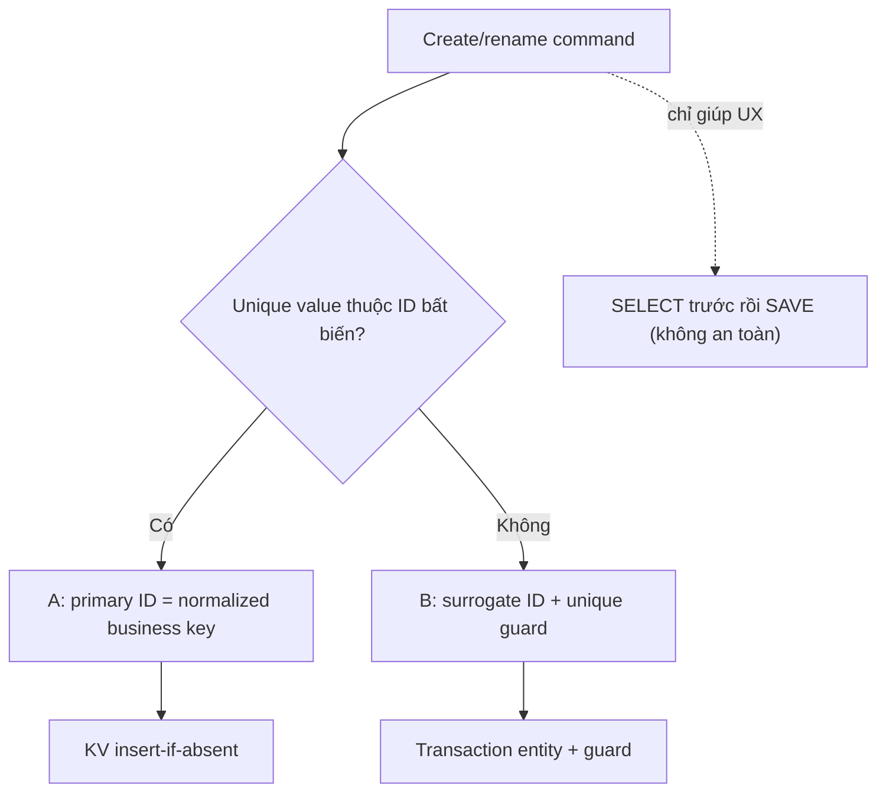
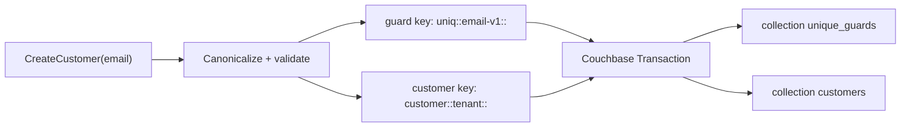
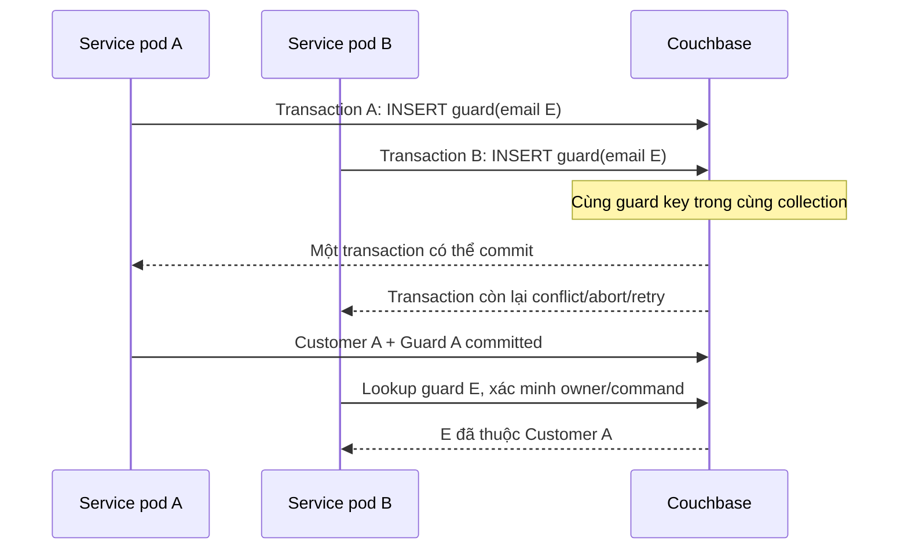
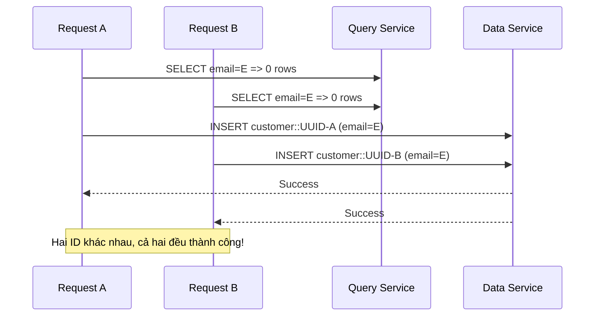
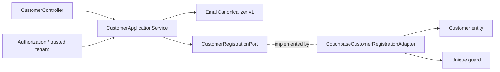

# Ràng buộc duy nhất trong nghiệp vụ và chiến lược theo khóa

## 1. Vấn đề: một trường “không được trùng” không tự trở thành ràng buộc dữ liệu

Một cửa hàng dùng Couchbase để lưu tài khoản khách hàng, sản phẩm, đơn hàng và mã giảm giá. Đội sản phẩm đưa ra những quy tắc:

- Một **mã SKU** chỉ được xuất hiện một lần **trong mỗi cửa hàng**.
- Một **email đã chuẩn hóa** chỉ được gắn với một tài khoản đang hoạt động **trong một tenant**, nhưng hai tenant có thể dùng cùng email.
- Mỗi **mã đơn do đối tác gửi** phải duy nhất trong phạm vi `(tenantId, partnerId)`; retry cùng lệnh không tạo đơn thứ hai.
- Một **số hóa đơn pháp lý** không được tái sử dụng theo phạm vi được quy định, kể cả sau khi hóa đơn bị hủy.
- Một **mã khuyến mãi** có thể duy nhất toàn hệ thống, không chỉ ở một collection.

Nếu chỉ viết:

```java
if (repository.findByTenantIdAndSku(tenantId, sku).isEmpty()) {
    repository.save(product);
}
```

thì hai request đồng thời có thể cùng đọc kết quả rỗng và cùng ghi **hai document với hai ID khác nhau**. Một secondary index hoặc `SELECT COUNT(*)` giúp tìm dữ liệu trùng, nhưng không biến bước kiểm tra–ghi thành một phép nguyên tử.

Trong chương **Thiết kế ứng dụng** của **SPRING_DATA_COUCHBASE**, bài này tập trung vào **ràng buộc duy nhất trong nghiệp vụ** và cách thiết kế **document key/unique guard** để bảo vệ chúng. Phạm vi module gồm document mapping, repository, `CouchbaseTemplate`, SQL++, bucket/scope/collection, secondary index, TTL, CAS, giao dịch và lựa chọn API reactive; mỗi khả năng chỉ hữu ích khi đặt đúng trách nhiệm.

### Mục tiêu học tập

Sau bài học, bạn có thể:

1. Phân biệt **định danh document duy nhất** với **thuộc tính nghiệp vụ duy nhất**.
2. Xác định rõ scope của uniqueness: toàn hệ thống, theo tenant, theo tổ chức, theo collection hoặc theo thời gian/trạng thái.
3. Chọn **khóa theo nghiệp vụ** (natural/composite key) hay **khóa đại diện ổn định + unique guard document**.
4. Chuẩn hóa đầu vào và mã hóa composite key sao cho không va chạm do nối chuỗi mơ hồ, sai Unicode hoặc vượt giới hạn ID.
5. Dùng KV `insert` để claim key nguyên tử, dùng CAS cho cập nhật và transaction khi phải ghi cả entity lẫn guard.
6. Đổi/xóa khóa duy nhất mà không tạo khoảng thời gian cho phép hai owner chiếm cùng giá trị.
7. Xử lý retry, commit ambiguity, TTL, tenant isolation, reactive và kiểm thử cạnh tranh.

> **Phạm vi kỹ thuật:** Ví dụ sử dụng Java 17+, Couchbase Java SDK 3.x, Spring Data Couchbase theo BOM tương thích với Spring Boot và Couchbase Server có hỗ trợ tính năng được dùng. Code block là minh họa từng trách nhiệm, không phải một dự án hoàn chỉnh; phải xác minh transaction, exception translation và mapping ở phiên bản đang triển khai.

## 2. Có những loại “duy nhất” nào?

### 2.1. Document ID là duy nhất trong **collection**

Couchbase lưu document theo cặp **key/value**; mỗi key **chỉ được phép xuất hiện một lần trong collection đó**. Hai collection khác nhau có thể cùng chứa document key `product::SKU-42` mà không vi phạm ràng buộc ở Data Service.

```text
bucket shop
└── scope sales
    ├── collection products
    │   └── key "product::SKU-42"
    └── collection product_snapshots
        └── key "product::SKU-42"   ← hợp lệ vì collection khác
```

Key là **bất biến**: muốn thay key phải tạo document mới với key mới rồi điều phối xóa/chuyển tham chiếu từ key cũ; không có lệnh “đổi tên key tại chỗ” làm thay mọi khóa ngoại của ứng dụng.

Theo tài liệu Couchbase Server hiện hành, document key thường có giới hạn **246 byte** trong các collection thông thường; `_default` collection có ngoại lệ tương thích **250 byte** khi dùng một số đường truy cập legacy. **Đơn vị là byte UTF-8, không phải số ký tự Java**. Để thiết kế đa collection nhất quán, nên giới hạn key trong **246 byte**, kể cả khi môi trường riêng cho phép dài hơn.

### 2.2. Secondary index không tự cưỡng chế uniqueness của thuộc tính

Ví dụ index:

```sql
CREATE INDEX ix_products_tenant_sku
ON `shop`.`sales`.`products`(tenant_id, sku);
```

Index giúp `WHERE tenant_id = $tenant AND sku = $sku` tìm nhanh hơn. Nó **không phải** một SQL `UNIQUE CONSTRAINT` như ở một số RDBMS và không ngăn hai document ID khác nhau cùng có `tenant_id="store-01", sku="SKU-42"`.

Vì vậy, yêu cầu “chỉ một SKU trong tenant” phải được biểu diễn bằng **một document key có thể claim nguyên tử** hoặc một **guard key** gắn với giá trị SKU đã chuẩn hóa.

### 2.3. Hợp đồng uniqueness phải nói đủ phạm vi

| Quy tắc | Scope đề xuất | Có được tái sử dụng sau xóa? | Thay đổi được không? |
| --- | --- | --- | --- |
| SKU | `(tenantId, normalizedSku)` | Theo policy sản phẩm | Có thể đổi mã |
| Email đăng nhập | `(tenantId, normalizedEmail)` | Theo chính sách tài khoản và recovery | Có thể đổi |
| Username cộng đồng | Có thể toàn hệ thống | Thường giữ một thời gian chống giả mạo | Có thể đổi |
| External order reference | `(tenantId, partnerId, externalOrderId)` | Thường không tái sử dụng trong dedupe window | Thường bất biến |
| Mã giảm giá công khai | `(campaignId, code)` hoặc toàn hệ thống | Theo campaign policy | Thường bất biến |
| Số hóa đơn pháp lý | Phạm vi tổ chức/kỳ/loại theo luật | Nhiều trường hợp **không** được tái sử dụng | Không sửa trực tiếp |

Đừng mã hóa quy tắc “unique theo tenant” thành một key **toàn cục** nếu hai tenant có quyền dùng cùng SKU. Ngược lại, một username cần duy nhất toàn hệ thống không thể được bảo vệ bằng guard key chứa tenant nếu mọi tenant được phép sở hữu cùng username.

Các câu hỏi phải được xác nhận trước khi viết repository:

1. “Duy nhất” áp dụng với **tất cả document** hay chỉ những bản ghi có `status=ACTIVE`?
2. Giá trị `NULL`/`MISSING` có được phép ở nhiều document hay là lỗi validation?
3. Chuỗi `SKU-42` và `sku-42` có được xem là cùng khóa? Có bỏ khoảng trắng đầu/cuối không?
4. Có được đổi giá trị sau khi tạo? Nếu đổi, ai quản lý khóa cũ?
5. Một lệnh retry sau timeout có được nhận diện cùng ý định không?
6. Có yêu cầu giữ quyền sở hữu khóa sau xóa/hủy hoặc sau khi TTL hết hạn không?

## 3. Ba cách bảo vệ một ràng buộc duy nhất

| Cách | Cơ chế | Khi phù hợp | Giới hạn |
| --- | --- | --- | --- |
| **A. Natural/composite document key** | Key được tính từ các trường nghiệp vụ, `insert` fail nếu tồn tại | Giá trị unique chính là định danh ổn định của aggregate | Đổi giá trị dẫn đến đổi key |
| **B. Surrogate entity key + unique guard** | Entity có ID riêng, guard key tính từ giá trị unique, claim bằng `insert` | Email/SKU có thể đổi, entity được tham chiếu ổn định | Cần đồng bộ guard và entity |
| **C. Chỉ query trước khi ghi** | `SELECT`/`findBy...` rồi `save` | Chỉ có ích như validation/UX gợi ý trước khi submit | **Không đảm bảo** tính duy nhất dưới concurrency |

Sơ đồ:



Quy tắc thực dụng: **nếu có thể biểu diễn toàn bộ ràng buộc trong một document ID ổn định, hãy cân nhắc dùng KV `insert` trước khi tăng độ phức tạp**. Khi ID cần giữ ổn định nhưng trường unique có thể đổi, dùng guard kèm transaction/hợp đồng phục hồi rõ ràng.

## 4. Thiết kế key: namespace, scope, chuẩn hóa và giới hạn byte

### 4.1. Đừng ghép chuỗi không có quy tắc

Giả sử một composite key dùng `tenantId` và `externalOrderId`. Ghép trực tiếp:

```text
tenant="ab"  + ref="c"  → "abc"
tenant="a"   + ref="bc" → "abc"
```

Đặt dấu `::` giúp đọc log nhưng **không đủ chống nhập nhằng** nếu chính giá trị đầu vào được phép chứa `::`. Các cách đáng tin hơn:

- Giới hạn format từng thành phần bằng whitelist chặt.
- Dùng **length prefix** cho từng thành phần (`2:ab1:c` khác `1:a2:bc`).
- Mã hóa bộ thành phần chuẩn hóa theo canonical binary/text encoding rồi băm mạnh (SHA-256); lưu các thành phần gốc trong document để kiểm tra.

### 4.2. Chuẩn hóa là **quy tắc nghiệp vụ**, không phải một `trim().toLowerCase()` tùy tiện

| Dữ liệu | Chuẩn hóa khả dĩ | Quyết định bắt buộc |
| --- | --- | --- |
| SKU | `trim`, uppercase `Locale.ROOT`, quy tắc ký tự ASCII | SKU có phân biệt hoa–thường không? |
| Username | Unicode normalization và case folding có kiểm soát | Có cho phép Unicode/confusables không? |
| Email | Trim, chuẩn hóa domain, chính sách xử lý local-part | **Không** mặc định bỏ dấu `.` hoặc phần `+tag` cho mọi provider |
| Điện thoại | Chuẩn hóa E.164 bằng thư viện phù hợp | Region và số chưa xác minh được xử lý thế nào? |
| Mã đối tác | Theo format/contract của chính đối tác | Phân biệt case hay giữ nguyên byte? |
| Số hóa đơn | Ghép organization + series + year + sequence | “Duy nhất trong kỳ” hay vĩnh viễn? |

Điều đặc biệt dễ sai với email: phần domain không phân biệt hoa–thường, nhưng chính sách xử lý **local-part** phụ thuộc hệ thống nghiệp vụ/provider. Đừng tự xóa dấu chấm, dấu cộng hoặc lowercase mọi email rồi coi đó là tiêu chuẩn chung; hãy viết và version hóa **canonicalization policy** của chính sản phẩm.

### 4.3. Ví dụ key builder Java 17

```java
package com.example.shop.identity;

import java.nio.charset.StandardCharsets;
import java.security.MessageDigest;
import java.security.NoSuchAlgorithmException;
import java.text.Normalizer;
import java.util.HexFormat;
import java.util.Locale;

public final class BusinessKeys {
    private BusinessKeys() {}

    public static String canonicalSku(String value) {
        if (value == null) {
            throw new IllegalArgumentException("Thiếu SKU");
        }
        String sku = Normalizer.normalize(
                value.trim(), Normalizer.Form.NFC)
                .toUpperCase(Locale.ROOT);

        if (!sku.matches("[A-Z0-9][A-Z0-9_-]{0,63}")) {
            throw new IllegalArgumentException("SKU không hợp lệ");
        }
        return sku;
    }

    public static String skuKey(String tenantId, String rawSku) {
        requireTenant(tenantId);
        String material = frame("sku-v1")
                + frame(tenantId)
                + frame(canonicalSku(rawSku));

        // Digest cố định độ dài, tránh đưa SKU/tenant thô vào key.
        return checkedKey("product::" + sha256(material));
    }

    public static String emailGuardKey(
            String tenantId, String canonicalEmail) {
        requireTenant(tenantId);
        if (canonicalEmail == null || canonicalEmail.isBlank()) {
            throw new IllegalArgumentException("Thiếu email chuẩn hóa");
        }
        // Canonical email do một policy riêng đã kiểm chứng tạo ra.
        return checkedKey("uniq::email-v1::" + sha256(
                frame("email-v1") + frame(tenantId)
                        + frame(canonicalEmail)));
    }

    private static String frame(String part) {
        return part.length() + ":" + part;
    }

    private static void requireTenant(String tenantId) {
        if (tenantId == null || tenantId.isBlank()) {
            throw new IllegalArgumentException("Tenant không hợp lệ");
        }
    }

    private static String checkedKey(String key) {
        if (key.getBytes(StandardCharsets.UTF_8).length > 246) {
            throw new IllegalArgumentException("Key vượt 246 byte");
        }
        return key;
    }

    private static String sha256(String data) {
        try {
            byte[] digest = MessageDigest.getInstance("SHA-256")
                    .digest(data.getBytes(StandardCharsets.UTF_8));
            return HexFormat.of().formatHex(digest);
        } catch (NoSuchAlgorithmException e) {
            throw new IllegalStateException(e);
        }
    }
}
```

Đây là **policy minh họa**: SKU bị giới hạn ASCII và không phân biệt hoa–thường, nhưng nhiều hệ thống có SKU Unicode hoặc phân biệt case. `emailGuardKey` chỉ nhận **email đã canonicalize** từ một component được version hóa độc lập; nó cố ý không bịa một quy tắc chuẩn email duy nhất cho mọi sản phẩm.

Vì output digest có chiều dài cố định, key không vượt giới hạn do giá trị đầu vào dài (nhưng **vẫn phải giới hạn độ dài input** để chống lạm dụng CPU/memory). SHA-256 có xác suất va chạm cực nhỏ nhưng không tạo một phép chứng minh toán học tuyệt đối: guard body phải giữ **canonical value + scope**, khi lookup luôn so lại, không chỉ tin vào hash. Nếu giá trị có entropy thấp và cần giảm rủi ro suy đoán ngoại tuyến, có thể dùng HMAC có secret quản trị an toàn; **hash không phải authorization**.

**Chú ý về version hóa:** thêm `sku-v1`/`email-v1` vào key giúp biểu diễn policy canonicalization cụ thể. Nếu sau này đổi policy, không được chỉ chuyển sang `v2` và quên bảo vệ những giá trị đã được claim theo v1; cần migration/dual-check/dual-claim có kiểm thử cạnh tranh.

## 5. Chiến lược A: business key chính là document ID

Khi SKU bất biến trong vòng đời sản phẩm, ràng buộc `(tenantId, normalizedSku)` có thể được thực thi trực tiếp bằng **một document ID xác định**:

```text
tenant = store-01
sku raw = " sku-42 "
sku canonical = "SKU-42"

key = product::<sha256(frame(tenant) + frame(SKU-42))>
```

Hai request tạo cùng tenant + SKU sẽ đi tới **cùng document key**, bất kể do pod nào xử lý. Khác tenant sẽ tạo key khác. Quan trọng nhất là chọn **`insert` thay vì `upsert`**.

### 5.1. SDK Java: claim duy nhất bằng insert-if-absent

```java
package com.example.shop.products.persistence;

import com.couchbase.client.core.error.DocumentExistsException;
import com.couchbase.client.java.Collection;
import com.couchbase.client.java.json.JsonObject;
import com.example.shop.identity.BusinessKeys;

public final class ProductCreationAdapter {
    private final Collection products;

    public ProductCreationAdapter(Collection products) {
        this.products = products; // shop.sales.products
    }

    public String create(
            String trustedTenantId,
            String skuFromRequest,
            String name,
            String requestFingerprint) {

        String sku = BusinessKeys.canonicalSku(skuFromRequest);
        String id = BusinessKeys.skuKey(trustedTenantId, sku);

        JsonObject body = JsonObject.create()
                .put("tenant_id", trustedTenantId)
                .put("sku", sku)
                .put("name", name)
                .put("creation_fingerprint", requestFingerprint)
                .put("status", "ACTIVE");

        try {
            products.insert(id, body);
            return id;
        } catch (DocumentExistsException alreadyExists) {
            // Rất có thể là một SKU đã có. Không tự coi là retry.
            JsonObject current = products.get(id).contentAsObject();
            if (!trustedTenantId.equals(
                        current.getString("tenant_id"))
                    || !sku.equals(current.getString("sku"))) {
                throw new CorruptedBusinessKeyException(id);
            }
            if (requestFingerprint.equals(
                    current.getString("creation_fingerprint"))) {
                // Chỉ replay nếu API còn xác minh đúng actor/command
                // và hợp đồng tạo cho phép trả kết quả lần đầu.
                return id;
            }
            throw new DuplicateSkuException(sku);
        }
    }
}
```

`DuplicateSkuException` và `CorruptedBusinessKeyException` là exception ứng dụng, phải tự định nghĩa. Đoạn ví dụ giả định `requestFingerprint` đã được tạo từ ý định create chuẩn hóa, `name` được validate và tenant được xác thực ở application layer. Trước khi replay, production còn phải kiểm tra **actor/authorization**; cùng SKU và fingerprint chưa nhất thiết chứng minh cùng người đang retry.

**Tính nguyên tử:** `products.insert(id,body)` là một thao tác KV trên key đó. Khi hai request cùng thực hiện, chỉ một request có thể tạo document với key đang trống; request còn lại sẽ gặp duplicate key. Đây là điểm khác căn bản với `findBySku(...)` rồi `save(new UUID())`.

**Lỗi mạng:** `DocumentExistsException` là tình huống rõ về key đã tồn tại tại thời điểm insert; nhưng timeout không được tự chuyển thành “đã thất bại”. Trong trường hợp outcome chưa rõ, tra cứu bằng **cùng key** rồi kiểm tra canonical value/fingerprint và retry có giới hạn. Nếu document vừa bị xóa sau timeout, phải có chính sách tombstone/receipt để phân biệt lệnh cũ với tạo mới.

### 5.2. Spring Data Couchbase: entity mapping và insert-only

Với Spring Data, entity có thể là:

```java
package com.example.shop.products.persistence;

import org.springframework.data.annotation.Id;
import org.springframework.data.annotation.Version;
import org.springframework.data.couchbase.core.mapping.Document;
import org.springframework.data.couchbase.core.mapping.Field;
import org.springframework.data.couchbase.core.mapping.Scope;
import org.springframework.data.couchbase.core.mapping.Collection;

@Document
@Scope("sales")
@Collection("products")
public class ProductDocument {
    @Id
    private String id;

    @Field("tenant_id")
    private String tenantId;

    private String sku;
    private String name;

    @Version
    private Long version;

    public ProductDocument() {}
    // Getters/setters/constructor nghiệp vụ trong file thật.
}
```

```java
import org.springframework.data.couchbase.repository.CouchbaseRepository;

public interface ProductRepository
        extends CouchbaseRepository<ProductDocument, String> {
    // Derived query phục vụ tìm kiếm, không cưỡng chế uniqueness.
}
```

`@Id` là document key được application tính từ canonical SKU; `@Version` là Couchbase CAS metadata, dùng phát hiện ghi đè ở những lần update sau. Nếu mục đích là **chỉ tạo**, không nên suy luận rằng mọi `repository.save` luôn có ngữ nghĩa insert-only, đặc biệt khi entity state detection/version thay đổi theo phiên bản.

Spring Data Couchbase có fluent Template API dùng cho mục đích tạo mới:

```java
import org.springframework.data.couchbase.core.CouchbaseTemplate;

ProductDocument persisted = template
        .insertById(ProductDocument.class)
        .one(newProductDocument);
```

Đặt `newProductDocument.id` thành **key đã chuẩn hóa** trước khi insert, và kiểm tra exception translation khi key trùng trên release Spring Data/SDK thực tế. Đường tạo mới **không** nên dùng `upsertById`/ghi đè chỉ để “không bị lỗi duplicate”.

### 5.3. Khi nào natural key là lựa chọn tồi?

Nếu SKU có thể được đổi từ `SKU-42` thành `SKU-0042`, nhưng giỏ hàng, đơn hàng lịch sử và API đang tham chiếu document key chứa SKU, việc đổi mã sẽ thành **di chuyển tài nguyên**. Dù Couchbase có transaction để tạo key mới/xóa key cũ, mọi tham chiếu bên ngoài và event history **không tự được chuyển**.

Các vấn đề:

- Đổi business field kéo theo đổi document key, cache key, event subject, URL.
- Alias cũ có thể phải tồn tại để hỗ trợ migration và redirect.
- Các quan hệ/foreign references chứa ID cũ không thể tự cập nhật nguyên tử nếu phân tán ở nhiều hệ thống.
- Mã nghiệp vụ có thể được tái sử dụng sau xóa, trong khi lịch sử cần ID vĩnh viễn.

**Nếu một thuộc tính được phép đổi, nên cân nhắc surrogate ID bất biến cho aggregate và dùng guard để cưỡng chế uniqueness riêng.**

## 6. Chiến lược B: surrogate ID + unique guard document

Giả sử khách hàng có `customerId` do server tạo, không đổi suốt vòng đời:

```text
customer ID (ổn định): customer::store-01::b725...
email hiện hành:       customer42@example.com
```

Yêu cầu nghiệp vụ: một email chuẩn hóa chỉ gắn với **một tài khoản ACTIVE trong tenant**. Email có thể đổi, nhưng customer ID và các tham chiếu từ Order/Payment phải giữ nguyên.

Ta tách:

1. **Customer document:** nguồn sự thật về khách hàng, ID ổn định.
2. **Unique guard document:** một key duy nhất cho `(tenantId, canonicalEmail)`, chỉ ra owner `customerId`.



Ví dụ body guard:

```json
{
  "kind": "UNIQUE_EMAIL",
  "tenant_id": "store-01",
  "canonical_email": "customer42@example.com",
  "owner_id": "customer::store-01::b725",
  "state": "ACTIVE",
  "canonicalization_version": 1,
  "claim_command_id": "create-customer-K"
}
```

Vì **mỗi canonical email ánh xạ đến đúng một guard key**, việc **insert-only guard** biến tranh chấp nghiệp vụ thành tranh chấp document key nguyên tử. Phải lưu guard vào **một collection được xác định rõ**, ví dụ `shop.sales.unique_guards`; nếu hai service cùng ràng buộc global email nhưng lại ghi guard vào **hai collection khác nhau**, chúng có thể cùng claim và vẫn vi phạm uniqueness toàn hệ thống.

### 6.1. Vì sao cần transaction giữa guard và entity?

Nếu ghi rời:

```text
T1: INSERT guard(email -> customerId)      thành công
T2: process crash                          (chưa có Customer)
```

email bị **giữ chỗ ma** (orphan guard): người dùng khác không thể đăng ký, còn `owner_id` không trỏ tới customer nào. Đảo thứ tự:

```text
T1: INSERT customer(UUID)                  thành công
T2: process crash                          (chưa có guard)
```

thì có customer không được bảo vệ uniqueness; một request khác có thể claim cùng email và tạo thêm customer. Nếu yêu cầu cả hai luôn có hoặc cùng không có, **giao dịch đa document** là lựa chọn phù hợp khi chúng ở cùng quyền sở hữu/cluster Couchbase.

### 6.2. Mẫu SDK transaction cho Customer + EmailGuard

```java
package com.example.shop.customers.persistence;

import com.couchbase.client.java.Cluster;
import com.couchbase.client.java.Collection;
import com.couchbase.client.java.json.JsonObject;
import com.couchbase.client.java.transactions.error.TransactionCommitAmbiguousException;
import com.couchbase.client.java.transactions.error.TransactionFailedException;
import com.example.shop.identity.BusinessKeys;

public final class UniqueEmailCustomerStore {
    private final Cluster cluster;
    private final Collection customers;
    private final Collection uniqueGuards;

    public UniqueEmailCustomerStore(Cluster cluster) {
        this.cluster = cluster;
        var scope = cluster.bucket("shop").scope("sales");
        this.customers = scope.collection("customers");
        this.uniqueGuards = scope.collection("unique_guards");
    }

    public void create(
            String trustedTenantId,
            String stableCustomerId,
            String canonicalEmail,
            String claimCommandId) {

        String guardId = BusinessKeys.emailGuardKey(
                trustedTenantId, canonicalEmail);

        // stableCustomerId và claimCommandId phải cố định qua retry.
        // Quyền tenant/actor, email verification, fingerprint
        // và định dạng customerId được application kiểm tra trước.
        try {
            cluster.transactions().run(ctx -> {
                JsonObject guard = JsonObject.create()
                        .put("kind", "UNIQUE_EMAIL")
                        .put("tenant_id", trustedTenantId)
                        .put("canonical_email", canonicalEmail)
                        .put("owner_id", stableCustomerId)
                        .put("claim_command_id", claimCommandId)
                        .put("state", "ACTIVE")
                        .put("canonicalization_version", 1);

                JsonObject customer = JsonObject.create()
                        .put("tenant_id", trustedTenantId)
                        .put("email", canonicalEmail)
                        .put("status", "ACTIVE");

                ctx.insert(uniqueGuards, guardId, guard);
                ctx.insert(customers, stableCustomerId, customer);
            });
        } catch (TransactionCommitAmbiguousException ambiguous) {
            // Commit có thể đã thành công: kiểm tra outcome theo
            // stableCustomerId + guardId + claimCommandId.
            throw new RegistrationOutcomeUnknownException(ambiguous);
        } catch (TransactionFailedException failed) {
            // Không gán tất cả lỗi thành "email trùng".
            // Đối chiếu guard hiện có, phân biệt duplicate,
            // xung đột, lỗi quyền, timeout hoặc lỗi hạ tầng.
            throw new RegistrationAttemptFailedException(failed);
        }
    }
}
```

`RegistrationOutcomeUnknownException` và `RegistrationAttemptFailedException` là exception ứng dụng. Mẫu này chỉ trình bày **phần DB mutation trong transaction**, không phải toàn bộ workflow đăng ký: application còn cần xử lý idempotency, xác minh email, thông báo, xác thực quyền và phục hồi sau ambiguous outcome.

Các điểm không thể bỏ qua:

- **`ctx.insert`** dùng key guard đã chuẩn hóa, không phải `collection.upsert` ghi đè owner hiện hữu.
- **Hai `ctx.insert` cùng transaction**: tránh orphan guard/customer khi transaction commit/abort đúng cách.
- **Định danh và data snapshot ổn định ngoài callback**: callback có thể được SDK retry; không sinh ID mới, gửi email hay gọi payment trong lambda.
- **Validation ngoài transaction không đủ để chặn race**: chính `ctx.insert(uniqueGuards,guardId,...)` là điểm tranh chấp quyết định.
- **Khi transaction thất bại**, phải phân loại: guard tồn tại và thuộc owner khác → uniqueness conflict; guard đã thuộc đúng owner/command → có thể là retry; lỗi hạ tầng/ambiguous → kiểm tra, không bịa response success/failure.
- **Couchbase transaction chỉ nguyên tử hóa các mutation Couchbase có tham gia**, không biến lệnh gọi email provider hoặc identity service bên ngoài thành transaction chung.

### 6.3. Tình huống hai pod cùng claim email



Không giả định pod A luôn thắng; thứ tự chỉ minh họa. **Bất biến cần kiểm thử** là: *không có hai customer ACTIVE cùng canonical email trong tenant*, bất kể nhiều pod cùng thực thi. Nếu một request retry của cùng command, receipt/claimCommandId giúp phân biệt với một khách hàng **khác** đang chọn cùng email.

## 7. Đổi khóa nghiệp vụ: claim mới, cập nhật entity, release cũ

Đổi email không chỉ là cập nhật `customer.email`. Nếu vẫn giữ guard của email cũ và chưa giữ guard của email mới, thì:

- Email cũ bị khóa dù owner đã bỏ dùng.
- Email mới có thể được một customer khác claim đồng thời.
- Một SQL++ query có thể thấy email mới ở hai customer trong khi guard chỉ trỏ tới một owner.

Với chính sách **email duy nhất trong nhóm ACTIVE và được tái sử dụng ngay khi owner rời khỏi giá trị cũ**, ba bước phải cùng một ranh giới nguyên tử:

```text
Transaction đổi email:
  1. INSERT guard(newCanonicalEmail -> sameCustomerId)
  2. REPLACE customer.email = newCanonicalEmail
  3. REMOVE guard(oldCanonicalEmail) [sau khi xác nhận owner]

Commit:
  Customer chỉ có email mới.
  Guard mới thuộc customer.
  Guard cũ được giải phóng theo đúng policy.
```

Nếu không cho tái sử dụng email cũ ngay, **không REMOVE old guard**: thay vào đó đổi guard thành **tombstone/reserved** với thời hạn rõ ràng và giữ cơ chế insert-only từ chối claim cho đến khi được giải phóng an toàn.

### 7.1. Mẫu đổi email bằng transaction SDK

Đây là phần persistence của một lệnh `ChangeCustomerEmail` đã được Service xác thực quyền, kiểm tra ownership, chốt `expectedOldEmail`/new canonical email và cấp một `commandId` ổn định.

```java
import com.couchbase.client.java.Cluster;
import com.couchbase.client.java.Collection;
import com.couchbase.client.java.json.JsonObject;
import com.couchbase.client.java.transactions.TransactionGetResult;
import java.util.Objects;

public void changeEmail(
        Cluster cluster,
        Collection customers,
        Collection uniqueGuards,
        String trustedTenantId,
        String customerId,
        String expectedOldEmail,
        String newCanonicalEmail,
        String commandId) {

    String newGuardId = BusinessKeys.emailGuardKey(
            trustedTenantId, newCanonicalEmail);

    cluster.transactions().run(ctx -> {
        TransactionGetResult customer =
                ctx.get(customers, customerId);
        JsonObject current = customer.contentAs(JsonObject.class);

        if (!trustedTenantId.equals(
                    current.getString("tenant_id"))) {
            throw new CustomerNotFoundException();
        }
        String actualOldEmail = current.getString("email");
        if (!Objects.equals(expectedOldEmail, actualOldEmail)) {
            throw new StaleEmailChangeException();
        }
        if (newCanonicalEmail.equals(actualOldEmail)) {
            return; // Cùng canonical email: không tạo guard mới.
        }

        String oldGuardId = BusinessKeys.emailGuardKey(
                trustedTenantId, actualOldEmail);
        TransactionGetResult oldGuard =
                ctx.get(uniqueGuards, oldGuardId);
        JsonObject oldGuardBody =
                oldGuard.contentAs(JsonObject.class);

        if (!customerId.equals(
                    oldGuardBody.getString("owner_id"))
                || !trustedTenantId.equals(
                    oldGuardBody.getString("tenant_id"))) {
            throw new UniqueGuardInvariantViolationException();
        }

        JsonObject newGuard = JsonObject.create()
                .put("kind", "UNIQUE_EMAIL")
                .put("tenant_id", trustedTenantId)
                .put("canonical_email", newCanonicalEmail)
                .put("owner_id", customerId)
                .put("claim_command_id", commandId)
                .put("state", "ACTIVE")
                .put("canonicalization_version", 1);

        ctx.insert(uniqueGuards, newGuardId, newGuard);

        current.put("email", newCanonicalEmail);
        ctx.replace(customer, current);

        // Chỉ được xóa nếu policy cho tái sử dụng email cũ ngay.
        ctx.remove(oldGuard);
    });
}
```

Các exception domain `StaleEmailChangeException` và `UniqueGuardInvariantViolationException` do ứng dụng định nghĩa. Mẫu này **chưa bọc** `TransactionCommitAmbiguousException`/reconciliation để tập trung vào trình tự mutation; production phải xử lý giống mục 6, theo **cùng customerId và commandId**, không thử lại với ID mới.

**Tại sao có `expectedOldEmail`?** Nếu user A và B cùng gửi hai lệnh đổi email khác nhau, cả hai không thể được áp lại tuần tự chỉ vì SDK retry transaction. Một lệnh cũ phải bị từ chối khi email hiện hành không còn đúng state mà client đã dựa vào. Bên cạnh kiểm tra này, **transaction/CAS** ngăn hai mutation tranh chấp commit như thể không có xung đột.

**Quan trọng:** phiên bản transaction/SDK có quy tắc riêng khi callback ném exception và retry. Không “bắt rồi nuốt” lỗi nghiệp vụ trong lambda, không thực hiện API call ngoài Couchbase trong lambda và không tạo `commandId` mới ở mỗi attempt.

### 7.2. Khi có nhiều ràng buộc unique trên một aggregate

Giả sử Customer phải có cả **email** và **username** duy nhất trong tenant:

```text
Transaction tạo Customer:
  INSERT guard(email-v1, tenant, canonicalEmail)
  INSERT guard(username-v1, tenant, canonicalUsername)
  INSERT customer(customerId)
```

Nếu username bị trùng, transaction phải rollback luôn guard email; không để email bị giữ chỗ nhưng customer chưa tồn tại. Khi đổi username, chỉ thay guard username và customer, không động vào guard email nếu nó không đổi.

**Đừng cho một “helper” riêng tự commit từng guard** bên trong một use case cần all-or-nothing. Có thể tạo `UniqueKeyService`/factory để sinh và validate key, nhưng transaction boundary phải do application owner phối hợp và persistence adapter hỗ trợ.

### 7.3. Thay key nếu aggregate ID chính là business key

Đôi khi mô hình A ở mục 5 đã được triển khai, SKU trở thành `ProductDocument.@Id`. Khi SKU đổi, cần:

1. Claim key mới bằng insert-only.
2. Sao chép/migrate nội dung theo schema đã được xác thực, có CAS/version thích hợp.
3. Giải phóng hoặc giữ redirect/tombstone key cũ theo policy.
4. Cập nhật các **tham chiếu** trong hệ thống ngoài giao dịch/collection một cách có kiểm soát.

Một transaction Couchbase có thể làm nguyên tử bước tạo key mới/xóa key cũ trong cùng phạm vi được hỗ trợ, nhưng không tự sửa URL bookmark, event history hay dữ liệu ở một microservice khác. Nếu rename là thao tác thường xuyên, **ID đại diện ổn định + guard** thường đơn giản và an toàn hơn.

## 8. Xóa, ngưng hoạt động, tái sử dụng khóa và tombstone

“Xóa tài khoản” không nhất thiết có nghĩa “email có thể được đăng ký lại ngay”. Cần một **chính sách ownership theo vòng đời**.

| Chính sách uniqueness | Khi entity bị xóa/ngưng | Hành vi guard |
| --- | --- | --- |
| Unique chỉ với ACTIVE, được tái sử dụng ngay | Deactivate/delete entity và release key **nguyên tử** | Xóa guard hoặc chuyển trạng thái theo cơ chế tái claim an toàn |
| Unique với ACTIVE, giữ 30 ngày chống giả mạo | Không cho owner mới dùng key trong 30 ngày | Tombstone/RESERVED, dọn sau retention |
| Unique vĩnh viễn (một mã pháp lý) | Không được dùng lại key dù entity bị hủy | Giữ guard/tombstone lâu dài theo policy |
| Unique trong một kỳ tài chính | Key có cả kỳ/năm/series | Guard thuộc scope kỳ; kỳ khác có thể dùng cùng số |
| Unique gắn với bản ghi hết TTL | Cần biết có cho tái sử dụng sau expiry không | Không để guard/owner lệch vòng đời |

### 8.1. Xóa guard trước hay xóa entity trước đều có vấn đề nếu không nguyên tử

**Xóa guard trước:** Customer vẫn ACTIVE với email cũ trong một khoảng thời gian; request khác có thể claim email và tạo Customer thứ hai.

**Xóa entity trước:** Email vẫn bị giữ bởi guard mồ côi nếu process chết sau khi xóa entity.

Với yêu cầu nhất quán mạnh trên hai document, đặt `delete/soft-delete Customer` và `remove/replace guard` trong **cùng transaction**. Khi xóa guard, phải đọc và xác nhận `owner_id` khớp; không cho một delete command đến muộn xóa guard đã được **owner mới claim lại**.

### 8.2. Tombstone phải có ngữ nghĩa rõ

Một guard giữ chỗ sau khi ngưng hoạt động:

```json
{
  "kind": "UNIQUE_USERNAME",
  "tenant_id": "store-01",
  "canonical_value": "user-42",
  "owner_id": "customer::store-01::abc",
  "state": "RESERVED_AFTER_DELETE",
  "released_at_ms": 1795595400000,
  "reuse_after_ms": 1798187400000,
  "deletion_command_id": "delete-K"
}
```

`released_at_ms` và `reuse_after_ms` ở đây là **thời điểm nghiệp vụ**, không phải metadata TTL của Couchbase. Worker có thể quét và giải phóng các guard đủ điều kiện sau deadline, dùng CAS/transaction để bảo đảm không xóa một guard đã được claim lại giữa lúc đọc và ghi.

**TTL không tự thực hiện lệnh nghiệp vụ “release unique key”.** TTL xóa document theo chính sách expiry. Nếu yêu cầu audit, quyền tái sử dụng, đối soát ID cũ hoặc chống ABA, cần giữ tombstone/receipt đủ lâu và có quy trình dọn an toàn, thay vì coi expiry là một transaction callback.

### 8.3. Nguy cơ ABA khi giải phóng rồi claim lại

```text
T0: Guard E thuộc Customer A.
T1: A đổi email, guard E được release.
T2: Customer B claim guard E.
T3: Retry delete/rename cũ của A cố xóa guard E.
T4: Nếu xóa theo key mà không kiểm tra owner → B mất bảo vệ!
```

Phòng tránh:

- **Luôn xác minh owner và generation/claim ID** của guard trước khi release.
- Dùng CAS/transaction cho đọc–kiểm tra–ghi/xóa; không chỉ `collection.remove(guardKey)` mù quáng.
- Một command retry phải mang **commandId** và có receipt hoặc precondition để không trở thành lệnh mới.
- Nếu business không muốn reuse, giữ tombstone/guard và không cho insert key mới.
- Nếu policy cho reuse, chứng minh rằng cleanup worker không thể xóa guard thế hệ mới sau khi job cũ bị delay.

### 8.4. TTL của entity và guard phải được thiết kế cùng nhau

Một sai lầm phổ biến là đặt **guard TTL ngắn hơn tuổi thọ entity**. Guard hết hạn trong khi Customer vẫn ACTIVE; user khác đăng ký cùng email, hai Customer cùng ACTIVE.

Điều kiện an toàn tối thiểu:

```text
Trong mọi thời điểm Customer ACTIVE với unique email E:
    Guard(E) phải tồn tại và owner_id phải trỏ đến Customer đó.
```

Nếu Customer có TTL vì mục đích dữ liệu tạm thời, phải thiết kế quy trình gỡ/giải phóng guard phù hợp, kể cả khi job cleanup bị chậm hoặc bị retry. Không để hai document có TTL độc lập rồi giả định chúng sẽ hết hạn đúng một thời điểm. Với dữ liệu quan trọng, cân nhắc không dùng TTL tự động cho guard ACTIVE; dùng command chuyển trạng thái có transaction và chỉ dọn guard sau khi hoàn tất.

## 9. “Kiểm tra trước bằng SQL++” vì sao không đủ?

Giả sử dùng hai document Customer có key UUID khác nhau:



Ngay cả nếu cả hai câu SELECT đều có **index mới nhất**, race **check-then-act** vẫn tồn tại. SQL++ scan consistency `REQUEST_PLUS` giúp truy vấn index bắt kịp các mutation được xác nhận đến thời điểm query bắt đầu; nó **không biến** câu SELECT và một KV insert sau đó thành một phép so sánh–ghi nguyên tử.

### 9.1. Query phục vụ tìm kiếm, guard phục vụ enforcement

Ví dụ query để hiển thị một customer theo email:

```sql
SELECT META(c).id AS documentId,
       c.tenant_id, c.email, c.status
FROM `shop`.`sales`.`customers` AS c
WHERE c.tenant_id = $tenantId
  AND c.email = $canonicalEmail;
```

Index hỗ trợ truy vấn đó:

```sql
CREATE INDEX ix_customers_tenant_email
ON `shop`.`sales`.`customers`(
    tenant_id, email
);
```

Index giúp query nhanh hơn và hữu ích để **phát hiện dữ liệu legacy trùng**; nó không thay việc **insert-if-absent vào guard key**. Nếu `Customer.email` có thể là `MISSING`/`NULL`, phải xác định liệu có lọc riêng hay không; không để một giá trị thiếu được mặc định là email hợp lệ và tạo một guard chung cho tất cả.

### 9.2. Key lookup thường không cần secondary index

Khi biết email đã chuẩn hóa:

```java
String guardId = BusinessKeys.emailGuardKey(
        trustedTenantId, canonicalEmail);

JsonObject guard = uniqueGuards.get(guardId).contentAsObject();
String ownerId = guard.getString("owner_id");
```

Truy cập guard bằng **KV key** không cần tạo index trên `canonical_email` để tìm đúng một guard. Một query index vẫn có ích cho dashboard/quét các guard theo trạng thái hoặc tenant nhưng **không nên dùng SQL++ SELECT để claim uniqueness**.

### 9.3. Truy vấn “phát hiện trùng” dùng trong migration, không phải khóa nghiệp vụ

Một câu SQL++ để điều tra dữ liệu cũ:

```sql
SELECT c.tenant_id,
       c.email,
       COUNT(1) AS duplicateCount
FROM `shop`.`sales`.`customers` AS c
WHERE c.status = "ACTIVE"
  AND c.email IS NOT MISSING
  AND c.email IS NOT NULL
GROUP BY c.tenant_id, c.email
HAVING COUNT(1) > 1;
```

Điều kiện trên nhóm theo **giá trị email đang lưu**. Nếu business so email không phân biệt case, báo cáo phải nhóm theo **canonical value đã áp dụng policy**; dùng `LOWER(email)` tùy tiện có thể không tương đương policy của Java, đặc biệt với Unicode. Một migration an toàn nên có field `canonical_email` được tạo bởi cùng canonicalizer, sau đó dùng query để kiểm tra.

Tính nhất quán của index cũng quan trọng khi chạy kiểm kê dữ liệu. Không dùng một kết quả “không có trùng” từ index chưa bắt kịp toàn bộ mutation làm bằng chứng rằng có thể bật uniqueness mới mà không có race.

## 10. Ranh giới ứng dụng: Service, guard coordinator và Repository

Một thiết kế rõ trách nhiệm:



| Thành phần | Trách nhiệm | Tránh |
| --- | --- | --- |
| Controller | DTO, `@Valid`, status 201/409/202, request ID | Tự ghép document key và gọi `Cluster` |
| Application Service | Tenant/actor authorization, canonicalization, idempotency policy, workflow đổi/xóa | Bỏ qua key conflict rồi tạo UUID mới |
| Domain aggregate | Quy tắc ACTIVE/DELETED, email đổi được không, invariants | Biết `QueryCriteria` hoặc JSON path |
| `CustomerRegistrationPort` | Hợp đồng `claimEmailAndCreate`, `changeEmail`, `releaseEmail` | Trả `JsonObject` raw cho HTTP |
| Couchbase adapter | Key builder, KV `insert`, transaction, CAS, guard mapping | Tự quyết định actor nào được sửa account |
| Read repository/query adapter | Tìm kiếm khách hàng, phân trang, SQL++/index | Cưỡng chế uniqueness bằng query trước save |

Một kiểu command application:

```java
package com.example.shop.customers.application;

public record RegisterCustomerCommand(
        String trustedTenantId,
        String actorId,
        String rawEmail,
        String idempotencyKey
) {}
```

`trustedTenantId` và `actorId` trong command phải xuất phát từ **principal/identity đã xác thực**; không tự tin những field được gửi trong JSON body. Service chuẩn hóa `rawEmail` theo policy rồi truyền `canonicalEmail`, `customerId` và `commandId` ổn định xuống adapter.

### 10.1. Port có ngữ nghĩa nghiệp vụ, không mô tả thao tác SQL

```java
public interface CustomerRegistrationPort {
    RegistrationResult claimEmailAndCreate(
            AuthorizedRegistration command,
            String canonicalEmail,
            String stableCustomerId);

    RegistrationResult changeEmail(
            AuthorizedEmailChange command,
            String newCanonicalEmail);
}
```

`RegistrationResult`, `AuthorizedRegistration` và `AuthorizedEmailChange` là **kiểu application do dự án định nghĩa**. `AuthorizedEmailChange` cần mang precondition (customer hiện có, email kỳ vọng/version, command ID). Adapter thực thi guard/transaction còn Service bảo vệ workflow và ranh giới quyền.

Nếu ứng dụng nhỏ, có thể gọi `CouchbaseTemplate`/repository trực tiếp trong Service, nhưng vẫn phải có **một đường ghi chính thức** cho ràng buộc email. Không cho user profile service, admin API và data import mỗi nơi ghi `CustomerDocument.email` theo cách riêng.

### 10.2. Khi chỉ có một aggregate/document

Nếu natural key là document ID, Spring Data repository và `CouchbaseTemplate.insertById` đã đủ cho create-only. Dùng transaction chỉ vì “unique” trong **một document** thường tăng chi phí không cần thiết.

Ngược lại, khi Customer và guard là **hai document**, chỉ đặt `@Transactional` trên method mà không kiểm tra transaction manager và các thao tác có tham gia thực sự là rủi ro. Phải khóa phiên bản Spring Data, cấu hình đúng `CouchbaseTransactionManager`/operator nếu dùng Spring transaction và **thử rollback giữa hai mutation**.

### 10.3. Có nhiều service/cluster khác nhau thì sao?

Một guard collection trong cùng cluster có thể đóng vai trò **nguồn sở hữu uniqueness** cho nhiều loại entity của ứng dụng, miễn mọi writer đều **đi qua cùng owner/transaction boundary**. Nhưng nếu tenant A và B ở hai cluster độc lập, một `unique_guards` trên từng cluster **không thể tự đảm bảo uniqueness toàn cầu**.

Khi yêu cầu “username duy nhất trên mọi cluster”, cần một **authority chung**: một service registry với keyspace/transaction nhất quán được chọn, hoặc một hệ thống lưu trữ khác có khả năng cưỡng chế global uniqueness phù hợp. Không đồng nhất tên collection giữa cluster với một ràng buộc duy nhất phân tán.

Tương tự, nếu service Customer sở hữu email nhưng service Billing cũng tự ghi guard email trong database riêng, ràng buộc đã bị tách làm hai. Hãy đặt **write ownership** của uniqueness ở một nơi và cung cấp command/API có policy rõ ràng.

## 11. Lũy đẳng và lỗi commit chưa rõ

Ngay cả khi chỉ một request có thể giữ một unique guard, ứng dụng vẫn phải xử lý **retry của cùng lệnh** khác với **một người mới tranh chấp giá trị**.

### 11.1. Ba tình huống cùng guard key

| Trường hợp | Guard đang thuộc | Incoming command | Hành vi |
| --- | --- | --- | --- |
| Đăng ký mới, chưa có guard | Không ai | A claim email E | Thử insert-only/transaction |
| Retry cùng command A sau timeout | Customer A / command A | A claim lại E | Tra receipt/guard/entity, replay kết quả đã xác nhận |
| Customer B chọn email E | Customer A | B claim E | Trả `DuplicateEmail`/409, không ghi Customer B |
| Customer A đổi email nhưng guard E đã được B claim | Customer B | Retry đổi/xóa cũ của A | **Không** được xóa/ghi đè guard của B |
| Guard E tồn tại nhưng owner thiếu | Orphan do bug/legacy | Claim mới | Không tự chiếm bằng upsert; chuyển sang recovery có kiểm soát |

**Duplicate key không có nghĩa cùng request.** Chỉ sau khi kiểm tra tenant, canonical value, owner, command ID, payload fingerprint và authorization mới quyết định replay hay conflict. Trong hệ thống có xử lý payment hoặc outbox, một guard đã tồn tại chưa chứng minh toàn bộ workflow đã hoàn tất.

### 11.2. Dùng command receipt khi cần replay đúng kết quả

Một receipt theo `(tenant, actor, operation, idempotencyKey)` có thể lưu:

```json
{
  "tenant_id": "store-01",
  "actor_id": "customer-42",
  "operation": "REGISTER_CUSTOMER",
  "command_id": "register-K",
  "fingerprint": "sha256:...",
  "state": "SUCCEEDED",
  "customer_id": "customer::store-01::b725",
  "original_http_status": 201,
  "result": {
    "customerId": "customer::store-01::b725"
  }
}
```

Đối với workflow đòi **Customer + Guard + Receipt + Outbox** cùng tồn tại hoặc cùng không tồn tại, có thể đặt cả bốn trong một Couchbase transaction khi phù hợp server/configuration. Không để một status `SUCCEEDED` được lưu trước khi tạo entity thực sự commit.

Với đăng ký tài khoản cần gửi email xác minh, ghi `VerificationRequested` vào **outbox** trong transaction; gửi email thực sau commit. Outbox worker có thể publish lặp; consumer/provider cần event ID/deduplication, không gửi email từ callback transaction có thể bị retry.

### 11.3. Commit ambiguity

```text
T0: Transaction bắt đầu claim guard + tạo Customer.
T1: Server có thể đã hoàn tất commit.
T2: Kết nối lỗi trước khi caller biết kết quả cuối.
T3: Caller thấy timeout/TransactionCommitAmbiguousException.
```

Không suy ra “giao dịch đã rollback”, cũng không sinh customerId mới rồi gọi lại toàn bộ workflow. Dùng **cùng guard key, stableCustomerId, commandId**, đọc lại state được commit bằng con đường phù hợp, kiểm tra owner/fingerprint và trả `PENDING/UNKNOWN` nếu chưa có bằng chứng.

Một lần KV `get` không thấy Customer trong khi transaction đang ở trạng thái ambiguous **không phải bằng chứng tuyệt đối** rằng commit sẽ không diễn ra. Cần bounded reconciliation, theo dõi tình trạng giao dịch/cleanup và không xóa guard có thể còn thuộc một attempt chưa kết thúc.

### 11.4. Claim ngoài transaction cần lease/fencing và quy trình phục hồi

Đôi khi hệ thống cũ không dùng được multi-document transaction. Một lựa chọn có đánh đổi:

```text
INSERT guard(E, state=PENDING, owner=A, lease=fencing-42)
INSERT Customer A
CAS UPDATE guard(E, state=ACTIVE) nếu owner/fencing còn đúng
```

Với cách này, vẫn có cửa sổ lỗi **guard mồ côi** hoặc Customer không nhất quán. Cần:

- Lease có thời hạn, **fencing token/generation** để worker cũ không ghi sau worker mới.
- Recovery worker đọc guard + Customer/receipt và đối soát trước khi giải phóng.
- Từ chối claim mới khi guard PENDING chưa được xử lý an toàn.
- Idempotency của từng bước và giới hạn retry.
- Test process crash ở mỗi bước, test đồng thời nhiều worker.

**Không xem lease + TTL là tương đương ACID.** Nếu ràng buộc duy nhất bắt buộc phải đúng ngay mọi lúc, ưu tiên thiết kế một-document-key hoặc transaction thật thay vì tự tạo distributed lock thiếu fencing.

## 12. Dữ liệu lịch sử và migration từ “query trước khi save” sang unique guard

Một hệ thống đã có hàng triệu Customer được tạo bằng UUID, trong đó không có guard. Nếu chỉ triển khai code mới `ctx.insert(guard,newEmail)`, tưởng là an toàn nhưng dữ liệu cũ có thể đã chứa email đó **mà không có guard**. Người mới vẫn claim được email của Customer cũ.

Đây là lỗi **migration cửa sổ trống**, không phải lỗi transaction.

### 12.1. Quy trình chuyển đổi an toàn

| Giai đoạn | Công việc | Tiêu chí dừng/tiếp tục |
| --- | --- | --- |
| **0. Xác định policy** | Scope, canonicalization version, ACTIVE/DELETED, quyền tái sử dụng | Product và security owner xác nhận |
| **1. Kiểm kê** | Quét dữ liệu cũ, tính canonical value, thống kê trùng và field thiếu | Có danh sách xung đột để xử lý |
| **2. Đóng cửa sổ race** | Tạm **ngăn create/rename** liên quan uniqueness hoặc dùng giao thức bridge được chứng minh an toàn | Không writer cũ nào còn ghi “bỏ qua guard” |
| **3. Resolve duplicate** | Chọn chủ sở hữu hợp lệ, merge/đổi giá trị/đưa vào quarantine theo policy | Mỗi canonical key có tối đa một owner |
| **4. Backfill guard** | Tạo guard insert-only cho từng entity đang giữ quyền, theo key canonical | Không có mismatch owner và không bỏ sót |
| **5. Verify** | Đối soát chiều Customer → Guard và Guard → Customer | Tập dữ liệu phù hợp invariant |
| **6. Enable new write path** | Bật transaction create/rename/delete theo guard, mở lại chức năng | Không writer legacy nào bypass |
| **7. Cleanup** | Giữ metrics, sửa index, xóa code check-then-save cũ | Regression tests/concurrency PASS |

**Cực kỳ quan trọng:** nếu không thể tạm ngưng writer, cần một giao thức chuyển tiếp **chặn claim email chưa được backfill** (ví dụ một authority/gate theo canonical key) và đảm bảo **mọi** writer mới/cũ cùng tuân thủ. Chỉ bật dual-write ở một số instance trong lúc instance cũ vẫn chạy `findByEmail + save(UUID)` **không tạo bảo đảm uniqueness**.

Trong thời gian backfill, phải xử lý chính sách **`MISSING` vs `NULL`**. Nếu email là optional, một Customer thiếu email không nên chiếm cùng một guard key “null” với tất cả Customer khác. Nếu email bắt buộc, document thiếu giá trị phải được đưa vào remediation trước khi tuyên bố migration thành công.

### 12.2. Đọc, đối soát và lỗi backfill

Với mỗi Customer đang ACTIVE:

```text
canonical = normalize(customer.email, policyVersion=1)
guardKey = emailGuardKey(customer.tenantId, canonical)

INSERT guard(guardKey -> customerId)
    - Nếu success: ghi nhận đã backfill
    - Nếu duplicate cùng owner/canonical: idempotent, bỏ qua
    - Nếu duplicate owner khác: conflict cần giải quyết dữ liệu
    - Nếu timeout: lookup + reconcile, không mặc định fail
```

Nếu vẫn có mutation được phép trong thời gian backfill, cần dùng CAS/transaction phù hợp để không tạo guard cho email **đã bị đổi** giữa lúc đọc Customer và lúc insert. Một snapshot export cũ không phải trạng thái hiện tại; phải so version/timestamp hoặc dùng một giai đoạn write freeze rõ ràng.

**Không xóa guard khi thấy Customer “không tồn tại” qua SQL++ index chưa bắt kịp**. Cần lookup theo key nguồn phù hợp, xem trạng thái transaction và áp dụng chính sách recovery/retention.

### 12.3. Đổi canonicalization policy là một migration dữ liệu

Giả sử `v1` phân biệt hoa–thường, còn `v2` không phân biệt:

```text
v1: "User-42" khác "user-42"
v2: cả hai đều thành "USER-42"
```

Hai record đang hợp lệ ở v1 có thể **trở thành trùng ở v2**. Không chỉ đổi `canonicalSku()` hoặc tiền tố key sang `sku-v2`, rồi cho v2 tạo guard riêng song song với v1. Những writer cũ có thể tiếp tục claim key v1 trong khi writer mới claim key v2 cùng một giá trị ngữ nghĩa.

Cần:

1. Phân tích tập **va chạm theo policy mới** trước deploy.
2. Giải quyết owner của mỗi nhóm va chạm theo policy.
3. Thiết kế giai đoạn dual-read/dual-claim hoặc write freeze có một authority chung.
4. Chuyển các document/guard có CAS, command ID và rollback plan.
5. Khi tất cả writer hiểu v2, bỏ dần v1 và kiểm tra không có guard orphan.

Với hệ thống polyglot (Java, Go, Node.js...), chuẩn hóa ký tự, mã hóa composite key và cách tính hash phải được định nghĩa **theo byte** trong shared contract. `String.length()` của Java đếm UTF-16 code units; nếu ngôn ngữ khác dùng số code points/UTF-8 bytes, hai service có thể sinh **hai guard key khác nhau**. Quy định canonical encoding bằng UTF-8 cùng **length prefix theo byte** hoặc một format canonical phổ quát, rồi tạo cross-language test vectors trước khi phối hợp nhiều writer.

### 12.4. Restore từ backup cũng phải restore invariant

Nếu chỉ restore collection `customers` nhưng không restore `unique_guards`, hệ thống có Customer hợp lệ nhưng email chưa được claim. Nếu chỉ restore guards mà không restore Customer, các key có thể bị giữ chỗ mồ côi.

Một runbook recovery cần:

- Restore entity và guard/receipt cùng một điểm nhất quán, hoặc đóng create/rename cho đến khi đối soát và backfill guard hoàn tất.
- Rebuild secondary indexes nếu cần nhưng **không dùng index như thay thế guard**.
- Đối soát cả hai chiều key → owner và owner → key.
- Chạy integration test duplicate-concurrent trước khi mở lại lưu lượng.
- Ghi audit và khả năng hoàn tác nếu restore/migration đụng trạng thái nghiệp vụ nhạy cảm.

## 13. Reactive API: tính duy nhất vẫn nằm ở key nguyên tử

WebFlux hay Reactor **không thay đổi quy tắc uniqueness**. Điểm quyết định vẫn là một `insert` duy nhất theo canonical key hoặc một transaction claim guard + entity.

### 13.1. Fragment reactive không đủ nếu chỉ dùng `findByEmail`

```java
// KHÔNG ĐỦ: race check-then-act vẫn tồn tại.
return reactiveCustomerRepository
        .findByTenantIdAndEmail(tenant, email)
        .hasElement()
        .flatMap(exists -> exists
                ? Mono.error(new DuplicateEmailException())
                : reactiveCustomerRepository.save(newCustomer));
```

Hai subscription độc lập vẫn có thể cùng thấy không tồn tại và tạo hai UUID. Không sửa bằng `synchronized` ở một JVM vì hệ thống có thể chạy nhiều pod.

### 13.2. Reactive transaction dùng cùng guard key ổn định

```java
import com.couchbase.client.java.Cluster;
import com.couchbase.client.java.ReactiveCollection;
import com.couchbase.client.java.json.JsonObject;
import reactor.core.publisher.Mono;

public Mono<?> createUniqueCustomerReactive(
        Cluster cluster,
        ReactiveCollection uniqueGuards,
        ReactiveCollection customers,
        String guardId,
        String stableCustomerId,
        String trustedTenantId,
        String canonicalEmail) {

    // guardId, customerId, tenant, email đã được chốt trước khi subscribe.
    return Mono.defer(() ->
        cluster.reactive().transactions().run(ctx ->
            ctx.insert(uniqueGuards, guardId,
                    JsonObject.create()
                            .put("tenant_id", trustedTenantId)
                            .put("canonical_email", canonicalEmail)
                            .put("owner_id", stableCustomerId))
               .then(ctx.insert(customers, stableCustomerId,
                    JsonObject.create()
                            .put("tenant_id", trustedTenantId)
                            .put("email", canonicalEmail)
                            .put("status", "ACTIVE")))
        )
    );
}
```

Đây là **khung reactive cho transaction** của SDK, chưa bao gồm payload fingerprint, actor authorization, error mapping hay reconciliation; bổ sung chúng trước khi dùng production. `ReactiveCollection` được lấy từ collection cùng scope, ví dụ `scope.collection("unique_guards").reactive()`. Dữ liệu `JsonObject` được tạo **mới trong callback** để hạn chế trạng thái mutable bị chia sẻ khi SDK retry attempt.

**Không gọi `.block()` trong request path reactive.** Khi transaction có thể retry callback, không phát email hoặc thanh toán bên trong lambda; ghi outbox trong transaction rồi publish sau commit. Với lỗi transaction ambiguous, không `retryWhen` vô điều kiện rồi sinh Customer ID mới; phải tra guard/customer/receipt bằng **ID ổn định**.

### 13.3. Kiểm thử hai subscription

Với cùng `guardId` nhưng hai `stableCustomerId` khác nhau:

- Chạy hai luồng create đồng thời, mỗi luồng dùng publisher/command riêng.
- Kết quả cuối không được có hai Customer ACTIVE sở hữu cùng canonical email.
- Subscription lại **cùng command** sau timeout phải có receipt/reconciliation, không tạo owner mới.
- `StepVerifier` kiểm tra success/error/terminal signal nhưng **không thay thế integration test transaction** trên Couchbase thật.
- Test rằng `JsonObject` và các biến mutable không bị reuse giữa nhiều subscribe theo cách làm thay đổi guard body ngoài ý muốn.

## 14. Kiểm thử ràng buộc unique và chiến lược key

Một bài test chỉ kiểm tra `repository.findByTenantIdAndEmail` trả một record **không chứng minh uniqueness**. Cần kiểm tra key builder, race giữa nhiều writer, transaction atomicity, release/migration và error recovery.

### 14.1. Unit test key normalization và phạm vi

```java
import static org.assertj.core.api.Assertions.*;
import org.junit.jupiter.api.Test;

@Test
void sameSkuCanonicalizesToSameKeyWithinTenant() {
    String first = BusinessKeys.skuKey("store-01", " sku-42 ");
    String second = BusinessKeys.skuKey("store-01", "SKU-42");
    assertThat(first).isEqualTo(second);
}

@Test
void sameSkuHasDifferentKeyAcrossTenants() {
    String t1 = BusinessKeys.skuKey("store-01", "SKU-42");
    String t2 = BusinessKeys.skuKey("store-02", "SKU-42");
    assertThat(t1).isNotEqualTo(t2);
}

@Test
void invalidSkuFailsBeforeDatabaseCall() {
    assertThatThrownBy(() ->
            BusinessKeys.skuKey("store-01", "SKU :: 42"))
            .isInstanceOf(IllegalArgumentException.class);
}
```

Các method trên được đặt bên trong class JUnit `BusinessKeysTest` với import `BusinessKeys`. Bổ sung test format Unicode, `Locale.ROOT`, hai thành phần composite có delimiter giống nhau và đặc biệt **test vector đa ngôn ngữ** nếu có nhiều writer.

### 14.2. Integration test hai request cùng guard

Với Couchbase thật, tạo hai command khác nhau:

```text
Command A: tenant=it-T, email=e@example.com, customerId=A
Command B: tenant=it-T, email=e@example.com, customerId=B

Chạy hai request cùng thời điểm (barrier):
  A -> transaction INSERT guard E, Customer A
  B -> transaction INSERT guard E, Customer B

Assert sau khi mọi transaction attempt đã được phân giải:
  Guard(E).owner_id ∈ {A,B}
  Chỉ Customer tương ứng với owner tồn tại ở trạng thái ACTIVE
  Customer còn lại không có (nếu transaction abort)
  Không có hai Customer ACTIVE với cùng canonical email
```

Test nên dùng **hai connection/client/concurrent tasks thực sự** hoặc hai pod, không chỉ hai lời gọi chạy tuần tự. Một transient conflict có thể khiến một attempt cần retry có giới hạn; assertion quan trọng là **không bao giờ có hai owner thành công** và cuối cùng guard khớp entity, chứ không bắt buộc một trong hai thread luôn là người thắng được chọn trước.

### 14.3. Failure injection để phát hiện transaction giả

| Điểm lỗi | Cách tạo | Kỳ vọng |
| --- | --- | --- |
| Sau khi claim guard, trước khi tạo Customer | Ném exception trong transaction test | Không có guard mồ côi, không có Customer mới |
| Guard đã thuộc owner khác | Cố tạo với email trùng | Không tạo Customer thứ hai |
| Transaction commit ambiguous | Giả lập lỗi mạng ở commit | Reconcile; không tự tạo ID mới |
| Hai rename tranh chấp cùng Customer | Hai `expectedOldEmail` giống nhau | Một được commit; lệnh cũ còn lại conflict/re-evaluate |
| Rename đến email đã được claim | Claim key mới bị duplicate | Email cũ và guard cũ **không đổi** |
| Xóa Customer nhưng cleanup chậm | Giả lập crash sau bước đầu trong thiết kế không transaction | Recovery phát hiện trạng thái lệch |
| Retry xóa guard sau khi owner mới claim | Stale cleanup command | Không xóa guard của owner mới |
| Guard có TTL quá ngắn | Tạo Customer ACTIVE rồi đợi guard hết hạn | Test phát hiện nguy cơ tạo trùng; sửa retention |
| Query index chưa bắt kịp | Ghi KV rồi SQL++ `NOT_BOUNDED` | Không dùng kết quả rỗng để claim uniqueness |
| Key normalization v1/v2 khác nhau | Chạy hai writer policy khác | Test/bridge chặn duplicate |
| Cross-tenant | Cùng email hai tenant | Hai guard key khác nếu policy tenant-scoped |
| Cross-collection/global | Cùng email hai collection | Nếu policy global, cả hai phải dùng cùng authority guard |

**Đọc để khẳng định sau failure:** với guard/Customer hãy đọc bằng KV theo các key ổn định, không dựa riêng vào SQL++ query theo secondary index vừa cập nhật. Sau đó có thể chạy query với consistency phù hợp để kiểm tra dữ liệu bảng báo cáo.

### 14.4. Test xử lý duplicate theo owner/fingerprint

| Guard lookup | Command đang xử lý | Kết quả phù hợp |
| --- | --- | --- |
| Không có guard, không có entity | Command mới | Claim bằng insert/transaction |
| Guard cùng owner, cùng command ID | Retry đúng lệnh | Replay receipt/success đã xác minh |
| Guard cùng owner nhưng command ID khác | Yêu cầu thay đổi/hành động mới | Xem state machine/permission, không mặc định thành công |
| Guard owner khác | Claim mới | Conflict, không sửa owner |
| Guard cùng hash key nhưng canonical value khác | Va chạm dữ liệu/hash/bug | Không replay; quarantine/alert |
| Guard tồn tại nhưng Customer không có | Mồ côi/transaction chưa phân giải | Recovery, không upsert đè guard |
| Customer tồn tại nhưng guard không có | Migration/bug/TTL mismatch | Khóa write path và sửa invariant trước khi cho claim mới |

Với hệ thống nhiều tenant, test cả trường hợp attacker đoán guard ID/Customer ID. Không trả email/owner của người khác trong message “đã có email”, nếu việc tiết lộ tài khoản tồn tại bị chính sách bảo mật hạn chế; API có thể dùng thông điệp chung và audit nội bộ.

## 15. Vận hành: contention, index, bảo mật và quan sát

### 15.1. Một guard “nóng” có phải vấn đề không?

Nếu hàng trăm request cùng cố đăng ký một username phổ biến, tất cả nhắm **cùng guard key**. Điều này là **đúng về mặt enforcement**: chỉ một owner có thể thắng. Nhưng lưu lượng tranh chấp cao có thể gây retry transaction, CAS conflict, latency và áp lực Data Service.

Một số cách giảm chi phí mà **không phá invariant**:

- Validate/canonicalize sớm, rate-limit theo actor/tenant/IP với chính sách công bằng.
- Nếu guard đã ACTIVE, trả conflict đã xác minh thay vì tiếp tục thử transaction mới vô hạn.
- Với workflow có contention, dùng backoff/jitter có trần và circuit breaker hợp lý.
- Dùng một **single logical owner/queue theo canonical key** cho workload cực nóng, nhưng vẫn để guard insert/CAS làm điểm bảo vệ cuối.
- Đặt guard keys đủ phân tán theo hash, đo key distribution và throughput theo thực tế; không giả định chỉ có prefix giống nhau là sẽ vào một node duy nhất.

**Không** giải quyết contention bằng cách thêm hậu tố random vào guard key:

```text
SAI:
uniq::email::<digest>::random-1
uniq::email::<digest>::random-2
```

Hai caller sẽ tạo hai guard khác nhau và uniqueness mất hiệu lực. Muốn phân vùng tải, cần **một authority duy nhất cho mỗi canonical value**; không được nhân bản điểm cưỡng chế cho cùng một giá trị mà thiếu cơ chế đồng bộ mạnh.

### 15.2. Thông số đo lường tối thiểu

| Metric / alert | Ý nghĩa |
| --- | --- |
| `unique.claim.success` | Số giá trị unique mới được claim |
| `unique.claim.conflict` | Giá trị đã có owner khác |
| `unique.claim.retry_same_command` | Replay hợp lệ sau timeout |
| `unique.claim.unknown_outcome` | Giao dịch có kết quả chưa xác nhận |
| `unique.guard.orphan_count` | Guard không trỏ tới owner hợp lệ |
| `unique.owner.missing_guard` | Entity ACTIVE nhưng không có guard |
| `unique.rename.transaction_abort` | Đổi khóa bị abort do tranh chấp/lỗi |
| `unique.cleanup.stale_attempt` | Worker cũ cố xóa guard đã đổi owner |
| `unique.canonicalization.version` | Writer đang dùng policy/key format nào |
| `unique.transaction.latency_p95/p99` | Chi phí transaction, contention |
| `unique.migration.progress` | Tỷ lệ entity đã có guard hợp lệ |
| `unique.guard.release_backlog` | Tombstone quá hạn chưa xử lý |

Không gắn raw email/username vào **metric label** vì dễ tạo cardinality rất lớn và rò thông tin cá nhân. Dùng loại unique, tenant/region được phép, canonicalization version, lỗi đã phân loại và correlation ID ẩn danh.

### 15.3. Runbook khi phát hiện duplicate thật

1. **Tạm ngưng đường ghi** có thể làm trùng nhiều hơn nếu invariant đang bị vi phạm.
2. Xác định canonicalization version, tenant scope và **cùng collection guard** đang được mọi writer dùng hay không.
3. Đọc entity và guard bằng KV key; nếu cần query SQL++, dùng scan consistency phù hợp và đối chiếu key thực tế.
4. Phân biệt duplicate do **legacy writer bypass**, migration chưa hoàn tất, policy v1/v2 bất đồng, guard TTL hết sớm, hoặc thao tác release sai owner.
5. Chọn owner hợp lệ qua policy nghiệp vụ/authorization, không dùng `MIN(id)`/timestamp ngẫu nhiên để tự động tước quyền tài khoản.
6. Sửa entity + guard bằng transaction/CAS, ghi audit; không xóa dữ liệu đang được người khác tham chiếu mà không có kế hoạch.
7. Bổ sung regression test tương ứng và chỉ mở lại write path sau khi đối soát toàn tập dữ liệu liên quan.

### 15.4. Quyền truy cập, dữ liệu cá nhân và audit

- `canonical_email` trong guard là **dữ liệu cá nhân**; áp dụng RBAC tối thiểu, encryption/retention và quy tắc truy cập tương ứng.
- Băm email trong document key giúp không lộ trực tiếp địa chỉ qua key, nhưng SHA-256 không bảo vệ khỏi **dictionary attack** khi email/username dễ đoán. Nếu bảo mật key đặc biệt quan trọng, dùng HMAC với key quản trị bí mật và chiến lược xoay key.
- Không cho caller nhập bất kỳ `tenantId`, `ownerId`, `guardKey` rồi mặc định đó là một lệnh hợp lệ. Server tính key từ identity và canonicalizer được kiểm soát.
- Với admin migration, dùng quyền riêng, dry-run, audit và phương thức khôi phục. Không mở endpoint “force release any guard” cho người dùng cuối.
- Không log nguyên nội dung `JsonObject` chứa email/token hoặc thông tin nhạy cảm trong exception handler.

## 16. Troubleshooting theo triệu chứng

| Triệu chứng | Nguyên nhân khả dĩ | Bước điều tra |
| --- | --- | --- |
| Hai customer cùng email vẫn được tạo | Dùng `findByEmail` rồi `save(UUID)`; mỗi writer tạo guard khác collection/key; guard TTL hết | So canonical key, collection, transaction và writer đang chạy |
| Cùng email khác hoa–thường tạo hai guard | Canonicalization không thống nhất | Log policy version an toàn; test `canonicalEmail` và key vector |
| User không đăng ký được dù query Customer không thấy email | Guard orphan, tombstone hoặc index lag | KV `get(guardId)`; kiểm tra owner/lease/state |
| `DocumentExistsException` sau request timeout | Lệnh đầu có thể đã insert thành công | Reconcile fingerprint/owner/command; không tự tạo ID mới |
| Transaction abort nhưng một Customer tồn tại | Có bước `collection.insert` chạy **ngoài ctx** hoặc data legacy | Rà toàn bộ mutation path, audit và raw KV |
| Rename trả thành công nhưng email cũ vẫn bị khóa | Old guard chưa release; policy cố ý reserve; cleanup lỗi | Đọc old/new guard, kiểm tra transaction vs retention |
| Retry delete xóa guard của owner mới | Không check owner/generation/CAS | Bổ sung fencing/precondition và test ABA |
| `@Version` không ngăn hai email trùng | CAS chỉ bảo vệ **từng document** | Dùng guard key hoặc natural ID, không chỉ version |
| Trùng chỉ xuất hiện sau deploy mới | Key builder v1/v2 khác nhau, old writer bypass | So policy/build rollout; kiểm tra migration gate |
| SQL++ `COUNT=0` nhưng guard đã có | Index không bắt kịp, query khác scope/type filter | Tra KV guard, kiểm tra scan consistency và index |
| Guard key bị lỗi độ dài | Đưa thẳng composite value dài/Unicode vào key | Đếm UTF-8 bytes; canonical encoding + digest |
| Lượng transaction retry tăng mạnh | Hot unique value, quá nhiều concurrent claims | Rate limit/backoff, đo p95/p99, tránh retry mù quáng |
| Reactive vẫn tạo hai bản ghi | `findBy...` trước `save(UUID)` hoặc multiple subscriptions | Dùng atomic insert/transaction với key ổn định |
| Sau restore mất toàn bộ guard | Backup/recovery không gồm guard collection | Đóng write, đối soát/backfill trước mở lại |

**Thứ tự chẩn đoán thực dụng:** xác nhận chính sách uniqueness → canonicalization/key bytes → scope/collection → đúng atomic insert hoặc transaction → owner/fingerprint → TTL/tombstone → migration/version → secondary index/read consistency. Đừng khởi đầu bằng cách tạo thêm index khi nguyên nhân là hai request ghi vào hai key khác nhau.

## 17. Checklist quyết định trước khi merge

### 17.1. Business contract

1. Uniqueness có **phạm vi rõ**: toàn cluster, toàn hệ thống, theo tenant, theo tổ chức/kỳ, theo trạng thái?
2. Optional `NULL`/`MISSING`, email chưa xác minh, account DELETED và tombstone đã có policy?
3. Giá trị có được đổi hoặc tái sử dụng không? Nếu có, thời hạn reserve/anti-ABA là gì?
4. Có quy tắc canonical hóa/format, version và cách xử lý Unicode/case/whitespace?
5. Nếu ứng dụng đa ngôn ngữ lập trình, key encoding/test vectors có giống nhau theo UTF-8 bytes?

### 17.2. Khóa và lưu trữ

1. Natural document ID hay surrogate ID + guard đã được chọn **theo vòng đời aggregate**, không chỉ để ít code?
2. Guard key ánh xạ một–một với giá trị canonical và được ghi trong **đúng một authority collection**?
3. Document ID nằm trong giới hạn byte phù hợp, không ghép mơ hồ và không nhận raw client key?
4. Create-only dùng `insert` (SDK hoặc Template), không `upsert` ghi đè?
5. Update dùng CAS/`@Version` khi cần; không coi CAS là unique constraint xuyên document?
6. Rename/delete kiểm tra guard owner/generation rồi update/release **cùng transaction** nếu invariant yêu cầu?
7. Guard ACTIVE không hết TTL trước entity; tombstone/receipt retention bao phủ retry/reuse policy?

### 17.3. Transaction và concurrency

1. Mọi mutation cần all-or-nothing (entity, guard, receipt, outbox) đều thực sự **tham gia transaction**?
2. SDK callback không sinh ID mới, gọi external side effect hoặc dùng mutable payload dùng chung thiếu kiểm soát?
3. Có handler commit ambiguous, bounded reconciliation và không sinh owner khác khi retry?
4. Duplicate key được phân biệt **cùng command/same owner** với **business conflict/different owner**?
5. Test hai pod/threads cùng claim một canonical key; chỉ một owner hợp lệ sau commit?
6. Test abort giữa các bước, rename tranh chấp, cleanup stale, TTL và ABA?

### 17.4. Production readiness

1. Writer cũ bị chặn không bypass guard trong migration/rollout?
2. Legacy duplicates đã được phát hiện/giải quyết trước khi bật enforcement?
3. Query/index dùng để tìm kiếm/kiểm kê, không để “đảm bảo unique” bằng check-then-insert?
4. Có metrics orphan guard/missing guard, conflict, unknown outcome, transaction retry và release backlog?
5. Backup/restore bao gồm entity/guard/receipt tương ứng và runbook đối soát?
6. RBAC, privacy, audit, rate limit và chính sách không tiết lộ tài khoản qua API được áp dụng?

## 18. Bài tập tự luyện

### Bài 1 — Xác định phạm vi

Một hệ thống có 100 tenant. Mỗi tenant được phép có sản phẩm `SKU-42`, nhưng không được có **hai** sản phẩm cùng SKU trong **một** tenant. Hãy viết tuple xác định uniqueness, key format và phương thức KV dùng để tạo.

**Đáp án gợi ý:** `(trustedTenantId, canonicalSku)`; key xác định như `product::<digest(tenant,sku)>` trong cùng collection products; `insert` tạo nếu vắng, trùng key phải kiểm tra owner/fingerprint trước khi trả lỗi/replay.

### Bài 2 — Race của `exists`

Hai request cùng gọi `findByTenantIdAndEmail` nhận rỗng rồi `save` Customer với UUID khác nhau. Vì sao `REQUEST_PLUS` hoặc index `(tenant_id,email)` vẫn chưa chứng minh an toàn? Vẽ lại luồng với guard `insert`.

**Đáp án:** query và mutation vẫn là hai bước riêng; cả hai có thể cùng thấy rỗng trước khi ai ghi. Atomic insert cùng guard key là điểm duy nhất có thể phân xử ai claim giá trị.

### Bài 3 — Hai composite key va chạm khi nối chuỗi

Cho `(tenant="ab", ref="c")` và `(tenant="a", ref="bc")`. Chỉ ra lỗi khi nối chuỗi trần, sau đó viết cách length-prefix và băm. Kiểm tra thêm case khi một component có dấu `::`.

**Gợi ý:** `2:ab1:c` khác `1:a2:bc`. Với nhiều ngôn ngữ lập trình, quy ước prefix dựa theo **byte UTF-8** thay vì số UTF-16 units riêng của Java.

### Bài 4 — Natural key hay surrogate ID?

Với `Product.sku` bất biến nhưng `Customer.email` có thể đổi và được hàng nghìn đơn hàng tham chiếu, bạn sẽ đặt `@Id` như thế nào? Vì sao đổi `email` không nên kéo theo đổi `Customer.@Id`?

### Bài 5 — Transaction tạo Customer

Mô tả ba mutation: `Customer`, `EmailGuard`, `CommandReceipt`. Nếu process chết sau khi ghi guard nhưng chưa ghi Customer, trạng thái sai là gì? Hãy thay ba lệnh KV rời bằng một SDK transaction với `ctx.insert` và mô tả rollback.

**Đáp án gợi ý:** guard orphan giữ email mà Customer chưa tồn tại; transaction all-or-nothing hoặc một workflow recovery/fencing phức tạp là bắt buộc nếu không thể transaction hóa.

### Bài 6 — Đổi email có tranh chấp

Customer A đang có `a@example.com`; request đổi thành `b@example.com` trong khi Customer B cũng đăng ký `b@example.com`. Viết thứ tự claim mới/update Customer/release cũ. Kỳ vọng nếu claim mới bị duplicate?

**Đáp án:** transaction phải abort toàn bộ lệnh đổi của A; Customer A và guard `a@example.com` giữ nguyên, không release trước khi claim thành công.

### Bài 7 — Xóa và tái sử dụng

Email `e@example.com` được Customer A release, Customer B claim lại. Cleanup worker cũ của A đến sau và gọi `remove(guardKey)`. Lỗi gì xảy ra? Bổ sung kiểm tra owner/generation và CAS.

### Bài 8 — TTL

Customer ACTIVE giữ 3 năm nhưng guard email được đặt TTL 30 ngày. Tại sao có thể xuất hiện hai Customer cùng email? Hãy thiết kế retention cho guard ACTIVE, tombstone và idempotency receipt độc lập.

**Đáp án gợi ý:** guard bị xóa trước khi entity ngưng hoạt động, người mới claim được key; TTL dọn dữ liệu phải phù hợp vòng đời owner và không thay release command.

### Bài 9 — Thay canonicalization v1 thành v2

`v1` phân biệt case, `v2` không. Có hai Customer với email chỉ khác chữ hoa. Trình bày kế hoạch xử lý conflict, đóng write race, backfill guard, chuyển writer và cleanup key v1.

### Bài 10 — Global username trên nhiều cluster

Tenant A nằm ở cluster X, tenant B ở cluster Y; product yêu cầu **username duy nhất toàn hệ thống**. Hai collection tên `unique_guards` trên X/Y có đủ không? Đề xuất một authority chung và giao thức claim/reconcile.

**Đáp án:** không; uniqueness của Couchbase key nằm trong một collection và không tự đồng bộ xuyên cluster. Cần registry/service/transaction owner có nguồn sự thật chung cho tất cả writer.

### Bài 11 — Reactive

Viết `Mono` tạo Customer/Guard bằng reactive transaction API. Vì sao `findByEmail(...).switchIfEmpty(save(new UUID()))` vẫn có race? Khi publisher bị subscribe lại, cần giữ ổn định ID/command/fingerprint như thế nào?

### Bài 12 — Test concurrency và fault injection

Thiết kế integration test với hai request claim cùng key, một request đến sau khi transaction trả ambiguous và một cleanup stale sau delete. Liệt kê assertion trên Guard, Customer, Receipt và state; vì sao chỉ assert `COUNT(*)=1` trên SQL++ ngay sau mutation chưa đủ?

**Gợi ý:** đọc trực tiếp từng key KV và kiểm tra owner/command; xác minh count sau khi index hội tụ với consistency đã chọn, đồng thời không bỏ sót orphan/missing guard.

## 19. Tổng kết

Trong Spring Data Couchbase, **duy nhất của document key** và **duy nhất của thuộc tính nghiệp vụ** không phải một khái niệm. Key chỉ duy nhất **trong collection**; secondary index giúp tìm kiếm nhưng không thay cho một ràng buộc uniqueness được cưỡng chế khi ghi. Hãy xác định scope, canonicalization và vòng đời trước khi chọn API.

- Nếu thuộc tính unique cũng là định danh bất biến của aggregate, dùng **document key xác định + KV `insert`** có thể là cách đơn giản nhất.
- Nếu aggregate có ID ổn định còn thuộc tính unique thay đổi được, dùng **unique guard document** ánh xạ canonical value → owner và **transaction** để tạo/đổi/xóa entity cùng guard.
- Với retry, kiểm tra **tenant, owner, command ID và fingerprint**; duplicate key không tự đồng nghĩa retry hợp lệ.
- Khi đổi/xóa, kiểm soát CAS, tombstone, TTL và nguy cơ ABA; không xóa guard của owner mới bằng cleanup cũ.
- Khi migration, không để writer cũ bypass và không để giá trị đã tồn tại từ legacy được claim như mới; kiểm tra policy v1/v2.
- Dùng SQL++/index cho khám phá, báo cáo và migration; dùng **KV/transaction trên key xác định** làm điểm cưỡng chế duy nhất.

Một thiết kế tốt phải chứng minh được invariant **dưới hai request thực sự đồng thời**, **sau crash ở giữa quy trình** và **khi retry sau commit chưa rõ kết quả** — không chỉ chạy thành công trong một test tuần tự.

## 20. Tài liệu tham khảo chính thức

- [Couchbase Server — Data, Items, Keys and Values](https://docs.couchbase.com/server/current/learn/data/data.html): phạm vi duy nhất của key theo collection, tính bất biến và giới hạn byte.
- [Couchbase Java SDK — KV Data Operations](https://docs.couchbase.com/java-sdk/current/howtos/kv-operations.html): `insert` vs `upsert`, `DocumentExistsException`, `get`, `replace`, CAS và expiry.
- [Couchbase Java SDK — Distributed ACID Transactions](https://docs.couchbase.com/java-sdk/current/howtos/distributed-acid-transactions-from-the-sdk.html): `ctx.insert/get/replace/remove`, callback retry và transaction boundaries.
- [Couchbase Java SDK — Transaction Concepts](https://docs.couchbase.com/java-sdk/current/concept-docs/transactions.html): staged mutation, atomic commit, cleanup và visibility.
- [Spring Data Couchbase — Modeling Entities](https://docs.spring.io/spring-data/couchbase/reference/couchbase/entity.html): `@Id`, `@Field`, `@Version`/CAS và document converter.
- [Spring Data Couchbase — Template Operations](https://docs.spring.io/spring-data/couchbase/reference/couchbase/template.html): thao tác insert/update và `CouchbaseTemplate`.
- [Spring Data Couchbase — Transactions](https://docs.spring.io/spring-data/couchbase/reference/couchbase/transactions.html): `@Transactional` và transaction manager/operator theo phiên bản.
- [Spring Data Couchbase — Repository Operations](https://docs.spring.io/spring-data/couchbase/reference/couchbase/repository.html): repository CRUD và derived query.
- [Couchbase Server — Indexes](https://docs.couchbase.com/server/current/learn/services-and-indexes/indexes/indexes.html): vai trò của primary/secondary index trong Query Service.
- [Couchbase Server — Create Secondary Index](https://docs.couchbase.com/server/current/guides/create-index.html): cấu trúc index phục vụ truy vấn, không phải uniqueness enforcement.
- [Couchbase Java SDK — SQL++ Queries](https://docs.couchbase.com/java-sdk/current/howtos/sqlpp-queries-with-sdk.html): tham số hóa, scan consistency và truy vấn phục vụ kiểm kê.
