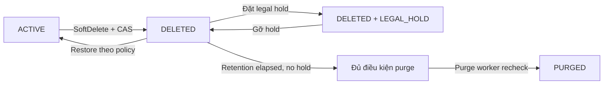
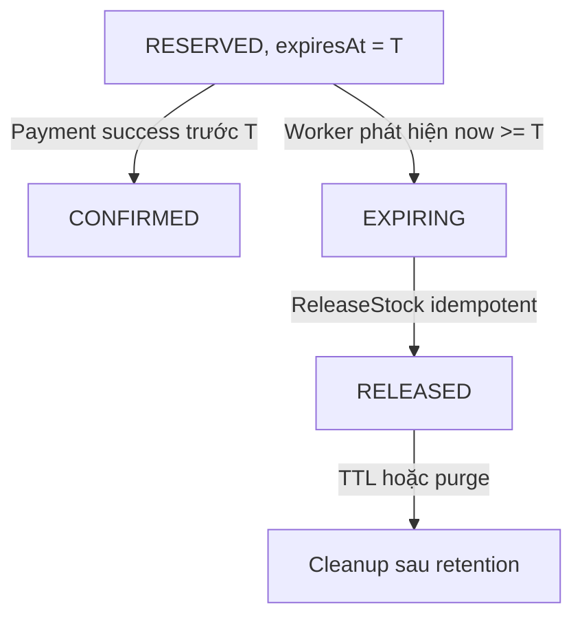

# Xóa mềm, lọc dữ liệu còn hiệu lực và tương tác với TTL

## 1. Bài toán: “không còn hiển thị” khác “đã bị xóa khỏi Couchbase”

Trong một ứng dụng thương mại điện tử, người mua hủy đơn, nhân viên hỗ trợ ẩn hồ sơ, phiếu giữ kho hết hạn, và hệ thống dọn dữ liệu cũ sau thời hạn lưu trữ. Cả bốn tình huống có thể khiến một bản ghi **không xuất hiện trong danh sách hiện hành**, nhưng chúng không cùng ý nghĩa:

```text
10:00  Order #A được tạo                     -> ACTIVE
10:15  Người dùng yêu cầu xóa khỏi giao diện -> DELETED (soft)
10:16  GET danh sách hiện hành không thấy #A
30 ngày sau: đủ thời hạn lưu trữ            -> purge eligible
Khi worker purge: document mới bị xóa vật lý
```

Nếu gọi `repository.deleteById(id)` ngay lúc 10:15, hệ thống có thể mất lịch sử giao dịch, dữ liệu giải quyết khiếu nại, thông tin chống retry hoặc khả năng khôi phục sai sót. Ngược lại, chỉ đặt `deleted=true` nhưng quên lọc tại các query khác sẽ làm lộ hồ sơ đã xóa.

Bài này thuộc chương **Thiết kế ứng dụng** của module **SPRING_DATA_COUCHBASE**. Module bao gồm tầng truy cập document qua Spring Data, repository, `CouchbaseTemplate`, SQL++, bucket/scope/collection, chỉ mục, TTL, CAS, giao dịch và reactive API. Trọng tâm ở đây là thiết kế vòng đời dữ liệu để **xóa mềm, xác định bản ghi còn hiệu lực và sử dụng TTL mà không vi phạm bất biến nghiệp vụ**.

**Sau bài học, bạn có thể:**

1. Phân biệt soft delete, business cancellation, hết hạn nghiệp vụ, Couchbase expiry và hard delete.
2. Thiết kế document có `lifecycleState`, `deletedAt`, `purgeAfter`, `legalHold`, `@Version`.
3. Đặt predicate chỉ đọc bản ghi còn hiệu lực vào tất cả các đường truy vấn, kể cả tenant, pagination và count.
4. Xử lý `MISSING`, `NULL`, legacy documents và đường đọc theo KV.
5. Viết soft delete/restore an toàn bằng CAS, chống side effect trùng và concurrency race.
6. Dùng `@Document(expiry=...)`, KV `expiry`, `preserveExpiry` đúng phiên bản và retention policy.
7. Thiết kế purge worker có recheck CAS, legal hold, audit/outbox và kiểm thử lỗi.

> **Phạm vi kỹ thuật:** Java 17+, Spring Data Couchbase 5.x/6.x với Spring Boot BOM tương thích, Couchbase Java SDK 3.x. Code là các mảnh theo tầng API/application/persistence, không phải một project có thể dán tất cả vào một file. Cách converter và expiry tương tác phụ thuộc phiên bản SDK/Server, bucket/collection policy và loại mutation; cần integration test trước production.

## 2. Năm khái niệm cần tách bạch

| Khái niệm | Điều kiện | Document vẫn ở KV? | Cơ chế |
| --- | --- | --- | --- |
| **Soft delete** | `lifecycle_state="DELETED"` | Có, đến khi purge | Application cập nhật document |
| **Hủy nghiệp vụ** | `business_status="CANCELLED"` | Thường có | Domain state machine |
| **Hết hiệu lực nghiệp vụ** | `valid_until_ms <= now` | Có thể có | Service/Query xác định từ Clock |
| **Couchbase TTL/expiry** | Metadata expiry đã đến hạn | Không đọc được như bản ghi sống; cleanup vật lý có thể đến sau | Server thực hiện expiration |
| **Hard delete/purge** | Gọi remove hoặc dọn theo retention | Không còn như document thường | KV/SQL++/maintenance |

**Soft delete không phải TTL.** Một document `DELETED` vẫn có thể được giữ nhiều tháng vì yêu cầu audit; một document `ACTIVE` có TTL đến hạn có thể biến mất khỏi đường đọc trước khi Service chuyển nó sang `DELETED`.

**Hủy đơn không nhất thiết là xóa mềm.** Đơn `CANCELLED` vẫn nên được người mua xem trong lịch sử, còn soft-deleted order thường bị loại khỏi danh sách mặc định. Đừng dùng một cờ để thay thế trạng thái kinh doanh và trạng thái hiển thị/lưu trữ.

### 2.1. Sơ đồ vòng đời



`PURGE` là **trạng thái suy ra**, không nhất thiết lưu trong document. `deletedAt`, `purgeAfter` và Couchbase `expiryTime` là ba mốc khác nhau, không được ngầm coi là một:

```text
createdAt:   thời điểm tạo
validUntil:  hết hiệu lực nghiệp vụ (không nhất thiết là soft delete)
deletedAt:   khi command soft delete được commit
purgeAfter:  sớm nhất được xóa vật lý theo retention
expiryTime:  TTL metadata do Couchbase quản lý
```

## 3. Lựa chọn mô hình soft delete và bất biến

Ba cách phổ biến:

| Mẫu | Dạng dữ liệu | Điểm mạnh | Rủi ro |
| --- | --- | --- | --- |
| Cờ | `deleted=true/false` | Đơn giản | Không có audit/retention |
| Timestamp | `deleted_at_ms` nullable | Lưu mốc xóa | `NULL`/`MISSING` có thể khác nhau |
| **State + audit** | `lifecycle_state`, `deleted_at_ms`, `deleted_by`, `purge_after_ms` | Dễ đặt chính sách và kiểm thử | Phải giữ các field nhất quán |

Ví dụ document trước khi xóa:

```json
{
  "tenant_id": "store-01",
  "customer_id": "C-42",
  "business_status": "PAID",
  "lifecycle_state": "ACTIVE",
  "created_at_ms": 1795595400000,
  "valid_until_ms": null,
  "deleted_at_ms": null,
  "deleted_by": null,
  "delete_command_id": null,
  "purge_after_ms": null,
  "legal_hold": false,
  "total_minor": 250000
}
```

Sau khi xóa mềm:

```json
{
  "tenant_id": "store-01",
  "customer_id": "C-42",
  "business_status": "PAID",
  "lifecycle_state": "DELETED",
  "created_at_ms": 1795595400000,
  "valid_until_ms": null,
  "deleted_at_ms": 1795597200000,
  "deleted_by": "actor-17",
  "delete_command_id": "delete-K-17",
  "purge_after_ms": 1798189200000,
  "legal_hold": false,
  "total_minor": 250000
}
```

Các timestamp chỉ minh họa; test nên dùng `Clock.fixed`. `total_minor` là số tiền theo đơn vị nhỏ nhất. `business_status` thuộc domain Order; không cho một delete command tự thay trạng thái thanh toán hoặc hoàn tiền ngoài quy trình nghiệp vụ.

**Bất biến cần có:**

1. `ACTIVE`: chưa có `deletedAt`/`deletedBy` theo schema mới.
2. `DELETED`: đã có `deletedAt`, actor hợp lệ, `deleteCommandId` và hạn purge.
3. `legalHold=true`: không purge dù đã qua `purgeAfter`.
4. DELETE lặp cùng `commandId`: replay/no-op, không phát notification/outbox hai lần.
5. Restore phải được phép bởi state machine, authorization và retention/unique-key policy.
6. CAS chỉ bảo vệ ghi trên một document, không phải business revision hay idempotency key.

### 3.1. `MISSING`, `NULL`, `false` không đồng nghĩa

Dữ liệu cũ có thể không có `lifecycle_state` hoặc `deleted_at_ms`; dữ liệu mới có thể có giá trị JSON null. SQL++ phân biệt **MISSING** (không có field), **NULL** và Boolean `false`. Vì vậy:

```sql
-- Không tự coi legacy MISSING là ACTIVE:
WHERE o.deleted = FALSE

-- Cũng không tự trả TRUE khi state bị MISSING:
WHERE o.lifecycle_state != "DELETED"
```

Nên ghi `lifecycle_state="ACTIVE"` rõ ràng khi tạo và migrate dữ liệu cũ. Nếu cần hỗ trợ tạm thời tài liệu legacy, dùng fallback có điều kiện theo **schema version được tin cậy**, không tự mặc định mọi field thiếu là còn hiệu lực.

## 4. Ánh xạ entity trong Spring Data Couchbase

```java
package com.example.shop.orders.persistence;

import org.springframework.data.annotation.Id;
import org.springframework.data.annotation.Version;
import org.springframework.data.couchbase.core.mapping.Document;
import org.springframework.data.couchbase.core.mapping.Field;
import org.springframework.data.couchbase.core.mapping.Scope;
import org.springframework.data.couchbase.core.mapping.Collection;

@Document
@Scope("sales")
@Collection("orders")
public class OrderDocument {
    @Id
    private String id;

    @Field("tenant_id")
    private String tenantId;

    @Field("customer_id")
    private String customerId;

    @Field("business_status")
    private String businessStatus;

    @Field("lifecycle_state")
    private String lifecycleState;

    @Field("created_at_ms")
    private Long createdAtMillis;

    @Field("valid_until_ms")
    private Long validUntilMillis;

    @Field("deleted_at_ms")
    private Long deletedAtMillis;

    @Field("deleted_by")
    private String deletedBy;

    @Field("delete_command_id")
    private String deleteCommandId;

    @Field("purge_after_ms")
    private Long purgeAfterMillis;

    @Field("legal_hold")
    private Boolean legalHold;

    @Field("total_minor")
    private Long totalMinor;

    @Version
    private Long version;

    public OrderDocument() {}
    // Thêm getters/setters hoặc constructor mapping thật.
}
```

`@Id` là document key; `@Version` ánh xạ CAS metadata, **không phải** `deleteCommandId`. `@Scope`/`@Collection` xác định keyspace theo cấu hình. Ví dụ cố tình không gắn expiry lên Order vì cần giữ document đến khi retention workflow cho phép purge.

```java
package com.example.shop.orders.persistence;

import org.springframework.data.couchbase.repository.CouchbaseRepository;

public interface OrderRepository
        extends CouchbaseRepository<OrderDocument, String> {
}
```

**Cảnh báo:** `repository.findAll()`, `repository.findById()` và derived query **không tự ẩn soft-deleted documents**. Nếu Controller trả thẳng entity hoặc service quên predicate lifecycle, dữ liệu đã xóa sẽ xuất hiện trở lại. Repository chỉ là access layer; chính sách “chỉ nhìn dữ liệu hiệu lực” cần được thực thi thống nhất ở application/read adapter.

### 4.1. Khi nào `@Document(expiry=...)` phù hợp?

```java
import org.springframework.data.couchbase.core.mapping.Document;
import org.springframework.data.couchbase.core.mapping.Scope;
import org.springframework.data.couchbase.core.mapping.Collection;

@Document(expiry = 900) // 15 phút, dành cho dữ liệu tạm.
@Scope("sales")
@Collection("temporary_views")
public class TemporaryViewDocument {
    // @Id và các field cần thiết...
}
```

Spring Data Couchbase hỗ trợ `@Document(expiry=...)`, `expiryUnit`, `expiryExpression`; giá trị expiry có thể được áp dụng/tính lại trên các thao tác lưu theo contract của mapper. **Không** copy `@Document(expiry=900)` sang Order chỉ vì muốn “soft delete sau 15 phút”: đó là thiết kế TTL xóa dữ liệu, không phải xóa mềm.

Tương tự, `touchOnRead=true` với document expiry có thể tạo **sliding expiration** khi đọc KV theo phiên bản/configuration. Không dùng hành vi gia hạn khi đọc để điều khiển retention cố định cho hồ sơ đã xóa.

## 5. Định nghĩa “còn hiệu lực” trước khi viết truy vấn

Một định nghĩa rõ ràng cho màn hình **đơn hiện hành**:

```text
isEffective(order, now, caller) =
    caller có quyền xem đúng tenant/order
    AND order.lifecycleState == ACTIVE
    AND order.deletedAt == null
    AND (order.validUntil == null OR order.validUntil > now)
```

`legalHold` **không làm đơn đã xóa trở thành còn hiệu lực**; legal hold chỉ chặn việc purge. `businessStatus=CANCELLED` có thể vẫn là một đơn hiệu lực để xem lịch sử, tùy yêu cầu endpoint; không trộn bộ lọc trạng thái thanh toán với lifecycle.

Hợp đồng cần nói rõ `validUntil == now` là **đã hết hiệu lực** vì điều kiện `validUntil > now`. Dùng một mốc `Clock` được lấy **một lần cho mỗi request/query**, không gọi `System.currentTimeMillis()` cho từng dòng khiến ranh giới thay đổi trong cùng phép lọc.

### 5.1. Định nghĩa đường đọc theo mục đích

| Đường đọc | Phạm vi hiển thị | Yêu cầu bảo mật |
| --- | --- | --- |
| `GET /orders` | Chỉ `ACTIVE` + trong hạn hiệu lực | Tenant, quyền khách hàng, filter và page |
| `GET /orders/{id}` | Chỉ document hiệu lực trừ khi API có chế độ lịch sử | KV read **vẫn phải tự lọc** lifecycle |
| `GET /orders/history` | Có thể gồm `CANCELLED` nhưng không gồm soft-deleted | Quyền đối với order của caller |
| `GET /admin/deleted-orders` | Chỉ `DELETED` theo policy | Admin/auditor role, audit logs, paging |
| `GET /admin/retention-candidates` | `DELETED`, `purgeAfter <= now`, no hold | Service identity cho purge worker |
| Analytics/ETL | Tùy mục tiêu, có thể cả deleted | Data governance, dữ liệu nhạy cảm, policy riêng |

**Không nên tạo một repository method `findAll()` rồi cho mọi Controller sử dụng tùy ý**. Có thể đặt tên cụ thể như `findEffectiveForTenant`, `findDeletedForAudit`, `findPurgeCandidates` trong các adapter/port riêng; đường đọc admin không được vô tình tái sử dụng cho API công khai.

### 5.2. SQL++ truy vấn tập hiệu lực

```sql
SELECT META(o).id AS documentId,
       o.customer_id AS customerId,
       o.business_status AS businessStatus,
       o.created_at_ms AS createdAtMillis,
       o.total_minor AS totalMinor
FROM `shop`.`sales`.`orders` AS o
WHERE o.tenant_id = $tenantId
  AND o.lifecycle_state = "ACTIVE"
  AND (o.deleted_at_ms IS MISSING OR o.deleted_at_ms IS NULL)
  AND (o.valid_until_ms IS MISSING
       OR o.valid_until_ms IS NULL
       OR o.valid_until_ms > $nowMillis)
ORDER BY o.created_at_ms DESC, META(o).id DESC
LIMIT $limit OFFSET $offset;
```

**Thứ tự ngoặc rất quan trọng.** Nếu viết:

```sql
WHERE o.tenant_id = $tenantId
  AND o.lifecycle_state = "ACTIVE"
  AND o.valid_until_ms IS MISSING
   OR o.valid_until_ms > $nowMillis
```

thì nhánh `OR` có thể trả **document tenant khác hoặc đã xóa** nếu chưa được nhóm với các điều kiện bắt buộc. Query cho API đa tenant phải có test dữ liệu tenant B thỏa vế phải của `OR`.

### 5.3. Bind tham số, không ghép SQL++ từ query parameter

Adapter dùng SDK:

```java
import com.couchbase.client.java.Cluster;
import com.couchbase.client.java.json.JsonObject;
import static com.couchbase.client.java.query.QueryOptions.queryOptions;
import java.time.Clock;

public java.util.List<JsonObject> findEffective(
        Cluster cluster,
        String trustedTenantId,
        int limit,
        int offset,
        Clock clock) {

    if (trustedTenantId == null || trustedTenantId.isBlank()
            || limit < 1 || limit > 100
            || offset < 0 || offset > 10_000) {
        throw new IllegalArgumentException("Bộ lọc không hợp lệ");
    }

    String sql = """
        SELECT META(o).id AS documentId,
               o.customer_id AS customerId,
               o.business_status AS businessStatus,
               o.created_at_ms AS createdAtMillis,
               o.total_minor AS totalMinor
        FROM `shop`.`sales`.`orders` AS o
        WHERE o.tenant_id = $tenantId
          AND o.lifecycle_state = "ACTIVE"
          AND (o.deleted_at_ms IS MISSING
               OR o.deleted_at_ms IS NULL)
          AND (o.valid_until_ms IS MISSING
               OR o.valid_until_ms IS NULL
               OR o.valid_until_ms > $nowMillis)
        ORDER BY o.created_at_ms DESC, META(o).id DESC
        LIMIT $limit OFFSET $offset
        """;

    JsonObject params = JsonObject.create()
            .put("tenantId", trustedTenantId)
            .put("nowMillis", clock.millis())
            .put("limit", limit)
            .put("offset", offset);

    return cluster.query(sql,
            queryOptions().parameters(params).readonly(true))
            .rowsAsObject();
}
```

Method này trả `JsonObject` cho **persistence adapter**; API thật nên map từng row thành `OrderSummary` rồi `OrderSummaryResponse`, không trả raw SDK rows trực tiếp ra Controller. `trustedTenantId` phải lấy từ ngữ cảnh đã xác thực, không lấy tùy ý từ HTTP query string. Nếu trong tenant còn có quyền theo `customerId`, phải đưa điều kiện quyền vào query **trước LIMIT/OFFSET/count**, không lọc sau khi phân trang.

### 5.4. `Page`/count phải dùng cùng predicate

```sql
SELECT RAW COUNT(1)
FROM `shop`.`sales`.`orders` AS o
WHERE o.tenant_id = $tenantId
  AND o.lifecycle_state = "ACTIVE"
  AND (o.deleted_at_ms IS MISSING OR o.deleted_at_ms IS NULL)
  AND (o.valid_until_ms IS MISSING
       OR o.valid_until_ms IS NULL
       OR o.valid_until_ms > $nowMillis);
```

Đếm tổng chỉ với `tenant_id` mà quên state/expiry sẽ **rò số bản ghi đã xóa** và làm phân trang sai. Hãy trừu tượng hóa **cùng logic filter** cho cả trang dữ liệu và count, nhưng tạo `Query`/query request **riêng** để count không mang `LIMIT/OFFSET`.

Hai phép SQL++ không mặc định là một snapshot tại cùng thời điểm: nếu có delete/restore hoặc hết hạn giữa chúng, tổng và nội dung có thể lệch. Với API chỉ cần “xem thêm”, cân nhắc `Slice` lấy `size+1` để tránh count.

### 5.5. Derived repository và `CouchbaseTemplate`

Trường hợp chỉ cần lifecycle flag và tenant, có thể dùng derived query:

```java
java.util.List<OrderDocument> findByTenantIdAndLifecycleState(
        String trustedTenantId, String lifecycleState);
```

Nhưng method trên **chưa đủ** cho policy `validUntil` và `deletedAt`, và không đảm bảo tự lọc quyền theo từng khách hàng. Khi điều kiện phức tạp, dùng repository fragment với `CouchbaseTemplate`/`QueryCriteria` (xác minh mapping alias/OR grouping của phiên bản đang dùng) hoặc SQL++ parameterized trong một adapter chuyên biệt.

Ví dụ Template **chỉ lọc các điều kiện đơn giản đã hỗ trợ**:

```java
import org.springframework.data.couchbase.core.CouchbaseTemplate;
import org.springframework.data.couchbase.core.query.Query;
import org.springframework.data.couchbase.core.query.QueryCriteria;

Query query = Query.query(
        QueryCriteria.where("tenantId").is(trustedTenantId));
query.addCriteria(
        QueryCriteria.where("lifecycleState").is("ACTIVE"));

var activeCandidates = template
        .findByQuery(OrderDocument.class)
        .matching(query)
        .all();
```

**Không dùng kết quả `activeCandidates` làm API tập hiệu lực hoàn chỉnh** khi use case còn `validUntil`/deletedAt/paging: đây chỉ là bộ lọc bước đầu. Một implementation đầy đủ phải dựng predicate tương đương SQL++ mục 5.2 **trước** phân trang và count. Nên tạo `Query` mới cho từng request, không giữ `QueryCriteria` mutable trong singleton.

### 5.6. Đọc theo document key vẫn cần kiểm tra lifecycle

```java
public OrderDocument getEffectiveById(
        OrderRepository repository,
        String trustedTenantId, String documentId, long nowMillis) {

    OrderDocument doc = repository.findById(documentId)
            .orElseThrow(OrderNotFoundException::new);

    if (!trustedTenantId.equals(doc.getTenantId())
            || !"ACTIVE".equals(doc.getLifecycleState())
            || doc.getDeletedAtMillis() != null
            || (doc.getValidUntilMillis() != null
                && doc.getValidUntilMillis() <= nowMillis)) {
        throw new OrderNotFoundException();
    }
    return doc;
}
```

`OrderNotFoundException` là domain exception do dự án định nghĩa; code thật còn phải kiểm tra **quyền đối với order/customer**, không chỉ tenant. Key có thể bị đoán và `findById` (KV) **không tự biết** policy soft delete. Trả `404` cho bản ghi đã xóa/không có quyền là một lựa chọn để không lộ thông tin; endpoint audit có thể có contract khác và phải được bảo vệ riêng.

## 6. Secondary index và lọc dữ liệu còn hiệu lực

Truy vấn SQL++ nhiều document cần secondary index. Một index khởi đầu:

```sql
CREATE INDEX ix_orders_tenant_state_created
ON `shop`.`sales`.`orders`(
    tenant_id, lifecycle_state, created_at_ms DESC
);
```

Một **partial index** cho riêng bản ghi ACTIVE cũng có thể được cân nhắc:

```sql
CREATE INDEX ix_orders_active_tenant_created
ON `shop`.`sales`.`orders`(
    tenant_id, created_at_ms DESC
)
WHERE lifecycle_state = "ACTIVE";
```

Đây là **hai hướng index thay thế hoặc bổ trợ**, không phải yêu cầu bắt buộc tạo cả hai. Query planner phải nhận ra query `WHERE lifecycle_state = "ACTIVE"` suy ra predicate partial index; cần chạy `EXPLAIN` với câu SQL++ cuối, kể cả type discriminator nếu Spring Data tự thêm.

### 6.1. Vì sao index không thay soft-delete predicate?

Index ACTIVE có thể tăng tốc tìm kiếm, nhưng nó **không cấm** query khác chọn `DELETED` nếu query đó bỏ predicate. Một repository `findAll` hoặc SDK raw query vẫn có quyền đọc dữ liệu đó theo RBAC.

**Index là cấu trúc tăng tốc; quyền và chính sách hiển thị nằm ở application/query contract.** Dữ liệu nhạy cảm cần thêm RBAC và endpoint audit tách biệt, không chỉ trông chờ partial index.

### 6.2. Điều kiện `valid_until_ms` có thể làm query đắt

Predicate:

```sql
AND (o.valid_until_ms IS MISSING
     OR o.valid_until_ms IS NULL
     OR o.valid_until_ms > $nowMillis)
```

chứa nhiều nhánh `OR`, có thể hạn chế khả năng dùng index tối ưu. Có thể giảm chi phí bằng cách chuẩn hóa schema mới: đặt một giá trị sentinel/ngày hiệu lực phù hợp, lưu `is_effective` được cập nhật bởi workflow, hoặc thiết kế collection/read model riêng. Tuy nhiên, **trường được tính sẵn phải có cơ chế refresh khi thời gian trôi qua**, không thể dựa vào giá trị `isEffective=true` bất biến khi `validUntil` đã qua.

Nếu use case có lưu lượng lớn, so `EXPLAIN`, số index entries/fetch, sort và độ trễ p95/p99; tránh tự suy đoán index composite nào là tối ưu nếu chưa có thống kê dữ liệu và workload.

### 6.3. Index lag không phải lý do bỏ lọc state

Mutation KV vừa soft-delete có thể chưa được secondary index phản ánh ngay. Truy vấn `NOT_BOUNDED` có thể trả kết quả cũ trong một cửa sổ ngắn, tùy consistency/index. Nếu **yêu cầu không hiển thị bản ghi đã xóa ngay**, chọn mức **scan consistency** phù hợp như `REQUEST_PLUS` hoặc cơ chế read-your-writes được hỗ trợ, và kiểm thử thực tế.

`REQUEST_PLUS` đảm bảo index theo kịp mutation được xác nhận tới thời điểm query bắt đầu theo contract của Query Service, đổi lại có thể tăng latency. Nó **không** biến hai câu page/count thành snapshot chung và không buộc một projection bất đồng bộ bên ngoài Query Service đã bắt kịp.

Đối với read model cập nhật qua event, cần thêm event revision/lag metrics và có thể dùng đường KV nguồn sự thật cho nhu cầu bảo mật hoặc phản hồi tức thời.

## 7. Thực thi soft delete bằng Spring Data và CAS

Một soft-delete command nên chứa **actor**, tenant đáng tin cậy, ID và idempotency key/command ID. Controller không nên nhận một `OrderDocument` đầy đủ từ `@RequestBody` rồi đặt `deleted=true`.

```java
package com.example.shop.orders.application;

public record SoftDeleteOrderCommand(
        String trustedTenantId,
        String orderId,
        String actorId,
        String commandId
) {}
```

Tầng Service có trách nhiệm xác thực actor được xóa **đúng đơn**, kiểm tra state machine, chọn thời điểm/retention theo chính sách và thực thi mutation có CAS. Ví dụ tối giản (mỗi public class/record đặt trong file Java riêng):

```java
package com.example.shop.orders.application;

import com.example.shop.orders.persistence.OrderDocument;
import com.example.shop.orders.persistence.OrderRepository;
import java.time.Clock;
import java.time.Duration;
import org.springframework.stereotype.Service;

@Service
public class OrderDeletionService {
    private final OrderRepository repository;
    private final OrderAccessPolicy accessPolicy;
    private final Clock clock;

    public OrderDeletionService(
            OrderRepository repository,
            OrderAccessPolicy accessPolicy,
            Clock clock) {
        this.repository = repository;
        this.accessPolicy = accessPolicy;
        this.clock = clock;
    }

    public DeleteOutcome softDelete(SoftDeleteOrderCommand command) {
        validate(command);

        OrderDocument doc = repository.findById(command.orderId())
                .orElseThrow(OrderNotFoundException::new);

        if (!command.trustedTenantId().equals(doc.getTenantId())) {
            throw new OrderNotFoundException();
        }
        accessPolicy.assertCanDelete(
                command.trustedTenantId(), command.actorId(), doc);

        if ("DELETED".equals(doc.getLifecycleState())) {
            // Không tạo thêm event hoặc thay deletedAt khi retry.
            if (command.commandId().equals(doc.getDeleteCommandId())) {
                return new DeleteOutcome(false, doc.getDeletedAtMillis());
            }
            // Có thể trả no-op cho DELETE lặp theo contract; nếu cần
            // đối chiếu cùng lệnh, dùng receipt riêng và trả conflict.
            throw new AlreadyDeletedException();
        }
        if (!"ACTIVE".equals(doc.getLifecycleState())) {
            throw new IllegalStateException("Trạng thái không cho phép");
        }

        long deletedAt = clock.millis();
        long purgeAfter = Math.addExact(
                deletedAt, Duration.ofDays(30).toMillis());

        doc.setLifecycleState("DELETED");
        doc.setDeletedAtMillis(deletedAt);
        doc.setDeletedBy(command.actorId());
        doc.setDeleteCommandId(command.commandId());
        doc.setPurgeAfterMillis(purgeAfter);

        // @Version Long trên OrderDocument ánh xạ CAS metadata.
        // Nếu một writer khác vừa sửa document, save sẽ conflict.
        repository.save(doc);
        return new DeleteOutcome(true, deletedAt);
    }

    private static void validate(SoftDeleteOrderCommand c) {
        if (c == null || c.trustedTenantId() == null
                || c.trustedTenantId().isBlank()
                || c.orderId() == null || c.orderId().isBlank()
                || c.actorId() == null || c.actorId().isBlank()
                || c.commandId() == null || c.commandId().isBlank()) {
            throw new IllegalArgumentException("Lệnh xóa không hợp lệ");
        }
    }
}

public record DeleteOutcome(boolean changed, Long deletedAtMillis) {}
```

`OrderAccessPolicy`, `OrderNotFoundException`, `AlreadyDeletedException` là kiểu do dự án định nghĩa. `OrderAccessPolicy` phải xác minh **actor từ identity đã xác thực**, không coi `actorId` client tự gửi là đủ. Ngoài quyền, Service thực tế còn phải kiểm tra bất biến domain: đơn đang thanh toán/đang tranh chấp có được xóa mềm hay cần lệnh cancellation riêng.

**Đoạn mã trên chưa có retry và outbox**, được bổ sung bên dưới. `@Version` của Spring Data bảo vệ một lần ghi nếu entity được tải với CAS tương ứng; tích hợp mapping thật cần test. Mặc dù API DELETE có thể trả `204`, Service không nên âm thầm ghi đè bản ghi vừa được người khác cập nhật.

### 7.1. Xử lý CAS conflict không phải retry mù quáng

Hai yêu cầu A và B cùng đọc bản ghi `ACTIVE`:

```text
A: đọc CAS=V1; thay state=DELETED
B: đọc CAS=V1; sửa địa chỉ giao hàng
A: save CAS V1 -> thành công, CAS thành V2
B: save CAS V1 -> OptimisticLockingFailureException
```

Nếu B bắt lỗi rồi `save` không CAS, nó có thể phục hồi `ACTIVE` ngoài ý muốn. Cách xử lý đúng: **đọc lại bản mới**, kiểm tra lifecycle và quy tắc sửa, sau đó quyết định conflict hay retry có giới hạn. Cùng soft-delete command retry sau timeout cũng cần đọc lại và đối chiếu `deleteCommandId`.

Một vòng retry giới hạn minh họa:

```java
for (int attempt = 0; attempt < 3; attempt++) {
    try {
        return service.softDelete(command);  // Mỗi lần đọc entity mới.
    } catch (OptimisticLockingFailureException conflict) {
        if (attempt == 2) {
            throw conflict;
        }
        // Backoff có giới hạn theo policy. Lần sau phải
        // re-evaluate state, tenant và business permission.
    }
}
throw new IllegalStateException("Không thể hoàn tất lệnh xóa");
```

Đoạn retry thuộc tầng orchestration, ví dụ exception `org.springframework.dao.OptimisticLockingFailureException`. Không bắt **mọi** exception để thử lại: lỗi phân quyền, schema hỏng hay state transition cấm không phải transient CAS conflict.

### 7.2. DELETE lặp: trạng thái cuối và kết quả command là hai chuyện khác

HTTP `DELETE` là method có tính lũy đẳng về **hiệu ứng dự kiến**: gửi lại cùng yêu cầu không làm tài nguyên “bị xóa thêm”. Tuy vậy, response status có thể khác giữa lần đầu và lần sau. Những hợp đồng hợp lệ:

| Tình huống | Hợp đồng A | Hợp đồng B |
| --- | --- | --- |
| DELETE lần đầu | `204 No Content` | `204 No Content` |
| DELETE lặp sau khi đã soft-delete | `204`, no-op | `404`/`409` theo chính sách |
| Khác command ID nhưng resource đã xóa | `204` theo state goal | Xung đột/receipt policy |
| Không có quyền hoặc khác tenant | `404`/ `403` theo bảo mật | Tương tự, không lộ thông tin |

Điểm bắt buộc là **không đổi `deletedAt` hoặc phát `OrderDeleted` lần thứ hai** khi retry cùng command. Nếu cần replay chính xác response ban đầu sau nhiều bước nghiệp vụ, dùng `CommandReceipt` với `(tenant,actor,operation,idempotencyKey)`, fingerprint và outcome đã commit.

### 7.3. Outbox phải đi cùng mutation, không gửi sự kiện trước commit

Đây là anti-pattern:

```java
repository.save(order); // soft delete
eventPublisher.publish(new OrderDeleted(order.getId()));
```

Process có thể chết giữa hai bước. Ngược lại, publish trước `save` có thể phát event cho mutation bị CAS conflict. Nếu workflow cần downstream xử lý (ẩn search index, hủy lịch giao, audit), chọn:

1. Gắn **pending event** trong chính Order document và lưu bằng **một mutation CAS**, sau đó worker publish.
2. Hoặc ghi **Order + Outbox document** trong **cùng Couchbase transaction** với các API thực sự tham gia transaction.

Publisher có thể giao lại event sau timeout; consumer phải dedupe bằng `eventId` ổn định. Nếu xóa order đồng thời với xóa reservation/inventory ở hệ thống khác, transaction Couchbase **không** bao trùm external service: dùng saga/compensation và idempotency.

### 7.4. Không dùng xóa mềm để thay lệnh hủy có nghiệp vụ bù trừ

Một đơn `PAID` bị “ẩn khỏi giao diện” không có nghĩa đã **hoàn tiền**, và một reservation hết hạn không có nghĩa tồn kho đã được giải phóng. Những hành động đó phải có **command riêng và business state machine**, đồng thời ghi nhận hiệu ứng/outbox một cách an toàn trước khi cho purge dữ liệu nguồn.

## 8. Restore: đảo trạng thái có điều kiện và xử lý race với purge

Restore không chỉ là `deleted=false`. Trước khi phục hồi:

- Caller phải có quyền restore.
- Document còn tồn tại và chưa vượt grace period nếu policy giới hạn.
- Domain có cho `DELETED -> ACTIVE` không, hay phải tạo bản ghi mới?
- Những unique keys (username/SKU) đã được người khác claim lại chưa?
- Có legal hold/retention/điều kiện compliance nào cấm restore?
- Purge worker có đang đọc bản ghi để xóa không?

Ví dụ thao tác trong Service với `@Version`:

```java
public OrderDocument restore(
        String trustedTenantId, String documentId,
        String actorId, long nowMillis) {

    OrderDocument doc = repository.findById(documentId)
            .orElseThrow(OrderNotFoundException::new);

    if (!trustedTenantId.equals(doc.getTenantId())) {
        throw new OrderNotFoundException();
    }
    accessPolicy.assertCanRestore(
            trustedTenantId, actorId, doc);

    if (!"DELETED".equals(doc.getLifecycleState())
            || doc.getPurgeAfterMillis() == null
            || doc.getPurgeAfterMillis() <= nowMillis) {
        throw new RestoreNotAllowedException();
    }

    // Domain phải xác minh có thể phục hồi, kể cả unique key và
    // trạng thái nghiệp vụ. Nếu nhiều document: dùng transaction.
    doc.setLifecycleState("ACTIVE");
    doc.setDeletedAtMillis(null);
    doc.setDeletedBy(null);
    doc.setDeleteCommandId(null);
    doc.setPurgeAfterMillis(null);
    return repository.save(doc);  // CAS bảo vệ với purge/update khác.
}
```

Đây là method minh họa, nằm trong một Service có `repository`/`accessPolicy` được inject; `RestoreNotAllowedException` do dự án khai báo. Tenant được kiểm tra **trước khi** quyền theo order; implementation authorization thật phải kiểm tra principal, resource ownership và action, không chỉ nhận một actor ID tự khai báo.

Nếu purge worker đọc CAS V1 của document `DELETED`, còn restore ghi thành `ACTIVE` và CAS V2, một lần `remove(cas=V1)` phải conflict. Nếu worker xóa trước, restore sẽ thấy không còn document và không thể “phục hồi” chỉ bằng đổi cờ. Với hệ thống cần phục hồi sau purge, phải có archive/backup hợp lệ và một **workflow tái tạo** riêng.

**Audit history:** việc xóa `deletedAt` trên resource khi restore không nên làm mất dấu sự kiện xóa cũ nếu pháp lý/vận hành yêu cầu. Giữ lịch sử ở event/outbox/audit collection có retention được kiểm soát; không nhồi mảng audit tăng vô hạn vào Order.

## 9. TTL của Couchbase: metadata lưu trữ, không phải lịch hẹn thực hiện domain command

Couchbase có khả năng **tự hết hạn document** dựa trên expiry metadata. Điều này phù hợp cho session, cache, token tạm và dữ liệu có thể tạo lại; nhưng cần rất thận trọng đối với đơn hàng, thanh toán, reservation hay hồ sơ phải bảo toàn đến khi có quyết định nghiệp vụ.

### 9.1. TTL hoạt động thế nào ở mức ứng dụng?

Khi tạo document, có thể đặt thời điểm expiry:

```java
import com.couchbase.client.java.Collection;
import com.couchbase.client.java.json.JsonObject;
import java.time.Duration;
import static com.couchbase.client.java.kv.InsertOptions.insertOptions;

collection.insert(
        "tmp::cart::abc",
        JsonObject.create()
                .put("tenant_id", "store-01")
                .put("status", "PENDING"),
        insertOptions().expiry(Duration.ofMinutes(15)));
```

Hoặc đặt **một thời điểm tuyệt đối** nếu deadline đã được tính:

```java
import java.time.Instant;
import static com.couchbase.client.java.kv.InsertOptions.insertOptions;

Instant deadline = Instant.parse("2026-11-26T08:30:00Z");
collection.insert(
        "tmp::view::xyz",
        JsonObject.create().put("kind", "TEMP_VIEW"),
        insertOptions().expiry(deadline));
```

SDK Java 3.x có overload `expiry(Duration)` và `expiry(Instant)`; xác minh giới hạn và cách diễn giải theo SDK/server đang dùng. Với `Duration`, hiệu lực được tính tương đối; với `Instant`, ứng dụng cung cấp deadline theo thời gian tuyệt đối. Đừng tự ghép epoch seconds vào JSON rồi tưởng đó đã là **TTL metadata**.

Sau expiry, document không còn được xem là tài nguyên đang tồn tại qua đường đọc KV/Query bình thường; việc dọn dữ liệu vật lý, replica, backup hoặc hệ thống đồng bộ có thể có tiến độ riêng. **Không thiết kế logic nghiệp vụ dựa vào một callback chạy chính xác khi đồng hồ chạm deadline.**

### 9.2. Đọc expiry metadata qua SDK

```java
import java.time.Instant;
import java.util.Optional;
import static com.couchbase.client.java.kv.GetOptions.getOptions;

var found = collection.get(
        documentId, getOptions().withExpiry(true));
Optional<Instant> currentExpiry = found.expiryTime();
```

`expiryTime()` trả về `Optional<Instant>`; absence có thể có nghĩa không có expiry được áp dụng cho tài liệu đó. Không dùng `found.contentAsObject().getLong("expiryTime")` nếu chưa có một **field nghiệp vụ** riêng: metadata expiry không tự xuất hiện trong body JSON của document.

Có thể xem metadata qua SQL++:

```sql
SELECT META(o).id AS documentId,
       META(o).expiration AS expiryEpochSeconds
FROM `shop`.`sales`.`orders` AS o
USE KEYS "order::store-01::A";
```

`META(o).expiration` biểu diễn thời điểm hết hạn theo **Unix epoch seconds**; giá trị `0` thể hiện không có expiry trong metadata. Nó **khác đơn vị** với `valid_until_ms` hoặc `purge_after_ms` mà ví dụ lưu theo **epoch milliseconds**. Nhân/chia 1000 phải có quy tắc rõ; không so trực tiếp `META(o).expiration < $nowMillis`. Việc metadata có thể được index không biến nó thành ràng buộc lifecycle: soft-deleted document có thể có expiry 0, và tài liệu còn hiệu lực nghiệp vụ có thể có TTL theo retention riêng.

### 9.3. Update có thể làm mất TTL nếu không xử lý

Một mutation `replace`/ `upsert` mặc định có thể đặt lại expiry thay vì giữ thời hạn trước đó. Nếu document `PENDING` còn 10 phút TTL mà service cập nhật ghi chú rồi mất expiry, nó có thể tồn tại lâu hơn policy cho phép.

Khi business policy yêu cầu **giữ đúng expiry cũ**:

```java
import static com.couchbase.client.java.kv.ReplaceOptions.replaceOptions;

var found = collection.get(documentId);
JsonObject body = found.contentAsObject();
body.put("note", "Giao sớm");

collection.replace(
        documentId,
        body,
        replaceOptions()
                .cas(found.cas())
                .preserveExpiry(true));
```

`preserveExpiry(true)` cho mutation KV yêu cầu **Couchbase Server 7.0+**. Với server cũ hơn, phải đọc expiry hiện tại rồi truyền lại expiry tương đương bằng API được hỗ trợ, đồng thời xử lý conflict; không giả định `replace` sẽ giữ TTL.

**Vì sao cần CAS?** Nếu một writer khác vừa cập nhật note, status hoặc expiry, một `replace` không CAS có thể ghi đè hoặc đặt lại deadline không được phép. `preserveExpiry` giải quyết **giữ thời hạn**, còn CAS giải quyết **ghi cạnh tranh**: chúng không thay thế nhau.

### 9.4. Đôi khi “preserve expiry” lại là sai về nghiệp vụ

Giả sử phiếu giữ kho ban đầu có TTL 15 phút, nhưng người dùng chuyển nó sang trạng thái `PAYMENT_DISPUTE` cần giữ 7 ngày để đối soát. Nếu chuyển trạng thái mà **vẫn preserve TTL 15 phút**, document có thể hết hạn trước khi hoàn tất nghiệp vụ.

Quyết định:

| Hành động | Chính sách expiry phù hợp |
| --- | --- |
| Chỉnh note của temporary view | Giữ TTL cũ, nếu không muốn gia hạn |
| Gia hạn session chủ động | Đặt TTL mới theo sliding session policy |
| Session đã logout | Xóa/revoke ngay, không chờ TTL để chặn quyền |
| Soft-delete Order cần giữ 30 ngày | **Không để TTL ngắn hơn retention**; thường giữ document cho purge job |
| Reservation cần release stock khi deadline đến | Dùng `expiresAt` và worker/saga, không chỉ TTL |
| Đặt legal hold lên hồ sơ | Bảo đảm policy storage không cho expiry tự xóa trước khi hold được giải quyết |
| Dọn snapshot read model có thể tái tạo | Có thể đặt TTL rõ theo SLA cache/projection |

**Retention policy thắng sự tiện lợi của SDK options.** `preserveExpiry=true` không phải một quy tắc chung; cần chọn giữ, gia hạn, rút ngắn hoặc xóa expiry theo lifecycle cụ thể.

### 9.5. Bucket và collection `maxExpiry`

Ngoài document expiry, Couchbase cho phép cấu hình giới hạn expiry ở bucket/collection. Một collection có thể kế thừa cấu hình bucket; tính năng **không-expire** ở collection và cách diễn giải `maxExpiry` có điều kiện theo phiên bản server/SDK.

Trước khi lưu hồ sơ audit/legal hold, phải kiểm tra:

1. Bucket/collection có `maxExpiry` khiến document tự hết hạn không?
2. `@Document(expiry=...)` có áp đặt TTL trên insert/save/update không?
3. Adapter SDK có vô tình đặt `expiry(Duration.ZERO)` hoặc `preserveExpiry` sai policy?
4. Những document đổi sang `LEGAL_HOLD` có còn TTL cũ sẽ xóa trước thời hạn không?
5. Restore/migration có làm reset deadline không?

Không khẳng định rằng gán expiry = 0 ở một mutation luôn vượt qua chính sách `maxExpiry` của collection/bucket. Quy tắc hiệu lực phải được xác minh với **cấu hình cluster đang chạy**. Nếu cần dữ liệu không được hết hạn ngoài quyết định của ứng dụng, hãy chọn keyspace/collection phù hợp thay vì dựa vào một annotation cục bộ.

### 9.6. Spring Data annotation và câu hỏi “ghi lại có reset TTL?”

`@Document(expiry = 900)` biểu diễn expiry tương đối theo mapping Spring Data. `@Document(expiryExpression = "...")` dùng Spring property resolution, không phải một hàm tự đọc `deletedAt` rồi tính `purgeAfter` tùy ý. Theo tài liệu Spring Data, giá trị expression có thể được tính lại khi gọi Template save/insert/update.

Điều đó có nghĩa một vòng `repository.save` có thể không giữ expiry theo cách developer nghĩ. Với dữ liệu có retention phức tạp, **test trực tiếp metadata expiry** sau insert, update, soft-delete, restore và backfill thay vì chỉ assert JSON body.

### 9.7. SQL++ UPDATE và giữ expiry

SQL++ mutation cũng có đặc điểm expiry riêng. Java SDK `QueryOptions.preserveExpiry(true)` cho các câu query sửa document được hỗ trợ từ **Couchbase Server 7.1+**. Nó **không** đồng nghĩa với `ReplaceOptions.preserveExpiry(true)` (yêu cầu server 7.0+) và không nên xem là một cờ toàn cục.

Nếu một job dùng `UPDATE` SQL++ để đánh dấu `DELETED` hàng loạt, phải:

- Xác định behavior expiry của câu SQL++ đó trên server version đã chọn.
- Kiểm tra cách `QueryOptions.preserveExpiry` áp dụng, và durability/transaction nếu cần.
- Tránh UPDATE không có CAS/business authorization với những document có thể đổi trạng thái đồng thời.
- Ghi nhận dữ liệu nào đã được update; sử dụng job phân lô và cơ chế retry/idempotency.

Với aggregate có invariant phức tạp, **đọc + quyết định + KV replace CAS** thường rõ ràng và an toàn hơn một câu UPDATE diện rộng bỏ qua state machine.

## 10. TTL không thể thay thế workflow hết hạn nghiệp vụ

Ví dụ `InventoryReservation` giữ `quantity=2`, thời hạn `expiresAt=12:00`. Nếu đến 12:00 Couchbase xóa reservation document theo TTL, **tồn kho không tự tăng lại**. Các hệ thống thanh toán/đối soát cũng không tự biết phải hủy lệnh giữ hàng.

Quy trình thích hợp:



Giả sử một reservation có `status=RESERVED` và `expires_at_ms`. Worker theo lịch có thể truy vấn các reservation đến hạn:

```sql
SELECT META(r).id AS documentId, r.tenant_id, r.expires_at_ms
FROM `shop`.`sales`.`reservations` AS r
WHERE r.status = "RESERVED"
  AND r.expires_at_ms <= $nowMillis
ORDER BY r.expires_at_ms ASC
LIMIT $batchSize;
```

Mỗi item cần được **recheck bằng KV/CAS hoặc transaction** trước khi chuyển từ `RESERVED` sang `EXPIRED/RELEASING`. Nếu payment vừa xác nhận, worker không được release stock từ một snapshot SQL++ cũ. Ghi receipt/outbox `ReleaseStock` với command ID ổn định để thử lại sau crash, rồi mới dùng TTL để dọn document phụ trợ.

**Không dựa hoàn toàn vào “expiry event” hoặc DCP change stream như một lịch hẹn tuyệt đối đúng giờ và exactly-once.** Streaming/CDC có thể được dùng để xây pipeline theo SLA, nhưng vẫn cần định nghĩa độ trễ, duplicate handling và reconciliation khi watcher dừng. TTL là cơ chế vòng đời của document, không phải một domain scheduler đáng tin cậy theo từng millisecond.

## 11. Thiết kế purge worker: chọn ứng viên bằng SQL++, xóa bằng CAS

Sau khi hết hạn lưu trữ, một background job có thể xóa vật lý document `DELETED`. Đây là **thao tác nguy hiểm và khó hoàn tác**, nên không được viết một câu SQL++ `DELETE WHERE deleted_at_ms < now` rồi chạy không kiểm soát trong production.

Điều kiện đủ để xóa một Order trong ví dụ:

```text
state == DELETED
AND legalHold == false
AND purgeAfter != null
AND purgeAfter <= now
AND dữ liệu audit/archive bắt buộc đã được ghi và xác nhận
AND không có operation/transaction cần giữ tài nguyên
```

### 11.1. Dùng SQL++ để tìm ứng viên, không để quyết định cuối

```sql
SELECT META(o).id AS documentId,
       o.tenant_id AS tenantId,
       o.purge_after_ms AS purgeAfterMillis
FROM `shop`.`sales`.`orders` AS o
WHERE o.lifecycle_state = "DELETED"
  AND o.legal_hold = FALSE
  AND o.purge_after_ms <= $nowMillis
ORDER BY o.purge_after_ms ASC, META(o).id ASC
LIMIT $batchSize;
```

Một index phục vụ truy vấn:

```sql
CREATE INDEX ix_orders_purge_candidates
ON `shop`.`sales`.`orders`(
    lifecycle_state, legal_hold, purge_after_ms
);
```

**Tại sao không dùng `OFFSET` tăng dần?** Khi worker xóa tài liệu trong tập kết quả, `OFFSET` có thể làm bỏ sót các tài liệu đang dịch vị trí. Có thể liên tục lấy **batch đầu tiên** theo thứ tự và sau khi xử lý lại truy vấn, hoặc dùng cursor/keyset đúng theo sort keys và bảo đảm chống starvation. Mỗi batch cần checkpoint, rate-limit, retry và quan sát lỗi.

Index có thể chậm cập nhật: một query chọn bản ghi vì trạng thái trước đó không có nghĩa trạng thái ấy **vẫn đúng tại lúc purge**. Vì vậy query chỉ tạo danh sách ứng viên, còn KV/CAS xác minh lần cuối.

### 11.2. Purge một document với điều kiện bất biến và CAS

```java
import com.couchbase.client.core.error.CasMismatchException;
import com.couchbase.client.core.error.DocumentNotFoundException;
import com.couchbase.client.java.Collection;
import com.couchbase.client.java.json.JsonObject;
import java.time.Clock;
import static com.couchbase.client.java.kv.RemoveOptions.removeOptions;

public boolean purgeIfEligible(
        Collection orders,
        String documentId,
        String expectedTenantId,
        Clock clock) {
    try {
        var found = orders.get(documentId);
        JsonObject body = found.contentAsObject();

        Long purgeAfter = body.getLong("purge_after_ms");
        Boolean legalHold = body.getBoolean("legal_hold");

        if (!expectedTenantId.equals(body.getString("tenant_id"))
                || !"DELETED".equals(
                        body.getString("lifecycle_state"))
                || !Boolean.FALSE.equals(legalHold)
                || purgeAfter == null
                || purgeAfter > clock.millis()) {
            return false;
        }

        // Giả định retention workflow đã xác nhận audit/archive
        // (nếu bắt buộc); check/commit đó phải đáng tin cậy.
        orders.remove(documentId, removeOptions().cas(found.cas()));
        return true;
    } catch (DocumentNotFoundException alreadyGone) {
        return false; // Purge lặp: document đã không còn.
    } catch (CasMismatchException changed) {
        return false; // Restore/hold/update vừa xảy ra: recheck ở lượt sau.
    }
}
```

Đây là **mẫu đơn document**, không chứng minh rằng archive/outbox đã được commit. Hàm phải được gọi từ worker có **service identity được cấp quyền purge**, không phải HTTP API nhận một key tùy ý. `expectedTenantId` đến từ query/service context đáng tin cậy, không dùng một claim chưa được xác thực để vượt quyền.

**Race được CAS bảo vệ:** Nếu A đọc document đủ điều kiện với CAS V1, B đồng thời đặt `legal_hold=true` và ghi CAS V2, `remove(cas=V1)` thất bại. Tương tự nếu B restore thành `ACTIVE` trước khi remove. Nếu remove commit trước, lệnh restore phải phát hiện document không tồn tại.

**Không tự retry khi CAS mismatch bằng `remove` không CAS**. Đọc lại, kiểm tra state/hold/deadline và quyết định. Một worker khác có thể đã xóa thành công; `DocumentNotFoundException` có thể là no-op hợp lệ theo policy.

### 11.3. Archive và outbox cần được xác nhận trước purge

Giả sử phải giữ bản chụp kiểm toán trước khi xóa:

```text
Purge candidate
   → archive state = PENDING
   → ghi archive + checksum + evidence theo policy
   → archive state = COMMITTED
   → recheck legal hold + retention + CAS
   → purge Order
   → ghi/audit outcome
```

Nếu archive nằm trong **cùng cluster và transaction boundary**, có thể ghi archive/receipt/outbox rồi `ctx.remove(order)` trong một transaction Couchbase khi phù hợp. Nếu archive ở object storage/hệ thống ngoài, **không** coi một `@Transactional` trên Service là có khả năng rollback object storage; cần saga/reconciliation, manifest/checksum, idempotency và xác nhận archive được lưu bền vững trước purge.

Nếu phải phát event `OrderPurged`, không được `remove` rồi `publish` trực tiếp mà không có cơ chế phục hồi khi process chết giữa hai bước. Ghi outbox/tombstone/receipt có thể replay theo thiết kế; event ID ổn định và consumer idempotent. Sau purge, phải xác định có giữ **receipt tối thiểu** để chống tái tạo cùng order ID trong cửa sổ retry hay không.

### 11.4. Legal hold có thể đến từ hệ thống khác

Ví dụ trên giả định `legal_hold` nằm **trong cùng Order document** nên CAS bảo vệ race với purge. Nếu legal hold thuộc một case-management service khác, phép đọc hold bên ngoài rồi KV remove **không tự nguyên tử**. Phải thiết kế một owner/gate/chuyển trạng thái có phối hợp, hoặc lưu một representation nhất quán trong cùng transaction boundary, để một yêu cầu hold hợp lệ không bị bỏ qua khi purge đang chạy.

Không áp dụng “khi query không thấy legal hold thì chắc chắn không có” nếu dữ liệu hold được đồng bộ bất đồng bộ. Đây là vấn đề pháp lý/vận hành, không chỉ tối ưu SQL++.

### 11.5. Purge không đồng nghĩa mọi bản sao trong hệ thống đã biến mất

Xóa một document khỏi collection không tự xóa tức thì mọi bản sao trong backup, log, search index, cache, export, downstream analytics hay replica cross-datacenter. Với yêu cầu xóa dữ liệu cá nhân, phải có **chính sách xóa/retention đầu cuối**:

- Phân loại nguồn dữ liệu, cache, projection, backup/restore và outbox.
- Xác định thời hạn/điều kiện xóa ở từng hệ thống.
- Ghi nhận dấu vết thực thi và kết quả, không tiết lộ PII trong audit.
- Không chỉ sử dụng soft-delete flag như bằng chứng đã đáp ứng yêu cầu xóa dữ liệu vĩnh viễn.

Với backup có retention theo batch, quy trình xử lý deletion request và restore phải phù hợp nghĩa vụ áp dụng tại tổ chức; không khẳng định KV purge đã hoàn tất nghĩa vụ pháp lý.

## 12. Soft delete, hard delete và ID/tombstone

Một Order đã soft-delete thường giữ document key cho đến khi purge. Khi đã purge, key có thể được dùng lại nếu writer cho phép `insert` với ID đó. Đây là **nguy cơ ABA/recreate**:

```text
T0: document key X thuộc Order A
T1: A soft-delete và purge X
T2: một lệnh mới tạo Order B với cùng key X
T3: một retry DELETE cũ của A đến và xóa X của B
```

Giải pháp:

1. Không dùng lại resource ID trong phạm vi được cam kết; sử dụng UUID/command ID ổn định.
2. Với API delete có `If-Match`, gắn precondition vào **thế hệ tài nguyên** thay vì xóa bất kỳ document cùng ID.
3. Giữ tombstone/receipt theo `deleteCommandId` đủ lâu để phân biệt retry cũ.
4. Nếu cần chống tạo lại lâu dài, dùng registry/unique guard theo key nghiệp vụ với lifecycle riêng.
5. Cleanup worker phải recheck owner/generation và CAS, không chỉ key.

### 12.1. Tombstone và soft-deleted entity không bắt buộc là một

| Representation | Chứa gì? | Khi nên dùng |
| --- | --- | --- |
| Soft-deleted Order | Các field nghiệp vụ + metadata xóa | Cần restore, điều tra hoặc lưu theo retention |
| Tombstone riêng | ID, generation, thời điểm xóa, receipt tối thiểu | Cần chống tái sử dụng ID sau khi Order đã purge |
| Command receipt | Operation + idempotency key/fingerprint + outcome | Cần replay cùng lệnh |
| Outbox event | `OrderDeleted`/`OrderPurged` + eventId | Downstream sync/idempotent processing |

Không giữ toàn bộ PII trong tombstone nếu chỉ cần một dấu nhận dạng không thể đảo ngược và policy cho phép. Ngược lại, một tombstone bị TTL quá sớm sẽ không bảo vệ retry đến muộn sau cửa sổ đó.

### 12.2. Restore phải xét lại uniqueness

Ví dụ email hoặc SKU trước khi xóa đã được giải phóng và **người khác claim lại**. Restore document cũ với cùng email/SKU mà không claim unique guard sẽ phá ràng buộc duy nhất. Với hệ thống dùng unique guard, transaction restore phải claim lại các key cần thiết hoặc từ chối restore; không chỉ đổi `lifecycle_state="ACTIVE"`.

### 12.3. Delete theo key không cần secondary index, nhưng vẫn cần authorization

`repository.findById`/SDK `collection.get` dùng exact key, thường không cần GSI. Nhưng hiểu key không đồng nghĩa có quyền xóa: application phải xác minh tenant, ownership và business status **trước** mutation. Không cung cấp một endpoint `DELETE /admin/orders/{rawKey}` mà bỏ kiểm tra actor/chính sách vì tin key đã được tạo từ tenant.

## 13. Migration dữ liệu cũ và diễn giải giá trị `NULL`/`MISSING`

Một hệ thống cũ có thể chứa:

```json
{"tenant_id":"store-01","business_status":"PAID"}
```

Trong khi schema mới luôn có `lifecycle_state`. Nếu deploy query chỉ lọc `ACTIVE`, document cũ có thể **biến mất khỏi UI**; nếu tạm cho mọi giá trị `MISSING` là `ACTIVE`, những tài liệu đã xóa bằng cơ chế cũ có thể **hiện trở lại**.

### 13.1. Quy trình expand → migrate → contract

| Bước | Hành động | Kiểm chứng |
| --- | --- | --- |
| **1. Khảo sát** | Phân loại document theo schema, field legacy, status, expiry | Biết nguồn dữ liệu thiếu/mâu thuẫn |
| **2. Expand reader** | Thêm decoder hiểu cả legacy và schema mới theo policy được xác minh | Không hiện bản ghi từng bị xóa |
| **3. Writer mới** | Tạo document mới luôn có lifecycle/audit fields | Không sinh thêm tài liệu nhập nhằng |
| **4. Backfill** | Chuyển state bằng CAS/transaction, không ghi đè update mới | Tỷ lệ lỗi/unknown có metrics |
| **5. Index cutover** | Tạo index/EXPLAIN cho predicate mới, chuyển API/worker | Đúng content/count và hiệu năng |
| **6. Cleanup** | Ngừng fallback và xóa logic cũ khi toàn bộ writer đã nâng cấp | Không còn data legacy cần đọc |

Không backfill theo kiểu `UPDATE ... SET lifecycle_state="ACTIVE"` cho **mọi** document thiếu state nếu dữ liệu cũ có riêng `deleted=true` hoặc `deleted_at`. Phải xây mapping có kiểm chứng theo từng phiên bản và đưa dữ liệu hỏng vào quarantine.

### 13.2. CAS khi backfill

Giả sử job đọc document legacy lúc 01:00, người dùng xóa mềm lúc 01:01, job ghi bản copy cũ lúc 01:02. Nếu job `upsert` vô điều kiện, nó có thể **phục hồi bản đã xóa**. Dùng CAS/transaction:

```text
GET document (CAS V1)
derive lifecycle from verified legacy fields
REPLACE document IF CAS == V1
  CAS mismatch -> reload, inspect current state, retry bounded
```

Nếu document đang có TTL, migration còn phải xác minh **giữ hay thay expiry** theo policy. Không chỉ so JSON trước/sau; kiểm tra cả metadata expiry bằng SDK.

### 13.3. Không dùng `COALESCE` tùy ý thay cho policy

Một compatibility SQL++ có thể dùng:

```sql
CASE
  WHEN o.schema_version = 1
       AND o.legacy_deleted = FALSE THEN "ACTIVE"
  WHEN o.schema_version = 1
       AND o.legacy_deleted = TRUE THEN "DELETED"
  ELSE o.lifecycle_state
END
```

Đây chỉ là **ví dụ khi schema v1 thực sự có cờ legacy được kiểm chứng**, không phải một hàm áp dụng cho mọi document. Trường `legacy_deleted` vắng/null cần policy riêng; đừng biến unknown thành ACTIVE. Sau migration, ưu tiên predicate `lifecycle_state` đơn giản để index và code dễ bảo trì.

## 14. Reactive: lifecycle vẫn vậy, publisher và retry thay đổi

Trong ứng dụng WebFlux, có thể dùng `ReactiveCouchbaseRepository`, `ReactiveCouchbaseTemplate` hoặc `cluster.reactive()`. Đổi từ `OrderRepository` sang reactive repository **không tự làm việc lọc soft delete hay CAS an toàn hơn**; mọi predicate, authorization và state transition vẫn phải được thực thi.

```java
import org.springframework.data.couchbase.repository.ReactiveCouchbaseRepository;

public interface ReactiveOrderRepository
        extends ReactiveCouchbaseRepository<OrderDocument, String> {
}
```

### 14.1. Reactive soft delete bằng `Mono.defer`

```java
import java.time.Clock;
import java.time.Duration;
import org.springframework.dao.OptimisticLockingFailureException;
import reactor.core.publisher.Mono;
import reactor.util.retry.Retry;

public Mono<DeleteOutcome> deleteReactive(
        ReactiveOrderRepository repository,
        SoftDeleteOrderCommand command,
        Clock clock) {

    // Identity và command đã được validate/authorize ở tầng ngoài.
    final long requestedAt = clock.millis();
    final long deadline = Math.addExact(
            requestedAt, Duration.ofDays(30).toMillis());

    return Mono.defer(() ->
        repository.findById(command.orderId())
            .switchIfEmpty(Mono.error(new OrderNotFoundException()))
            .flatMap(doc -> {
                if (!command.trustedTenantId().equals(
                        doc.getTenantId())) {
                    return Mono.error(new OrderNotFoundException());
                }

                if ("DELETED".equals(doc.getLifecycleState())
                        && command.commandId().equals(
                                doc.getDeleteCommandId())) {
                    return Mono.just(new DeleteOutcome(
                            false, doc.getDeletedAtMillis()));
                }
                if (!"ACTIVE".equals(doc.getLifecycleState())) {
                    return Mono.error(
                            new IllegalStateException("Lệnh không hợp lệ"));
                }

                doc.setLifecycleState("DELETED");
                doc.setDeletedAtMillis(requestedAt);
                doc.setDeletedBy(command.actorId());
                doc.setDeleteCommandId(command.commandId());
                doc.setPurgeAfterMillis(deadline);
                return repository.save(doc)
                        .map(saved -> new DeleteOutcome(
                                true, saved.getDeletedAtMillis()));
            })
    ).retryWhen(Retry.backoff(
            2, Duration.ofMillis(25))
        .filter(error ->
                error instanceof OptimisticLockingFailureException));
}
```

Đây là **mẫu cấu trúc**: authorization theo principal/order và domain invariant **phải được thực thi trước mutation** (một policy reactive có thể được compose vào `Mono`). Không dùng `command.actorId()` như bằng chứng quyền chỉ vì có chuỗi trong DTO. `Mono.defer` giúp **đọc mới document khi subscription lại/retry CAS**; `requestedAt` cố định theo một lời gọi command, không được tính lại ở mỗi attempt để làm đổi deadline.

**Giới hạn:** mã không phát event; nếu cần audit/outbox, dùng mutation một-document có embedded intent hoặc reactive transaction được SDK/Spring Data hỗ trợ, không gọi broker/email từ `flatMap` có thể chạy lại. `Retry.backoff` chỉ thử lại `OptimisticLockingFailureException` giới hạn số lần; lỗi phân quyền, status không hợp lệ và document không tồn tại không được tự retry.

### 14.2. Reactive truy vấn tập hiệu lực

Một đường tìm kiếm reactive nên tạo **Query/parameters mới cho từng subscription**, nhận tenant đáng tin cậy và mốc thời gian đã snapshot, rồi trả `Flux<OrderSummary>`/ `Mono<PageModel>` được map tường minh.

```text
Reactive HTTP Controller
  -> validated search command + authorized tenant + nowMillis
  -> ReactiveOrderSearchAdapter
  -> ReactiveCouchbaseTemplate / reactive SDK SQL++
  -> WHERE tenant AND ACTIVE AND validUntil policy
  -> mapping OrderSummaryResponse
```

Không viết `Mono.just(blockingTemplate.findByQuery(...).all())`: lời gọi blocking đã xảy ra trước khi tạo publisher. Không dùng `.block()` trong request path. Với `StepVerifier`, kiểm tra emission, error và việc callback thật sự được subscribe, nhưng **integration test với Couchbase** mới chứng minh query/index/expiry.

### 14.3. Retry sau timeout không đồng nghĩa retry sau CAS conflict

Một retry `Mono` sau lỗi transport hoặc transaction ambiguous có thể thực hiện lại command đã commit. Nếu command chỉ ghi `DELETED` bằng CAS và lưu `deleteCommandId`, nó có thể nhận diện trạng thái sau retry; nếu kèm side effects nhiều document, cần receipt/outbox và reconciliation.

**Không viết `publisher.retry()` vô hạn** cho đường xóa có external side effects. Định nghĩa loại lỗi retryable, idempotency key, số lần thử, backoff và đường xử lý `UNKNOWN` rõ ràng.

## 15. Kiểm thử: policy hiệu lực, CAS, TTL và purge phải được chứng minh riêng

Một unit test `deleted=true` không chứng minh data không bị trả bởi một query khác, cũng không chứng minh expiry metadata được giữ trên server. Cần nhiều lớp test độc lập.

### 15.1. Ma trận fixture cho truy vấn “còn hiệu lực”

Giả sử `nowMillis=10000`, tất cả bản ghi có tổng tiền khác nhau nhưng cùng tenant trừ khi ghi chú:

| ID | Tenant | Lifecycle | deletedAt | validUntil | Expected GET effective |
| --- | --- | --- | --- | --- | --- |
| A | store-IT | ACTIVE | null | null | **Có** |
| B | store-IT | ACTIVE | null | 12000 | **Có** |
| C | store-IT | ACTIVE | null | 10000 | Không (đúng biên) |
| D | store-IT | ACTIVE | null | 9000 | Không |
| E | store-IT | DELETED | 8000 | null | Không |
| F | other-IT | ACTIVE | null | null | Không |
| G | store-IT | ACTIVE | **8000** | null | Không, invariant hỏng |
| H | store-IT | **MISSING** | MISSING | null | Không cho schema mới; legacy policy riêng |
| I | store-IT | ACTIVE | **MISSING** | **MISSING** | Có nếu mapping hiện hành cho phép |
| J | store-IT | ACTIVE | null | **0** | Không |

Assertions phải kiểm tra **tập ID chính xác**, thứ tự, `totalElements` và quyền tenant. Nếu chỉ assert số bản ghi, query có thể vừa bỏ một Order hợp lệ vừa lộ một Order đã xóa mà tổng vẫn bằng nhau.

### 15.2. Unit test ranh giới thời gian

```java
import static org.assertj.core.api.Assertions.assertThat;
import org.junit.jupiter.api.Test;

@Test
void boundaryAtValidUntilIsAlreadyExpired() {
    long nowMillis = 10_000L;
    assertThat(isEffective("ACTIVE", null, null, nowMillis))
            .isTrue();
    assertThat(isEffective("ACTIVE", null, 10_001L, nowMillis))
            .isTrue();
    assertThat(isEffective("ACTIVE", null, 10_000L, nowMillis))
            .isFalse();
    assertThat(isEffective("DELETED", 9_000L, null, nowMillis))
            .isFalse();
}
```

`isEffective(state,deletedAt,validUntil,now)` là **hàm thuần do bài tập đề xuất** theo định nghĩa mục 5; implement có thể là:

```java
static boolean isEffective(
        String state, Long deletedAt, Long validUntil, long now) {
    return "ACTIVE".equals(state)
            && deletedAt == null
            && (validUntil == null || validUntil > now);
}
```

Đặt test method trong một JUnit class, sử dụng `Clock.fixed` cho use case tạo thời điểm xóa/hạn purge. Unit test không xác minh `MISSING` khác `NULL` vì chúng có thể cùng thành Java null sau mapping; cần raw JSON/SQL++ integration test để chứng minh semantics.

### 15.3. Integration test CAS trên hai bản sao

```java
import static org.assertj.core.api.Assertions.assertThatThrownBy;
import org.springframework.dao.OptimisticLockingFailureException;

OrderDocument first = repository.findById(documentId).orElseThrow();
OrderDocument second = repository.findById(documentId).orElseThrow();

first.setLifecycleState("DELETED");
first.setDeletedAtMillis(10_000L);
repository.save(first);

second.setBusinessStatus("SHIPPED");
assertThatThrownBy(() -> repository.save(second))
        .isInstanceOf(OptimisticLockingFailureException.class);
```

Đây là một **đoạn nằm trong integration test có fixture và repository thực**. Assertion chứng minh CAS/optimistic locking bảo vệ cập nhật cạnh tranh. Test lệnh xóa mềm đầy đủ còn phải kiểm tra actor/tenant và command ID; không để workflow khác cập nhật `businessStatus` sau khi lifecycle đã bị khóa.

### 15.4. Test TTL metadata, không chỉ JSON body

```java
import static org.assertj.core.api.Assertions.assertThat;
import static com.couchbase.client.java.kv.GetOptions.getOptions;
import static com.couchbase.client.java.kv.ReplaceOptions.replaceOptions;

var before = collection.get(
        documentId, getOptions().withExpiry(true));
var savedExpiry = before.expiryTime();

var body = before.contentAsObject();
body.put("note", "updated");

collection.replace(
        documentId, body,
        replaceOptions().cas(before.cas()).preserveExpiry(true));

var after = collection.get(
        documentId, getOptions().withExpiry(true));
assertThat(after.expiryTime()).isEqualTo(savedExpiry);
```

Chạy test này với **server hỗ trợ `preserveExpiry` (7.0+)** và một document có TTL đủ xa để không hết hạn giữa test; expiry precision có thể bị làm tròn theo giây, nên so theo contract của API. Với server cũ, test phương án đọc và đặt lại expiry thay thế. Test thêm mutation **không preserve** để biết hành vi thực tế trên bucket/collection đang chạy.

### 15.5. Test purge và legal hold với race

Các test quan trọng:

1. `DELETED`, `purgeAfter < now`, `legalHold=false` → worker xóa document.
2. `DELETED`, `purgeAfter > now` → worker không xóa.
3. `DELETED`, `legalHold=true` → không xóa dù đã đến hạn.
4. `legalHold=null` hoặc `MISSING` → **fail closed**, không purge.
5. Worker đọc CAS V1, rồi Service restore/hold ghi V2 → remove(CAS V1) phải conflict.
6. Hai worker cùng chọn một key → một lần purge thành công; lần kia là no-op hoặc conflict.
7. Đã purge → DELETE retry theo policy không xóa nhầm tài nguyên thế hệ mới.
8. Archive chưa confirm → không purge nếu chính sách yêu cầu archive.
9. Outbox publish fail sau commit → event còn để retry, không bị mất.
10. SQL++ index chậm phản ánh trạng thái mới → KV recheck vẫn ngăn xóa nhầm.

### 15.6. Test expiry theo thời gian không nên chờ “đúng một giây”

Đối với `validUntil` **thuần nghiệp vụ**, inject Clock để chạy test không sleep. Với Couchbase TTL thực, dùng bounded polling có timeout hợp lý để xác minh KV đã trả not found sau expiry và kiểm tra metadata trước khi hết hạn; không khẳng định cleanup vật lý và mọi downstream index/replica cập nhật cùng một millisecond.

Trong test chung, đặt tenant/ID prefix riêng; cleanup đúng document ID ở `@AfterEach`. Không chạy `DELETE FROM orders` không filter trên collection dùng chung.

### 15.7. Test migration legacy

Seed raw JSON:

```json
{"tenant_id":"store-IT","legacy_deleted":false,"schema_version":1}
```

```json
{"tenant_id":"store-IT","legacy_deleted":true,"schema_version":1}
```

```json
{"tenant_id":"store-IT","lifecycle_state":"ACTIVE","schema_version":2}
```

Xác minh compatibility reader/decoder theo policy, backfill CAS không ghi đè lệnh soft-delete đồng thời, và sau migration query mới chỉ trả bản ghi còn hiệu lực. Nếu SDK seed document thiếu `_class` còn Spring Data query có type discriminator, phải kiểm tra **cùng cấu hình entity mapping** để không nhầm lỗi type filter với lỗi lifecycle.

## 16. Những anti-pattern dễ đưa dữ liệu đã xóa trở lại hệ thống

### 16.1. Dùng `deleteById` khi yêu cầu soft delete

```java
// KHÔNG ĐÚNG nếu domain cần giữ trạng thái/audit/restore.
repository.deleteById(documentId);
```

`deleteById` là thao tác xóa vật lý theo hợp đồng repository. Nó không tự đặt `deletedAt`, `purgeAfter`, không tự xuất outbox event và không tạo cơ chế restore. Hãy đặt một method/application command `softDelete` với transition, authorization, CAS và retention metadata.

### 16.2. Trả thẳng `findAll()` hoặc entity ra Controller

```java
// KHÔNG LÀM: dữ liệu đã soft-delete có thể xuất hiện.
@GetMapping("/orders")
public Iterable<OrderDocument> list() {
    return repository.findAll();
}
```

Thay bằng một read adapter chuyên `findEffective`, trả DTO allowlist và kiểm tra tenant/quyền. Tạo hai đường đọc **có tên rõ ràng**: `listCurrentOrders` và `listDeletedOrdersForAudit` với quyền khác nhau.

### 16.3. Query `WHERE deleted != TRUE` trên dữ liệu legacy

SQL++ xử lý `NULL`/`MISSING` theo logic ba giá trị. `field != TRUE` không tự nhận tất cả field thiếu là `false`. Viết schema v2 có `lifecycle_state` rõ ràng, chạy migration, test cả raw JSON `MISSING` và `NULL`. Không dùng fallback “thiếu field = active” nếu chưa điều tra dữ liệu cũ.

### 16.4. Viết `OR` khiến điều kiện tenant bị bypass

```sql
-- SAI:
WHERE tenant_id = $tenantId AND lifecycle_state = "ACTIVE"
   OR valid_until_ms > $nowMillis
```

Vế OR có thể trả dữ liệu ngoài tenant hoặc soft-deleted. Luôn nhóm:

```sql
WHERE tenant_id = $tenantId
  AND lifecycle_state = "ACTIVE"
  AND (valid_until_ms IS MISSING
       OR valid_until_ms IS NULL
       OR valid_until_ms > $nowMillis)
```

Nếu schema còn có `deleted_at_ms` và yêu cầu bất biến, bổ sung predicate đó giống mục 5.2.

### 16.5. `@Document(expiry=900)` cho dữ liệu cần audit 30 ngày

Document có thể tự hết hạn trước khi retention workflow, outbox hoặc legal hold xử lý. Phân loại entity tạm với entity chính, kiểm tra cả bucket/collection `maxExpiry`, không mặc định annotation TTL tương đương “đến hạn gọi softDelete”.

### 16.6. `preserveExpiry=true` trong mọi update

Giữ TTL 15 phút là đúng khi chỉ sửa note của temporary view, nhưng **sai** khi nghiệp vụ yêu cầu kéo dài lưu hồ sơ tranh chấp 7 ngày. Hãy quyết định giữ, gia hạn, rút ngắn hay bỏ expiry theo state machine, không áp dụng một option đồng loạt.

### 16.7. Soft-delete rồi tự động tăng tồn kho trong TTL callback tưởng tượng

TTL là storage lifetime, không bảo đảm một domain event được xử lý đúng một lần tại deadline. Cần workflow reservation `RESERVED -> RELEASING -> RELEASED`, command/outbox idempotent và reconciliation.

### 16.8. Xóa bằng query từ một snapshot index đã cũ

```sql
-- Rủi ro nếu chạy hàng loạt, không recheck lifecycle/hold hiện hành.
DELETE FROM `shop`.`sales`.`orders`
WHERE purge_after_ms <= $nowMillis;
```

Câu trên còn thiếu trạng thái `DELETED`, `legal_hold=false`, điều kiện archive và bảo vệ race. Hãy dùng SQL++ tìm ứng viên theo batch, rồi **KV/CAS recheck** cho từng document; nếu cần nhiều document atomic, dùng transaction phù hợp.

### 16.9. Dùng OFFSET tăng dần trong khi chính worker đang xóa

Khi tập kết quả co lại, OFFSET có thể nhảy qua bản ghi chưa xử lý. Dùng batch đầu tiên lặp lại hoặc keyset/cursor đúng thứ tự, có checkpoint và cơ chế xử lý lỗi/stuck item.

### 16.10. Restore chỉ bằng cách đặt `deleted=false`

Restore có thể phá unique constraint, trạng thái thanh toán và audit; còn purge có thể đã chạy. Cần quyền, CAS, business invariant, re-claim unique key nếu đã release và workflow khôi phục từ archive nếu document không còn ở KV.

### 16.11. Tin `REQUEST_PLUS` giải quyết mọi hệ quả soft delete

`REQUEST_PLUS` phục vụ nhất quán của Query Service/secondary index; nó **không** đảm bảo email đã được gửi, cache ngoài đã invalidate, Elasticsearch đã nhận event hay archive hoàn thành. Những hệ thống này cần outbox, revision, lag metrics và reconciliation.

### 16.12. Không ghi lịch sử xóa vì “đã có `deletedAt`”

`deletedAt` chỉ cho biết trạng thái cuối trong document hiện hành. Nếu restore rồi xóa lại, thông tin xóa cũ có thể mất nếu các field bị ghi đè. Khi chính sách audit yêu cầu, lưu event history/receipt riêng có retention và quyền phù hợp, không dựa vào một timestamp mutable duy nhất.

## 17. Checklist thiết kế và vận hành

### 17.1. Domain và dữ liệu

1. Có phân biệt rõ **cancellation**, soft delete, business expiry, purge và retention?
2. Có định nghĩa một canonical lifecycle state với các invariant `deletedAt`/`purgeAfter`?
3. `validUntil` dùng khoảng nửa mở `now < validUntil`; mốc biên được kiểm thử?
4. `legalHold` được kiểm tra trước purge; thiếu/null hold có được coi là **không đủ điều kiện**?
5. ID và unique guard/tombstone được giữ đủ lâu để chống ABA khi retry?
6. Restore có kiểm tra business state, quyền, unique constraints và thời hạn grace?

### 17.2. API và quyền truy cập

1. GET theo key có áp dụng **tenant + resource ownership + lifecycle + validUntil**?
2. List/count/Page dùng cùng predicate, và filter bảo mật xuất hiện **trước** phân trang?
3. Có tách API admin xem `DELETED` khỏi API người dùng; audit truy cập admin?
4. Request DTO không cho caller tự đặt `deletedBy`, `purgeAfter`, `@Version` hoặc legal hold?
5. Retry DELETE có command ID/receipt và không phát side effect hai lần?
6. Response HTTP cho deleted/not found/forbidden nhất quán với chính sách chống dò tài nguyên?

### 17.3. Couchbase mapping, query và consistency

1. `@Field` alias, `@Scope`, `@Collection`, `@Version` được integration test?
2. Raw fixture `MISSING`, `NULL`, `false`, legacy `schema_version` được kiểm tra?
3. Query SQL++ có ngoặc cho nhánh `OR`; `EXPLAIN` đúng index và sort?
4. `Page` và `count` loại cùng DELETED/expired documents?
5. Có scan consistency phù hợp yêu cầu “xóa rồi không xuất hiện ngay”?
6. Không nhầm index lag với việc mutation CAS/transaction chưa commit?

### 17.4. TTL và retention

1. Đã kiểm tra `@Document(expiry...)`, bucket/collection `maxExpiry` và default TTL?
2. Mutation update có chủ động chọn **preserve hay set lại expiry**, không dựa vào mặc định?
3. Test `GetResult.expiryTime()` sau insert/update/migration/soft-delete?
4. Kiểm tra server 7.0+ cho KV `preserveExpiry`, 7.1+ cho SQL++ query option tương ứng?
5. Không gán TTL ngắn cho Order hoặc legal-hold record trước khi hoàn tất lưu giữ?
6. Có worker nghiệp vụ riêng cho Reservation/Payment expiration, không chỉ TTL?
7. Có kế hoạch xóa dữ liệu ở cache, projection, backup và hệ thống ngoài?

### 17.5. Purge và observability

1. Purge chạy qua service identity riêng, có dry-run, rate-limit và checkpoint?
2. Query chọn batch chỉ gồm `DELETED + no hold + purgeAfter <= now`, không skip vì OFFSET?
3. Worker recheck body/hold/deadline rồi **remove với CAS**?
4. Nếu archive/outbox bắt buộc, có bằng chứng đã commit trước khi xóa?
5. Có metrics: `soft_delete.success`, `soft_delete.noop`, `restore.conflict`, `purge.candidate`, `purge.skipped_hold`, `purge.cas_conflict`, `archive.pending_age`, `ttl.unexpected_expiry`?
6. Có alert khi purge backlog tăng, document hết hạn sớm, dữ liệu legacy lọt vào API hoặc event worker bị kẹt?
7. Có runbook rollback/reconcile khi purge nhầm, và chính sách restore từ backup với privacy/retention?

## 18. Bài tập thực hành

### Bài 1 — Phân biệt khái niệm

Cho các tình huống: (a) đơn bị hủy, (b) người dùng yêu cầu ẩn đơn, (c) session hết 15 phút, (d) hóa đơn đủ 7 năm lưu trữ, (e) reservation quá deadline nhưng stock chưa release. Với mỗi tình huống, hãy chọn **domain transition**, soft delete, TTL, purge hoặc saga.

**Đáp án gợi ý:** (a) domain `CANCELLED`, vẫn giữ lịch sử; (b) soft delete + filter; (c) TTL phù hợp session nếu không có business effect khác; (d) retention-controlled purge sau legal checks; (e) worker/saga release stock idempotent, TTL chỉ dọn sau khi xử lý.

### Bài 2 — Viết effective predicate

Thiết kế truy vấn SQL++ với `tenant_id`, `lifecycle_state`, `deleted_at_ms`, `valid_until_ms` và `nowMillis`. Giải thích vì sao phải có ngoặc quanh các nhánh `MISSING/NULL/>now`; bổ sung hai document tenant khác để kiểm thử rò dữ liệu.

### Bài 3 — Boundary của thời gian

Với `now=10000`, xác định trạng thái hiệu lực của `validUntil=9999,10000,10001,null,MISSING`. Vì sao test nghiệp vụ nên dùng `Clock.fixed` thay vì `Thread.sleep`?

**Đáp án:** `9999` và `10000` hết hạn, `10001` còn hiệu lực, null/MISSING theo policy không giới hạn. `Clock.fixed` làm test xác định, không phụ thuộc lịch của OS.

### Bài 4 — DELETE idempotent

Client gửi cùng `deleteCommandId=K` hai lần vì request đầu timeout. Thiết kế kết quả lần hai, cách giữ `deletedAt` gốc và tránh phát `OrderDeleted` lần thứ hai. Nếu một command khác cố xóa sau đó, API sẽ trả gì?

**Gợi ý:** đối chiếu command ID/receipt; cùng K replay/no-op, khác K áp dụng policy (204 theo state hoặc conflict), không sửa `deletedAt` khi đã DELETED.

### Bài 5 — CAS chống restore–purge race

Worker đọc document `DELETED` với CAS V1; Admin restore document và CAS thành V2; Worker gọi `remove`. Kết quả đúng là gì? Nếu worker xóa trước, restore phải xử lý ra sao?

**Đáp án:** `remove(cas=V1)` phải fail; re-read và không xóa document ACTIVE. Nếu purge commit trước, restore bình thường không còn resource, cần archive restore workflow nếu policy cho phép.

### Bài 6 — Chọn `preserveExpiry`

Hai document có TTL 15 phút: (a) cache preview được cập nhật title, (b) payment dispute chuyển sang cần giữ 30 ngày. Với từng trường hợp, dùng `preserveExpiry`, đặt lại expiry hay bỏ TTL? Giải thích tác động của bucket/collection `maxExpiry`.

### Bài 7 — Legal hold

Thiết kế test với `legalHold=true`, `false`, `null` và `MISSING`. Tại sao purge phải **fail closed** với unknown? Nếu legal hold nằm ở một microservice khác, CAS trên Order có còn đủ bảo vệ race không?

**Đáp án:** chỉ `false` xác thực đủ điều kiện, ngoài ra skip; nếu hold ở service khác phải có authority/coordination nhất quán thay vì check ngoài transaction.

### Bài 8 — Đếm trang sai

API list dùng `state=ACTIVE`, nhưng count chỉ lọc `tenantId`. Hãy chỉ ra rủi ro đối với tổng số trang và quyền riêng tư, rồi tạo phương thức dùng chung filter cho page/count hoặc `Slice`.

### Bài 9 — Purge theo batch

Một worker lấy page0, page1, page2 bằng `OFFSET` và xóa các bản ghi ngay sau mỗi page. Vì sao có thể bỏ qua bản ghi? Hãy thiết kế repeated-first-page hoặc keyset/cursor với retry/checkpoint và CAS recheck.

### Bài 10 — Migration dữ liệu legacy

V1 chỉ có `legacy_deleted`, V2 có `lifecycle_state`. Hãy xây bảng mapping cho true/false/null/MISSING, đề xuất giai đoạn expand/migrate/contract và test rằng một DELETE đồng thời không bị backfill ghi `ACTIVE` đè lại.

### Bài 11 — Reactive CAS retry

Viết `Mono<DeleteOutcome>` có `Mono.defer`, tìm entity mới mỗi subscribe và `retryWhen` **chỉ khi optimistic locking conflict**. Giữ thời điểm command và command ID ổn định, không publish broker từ callback. Dùng `StepVerifier` kiểm tra no-op và conflict.

### Bài 12 — Yêu cầu xóa dữ liệu cá nhân

Một API báo “đã xóa tài khoản” sau khi đặt `deleted=true`; backup, search index và CRM vẫn có bản sao. Đặt ra các bước compliance/data-governance cần phối hợp và lý do không thể tuyên bố đã xóa vĩnh viễn chỉ vì Couchbase KV không còn document.

### Bài 13 — Chỉ mục cho hai đường đọc

Một query người dùng lọc `tenant + ACTIVE`, một query background lọc `DELETED + legalHold=false + purgeAfter<=now`. Đề xuất index riêng, chạy `EXPLAIN` và lý giải đánh đổi index maintenance/partial index/OR NULL.

### Bài 14 — TTL và cập nhật Spring Data

Một `@Document(expiry=900)` được `repository.save` vài lần. Dùng SDK `getOptions().withExpiry(true)` kiểm tra expiry sau các lần ghi, so với một update SDK có `preserveExpiry(true)`. Kết quả phụ thuộc những phần nào của Server, SDK, Spring Data và bucket policy?

## 19. Tổng kết

Trong Spring Data Couchbase, **xóa mềm** là một thay đổi trạng thái **có chủ đích của application**, còn **TTL** là cơ chế hết hạn do Couchbase quản lý. Chúng có thể phối hợp nhưng không thay thế nhau: soft delete cần lọc ở mọi đường đọc, CAS và audit; TTL chỉ phù hợp khi việc document biến mất không làm mất bước nghiệp vụ bắt buộc.

Một triển khai đáng tin cậy cần:

- Đặt lifecycle state/retention metadata rõ ràng, tách `businessStatus` khỏi `DELETED` và business expiry.
- Xây query hiệu lực **cùng tenant và quyền**, xử lý `NULL/MISSING`, thống nhất list/count/KV read.
- Dùng `@Version`/CAS để bảo vệ soft-delete, restore và purge trước ghi đồng thời.
- Chọn có chủ đích **giữ hay thay expiry** ở mỗi mutation, xác minh bucket/collection policy và version.
- Dùng worker/saga/outbox cho refund, release stock, audit, projection và các side effect khác; không mặc định TTL sẽ thực hiện chúng.
- Purge theo batch và **recheck bằng KV/CAS**, tôn trọng legal hold/archive/retention, không tự tăng OFFSET khi xóa.
- Kiểm thử dữ liệu hai tenant, schema legacy, biên thời gian, SQL++ index lag, TTL metadata, retry và crash.

## 20. Tài liệu tham khảo

- [Spring Data Couchbase — Modeling Entities](https://docs.spring.io/spring-data/couchbase/reference/couchbase/entity.html): mapping `@Document`, `@Field`, `@Version`, expiry.
- [Spring Data Couchbase — `Document` Annotation API](https://docs.spring.io/spring-data/couchbase/reference/api/java/org/springframework/data/couchbase/core/mapping/Document.html): `expiry`, `expiryExpression`, `expiryUnit`, `touchOnRead`.
- [Spring Data Couchbase — Repository Operations](https://docs.spring.io/spring-data/couchbase/reference/couchbase/repository.html): CRUD và query methods.
- [Spring Data Couchbase — Template Operations](https://docs.spring.io/spring-data/couchbase/reference/couchbase/template.html): `CouchbaseTemplate`, Query/QueryCriteria.
- [Couchbase Java SDK — KV Operations](https://docs.couchbase.com/java-sdk/current/howtos/kv-operations.html): `insert`, `replace`, `remove`, CAS, TTL, `withExpiry` và `preserveExpiry`.
- [Couchbase Java SDK — `ReplaceOptions` API](https://docs.couchbase.com/sdk-api/couchbase-java-client/com/couchbase/client/java/kv/ReplaceOptions.html): giữ expiry từ Couchbase Server 7.0+.
- [Couchbase Java SDK — `QueryOptions` API](https://docs.couchbase.com/sdk-api/couchbase-java-client/com/couchbase/client/java/query/QueryOptions.html): tùy chọn `preserveExpiry` cho SQL++ mutation từ Server 7.1+.
- [Couchbase Java SDK — Data Modelling, Durability and Consistency](https://docs.couchbase.com/java-sdk/current/concept-docs/data-durability-acid-transactions.html): bucket/collection `maxExpiry`, durability và consistency.
- [Couchbase Java SDK — SQL++ Queries](https://docs.couchbase.com/java-sdk/current/howtos/sqlpp-queries-with-sdk.html): named parameters, scan consistency.
- [Couchbase Java SDK — Distributed Transactions](https://docs.couchbase.com/java-sdk/current/howtos/distributed-acid-transactions-from-the-sdk.html): transaction khi cần nhiều mutation nguyên tử.
- [Couchbase Server — Indexing Overview](https://docs.couchbase.com/server/current/indexes/indexing-overview.html): secondary index, partial index và `EXPLAIN`.
- [RFC 9110 — DELETE and Idempotent Methods](https://www.rfc-editor.org/rfc/rfc9110.html#name-idempotent-methods): ngữ nghĩa idempotency của HTTP.
