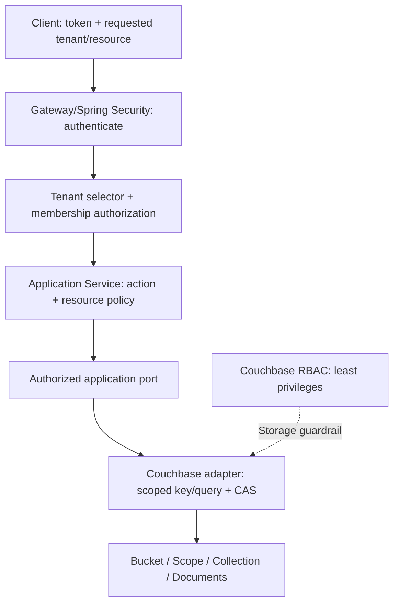

# Phân quyền và tenant ở ranh giới dịch vụ

## 1. Bài toán: đăng nhập đúng vẫn có thể đọc sai dữ liệu

Một nền tảng bán hàng cung cấp API cho nhiều cửa hàng (*tenant*). Người dùng của cửa hàng A gọi:

```http
GET /api/orders/order-482?tenantId=store-B
Authorization: Bearer <access-token-of-user-in-store-A>
```

Người dùng đã đăng nhập hợp lệ, nhưng điều đó **không có nghĩa** họ được xem đơn của `store-B`. Nếu Controller chuyển thẳng `tenantId` và `orderId` sang `repository.findById`, hoặc Service chỉ kiểm tra “đã authenticated”, ứng dụng có thể mắc lỗi **Broken Object Level Authorization (BOLA/IDOR)**.

Những biến thể khó phát hiện hơn:

- `GET /api/orders` trả đúng 20 đơn thuộc cửa hàng A, nhưng `totalElements` tính trên **toàn cluster** làm lộ số đơn của B.
- Bộ lọc động ghép `tenantId = A AND status = PAID OR status = SHIPPED`; nhánh `OR` có thể đưa đơn của B vào kết quả.
- `DELETE /api/orders/{id}` dùng `deleteById` theo ID đoán được mà không đọc và kiểm tra owner.
- Một event từ queue mang `tenantId` chưa được kiểm chứng khiến background worker ghi vào collection hoặc cache của tenant khác.
- Một người là thành viên hai tenant có thể **chủ động chuyển tenant đang làm việc**, nhưng client không thể tự cấp quyền đối với tenant thứ ba.
- Document đúng tenant nhưng thuộc **khách hàng/chi nhánh khác** mà actor không được xem.

Bài học thuộc chương **Thiết kế ứng dụng** trong module **SPRING_DATA_COUCHBASE**: xây dựng tầng truy cập Couchbase với document mapping, repository, `CouchbaseTemplate`, SQL++, tổ chức bucket/scope/collection, chỉ mục, TTL, CAS, giao dịch và reactive. Trọng tâm là đặt **authentication, authorization, tenant selection và data-scoping** ở đúng ranh giới, đồng thời bảo vệ **mọi đường đọc/ghi**.

**Mục tiêu học tập:**

1. Phân biệt xác thực danh tính, kiểm tra quyền nghiệp vụ và phân vùng dữ liệu theo tenant.
2. Thiết kế đường đi từ principal đáng tin cậy tới `AuthorizedTenantScope` và application service.
3. Tránh IDOR qua `findById`, `deleteById`, `@Query`, `CouchbaseTemplate`, raw SQL++, count, pagination và JOIN.
4. Đối chiếu các mô hình multi-tenancy trong Couchbase, phạm vi RBAC và cách chọn keyspace an toàn.
5. Tích hợp CAS, transaction, TTL, soft delete và outbox mà không bỏ sót điều kiện phân quyền.
6. Hiểu cách truyền security/tenant context trong reactive pipeline và background job.
7. Kiểm thử cross-tenant access, resource ownership, cache leakage, query injection và concurrent requests.

> **Phạm vi:** Ví dụ dùng Java 17+, Spring Security hiện đại, Spring Data Couchbase và Java SDK 3.x với phiên bản tương thích. Những class minh họa ở package khác nhau cần đặt trong các file Java riêng. Bài tập trung vào **application design**; JWT validation, chính sách identity provider và authorization provider cụ thể phải được cấu hình, kiểm thử theo hệ thống đang triển khai.

## 2. Bốn lớp bảo vệ không được gộp làm một

| Lớp | Câu hỏi phải trả lời | Ví dụ kiểm tra | Cơ chế không thay thế được nó |
| --- | --- | --- | --- |
| **Authentication** | Người gọi thực sự là ai? | JWT signature, issuer, audience, expiry, principal | Chỉ có `tenantId` trong body |
| **Tenant authorization** | Actor có được thao tác trong tenant đang chọn? | Membership/role còn hiệu lực, service identity được cấp | Document có field `tenant_id` |
| **Resource authorization** | Actor được xem/sửa **đơn cụ thể** nào trong tenant? | Ownership, team, branch, policy/state | Quyền truy cập bucket/scope |
| **Storage authorization** | Backend credential được phép làm gì với Couchbase? | RBAC quyền read/write/query trên keyspace cần thiết | `@PreAuthorize` ở HTTP |

Một ứng dụng có RBAC chặt ở Couchbase nhưng dùng **một service account có quyền đọc mọi document** vẫn phải kiểm tra tenant/owner trong application. Ngược lại, một Service có policy tốt nhưng credential database quá rộng làm tăng tác động nếu xuất hiện injection hoặc credential leak.



### 2.1. Thông tin đã xác thực khác thông tin do client *yêu cầu*

Giả sử API cho phép người dùng đổi cửa hàng đang thao tác bằng header:

```http
X-Tenant-ID: store-02
```

Header đó chỉ là **requested tenant**, không phải bằng chứng user có quyền. Server cần:

1. Xác thực token/session và nhận diện actor từ nguồn đáng tin.
2. Kiểm tra actor hiện là thành viên/được ủy quyền với `store-02`.
3. Kiểm tra action cụ thể, ví dụ `ORDER_READ`, `ORDER_DELETE`, `CUSTOMER_EXPORT`.
4. Với thao tác theo document, kiểm tra tiếp **owner, branch, customer, trạng thái**.
5. Tạo một scope nội bộ đã được xác minh và truyền nó đến Service/repository adapter.

Nếu token có danh sách `tenants` hoặc `roles`, chỉ tin claim **sau khi** token được kiểm tra cryptographic signature/issuer/audience/expiry và claim contract. Tùy yêu cầu thu hồi quyền tức thì, membership/role trong token có thể đã cũ: cần policy lookup hoặc cache có TTL/invalidations và kiểm tra token lifetime.

### 2.2. Vai trò không tự cấp quyền trên mọi tài nguyên

Người dùng có `role=MANAGER` trong cửa hàng A chưa chắc được xem customer VIP do một bộ phận khác quản lý. Có thể cần:

```text
allow(actor, READ_ORDER, order) =
    actor.isActive
    AND memberOf(actor, order.tenantId)
    AND hasActionRole(actor, READ_ORDER, order.tenantId)
    AND (actor.isTenantAdmin
         OR order.customerId IN actor.allowedCustomerIds
         OR order.branchId IN actor.allowedBranchIds)
```

Đây là kết hợp **RBAC** (role/action) và **ABAC** (thuộc tính actor/resource). Chính sách phải có **mặc định từ chối** (*deny by default*) và mọi thuộc tính quyền phải đến từ authority đáng tin. Không tin `allowedCustomerIds` được gửi trong query string chỉ vì nó có dạng `List<String>`.

## 3. Tenant được phân tách ở đâu trong Couchbase?

Không có một chiến lược tổ chức tenant tối ưu cho mọi ứng dụng. Các phương án:

| Mô hình | Tổ chức dữ liệu | Điểm mạnh | Trách nhiệm / giới hạn |
| --- | --- | --- | --- |
| **Shared collection, tenant field** | Tất cả `orders` trong `shop.sales.orders`, có `tenant_id` | Đơn giản, thuận tiện phân tích và scale nhiều tenant nhỏ | Phải lọc tenant ở **mọi** query/KV path; index có tenant prefix |
| **Collection per tenant** | `tenantA.orders`, `tenantB.orders` trong scope được cấu hình | Có thể cấp RBAC theo collection và điều phối lưu trữ | Số lượng collection/DDL/connection, routing, migrations và giới hạn cluster |
| **Scope/bucket per tenant** | Mỗi tenant có keyspace riêng | Isolation, quota/operability tùy yêu cầu | Tốn quản trị, số keyspace, index, credential/cluster topology |
| **Cluster per tenant/tenant group** | Cluster riêng | Isolation mạnh hơn ở ranh giới vận hành | Chi phí, deployment, backup, routing và multi-region |

Trong **shared collection**, Couchbase RBAC trên `shop.sales.orders` không tự giới hạn một credential ở `tenant_id = store-01`. App cần predicate và key validation. Trong mô hình nhiều collection, truy cập collection sai vẫn có thể lộ dữ liệu nếu selector được client điều khiển mà không xác thực quyền.

### 3.1. Scope/collection không đồng nghĩa tenant

```java
@Document
@Scope("sales")
@Collection("orders")
public class OrderDocument {
    // ...
}
```

Hai annotation trên chỉ xác định **keyspace mapping**, không tự inject filter `tenantId` vào `findAll` hay `findById`. Nếu mọi tenant chung collection `orders`, chúng vẫn cần tenant predicate và ID validation.

### 3.2. Không cho client tự định danh keyspace trong SQL++

```java
// KHÔNG NÊN:
String collection = request.getParameter("collection");
String sql = "SELECT * FROM `shop`.`sales`.`"
        + collection + "` WHERE ...";
```

SQL++ named parameters bind **giá trị**, không tự thay các thành phần identifier/keyspace. Chọn tenant-specific keyspace qua **mapping/registry được server quản lý**, sau khi membership/authorization được kiểm chứng, và chỉ chấp nhận identifier nằm trong allowlist đã triển khai:

```text
requestedTenant: "store-02" (untrusted selection)
       ↓ authorizeMembership(actor, requestedTenant)
authorizedTenant: "store-02"
       ↓ TenantKeyspaceRegistry (server-controlled)
bucket/scope/collection + CouchbaseClientFactory/template
       ↓ prepared query, bound values
```

Không xây tên bucket/collection bằng cách thay bất kỳ chuỗi client nào vào query; cần kiểm tra cả thao tác tenant move/migrate, rename scope và các tenant đã bị ngưng hoạt động.

### 3.3. ID phân vùng tenant để giảm nhầm key, không dùng làm authorization

Ví dụ một document ID có namespace:

```text
order::store-01::ORD-1024
```

ID chứa tenant giúp routing, audit và tránh đụng key giữa tenant trong cùng collection. Nhưng prefix **không phải chứng minh quyền**: client có thể đoán hoặc tự tạo `order::store-02::ORD-1024`. Sau KV get vẫn cần đối chiếu tenant trong body và quyền theo resource.

Nếu tenant ID hoặc business ID chứa dấu phân tách, dùng format canonical/length-prefix hoặc digest; kiểm tra giới hạn byte ID. Không ghép raw ID tùy ý tạo ambiguity hoặc lộ dữ liệu cá nhân vào document key.

## 4. Mô hình danh tính và scope được cấp quyền

Đường đi thiết kế:

```text
Trusted principal ──> tenant selection request
          │                   │
          └──> TenantMembershipPolicy.check(...)
                              │
                     AuthorizedTenantScope
                              │
                 Application Service (action)
                              │
                       Data access port
```

### 4.1. Những kiểu dữ liệu nên tách riêng

```java
package com.example.shop.security;

import java.util.Set;

/** Principal đã được authentication framework xác thực. */
public record AuthenticatedActor(
        String subjectId,
        Set<String> globalAuthorities
) {
    public AuthenticatedActor {
        if (subjectId == null || subjectId.isBlank()) {
            throw new IllegalArgumentException("subjectId rỗng");
        }
        globalAuthorities = Set.copyOf(globalAuthorities);
    }
}

/** Kết quả kiểm tra membership/role trong tenant, không phải HTTP DTO. */
public record AuthorizedTenantScope(
        String tenantId,
        String actorId,
        Set<String> permittedActions,
        Set<String> permittedBranches
) {
    public AuthorizedTenantScope {
        if (tenantId == null || tenantId.isBlank()
                || actorId == null || actorId.isBlank()) {
            throw new IllegalArgumentException("Scope không hợp lệ");
        }
        permittedActions = Set.copyOf(permittedActions);
        permittedBranches = Set.copyOf(permittedBranches);
    }
}
```

Đặt **hai public record trong hai file Java riêng**. Đây là kiểu dữ liệu cho application, không phải security mechanism: ai cũng có thể `new AuthorizedTenantScope(...)` trong cùng ứng dụng nếu API cho phép. **Độ tin cậy đến từ việc Service chỉ nhận scope qua authorization gateway và không expose đường vòng**; có thể hạn chế constructor/package visibility, dùng opaque capability có factory được kiểm soát hoặc luôn kiểm tra policy tại điểm dùng, tùy mức đe dọa.

`globalAuthorities` không tự biến thành quyền trên mọi tenant. `permittedActions` và `permittedBranches` phải là **kết quả policy**, không sao chép request body của user.

### 4.2. Tenant policy port

```java
package com.example.shop.security;

public interface TenantMembershipPolicy {
    AuthorizedTenantScope authorize(
            AuthenticatedActor actor,
            String requestedTenantId,
            String action);
}
```

Implementation truy vấn authoritative membership/role store hoặc permission service có chính sách cache/TTL rõ ràng. Nó phải:

- Từ chối tenant không tồn tại, bị suspend hoặc actor không còn membership.
- Từ chối action không thuộc quyền của actor trong tenant đó.
- Xác nhận actor đang hoạt động, không chỉ thuộc danh sách role cũ trong token.
- Trả branch/customer constraints cần thiết để truy vấn dữ liệu trước pagination.
- Ghi audit những denial quan trọng mà không lộ token/PII.

Nếu actor được quyền quản trị **nhiều tenant**, mỗi request vẫn cần một **scope tenant tường minh** hoặc một authorization cho cross-tenant report riêng. Đừng biến `role=SUPER_ADMIN` thành điều kiện `WHERE 1=1` trong query dành cho người dùng thường.

## 5. Chọn tenant ở HTTP boundary: yêu cầu khác quyền

Ví dụ dùng Spring MVC và một Resource Server có JWT hợp lệ do Spring Security kiểm tra:

```java
package com.example.shop.orders.api;

import com.example.shop.security.AuthenticatedActor;
import com.example.shop.security.JwtActorMapper;
import com.example.shop.orders.application.OrderSearchService;
import org.springframework.security.core.Authentication;
import org.springframework.web.bind.annotation.*;

@RestController
@RequestMapping("/api/orders")
public class OrderController {
    private final JwtActorMapper actors;
    private final OrderSearchService service;

    public OrderController(
            JwtActorMapper actors, OrderSearchService service) {
        this.actors = actors;
        this.service = service;
    }

    @GetMapping
    public OrderSearchResponse list(
            Authentication authentication,
            @RequestHeader("X-Tenant-ID") String requestedTenant,
            @RequestParam(required = false) String status,
            @RequestParam(defaultValue = "0") int page,
            @RequestParam(defaultValue = "20") int size) {

        AuthenticatedActor actor = actors.from(authentication);
        return service.list(
                actor, requestedTenant, status, page, size);
    }
}
```

`OrderSearchResponse` là DTO API do dự án định nghĩa, **không phải entity Couchbase**. `JwtActorMapper` cũng là component ứng dụng; nó chỉ chuyển từ một `Authentication` đã được Spring Security xác thực. Ví dụ an toàn ở phía mapper:

```java
package com.example.shop.security;

import java.util.stream.Collectors;
import org.springframework.security.core.Authentication;
import org.springframework.security.oauth2.server.resource.authentication.JwtAuthenticationToken;
import org.springframework.stereotype.Component;

@Component
public class JwtActorMapper {
    public AuthenticatedActor from(Authentication authentication) {
        if (!(authentication instanceof JwtAuthenticationToken jwt)
                || !authentication.isAuthenticated()) {
            throw new IllegalArgumentException(
                    "Chưa có principal JWT đã xác thực");
        }
        var authorities = jwt.getAuthorities().stream()
                .map(a -> a.getAuthority())
                .collect(Collectors.toUnmodifiableSet());
        return new AuthenticatedActor(
                jwt.getToken().getSubject(), authorities);
    }
}
```

**Điều kiện tiên quyết quan trọng:** `Authentication` chỉ đáng tin nếu filter chain đã cấu hình **JWT resource server verification** (chữ ký/JWKS, issuer, audience, expiry, thuật toán được chấp nhận, policy revocation khi cần). Mã mapper không tự thực hiện cryptographic validation. Cấu hình JWT issuer/audience là phần security configuration bắt buộc, nhưng không nên nhúng secret vào tutorial hay dựa vào một token decode thuần túy.

### 5.1. Bảo vệ endpoint không đủ để bảo vệ resource

```java
@PreAuthorize("hasAuthority('SCOPE_orders.read')")
public OrderSearchResponse list(...) { ... }
```

Method security như trên hữu ích để giới hạn **khả năng chung** của user, nhưng chưa trả lời:

- `orders.read` có phải quyền trong `store-01` hay chỉ là scope chung?
- User có được xem **tất cả** order hay chỉ order trong branch A?
- User đã bị thu hồi membership từ khi JWT được phát hành?
- Một `orderId` thuộc tenant B liệu vẫn có thể bị truy xuất?

Vì vậy cần **policy cấp tenant/action và policy cấp resource** ở application service, không chỉ một annotation HTTP.

### 5.2. Những lựa chọn thiết kế endpoint

| Giao diện | Ý nghĩa của tenant | Cần xác minh |
| --- | --- | --- |
| `/tenants/{tenantId}/orders` | Tenant được client yêu cầu qua path | Membership/action; path không cấp quyền |
| `X-Tenant-ID` | Tenant đang chọn trong UI | Membership/action |
| Tenant trong token claim | Danh tính/tenant được issuer xác nhận tại lúc token phát hành | Chữ ký/issuer/audience, claim freshness và action |
| Subdomain `store-01.example` | Host routing/tenant selection | Host header/proxy trust, membership |
| mTLS/service identity | Service-to-service tenant context | Quyền delegation, source attestation, scope cụ thể |

**Không lấy mặc định tenant từ một field bất kỳ chỉ vì client gửi nhiều bản sao giống nhau.** Nếu path, header và body đều có tenant, nên chọn **một nguồn selection đã định nghĩa**, kiểm tra các field thừa có thể gây ambiguity, và từ chối trường hợp mâu thuẫn thay vì ưu tiên tùy tiện.

## 6. Application service là điểm kiểm soát quyền và scope

Từ Controller, chuyển actor và **tenant được yêu cầu** sang Service. Service gọi membership policy để cấp scope:

```java
package com.example.shop.orders.application;

import com.example.shop.security.AuthenticatedActor;
import com.example.shop.security.AuthorizedTenantScope;
import com.example.shop.security.TenantMembershipPolicy;
import org.springframework.data.domain.PageRequest;
import org.springframework.stereotype.Service;

@Service
public class OrderSearchService {
    private final TenantMembershipPolicy membership;
    private final OrderReadPort orderReads;

    public OrderSearchService(
            TenantMembershipPolicy membership, OrderReadPort orderReads) {
        this.membership = membership;
        this.orderReads = orderReads;
    }

    public OrderSearchResponse list(
            AuthenticatedActor actor,
            String requestedTenant,
            String requestedStatus,
            int page,
            int size) {

        AuthorizedTenantScope scope = membership.authorize(
                actor, requestedTenant, "ORDER_READ");

        if (page < 0 || size < 1 || size > 100
                || (long) page * size > 10_000L) {
            throw new IllegalArgumentException("Phân trang không hợp lệ");
        }

        String status = validateStatus(requestedStatus);
        var matches = orderReads.listVisible(
                scope, status, PageRequest.of(page, size));

        // Map application read model -> API DTO, không trả OrderDocument.
        return OrderSearchResponse.from(matches);
    }

    private static String validateStatus(String requested) {
        if (requested == null) return null;
        return switch (requested) {
            case "NEW", "PAID", "SHIPPED", "CANCELLED" -> requested;
            default -> throw new IllegalArgumentException("Status sai");
        };
    }
}
```

`OrderReadPort` là port application; `OrderSearchResponse.from(...)` là mapper minh họa. `membership.authorize` phải kiểm tra cả **actor, tenant, action** và xây ràng buộc branch/customer từ nguồn được cấp quyền. Không tin `scope` chỉ vì nó có kiểu `AuthorizedTenantScope` nếu code khác có thể tự tạo kiểu này.

### 6.1. Hợp đồng port không có biến “bỏ tenant filter”

```java
package com.example.shop.orders.application;

import com.example.shop.security.AuthorizedTenantScope;
import org.springframework.data.domain.Page;
import org.springframework.data.domain.Pageable;

public interface OrderReadPort {
    Page<OrderSummary> listVisible(
            AuthorizedTenantScope scope,
            String normalizedStatus,
            Pageable pageable);

    OrderSummary getVisibleById(
            AuthorizedTenantScope scope,
            String publicOrderId);
}

public record OrderSummary(
        String id,
        String tenantId,
        String customerId,
        String branchId,
        String status,
        long totalMinor) {}
```

Interface và record ở trên thuộc **hai file Java riêng**. Không thêm boolean `skipTenantFilter` vào method như một đường tắt “dành cho admin”. Với báo cáo cross-tenant thực sự, tạo **port và action riêng** (`CrossTenantOrderReportPort`), cấp service identity/authorization phù hợp và log audit.

### 6.2. Ràng buộc chi nhánh có thể là tập trống

Quy tắc ở đây:

```text
scope.permittedActions chứa ORDER_READ_ALL_BRANCHES
    -> được xem mọi branch trong tenant

ngược lại:
    -> chỉ được xem order.branchId trong permittedBranches
       (tập rỗng nghĩa là KHÔNG thấy document nào)
```

**Đừng biến tập branch rỗng thành “bỏ điều kiện branch”**: đó là lỗi escalation rất nguy hiểm. Tương tự, `customerIds=[]` từ policy có thể nghĩa là user không có khách hàng nào được xem, không phải “mọi khách hàng”.

### 6.3. Trả 403 hay 404 cho tài nguyên ngoài phạm vi?

Với yêu cầu truy xuất một ID cụ thể, nhiều hệ thống cố tình trả **404 Not Found** khi tài nguyên không tồn tại **hoặc caller không được phép biết nó tồn tại**, để giảm nguy cơ enumeration. Một số endpoint admin lại chọn 403 với audit chi tiết.

Điểm cần bảo đảm:

- Không đưa tenant ID, customer email hoặc owner khác vào error body.
- Response timing và lỗi kỹ thuật không giúp dễ dàng dò tài nguyên.
- Không trả dữ liệu rồi mới kiểm tra permission sau serialization.
- Có audit nội bộ cho denial để điều tra, nhưng không log nguyên JWT/PII.

API contract quyết định mã HTTP, nhưng **không** thay đổi yêu cầu kiểm tra quyền trước khi trả dữ liệu.

## 7. Entity mapping và định danh an toàn theo tenant

Một Order trong shared collection `shop.sales.orders`:

```java
package com.example.shop.orders.persistence;

import org.springframework.data.annotation.Id;
import org.springframework.data.annotation.Version;
import org.springframework.data.couchbase.core.mapping.*;

@Document
@Scope("sales")
@Collection("orders")
public class OrderDocument {
    @Id
    private String id;

    @Field("tenant_id")
    private String tenantId;

    @Field("customer_id")
    private String customerId;

    @Field("branch_id")
    private String branchId;

    @Field("status")
    private String status;

    @Field("total_minor")
    private Long totalMinor;

    @Field("lifecycle_state")
    private String lifecycleState;

    @Field("created_at_ms")
    private Long createdAtMillis;

    @Version
    private Long version;

    public OrderDocument() {}
    // Constructor/getters/setters mapping cần thiết trong file thật.
}
```

**`@Scope` và `@Collection` chỉ chọn keyspace; `@Version` chỉ ánh xạ CAS.** Không annotation nào tự đưa `tenant_id` hoặc `branch_id` vào mọi query/DELETE/UPDATE. Bộ lọc ứng dụng vẫn phải bắt buộc theo policy.

### 7.1. Document key có thể ghép tenant và public ID

Ví dụ:

```text
publicOrderId = ORD-482
trustedTenant = store-01

document key = order::store-01::ORD-482
```

Chỉ nhận public ID đã validate định dạng và kết hợp với **trusted tenant**:

```java
public final class OrderKeys {
    private OrderKeys() {}

    public static String documentId(
            String trustedTenant, String publicOrderId) {
        if (trustedTenant == null
                || !trustedTenant.matches("[A-Za-z0-9_-]{1,64}")
                || publicOrderId == null
                || !publicOrderId.matches("[A-Za-z0-9_-]{1,80}")) {
            throw new IllegalArgumentException("ID sai định dạng");
        }
        return "order::" + trustedTenant + "::" + publicOrderId;
    }
}
```

Ví dụ giả định policy tenant ID chỉ cho ký tự ASCII không có dấu `::`. Với tenant ID UUID hoặc Unicode, phải định nghĩa encoding/canonicalization khác. Không biến việc giữ prefix đúng thành “mặc nhiên an toàn”: **sau khi đọc document phải so `doc.tenantId` và quyền owner/branch** vì dữ liệu có thể bị ghi sai, migrate nhầm hoặc bị sửa bởi một đường ghi legacy.

### 7.2. Đọc theo KV là nơi dễ xuất hiện IDOR

```java
// KHÔNG AN TOÀN:
return repository.findById(requestedId).orElseThrow();
```

Repository không biết actor hiện tại. Một adapter bảo vệ theo key và nội dung:

```java
public OrderSummary getVisibleById(
        AuthorizedTenantScope scope, String publicOrderId) {

    if (!scope.permittedActions().contains("ORDER_READ")) {
        throw new AccessDeniedException("Thiếu quyền đọc");
    }

    String key = OrderKeys.documentId(
            scope.tenantId(), publicOrderId);
    OrderDocument doc = repository.findById(key)
            .orElseThrow(OrderNotFoundException::new);

    if (!scope.tenantId().equals(doc.getTenantId())
            || !"ACTIVE".equals(doc.getLifecycleState())) {
        throw new OrderNotFoundException();
    }
    boolean allBranches = scope.permittedActions()
            .contains("ORDER_READ_ALL_BRANCHES");
    if (!allBranches
            && (doc.getBranchId() == null
                || !scope.permittedBranches()
                       .contains(doc.getBranchId()))) {
        throw new OrderNotFoundException();
    }

    return new OrderSummary(
            publicOrderId, doc.getTenantId(),
            doc.getCustomerId(), doc.getBranchId(),
            doc.getStatus(), doc.getTotalMinor());
}
```

Đây là method trong một persistence adapter inject `OrderRepository`; `OrderNotFoundException` do dự án định nghĩa, còn `AccessDeniedException` dùng kiểu của Spring Security. **Giả định** scope được tạo bởi một `TenantMembershipPolicy` đáng tin; adapter vẫn kiểm tra lại action `ORDER_READ` theo nguyên tắc phòng thủ nhiều lớp. Nếu quyền còn hạn chế theo customer/order ownership, thêm điều kiện đó **trước khi trả summary**, không chỉ branch.

Trong code thật, các phương thức `getBranchId`, `getLifecycleState` ... phải được khai báo trong entity. Không trả `OrderDocument` trực tiếp để tránh lộ `@Version`, schema metadata và các field nội bộ.

## 8. Truy vấn danh sách: mọi nhánh phải mang tenant và quyền

Với shared collection `shop.sales.orders`, một truy vấn **chỉ có filter status** là không an toàn:

```sql
SELECT *
FROM `shop`.`sales`.`orders` AS o
WHERE o.status = $status;
```

Truy vấn cần ít nhất tenant, trạng thái hiển thị và giới hạn quyền theo chi nhánh/khách hàng:

```sql
SELECT META(o).id AS documentId,
       o.customer_id, o.branch_id, o.status, o.total_minor
FROM `shop`.`sales`.`orders` AS o
WHERE o.tenant_id = $tenantId
  AND o.lifecycle_state = "ACTIVE"
  AND ($allBranches = TRUE OR o.branch_id IN $branches)
  AND ($status IS NULL OR o.status = $status)
ORDER BY o.created_at_ms DESC, META(o).id DESC
LIMIT $size OFFSET $offset;
```

`$allBranches`, `$branches` và `$tenantId` phải được **tạo từ server-side authorization result**, không lấy từ HTTP query hoặc body. `$status` có thể đến từ client **sau whitelist validation**. Nếu scope không có `ORDER_READ_ALL_BRANCHES` và danh sách branch rỗng, trả **không có hàng nào**, không tự bỏ predicate.

### 8.1. Quy tắc nhóm `OR` đặc biệt quan trọng

Ví dụ sai:

```sql
WHERE o.tenant_id = $tenantId
  AND o.status = "PAID"
   OR o.status = "SHIPPED"
```

Do ưu tiên toán tử, query có thể tương đương:

```sql
WHERE (o.tenant_id = $tenantId AND o.status = "PAID")
   OR (o.status = "SHIPPED")
```

Nhánh thứ hai không ràng tenant. Đúng:

```sql
WHERE o.tenant_id = $tenantId
  AND (o.status = "PAID" OR o.status = "SHIPPED")
```

Khi có quyền chi nhánh, predicate đầy đủ phải giữ dạng:

```text
tenantConstraint
  AND resourceVisibilityConstraint
  AND (optionalFilterA OR optionalFilterB)
```

Không viết kiểu `(tenant AND branch AND A) OR B` khi B chỉ là điều kiện status.

### 8.2. Java SDK SQL++: chỉ bind values, không lấy boolean quyền từ client

```java
import com.couchbase.client.java.Cluster;
import com.couchbase.client.java.json.JsonArray;
import com.couchbase.client.java.json.JsonObject;
import com.couchbase.client.java.query.QueryScanConsistency;
import org.springframework.data.domain.Page;
import org.springframework.data.domain.PageImpl;
import org.springframework.data.domain.Pageable;
import java.util.ArrayList;
import java.util.List;
import static com.couchbase.client.java.query.QueryOptions.queryOptions;

public Page<OrderSummary> listVisible(
        AuthorizedTenantScope scope,
        String normalizedStatus,
        Pageable pageable) {

    if (!scope.permittedActions().contains("ORDER_READ")) {
        throw new AccessDeniedException("Thiếu quyền đọc");
    }
    boolean allBranches = scope.permittedActions()
            .contains("ORDER_READ_ALL_BRANCHES");
    if (!allBranches && scope.permittedBranches().isEmpty()) {
        return new PageImpl<>(List.of(), pageable, 0);
    }
    if (pageable.isUnpaged()
            || pageable.getPageSize() > 100
            || pageable.getOffset() > 10_000L) {
        throw new IllegalArgumentException("Trang quá lớn");
    }

    JsonArray branches = JsonArray.create();
    scope.permittedBranches().stream().sorted()
            .forEach(branches::add);

    JsonObject params = JsonObject.create()
            .put("tenantId", scope.tenantId())
            .put("allBranches", allBranches)
            .put("branches", branches)
            .put("status", normalizedStatus)
            .put("size", pageable.getPageSize())
            .put("offset", pageable.getOffset());

    String fromWhere = """
        FROM `shop`.`sales`.`orders` AS o
        WHERE o.tenant_id = $tenantId
          AND o.lifecycle_state = "ACTIVE"
          AND ($allBranches = TRUE OR o.branch_id IN $branches)
          AND ($status IS NULL OR o.status = $status)
        """;

    String rowsSql = """
        SELECT META(o).id AS documentId,
               o.customer_id AS customerId,
               o.branch_id AS branchId,
               o.status AS status,
               o.total_minor AS totalMinor
        """ + fromWhere + """
        ORDER BY o.created_at_ms DESC, META(o).id DESC
        LIMIT $size OFFSET $offset
        """;

    String countSql = "SELECT RAW COUNT(1) "
            + fromWhere;

    var rows = cluster.query(
            rowsSql,
            queryOptions().parameters(params).readonly(true))
            .rowsAsObject();

    long total = cluster.query(
            countSql,
            queryOptions().parameters(params).readonly(true))
            .rowsAs(Long.class).get(0);

    List<OrderSummary> mapped = new ArrayList<>();
    String prefix = "order::" + scope.tenantId() + "::";
    for (JsonObject row : rows) {
        String docId = row.getString("documentId");
        if (!docId.startsWith(prefix)) {
            throw new IllegalStateException(
                    "Sai key namespace trong dữ liệu");
        }
        mapped.add(new OrderSummary(
                docId.substring(prefix.length()),
                scope.tenantId(),
                row.getString("customerId"),
                row.getString("branchId"),
                row.getString("status"),
                row.getLong("totalMinor")));
    }

    return new PageImpl<>(mapped, pageable, total);
}
```

Đây là method minh họa nằm trong adapter inject `Cluster` và implementation của `OrderReadPort`; class `AccessDeniedException` có thể là `org.springframework.security.access.AccessDeniedException`. Code dùng hai **query executions** độc lập, không cam kết snapshot chung. Production cần policy status validation đầu vào (Service ở mục 6), tenant/branch membership còn hiệu lực, mapping khi dữ liệu cũ thiếu field, query timeout/scan consistency và metrics phù hợp.

Trong môi trường **yêu cầu chặn ngay truy vấn thấy dữ liệu đã đổi quyền hoặc soft delete**, cân nhắc `scanConsistency(QueryScanConsistency.REQUEST_PLUS)` cho các query SQL++ liên quan, với đánh đổi latency. Đừng lạm dụng nó thay cho kiểm tra quyền: index consistency **không kiểm chứng actor được phép**.

Một policy cấp customer ngoài branch phải được thêm vào `fromWhere`, **không được** lọc bớt `mapped` sau khi đã `LIMIT/OFFSET`. Ví dụ `customer_id IN $authorizedCustomerIds` với danh sách do policy cung cấp. Đừng truyền hàng vạn ID vào SQL++ nếu hệ thống có mô hình quyền phức tạp; cân nhắc read model/ACL index hay entitlement service có thiết kế nhất quán và scale được.

### 8.3. Count và pagination là một phần của ranh giới bảo mật

Nếu trang list lọc tenant A, nhưng count tính trên mọi tenant:

```sql
-- Sai: làm lộ metadata và sai total pages.
SELECT RAW COUNT(1)
FROM `shop`.`sales`.`orders` AS o
WHERE o.status = "PAID";
```

thì dù response items không chứa đơn của B, `totalElements` vẫn có thể tiết lộ activity của tenant khác. Query trang và count phải có **cùng predicate tenant, state, branch, customer và filter**. Các thao tác `EXISTS`, `COUNT`, aggregation, facet/search suggestions, exports cũng là kênh quan sát dữ liệu, không chỉ `SELECT` trả entity.

Nếu không cần tổng số, có thể trả `Slice` với `size+1` thay count. Nhưng cách này vẫn phải lọc quyền **trước** phân trang và dùng order ổn định để tránh trùng trang. Không dùng `size`/offset tùy ý từ client; đặt trần và cân nhắc keyset pagination khi offset sâu.

### 8.4. Index giúp hiệu năng, không tạo row-level security

```sql
CREATE INDEX ix_orders_tenant_branch_time
ON `shop`.`sales`.`orders`(
    tenant_id,
    branch_id,
    created_at_ms DESC
);
```

Index này có thể phù hợp với query tenant + branch, nhưng nếu query cho manager không lọc branch, planner có thể cần index khác:

```sql
CREATE INDEX ix_orders_tenant_state_time
ON `shop`.`sales`.`orders`(
    tenant_id,
    lifecycle_state,
    created_at_ms DESC
);
```

Không tạo index cho mọi tổ hợp một cách cơ học. Hãy chạy `EXPLAIN` với **SQL++ thực tế** (cả type discriminator do Spring Data có thể thêm), kiểm tra index scan/sort/fetch, số tenant và phân bố branch, rồi đo p95/p99. **Không coi index prefix tenant là permission policy**: một query thiếu `WHERE tenant_id = ...` vẫn có thể quét dữ liệu ngoài scope nếu credential cho phép.

## 9. Spring Data repository, `@Query`, Template và fragment

Các abstraction Spring Data giúp giảm SQL++ thủ công, nhưng **không biến repository mặc định thành tenant-aware**.

### 9.1. Derived query: tenant phải là một phần của chữ ký

```java
import org.springframework.data.couchbase.repository.CouchbaseRepository;
import java.util.List;

public interface OrderRepository
        extends CouchbaseRepository<OrderDocument, String> {

    List<OrderDocument> findByTenantIdAndLifecycleState(
            String trustedTenantId, String lifecycleState);
}
```

Derived method trên có tenant và lifecycle, nhưng vẫn **chưa đủ** nếu actor chỉ được xem một subset branch/customer. Không trao quyền gọi derived method này trực tiếp cho Controller; Service/adapter chịu trách nhiệm thêm điều kiện quyền được cấp và map về DTO an toàn.

### 9.2. Repository `@Query` cần đúng tên JSON và type filter

Ví dụ pattern của Spring Data Couchbase:

```java
import org.springframework.data.couchbase.repository.Query;
import org.springframework.data.couchbase.repository.CouchbaseRepository;
import java.util.List;

public interface OrderRepository
        extends CouchbaseRepository<OrderDocument, String> {

    @Query("#{#n1ql.selectEntity} WHERE #{#n1ql.filter} " +
           "AND tenant_id = $1 AND lifecycle_state = 'ACTIVE' " +
           "AND status = $2")
    List<OrderDocument> findActiveByTenantAndStatus(
            String trustedTenantId, String status);
}
```

`#{#n1ql.selectEntity}` và `#{#n1ql.filter}` là cú pháp Spring Data Couchbase dùng hỗ trợ entity selection/type filtering; **phải kiểm chứng đúng theo dependency version và mapping `@Field` của dự án**. `tenant_id` ở string SQL++ là **JSON stored field**, không phải property Java `tenantId`. Các giá trị `$1`, `$2` được binding thay vì nối string input.

Đây vẫn chỉ là method dành cho phạm vi **có quyền xem mọi branch**. Nếu actor bị hạn chế branch, không dùng nó rồi lọc sau khi đã trả `List`; xây method/query riêng có predicate branch trước khi phân trang.

### 9.3. `CouchbaseTemplate` và `QueryCriteria`

```java
import org.springframework.data.couchbase.core.CouchbaseTemplate;
import org.springframework.data.couchbase.core.query.Query;
import org.springframework.data.couchbase.core.query.QueryCriteria;

Query query = Query.query(
        QueryCriteria.where("tenantId")
                .is(authorizedScope.tenantId()));
query.addCriteria(
        QueryCriteria.where("lifecycleState")
                .is("ACTIVE"));
query.addCriteria(
        QueryCriteria.where("branchId")
                .in(authorizedScope.permittedBranches()
                        .toArray(String[]::new)));

var result = template.findByQuery(OrderDocument.class)
        .matching(query)
        .all();
```

Ví dụ này chỉ dùng được khi actor **không** có quyền `ORDER_READ_ALL_BRANCHES`, có danh sách branch không rỗng và application đã xác minh `ORDER_READ`. Nếu tập branch rỗng, nên trả empty result **trước query**, không vô tình bỏ `in(...)`. Nếu cần OR giữa nhiều lựa chọn, kiểm tra grouping `QueryCriteria` theo phiên bản, để `tenant AND branch AND (A OR B)`, không đưa OR vượt khỏi policy.

**Đường truy vấn thực cần kiểm thử với `@Field` alias**: ở Criteria có thể dùng property Java để converter mapping, nhưng SQL++ string phải dùng key JSON. Tránh trộn dấu tên property, path nested và tên field API trong cùng một expression mà không xem query được sinh ra.

### 9.4. Repository fragment là nơi đóng gói query động

Khi filter thay đổi theo UI, có thể tạo:

```java
public interface ScopedOrderSearchFragment {
    org.springframework.data.domain.Page<OrderDocument> search(
            AuthorizedTenantScope scope,
            OrderSearchFilter filter,
            org.springframework.data.domain.Pageable pageable);
}
```

```text
OrderRepository
  extends CouchbaseRepository<OrderDocument, String>,
          ScopedOrderSearchFragment

ScopedOrderSearchFragmentImpl
  implements ScopedOrderSearchFragment
  injects CouchbaseTemplate
  builds NEW Query per invocation
```

Ở implementation, tạo query riêng cho page/count với **cùng** tenant/action/branch/filter, không lưu `Query` mutable trong singleton, không nhận `QueryCriteria` trực tiếp từ Controller, và không để caller truyền `whereSql` tự do. Trên hệ thống yêu cầu tách domain/storage, bọc fragment bên trong `OrderReadPort` adapter để Service không thấy `OrderDocument`.

## 10. Đường ghi: kiểm tra quyền trước mutation và bảo vệ race bằng CAS

Một lỗi nghiêm trọng là nghĩ rằng ghi chỉ cần biết key:

```java
// KHÔNG AN TOÀN: không kiểm tra tenant/resource ownership.
repository.deleteById(documentId);
```

Với shared collection, cả `deleteById`, `save`, `upsert`, `replace`, `remove` và `mutateIn` cần **authorization trước khi ghi**. Ngoài tenant, còn có trạng thái domain, quyền theo branch/customer và precondition phiên bản.

### 10.1. Một command sửa địa chỉ được cấp quyền

```java
public record ChangeShippingAddressCommand(
        String requestedTenantId,
        String publicOrderId,
        String newAddress,
        String idempotencyKey
) {}
```

Không tin `requestedTenantId` là đã được cấp quyền. Service:

```text
AuthenticatedActor
  ↓ authorize(actor, requestedTenant, ORDER_EDIT)
AuthorizedTenantScope
  ↓ OrderStore.getByTenantAndPublicId
OrderDocument + @Version/CAS
  ↓ assertMayEditOrder(actor, document, scope)
Domain.validateStateTransition/changeAddress
  ↓ save/replace WITH CAS
Updated document / outbox intent
```

Ví dụ adapter dùng Spring Data:

```java
import org.springframework.dao.OptimisticLockingFailureException;

public void updateShippingAddress(
        AuthorizedTenantScope scope,
        String publicOrderId,
        String newAddress) {

    if (!scope.permittedActions().contains("ORDER_EDIT")) {
        throw new AccessDeniedException("Thiếu quyền chỉnh đơn");
    }

    String key = OrderKeys.documentId(
            scope.tenantId(), publicOrderId);
    OrderDocument doc = repository.findById(key)
            .orElseThrow(OrderNotFoundException::new);

    if (!scope.tenantId().equals(doc.getTenantId())
            || doc.getBranchId() == null
            || !scope.permittedBranches()
                     .contains(doc.getBranchId())) {
        throw new OrderNotFoundException();
    }
    if (!"NEW".equals(doc.getStatus())
            || !"ACTIVE".equals(doc.getLifecycleState())) {
        throw new IllegalStateException("Order không cho phép sửa");
    }

    doc.setShippingAddress(newAddress);
    try {
        repository.save(doc); // @Version -> CAS nếu mapping đúng.
    } catch (OptimisticLockingFailureException conflict) {
        // Đọc lại, kiểm tra lại permission/state rồi mới quyết định
        // retry có giới hạn hoặc trả conflict cho caller.
        throw conflict;
    }
}
```

Đây là code minh họa một method trong persistence adapter; entity mẫu mục 7 cần thêm `shippingAddress` getter/setter nếu triển khai. Nó cố ý **fail-closed** khi branch không thuộc scope. Nếu policy cho manager sửa mọi branch, phải dùng một quyền **ORDER_EDIT_ALL_BRANCHES** được cấp tường minh thay vì tận dụng cờ `ORDER_READ_ALL_BRANCHES` (quyền đọc không tự cấp quyền sửa).

**Một điểm quan trọng:** cả khi `doc.tenantId` và `scope.tenantId` khớp, caller vẫn có thể không được phép thay đổi order này. Ví dụ order đã giao, order gắn customer không thuộc phạm vi hoặc người dùng chỉ có quyền xem. Kiểm tra quyền **theo action và resource** không thể thay bằng một so sánh tenant.

### 10.2. CAS chỉ chống lost update, không phải giấy phép truy cập

`@Version` ánh xạ Couchbase CAS để xác định document có thay đổi từ lúc đọc hay không. Nó **không** kiểm tra actor hiện có quyền edit. Sau CAS conflict:

1. Đọc lại entity theo key đáng tin.
2. Xác minh tenant và quyền resource của actor **trên trạng thái mới**.
3. Kiểm tra trạng thái nghiệp vụ, command ID và điều kiện `If-Match` nếu API yêu cầu.
4. Chỉ retry giới hạn khi phép biến đổi còn hợp lệ.

Không xử lý conflict bằng cách bỏ CAS rồi `upsert`: điều đó có thể ghi đè một lần xóa mềm, thay owner hoặc khôi phục đơn đã bị khóa.

### 10.3. Soft delete, TTL và trạng thái quyền

Khi soft-delete, Service cần kiểm tra `ORDER_DELETE`, state transition, tenant và resource; cập nhật `lifecycle_state="DELETED"` bằng CAS. Đường GET thông thường phải lọc `DELETED`, còn endpoint audit/admin có quyền riêng.

TTL **không thực thi permission check** khi document hết hạn. Với document cần archive, legal hold hoặc hoàn tiền trước purge, thiết kế workflow riêng; không dùng `@Document(expiry=...)` như một command `DELETE` đã được phân quyền. Khi mutation giữ hoặc thay TTL, cũng cần ghi nhận audit và tránh rút ngắn thời hạn lưu ngoài chính sách của tenant.

### 10.4. Idempotency key không thay thế authorization

Lệnh tạo/hủy có thể mang `Idempotency-Key` để retry an toàn. Một người đoán được key của user khác **không được phép** đọc receipt/result hoặc điều khiển workflow. Receipt key nên có scope:

```text
tenant + actor/resource scope + operation + idempotencyKey
```

Sau duplicate key, trước khi replay phải xác minh actor được phép và payload fingerprint/owner khớp. Không dùng `catch (DocumentExistsException) { return previousResult; }` mà bỏ qua quyền. Dedupe và authorization là hai lớp độc lập.

## 11. JOIN, nested arrays, aggregation và projection cũng cần cùng scope

Một query trên nhiều collection có thể tạo rò dữ liệu dù bảng chính đã lọc tenant.

### 11.1. JOIN phải gắn điều kiện tenant ở các phía

Giả sử Order chứa `customer_id` chỉ duy nhất **trong mỗi tenant**, còn Customer cũng có `tenant_id`. Một JOIN không đủ an toàn:

```sql
-- KHÔNG đủ nếu customer_id có thể trùng giữa tenant.
SELECT o.status, c.email
FROM `shop`.`sales`.`orders` AS o
JOIN `shop`.`sales`.`customers` AS c
  ON c.customer_id = o.customer_id
WHERE o.tenant_id = $tenantId;
```

Điều kiện JOIN đúng hơn:

```sql
SELECT o.status, c.email
FROM `shop`.`sales`.`orders` AS o
JOIN `shop`.`sales`.`customers` AS c
  ON c.tenant_id = o.tenant_id
 AND c.customer_id = o.customer_id
WHERE o.tenant_id = $tenantId
  AND o.lifecycle_state = "ACTIVE"
  AND ($allBranches = TRUE OR o.branch_id IN $branches);
```

**Còn thiếu gì?** Nếu email là dữ liệu cá nhân cần quyền `CUSTOMER_PII_READ`, cùng tenant vẫn chưa cho phép trả `c.email`. Cần policy/projection riêng, hoặc query chỉ lấy thông tin được cấp quyền. Không lấy toàn bộ document Customer rồi xóa field trong mapper một cách không nhất quán.

Khi dùng `JOIN ... ON KEYS` theo document ID, nhớ rằng ID không tự cấp quyền: kiểm tra cả `c.tenant_id = o.tenant_id` hoặc một invariant key/owner được chứng minh và validation tương ứng.

### 11.2. `ANY`/nested document phải giữ điều kiện trên đúng phần tử

Ví dụ tìm order có line item SKU:

```sql
WHERE o.tenant_id = $tenantId
  AND o.lifecycle_state = "ACTIVE"
  AND ($allBranches = TRUE OR o.branch_id IN $branches)
  AND ANY line IN o.line_items
      SATISFIES line.sku = $sku
             AND line.quantity >= $minQuantity
      END;
```

Một query có `ANY` cho SKU và `ANY` khác cho quantity có thể khớp trên **hai line items khác nhau**. Đây là lỗi logic độc lập với tenant, nhưng khi kết hợp `OR` còn có thể bỏ qua tenant filter. Bind values, validate SKU/quantity, và test cùng một document có nhiều item.

### 11.3. Aggregation không vô hại

```sql
SELECT o.status, COUNT(1) AS count
FROM `shop`.`sales`.`orders` AS o
WHERE o.tenant_id = $tenantId
  AND ($allBranches = TRUE OR o.branch_id IN $branches)
  AND o.lifecycle_state = "ACTIVE"
GROUP BY o.status;
```

Nếu một báo cáo đếm đơn tất cả tenant rồi chỉ trả tổng, nó vẫn có thể lộ doanh số/tần suất hoạt động của tenant khác. **Aggregate, count, sum, distinct, autocomplete/facets, EXPORT và search index** đều phải thuộc permission policy, không chỉ trả danh sách entity.

### 11.4. Query truy xuất admin nên tách hẳn

```text
OrderReadPort.listVisibleForTenant(...)
    ↳ bắt tenant+resource constraints

AdminAuditPort.listDeletedAcrossTenants(...)
    ↳ action AUDIT_CROSS_TENANT được cấp riêng
    ↳ credential/keyspace/policy riêng nếu cần
    ↳ audit reason, paging cap, approval workflow
```

Không thêm một header `X-Admin: true` hoặc `skipTenant=true` vào API người dùng thường. Admin route cũng phải kiểm tra principal, quyền action, tenant scope, reason và logging theo chính sách.

## 12. Couchbase RBAC là lớp phòng thủ bổ sung

Couchbase Server có các quyền theo RBAC để truy cập data/query trên bucket/scope/collection, cùng các quyền quản trị/quan sát riêng. Về nguyên tắc:

- Cấp cho **application service account** quyền tối thiểu cần thiết trên keyspace nó sở hữu.
- Không dùng cluster administrator credentials cho API CRUD.
- Tách service account đọc báo cáo khỏi writer/purge nếu kiến trúc yêu cầu.
- Quyền tạo/drop index, cấu hình bucket và backup nên thuộc **deployment/operations identity**, không mở cho user-facing service.
- Bật TLS, kiểm soát secrets, network access, rotation và audit theo security requirements.

### 12.1. Một credential dùng chung không tạo row-level tenant isolation

```text
RBAC: service-order được READ/WRITE shop.sales.orders

Order A: tenant_id = store-01
Order B: tenant_id = store-02
```

Credential có quyền đọc collection thường có khả năng đọc cả A/B; Couchbase RBAC **không tự thêm predicate `tenant_id`** vào SQL++ hoặc SDK KV request. Trong shared collection, Service phải kiểm tra quyền tenant và mọi path phải thêm filter/đối chiếu tenant.

Nếu tổ chức cần isolation cứng hơn bằng storage privileges, cân nhắc collection/scope/bucket per tenant hoặc cluster per tenant **theo quy mô thực tế và giới hạn server**. Nhưng tenant router vẫn phải đáng tin; không cho client tùy ý chọn credential của tenant khác.

### 12.2. Không để Service tự suy quyền Couchbase bằng role của user

Một JWT có `role=SALES_MANAGER` không có nghĩa backend nên chuyển nguyên chuỗi role đó thành Couchbase RBAC role hoặc quyền chọn bucket. Thường application sử dụng **service identity** kết nối Couchbase; policy ứng dụng thực thi authorization theo actor và thuộc tính domain.

Trong một số hệ thống cần delegated access tới nhiều keyspace, có thể thiết kế credential/connection riêng theo tenant, nhưng credential selection phải dựa trên **authorized tenant registry** và quản lý pool/secret lifecycle an toàn; không tạo dynamic admin user mỗi HTTP request.

### 12.3. Connection/template routing phải cùng tenant với query

Nếu ứng dụng có nhiều `CouchbaseClientFactory`/`CouchbaseTemplate` hoặc nhiều cluster, một lỗi wiring có thể khiến SQL++ đúng predicate nhưng chạy trên **cluster khác**. Cần test:

1. Authorized tenant A được route đúng cluster/bucket/scope/collection.
2. Tenant B dùng context khác không bị route nhầm do singleton mutable `currentTenant`.
3. Rebalance/migration tenant được thực hiện bằng một mapping version có kiểm soát.
4. Cache của tenant registry được invalidated khi tenant move/suspend.
5. Credentials bị thu hồi/rotate không tự khiến service fallback sang admin credential.

**Không lưu `tenantId` trong field mutable của một singleton repository/Template** rồi đổi nó theo request. Template có thể được reuse theo cấu hình, nhưng selector/tenant scope phải được truyền rõ, không có state rò qua thread/reactive subscription.

## 13. Reactive WebFlux: tenant scope phải đi cùng publisher, không cùng Thread

Với Spring WebFlux, nhiều request có thể đi qua cùng event-loop thread theo thời gian. Không thiết kế:

```java
// KHÔNG AN TOÀN:
static final ThreadLocal<String> TENANT = new ThreadLocal<>();
TENANT.set(requestedTenant);

return reactiveRepository.findAll(); // nhiều async boundaries
```

ThreadLocal không đảm bảo ngữ cảnh đúng qua các operator `flatMap`, `publishOn`, `subscribeOn` hay các callback tương tác I/O. Nếu code giữ tenant trong static/singleton mutable field, request A/B có thể ghi đè context nhau.

### 13.1. Lấy security context theo Reactor

Spring Security WebFlux có `ReactiveSecurityContextHolder` để làm việc với Reactor Context:

```java
import org.springframework.security.core.Authentication;
import org.springframework.security.core.context.ReactiveSecurityContextHolder;
import reactor.core.publisher.Mono;

public Mono<OrderSearchResponse> searchReactive(
        String requestedTenant,
        String requestedStatus,
        int page,
        int size) {

    return ReactiveSecurityContextHolder.getContext()
            .switchIfEmpty(Mono.error(
                    new AccessDeniedException("Không có security context")))
            .map(ctx -> ctx.getAuthentication())
            .map(jwtActorMapper::from)
            .flatMap(actor ->
                reactiveMembership.authorize(
                        actor, requestedTenant, "ORDER_READ"))
            .flatMap(scope ->
                reactiveOrders.listVisible(
                        scope, validateStatus(requestedStatus),
                        page, size))
            .map(OrderSearchResponse::from);
}
```

`reactiveMembership` là **port reactive** trả `Mono<AuthorizedTenantScope>`; `reactiveOrders` trả `Mono<Page<OrderSummary>>` hoặc page model của ứng dụng. Các helper đã xuất hiện ở những ví dụ trước; phải cấu hình Spring Security WebFlux đúng và chuyển DAO/permission lookup sang non-blocking API thực sự. `map(jwtActorMapper::from)` giả định authentication object là loại JWT đã xác thực; nếu hệ thống dùng mTLS/session, thay adapter tương ứng.

**Không coi Reactor Context là authorization authority** nếu một library/worker bất kỳ có thể tự đặt `tenantId` string vào context. Reactor Context là cơ chế **truyền ngữ cảnh**, không xác minh tính hợp lệ. Phải sinh scope sau khi kiểm tra principal/membership/action.

### 13.2. `Mono.defer` giúp tránh dùng query mutable chung, không cấp quyền

```java
return Mono.defer(() -> {
    // Dùng scope đã được authorize cho subscription hiện tại.
    var query = newScopedQuery(scope, filter);
    return reactiveTemplate.findByQuery(OrderDocument.class)
            .matching(query)
            .all()
            .collectList();
});
```

Hàm `newScopedQuery` phải tạo **đối tượng Query mới** và luôn thêm tenant/resource predicates. `Mono.defer` không ngăn một caller độc hại tự tạo `AuthorizedTenantScope`; đó vẫn là trách nhiệm của authorization boundary. Nếu publisher bị subscribe lại do `retryWhen`, cần re-evaluate permission theo policy nếu membership có thể bị thu hồi trong quá trình chờ.

### 13.3. Không đổi blocking thành reactive bằng cách bọc `Mono.just`

```java
// Sai: truy vấn blocking đã được thực thi ngay.
return Mono.just(blockingTemplate
        .findByQuery(OrderDocument.class)
        .matching(query)
        .all());
```

Với WebFlux, dùng `ReactiveCouchbaseTemplate`, `ReactiveCouchbaseRepository` hoặc SDK reactive API. Nếu buộc gọi blocking permission provider, phải có thiết kế scheduler/timeout và quan sát tải; không block event-loop thread hoặc lấy kết quả bằng `.block()` trong request path.

### 13.4. Hai subscription và retry không được chia sẻ tenant query

Một test cần tạo:

```text
Publisher A: actor A, tenant store-01, branch B1
Publisher B: actor B, tenant store-02, branch B1

subscribe A và B đồng thời nhiều lần
  → A chỉ thấy documents store-01
  → B chỉ thấy documents store-02
  → không có Query/params từ B xuất hiện trong A
```

Không lưu `Query`, `JsonObject params` hoặc `currentTenant` mutable trong singleton reactive adapter. Chỉ cache **bản mô tả query bất biến** hoặc prepared SQL++ cố định nếu cần; params phải được tạo cho từng invocation/subscription.

## 14. Background jobs, queue consumers và service-to-service delegation

Một HTTP request có principal từ Resource Server; một worker không có user JWT đi kèm nhưng vẫn cần **actor identity và tenant/action scope được xác minh**.

### 14.1. Event envelope mang tenant để route, không tự cấp quyền

```json
{
  "event_id": "evt-891",
  "event_type": "OrderPaid",
  "tenant_id": "store-01",
  "order_id": "ORD-482",
  "aggregate_revision": 12,
  "producer": "payments-service",
  "occurred_at_ms": 1795595400000
}
```

`tenant_id` ở đây là **routing claim trong event**. Consumer chỉ tin nó sau khi:

- Xác minh producer/service identity theo transport (mTLS, broker ACL, signature/authorization).
- Kiểm tra producer được phép phát event loại đó và chọn tenant này.
- Tra resource theo key đã định tuyến và đối chiếu `tenant_id` trong document.
- Kiểm tra event ID/revision/state để chống duplicate, out-of-order và replay.

Nếu message broker cho bất kỳ producer nào publish vào cùng topic, không được dùng `event.tenant_id` trực tiếp để tạo Couchbase key hoặc chuyển tiền. Phải có trust contract/ACL và lệnh xử lý có scope được cấp.

### 14.2. Service identity không tự cho phép mọi hành động

```text
HTTP actor: user-17 ── ORDER_READ in store-01
Queue actor: payments-service ── ORDER_MARK_PAID in tenant X
Purge actor: retention-worker ── PURGE_OLD_ORDERS in approved scope
```

Mỗi loại identity có **action policy riêng**. Không viết chung `if (actor.isService()) return allow;`: bất kỳ worker bị lộ credential có thể xóa toàn bộ dữ liệu.

Đối với service delegation (ví dụ API A gọi API B thay người dùng), cần quyết định rõ:

1. Ai đang thực hiện hành động thực sự (*service actor*)?
2. Người dùng gốc là ai (*on-behalf-of actor*)?
3. Tenant/resource scope nào được phép chuyển tiếp?
4. Downstream kiểm chứng được delegation qua token exchange/mTLS/signed context không?
5. Quyền người dùng gốc có bị thu hồi giữa lúc queue chờ xử lý không?

Không sao chép nguyên header `X-Tenant-ID` từ inbound HTTP sang mọi outbound call mà bỏ qua quyền của service downstream.

### 14.3. Outbox và transaction phải gắn tenant vào bất biến ghi

Khi `OrderService` thay trạng thái đơn và tạo `OrderPaid` outbox event:

```text
Transaction:
  read Order (tenant=store-01, id=ORD-482)
  authorize actor + state transition
  replace Order with CAS
  insert Outbox event (tenant=store-01, order ID + event ID stable)
Commit
```

Nếu transaction có callback retry, **không** gọi HTTP/payment/email bên trong; callback có thể chạy lại. Mọi read/mutation trong transaction phải dùng collection/key phù hợp và cùng tenant policy; một transaction hỗ trợ nhiều document **không tự ngăn** developer ghi nhầm document tenant khác.

Khi commit ambiguous, đối soát theo **stable key/command ID và đúng tenant**, không tạo ID khác hoặc replay kết quả của tenant khác. Outbox consumer cũng phải kiểm tra owner và event ID; at-least-once delivery không tự bảo đảm exactly-once effect.

### 14.4. Scheduled jobs có thể cần quyền cross-tenant nhưng phải giới hạn

Ví dụ retention worker quét tất cả tenant để purge document đã soft-delete. Không tái sử dụng `OrderReadPort.listVisible` với `scope=null` để “bỏ filter”. Tạo job port riêng với service account, điều kiện tenant/retention/legal hold, batch size, audit, rate limits, recheck CAS và runbook.

Nếu job có phân vùng tenant, ghi `tenantId` cùng cursor/checkpoint. Không resume một checkpoint của tenant A rồi áp lên tenant B. Keyspace/collection routing từ job manifest phải qua registry đã được kiểm chứng, không dùng path từ message bất kỳ.

## 15. Cache, search, exports và logs cũng có thể vượt ranh giới tenant

Ngay cả khi SQL++ đã đúng, một lớp cache hoặc search index không phân vùng tenant có thể tạo lỗ hổng.

### 15.1. Cache key phải phản ánh quyền ảnh hưởng đến kết quả

```text
KHÔNG AN TOÀN:
  cacheKey = "order:list:" + status

CẦN XEM XÉT:
  cacheKey = tenantId + actor/policyScopeVersion
             + branchSetHash + status + page + size + sort
```

Nếu user A chỉ được xem branch B1 và user B được xem B1+B2 trong cùng tenant, cache theo **tenant duy nhất** có thể trả kết quả của B cho A. Cache key có thể dùng **authorization scope hash/version** thay vì raw branch IDs để tránh lộ thông tin nhạy cảm và key quá dài, nhưng phải có invalidation khi membership/permissions thay đổi.

Với CDN/API gateway caching, kiểm tra `Cache-Control`, `Vary`, private/public response và session/tenant switching. Không để một response chứa đơn khách hàng được cache công khai chỉ vì HTTP GET có status 200.

### 15.2. Search index và read model phải có cùng scope

Một hệ thống đồng bộ Couchbase sang Elasticsearch/OpenSearch hoặc vector/search backend cần mang `tenantId`, branch/ACL metadata và document revision, đồng thời:

- Lọc quyền trong search query trước phân trang/facets.
- Không để field PII ngoài khả năng kiểm soát quyền bị index tùy tiện.
- Xử lý soft-delete/revoke bằng event, tombstone hoặc reconciliation.
- Chấp nhận và đo lag; nếu yêu cầu chặn truy cập ngay, dùng source-of-truth authorization check tại read path.

Nếu dùng SQL++/FTS hoặc một plugin search khác, **quyền keyspace của backend không thay permission policy của tài liệu**. Search suggestions, autocomplete và facets đều có thể lộ sự tồn tại của dữ liệu.

### 15.3. CSV/Excel exports và background report

Một export lớn thường chạy bất đồng bộ. Permission lúc **tạo job** có thể khác permission khi **download file**:

1. Người tạo có quyền export các tenant/branch được chọn lúc enqueue.
2. Worker chạy bằng service identity, sử dụng scope đã được ký/kiểm chứng và có hạn.
3. Trước khi phát file, xác minh phạm vi dữ liệu export thực tế.
4. Khi download, kiểm tra quyền hiện tại của actor đối với export và object storage key.
5. Link tải file có TTL, không lộ tenant khác qua tên file hoặc predictable ID.
6. Khi membership bị thu hồi giữa các bước, xác định policy cancel/recheck.

Không dùng một token tải file vĩnh viễn chỉ vì kết quả SQL++ đã lọc tenant đúng lúc bắt đầu job.

### 15.4. Telemetry và error handling

Log/tracing nên ghi các trường an toàn như `requestId`, `tenantRef` đã ẩn danh, `action`, `decision`, `policyVersion`, `resourceType`; tránh token raw, password, email, full SQL++ parameters hoặc toàn bộ document.

Metrics không nên có **raw tenantId/actorId** làm label vô hạn nếu số tenant lớn; dùng các nhãn bounded như operation, error class, region, tenant tier hoặc sampling. Alert các trường hợp nghi ngờ:

- `tenant.denied` tăng bất thường.
- `kv.tenant_mismatch` khác 0.
- `query.no_tenant_predicate` qua lint/observability test.
- `query.cross_tenant_result` qua canary/integration checks.
- `cache.authorization_scope_mismatch`.
- `membership.stale_cache_age` cao.

Không ghi quá nhiều dữ liệu nhạy cảm chỉ để debug một sự cố phân quyền.

## 16. Kiểm thử phân quyền theo hai tenant và nhiều mức quyền

Chỉ có test “token hợp lệ gọi API trả 200” **không chứng minh** tenant isolation. Cần dữ liệu đối chứng: hai tenant có **cùng publicOrderId, status, branch name**, một user thuộc cả hai tenant nhưng có quyền khác nhau, user bị thu hồi membership, service actor và document bị ghi sai tenant.

### 16.1. Fixture tối thiểu

| ID | Tenant | Branch | Status | Lifecycle | Tình huống |
| --- | --- | --- | --- | --- | --- |
| A1 | store-A | B1 | PAID | ACTIVE | User A xem được |
| A2 | store-A | B2 | PAID | ACTIVE | User A không có quyền branch B2 |
| A3 | store-A | B1 | SHIPPED | ACTIVE | Bộ lọc trạng thái |
| A4 | store-A | B1 | PAID | DELETED | Không được hiện ở list thường |
| B1 | **store-B** | B1 | PAID | ACTIVE | Tenant khác, branch trùng tên |
| B2 | **store-B** | B2 | SHIPPED | ACTIVE | Tenant khác, status khác |
| X | key chứa store-A | B1 | PAID | ACTIVE nhưng body `tenant_id=store-B` | Phát hiện key/body mismatch |
| L | store-A | MISSING | PAID | ACTIVE | Field quyền branch thiếu |

Fixture A1 và B1 có thể cùng `publicOrderId = ORD-482` nhưng lưu dưới **hai document key khác nhau**:

```text
order::store-A::ORD-482
order::store-B::ORD-482
```

Khi user A gọi `GET /orders/ORD-482`, hệ thống phải route/validate theo store-A, không lấy đại một ID từ toàn collection. Khi user A đoán được full key của store-B, không được cho dùng full key đó như `publicOrderId`.

### 16.2. Ma trận kiểm thử bắt buộc

| Actor và request | Kỳ vọng | Lỗi được phát hiện |
| --- | --- | --- |
| User A chọn tenant A, chỉ branch B1 | Chỉ A1/A3 tùy status | Branch scope |
| User A chọn tenant B khi không có membership | Deny **trước data I/O** | Trust header/path |
| User A đoán ID của B1 | Không nhận nội dung/metadata B1 | KV IDOR |
| User A có token cũ sau khi bị revoke | Theo revocation policy: deny sau khi authority cập nhật | Stale membership cache/JWT |
| User A lọc `PAID OR SHIPPED` | Không thấy B1/B2 | OR precedence |
| Status chứa SQL injection payload | Validation error, không đổi SQL++ | Input concatenation |
| User A yêu cầu sort `META().id` tùy ý | Từ chối/whitelist sort | Identifier injection |
| User A gọi list và count | Total chỉ tính authorized rows | Metadata leakage |
| User A gọi aggregation theo status | Count không gồm B1/B2 | Aggregate leakage |
| User A gọi JOIN Customer | Không ghép customer tenant B | Cross-tenant JOIN |
| Order có key A nhưng body tenant B | Fail closed + audit | Key/body mismatch |
| Order branch MISSING khi user chỉ có B1 | Deny/không xuất hiện | Null/MISSING privilege escalation |
| Order DELETED | Không hiện ở read API thường | Lifecycle bypass |
| User có quyền READ nhưng không EDIT | Write bị deny | Action confusion |
| User có quyền EDIT, không DELETE | Soft/hard delete bị deny | Delete privilege escalation |
| Admin cross-tenant có quyền cấp riêng | Chỉ chạy qua admin port/audit | Unscoped backdoor |
| Cache A/B dùng cùng status/page | Không nhận cache response của actor/tenant khác | Cache poisoning |
| Hai reactive subscriptions A/B song song | Không lẫn tenant params | Mutable shared context |
| Export quyền đã revoke trước download | Deny theo export policy | Stale export access |

**Giá trị lớn nhất của dataset này là tính đối xứng:** nếu hai tenant đều có branch B1 và status PAID, một query thiếu tenant sẽ **không** được “may mắn” trả đúng vì dữ liệu tenant B không có trường hợp tương tự.

### 16.3. Unit test: không được gọi data port khi thiếu membership

```java
import static org.assertj.core.api.Assertions.assertThatThrownBy;
import static org.mockito.Mockito.*;
import org.junit.jupiter.api.Test;
import org.springframework.security.access.AccessDeniedException;

@Test
void deniedTenantNeverReachesOrderPort() {
    AuthenticatedActor actor =
            new AuthenticatedActor("user-A", java.util.Set.of());

    when(membership.authorize(
            actor, "store-B", "ORDER_READ"))
            .thenThrow(new AccessDeniedException("Denied"));

    assertThatThrownBy(() ->
            service.list(actor, "store-B", "PAID", 0, 20))
            .isInstanceOf(AccessDeniedException.class);

    verifyNoInteractions(orderReads);
}
```

Đoạn này nằm trong một class JUnit + Mockito có `membership`, `service`, `orderReads` được khởi tạo/inject; không phải file Java độc lập. Unit test cho policy nên bổ sung trường hợp **empty branch set**, user suspended, role chỉ READ, token claim lỗi, chuyển tenant hợp lệ khi user thuộc cả hai tenant.

### 16.4. Unit test: public key có tenant namespace rõ

```java
import static org.assertj.core.api.Assertions.*;

@Test
void samePublicOrderIdNeverResolvesToSameKeyAcrossTenants() {
    String idA = OrderKeys.documentId("store-A", "ORD-482");
    String idB = OrderKeys.documentId("store-B", "ORD-482");

    assertThat(idA).isNotEqualTo(idB);
    assertThat(idA).isEqualTo("order::store-A::ORD-482");
    assertThat(idB).isEqualTo("order::store-B::ORD-482");
}
```

Test key giúp tránh nhầm routing, **không** thay integration test kiểm tra `doc.tenantId` và quyền. Nếu hệ thống dùng hash/length-prefix thay vì prefix rõ, kiểm tra key builder bằng test vector đúng version.

### 16.5. Integration test qua repository/Template/SQL++ thực

Trong `@SpringBootTest` hoặc Testcontainers phù hợp, seed A1–B2 và:

```java
@Test
void countAndRowsAreScopedToAuthorizedBranch() {
    // Given: fixture đã seed trong collection của test,
    // index ONLINE và consistency đã được kiểm soát.
    AuthorizedTenantScope scope = testPolicy
            .authorized("user-A", "store-A", "ORDER_READ",
                    java.util.Set.of("B1"));

    Page<OrderSummary> page = orderReadAdapter.listVisible(
            scope, "PAID", PageRequest.of(0, 20));

    assertThat(page.getContent())
            .extracting(OrderSummary::id)
            .containsExactlyInAnyOrder("A1");
    assertThat(page.getTotalElements()).isEqualTo(1L);
}
```

Đây là **integration-test skeleton**: fixture IDs phải khớp naming convention, các helper `testPolicy`/adapter cần triển khai, phải dọn đúng IDs sau test. Trong dataset này A1 là public ID minh họa; nếu lưu `ORD-A1` thì assert đúng ID được seed. Để chứng minh phân quyền thực, cần thêm test **qua Service thật**, không chỉ tạo `AuthorizedTenantScope` bằng test helper rồi gọi adapter.

Với `@Field` alias, raw SDK fixture có thể thiếu Spring Data type discriminator (`_class`). So sánh query thực và mapping; không nhầm một document không được Template trả vì type filter với một document bị permission policy chặn.

### 16.6. Unit và integration test phải phân biệt quyền được cấp với data filter

Hai trường hợp cần test **riêng**:

1. User **không có membership tenant B** → bị deny trước mọi query, dù collection rỗng.
2. User có membership B nhưng **không có branch nào được xem** → kết quả list/count rỗng, không tự mở quyền mọi branch.

Một implementation dễ sai:

```java
if (allowedBranches.isEmpty()) {
    // Sai: bỏ điều kiện branch để query tất cả trong tenant.
    return findByTenantId(tenantId);
}
```

**Fail-closed** khi tập entitlement rỗng là một invariant cần test rõ.

### 16.7. Test quyền sửa phải có concurrency

Hai request:

```text
A: actor có EDIT, đọc order CAS V1
B: actor có DELETE, soft-delete order, ghi CAS V2
A: cố ghi address với CAS V1
```

Kỳ vọng A nhận optimistic-lock conflict, **đọc lại và không được sửa document đã DELETED**. Không bỏ CAS để “thành công”; sau mỗi retry phải kiểm tra state/authorization hiện hành.

Thêm tình huống membership/branch ownership đổi giữa read và write. Nếu business yêu cầu quyền không bị thay đổi trong cửa sổ đó, cần authorization policy/version check hoặc transaction/guard phối hợp; chỉ CAS của Order không bảo vệ một membership document riêng vừa bị sửa.

### 16.8. Reactive test concurrency giữa hai scope

```text
Tạo hai Mono/Flux với hai actor:
  A -> tenant A, branches {B1}
  B -> tenant B, branches {B1,B2}

Subscribe đồng thời, lặp 100 lần:
  A không thấy document tenant B
  B không thấy document tenant A
  query parameters của hai subscription độc lập
```

`StepVerifier` xác minh emission/error; integration tests với Query Service mới chứng minh WHERE được bind đúng. Không dùng `Thread.sleep` làm bằng chứng race đã xảy ra; dùng barrier/latches/test hooks để đảm bảo hai request thực sự overlap.

## 17. Policy freshness, tenant migration và tình huống lỗi vận hành

### 17.1. Quyền bị thu hồi sau khi đã cấp JWT

Nếu JWT chứa membership/roles có thời hạn 60 phút, user bị xóa khỏi tenant sau phút thứ 5, những request sau đó có được xem dữ liệu tiếp không?

Câu trả lời phụ thuộc **hợp đồng revocation**:

- Nếu chấp nhận quyền có thể trễ tối đa thời hạn token, phải công bố và đánh giá rủi ro.
- Nếu yêu cầu thu hồi gần thời gian thực, query authority/member store hoặc dùng cache với TTL ngắn, event invalidation, token/session revocation.
- Với thao tác nhạy cảm (PURGE, EXPORT, PAYMENT_REFUND), có thể cần **fresh authorization** trước commit, không chỉ token claim lúc login.
- Đo `authorization.cache_age` và test user mất membership trong lúc export/job còn chạy.

Không gọi membership service ở mọi document trong một trang lớn theo cách N+1 nếu có thể tính scope/entitlements trước query. Tuy nhiên, **đừng tối ưu caching bằng cách loại bỏ kiểm tra quyền**.

### 17.2. Tenant suspend, transfer và move cluster

Khi tenant bị khóa hoặc migrate từ cluster X sang Y:

1. Chặn command mới theo tenant lifecycle state.
2. Drain/điều phối các write đang chạy, bảo vệ CAS/idempotency.
3. Cập nhật registry routing có version; không để hai writer độc lập cùng claim một source of truth.
4. Rebuild/index/catch-up ở đích, xác minh tenant + resource ACL.
5. Invalidate cache theo tenant và credentials/template selectors.
6. Kiểm tra outbox/consumer checkpoint không trỏ lại cluster cũ ngoài ý muốn.

Việc tenant move không được biến user B thành member của tenant A chỉ vì path/cluster name đã đổi. Tenant identity phải **ổn định theo nghiệp vụ**, còn keyspace routing có thể thay đổi qua registry.

### 17.3. Legacy documents không có `tenant_id`

Trong shared collection, một document thiếu `tenant_id` là **unknown ownership**, không mặc định thuộc tenant hiện tại:

```sql
-- Không dùng cho API thông thường:
WHERE o.tenant_id = $tenantId
   OR o.tenant_id IS MISSING
```

Nhánh OR có thể cho user A xem toàn bộ dữ liệu legacy. Đúng hơn:

1. Cách ly dữ liệu legacy hoặc chỉ đọc từ admin migration pipeline.
2. Đối chiếu owner bằng nguồn đáng tin: key namespace, historical mapping, audit.
3. Backfill `tenant_id` bằng CAS/transaction với kiểm tra provenance.
4. Chạy invariant test/cross-tenant query trước khi bật đọc mới.
5. Không gán tenant từ client request trong migration chỉ vì document thiếu field.

### 17.4. Rollout policy mới cần tương thích và fail-closed

Ví dụ v1 có role `ORDER_READ` mọi branch, v2 phân quyền từng branch. Nếu triển khai Service v2 nhưng worker/adapter v1 vẫn đọc không có branch filter, ranh giới đã hỏng.

Quy trình:

- Inventory mọi writer/reader (Controller, scheduled job, SDK scripts, report/export, cache/search).
- Có policy version và feature flag được kiểm soát, không mở quyền trong quá trình migrate.
- Tạo API contract/permission tests dùng chung giữa các entrypoints.
- Dừng hoặc nâng cấp đường đọc legacy không an toàn trước khi bật policy mới.
- Có audit về kết quả authorization và cách rollback mà không tiết lộ dữ liệu.

Không sửa riêng một Controller rồi kết luận toàn ứng dụng đã tenant-safe nếu còn SDK scripts hoặc admin endpoint truy vấn không ràng buộc.

## 18. Troubleshooting: điều tra sai scope trước khi tối ưu query

| Triệu chứng | Nguyên nhân khả dĩ | Hướng kiểm tra |
| --- | --- | --- |
| User tenant A đọc được ID của B | `findById` dùng raw key, không check body tenant/ownership | Kiểm tra OrderKeys và policy sau KV get |
| List chỉ có A nhưng `totalElements` quá lớn | Count query thiếu predicate tenant/branch | So WHERE của page và count |
| Trạng thái SHIPPED lọt từ tenant khác | `OR` không được nhóm | Xem SQL++ cuối và test fixture tenant khác |
| Cùng user đổi tenant, thấy cache kết quả cũ | Cache key thiếu tenant/permission version | Kiểm tra key, `Vary`, invalidation |
| Branch MISSING được coi là “không cần lọc” | Fallback null/empty list thành all access | Fail-closed, schema remediation |
| `@PreAuthorize` cho qua nhưng API vẫn lỗi quyền | Method role chung, thiếu membership/resource policy | Kiểm tra từng lớp authN/authZ |
| Document có key prefix A nhưng body tenant B | Legacy data/migration bug, ghi sai tenant | Quarantine, kiểm tra writer và invariant |
| `@Query` trả khác raw SQL++ | Type discriminator, `@Field` aliases, collection mapping | In SQL++ cuối an toàn, so converter/fixture |
| Raw SQL++ thấy Customer tenant B trong JOIN | Join theo `customer_id` không kèm tenant | Thêm điều kiện equality tenant ở JOIN |
| GET by ID đúng, list sai | KV path có check; query path thiếu/nhầm tenant filter | Integration test cả hai path |
| User bị revoke mà vẫn gọi được | JWT/permission cache stale | Revocation SLA, invalidation, token lifetime |
| Manager không thấy branch nào | Policy cấp `ORDER_READ_ALL_BRANCHES` nhưng adapter chỉ dùng set | Phân biệt allBranches với empty branch set |
| Unauthorized export file bị tải lại | Download route không re-authorize | Kiểm tra signed URL/access policy |
| Reactive data lẫn tenant | ThreadLocal/static mutable state, Query reused | Reactor Context, immutable scope, per-subscription Query |
| Consumer ghi sang tenant khác | Tin `tenantId` trong event thiếu producer verification | Broker ACL, service identity, resource verification |
| Query timeout sau khi thêm permission filter | Index/sort không phù hợp, entitlement list quá lớn | `EXPLAIN`, index, read model, metrics |
| Admin truy cập mọi tenant dù không có nhiệm vụ | Dùng shared bypass flag/credential quá rộng | Admin port riêng, approval/audit/RBAC |
| Tenant move cluster rồi query sai dữ liệu | Registry/template/cache routing stale | Kiểm tra mapping version, refresh caches |

### 18.1. Quy trình điều tra một báo cáo cross-tenant leak

1. **Giới hạn tác động:** tạm chặn đường truy cập nghi ngờ, thu hồi credential/route nếu cần, không tiếp tục export dữ liệu nhạy cảm.
2. **Tái hiện an toàn:** dùng fixture tenant A/B và account test có role tương ứng; tránh đọc thêm dữ liệu khách hàng thật khi không cần.
3. **Truy identity:** xác định authenticated subject, issuer/audience, tenant selection, membership và action policy đã áp dụng.
4. **Truy service:** scope được mint tại đâu? Có đường code nào tự tạo `AuthorizedTenantScope` không qua policy?
5. **Truy dữ liệu:** exact document key, keyspace, `tenant_id` trong body, SQL++ WHERE/JOIN, type discriminator, count/export/cache.
6. **Truy thời gian:** permission revocation, cache TTL, index lag, transaction hoặc tenant migration đang diễn ra?
7. **Sửa và kiểm chứng:** thêm test tái hiện và phủ các đường query khác (KV, list, count, JOIN, aggregation, worker).
8. **Audit và khắc phục:** ghi nhận phạm vi ảnh hưởng, xử lý theo incident/privacy process; không chỉ sửa một câu SQL++ rồi đóng sự cố.

Đừng đổ lỗi cho Couchbase index khi một query thiếu tenant/branch predicate từ đầu. Ngược lại, nếu mutation đã soft-delete thành công nhưng danh sách còn thấy tạm thời, cần phân biệt **index lag** với **authorization bug**, rồi chọn consistency theo SLA và sensitivity.

## 19. Checklist trước khi merge

### 19.1. Identity và ranh giới Service

1. Endpoint và background job đều xác minh actor identity từ nguồn tin cậy?
2. JWT có kiểm tra chữ ký, issuer, audience, expiry và policy revocation phù hợp?
3. Header/path/subdomain tenant chỉ dùng để **select**, không tự cấp quyền?
4. Service gọi membership/action policy trước khi dùng data port?
5. Phạm vi branch/customer/order được dẫn xuất từ **authority**, không copy request input?
6. User thuộc nhiều tenant vẫn chọn một scope rõ ràng mỗi request?
7. Có phương án cho service identity, delegation và admin cross-tenant riêng?
8. Không dùng kiểu `AuthorizedTenantScope` như bằng chứng duy nhất nếu nó có thể được tạo tự do ở đường không tin cậy?

### 19.2. Data access

1. Tất cả đường `findById`, `deleteById`, `save`, `replace`, `mutateIn` có tenant + resource authorization?
2. Key builder lấy tenant đã authorize, validate ID; KV read kiểm tra **body tenant**?
3. Query list, page, count, aggregation, JOIN, nested `ANY`, export, search đều có policy predicate?
4. `OR` được nhóm sao cho tenant/resource constraints áp dụng trên **mọi nhánh**?
5. Tập entitlement rỗng nghĩa là không có data, không bị diễn giải thành `ALL`?
6. Sort/field/keyspace identifiers do server whitelist, values dùng parameter binding?
7. `@Field` alias, `@Query` SpEL, type discriminator, collection routing được test theo version?
8. Page/count có cùng quyền và filter; không lọc quyền sau `LIMIT/OFFSET`?
9. Index và scan consistency phù hợp nhưng **không thay thế** permission checks?

### 19.3. Ghi dữ liệu và consistency

1. Action READ, EDIT, DELETE, EXPORT, REFUND, PURGE được phân biệt, không dùng READ để cấp WRITE?
2. Ghi có CAS/`@Version`, state transition, retry giới hạn và reauthorize khi cần?
3. Soft delete/TTL không làm mất dữ liệu theo retention hoặc legal hold?
4. Transaction/outbox mang tenant chính xác, dùng stable command/event ID, không gọi external API trong callback retry?
5. Idempotency receipt kiểm tra scope/fingerprint/owner trước khi replay?
6. Worker purge/admin có service identity, audit reason và batch/checkpoint riêng?
7. Khả năng fail-closed khi tenant/branch fields `NULL`/`MISSING`, membership service lỗi hoặc registry mất liên lạc?

### 19.4. Hạ tầng và vận hành

1. Couchbase service account theo least privilege, không dùng cluster admin trong user-facing service?
2. TLS, secrets rotation, network access và audit được triển khai?
3. Multi-tenant shared vs isolated keyspace được chọn có chủ đích, không tuyên bố RBAC tạo row-level filter?
4. Tenant registry/keyspace cache có version/invalidation khi move/suspend?
5. Cache/CDN/search/export áp dụng cùng tenant và authorization scope, kể cả khi quyền bị thu hồi?
6. Có alert cho tenant mismatch, cache scope mismatch, deny spike, worker unauthorized, migration legacy?
7. Integration tests dùng tối thiểu hai tenant có cùng status/public ID/branch, quyền khác nhau?
8. Có security review và runbook incident ứng với mức nhạy cảm của dữ liệu?

## 20. Bài tập thực hành

### Bài 1 — Phân biệt authentication và authorization

Một API có Spring Security xác minh JWT hợp lệ, trong token có `sub=user-01`. User này yêu cầu `X-Tenant-ID: store-99`, một tenant không thuộc về họ. Tại sao JWT hợp lệ **không** cho phép query `store-99`? Hãy mô tả các bước từ HTTP boundary đến application.

**Đáp án gợi ý:** authentication chỉ chứng minh identity. Server phải kiểm tra membership của `user-01` trong `store-99`, action `ORDER_READ`, resource scope và tenant routing. Chỉ tạo `AuthorizedTenantScope` sau khi pass policy; bị deny thì không gọi `OrderReadPort`.

### Bài 2 — Sửa lỗi IDOR qua `findById`

Code hiện có:

```java
@GetMapping("/{id}")
public OrderDocument get(@PathVariable String id) {
    return repository.findById(id).orElseThrow();
}
```

Viết lại flow an toàn dùng principal, requested tenant, `OrderKeys.documentId`, so `doc.tenantId` và branch/customer quyền. Vì sao `id` có tiền tố tenant vẫn chưa đủ làm authorization?

**Gợi ý:** client có thể đoán/gửi ID của tenant khác; data legacy hoặc bug có thể làm key/body mismatch. Trả DTO allowlist, không trả entity/CAS. Chọn policy 404/403 không tiết lộ thông tin ngoài scope.

### Bài 3 — `OR` làm bỏ qua tenant

Phân tích và sửa:

```sql
WHERE tenant_id = $tenantId AND status = "PAID"
   OR status = "SHIPPED"
```

Tạo fixture có `store-A` PAID và `store-B` SHIPPED để chứng minh lỗi.

**Đáp án:**

```sql
WHERE tenant_id = $tenantId
  AND (status = "PAID" OR status = "SHIPPED")
```

Sau đó thêm predicate lifecycle/branch/customer cùng mức `AND` bên ngoài dấu ngoặc.

### Bài 4 — Tập entitlement rỗng

Membership policy trả `permittedBranches=[]` và không cấp `ORDER_READ_ALL_BRANCHES`. Adapter nên trả dữ liệu nào? Vì sao code `if (branches.isEmpty()) skipBranchFilter` là một lỗ hổng?

**Đáp án:** kết quả rỗng. Tập rỗng là **không có tài nguyên được cấp**, không phải wildcard. Chỉ `ORDER_READ_ALL_BRANCHES` được policy cấp tường minh mới cho phép không ràng branch.

### Bài 5 — Quyền theo resource so với quyền theo tenant

Actor có `ORDER_READ` trong tenant A nhưng chỉ được xem khách hàng C-42. Một query `WHERE tenant_id=A` trả 100 đơn, Service lọc C-42 sau khi lấy page 20 đơn. Điều gì sai với kết quả trang và `totalElements`? Hãy đưa customer constraints vào SQL++ **trước** `LIMIT/OFFSET`.

### Bài 6 — JOIN sai khi ID chỉ duy nhất theo tenant

Customer `C-1` xuất hiện trong cả tenant A và tenant B. Một query JOIN Order–Customer chỉ dựa `customer_id`. Hãy viết điều kiện JOIN an toàn và xem xét riêng quyền đọc field email.

**Gợi ý:** `o.tenant_id = c.tenant_id AND o.customer_id = c.customer_id`, thêm tenant/branch filters của Order và policy cho PII của Customer.

### Bài 7 — Derived query, `@Query` hay fragment?

Cho ba yêu cầu: (a) tìm đơn PAID của tenant đã authorize; (b) tìm theo tập trạng thái, branch và khoảng ngày động; (c) thống kê doanh thu toàn hệ thống cho auditor. Bạn chọn derived method, `@Query`, fragment hay adapter/report port chuyên biệt?

**Đáp án gợi ý:** (a) derived/`@Query` có tenant rõ và quyền branch phù hợp; (b) fragment + Template/SQL++ parameterized xây criteria mới mỗi request; (c) port auditor riêng, action/credential/audit policy riêng, không dùng flag bypass trên method thông thường.

### Bài 8 — COUNT rò metadata

API list lọc tenant A và branch B1, nhưng count chỉ lọc tenant A. Trang trả 5 đơn, total lại 900. Vì sao đây vừa là lỗi UX vừa có thể là thông tin không được phép tiết lộ? Viết hai query có **cùng from/where** và giải thích Page vs Slice.

### Bài 9 — Ghi bằng CAS sau khi quyền thay đổi

User A đọc Order lúc thuộc branch B1, rồi manager chuyển Order sang B2 trước khi A ghi note. Một `repository.save` dùng CAS cũ sẽ ra sao? Nếu A re-read sau conflict, cần kiểm tra lại điều gì?

**Gợi ý:** CAS conflict ngăn lost update; khi đọc lại, kiểm tra tenant, resource ownership/branch, action permission, state transition và If-Match. Không dùng `upsert` bỏ CAS để ép ghi.

### Bài 10 — Cache nhiều tenant và branch

Hai user cùng tenant nhưng được phép xem số branch khác nhau. Cache key chỉ gồm `tenantId + status + page`. Một user có quyền rộng gọi trước, user quyền hẹp gọi sau. Điều gì xảy ra? Thiết kế key/invalidation tối thiểu và lưu ý JWT/member revocation.

### Bài 11 — Worker tin event tenant

Một queue consumer đọc:

```json
{"event_type":"OrderPaid","tenant_id":"store-B","order_id":"ORD-1"}
```

Producer chưa được xác thực. Có thể gọi `OrderKeys.documentId("store-B","ORD-1")` và ghi `PAID` ngay không? Viết các bước xác thực producer, quyền action của service, lookup ownership, dedupe event ID và transaction/outbox khi cần.

**Đáp án:** không. `tenant_id` trong event là dữ liệu chưa tin cậy cho đến khi transport/producer được xác thực và được phép phát lệnh đó. Resource tenant/state/CAS cũng phải được xác minh, event phải có ID/revision đủ để chống duplicate/replay.

### Bài 12 — Reactive context

Một `ThreadLocal<String> currentTenant` được set ở WebFilter, Service dùng `flatMap`/SDK reactive. Nêu hai nguy cơ khi request A/B cùng chạy. Viết lại dùng `ReactiveSecurityContextHolder`, membership policy reactive và scope bất biến truyền tới adapter. Test hai subscriptions đồng thời.

### Bài 13 — Dữ liệu legacy thiếu tenant

Một document cũ không có `tenant_id`. Developer muốn query:

```sql
WHERE tenant_id = $tenantId OR tenant_id IS MISSING
```

Vì sao đây là nguy cơ rò toàn bộ legacy documents? Đề xuất backfill từ owner mapping đáng tin, CAS và quarantine; tránh dựa vào tenant do request hiện tại gửi.

### Bài 14 — Tenant per collection

Một doanh nghiệp muốn mỗi tenant có collection riêng. Điều này có làm mất nhu cầu application authorization không? Hãy phân tích: keyspace selector, credential RBAC, tenant registry, API path/header, multi-tenant admin report, limits/maintenance và shared services.

**Gợi ý:** isolation storage tốt hơn nhưng routing vẫn có thể chọn nhầm collection nếu client được điều khiển selector; Resource policy và operator access vẫn phải được kiểm tra.

### Bài 15 — Truy vấn có `NULL/MISSING`

Một số Order legacy thiếu `branch_id`; user chỉ được xem B1. Hãy dự đoán `o.branch_id IN $branches` với branch MISSING và vì sao **không** được mặc định “MISSING = all branches”. Nêu policy migration khi `branch_id` thực sự là optional.

### Bài 16 — Tạo ma trận test end-to-end

Viết một bài integration test với hai tenant A/B đều có `publicOrderId=ORD-482`, mỗi tenant có branch B1, một document DELETED và user có READ nhưng không DELETE. Assert:

1. `GET` theo ID chỉ trả đúng tenant và đúng quyền.
2. List/count không gồm tenant khác, branch khác hoặc DELETED.
3. Đổi query status sang nhánh `OR` vẫn không rò tenant.
4. `DELETE` bị chặn trước mutation.
5. Backend service identity dùng đúng keyspace và không gọi admin bypass.
6. Nếu dùng WebFlux, hai subscription đồng thời không dùng chung params.

## 21. Tổng kết

**Tenant isolation không phải một bộ lọc tùy chọn; nó là bất biến của mọi đường truy cập dữ liệu.** Trước khi đưa một request tới `CouchbaseRepository`, `CouchbaseTemplate` hoặc SDK, Service phải biết **ai đang gọi, họ được phép làm gì, trong tenant nào, với loại tài nguyên nào**.

Thiết kế có thể tin cậy khi:

- Authentication xác thực identity; membership/action/resource policy tạo scope từ authority đáng tin, không từ header/client tự khai.
- Cả **KV ID lookup** và **SQL++ list/count/JOIN/aggregation** luôn ràng buộc tenant, quyền resource và trạng thái hiển thị.
- Dữ liệu entitlement rỗng mặc định **không cho phép**; `OR` luôn được nhóm sau predicate bắt buộc.
- `@Field`/keyspace mapping, CAS, TTL, index và transaction được sử dụng đúng vai trò, không bị nhầm thành authorization.
- Couchbase RBAC hạn chế backend service account, nhưng trong shared collection **không tự cấp row-level tenant filtering**.
- Reactive context, worker, cache, search, export và outbox đều giữ scope đã xác thực; không chia sẻ mutable `currentTenant` giữa requests.
- Có kiểm thử nhiều tenant với **dữ liệu trùng public ID/branch/status** để chứng minh cách ly, cùng fault injection cho revoke, CAS conflict, tenant move và background jobs.

Với các thao tác nhạy cảm như xóa, hoàn tiền, export hoặc purge, không đủ để “query đúng tenant”: phải kiểm tra **action và resource policy**, tính mới của quyền, tiền điều kiện và audit. Bảo mật nhiều tenant là một **chuỗi bất biến xuyên tầng**, không phải một annotation hoặc một index riêng lẻ.

## 22. Tài liệu tham khảo chính thức

- [Spring Security — OAuth2 Resource Server JWT](https://docs.spring.io/spring-security/reference/servlet/oauth2/resource-server/jwt.html): xác thực token, issuer, audience và security integration.
- [Spring Security — Authorize HTTP Requests](https://docs.spring.io/spring-security/reference/servlet/authorization/authorize-http-requests.html): route authorization, request matching, defense-in-depth.
- [Spring Security — Reactive Authorization](https://docs.spring.io/spring-security/reference/reactive/authorization/authorize-http-requests.html): bảo vệ request với WebFlux.
- [Spring Security — Method Security](https://docs.spring.io/spring-security/reference/servlet/authorization/method-security.html): `@PreAuthorize` và method-level authorization.
- [Spring Data Couchbase — Entity Mapping](https://docs.spring.io/spring-data/couchbase/reference/couchbase/entity.html): `@Id`, `@Field`, `@Scope`, `@Collection`, `@Version`.
- [Spring Data Couchbase — Template Operations](https://docs.spring.io/spring-data/couchbase/reference/couchbase/template.html): `CouchbaseTemplate`, `Query`/`QueryCriteria`.
- [Spring Data Couchbase — Repository Query Methods](https://docs.spring.io/spring-data/couchbase/reference/repositories/query-methods-details.html): derived/`@Query`, paging và sorting.
- [Spring Data Couchbase — Custom Repository Implementations](https://docs.spring.io/spring-data/couchbase/reference/repositories/custom-implementations.html): repository fragment composition.
- [Couchbase Server — Authorization Overview](https://docs.couchbase.com/server/current/learn/security/authorization-overview.html): RBAC và phạm vi quyền trên dữ liệu.
- [Couchbase Java SDK — SQL++ Queries](https://docs.couchbase.com/java-sdk/current/howtos/sqlpp-queries-with-sdk.html): parameter binding, query consistency và Query Service.
- [Couchbase Java SDK — KV Operations](https://docs.couchbase.com/java-sdk/current/howtos/kv-operations.html): key lookup, CAS và mutation.
- [Couchbase Server — Indexing Overview](https://docs.couchbase.com/server/current/indexes/indexing-overview.html): secondary indexes và `EXPLAIN`.
- [OWASP API Security Top 10 — API1:2023 Broken Object Level Authorization](https://owasp.org/API-Security/editions/2023/en/0xa1-broken-object-level-authorization/): threat model IDOR/BOLA.
- [OWASP Cheat Sheet — Authorization](https://cheatsheetseries.owasp.org/cheatsheets/Authorization_Cheat_Sheet.html): deny by default, least privilege, test authorization.
