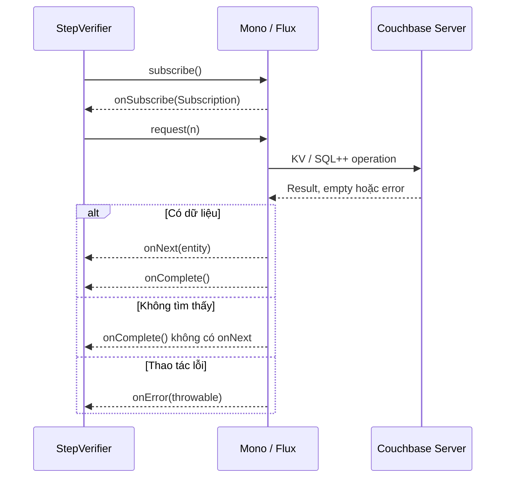
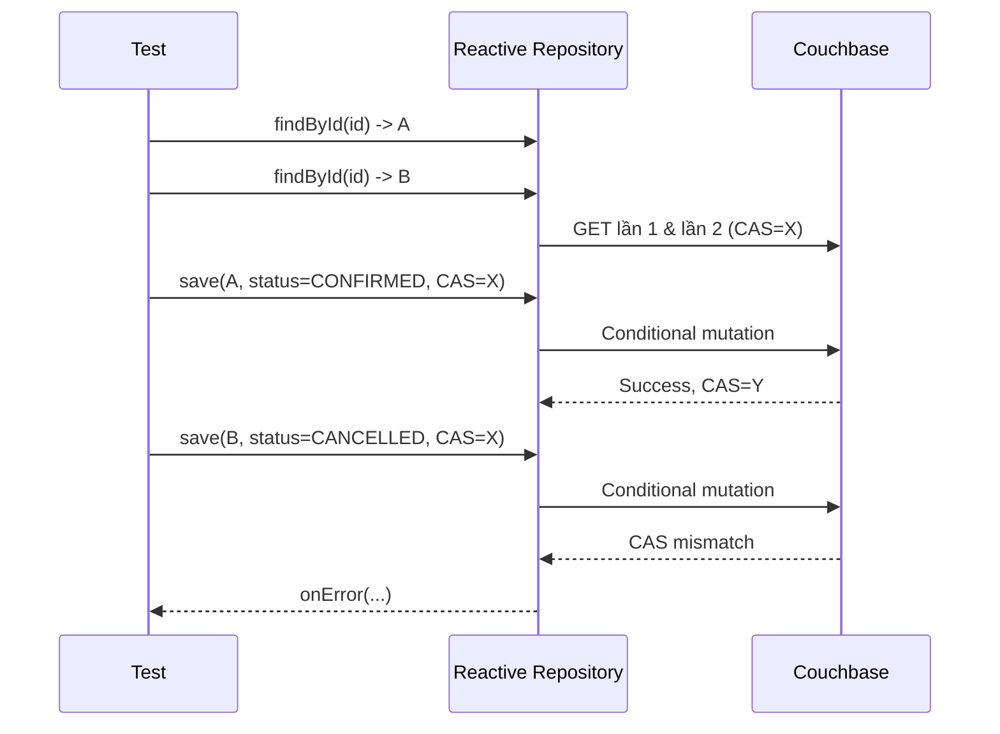
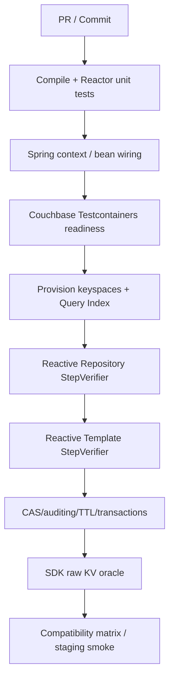

# StepVerifier cho Repository và Template phản ứng trong Spring Data Couchbase

Trong **Spring Data Couchbase**, một lời gọi `ReactiveCouchbaseRepository.save(entity)` hoặc `ReactiveCouchbaseTemplate.findById(...).one(id)` thường trả về **`Mono<T>`**; các truy vấn nhiều kết quả trả về **`Flux<T>`**. Đó là các publisher: chúng mô tả một luồng bất đồng bộ với các tín hiệu `onSubscribe`, `onNext`, `onError` và `onComplete`. Chỉ tạo publisher trong test **không đủ** để chứng minh lệnh Couchbase đã được thực hiện hoặc dữ liệu đã được ghi.

`StepVerifier` từ thư viện `reactor-test` cho phép **subscribe** vào publisher và xác minh thứ tự tín hiệu, nội dung entity, lỗi, thời gian chờ, backpressure và cancellation. Khi sử dụng đúng, nó giúp phát hiện những lỗi mà test kiểu `assertNotNull(repository.save(entity))` hoàn toàn bỏ qua: publisher không bao giờ được subscribe, thiếu index cho SQL++, sai bucket/scope/collection, `Mono.empty()` không được xử lý, lỗi CAS bị swallow, hoặc auditing dùng sai principal trong một luồng reactive.

Bài nằm trong chương **Kiểm thử** của module `SPRING_DATA_COUCHBASE`. Ta sẽ xây dựng phương pháp kiểm thử từ **unit test Reactor operator** đến **integration test thật với Couchbase**, thông qua repository, fluent Template, SQL++, `@Version`/CAS, TTL, transaction, auditing và Reactor Context. Mỗi ví dụ phân biệt phần có thể copy dùng ngay với phần cần fixture/hạ tầng; không coi mock `Mono.just(...)` là bằng chứng database đã được ghi.

## 1. Mục tiêu học tập và phạm vi

Sau bài, bạn có thể:

1. Mô tả chính xác các tín hiệu của `Mono` và `Flux`, và tại sao `verify()` là bước kích hoạt test.
2. Viết `StepVerifier.create(...)` để assert giá trị, số lượng, completion và error.
3. Kiểm tra repository `save`, `findById`, derived queries và `deleteById` bằng publisher thật.
4. Kiểm tra fluent `ReactiveCouchbaseTemplate.upsertById/findById/findByQuery`, bao gồm scope/collection và SQL++ consistency.
5. Viết negative tests cho `Mono.empty()`, optimistic-lock failure, thiếu quyền hoặc Query Index.
6. Kiểm tra created/modified auditor ở **Reactor subscriber context**.
7. Dùng `StepVerifier.withVirtualTime(...)` đúng chỗ: các operator điều khiển bằng scheduler, **không phải giả lập network/Couchbase server time**.
8. Kiểm tra cancellation/backpressure/retry và tránh side effects trong pipeline có thể resubscribe.
9. Tổ chức Testcontainers/CI, key fixture, SDK KV oracle và ma trận test đáng tin.

## 2. Reactive signals: những gì thực sự được kiểm tra



Theo hợp đồng Reactive Streams:

- `onSubscribe`: subscriber nhận `Subscription`.
- `onNext(T)`: nhận tối đa số phần tử đã request; một `Mono<T>` phát **0 hoặc 1** giá trị.
- `onComplete`: luồng kết thúc thành công; một `Mono.empty()` chỉ hoàn tất, **không phát null**.
- `onError(Throwable)`: kết thúc bằng lỗi, không có `onComplete` sau đó.
- `cancel()`: subscriber thông báo không muốn tiếp tục; **không phải rollback** cho lệnh Couchbase có thể đã gửi tới server.

Một `Flux<OrderDocument>` không mặc định có thứ tự ổn định theo ID hoặc thời gian. Nếu query SQL++ không có `ORDER BY`, đừng viết test `expectNext(orderA, orderB)` phụ thuộc thứ tự ngẫu nhiên.

## 3. StepVerifier khác assert thông thường như thế nào?

| Cách test | Điều test chứng minh | Giới hạn |
| --- | --- | --- |
| `assertNotNull(repo.save(order))` | Method trả một object publisher. | Không chứng minh subscription, mutation hay completion. |
| `StepVerifier.create(repo.save(order)).assertNext(...).verifyComplete()` | Publisher đã được subscribe, phát một entity phù hợp và complete. | Cần SDK oracle để chứng minh đúng collection nếu nghi routing sai. |
| `StepVerifier.create(repo.findById(id)).verifyComplete()` | Publisher hoàn tất mà không phát phần tử. | Chỉ hợp lý nếu test chủ đích missing key. |
| `expectErrorMatches(predicate)` | Publisher kết thúc bằng lỗi đạt predicate. | Predicate phải phân loại lỗi chính xác, không chỉ `e != null`. |
| `expectNextCount(n)` | Đúng `n` phần tử được nhận trong đoạn đang xác minh. | Không kiểm tra field business của từng phần tử. |
| `thenCancel()` | Subscriber hủy subscription theo script. | Không bảo đảm KV mutation chưa commit. |
| `withVirtualTime(...)` | Test các operator dùng Reactor scheduler một cách nhanh. | Không tăng tốc timeout network thực hay TTL trên Couchbase Server. |

**Điểm dễ quên:** gọi `expectNext(...)` hoặc `expectComplete()` đơn lẻ **chưa chạy test**. Phải kết thúc bằng `verify()`, `verifyComplete()`, `verifyError()` hoặc phương thức verify tương đương.

## 4. Dependency và tương thích phiên bản

Ví dụ Gradle trong ứng dụng Spring Boot có BOM quản lý phiên bản:

```groovy
dependencies {
    implementation("org.springframework.boot:spring-boot-starter-data-couchbase-reactive")

    testImplementation("io.projectreactor:reactor-test")
    testImplementation("org.springframework.boot:spring-boot-starter-test")

    // Khi tích hợp Spring Security với reactive auditing:
    implementation("org.springframework.boot:spring-boot-starter-security")

    // Khi chạy Couchbase thật qua Testcontainers:
    testImplementation("org.springframework.boot:spring-boot-testcontainers")
    testImplementation("org.testcontainers:junit-jupiter")
    // Thêm module Couchbase tương ứng Testcontainers 1.x hoặc 2.x.
}
```

Trong Testcontainers **2.x**, module Couchbase thường dùng coordinate `org.testcontainers:testcontainers-couchbase`; ở dòng **1.x** tên artifact và package có thể khác. Không trộn mã ví dụ Javadoc của 2.x với dependency 1.x. Cần giữ cùng major version giữa core và các modules Testcontainers.

Các imports Reactor Test:

```java
import reactor.core.publisher.Flux;
import reactor.core.publisher.Mono;
import reactor.test.StepVerifier;
import reactor.test.StepVerifierOptions;
```

Với Spring Boot BOM, không cần tự ép phiên bản `reactor-core`, `reactor-test` hay `spring-data-couchbase` nếu không có yêu cầu tương thích cụ thể. Khi nâng Spring Data, kiểm tra Javadoc của release đang **resolve**; fluent API và các callback interfaces có thể khác giữa dòng 4.x, 5.x và 6.x.

**Không chạy build/Gradle trong tác vụ soạn bài này**; các lệnh và mã test dưới đây là ví dụ cho người học sử dụng trong dự án.

## 5. Entity và repository minh họa

Giả sử bucket `shop_test`, scope `commerce` và collection `orders` đã được provision trong test environment.

```java
package example.shop.persistence;

import java.time.Instant;

import org.springframework.data.annotation.CreatedBy;
import org.springframework.data.annotation.CreatedDate;
import org.springframework.data.annotation.Id;
import org.springframework.data.annotation.LastModifiedBy;
import org.springframework.data.annotation.LastModifiedDate;
import org.springframework.data.annotation.Version;
import org.springframework.data.couchbase.core.mapping.Document;
import org.springframework.data.couchbase.repository.Collection;
import org.springframework.data.couchbase.repository.Scope;

@Document
@Scope("commerce")
@Collection("orders")
public class OrderDocument {

    @Id
    private String id;

    private String tenantId;
    private String status;

    @Version
    private long version;

    @CreatedDate
    private Instant createdAt;

    @LastModifiedDate
    private Instant lastModifiedAt;

    @CreatedBy
    private String createdBy;

    @LastModifiedBy
    private String lastModifiedBy;

    public OrderDocument() {}

    public OrderDocument(
            String id, String tenantId, String status) {
        this.id = id;
        this.tenantId = tenantId;
        this.status = status;
    }

    public String getId() { return id; }
    public String getTenantId() { return tenantId; }

    public String getStatus() { return status; }
    public void setStatus(String status) { this.status = status; }

    public long getVersion() { return version; }
    public Instant getCreatedAt() { return createdAt; }
    public Instant getLastModifiedAt() { return lastModifiedAt; }
    public String getCreatedBy() { return createdBy; }
    public String getLastModifiedBy() { return lastModifiedBy; }
}
```

Reactive repository:

```java
package example.shop.persistence;

import reactor.core.publisher.Flux;
import org.springframework.data.couchbase.repository.ReactiveCouchbaseRepository;

public interface ReactiveOrderRepository
        extends ReactiveCouchbaseRepository<OrderDocument, String> {

    Flux<OrderDocument> findByStatus(String status);

    Flux<OrderDocument> findByTenantIdAndStatus(
        String tenantId, String status);
}
```

Cần phân biệt imports: `@Scope` và `@Collection` của Couchbase thuộc `org.springframework.data.couchbase.repository`, không phải Spring bean scope. `@Version` của Couchbase ánh xạ CAS metadata; không tự tăng nó như revision counter.

Hai derived queries trên thường dùng SQL++ Query Service, nên test cần quyền `query_select` và index phù hợp. `findById` thường đi theo KV path — một phương thức pass không đủ chứng minh finder SQL++ cũng hoạt động.

## 6. Chuẩn bị hạ tầng kiểm thử tích hợp

**Unit test** với mock repository rất tốt cho logic Reactor của service. Nhưng để kiểm chứng mapping, CAS, SQL++, transaction, TTL hoặc behavior của Couchbase, cần một **Couchbase Server test** được provision đúng.

Ví dụ setup Testcontainers 2.x:

```java
import org.junit.jupiter.api.Test;
import org.springframework.boot.test.context.SpringBootTest;
import org.springframework.boot.testcontainers.service.connection.ServiceConnection;
import org.testcontainers.couchbase.BucketDefinition;
import org.testcontainers.couchbase.CouchbaseContainer;
import org.testcontainers.junit.jupiter.Container;
import org.testcontainers.junit.jupiter.Testcontainers;
import org.testcontainers.utility.DockerImageName;

@SpringBootTest(properties =
    "spring.data.couchbase.bucket-name=shop_test")
@Testcontainers
class ReactiveCouchbaseIT {

    @Container
    @ServiceConnection
    static CouchbaseContainer couchbase =
        new CouchbaseContainer(
            DockerImageName.parse(
                System.getProperty("it.couchbase.image")
            )
        ).withBucket(new BucketDefinition("shop_test"));

    @Test
    void contextLoads() {
        // Sau khi đã provision scope/collection/index.
    }
}
```

Đây chỉ là **khung hạ tầng**, không phải test hoàn chỉnh với collection và index tự xuất hiện. Cần đặt system property `it.couchbase.image` thành image/version được CI phê duyệt, provision `commerce.orders` và index bằng setup identity trong test. `@ServiceConnection` cần Spring Boot/Testcontainers integration tương thích; không lẫn version imports.

### Hạn chế quyền của tài khoản application

Container thường được bootstrap bằng admin credentials. Nếu ứng dụng khi test sử dụng luôn tài khoản admin, các ca thiếu `query_select` hoặc thiếu quyền collection có thể bị che khuất. Nên có:

- Setup/admin identity: provision bucket, scope, collection và indexes.
- Application-under-test identity: chỉ có quyền KV/Query cần thiết.
- Negative-test identity: cố tình thiếu quyền KV hoặc Query để kiểm tra failure.
- SDK oracle: đọc raw JSON/CAS bằng account setup tại đúng keyspace.

Đây là yêu cầu của integration test, không phải việc `StepVerifier` tự xử lý.

## 7. Cấu trúc fixture và isolation

Một test database dùng chung có thể chứa document từ các test trước. Tránh:

```java
// Không dùng như cleanup trong shared cluster:
repository.deleteAll();
```

Dùng key unique theo test:

```java
String orderId = "it::orders::" + java.util.UUID.randomUUID();

OrderDocument candidate =
    new OrderDocument(orderId, "tenant-acme", "NEW");
```

Khi cleanup, chỉ remove key đã tạo bởi test tại đúng collection, tốt nhất trong `@AfterEach` hoặc lifecycle fixture. Với test intentionally failing, cleanup phải xảy ra cả khi `StepVerifier` assert thất bại. Một hướng là theo dõi IDs rồi dùng SDK setup account để remove idempotently, không xóa toàn bộ collection.

### Fixture phải có tiền điều kiện

Trước test `findById` nên biết key đã được seed. Trước test lỗi CAS phải có hai **bản độc lập** cùng CAS. Trước test SQL++ cần index ONLINE và user đủ Query privilege. Trước test TTL phải có expiry phù hợp, không dùng dữ liệu production.

Có thể dùng publisher theo chuỗi `save(...).flatMap(...)` để seed và verify trong cùng StepVerifier; nhưng nếu repository.save trả entity đã mutate thì phải cân nhắc tránh chia sẻ object đó với concurrent test khác.

## 8. StepVerifier API cơ bản cho Mono

Ví dụ hoàn toàn độc lập với Couchbase:

```java
import org.junit.jupiter.api.Test;
import reactor.core.publisher.Mono;
import reactor.test.StepVerifier;

class StepVerifierBasicsTest {

    @Test
    void emitsExactlyOneValueThenCompletes() {
        StepVerifier.create(Mono.just("CREATED"))
            .expectSubscription()
            .expectNext("CREATED")
            .verifyComplete();
    }

    @Test
    void emptyMonoHasNoOnNext() {
        StepVerifier.create(Mono.<String>empty())
            .expectSubscription()
            .verifyComplete();
    }

    @Test
    void failedMonoMustProduceOnError() {
        StepVerifier.create(
                Mono.<String>error(
                    new IllegalArgumentException("invalid order")
                )
            )
            .expectError(IllegalArgumentException.class)
            .verify();
    }
}
```

Từ ba test trên:

- `Mono.just(value)`: một `onNext(value)`, rồi `onComplete`.
- `Mono.empty()`: chỉ `onComplete`, không có null.
- `Mono.error(e)`: `onError(e)` thay vì success completion.
- `verifyComplete()` và `verify()` đều subscribe/verify; `expectNext(...)` **không** phải thao tác chạy độc lập.

### Có timeout cho DB test

Khi test một thao tác Couchbase thật, dùng timeout hữu hạn:

```java
StepVerifier.create(publisher)
    .expectNextMatches(item -> item != null)
    .expectComplete()
    .verify(java.time.Duration.ofSeconds(10));
```

`publisher` là biến `Mono<T>`/`Flux<T>` của test. Reactor Test mặc định không bảo đảm mọi verify có timeout ngắn; cần tránh test treo vô hạn khi network/DB lỗi.

## 9. Test repository.save: entity và tín hiệu terminal

Đây là **thân integration test** với `ReactiveOrderRepository orders` đã inject và collection đã provision:

```java
String id = "it::save::" + java.util.UUID.randomUUID();

OrderDocument newOrder =
    new OrderDocument(id, "tenant-acme", "NEW");

StepVerifier.create(orders.save(newOrder))
    .assertNext(saved -> {
        assertEquals(id, saved.getId());
        assertEquals("NEW", saved.getStatus());
        assertEquals("tenant-acme", saved.getTenantId());

        // Không assert CAS == 1, 2, 3: CAS là opaque token.
        assertTrue(saved.getVersion() != 0L);
    })
    .expectComplete()
    .verify(java.time.Duration.ofSeconds(10));
```

Cần import JUnit assertions và test context. Trường `version` liên kết CAS khi sử dụng `@Version`; test chính xác mapping theo release được resolve. Với một test đơn thuần, nếu auditing bật mà không có actor, created-by có thể trống — không assert field đó ở đây trừ khi fixture đã cung cấp auditor.

**Không viết:**

```java
Mono<OrderDocument> save = orders.save(newOrder);
assertNotNull(save); // Không chứng minh document được lưu.
```

Cũng không dùng `save.subscribe()` rời rạc rồi assert ngay vì subscription là bất đồng bộ và lỗi có thể bị bỏ qua. `StepVerifier` quản lý subscription và terminal signal để test có kết quả.

## 10. Test repository.findById sau khi ghi

Một cách tránh race là **nối write và read trong cùng publisher**:

```java
String id = "it::roundtrip::" + java.util.UUID.randomUUID();
OrderDocument candidate =
    new OrderDocument(id, "tenant-acme", "NEW");

Mono<OrderDocument> roundTrip =
    orders.save(candidate)
        .flatMap(saved -> orders.findById(saved.getId()));

StepVerifier.create(roundTrip)
    .assertNext(found -> {
        assertEquals(id, found.getId());
        assertEquals("NEW", found.getStatus());
        assertTrue(found.getVersion() != 0L);
    })
    .expectComplete()
    .verify(java.time.Duration.ofSeconds(10));
```

`flatMap` chỉ subscribe bước `findById` sau khi save publisher phát result, nên không tạo một read chạy song song trước write như `Mono.zip(save, find)`.

**Quan trọng:** test này chứng minh save/read qua cùng repository, **chưa chứng minh keyspace đúng** nếu repository bị cấu hình nhầm sang collection khác mà cả hai operations đều nhắm cùng nơi sai. Phần SDK oracle sau sẽ xử lý giới hạn này.

### Test empty vì key không tồn tại

```java
String missingId =
    "it::missing::" + java.util.UUID.randomUUID();

StepVerifier.create(orders.findById(missingId))
    .expectSubscription()
    .expectComplete()
    .verify(java.time.Duration.ofSeconds(10));
```

Không kỳ vọng `null` từ `Mono<OrderDocument>`. Không biến empty thành lỗi nếu repository API hợp đồng trả empty cho missing key. Ở service có thể dùng `switchIfEmpty(Mono.error(...))` để chuyển missing entity thành lỗi nghiệp vụ.

## 11. Test service chuyển Mono.empty thành lỗi nghiệp vụ

Service ví dụ:

```java
package example.shop.application;

import reactor.core.publisher.Mono;

public final class OrderLookupService {

    private final ReactiveOrderRepository orders;

    public OrderLookupService(ReactiveOrderRepository orders) {
        this.orders = orders;
    }

    public Mono<OrderDocument> requireOrder(String id) {
        return orders.findById(id)
            .switchIfEmpty(Mono.error(
                new OrderNotFoundException(id)
            ));
    }
}
```

Exception domain:

```java
package example.shop.application;

public class OrderNotFoundException
        extends RuntimeException {

    public OrderNotFoundException(String id) {
        super("Order not found");
    }
}
```

Test:

```java
StepVerifier.create(
        lookupService.requireOrder(
            "it::missing::" + java.util.UUID.randomUUID()
        )
    )
    .expectErrorMatches(error ->
        error instanceof OrderNotFoundException
    )
    .verify(java.time.Duration.ofSeconds(10));
```

Đây là test fragment, cần `lookupService` đã inject và import exception/domain classes. `expectErrorMatches` nên kiểm tra **loại lỗi có ý nghĩa**, không chỉ `error != null`, vì timeout/hết quyền/connection failure cũng có thể phát lỗi.

## 12. Test Flux từ derived query và SQL++ Index

Với `ReactiveOrderRepository.findByStatus("NEW")`, kết quả có thể gồm nhiều document và **không có thứ tự ổn định** nếu SQL++ query không chỉ định ORDER BY. Có thể test qua collectList khi tập kết quả đã được giới hạn bởi fixture tenant:

```java
String tenant = "it-tenant-" + java.util.UUID.randomUUID();

OrderDocument a = new OrderDocument(
    "it::a::" + java.util.UUID.randomUUID(),
    tenant,
    "NEW"
);
OrderDocument b = new OrderDocument(
    "it::b::" + java.util.UUID.randomUUID(),
    tenant,
    "NEW"
);

Mono<java.util.List<OrderDocument>> result =
    orders.saveAll(java.util.List.of(a, b))
        .thenMany(
            orders.findByTenantIdAndStatus(tenant, "NEW")
        )
        .collectList();

StepVerifier.create(result)
    .assertNext(list -> {
        assertEquals(2, list.size());

        var ids = list.stream()
            .map(OrderDocument::getId)
            .collect(java.util.stream.Collectors.toSet());

        assertTrue(ids.contains(a.getId()));
        assertTrue(ids.contains(b.getId()));
    })
    .expectComplete()
    .verify(java.time.Duration.ofSeconds(20));
```

**Yêu cầu fixture:** Query Service và index cho tenant/status phải tồn tại. Query Index có thể lag ngay sau KV writes; `thenMany` đảm bảo thứ tự subscription, **không** đảm bảo index đã bắt kịp. Để test deterministic, cấu hình query scan consistency phù hợp (ví dụ `REQUEST_PLUS` trên đường Template/query được hỗ trợ), hoặc có retry polling theo sự nhất quán của Query Service trong test integration. Không dùng sleep 100 ms tùy tiện.

### Không assert thứ tự ngẫu nhiên

Sai:

```java
// Sai nếu query không có ORDER BY.
StepVerifier.create(orders.findByStatus("NEW"))
    .expectNext(a, b)
    .verifyComplete();
```

Đúng hơn: query có ORDER BY được kiểm tra rõ, hoặc kiểm tra tập ID/value theo fixture cô lập. Cũng tránh `collectList()` trên một Flux có thể **vô hạn** hoặc cực lớn; nên giới hạn truy vấn/test data.

## 13. ReactiveCouchbaseTemplate: fluent KV upsert và find

Spring Data Couchbase cung cấp `ReactiveCouchbaseTemplate`/`ReactiveCouchbaseOperations` để chỉ định domain type và options theo fluent API.

Ví dụ integration test:

```java
import org.springframework.data.couchbase.core.ReactiveCouchbaseTemplate;

String id = "it::template::" + java.util.UUID.randomUUID();
OrderDocument order =
    new OrderDocument(id, "tenant-acme", "NEW");

Mono<OrderDocument> writeThenRead =
    reactiveTemplate
        .upsertById(OrderDocument.class)
        .one(order)
        .flatMap(saved ->
            reactiveTemplate
                .findById(OrderDocument.class)
                .one(saved.getId())
        );

StepVerifier.create(writeThenRead)
    .assertNext(found -> {
        assertEquals(id, found.getId());
        assertEquals("NEW", found.getStatus());
    })
    .expectComplete()
    .verify(java.time.Duration.ofSeconds(10));
```

Ở đây `reactiveTemplate` là bean đã inject từ test context. `upsertById(...)` là **upsert**, khác với insert-only semantics; nếu cần kiểm tra duplicate key, dùng `insertById(...)` phù hợp và test lỗi duplicate.

**Đặc biệt:** nếu Template có converter/callback wiring tùy chỉnh, auditing có thể khác repository. Vì vậy cần kiểm thử chính Template đang được inject, không lấy test repository.save làm bằng chứng mọi Template đều đã được cấu hình đúng.

## 14. Kiểm tra inScope/inCollection của fluent Template

Với nhiều scopes/collections, dùng override rõ ràng trong test:

```java
Mono<OrderDocument> pipeline =
    reactiveTemplate
        .upsertById(OrderDocument.class)
        .inScope("commerce")
        .inCollection("orders")
        .one(order)
        .flatMap(saved ->
            reactiveTemplate
                .findById(OrderDocument.class)
                .inScope("commerce")
                .inCollection("orders")
                .one(saved.getId())
        );
```

Theo fluent API ở các dòng Spring Data Couchbase hiện đại, `inScope(...)` chuyển sang bước có thể chọn `inCollection(...)`. Hãy đối chiếu Javadoc của version thực, không lấy một fluent chain của dòng mới rồi áp vào dependency cũ.

**Không được nhầm:** `inScope("commerce")` không tự thay bucket đã gắn vào Template. Nếu ứng dụng có multi-bucket, kiểm tra `CouchbaseClientFactory`/Template được tạo cho đúng bucket và thực hiện raw KV oracle để xác nhận.

Test này nên sử dụng **cùng ID tại collection khác** với status khác nhau làm negative case, tránh chỉ nhìn success của một pipeline bị route nhầm.

## 15. ReactiveCouchbaseTemplate.findByQuery và consistency

Template có fluent query operation dùng SQL++:

```java
import com.couchbase.client.java.query.QueryScanConsistency;

import org.springframework.data.couchbase.core.query.Query;
import org.springframework.data.couchbase.core.query.QueryCriteria;

var criteria = Query.query(
    QueryCriteria.where("tenantId").is(tenant)
);

Flux<OrderDocument> queried =
    reactiveTemplate
        .findByQuery(OrderDocument.class)
        .consistentWith(QueryScanConsistency.REQUEST_PLUS)
        .matching(criteria)
        .all();
```

`REQUEST_PLUS` đợi index xử lý tới thời điểm truy vấn để hỗ trợ đọc sau ghi khi phù hợp; nó có thể tăng độ trễ và **không** tự tạo index, không cấp quyền `query_select`, cũng không bảo đảm business ordering nếu thiếu ORDER BY.

Test:

```java
StepVerifier.create(queried.collectList())
    .assertNext(rows -> {
        assertFalse(rows.isEmpty());
        assertTrue(rows.stream().allMatch(
            row -> tenant.equals(row.getTenantId())
        ));
    })
    .expectComplete()
    .verify(java.time.Duration.ofSeconds(20));
```

Đây là **test fragment**. Cần fixture đã seed, index, permissions và class imports đúng version. Có thể bổ sung status vào criteria để giới hạn kết quả:

```java
Query query = Query.query(
    QueryCriteria.where("tenantId").is(tenant)
        .and("status").is("NEW")
);
```

Một số dự án có custom query/Template config làm SQL++ chọn type discriminator riêng; khi test không thấy entity, kiểm tra `_class`, index, tenant filter và scan consistency trước khi đổi `expectNextCount`.

## 16. SDK KV oracle: xác nhận dữ liệu thực và keyspace

Một test như `template.upsertById(...).one(order).flatMap(saved -> template.findById(...).one(id))` có thể pass ngay cả khi **hai operation cùng trỏ nhầm collection**. Vì vậy cần một oracle độc lập: Java SDK đọc raw document ở **bucket.scope.collection** đã định nghĩa trong yêu cầu.

Ví dụ sau khi StepVerifier xác nhận lưu thành công:

```java
import com.couchbase.client.java.Cluster;

var sdkResult = sdkCluster
    .bucket("shop_test")
    .scope("commerce")
    .collection("orders")
    .get(id);

var raw = sdkResult.contentAsObject();

assertEquals("NEW", raw.getString("status"));
assertEquals("tenant-acme", raw.getString("tenantId"));
```

Đây là **mảnh integration test** chạy ngoài event loop, sau khi StepVerifier đã complete; `sdkCluster` là Cluster dùng trong test context, `id` là key đã lưu. Việc gọi SDK blocking trong test thread cho mục đích oracle là khác với việc block một event-loop production.

### Kiểm tra @Version từ CAS

Nếu entity dùng `@Version long`, sau khi materialize từ Spring Data có thể so sánh `entity.getVersion()` với `sdkResult.cas()` ở **cùng document và cùng keyspace**. Tuy nhiên:

- CAS là opaque metadata; không assert giá trị tăng dần 1, 2, 3.
- CAS của document trong collection A không so với B dù ID giống nhau.
- Không tự thêm field JSON `version` rồi dùng nó thay CAS.
- Mỗi lần raw SDK mutation có thể làm entity Spring Data đã load trở thành stale.

### Tại sao cần kiểm tra type discriminator?

Spring Data Couchbase có thể lưu field type metadata như `_class`, hoặc dùng type alias/custom conversions. Raw SDK write không tự có mapping đó. Test một document mới tạo bằng SDK có thể find qua KV nhưng không thỏa type predicate của SQL++ repository finder. Vì vậy oracle nên kiểm tra cả schema JSON quan trọng và read-back qua Spring Data.

## 17. Test insert-only, duplicate key và kết quả Mono.error

`ReactiveCouchbaseTemplate.upsertById(...)` có semantics create-or-replace. Nếu nghiệp vụ yêu cầu **không ghi đè** document hiện có, kiểm tra `insertById(...)` và duplicate key.

Ví dụ integration test fragment:

```java
String id = "it::unique::" + java.util.UUID.randomUUID();

OrderDocument initial =
    new OrderDocument(id, "tenant-acme", "NEW");

StepVerifier.create(
        reactiveTemplate
            .insertById(OrderDocument.class)
            .one(initial)
    )
    .assertNext(saved ->
        assertEquals(id, saved.getId())
    )
    .expectComplete()
    .verify(java.time.Duration.ofSeconds(10));

OrderDocument duplicate =
    new OrderDocument(id, "tenant-acme", "NEW");

StepVerifier.create(
        reactiveTemplate
            .insertById(OrderDocument.class)
            .one(duplicate)
    )
    .expectErrorMatches(error ->
        isDocumentAlreadyExists(error)
    )
    .verify(java.time.Duration.ofSeconds(10));
```

`isDocumentAlreadyExists(Throwable)` là **helper của test**, không phải API có sẵn của Reactor/Spring Data. Nên kiểm tra exception/cause chain theo version Spring Data/Couchbase Java SDK đang dùng; đừng viết `error != null` hoặc chỉ tìm substring “already exists”.

Sau negative insert, dùng SDK oracle xác nhận raw JSON/CAS không bị duplicate attempt ghi đè. Exception translation giữa SDK và Spring Data có thể khiến top-level exception khác lớp SDK nguyên thủy.

## 18. Test removeById và Mono<Void>

Một `Mono<Void>` thành công **không phát onNext**. Kiểm tra terminal completion bằng `verifyComplete()` hoặc `expectComplete().verify(timeout)`:

```java
String id = "it::delete::" + java.util.UUID.randomUUID();

Mono<Void> createThenRemove =
    orders.save(new OrderDocument(
            id, "tenant-acme", "NEW"
        ))
        .then(orders.deleteById(id));

StepVerifier.create(createThenRemove)
    .expectSubscription()
    .expectComplete()
    .verify(java.time.Duration.ofSeconds(10));

StepVerifier.create(orders.findById(id))
    .expectComplete()
    .verify(java.time.Duration.ofSeconds(10));
```

Hai StepVerifier khác nhau được subscribe theo thứ tự chương trình; script đầu đã complete trước script thứ hai. Nếu muốn thể hiện một pipeline duy nhất:

```java
Mono<Boolean> deleted =
    orders.save(new OrderDocument(
            id, "tenant-acme", "NEW"
        ))
        .then(orders.deleteById(id))
        .then(orders.existsById(id));

StepVerifier.create(deleted)
    .expectNext(false)
    .expectComplete()
    .verify(java.time.Duration.ofSeconds(10));
```

**Lưu ý:** một số delete-by-ID APIs hoàn thành cả khi document không tồn tại; đừng mặc định `Mono<Void>` complete chứng minh document **đã tồn tại** trước đó. Nếu cần nghiệp vụ kiểm tra tồn tại, hãy load trước hoặc dùng một delete operation có expected semantics, rồi assert server state sau.

Với TTL expiry hoặc xóa trực tiếp SDK/SQL++, Spring callbacks không tự có event domain tương đương; đây là test persistence, không phải audit trail.

## 19. Phân loại lỗi trong StepVerifier thay vì “bất kỳ lỗi nào cũng pass”

Một lỗi Couchbase có thể xuất hiện trực tiếp từ SDK hoặc được Spring Data translate thành `DataAccessException`. Các tình huống:

| Trường hợp | Lỗi về mặt ý nghĩa | Assertion cần phân biệt |
| --- | --- | --- |
| Read key không tồn tại | `Mono.empty()` với repository `findById` phổ biến | `verifyComplete()` mà không `expectNext`. |
| Insert key trùng | Duplicate-document/write conflict | Error class/cause đúng version; không phải timeout. |
| Save entity stale CAS | Optimistic locking conflict | `OptimisticLockingFailureException` hoặc cause SDK CAS mismatch theo release. |
| Thiếu quyền Query | Authorization/permission failure | Không chấp nhận “không có index” thay cho permission. |
| Thiếu index | Query planning/index failure | Fixture query và user permissions đã xác minh trước. |
| Bucket/scope/collection sai | Keyspace not found/routing failure | Không mặc định là empty business result. |
| Service timeout | Network/timeout/ambiguous outcome | Không suy mutation chắc chắn chưa commit. |
| Converter lỗi | Mapping/serialization failure | Đọc raw JSON và kiểm tra schema/alias. |

Mẫu assertion:

```java
StepVerifier.create(service.confirm(orderId))
    .expectErrorSatisfies(error -> {
        assertTrue(
            isOptimisticLockingFailure(error),
            "Expected CAS conflict, not any error"
        );
    })
    .verify(java.time.Duration.ofSeconds(10));
```

Hai biến `service` và `orderId` đến từ test fixture; `isOptimisticLockingFailure` là helper nội bộ kiểm tra class/cause chain theo dependency version. Trong Java tests có thể kiểm tra `org.springframework.dao.OptimisticLockingFailureException` nếu repository đó translate thành kiểu này; phải xác minh bằng test thực, không ép mọi phiên bản vào một wrapper.

**Không làm:**

```java
StepVerifier.create(publisher)
    .expectError()
    .verify(); // Quá yếu cho test quyền/CAS.
```

Test này có thể PASS do bất kỳ lỗi nào, kể cả “Couchbase server chưa start”.

## 20. @Version và optimistic locking: test hai writer độc lập

Một lỗi concurrency nguy hiểm: A và B cùng đọc entity, B save sau A và vô tình overwrite dữ liệu A. Với `@Version`, CAS từ document được dùng để phát hiện stale save theo semantics Spring Data.

Thiết kế test:



Dùng **hai bản entity độc lập** từ hai lượt đọc:

```java
Mono<OrderDocument> staleWriteScenario =
    Mono.zip(
        orders.findById(id),
        orders.findById(id)
    ).flatMap(pair -> {
        OrderDocument a = pair.getT1();
        OrderDocument b = pair.getT2();

        assertEquals(a.getVersion(), b.getVersion());

        a.setStatus("CONFIRMED");
        b.setStatus("CANCELLED");

        return orders.save(a)
            .then(orders.save(b));
    });

StepVerifier.create(staleWriteScenario)
    .expectErrorMatches(this::isOptimisticLockingFailure)
    .verify(java.time.Duration.ofSeconds(15));
```

Đây là **một method test minh họa**, cần `id` đã seed, repository, matcher phù hợp và JUnit imports. Muốn rõ ràng hơn, bước đầu của test có thể đọc hai snapshot tuần tự rồi kiểm tra CAS bằng SDK oracle; không dùng cùng object reference cho A/B. Cần xác nhận final state là `CONFIRMED` và không bị stale B overwrite.

### Tránh lỗi do JSON writer khác

Nếu một SDK direct writer gọi `collection.upsert(id, json)` không kèm CAS, điều đó có thể phá optimistic locking convention của application, dù Spring Data entity có `@Version`. Test kết hợp SDK writer và repository stale save sẽ phát hiện hậu quả.

## 21. Reactive auditing với StepVerifier và Reactor Context

Bật reactive auditing:

```java
package example.shop.config;

import org.springframework.context.annotation.Configuration;
import org.springframework.data.couchbase.repository.auditing.EnableReactiveCouchbaseAuditing;

@Configuration
@EnableReactiveCouchbaseAuditing(
    auditorAwareRef = "securityReactiveAuditor",
    dateTimeProviderRef = "auditClockProvider",
    modifyOnCreate = true
)
public class ReactiveAuditConfig {
}
```

Nguồn actor:

```java
import org.springframework.context.annotation.Bean;
import org.springframework.data.domain.ReactiveAuditorAware;
import org.springframework.security.authentication.AnonymousAuthenticationToken;
import org.springframework.security.core.Authentication;
import org.springframework.security.core.context.ReactiveSecurityContextHolder;
import reactor.core.publisher.Mono;

@Bean("securityReactiveAuditor")
ReactiveAuditorAware<String> securityReactiveAuditor() {
    return () -> ReactiveSecurityContextHolder.getContext()
        .flatMap(ctx ->
            Mono.justOrEmpty(ctx.getAuthentication())
        )
        .filter(Authentication::isAuthenticated)
        .filter(a ->
            !(a instanceof AnonymousAuthenticationToken)
        )
        .map(Authentication::getName);
}
```

DateTimeProvider có thể dùng `Clock.systemUTC()`:

```java
@Bean("auditClockProvider")
org.springframework.data.auditing.DateTimeProvider auditClockProvider() {
    return () -> java.util.Optional.of(
        java.time.Instant.now(java.time.Clock.systemUTC())
    );
}
```

Đây là các **mảnh method cấu hình**, cần đặt trong `@Configuration` được Spring scan; Spring Security phải thực sự tạo authenticated principal ở entrypoint. Không biến `AuditorAware` thành cơ chế authentication/authorization.

### StepVerifier gắn principal vào subscriber

```java
import java.util.List;
import org.springframework.security.authentication.UsernamePasswordAuthenticationToken;
import org.springframework.security.core.context.ReactiveSecurityContextHolder;

var alice = new UsernamePasswordAuthenticationToken(
    "user:alice", "unused", List.of()
);

String id = "it::audit::" + java.util.UUID.randomUUID();

Mono<OrderDocument> saved =
    orders.save(
        new OrderDocument(id, "tenant-acme", "NEW")
    ).contextWrite(
        ReactiveSecurityContextHolder.withAuthentication(alice)
    );

StepVerifier.create(saved)
    .assertNext(order -> {
        assertEquals("user:alice", order.getCreatedBy());
        assertEquals("user:alice", order.getLastModifiedBy());
        assertNotNull(order.getCreatedAt());
    })
    .expectComplete()
    .verify(java.time.Duration.ofSeconds(10));
```

Ctor 3 tham số của `UsernamePasswordAuthenticationToken` có thể tạo authenticated token cho test. Đoạn test kiểm tra auditor; **không chứng minh HTTP security filters và tenant authorization**. Những thứ đó cần security test riêng ở API layer.

### Test hai principals đồng thời

```java
Mono<OrderDocument> left =
    orders.save(new OrderDocument(
        idAlice, "tenant-acme", "NEW"
    )).contextWrite(
        ReactiveSecurityContextHolder.withAuthentication(alice)
    );

Mono<OrderDocument> right =
    orders.save(new OrderDocument(
        idBob, "tenant-acme", "NEW"
    )).contextWrite(
        ReactiveSecurityContextHolder.withAuthentication(bob)
    );

StepVerifier.create(Mono.zip(left, right))
    .assertNext(pair -> {
        assertEquals(
            "user:alice", pair.getT1().getCreatedBy());
        assertEquals(
            "user:bob", pair.getT2().getCreatedBy());
    })
    .expectComplete()
    .verify(java.time.Duration.ofSeconds(10));
```

Cần tạo hai ID và two authenticated tokens độc lập. Nếu auditor dựa vào singleton mutable `currentUser`, test concurrent có thể phát hiện identity bị trộn. Không suy từ thread của `publishOn` rằng Reactor context có cùng đặc tính với ThreadLocal.

## 22. StepVerifierOptions, scenarioName, as và timeout

Test integration có nhiều bước sẽ khó debug nếu chỉ báo “expected onNext”. Có thể đặt tên scenario:

```java
StepVerifierOptions options = StepVerifierOptions.create()
    .scenarioName("order-save-and-get-by-id");

StepVerifier.create(orders.findById(id), options)
    .expectSubscription()
    .assertNext(order -> {
        assertEquals(id, order.getId());
        assertEquals("NEW", order.getStatus());
    })
    .as("read materialized order")
    .expectComplete()
    .verify(java.time.Duration.ofSeconds(10));
```

`as(String)` dùng đặt nhãn cho expectation trước nó; không làm thay đổi publisher hay DB. Tên scenario giúp định vị failure, nhưng assertion ném bên trong `assertNext` không phải lúc nào cũng được StepVerifier gắn nhãn vào thông điệp JUnit; nên viết assertion message có ý nghĩa.

### Timeout cho test suite

`StepVerifier.verify()` có thể **không có giới hạn thời gian mặc định**, tùy cấu hình. Sử dụng:

- `verify(Duration.ofSeconds(...))` ở mỗi integration test.
- Hoặc `StepVerifier.setDefaultTimeout(...)` ở setup suite (cẩn thận tác động toàn cục cho các test chạy song song).
- Kết hợp timeout SDK/QueryOptions phù hợp và test runner deadline.

Nếu test treo vì Couchbase không chạy, đừng tăng timeout vô hạn; kiểm tra readiness, connection configuration và log.

## 23. withVirtualTime: đúng cho operator thời gian

Reactor có `StepVerifier.withVirtualTime(Supplier<Publisher<T>>)` để kiểm tra một pipeline có `delay`/`interval`/`timeout` sử dụng Reactor scheduler mà không phải chờ thời gian thực.

Ví dụ unit test:

```java
import java.time.Duration;
import reactor.core.publisher.Mono;
import reactor.test.StepVerifier;

StepVerifier.withVirtualTime(
        () -> Mono.delay(Duration.ofHours(1))
    )
    .expectSubscription()
    .thenAwait(Duration.ofHours(1))
    .expectNext(0L)
    .verifyComplete();
```

Phải tạo publisher **bên trong Supplier**, vì virtual scheduler cần được cài đặt trước khi các time-based operators được tạo.

### Test retry backoff với virtual time

Giả sử một service wrapper có retry backoff trên một nguồn giả lập:

```java
import java.time.Duration;
import java.util.concurrent.atomic.AtomicInteger;

import reactor.core.publisher.Mono;
import reactor.util.retry.Retry;
import reactor.test.StepVerifier;

AtomicInteger attempts = new AtomicInteger();

StepVerifier.withVirtualTime(() ->
    Mono.defer(() -> {
        int n = attempts.incrementAndGet();

        if (n < 3) {
            return Mono.<String>error(
                new IllegalStateException("transient")
            );
        }
        return Mono.just("OK");
    }).retryWhen(
        Retry.fixedDelay(2, Duration.ofSeconds(5))
    )
)
    .expectSubscription()
    .thenAwait(Duration.ofSeconds(10))
    .expectNext("OK")
    .verifyComplete();

assertEquals(3, attempts.get());
```

Đây là test unit Reactor retry: nó **không** mở Couchbase connection và không chứng minh SDK transaction retry, server timeout hay CAS recovery. Loại `Retry.fixedDelay` ở đây cần import và Reactor version phù hợp; khi test random jitter/backoff phải kiểm soát scheduler hoặc xem mức dao động.

### Vấn đề với timeout

Nếu code dùng `timeout(Duration)` (Reactor operator), virtual time có thể đẩy clock vượt ngưỡng nhanh. Nếu nó dùng **SDK network timeout** do Couchbase SDK quản lý, virtual time của Reactor không chắc điều khiển được timeout bên trong SDK. Phải test network timeout thật bằng fault injection/integration environment.

## 24. Không dùng virtual time để giả lập Couchbase TTL hoặc commit time

Sai lầm:

```java
StepVerifier.withVirtualTime(() ->
    repository.findById(id).delayElement(
        java.time.Duration.ofHours(2)
    )
)
    .thenAwait(java.time.Duration.ofHours(2))
    .verifyComplete();
```

Ví dụ này thậm chí có kỳ vọng sai nếu document tồn tại: sẽ phát `onNext` sau delay; không thể `verifyComplete()` mà không expectNext. Và dù advance Reactor scheduler hai giờ, **đồng hồ Couchbase Server không tự nhảy hai giờ** để TTL hết hạn.

Đúng hướng:

- **Operator time** (delay, interval, retryWhen backoff): virtual time với test Publisher không gọi network.
- **Couchbase TTL**: integration test với expiry ngắn do Server quản lý, kiểm tra server state bằng retry polling có hạn, không kỳ vọng xóa vật lý tức thì tại đúng millisecond.
- **Business clock**: inject Java `Clock.fixed(...)` nếu muốn test createdAt/modifiedAt.
- **Transaction commit**: test bằng transaction API và database oracle; không thể thay server commit bằng `thenAwait(...)`.

### Các loại thời gian không đồng nghĩa

| Đồng hồ | Tác động của virtual time |
| --- | --- |
| Reactor scheduler time | Có thể điều khiển khi operators dùng scheduler tương ứng. |
| Java `Clock` của ứng dụng | Không tự bị thay đổi; dùng dependency injection riêng. |
| Couchbase Server TTL/expiry time | Không thay đổi. |
| Couchbase SDK network timeout | Không mặc định bị điều khiển. |
| Cluster transaction commit/unstaging | Không bị ảo hóa bởi StepVerifier. |

## 25. request(n), backpressure và thenCancel

Với `Flux<T>`, có thể kiểm tra luồng phản ứng trước demand:

```java
StepVerifier.create(
        Flux.just("A", "B", "C"),
        0
    )
    .expectSubscription()
    .thenRequest(1)
    .expectNext("A")
    .thenRequest(1)
    .expectNext("B")
    .thenCancel()
    .verify(java.time.Duration.ofSeconds(5));
```

`StepVerifier.create(publisher, 0)` bắt đầu với request = 0 và dùng `thenRequest(n)` cho demand. Test trên xác minh được cách **Flux operator** tôn trọng downstream demand.

Nhưng với `ReactiveCouchbaseRepository.findAll()` hoặc SQL++ query:

- Có thể có prefetch/buffering từ Spring Data/SDK.
- `thenCancel()` không chứng minh server không còn thực thi query.
- `take(1)` hoặc cancellation không đảm bảo không có network bytes hoặc work đã được thực hiện trước.
- Với writes, cancellation **không tự rollback** lệnh KV đã gửi.

Nếu yêu cầu performance/backpressure chặt chẽ, nên có benchmark/metrics và test integration đo resource behavior; StepVerifier chỉ xác minh contract tín hiệu publisher ở subscriber boundary.

## 26. TestPublisher và PublisherProbe cho unit test service

Khi test **business service có repository được mock**, có thể dùng `reactor-test` để điều khiển các nhánh nguồn; không cần Couchbase thật. Đây là loại test bổ sung, **không thay thế integration tests**.

### TestPublisher tạo signal thủ công

```java
import reactor.test.publisher.TestPublisher;
import reactor.test.StepVerifier;

TestPublisher<String> source = TestPublisher.create();

StepVerifier.create(
        source.flux().map(String::toUpperCase)
    )
    .then(() -> source.next("ok"))
    .then(source::complete)
    .expectNext("OK")
    .verifyComplete();
```

Tùy version Reactor, test cần bảo đảm source đã có subscriber trước khi phát next; StepVerifier `then(...)` thực hiện sau subscription. `TestPublisher.createNonCompliant(...)` có thể cố ý vi phạm Reactive Streams nhằm kiểm thử operator biên, nhưng không dùng nó để mô phỏng Couchbase SDK nếu nhu cầu chỉ là lỗi nghiệp vụ.

### PublisherProbe kiểm tra nhánh fallback

Một service dùng `switchIfEmpty`:

```java
public Mono<String> getOrFallback(
        Mono<String> primary,
        Mono<String> fallback) {

    return primary.switchIfEmpty(fallback);
}
```

Test nhánh fallback:

```java
import reactor.test.publisher.PublisherProbe;

PublisherProbe<String> fallback =
    PublisherProbe.of(Mono.just("DEFAULT"));

StepVerifier.create(
        getOrFallback(Mono.empty(), fallback.mono())
    )
    .expectNext("DEFAULT")
    .verifyComplete();

fallback.assertWasSubscribed();
fallback.assertWasRequested();
fallback.assertWasNotCancelled();
```

`PublisherProbe` chứng minh nhánh publisher được sử dụng, hữu ích khi test service dùng cache → repository fallback, hoặc command → alternate path. Nó không chứng minh một fallback “repository” thật đã gọi Couchbase nếu đó chỉ là mock Mono.

## 27. Kiểm tra Reactor Context không đồng nghĩa kiểm tra ThreadLocal

Một service sử dụng Reactor Context để truyền trace ID hoặc principal:

```java
Mono<String> actor =
    Mono.deferContextual(ctx ->
        Mono.just(ctx.get("actorId"))
    );

StepVerifier.create(
        actor.contextWrite(context ->
            context.put("actorId", "user:alice")
        )
    )
    .expectNext("user:alice")
    .verifyComplete();
```

`Mono.deferContextual(...)` lấy dữ liệu tại subscription theo context downstream. Với Spring Security nên dùng `ReactiveSecurityContextHolder`, không tự coi key `actorId` do user input đặt là identity đã xác thực.

Đừng làm:

```java
// Không an toàn cho nhiều concurrent subscribers:
private static String currentActor;
```

Một singleton mutable actor có thể khiến test đồng thời ghi sai metadata; ThreadLocal cũng không có cùng propagation semantics với Reactor Context khi scheduler thay đổi.

## 28. Retry và idempotency: StepVerifier không làm mutation exactly once

Mẫu retry:

```java
Mono<OrderDocument> command =
    Mono.defer(() ->
        orders.findById(id)
            .flatMap(order -> {
                requireCanConfirm(order);
                order.setStatus("CONFIRMED");
                return orders.save(order);
            })
    ).retryWhen(
        reactor.util.retry.Retry.backoff(
            2, java.time.Duration.ofMillis(50)
        ).filter(this::isOptimisticLockingFailure)
    );
```

Đây là một **method service fragment**, cần `requireCanConfirm` và matcher error đúng version. `Mono.defer(...)` giúp **mỗi retry load lại** current document/CAS. Chỉ retry lỗi mà domain cho phép; sau khi reload, business state có thể đã được xác nhận bởi command khác — khi đó cần policy duplicate/invalid transition rõ ràng.

Không đưa payment/email/broker message vào phần được retry. Publisher có thể resubscribe; một timeout có thể là ambiguous outcome dù server đã commit. Nếu cần giao event bền vững, cân nhắc transactional outbox và command ID idempotent.

### Test retry ở hai mức

- Unit: dùng `TestPublisher` hoặc `Mono.defer` với counter và `withVirtualTime` cho backoff.
- Integration: tạo CAS conflict thật, assert raw server state và eventual result; không dùng virtual time để giả xung đột KV.

**Không chỉ assert `expectNextCount(1)`** rồi cho rằng command đã chạy đúng một lần. Nó chỉ nói về số `onNext` tới subscriber, không phải số attempts gửi tới server.

## 29. TTL/expiry: kiểm thử với StepVerifier nhưng oracle là server

Giả sử một document có TTL vài giây theo policy test và được lưu qua một Template/entity operation hỗ trợ expiry. Kiểm thử:

1. Gieo document với ID test unique và expiry tường minh theo SDK/Template API version.
2. `StepVerifier` cho lệnh write trả success.
3. SDK KV GET xác nhận document tồn tại ngay sau write.
4. Theo deadline hữu hạn, dùng polling/retry để chờ document được server xem là expired.
5. Assert `findById` eventually trả `Mono.empty()` (hoặc SDK NotFound) tại keyspace đúng.
6. Cleanup fixture nếu còn; không dùng production collection.

Không dùng `Thread.sleep(5000)` không kiểm soát rồi assert ngay; clock server, scheduling và việc physical cleanup không hứa chính xác từng millisecond. Một polling utility trong integration test cần timeout cao hơn TTL dự kiến và phân loại server timeout vs expired.

**Kiểm tra preserveExpiry:** thao tác replace/upsert/mutateIn có options khác nhau, nên test riêng khi business yêu cầu giữ TTL. Không suy `lastModifiedAt` là server expiry time.

## 30. Transaction reactive: StepVerifier phải quan sát commit, không chỉ onNext

Khi một workflow ghi **order** và **outbox event** trong cùng transaction Couchbase, cần phân biệt:

- Publisher phát entity.
- Transaction đã đạt commit point.
- Document đã unstaging và non-transactional readers nhìn thấy.
- Event đã được broker/consumer xử lý.

Một `StepVerifier.create(transactionalService.confirm(...)).expectNext(...).verifyComplete()` chỉ chứng minh **hợp đồng publisher của method**. Nếu method thực sự trả kết quả sau commit theo transaction API, nó là một kiểm tra hữu ích; nhưng **vẫn cần SDK oracle** để xác minh dữ liệu order và outbox cùng tồn tại.

### Ma trận transaction

| Kịch bản | Test Spring/Reactor | Oracle Couchbase |
| --- | --- | --- |
| Commit success | Publisher complete theo contract service | Order và outbox có trạng thái mong đợi. |
| Lỗi trước commit | Publisher error có phân loại đúng | Không có partial mutation. |
| CAS conflict/transaction retry | Có thể retry theo policy, không publish side effect trước commit | Invariants không bị phá. |
| Transaction commit ambiguous | Không đánh đồng lỗi với rollback chắc chắn | Reconcile theo commandId/outboxId ổn định. |
| Unstaging chưa hoàn tất | Không suy mọi KV reader đã thấy tức thời | Poll/read phù hợp protocol và timeout. |
| Reactive publisher không subscribe | Không có bằng chứng transaction đã chạy | Kiểm tra riêng bằng oracle nếu cần. |

### Không dùng doOnNext để gửi message “sau commit”

```java
Mono<OrderDocument> pipeline =
    transactionalService.confirm(orderId)
        .doOnNext(saved -> {
            // Tránh gửi broker/payment ở đây nếu
            // cần bảo đảm atomicity và durability.
        });
```

`doOnNext` chạy khi operator nhận `onNext`, không tự được nâng thành transaction post-commit hook. Nếu publisher bị resubscribe, operator có thể chạy lại. Khi cần event bền vững, ghi outbox trong **cùng transaction** và dispatch bằng worker có idempotency.

## 31. Kiểm thử cancel() có thể không rollback một lệnh ghi

Một test dạng:

```java
StepVerifier.create(
        reactiveTemplate
            .upsertById(OrderDocument.class)
            .one(order),
        0
    )
    .expectSubscription()
    .thenCancel()
    .verify(java.time.Duration.ofSeconds(5));
```

xác nhận subscriber cancel sau subscription, **không chứng minh document chưa được ghi**. Một operation có thể bắt đầu trước cancellation, hoặc SDK đã gửi request. Ngược lại, nếu cancel trước khi có demand, việc không mutate có thể chỉ là chi tiết implementation đang dùng.

Không dùng test cancellation như test rollback giao dịch. Với command cần xác nhận kết quả, hãy dùng idempotency key, kiểm tra server state và transaction semantics.

### Test cancel ở đâu hữu ích?

- Một `Flux` query dài có thể dừng phát phần tử downstream khi subscriber cancel.
- Service chuyển đổi `Flux` cần cleanup resources.
- Operator `take(n)` cần không tạo nhiều side effects không mong muốn.
- PublisherProbe có thể xác nhận source đã bị cancel.

Nhưng không suy ra số network requests/CPU work server từ `StepVerifier.thenCancel()` mà không có metrics/trace.

## 32. Dùng verifyThenAssertThat và dropped/discarded signals

Reactor Test hỗ trợ một số assertion sau khi verification:

```java
StepVerifier.create(
        Flux.just("A", "B", "C")
            .take(1)
    )
    .expectNext("A")
    .expectComplete()
    .verifyThenAssertThat();
```

Phương thức `verifyThenAssertThat()` giúp lấy `StepVerifier.Assertions` cho những kiểm tra hậu điều kiện như discarded/dropped elements theo khả năng operator và hooks. **Không mặc định mọi `take(1)` luôn tạo một discarded element**: điều này phụ thuộc upstream fusion/prefetch/timing. Nếu cần assertion deterministic, test operator với publisher kiểm soát được.

Trong integration tests Couchbase, thứ hữu ích hơn là **SDK oracle, error classification và no-unexpected-mutation**. Không biến dropped/discarded signal thành một thước đo chính xác số query server đã chạy.

## 33. Những anti-pattern dễ tạo test false positive

| Anti-pattern | Vì sao sai | Thay thế |
| --- | --- | --- |
| `assertNotNull(repo.save(order))` | Chỉ kiểm tra publisher object, chưa subscribe. | `StepVerifier...verifyComplete()` và raw KV oracle. |
| `repo.save(order).subscribe(); assert...` | Không đợi completion, error có thể bị bỏ qua. | StepVerifier quản lý subscription/termination. |
| `expectError()` cho test CAS/RBAC | Bất kỳ lỗi nào cũng PASS. | `expectErrorMatches`/`expectErrorSatisfies` có phân loại. |
| `expectNext(a,b)` cho SQL++ không ORDER BY | Thứ tự không được bảo đảm. | Assert set IDs hoặc thêm sort/query order. |
| `expectNextCount(1)` là “exactly once DB write” | Count là số onNext, không phải số attempts. | CommandId + server oracle + logs/test retry. |
| `withVirtualTime(repo.findById(id))` | Publisher tạo trước scheduler, DB I/O không được ảo hóa. | Virtual time cho pure Reactor time logic; integration thật cho Couchbase. |
| `Mono.zip(save, findById)` để read-after-write | Hai nhánh có thể subscribe đồng thời. | `save.flatMap(saved -> findById(...))`. |
| `Thread.sleep(500)` chờ index | Tùy CI/server load, dễ flaky. | `REQUEST_PLUS` hoặc polling có deadline theo semantics. |
| Test repository.save/find cùng Template sai | Cùng sai route vẫn PASS. | SDK đọc đúng bucket.scope.collection. |
| Dùng admin credential cho mọi test | Che lỗi RBAC và Query roles. | App limited account + setup admin riêng. |
| Dùng static mutable actor | Trộn principal khi concurrent subscribers. | Reactor Context/ReactiveSecurityContextHolder. |
| Test `Mono<Void>` bằng `expectNext(null)` | Reactor cấm null onNext. | `verifyComplete()` không có expectNext. |
| `verifyComplete()` không timeout ở integration | Test có thể treo. | `expectComplete().verify(Duration)`. |
| Retry mọi lỗi | Có thể retry permission/validation, duplicate side effect. | Filter lỗi transient/CAS, backoff, idempotency. |
| Clean up bằng `deleteAll()` | Có thể xóa dữ liệu test khác hoặc production. | Test key prefix + cleanup từng key. |
| Mock repository rồi kết luận auditing/Index đúng | Mock không chạy converter, SDK hay Query. | Testcontainers/Couchbase integration. |

## 34. Ma trận kiểm thử Repository và Template

| Mã | Target | Kịch bản | Assertion chính |
| --- | --- | --- | --- |
| SV01 | Pure Mono | 1 value rồi complete | `expectNext, verifyComplete`. |
| SV02 | Pure Mono | Empty | Không có onNext, complete. |
| SV03 | Pure Mono | Error | Error class/predicate đúng. |
| SV04 | Repository | Save entity mới | Một saved entity, CAS tồn tại theo mapping. |
| SV05 | Repository | Find existing by ID | Một entity chính xác và complete. |
| SV06 | Repository | Find missing ID | Empty completion. |
| SV07 | Repository | Delete by ID | `Mono<Void>` complete, raw key không còn. |
| SV08 | Repository Query | Finder by tenant/status | Flux rows đúng, không dựa thứ tự ngẫu nhiên. |
| SV09 | Repository Query | Query role/index thiếu | Đúng loại error, không chấp nhận timeout. |
| SV10 | Template KV | `upsertById(...).one(entity)` | Entity persist và mapped đúng. |
| SV11 | Template KV | `findById(...).one(id)` | Đúng keyspace và version. |
| SV12 | Template KV | Insert duplicate | Duplicate error, raw data không đổi. |
| SV13 | Template SQL++ | Query filter + REQUEST_PLUS | Rows đúng và index ready. |
| SV14 | Template routing | inScope/inCollection đúng | SDK oracle đúng bucket.scope.collection. |
| SV15 | Both | Custom converter/type alias | Raw JSON và materialization tương thích. |
| SV16 | Both | @Version stale CAS | Một writer conflict, no lost update. |
| SV17 | Reactive auditing | Alice create, Bob update | created fields giữ, modified fields đổi. |
| SV18 | Reactor Context | Hai principals concurrent | Không trộn actor. |
| SV19 | Reactive operators | withVirtualTime retry/delay | Không chờ network thật. |
| SV20 | Flux | Request(1), cancellation | Respect downstream demand, signal expected. |
| SV21 | Service branch | PublisherProbe fallback | Đúng branch được subscribed. |
| SV22 | TTL | Document eventually expires | Server oracle, không dùng virtual clock. |
| SV23 | Transaction | Commit order+outbox | Atomic business state trong server. |
| SV24 | Transaction | Rollback/failure | Không partial mutation. |
| SV25 | Retry | CAS reload/revalidate | Bounded attempts, no external side effect. |
| SV26 | SDK direct | Raw JSON upsert | Spring Data callbacks không tự chạy. |
| SV27 | Infra | Wrong credential/keyspace | Error được phân loại chính xác. |
| SV28 | CI | Unsupported version/config | Test fail có diagnostics version. |

## 35. Lỗi hay gặp và quy trình chẩn đoán

### Lỗi A: StepVerifier timeout ở repo.findById

Kiểm tra:

1. Test đã provision bucket, scope, collection chưa?
2. SDK Cluster đã ready/connection string/TLS đúng chưa?
3. Test đang dùng `@ServiceConnection` và property bucket tương thích version chưa?
4. Credentials có quyền KV read không?
5. Timeout là của StepVerifier hay SDK request?
6. Có operator `publishOn/subscribeOn` hoặc `block()` gây deadlock không?
7. Có một publisher không phát terminal event do service logic không?

Đừng tự tăng verify timeout từ 10 giây lên 10 phút mà không kiểm tra root cause.

### Lỗi B: findById OK, findByStatus fail

Một `findById` thường dùng KV, trong khi derived finder dùng SQL++. Kiểm tra:

- Query Service đã có chưa?
- Role `query_select` ở đúng collection?
- Index ONLINE?
- Query SQL++ có type filter phù hợp với `_class`?
- SQL++ scan consistency/index lag?
- Tenant filter có đúng không?

Dùng raw SDK GET và SQL++ EXPLAIN với setup identity để phân loại index vs permission vs mapping.

### Lỗi C: test save hoàn tất nhưng raw SDK không thấy

- Có thể repo và oracle trỏ khác bucket/scope/collection.
- Test container boot property bucket bị override.
- App account dùng collection khác do annotation/template route.
- SDK oracle được gọi trước StepVerifier terminal? Phải đợi verify.
- Với transaction, commit/unstaging chưa hoàn tất theo protocol.
- Với TTL ngắn, document có thể đã expired khi đọc.

Không sửa bằng cách thêm sleep trước khi xác minh keyspace.

### Lỗi D: StepVerifier expected error nhưng nhận onNext

- Domain service đã xử lý lỗi bằng `onErrorResume`.
- Operation chỉ là upsert nên không lỗi duplicate.
- CAS version bị mất/reset khi dựng entity mới.
- Credential admin không chịu restriction như expected.
- Test dùng query/collection khác nên không chạm conflict thực.

Sửa tiền điều kiện và test oracle thay vì làm predicate `expectErrorMatches` quá rộng.

### Lỗi E: virtual time test bị treo

- Publisher được tạo trước khi `withVirtualTime` setup scheduler.
- Operator dùng scheduler custom không bị thay bằng virtual scheduler.
- Quên `thenAwait` để advance time.
- Test gọi DB I/O thật trong virtual-time scenario.
- Một infinite Flux hoặc synchronous loop giữ thread.
- Operator cần demand nhưng StepVerifier không `thenRequest(n)`.

Phân tách time-based pure Reactor unit test và Couchbase integration test.

## 36. Quy trình CI/Testcontainers để test đáng tin

Một pipeline hợp lý:



### Phân tầng kiểm thử

**Mỗi pull request:**

- Unit test business service dùng fake publisher/PublisherProbe/TestPublisher.
- Context test cho Reactor auditing config, mapping và repositories.
- Một Testcontainers integration suite: save, find, missing, Query, Template, CAS.
- Timeout hữu hạn, key unique, cleanup.
- RBAC positive/negative nếu ứng dụng yêu cầu bảo vệ Query/KV riêng.

**Nightly/trước release:**

- Server/SDK/Spring Data candidate version matrix.
- TLS và credential rotation.
- Multi-bucket, multi-scope/collection routing.
- TTL, failover/timeout và transaction ambiguous failure injection.
- Query index readiness/load/performance.
- Test concurrent principals và high-volume Flux streaming.

### Kiểm soát flakiness

- Đợi service/index ready bằng điều kiện thực, không sleep cố định.
- Nếu cần eventual consistency, dùng consistency hoặc retry polling có giới hạn; không retry lỗi authentication.
- Khi assert SQL++ list, kiểm tra tập kết quả hoặc ORDER BY tường minh.
- Không dùng thời điểm `Instant.now()` hai lần rồi assert exact equality.
- Ghi version fingerprint: JDK, Boot, Spring Data, SDK, Server, Testcontainers, cluster settings, index manifest.
- Không để test Integration bị skip vì thiếu Docker nhưng pipeline vẫn báo “đã kiểm chứng Couchbase” như một PASS.

## 37. Checklist code review

- [ ] Đã thêm `reactor-test` đúng BOM và version Reactor.
- [ ] Dùng `StepVerifier.create(publisher)` thay cho chỉ kiểm tra publisher non-null.
- [ ] Mỗi script có terminal expectation và `verify()/verifyComplete()`.
- [ ] Test Couchbase thật có timeout hữu hạn.
- [ ] Phân biệt `Mono.empty()`, `Mono<Void>` và `Mono.error(...)`.
- [ ] `expectErrorMatches` kiểm tra đúng loại lỗi, không catch-all.
- [ ] Test save được nối với read bằng `flatMap`, không tạo race.
- [ ] Derived query/SQL++ có Query Service, quyền và index.
- [ ] Không assert thứ tự Flux khi query không ORDER BY.
- [ ] Template API được test qua đúng entity class, scope và collection.
- [ ] Custom Template có converter/callback wiring phù hợp.
- [ ] Testcontainers image và modules được pin/managed theo version tương thích.
- [ ] Provision keyspace/index thật, không mặc định Testcontainers chỉ tạo bucket là đủ.
- [ ] Test không dùng admin credential để che lỗi RBAC.
- [ ] SDK KV oracle xác minh đúng bucket.scope.collection và raw JSON.
- [ ] Test `@Version` dùng CAS, không cộng 1 như revision.
- [ ] Stale CAS negative test kiểm tra server không bị overwrite.
- [ ] Reactive auditing test actor tại subscriber context.
- [ ] Hai concurrent publishers không trộn principals.
- [ ] Không dựa ThreadLocal/singleton mutable làm auditor.
- [ ] `withVirtualTime` chỉ cho time operators phù hợp.
- [ ] Không coi virtual time là Couchbase Server clock hoặc TTL.
- [ ] Cancellation không bị diễn giải là rollback DB.
- [ ] Retry lỗi CAS có reload/revalidate, command ID stable khi cần.
- [ ] Không gửi external side effect từ mapping callback/retry.
- [ ] Transaction tests có commit/rollback và server oracle.
- [ ] Query result được kiểm tra với consistency đúng.
- [ ] Tests dùng unique IDs và cleanup từng key, không `deleteAll()` shared cluster.
- [ ] Timeout/flakiness có diagnostics và phân loại nguyên nhân.
- [ ] Đã đối chiếu API Fluent Template, annotations và exception translation với dependency version.

## 38. Câu hỏi vận dụng

**Câu 1.** `assertNotNull(repository.save(order))` chứng minh Couchbase đã ghi document chưa?

**Đáp án:** Chưa. Nó chỉ chứng minh method trả publisher. Cần subscription/terminal signal qua StepVerifier và raw KV oracle khi cần kiểm tra persistence.

**Câu 2.** Vì sao `StepVerifier.verifyComplete()` rất quan trọng?

**Đáp án:** Nó vừa kích hoạt subscription vừa xác minh publisher hoàn tất thành công theo script đã khai báo; không gọi verify thì script expectation chưa chạy.

**Câu 3.** `repository.findById(missingKey)` thường phát gì?

**Đáp án:** `Mono.empty()`, tức không có onNext và kết thúc onComplete. Service có thể chuyển sang domain error bằng `switchIfEmpty`.

**Câu 4.** `Mono<Void>` thành công có cần `expectNext(null)` không?

**Đáp án:** Không. Reactive Streams không phát null element; dùng completion expectation.

**Câu 5.** Có nên dùng `expectNext(a,b)` cho SQL++ query thiếu ORDER BY?

**Đáp án:** Không. Thứ tự không được bảo đảm; nên assert tập ID hoặc thêm sort/order rõ.

**Câu 6.** Vì sao `Mono.zip(save, findById)` có thể tạo test flaky?

**Đáp án:** Hai nhánh được subscribe đồng thời, find có thể chạy trước save. Dùng `save.flatMap(saved -> findById(...))`.

**Câu 7.** Một Testcontainers test `findById` pass có chứng minh SQL++ finder hoạt động không?

**Đáp án:** Không. KV và Query Service có quyền/index và consistency khác nhau.

**Câu 8.** `StepVerifier.withVirtualTime` có làm Couchbase TTL 60 phút hết hạn tức thì không?

**Đáp án:** Không. Nó chỉ kiểm soát Reactor scheduler time ở các operators tương thích, không thay đồng hồ Couchbase Server.

**Câu 9.** StepVerifier `thenCancel()` có rollback một lệnh write đã gửi không?

**Đáp án:** Không có bảo đảm như vậy. Cancellation là tín hiệu subscriber, không phải transaction rollback.

**Câu 10.** Vì sao `expectError()` quá yếu cho test RBAC/CAS?

**Đáp án:** Mọi lỗi, kể cả cluster down, đều thỏa. Test phải phân loại đúng authorization hoặc optimistic-lock conflict.

**Câu 11.** `@Version` trong Couchbase có phải revision tăng 1 không?

**Đáp án:** Không. Nó ánh xạ CAS opaque token của server; test stale update bằng hai writer.

**Câu 12.** Nếu repository save/find cùng trỏ nhầm collection, làm thế nào phát hiện?

**Đáp án:** SDK oracle đọc tại exact bucket.scope.collection kỳ vọng và có thể gieo cùng ID ở collection khác để kiểm tra routing.

**Câu 13.** Virtual time test retry đã pass có bảo đảm retry Couchbase transaction đúng không?

**Đáp án:** Không. Nó chỉ test operator retry/backoff ở mức Reactor; transaction protocol và server outcomes cần integration/failure-injection tests.

**Câu 14.** Reactive auditing lấy actor ở đâu để không trộn requests?

**Đáp án:** Từ Reactor subscriber context, chẳng hạn `ReactiveSecurityContextHolder`, không từ static mutable actor hay ThreadLocal tùy tiện.

**Câu 15.** Khi nào nên dùng `PublisherProbe`?

**Đáp án:** Khi cần chứng minh một nhánh publisher được subscribe/requested/cancelled, ví dụ fallback khi một Mono.empty được trả về.

## 39. Bài thực hành có đáp án định hướng

Xây mini project với:

```text
shop_test.commerce.orders
Spring Data ReactiveCouchbaseRepository
ReactiveCouchbaseTemplate
Couchbase Testcontainers (phiên bản đã pin)
Query Service + index for tenantId/status
Reactor Test StepVerifier
```

**Bài A — CRUD.** Viết StepVerifier cho save → findById → delete → find missing. Mỗi operation có timeout, ID riêng. Đọc raw SDK ở bước save và sau delete.

**Bài B — SQL++ consistency.** Tạo hai order NEW cùng test tenant, rồi chạy repository derived query và Template `findByQuery(...).consistentWith(REQUEST_PLUS).matching(...).all()`. Assert tập IDs không phụ thuộc thứ tự. Thử thiếu index/query permission để thấy đúng lỗi.

**Bài C — CAS.** Hai snapshots cùng CAS; writer A thay status thành CONFIRMED, writer B save stale CANCELLED. Assert lỗi optimistic locking và raw JSON vẫn CONFIRMED.

**Bài D — Reactive actor.** Gắn `ReactiveSecurityContextHolder.withAuthentication(...)` cho publisher Alice và Bob chạy đồng thời. Assert createdBy đúng với từng order. Không dùng global mutable identity.

**Bài E — Virtual time.** Dùng `Mono.defer` tạo nguồn lỗi hai lần, `retryWhen(Retry.fixedDelay(...))` và `StepVerifier.withVirtualTime` để xác minh đúng ba attempts mà không chờ 10 giây thật. Sau đó giải thích vì sao không dùng kỹ thuật này để đợi Couchbase TTL.

**Bài F — Template routing.** Gieo cùng document ID ở `commerce.orders` và một collection test khác, dùng fluent `inScope/inCollection` rồi SDK oracle để xác minh chọn keyspace đúng.

**Bài G — Fault injection.** Simulate server unavailable/credentials thiếu quyền và xác minh StepVerifier chỉ pass khi nhận đúng error class/semantics. Không để một TimeoutException được coi là CAS mismatch.

**Tiêu chí hoàn thành:** mỗi test có **preconditions**, publisher thực, terminal assertion, timeout, cleanup và SDK/DB oracle khi test persistence; mỗi failure được phân loại, không dùng test “có bất kỳ exception nào cũng đạt”.

## 40. Kết luận

`StepVerifier` là công cụ phù hợp để kiểm thử **hợp đồng tín hiệu bất đồng bộ** của `Mono`/`Flux` trong Spring Data Couchbase: subscription, onNext, empty completion, error, demand và cancellation. Với repository và `ReactiveCouchbaseTemplate`, cần xây publisher từ operation thật, trigger verification, kiểm tra field/domain state và dùng **Java SDK KV oracle ở đúng bucket.scope.collection** khi muốn chứng minh dữ liệu đã persist vào nơi mong đợi.

Những test SQL++ cần tách quyền Query, index và consistency khỏi KV read/write. Những test CAS cần hai writer độc lập và raw final state; auditing reactive cần subscriber context đúng principal; TTL và transaction cần kiểm chứng trên Couchbase Server. **Virtual time chỉ dành cho Reactor time operators phù hợp — không phải công cụ tua đồng hồ Couchbase.**

Một bộ test tốt không chỉ “xanh” vì mock trả `Mono.just(entity)`: nó kiểm tra được **những điều kiện biên thực sự**, phát hiện timeout/quyền/route/CAS sai đúng loại lỗi, và không che giấu subscription hay commit chưa xảy ra.

## Tài liệu tham khảo

1. [Project Reactor — Testing Reference](https://projectreactor.io/docs/core/release/reference/testing.html): `StepVerifier`, time manipulation, TestPublisher, PublisherProbe và cách đặt timeout.
2. [Project Reactor — StepVerifier Javadoc](https://projectreactor.io/docs/test/release/api/reactor/test/StepVerifier.html): các phương thức `create`, `assertNext`, `verify`, `withVirtualTime`, `thenCancel`.
3. [Project Reactor — Context Reference](https://projectreactor.io/docs/core/release/reference/advancedFeatures/context.html): `contextWrite`/`deferContextual` theo subscriber.
4. [Spring Data Couchbase — Template & Direct Operations](https://docs.spring.io/spring-data/couchbase/reference/couchbase/template.html): fluent operations của Template và Query consistency.
5. [Spring Data Couchbase — ReactiveCouchbaseTemplate Javadoc](https://docs.spring.io/spring-data/couchbase/docs/current/api/org/springframework/data/couchbase/core/ReactiveCouchbaseTemplate.html): fluent KV/query operations và các overload tương ứng.
6. [Spring Data Couchbase — ReactiveFindByQueryOperation Javadoc](https://docs.spring.io/spring-data/couchbase/docs/current/api/org/springframework/data/couchbase/core/ReactiveFindByQueryOperation.FindByQueryWithQuery.html): `matching(Query)` và fluent query options.
7. [Spring Data Couchbase — QueryCriteria Javadoc](https://docs.spring.io/spring-data/couchbase/docs/current/api/org/springframework/data/couchbase/core/query/QueryCriteria.html): `where`, `is`, `and` và typed criteria.
8. [Spring Data Couchbase — Entity Modeling](https://docs.spring.io/spring-data/couchbase/reference/couchbase/entity.html): `@Document`, `@Version`, CAS và auditing.
9. [Spring Data Couchbase — Repositories](https://docs.spring.io/spring-data/couchbase/reference/couchbase/repository.html): query derivation, KV/query methods và repository contracts.
10. [Spring Data Commons — Entity Callbacks](https://docs.spring.io/spring-data/commons/reference/entity-callbacks.html): reactive callbacks và lifecycle.
11. [Spring Data Commons — Auditing](https://docs.spring.io/spring-data/commons/reference/auditing.html): created/modified metadata và `ReactiveAuditorAware`.
12. [Couchbase Java SDK — KV Operations](https://docs.couchbase.com/java-sdk/current/howtos/kv-operations.html): raw KV get, CAS, expiry và timeout semantics.
13. [Couchbase Java SDK — SQL++ Queries](https://docs.couchbase.com/java-sdk/current/howtos/n1ql-queries-with-sdk.html): Query Service, index và scan consistency.
14. [Testcontainers Java — Couchbase Module](https://java.testcontainers.org/modules/databases/couchbase/): `CouchbaseContainer`, bucket setup và integration testing.
15. [Spring Boot — Testing with Testcontainers](https://docs.spring.io/spring-boot/reference/testing/testcontainers.html): `@ServiceConnection`, ConnectionDetails và test context integration.


