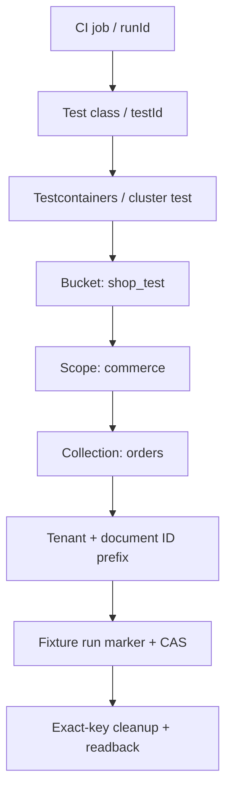

# Cô lập dữ liệu giữa các bài kiểm thử và dọn dẹp đúng phạm vi trong Spring Data Couchbase

Trong module `SPRING_DATA_COUCHBASE`, một bài kiểm thử có thể lưu document qua `CouchbaseRepository`, `ReactiveCouchbaseRepository`, `CouchbaseTemplate`, `ReactiveCouchbaseTemplate`, Java SDK, SQL++ hoặc transaction. Nếu hai bài test chia sẻ bucket/scope/collection và dùng cùng document ID hoặc cùng điều kiện truy vấn, chúng có thể làm hỏng kết quả của nhau: một test thấy document của test khác, một cleanup xóa dữ liệu ngoài phạm vi, một retry tạo event trùng, hoặc một kiểm thử TTL làm key biến mất đúng lúc test khác đọc.

Rủi ro nghiêm trọng nhất không phải test đỏ, mà là **test xanh sai**. Ví dụ: hai test đều sử dụng ID `order::1001`, test B vô tình update document đã được test A tạo; `findById` của cả hai vẫn trả entity hợp lệ. Một trường hợp khác: `@AfterEach repository.deleteAll()` hoạt động trong môi trường đơn người, nhưng khi CI chạy song song nó xóa fixture của mọi test cùng collection. Nếu cấu hình sai bucket, lời gọi ấy còn có thể phá dữ liệu không thuộc bộ kiểm thử.

Bài thuộc chương **Kiểm thử**. Mục tiêu là xây dựng **ranh giới sở hữu dữ liệu**: dữ liệu nào được bài test tạo, tại bucket/scope/collection nào, bằng actor/credential nào, khi nào được phép xóa và cách xác minh không ảnh hưởng tài nguyên khác. Những nguyên tắc này áp dụng cho document mapping, repository, Template, SQL++, CAS, TTL, transaction, auditing và cả reactive access.

> **Quy tắc cốt lõi:** Chỉ dọn tài nguyên mà bài test có thể **chứng minh quyền sở hữu và định danh chính xác**. Không biến cleanup thành một lệnh xóa toàn cục.

## 1. Mục tiêu học tập

Sau bài, bạn có thể:

1. Phân biệt **isolation theo container/cluster**, **bucket**, **scope/collection**, **tenant**, **document ID** và **transaction**.
2. Tạo fixture có `runId`, `testId`, key unique, tenant riêng và dấu nhận diện chủ sở hữu.
3. Phân biệt document do test sở hữu với dữ liệu do hệ thống/worker khác tạo.
4. Dùng `@BeforeEach`, `@AfterEach` và `try/finally` để lập kế hoạch cleanup trước mutation và kiểm tra kết quả sau test.
5. Xóa chính xác từng key qua SDK, đối chiếu dấu owner và CAS; không dùng `deleteAll()` trên collection dùng chung.
6. Xử lý dữ liệu có liên kết: order, outbox, projection, event/inbox và tài nguyên index.
7. Giải thích vì sao rollback bằng `@Transactional` hoặc TTL **không** mặc nhiên thay cleanup.
8. Kiểm soát fixture khi test chạy song song, reactive publisher bị resubscribe, Query Index cập nhật trễ hoặc mutation timeout ambiguous.
9. Xây cơ chế recovery/janitor cho fixture bị bỏ lại sau crash mà không xóa dữ liệu ngoài phạm vi.
10. Chứng minh isolation bằng cả test **không nhiễm chéo** và SDK oracle độc lập.

## 2. “Cô lập” là một tập ranh giới, không phải một annotation



Các lớp isolation có độ mạnh, chi phí và nguy cơ khác nhau:

| Cấp độ | Ví dụ | Ưu điểm | Giới hạn |
| --- | --- | --- | --- |
| **Container/cluster riêng** | Một Couchbase Testcontainer cho một test suite | Hạn chế ảnh hưởng từ test ngoài; cấu hình có thể tái lập | Khởi động tốn tài nguyên; các test trong cùng container vẫn chia sẻ dữ liệu. |
| **Bucket riêng** | `shop_test` cho một job | Dễ hạn chế quyền và chặn nhầm production | Test cùng bucket vẫn có thể va chạm keyspace/index. |
| **Scope riêng** | `ci_run_abc` | Ranh giới collection theo scope | Provision/drop cần quyền và tốn thời gian; có thể không phù hợp cho từng test. |
| **Collection riêng** | `orders_test_abc` | Query/index/fixtures tách mạnh | Tạo/drop/index nhiều lần tốn chi phí, giới hạn tài nguyên. |
| **Tenant riêng** | `tenant::it::run-abc` | Test filter/query/multi-tenant | Không đủ nếu code bỏ tenant predicate hoặc dùng admin account. |
| **Document ID riêng** | `it::runId::testId::order::uuid` | Nhẹ, phù hợp chạy song song | Query rộng, cleanup sai hoặc global index vẫn gây can nhiễu. |
| **CAS và owner marker** | `fixtureRunId` + CAS của raw JSON | Giúp cleanup tránh xóa document không phải của test | Cần kiểm chứng owner/đúng collection; không thay authorization. |

**Không có một chiến lược phù hợp tất cả.** Trong CI, lựa chọn phổ biến là container/bucket test cố định cho suite, scope/collection provision một lần, và **unique IDs/tenant per test method**. Test về phân quyền, routing hoặc lifecycle có thể cần nhiều collections; test phá schema/index cần môi trường cô lập mạnh hơn.

## 3. Những lỗi isolation hay gặp

| Tình huống | Vì sao nguy hiểm | Cách phòng ngừa |
| --- | --- | --- |
| Hai test cùng dùng `order::1` | Đụng key, overwrite hoặc duplicate ngoài ý muốn | Key chứa runId/testId + UUID. |
| Cleanup dùng `repository.deleteAll()` | Xóa toàn collection, kể cả fixture khác | Ledger ghi chính xác IDs đã tạo. |
| Test A dùng `findAll()` rồi assert đúng 2 rows | Nhìn thêm row của test B | Filter theo tenant/run marker; dùng query có phạm vi. |
| SQL++ `DELETE WHERE status="NEW"` | Xóa cả document không thuộc test | `USE KEYS` từ ledger + owner guard. |
| Dùng credential admin để cleanup mọi nơi | Một bug routing có thể phá dữ liệu thật | Test bucket độc lập, allowlist keyspace, setup account test-only. |
| Test chỉ xác minh `repository.findById` | Save/find cùng nhầm collection vẫn pass | SDK raw GET tại đúng bucket.scope.collection. |
| `@DirtiesContext` sau test | Chỉ làm mới Spring context, không tự xóa Couchbase data | Cleanup database riêng. |
| `@Transactional` trên test và kỳ vọng rollback mọi I/O | Không phải mọi API/write tham gia transaction | Test đúng manager + explicit cleanup. |
| TTL cực ngắn cho mọi fixture | Document expire giữa hai assertion | TTL dự phòng dài hơn thời gian test, explicit cleanup chính. |
| Reactive `subscribe()` rời rạc | Cleanup chạy trước write hoàn tất | Dùng StepVerifier/await terminal signal. |
| Test suite chạy parallel với shared static registry | Test này xóa IDs của test kia | Registry theo test instance/run, thread-safe khi cần. |
| Mutation timeout, không lưu key dự định | Server có thể đã ghi, để lại orphan | Đăng ký kế hoạch trước write, đọc lại owner trước delete. |

## 4. Tài nguyên nào thuộc quyền sở hữu của test?

Trước khi tạo fixture, phân loại mọi đối tượng:

- **Fixture owned**: document, outbox event, projection hoặc test account mà bài test chủ động tạo và có cách nhận diện.
- **Shared infrastructure**: bucket/scope/collection/index được suite bootstrap dùng chung, không thuộc từng test method.
- **External/system data**: document có trước bài test, dữ liệu từ job khác, hoặc collection không nằm trong cấu hình test.
- **Ephemeral suite resource**: scope/index do một suite độc quyền provision, có thể thu hồi khi chắc chắn suite dừng và không có consumer khác.

Một bài test update **document đã có sẵn** không mặc nhiên sở hữu document đó. Với trường hợp này, cách an toàn hơn là dùng bản sao/fixture mới, hoặc snapshot + restore có CAS, không xóa nguyên document của hệ thống.

### Bảng ownership cần có trong test plan

| Tài nguyên | Owner | Được phép xóa khi nào? |
| --- | --- | --- |
| `shop_test.commerce.orders / it::runA::...` | Test A | Sau khi StepVerifier hoàn tất, xác minh marker và CAS. |
| `shop_test.operations.outbox_events / it::runA::...` | Test A/transaction A | Sau khi dispatcher/test đã dừng và xác minh event owner. |
| `shop_test.commerce.orders / it::runB::...` | Test B | **Không** bởi cleanup của A. |
| Index `ix_orders_tenant_status` | Provisioner của suite | Không xóa ở `@AfterEach`. |
| Bucket `shop_test` | Test infrastructure | Chỉ suite/CI teardown khi không còn người dùng. |
| `shop.commerce.orders` | Production | **Không** thuộc quyền xóa của tests. |

Nếu test không xác định được owner và phạm vi tài nguyên thì **không chạy cleanup phá hủy**.

## 5. Quy ước ID và tenant cô lập

Một ID tốt phải đủ riêng biệt và có thể đối chiếu với run:

```text
it::<runId>::<testId>::<kind>::<uuid>
```

Ví dụ:

```text
it::ci-81b::save-order::order::913df4e5-...
it::ci-81b::save-order::outbox::0c17d2aa-...
it::ci-81b::parallel-update::order::50f6e7a8-...
```

Không dùng duy nhất test class name vì hai CI workers chạy cùng suite vẫn có thể trùng. Kết hợp **run ID duy nhất** và UUID để phòng xung đột. Không nhúng password/token/PII vào ID vì key có thể xuất hiện trong logs và audit traces.

### Tách test tenant khỏi tenant production

```java
String runId = java.util.UUID.randomUUID().toString();

String tenantId = "it-tenant-" + runId;

String orderId =
    "it::" + runId + "::order::" +
    java.util.UUID.randomUUID();
```

Nếu test dùng shared collection có field `tenantId`, query phải lọc theo test tenant. **Test tenant chỉ là data filter, không phải biên bảo mật**: cần test riêng trường hợp thiếu tenant predicate và application authorization.

## 6. Dấu nhận diện fixture: ID prefix chưa đủ trong mọi tình huống

Có hai trường hợp khác nhau:

**Test hoàn toàn isolated container/bucket:** một key có prefix unique và không được writer khác sử dụng có thể đủ để cleanup trực tiếp theo ID.

**Test dùng chung collection với CI workers khác:** nên đặt marker như `fixtureRunId` và `fixtureTestId` trong JSON để cleanup có thể kiểm chứng **document thực tại key** vẫn là fixture mình tạo, đặc biệt khi có timeout ambiguous, retry hoặc test lỗi routing.

Ví dụ JSON fixture:

```json
{
  "type": "Order",
  "tenantId": "it-tenant-ci81b",
  "status": "NEW",
  "fixtureRunId": "ci81b",
  "fixtureTestId": "save-order"
}
```

Các marker này là **metadata dành cho fixture**. Trong sản phẩm thật, không thêm chúng vào domain schema production chỉ để dọn test nếu có thể dùng một test-only document type/collection hoặc fixture mapping riêng. Test migration/schema compatibility phải giữ JSON giống production khi cần, nên lúc ấy có thể quản lý ownership bằng **test-only key prefix và manifest đáng tin**, thay vì biến đổi payload thực tế.

### Chống nguy cơ xóa nhầm sau một write timeout

Đăng ký **key dự định dùng trước mutation**. Nếu request timeout sau khi server đã ghi mà client không biết, teardown vẫn có key để kiểm tra. Nhưng cleanup phải **GET và xác minh marker** trước khi xóa; nếu ID bị collision với một document không cùng owner, tuyệt đối không xóa document đó.

## 7. Ví dụ entity Spring Data cho fixture test-only

```java
package example.shop.testfixture;

import org.springframework.data.annotation.Id;
import org.springframework.data.annotation.Version;
import org.springframework.data.couchbase.core.mapping.Document;
import org.springframework.data.couchbase.repository.Collection;
import org.springframework.data.couchbase.repository.Scope;

@Document
@Scope("commerce")
@Collection("orders")
public class TestOrderDocument {

    @Id
    private String id;

    private String tenantId;
    private String fixtureRunId;
    private String status;

    @Version
    private long version;

    public TestOrderDocument() {}

    public TestOrderDocument(
            String id,
            String tenantId,
            String fixtureRunId,
            String status) {

        this.id = id;
        this.tenantId = tenantId;
        this.fixtureRunId = fixtureRunId;
        this.status = status;
    }

    public String getId() { return id; }
    public String getTenantId() { return tenantId; }
    public String getFixtureRunId() { return fixtureRunId; }
    public String getStatus() { return status; }
    public void setStatus(String value) { status = value; }
    public long getVersion() { return version; }
}
```

Lớp này là một **fixture entity riêng**, không có ý định thay production `OrderDocument`. Với test mapping production nghiêm ngặt, dùng production entity và key prefix/manifest riêng; nếu fixtureRunId là field không được production schema chấp nhận, không thêm nó vào JSON.

Repository dùng trong test:

```java
import org.springframework.data.couchbase.repository.ReactiveCouchbaseRepository;

public interface TestOrderRepository
        extends ReactiveCouchbaseRepository<TestOrderDocument, String> {
}
```

**Chú ý:** entity được annotate `@Scope` và `@Collection` nhưng bucket do Spring Data client factory/Template chọn. Test integration phải dùng SDK đọc độc lập `shop_test.commerce.orders` để chắc routing đúng.

## 8. Testcontainers không thay thế isolation giữa các test method

Với Testcontainers:

- Một `static @Container` thường sống suốt một **test class**, nên các test methods trong class **cùng chia sẻ database**.
- Một container dùng chung cho toàn suite còn có thể được chia sẻ giữa test classes.
- Container có thể bị reuse giữa các lần chạy nếu cấu hình reusable containers; khi đó dữ liệu cũ càng dễ sót.
- `@TestInstance(PER_METHOD)` tạo instance JUnit khác cho mỗi method, **không** tạo Couchbase Server khác.
- `@DirtiesContext` làm mới Spring `ApplicationContext`, **không** gọi Couchbase remove hoặc DROP.
- Container stop sau suite có thể hủy môi trường test, nhưng không giúp test A tránh thấy fixture của B **trong lúc cả hai chạy**.

### Khung Testcontainers

```java
import org.junit.jupiter.api.Test;
import org.springframework.boot.test.context.SpringBootTest;
import org.springframework.boot.testcontainers.service.connection.ServiceConnection;
import org.testcontainers.couchbase.BucketDefinition;
import org.testcontainers.couchbase.CouchbaseContainer;
import org.testcontainers.junit.jupiter.Container;
import org.testcontainers.junit.jupiter.Testcontainers;
import org.testcontainers.utility.DockerImageName;

@SpringBootTest(properties =
    "spring.data.couchbase.bucket-name=shop_test")
@Testcontainers
class OrderIsolationIT {

    @Container
    @ServiceConnection
    static CouchbaseContainer couchbase =
        new CouchbaseContainer(
            DockerImageName.parse(
                System.getProperty("it.couchbase.image")
            )
        ).withBucket(new BucketDefinition("shop_test"));

    @Test
    void repositorySmoke() {
        // Cần provision scope/collection và fixture.
    }
}
```

Ví dụ theo **Testcontainers 2.x**; package/artifact Testcontainers 1.x có thể khác. System property `it.couchbase.image` phải được CI cung cấp theo approved image tag/digest. `withBucket(...)` không mặc định provision mọi scope, collection hoặc Query Index. Một provisioning setup chỉ chạy ở test-only environment, không chạy ngẫu nhiên vào server production.

## 9. Fixture lifecycle: chuẩn bị trước, cleanup sau, kiểm tra lại

```mermaid
sequenceDiagram
    participant T as JUnit test
    participant L as Fixture ledger
    participant R as Spring Data / SDK
    participant C as Couchbase
    T->>L: plan test key + expected owner
    T->>R: INSERT / save fixture
    R->>C: Mutation
    C-->>R: Success hoặc timeout ambiguous
    T->>R: Execute assertions + StepVerifier
    T->>L: teardown in @AfterEach
    L->>C: GET planned key at exact keyspace
    C-->>L: JSON + CAS hoặc NotFound
    L->>L: Compare owner marker
    L->>C: REMOVE only owned document, with CAS
    C-->>L: Success / conflict / error
    L-->>T: cleanup report; fail if unsafe/incomplete
```

Các bước cần giữ đúng thứ tự:

1. Khởi tạo runId/testId và keyspace allowlist.
2. **Plan** key trước khi tạo publisher ghi.
3. Insert-only khi fixture cần độc quyền key; không upsert đè key tồn tại.
4. Đợi các reactive operations hoàn tất hoặc được cancel và xác minh trạng thái.
5. Trong teardown, đọc lại key bằng SDK tại **đúng keyspace**.
6. Xác minh `fixtureRunId`/owner marker phù hợp.
7. Xóa bằng `remove(id, removeOptions().cas(read.cas()))` khi muốn tránh race.
8. Phân loại NotFound, CAS conflict, authorization và timeout.
9. Xác nhận không còn key do test sở hữu, báo lỗi cleanup thay vì nuốt mọi exception.

## 10. Ví dụ ledger ghi chính xác key cần dọn

Một helper riêng cho test suite có thể quản lý danh sách tài nguyên:

```java
package example.shop.testfixture;

import java.util.Set;
import java.util.UUID;
import java.util.concurrent.ConcurrentHashMap;

public final class FixtureLedger {

    public record TestKey(
        String scope,
        String collection,
        String id
    ) {}

    private final String runId = UUID.randomUUID().toString();
    private final Set<TestKey> planned =
        ConcurrentHashMap.newKeySet();

    public String runId() { return runId; }

    public String newId(String kind) {
        return "it::" + runId + "::" + kind +
            "::" + UUID.randomUUID();
    }

    public void plan(String scope,
                     String collection,
                     String id) {

        if (!Set.of("commerce.orders",
                    "operations.outbox_events")
                .contains(scope + "." + collection)) {
            throw new IllegalArgumentException(
                "Unapproved test collection"
            );
        }

        if (!id.startsWith("it::" + runId + "::")) {
            throw new IllegalArgumentException(
                "ID not owned by this run"
            );
        }

        planned.add(new TestKey(scope, collection, id));
    }

    public Set<TestKey> plannedKeys() {
        return Set.copyOf(planned);
    }
}
```

Ở đây `runId` được tạo riêng cho instance helper; có thể thêm `testId` để phục vụ trace và kiểm thử song song. Bài dùng `runId` gộp phạm vi test method để tránh việc nhiều test dùng chung registry không kiểm soát.

**Hạn chế quan trọng:** ledger trong bộ nhớ biến mất khi process crash. Vì vậy với CI dùng persistent test cluster, cần run manifest/TTL fallback và một **janitor có guard** ở phần sau; không tuyên bố `@AfterEach` luôn chạy trong mọi loại crash.

## 11. SDK cleanup có ownership marker và CAS

Đây là một routine cleanup **trên bucket test `shop_test` đã được caller cung cấp**:

```java
package example.shop.testfixture;

import com.couchbase.client.core.error.CasMismatchException;
import com.couchbase.client.core.error.DocumentNotFoundException;
import com.couchbase.client.java.Bucket;
import com.couchbase.client.java.Collection;
import com.couchbase.client.java.kv.GetResult;

import java.util.ArrayList;
import java.util.List;

import static com.couchbase.client.java.kv.RemoveOptions.removeOptions;

public final class FixtureCleanup {

    public static void removeOwned(
            Bucket testBucket, FixtureLedger ledger) {

        List<RuntimeException> problems = new ArrayList<>();

        for (var key : ledger.plannedKeys()) {
            Collection collection = testBucket
                .scope(key.scope())
                .collection(key.collection());

            try {
                GetResult current = collection.get(key.id());

                String owner = current.contentAsObject()
                    .getString("fixtureRunId");

                if (!ledger.runId().equals(owner)) {
                    problems.add(new IllegalStateException(
                        "Refusing to delete unowned key " +
                        key.id()
                    ));
                    continue;
                }

                collection.remove(
                    key.id(),
                    removeOptions().cas(current.cas())
                );

            } catch (DocumentNotFoundException absent) {
                // Không có key để dọn: thường là an toàn.
            } catch (CasMismatchException conflict) {
                // Writer khác vừa sửa document: tuyệt đối
                // không xóa lại bằng remove(id) vô điều kiện.
                problems.add(conflict);
            } catch (RuntimeException unexpected) {
                // RBAC, timeout, serialization, server unavailable...
                problems.add(unexpected);
            }
        }

        if (!problems.isEmpty()) {
            AssertionError error = new AssertionError(
                "Fixture cleanup incomplete: " +
                problems.size() + " error(s)"
            );

            problems.forEach(error::addSuppressed);
            throw error;
        }
    }

    private FixtureCleanup() {}
}
```

**Những ràng buộc quan trọng của ví dụ:**

- `testBucket` phải được tạo từ một **test-only cluster**; routine không chấp nhận bucket name tùy ý từ request/user.
- Chỉ các key đã `plan(...)` và mang `fixtureRunId` đúng mới được xóa.
- `DocumentNotFoundException` được xem là idempotent cleanup khi key thực sự không có.
- `CasMismatchException` là dấu hiệu **concurrent interference** hoặc mutation mới; fail test/teardown để điều tra.
- Timeout hoặc lỗi quyền không được nuốt; nó có thể có **ambiguous result**.
- Đây là helper ở test code, không phải công cụ cleanup cho production.
- Nếu test cố ý xóa marker để kiểm tra mapping, routine sẽ từ chối xóa; test đó phải dùng bucket/collection riêng hoặc sở hữu manifest có bảo đảm khác, thay vì tắt owner check cho toàn suite.

### Tại sao không luôn xóa thẳng bằng remove(id)?

Nếu hai test vô tình đụng ID, `remove(id)` có thể xóa document mà test thứ hai vừa ghi. Việc GET → kiểm tra owner → REMOVE với CAS giảm rủi ro, và việc báo conflict giúp phát hiện thiết kế isolation chưa đủ mạnh. **CAS không thay thế kiểm tra chủ sở hữu**; một document của người khác cũng có CAS hợp lệ.

## 12. Gắn ledger vào JUnit @AfterEach

JUnit Jupiter thường tạo **instance mới cho mỗi test method** theo lifecycle mặc định. Có thể giữ một `FixtureLedger` riêng cho từng method và dọn trong `@AfterEach`:

```java
import com.couchbase.client.java.Cluster;
import org.junit.jupiter.api.AfterEach;
import org.junit.jupiter.api.Test;
import org.springframework.beans.factory.annotation.Autowired;
import org.springframework.boot.test.context.SpringBootTest;
import reactor.test.StepVerifier;

import java.time.Duration;
import static org.junit.jupiter.api.Assertions.*;

@SpringBootTest
class OrderFixtureIT {

    private final FixtureLedger ledger =
        new FixtureLedger();

    @Autowired TestOrderRepository orders;

    // SDK Cluster trỏ vào TEST ENV, không phải production.
    @Autowired Cluster testCluster;

    @AfterEach
    void tearDown() {
        FixtureCleanup.removeOwned(
            testCluster.bucket("shop_test"),
            ledger
        );
    }

    @Test
    void savesOnlyOwnOrder() {
        String id = ledger.newId("order");
        ledger.plan("commerce", "orders", id);

        TestOrderDocument candidate =
            new TestOrderDocument(
                id,
                "it-tenant-" + ledger.runId(),
                ledger.runId(),
                "NEW"
            );

        StepVerifier.create(orders.save(candidate))
            .assertNext(saved -> {
                assertEquals(id, saved.getId());
                assertEquals(
                    ledger.runId(),
                    saved.getFixtureRunId()
                );
            })
            .expectComplete()
            .verify(Duration.ofSeconds(10));
    }
}
```

Đây là **khung integration test**, cần test database được provision, repository được scan và Cluster được tạo bằng connection details của test. Nếu runtime account không có quyền delete, cấu hình **fixture cleanup Cluster riêng** có quyền chỉ trên test bucket; không tăng quyền của production service.

Nếu test dùng `@TestInstance(PER_CLASS)` hoặc một static shared ledger, nhiều test methods có thể dùng chung registry. Khi đó cần ledger riêng cho từng invocation do JUnit extension/TestInfo quản lý, hoặc dùng lifecycle per-method. `@DirtiesContext` không xóa document Couchbase.

### Đăng ký trước write và vấn đề key collision

Đăng ký planned key trước mutation giúp phát hiện **ambiguous timeout**: server có thể đã ghi dù client chưa thấy ack. Nhưng nếu key trùng document của người khác và thao tác là upsert, document ấy có thể bị ghi đè trước teardown. Vì vậy **tạo fixture bằng insert-only nếu có thể**, dùng UUID/runId riêng và owner guard ở cleanup.

## 13. @AfterEach, try/finally và failure visibility

`@AfterEach` thường được JUnit gọi kể cả khi assertion thất bại; `finally` hữu ích khi tạo resource ngoài JUnit lifecycle:

```java
String id = ledger.newId("order");
ledger.plan("commerce", "orders", id);

try {
    createFixtureAndVerify(id, ledger.runId());
} finally {
    FixtureCleanup.removeOwned(
        testCluster.bucket("shop_test"),
        ledger
    );
}
```

Đây là test fragment cần helper đã định nghĩa. **Không** dùng cả `finally` và `@AfterEach` để dọn cùng resource nhiều lần thiếu chủ đích. Với routine idempotent, NotFound có thể chấp nhận; với external resources hoặc schema objects có thể không.

Khi test fail và cleanup cũng fail, phải **ghi nhận cả hai lỗi**. Đừng `catch (Exception ignored)` hoặc in log rồi coi cleanup thành công. Test results nên thể hiện failure trong teardown; helper có thể đưa các lỗi vào suppressed exceptions để không bỏ mất thông tin.

**Lưu ý:** khi process bị kill, máy CI ngắt nguồn hoặc Docker bị phá, `@AfterEach/finally` không được bảo đảm chạy; cần safety net bằng expiry và janitor có guard cho persistent test environments.

## 14. Reactive lifecycle: không cleanup trước subscription hoàn tất

Sai:

```java
Mono<TestOrderDocument> write = orders.save(candidate);

write.subscribe(); // Không đợi kết quả và dễ mất error.
FixtureCleanup.removeOwned(testBucket, ledger);
```

Cleanup có thể thấy NotFound rồi kết thúc, trong khi write bất đồng bộ sau đó mới được server apply → orphan.

Đúng:

```java
StepVerifier.create(orders.save(candidate))
    .assertNext(saved ->
        assertEquals(
            ledger.runId(),
            saved.getFixtureRunId()
        )
    )
    .expectComplete()
    .verify(java.time.Duration.ofSeconds(10));

// Sau terminal signal mới cleanup ở test thread.
FixtureCleanup.removeOwned(testBucket, ledger);
```

Trong JUnit có thể để teardown ở `@AfterEach` sau StepVerifier. Nếu write timeout/cancel, kết quả có thể chưa rõ; readback theo planned ID và owner marker giúp reconcile. Cần đợi bounded time hoặc quiesce worker để tránh một write in-flight tạo document **sau** vòng cleanup đầu tiên.

### Cancellation không phải rollback

`StepVerifier.thenCancel()` xác nhận subscriber cancel, **không** bảo đảm Couchbase KV mutation đã gửi sẽ rollback. Test cancellation nên có key riêng và post-cancel polling/reconciliation với deadline, không mặc định cancel đồng nghĩa không ghi.

## 15. Reactor usingWhen và callback cleanup

Reactor cung cấp `Mono.usingWhen` để gắn resource cleanup vào completion/error/cancel:

```java
Mono<String> result = Mono.usingWhen(
    Mono.just("fixture"),
    resource -> Mono.just(resource.toUpperCase()),
    resource -> Mono.empty()
);

StepVerifier.create(result)
    .expectNext("FIXTURE")
    .verifyComplete();
```

Đây là test **thuần Reactor**, không chạm Couchbase. Khi dùng `usingWhen` cho fixture DB, cleanup publisher phải nhận đủ identity/keyspace/CAS và **không swallow lỗi** bằng `onErrorResume(err -> Mono.empty())`. Nó cũng không tự bảo đảm cleanup khi process crash hoặc khi SDK write đã commit sau cancellation. Ledger + JUnit teardown thường dễ quan sát hơn cho test nhiều documents.

## 16. Dọn một workflow có nhiều documents và side effects

Một business command có thể tạo:

```text
shop_test.commerce.orders          it::runA::order::123
shop_test.operations.outbox_events it::runA::event::456
shop_test.views.order_projection   it::runA::projection::789
```

Nếu chỉ dọn order, outbox dispatcher có thể thấy event `PENDING` sau khi test hoàn tất và gửi message vào fake broker. Vì vậy:

1. Plan **cả order, outbox, projection/inbox keys** trước transaction.
2. Dùng eventId/commandId deterministic theo run/test.
3. Dừng/quiesce dispatcher hoặc consumer trước teardown khi có background writers.
4. Dọn dependent resources trước hoặc dùng cleanup transaction nếu cần giữ invariant cho observers còn hoạt động.
5. Đối chiếu từng collection bằng SDK oracle.
6. Xóa test broker messages/subscriptions hoặc dùng test-specific consumer group.
7. Không ghi event tới production topic từ integration test.

Cần mở rộng allowlist trong ledger khi test được phép ghi thêm `views.order_projection`; **không tự tắt allowlist** cho toàn bộ bucket.

### Transaction và cleanup

Một transaction order+outbox đảm bảo semantics commit/rollback theo SDK khi sử dụng đúng API. Cleanup sau transaction có thể xóa từng document nếu không còn worker nào chạy và tài nguyên hoàn toàn test-owned; nhưng nếu yêu cầu atomic cleanup trước concurrent observers, cần transaction cleanup phù hợp. Khi gặp `TransactionCommitAmbiguousException`, reconcile thay vì coi chắc rollback.

## 17. Background workers và scheduler vẫn có thể ghi sau test

Các nguồn side effect hay bị quên:

- Outbox dispatcher quét event `PENDING` theo schedule.
- Async `@EventListener` phát publisher độc lập.
- DCP/CDC consumer xây projections.
- Retry queue chạy lại command sau backoff.
- TTL job hoặc migration worker thay trạng thái.
- Một publisher được `subscribe()` thủ công mà test không quản lý.

Ngay cả khi test method đã nhận `onComplete`, **các nguồn trên có thể vẫn hoạt động**.

| Chiến lược | Phù hợp khi | Trade-off |
| --- | --- | --- |
| Tắt dispatcher bằng test profile | Test repository/Template thuần | Không test pipeline event thật. |
| Dùng test topic/consumer group | Test integration event | Cần cleanup broker/inbox. |
| Fake clock/broker/scheduler | Test service behavior | Không chứng minh external provider thật. |
| Poll projection đến expected state | Kiểm thử eventual consistency | Phải có deadline và diagnostic. |
| Exclusive cluster, không chạy parallel | Test failover/transaction phức tạp | Tốn tài nguyên, giảm throughput CI. |

Không dùng production endpoints/credentials chỉ vì local config không có test profile tương ứng.

## 18. Isolation truy vấn SQL++ và Repository

Một repository method:

```java
Flux<TestOrderDocument> findByStatus(String status);
```

có thể trả rows từ nhiều tests cùng có `status=NEW`. Nếu test assert đúng hai rows, nó sẽ flaky hoặc pass sai khi test khác cùng dữ liệu.

Ưu tiên filter bằng unique tenant/run:

```java
Flux<TestOrderDocument> findByTenantIdAndStatus(
    String tenantId,
    String status
);
```

Ví dụ:

```java
String tenant = "it-tenant-" + ledger.runId();

StepVerifier.create(
        orders.findByTenantIdAndStatus(
            tenant, "NEW"
        ).collectList()
    )
    .assertNext(rows -> {
        assertEquals(2, rows.size());
        assertTrue(rows.stream().allMatch(
            r -> tenant.equals(r.getTenantId())
        ));
    })
    .expectComplete()
    .verify(java.time.Duration.ofSeconds(20));
```

Test fragment yêu cầu đã seed 2 documents, Query Index và Query privileges. Nếu query không có `ORDER BY`, so sánh **set IDs**, không assert thứ tự tùy ý. Không dùng `findAll()` để assert tổng số rows của shared collection trừ khi collection thực sự độc quyền.

## 19. Index consistency khác với dữ liệu thật

Sau KV mutation, SDK `collection.get(id)` tại đúng collection thường là oracle phù hợp cho một key. SQL++ finder sử dụng secondary indexes có thể tạm thời chưa thấy document mới/xóa do index lag.

Nếu SQL++ query không thấy row:

- Key có thực sự tồn tại theo KV không?
- Có dùng đúng bucket/scope/collection không?
- Query có lọc tenant/owner/type discriminator không?
- Index đã ONLINE chưa?
- Query consistency có phù hợp yêu cầu không?

Với Spring Data Couchbase fluent query phiên bản hỗ trợ:

```java
import com.couchbase.client.java.query.QueryScanConsistency;

var results = reactiveTemplate
    .findByQuery(TestOrderDocument.class)
    .consistentWith(QueryScanConsistency.REQUEST_PLUS)
    .matching(
        org.springframework.data.couchbase.core.query.Query.query(
            org.springframework.data.couchbase.core.query.QueryCriteria
                .where("tenantId").is(tenant)
        )
    )
    .all();
```

`REQUEST_PLUS` giúp truy vấn đợi index đáp ứng mức consistency được yêu cầu, có thể tăng latency. Nó không sửa thiếu role `query_select`, không tạo index thiếu và không thay raw KV oracle cho một key. **Sau cleanup, query SQL++ cũ có thể còn thấy row nếu dùng index consistency yếu; phải so với KV đúng keyspace trước khi kết luận cleanup fail.**

## 20. SQL++ DELETE theo key, kèm owner guard

Couchbase SQL++ hỗ trợ `DELETE FROM ... USE KEYS ... WHERE ... RETURNING`. Với key list từ ledger:

```sql
DELETE FROM `shop_test`.`commerce`.`orders` AS o
USE KEYS $ownedKeys
WHERE o.fixtureRunId = $runId
RETURNING META(o).id AS deletedId;
```

- `$ownedKeys`: chỉ chứa IDs từ ledger của test này.
- `$runId`: dấu owner đã ghi khi tạo fixture.
- `shop_test.commerce.orders`: keyspace cố định/allowlisted; không nối từ request input.
- Với `RETURNING`, role SQL++ có thể cần cả Query Delete và Query Select.

Tránh:

```sql
-- KHÔNG chạy: xóa mọi document của shared test collection!
DELETE FROM `shop_test`.`commerce`.`orders`;

-- KHÔNG đủ hẹp cho cleanup:
DELETE FROM `shop_test`.`commerce`.`orders`
WHERE status = "NEW";
```

SQL++ là lựa chọn tốt cho batch theo test-owned keys khi có đầy đủ quyền và guard, nhưng KV `GET + REMOVE CAS` đơn giản hơn để kiểm soát từng key và ít phụ thuộc Query Service/index. Nếu DML thất bại giữa chừng hoặc kết quả không rõ, đối soát từng key theo owner; không coi một câu DML là transaction nhiều document nếu không dùng transaction phù hợp.

## 21. CAS trong teardown: phát hiện nhiễm chéo thay vì che giấu

Giả sử test A tạo key K có CAS=X, test B do lỗi routing đã update cùng K tạo CAS=Y. Nếu cleanup A gọi `remove(K)` vô điều kiện, nó sẽ xóa document đã bị B sửa — và che mất bằng chứng nhiễm chéo.

Với owner marker và CAS:

1. A đọc K từ đúng test collection.
2. Nếu `fixtureRunId != runId(A)`, **không xóa**; báo ownership violation.
3. Nếu marker vẫn là A nhưng writer khác sửa giữa GET và REMOVE, CAS mismatch → báo concurrent interference.
4. Chỉ xóa nếu marker đúng và CAS còn khớp.
5. Đọc lại key (hoặc dùng result và SDK oracle) để xác minh document không còn khi test yêu cầu chặt.

Một CAS mismatch không tự nói writer nào hợp lệ. **Không retry cleanup vô hạn** hoặc bỏ CAS để “cho sạch”. Quiesce writers, kiểm tra owner và domain state trước khi quyết định có retry giới hạn hay không.

### CAS không phải revision number

`@Version` trong Spring Data Couchbase liên kết với CAS metadata của Couchbase Server. Không giả định sau một update version tăng 1. Nếu test kiểm tra teardown dựa vào `version + 1` hoặc so sánh thứ tự CAS như timestamp, kết luận không có giá trị.

## 22. TTL làm safety net, không phải chiến lược cleanup chính

Couchbase có expiry/TTL. Một fixture direct SDK có thể khai báo:

```java
import java.time.Duration;
import com.couchbase.client.java.json.JsonObject;
import static com.couchbase.client.java.kv.InsertOptions.insertOptions;

collection.insert(
    id,
    JsonObject.create()
        .put("fixtureRunId", ledger.runId())
        .put("status", "NEW"),
    insertOptions().expiry(Duration.ofHours(2))
);
```

Đây là test fragment; SDK `collection` phải trỏ đúng test collection. Với entity Spring Data, kiểm tra TTL annotation/Template API theo version đang dùng, không mặc định mọi save giữ expiry ban đầu.

**TTL chỉ là giới hạn tuổi thọ dự phòng nếu test crash:**

- Không thay `@AfterEach`, bởi trong 2 giờ đó test khác vẫn có thể thấy fixture.
- Không đặt TTL quá ngắn khiến document hết hạn giữa hai assertions.
- Khi server xem document đã logically expired, SDK có thể trả NotFound **trước khi physical purge** đã hoàn tất.
- Bucket/collection maxTTL có thể làm expiry thực ngắn hơn kỳ vọng.
- Replace/upsert/mutateIn có options về preserve expiry; thiếu option phù hợp có thể vô tình xóa expiry.
- Tua `StepVerifier.withVirtualTime` không làm đồng hồ Couchbase Server nhảy tới lúc TTL hết hạn.

Đối với **test TTL behavior**, chọn collection/test riêng, expiry đủ ngắn để kiểm chứng nhưng dùng polling có deadline thay vì `Thread.sleep(1000)` rồi kỳ vọng purge đúng millisecond.

## 23. @Transactional rollback không tự thay cleanup

Mẫu:

```java
@Test
@Transactional
void testAndRollback() {
    // ...
}
```

có thể làm bạn nghĩ test không để lại dữ liệu. Nhưng với Spring Data Couchbase:

- Cần dùng đúng `CouchbaseTransactionManager` hoặc reactive operator/SDK transaction theo version.
- Chỉ những operations thực sự tham gia transaction mới được rollback.
- Direct SDK writes ở ngoài transaction hoặc Query DML ngoài context đó **không được rollback** bởi annotation test.
- `@BeforeAll` seed fixture ngoài transaction không biến mất khi method test rollback.
- Một event/HTTP call/email phát ra bên ngoài DB không có cơ chế rollback chung.
- Spring transaction manager có thể khác Couchbase khi app dùng nhiều databases.
- SDK commit ambiguous cần reconcile, không coi exception đồng nghĩa rollback chắc chắn.

Với transaction của Couchbase, tài liệu Spring Data Couchbase nhấn mạnh entity cần `@Version Long` cho CAS theo các release được hỗ trợ và một tập operations cụ thể tham gia transaction. Do đó phải có integration tests cho commit, rollback, failed attempt và raw server state.

**Kết luận thực dụng:** dùng rollback để kiểm tra transactional behavior, nhưng **ledger + scoped cleanup** vẫn cần cho fixtures/workflows có nhiều đường ghi.

## 24. Least privilege và guard môi trường

Một cleanup đáng tin không nên chạy bằng Couchbase Full Administrator toàn cluster nếu chỉ cần xóa vài keys:

| Identity | Quyền |
| --- | --- |
| App-under-test | CRUD/Query theo runtime contract tại test keyspace. |
| Setup/provisioner | Tạo bucket, scope, collection, indexes và test users. |
| Fixture cleanup | KV read/remove trong **allowlisted test collections**. |
| Oracle client | Read-only KV/query ở collection được kiểm tra. |
| CI janitor | Chỉ xóa fixture đã hết hạn/đã xác minh owner trong test env. |

Giới hạn **blast radius** ở nhiều lớp:

1. Test connection string và secret riêng.
2. Bucket allowlist cứng: `shop_test`, không nhận từ HTTP request.
3. SDK Cluster của cleanup không có quyền trên production bucket.
4. Scope/collection được kiểm tra theo allowlist trong ledger.
5. Chỉ xóa những IDs đã được plan và có owner marker hợp lệ.
6. CAS để phát hiện concurrent mutation.
7. Không log credentials/secret và không nới quyền để xử lý nhanh một test đỏ.

Đừng chỉ kiểm tra bucket name kết thúc bằng `_test` rồi tin đó không thể là production. Cần xác nhận endpoint/environment identity và secret scope riêng.

## 25. Dọn scope/collection/index: chỉ khi suite thực sự sở hữu

Một số bài test tạo resource mới để thử routing, Query Index hoặc RBAC. Khi đó:

- Tạo tên độc nhất theo run ID: `ci_run_abcd`, `orders_ci_abcd`.
- Dùng test-only bucket và setup identity.
- Có suite-level manifest ghi ai tạo mỗi resource.
- Dừng publishers/workers sử dụng resource trước khi drop.
- Xóa **resource do suite này tạo**, không drop shared collection `orders`.
- Không chạy `DROP INDEX` nếu index đó đang được test class khác dùng.
- Đợi index online khi test yêu cầu Query Service; cleanup phải xử lý index build/failure có giới hạn.
- Không drop scope nếu còn collection của test khác.

**Không** tạo và drop bucket trong `@BeforeEach/@AfterEach` cho mỗi test method chỉ để đạt isolation đơn giản. Tạo resources cần quyền rộng, tăng thời gian CI và mở thêm race conditions.

### Ai được phép drop toàn bộ test bucket?

Chỉ provisioning/CI teardown khi bucket do **job độc quyền sở hữu**, không có test khác hoặc service nào đang dùng; endpoint/role đã được xác nhận. Trên một shared QA cluster, `DROP BUCKET shop_test` không phải “cleanup đúng phạm vi”.

## 26. Sửa một document có sẵn cần restore, không được delete

Nếu một test sửa document vốn tồn tại từ trước, test **không trở thành owner để delete nó**. Phân biệt:

- **Created fixture**: document do test mới tạo, có thể remove khi xác minh owner.
- **Borrowed fixture**: document baseline do suite tạo và nhiều test cùng đọc.
- **External data**: document của hệ thống khác, không được test mutate/cleanup.

Các lựa chọn:

1. **Ưu tiên:** copy baseline thành key unique trong test collection.
2. **Tiếp theo:** seed dataset riêng cho test suite.
3. **Chỉ khi độc quyền:** snapshot before-image rồi restore bằng CAS sau test.
4. **Không làm:** update document dùng chung rồi gọi remove(id) để xóa dấu vết.

### Restore với CAS

```text
GET original JSON + CAS=X
UPDATE selected fields with CAS=X
assert business behavior
GET current JSON + current CAS=Y
RESTORE original JSON with CAS=Y
verify original JSON and test-owned state
```

Nếu có một writer khác sửa giữa get và restore, CAS mismatch là dấu hiệu cần điều tra. Không force upsert original payload ghi đè cập nhật của người khác. Nếu không thể bảo đảm độc quyền, hãy bỏ cách test trên shared document.

## 27. Parallel tests: test chạy độc lập là một invariant

Khi JUnit/Gradle chạy song song, phải giả định:

- Hai tests cùng khởi tạo context và query một collection.
- Query Index cập nhật trễ so với KV writes.
- Background workers chạy giữa assertion và teardown.
- Test A có thể fail giữa lúc B đang chạy.
- Teardown của A có thể diễn ra khi B đang đọc.
- Testcontainers có thể được share bởi nhiều classes hoặc CI shards.

Một chiến lược tốt là:

```text
CI run UUID
  |-- class A
  |     |-- method A1: own test IDs + own tenant
  |     |-- method A2: distinct IDs + distinct tenant
  |-- class B
        |-- method B1: distinct IDs + distinct tenant
```

Không dùng `static String currentTenant` hoặc một mutable singleton registry khi test chạy parallel. `ThreadLocal` cũng có thể gây mất context với Reactor; dùng test instance per-method, explicit fixture object và Reactor Context cho principal.

### Khi nào phải tắt parallelism?

Tắt cho những bài test **cố ý thay đổi tài nguyên dùng chung**:

- CREATE/DROP INDEX trong shared collection.
- Thay RBAC role/credentials của cùng account.
- Thay collection-level maxTTL.
- Thử failover/rebalance/cluster service shutdown.
- Thay schema/type alias global hoặc fixtures có key cố định không thể đổi.

Đây là **test infrastructure lock/isolated suite requirement**, không phải lý do tắt mọi test khác. Dùng resource locks/JUnit annotations/CI job exclusivity phù hợp với mức tài nguyên bị tác động.

## 28. Test chính khả năng không nhiễm chéo

Tạo **hai fixture độc lập** A và B cùng collection nhưng khác runId/tenant:

```text
A: id=it::runA::order::a1
   fixtureRunId=runA
   tenantId=it-tenant-runA

B: id=it::runB::order::b1
   fixtureRunId=runB
   tenantId=it-tenant-runB
```

Test cần chứng minh:

1. Query A theo tenant/run marker chỉ trả IDs của A.
2. Query B chỉ trả IDs của B.
3. Cleanup ledger A chỉ remove key A.
4. Sau cleanup A, raw SDK GET key B vẫn thành công và CAS/body không đổi.
5. Sau cleanup B, cả hai không còn.
6. Không có SQL++ query rộng hoặc global cleanup ảnh hưởng B.

### Negative test cố ý giả lỗi

Trong môi trường chỉ dành cho integration test, thử một cleanup candidate có key B trong ledger A. Routine owner guard phải **từ chối** key đó và không xóa B. Test này giúp phát hiện regression khi ai đó thay implementation từ GET+owner+CAS thành `remove(id)` trực tiếp.

## 29. Kiểm thử failure injection và khôi phục

| Failure | Rủi ro | Test mong đợi |
| --- | --- | --- |
| Test assertion fail sau insert | Fixture bị bỏ lại | `@AfterEach` vẫn cleanup; nếu lỗi cleanup thì report. |
| Write timeout sau khi server đã commit | Registry tưởng write fail nên quên key | Planned ledger + owner GET tìm và dọn. |
| Delete timeout ambiguous | Không biết key còn hay mất | SDK readback theo key, bounded retry/reconcile. |
| CAS conflict tại cleanup | Có writer concurrent | Không force remove; fail closed. |
| Key tồn tại nhưng marker khác | Collision/route sai | Refuse delete; giữ data và báo lỗi. |
| Server down trong cleanup | Orphan fixture | Teardown fail, janitor/TTL xử lý sau. |
| JUnit process kill | @AfterEach không chạy | Orphan manifest/TTL/janitor. |
| SQL++ index chưa bắt kịp | Query thấy dữ liệu cũ | KV oracle, query consistency phù hợp. |
| Background consumer tạo projection sau delete | Dữ liệu xuất hiện lại | Quiesce consumer trước cleanup. |
| Test A cleanup khi B đang query | Query B thất bại/chọn nhầm row | Unique ID/tenant, không broad delete. |
| Wrong bucket/scope/collection | Cleanup có thể chạm dữ liệu lạ | Allowlist + credentials + raw SDK oracle. |
| Cleanup quyền hạn không đủ | Data leak dù test assertions pass | Fail teardown, không swallow exception. |
| TTL xảy ra trong test | Fixture biến mất | Expiry dài hơn runtime test hoặc test TTL riêng. |

## 30. Janitor dọn orphan sau CI crash phải “fail closed”

Khi test cluster được dùng lâu dài và job CI có thể bị kill, cần một tiến trình janitor **chỉ** quản lý test data.

Quy tắc tối thiểu:

1. Chỉ chạy trên **dedicated test environment** có bucket allowlist.
2. Đọc manifest các run IDs đã **được đánh dấu kết thúc/hết lease**.
3. Tìm candidate key theo **manifest/known prefix**, không quét tất cả dữ liệu để xóa bừa.
4. Đối chiếu `fixtureRunId`, test owner và thời gian tồn tại với dữ liệu raw.
5. Trước xóa, xác minh không còn CI run/worker hợp lệ giữ lease.
6. Xóa bằng KV GET → owner → CAS conditional remove, hoặc batch đã được guard.
7. Log summary số key đã xóa, skip, mismatch, timeout, không log secret.
8. Quarantine/báo điều tra khi owner marker không hợp lệ hoặc tài nguyên không thuộc allowlist.
9. Cần approval/manual review cho tài nguyên schema-level như scope/collection/index nếu không có exclusive manifest chắc chắn.

### Không dùng prefix quét toàn bucket như giấy phép xóa

Một prefix như `it::` chỉ mang ý nghĩa quy ước, không thay proof of ownership. Nếu nhiều jobs đang chạy, một janitor query `WHERE META().id LIKE "it::%"` sẽ xóa cả fixtures còn sống. Cần run lease/age/manifest và xác minh từng key.

### TTL và janitor bổ sung cho nhau

TTL giúp server eventually expire temporary documents, nhưng không bảo đảm purge vật lý ngay; janitor giúp xử lý resources ngoài document TTL như test accounts/indexes hoặc data có TTL không đúng. Cả hai đều **không thay test-level cleanup có giám sát**.

## 31. Integration test chứng minh cleanup A không xóa B

Bài test sau minh họa **hai ledger độc lập** cùng sử dụng một collection test. Dữ liệu được tạo trực tiếp bằng SDK để tập trung vào contract cleanup:

```java
import com.couchbase.client.java.Bucket;
import com.couchbase.client.java.Collection;
import com.couchbase.client.java.json.JsonObject;

import org.junit.jupiter.api.Test;
import static org.junit.jupiter.api.Assertions.*;

class FixtureIsolationContractIT {

    private final Bucket testBucket;

    FixtureIsolationContractIT(Bucket testBucket) {
        this.testBucket = testBucket;
    }

    @Test
    void cleaningRunALeavesRunBUntouched() {
        FixtureLedger a = new FixtureLedger();
        FixtureLedger b = new FixtureLedger();

        Collection orders = testBucket
            .scope("commerce")
            .collection("orders");

        String idA = a.newId("order");
        String idB = b.newId("order");

        a.plan("commerce", "orders", idA);
        b.plan("commerce", "orders", idB);

        try {
            orders.insert(idA, JsonObject.create()
                .put("fixtureRunId", a.runId())
                .put("status", "NEW"));

            orders.insert(idB, JsonObject.create()
                .put("fixtureRunId", b.runId())
                .put("status", "NEW"));

            long bCasBefore = orders.get(idB).cas();

            FixtureCleanup.removeOwned(testBucket, a);

            assertFalse(orders.exists(idA).exists());
            assertTrue(orders.exists(idB).exists());
            assertEquals(
                bCasBefore, orders.get(idB).cas()
            );
        } finally {
            // Nếu assert A fail, B vẫn được dọn.
            FixtureCleanup.removeOwned(testBucket, b);
        }
    }
}
```

Đây là **khung test**, cần khởi tạo/inject `Bucket testBucket` từ test-only Cluster qua JUnit/Spring fixture; constructor injection trong một class không có setup extension phù hợp chưa chạy độc lập. Ví dụ nhằm chứng minh dữ liệu B và CAS B không đổi sau khi cleanup A. Trong project thật, thay bằng `@SpringBootTest` và `@Autowired` hoặc test extension phù hợp; vẫn phải provision scope/collection trước.

Nếu test muốn kiểm tra **negative owner mismatch**, có thể cố tình đưa một key B vào planned list A thông qua helper test riêng hoặc một mock ledger, sau đó assert cleanup từ chối và B vẫn tồn tại. Không biến exception “wrong owner” thành lệnh force delete.

## 32. Assert hậu điều kiện cleanup theo từng key

Khi teardown báo success, điều kiện tối thiểu là những key do test sở hữu không còn truy cập được bằng KV:

```java
for (var planned : ledger.plannedKeys()) {
    boolean exists = testBucket
        .scope(planned.scope())
        .collection(planned.collection())
        .exists(planned.id())
        .exists();

    assertFalse(
        exists,
        "Leftover owned document: " + planned.id()
    );
}
```

Đây là test fragment **chỉ dùng khi các publishers/worker đã quiescent**. SDK `exists(id)` ở đúng collection là oracle trực tiếp cho sự tồn tại theo KV. Nếu statement/test nhằm kiểm tra cả SQL++ index, dùng thêm query với consistency phù hợp; không dùng query index không cập nhật kịp để kết luận rằng KV document vẫn còn.

### Khi cleanup lỗi nhưng sau đó document đã biến mất

Timeout khi REMOVE có thể xảy ra sau khi server commit. Hãy **reconcile**: GET/EXISTS theo key; nếu không còn thì có thể ghi nhận “absent after ambiguous cleanup” theo policy, nếu còn và owner đúng thì retry bounded; nếu owner khác thì fail closed. Không coi mọi timeout là lỗi quyền hoặc rollback chắc chắn.

## 33. Test suite có thể bị “xanh sai” dù cleanup sai

Ba test failures hay bị che khuất:

1. **Swallow cleanup exception:** test assertion pass, `@AfterEach` catch all rồi im lặng.
2. **Wrong keyspace cả save và cleanup:** cả hai cùng sai collection, không phát hiện test đáng ra ghi ở nơi khác.
3. **Lỗi query consistency:** cleanup đã xóa KV nhưng SQL++ default consistency còn thấy row, developer làm test skip assertion, trong khi fixture ledger thực tế chưa được xác minh.

Cần có hai oracle độc lập:

- **Functional oracle:** repository/Template trả data/behavior đúng.
- **Storage oracle:** SDK raw GET/EXISTS tại bucket.scope.collection dự kiến, theo đúng owner và key.

Thêm smoke assertion setup connection là **test-only environment**, không phải production. Với negative tenant tests, assert tài nguyên không được phép **không hề thay đổi CAS/status/audit metadata**.

## 34. Runbook chẩn đoán fixture còn sót

Nếu CI báo `Fixture cleanup incomplete`:

1. Xác định runId, test method, bucket/scope/collection, document ID từ test report.
2. Kiểm tra test thật sự sử dụng đúng test cluster/credential.
3. Đọc raw JSON bằng test oracle, xác minh `fixtureRunId`/owner marker.
4. Phân loại lỗi:
   - NotFound: key có thể đã được xóa hoặc expired.
   - CAS mismatch: có mutation đồng thời.
   - Owner mismatch: key không thuộc test, **không xóa**.
   - Authentication/authorization: cleanup account thiếu role hoặc secret sai.
   - Timeout: kết quả có thể ambiguous; reconcile.
   - Collection not found: resource đã bị drop ngoài phạm vi.
5. Xem logs/trace của background worker hoặc publisher in-flight.
6. Nếu owner đúng và run đã kết thúc, dọn bằng janitor có guard; không chạy SQL++ DELETE toàn collection.
7. Sửa root cause (shared static fixture ID, tenant filter, async subscribe, wrong Template routing), không chỉ thêm sleep.

### Nếu cleanup bất ngờ xóa fixture của test khác

Đây là một **bug isolation**, không phải flaky test thông thường. Ngừng dùng broad cleanup, phân vùng lại credentials/collection, bổ sung owner + CAS check và regression test A/B. Đừng khắc phục bằng cách tắt parallel tests toàn bộ mà không điều tra phạm vi ảnh hưởng.

## 35. Ma trận kiểm thử data isolation

| Mã | Kịch bản | Kết quả cần chứng minh |
| --- | --- | --- |
| ISO01 | Tạo fixture key unique | Không trùng với test khác. |
| ISO02 | Plan key trước write | Timeout ambiguous vẫn có candidate để reconcile. |
| ISO03 | Insert-only gặp duplicate | Không ghi đè data có trước. |
| ISO04 | Cleanup owner đúng | Xóa chính xác key của test. |
| ISO05 | Cleanup owner khác | Từ chối xóa, key lạ còn nguyên. |
| ISO06 | Cleanup key NotFound | Idempotent, không làm test fail vô lý. |
| ISO07 | CAS thay giữa GET/REMOVE | Phát hiện conflict, không force delete. |
| ISO08 | Cleanup timeout | Báo lỗi/đối soát, không swallow. |
| ISO09 | Test A và B chạy song song | A cleanup không làm B đổi CAS/body. |
| ISO10 | SQL++ finder theo tenant | Không đọc document của test khác. |
| ISO11 | SQL++ index lag | KV oracle xác minh dữ liệu thật. |
| ISO12 | Reactive save subscribe xong | Cleanup không chạy trước terminal signal. |
| ISO13 | Cancel/timeout reactive write | Có reconciliation khi mutation outcome chưa rõ. |
| ISO14 | Workflow order + outbox | Dọn tất cả dependent resources. |
| ISO15 | Background worker đang chạy | Quiesce hoặc dùng isolated consumer context. |
| ISO16 | Dùng @DirtiesContext | DB fixture vẫn được dọn riêng. |
| ISO17 | Test transaction rollback | Không còn side effects outside transaction. |
| ISO18 | TTL expiry | Không tạo false positive/false negative cho cleanup. |
| ISO19 | CI process bị kill | Janitor/expiry thu hồi orphan có owner guard. |
| ISO20 | Scope/index shared | Per-test teardown không drop shared schema resources. |
| ISO21 | Wrong bucket/collection | SDK oracle và allowlist phát hiện routing sai. |
| ISO22 | App account least privilege | Cleanup account test-only không tác động production. |
| ISO23 | Test borrowed document | Restore/rollback độc quyền, không delete baseline. |
| ISO24 | Test có lỗi assert + cleanup lỗi | Cả hai failure được ghi nhận. |

## 36. Checklist code review

- [ ] Test có runId/testId unique, không hardcode một shared document key.
- [ ] Fixture ở dedicated test environment/bucket có guard chống nhầm production.
- [ ] Có ownership boundary cho từng scope, collection, tenant và key.
- [ ] Nếu test dùng shared collection, có tenant/run filter đúng trong mọi query.
- [ ] Không dùng `repository.deleteAll()` hoặc `DROP COLLECTION` trong per-test teardown.
- [ ] Ledger lưu danh sách IDs đã plan **trước** mutation.
- [ ] Tạo fixture bằng insert-only khi cần chống collision.
- [ ] Owner marker/manifest đủ để xử lý timeout ambiguous.
- [ ] SDK cleanup dùng GET → owner check → CAS remove.
- [ ] CAS conflict không bị bỏ qua hoặc force remove vô điều kiện.
- [ ] Chỉ bỏ qua DocumentNotFound khi đúng semantics cleanup.
- [ ] Lỗi permission/timeout/collection missing làm teardown fail hoặc được reconcile.
- [ ] Test failures và cleanup failures đều được báo.
- [ ] Reactive writes được StepVerifier/transaction result consume trước cleanup.
- [ ] Không tự subscribe vào background mutation thiếu lifecycle management.
- [ ] Cancellation không được coi là rollback.
- [ ] Order, outbox, inbox, projection và external side effects được track.
- [ ] Background worker/scheduler dừng hoặc isolated trước teardown.
- [ ] Testcontainers static container được hiểu là shared giữa methods.
- [ ] `@DirtiesContext` không bị coi là cleanup Couchbase.
- [ ] Rollback bằng `@Transactional` chỉ được kỳ vọng cho operations có transaction thật.
- [ ] TTL chỉ làm safety net, không thay explicit cleanup.
- [ ] Fixture TTL dài hơn test runtime; test TTL behavior có suite riêng.
- [ ] Cleanup schema-level được thực hiện bởi suite owner độc quyền.
- [ ] Không drop index/scope/collection được nhiều tests dùng chung.
- [ ] App-under-test identity khác setup/cleanup identity khi test RBAC.
- [ ] Cleanup credentials không có quyền production.
- [ ] SDK oracle đọc đúng bucket.scope.collection.
- [ ] SQL++ query cần index/consistency, không dùng index lag làm bằng chứng cleanup fail.
- [ ] Suite parallel có registry độc lập, không dùng static mutable IDs/tenants.
- [ ] CI janitor có run lease/manifest và owner check, không quét/xóa mọi key `it::`.
- [ ] Có regression test đảm bảo cleanup A không xóa B.
- [ ] Không log secret/PII trong fixture IDs hoặc cleanup reports.
- [ ] Test fixtures được dọn theo key nhỏ nhất, không xóa rộng để tiện.

## 37. Câu hỏi vận dụng

**Câu 1.** Vì sao `repository.deleteAll()` nguy hiểm trong `@AfterEach`?

**Đáp án:** Nó có thể xóa toàn bộ collection dùng chung, gồm fixture của test khác hoặc dữ liệu ngoài test. Chỉ xóa IDs mà test sở hữu.

**Câu 2.** Dùng Testcontainers rồi có cần unique document ID không?

**Đáp án:** Có. Một container có thể phục vụ nhiều test methods/classes cùng lúc; container-level isolation không đồng nghĩa per-test isolation.

**Câu 3.** `@DirtiesContext` có xóa Couchbase documents không?

**Đáp án:** Không. Nó làm mới Spring context; dữ liệu server cần cleanup riêng.

**Câu 4.** Vì sao phải plan ID trước write?

**Đáp án:** Khi write timeout sau server commit, client có thể không biết đã ghi. Planned ID cho phép teardown đọc lại và dọn an toàn.

**Câu 5.** Plan ID trước write có thể dẫn tới xóa nhầm key đã tồn tại không?

**Đáp án:** Có nếu teardown xóa vô điều kiện. Phải dùng insert-only, runId unique và owner marker/CAS guard trước remove.

**Câu 6.** `removeOptions().cas(...)` bảo vệ điều gì?

**Đáp án:** Ngăn remove nếu document đã bị mutate giữa GET và REMOVE. Nó không chứng minh document thuộc quyền sở hữu test; cần kiểm tra owner marker riêng.

**Câu 7.** Vì sao `findAll()` thường không nên dùng để đếm fixture trong shared collection?

**Đáp án:** Nó có thể đọc dữ liệu của test khác; cần filter theo run/tenant và keyspace.

**Câu 8.** SQL++ finder chưa thấy document vừa tạo, có phải test ghi sai không?

**Đáp án:** Không nhất thiết. Có thể secondary index chưa bắt kịp; kiểm tra raw KV, Query Index và scan consistency.

**Câu 9.** TTL hai giờ có thay `@AfterEach` không?

**Đáp án:** Không. Trong hai giờ đó fixture vẫn có thể ảnh hưởng test khác; TTL chỉ là safety net khi cleanup không chạy.

**Câu 10.** Một reactive test gọi `subscribe()` và ngay sau đó teardown; có an toàn không?

**Đáp án:** Không. Write có thể vẫn in-flight; dùng StepVerifier/terminal signal hoặc quản lý subscription/cancel/reconciliation.

**Câu 11.** Nếu test đã sửa document baseline có sẵn, có nên delete sau test?

**Đáp án:** Không. Test không sở hữu creation của document đó. Dùng clone fixture hoặc restore bằng CAS trong môi trường độc quyền.

**Câu 12.** Khi cleanup gặp CAS mismatch nên làm gì?

**Đáp án:** Báo concurrent interference, dừng/kiểm tra writers và owner; không force delete không điều kiện.

**Câu 13.** Vì sao cleanup order chưa đủ khi service còn outbox?

**Đáp án:** Outbox/dispatcher có thể còn event PENDING và tái phát hành hoặc tạo projections sau teardown. Phải track mọi side effect.

**Câu 14.** Janitor có được xóa tất cả keys có prefix `it::` không?

**Đáp án:** Không. Có thể có CI run còn sống; cần manifest/lease, owner marker và test environment allowlist.

## 38. Bài thực hành đề xuất

**Bài A — Hai test methods độc lập.** Cùng dùng `shop_test.commerce.orders`, tạo runId/tenant/key riêng. Chạy parallel, mỗi test dùng `@AfterEach` cleanup; assert không còn own key và không ảnh hưởng test còn lại.

**Bài B — Owner guard.** Tạo A và B có IDs khác nhau. Cho ledger A thử nhận key của B. Cleanup phải từ chối, B vẫn tồn tại với CAS không đổi.

**Bài C — Reactive cancellation.** Dùng `StepVerifier` test save có timeout/cancel và xác minh server state sau đó; không suy cancel nghĩa rollback. Cleanup planned key phải xử lý cả trường hợp write commit sau cancel.

**Bài D — Query consistency.** Seed hai orders theo tenant/run unique, query bằng derived method và Template `REQUEST_PLUS`, so sánh tập IDs. Dọn bằng KV, đối chiếu KV state và SQL++ sau index catch-up.

**Bài E — Workflow nhiều documents.** Transaction tạo order+outbox. Ghi cả hai IDs vào ledger, tắt dispatcher trước teardown, xóa đúng hai keys và xác minh không có orphan pending event.

**Bài F — CI crash.** Mô phỏng process không chạy teardown trên dedicated test environment. Janitor chỉ được dọn một run đã hết lease và có owner marker đúng; không được xóa run khác vẫn active.

**Tiêu chí hoàn thành:** test suite có **test-level ownership**, **bounded cleanup**, **negative test chống xóa nhầm**, **SDK server oracle**, log đủ để điều tra data leak và không đòi quyền production.

## 39. Kết luận

Cô lập dữ liệu kiểm thử trong Spring Data Couchbase không chỉ là đặt tên ID ngẫu nhiên hoặc chạy Testcontainers. Một thiết kế đúng cần **ranh giới sở hữu chặt** ở nhiều lớp: environment, bucket, scope/collection, tenant, document ID, marker và CAS. Repository, Template, SQL++, direct SDK, reactive publishers và transaction có những đường ghi khác nhau; mọi resource mà test tạo đều phải được theo dõi và dọn đúng phạm vi.

Cleanup an toàn là **planned keys → raw GET → xác minh owner → CAS conditional REMOVE → verify**, không phải `deleteAll()` hoặc `DROP COLLECTION` trên shared resource. `@AfterEach` và `try/finally` giúp dọn khi test fail, còn TTL/janitor xử lý crash với điều kiện ownership/lease rõ ràng. SQL++ Query Index lag không được nhầm với trạng thái KV; reactive cancellation không phải rollback; transaction rollback không tự bao trùm mọi side effects.

Một test suite đáng tin khi **test A không thể xóa hoặc đọc nhầm dữ liệu của B**, kết quả mutation được xác nhận tại đúng `bucket.scope.collection`, và lỗi teardown làm CI báo vấn đề thay vì âm thầm để lại dữ liệu.

## Tài liệu tham khảo

1. [Couchbase Java SDK — Key-Value Operations](https://docs.couchbase.com/java-sdk/current/howtos/kv-operations.html): `remove`, `get`, `insert`, optimistic concurrency bằng CAS và expiry.
2. [Couchbase Java SDK — Collection API](https://docs.couchbase.com/sdk-api/couchbase-java-client/com/couchbase/client/java/Collection.html): signatures `remove(String)`, `remove(String, RemoveOptions)`, `get`, `exists`.
3. [Couchbase Java SDK — RemoveOptions API](https://docs.couchbase.com/sdk-api/couchbase-java-client/com/couchbase/client/java/kv/RemoveOptions.html): `removeOptions().cas(long)`.
4. [Couchbase Server — DELETE SQL++](https://docs.couchbase.com/server/current/n1ql/n1ql-language-reference/delete.html): `DELETE FROM`, `USE KEYS`, `WHERE`, `RETURNING` và RBAC.
5. [Couchbase Server — Expiration](https://docs.couchbase.com/server/current/learn/data/expiration.html): TTL/maxTTL và expired document semantics.
6. [Spring Data Couchbase — Repositories](https://docs.spring.io/spring-data/couchbase/reference/couchbase/repository.html): Repository KV/Query behavior và methods.
7. [Spring Data Couchbase — Template Operations](https://docs.spring.io/spring-data/couchbase/reference/couchbase/template.html): fluent Template/ReactiveTemplate và keyspace routing.
8. [Spring Data Couchbase — Transactions](https://docs.spring.io/spring-data/couchbase/reference/couchbase/transactions.html): transactional operations, version/CAS requirements và operator.
9. [Spring Data Couchbase — Entity Modeling](https://docs.spring.io/spring-data/couchbase/reference/couchbase/entity.html): `@Version`, ID, mapping và auditing.
10. [Spring Boot — Testing with Testcontainers](https://docs.spring.io/spring-boot/reference/testing/testcontainers.html): `@ServiceConnection` và test connection details.
11. [Testcontainers Java — Couchbase Module](https://java.testcontainers.org/modules/databases/couchbase/): `CouchbaseContainer`, bucket provisioning và dependency modules.
12. [JUnit 5 — Test Instance Lifecycle](https://docs.junit.org/current/user-guide/#writing-tests-test-instance-lifecycle): per-method/per-class và parallel tests.
13. [JUnit 5 — Lifecycle Methods](https://docs.junit.org/current/user-guide/#writing-tests-definitions): `@BeforeEach`/`@AfterEach`, teardown execution.
14. [Project Reactor — Testing](https://projectreactor.io/docs/core/release/reference/testing.html): `StepVerifier`, completion/cancel/error và virtual-time limitations.
15. [Project Reactor — Using Resources Reactively](https://projectreactor.io/docs/core/release/reference/coreFeatures/error-handling.html): `usingWhen` và cleanup publisher semantics.


