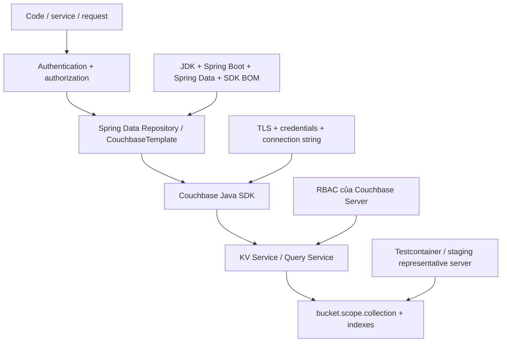
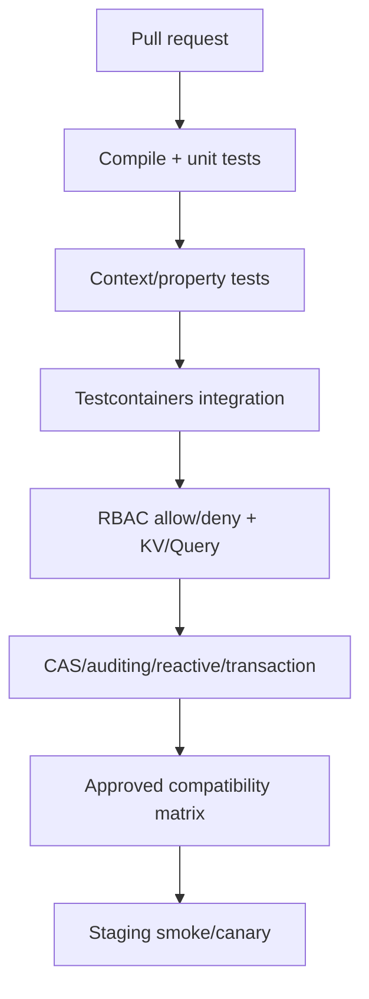

# Kiểm thử quyền truy cập, cấu hình sai và tính tương thích phiên bản trong Spring Data Couchbase

Một ứng dụng **Spring Data Couchbase** có thể pass tất cả unit tests nhưng vẫn gặp lỗi production ngay trong phút đầu triển khai: `repository.findById(...)` chạy tốt còn `findByStatus(...)` bị từ chối quyền Query; credentials kết nối được bucket nhưng không có quyền vào collection; repository đang trỏ nhầm scope có cùng tên collection; một ứng dụng khác sử dụng bản Java SDK mới làm thay đổi class exception hoặc mapping; hoặc CI dùng tài khoản Administrator nên không phát hiện thiếu role ở production.

Kiểm thử **bảo mật quyền truy cập**, **cấu hình sai** và **tính tương thích phiên bản** phải được thực hiện cùng nhau, nhưng **không** được gộp mọi lỗi thành một nhóm “Couchbase không kết nối được”. Một kết quả kiểm thử tốt giúp trả lời ba câu hỏi khác nhau:

1. **Quyền**: identity này *được phép* đọc/ghi/truy vấn/chỉnh sửa tài nguyên nào? Những hành động ngoài quyền có **thực sự thất bại** không?
2. **Cấu hình**: ứng dụng đang dùng đúng endpoint, chứng thư TLS, bucket, scope, collection, index, converter và runtime settings chưa?
3. **Tương thích**: tổ hợp Java, Spring Boot, Spring Data Couchbase, Couchbase Java SDK và Couchbase Server đã được kiểm tra với đúng API và semantics chưa?

Bài thuộc chương **Kiểm thử** của module `SPRING_DATA_COUCHBASE`. Trong một ứng dụng có document mapping, repository, `CouchbaseTemplate`, SQL++, CAS/`@Version`, TTL, giao dịch và reactive API, các ca này cần được kiểm tra từ **API/service → repository/Template → SDK/KV/Query Service → document thực**. Không thay thế các kiểm thử đó bằng mock `CouchbaseRepository` rồi mặc định mọi tài nguyên và role sẽ tồn tại khi deploy.

## 1. Chiến lược kiểm thử: ba lớp, nhiều ranh giới



Một chiến lược đúng kết hợp:

| Lớp test | Mục đích | Có thể kết luận? |
| --- | --- | --- |
| Unit test authorization/domain | User A không có quyền với tenant B; DTO không được tự chọn actor hay collection | Domain policy hoạt động trên input mô phỏng; **chưa kiểm chứng RBAC server**. |
| Context/configuration test | Bean, profiles, property binding, repository scan, credential provider được chọn | Spring context có cấu hình mong đợi; **chưa chứng minh server cấp quyền**. |
| Couchbase integration test | Kết nối thật, KV/SQL++/CAS/TTL/transactions và role allow/deny | Có bằng chứng thực về hạ tầng và mapping. |
| Multi-version compatibility test | Nhiều tổ hợp dependency/server image được support | Hành vi regression theo tổ hợp đã kiểm tra. |
| Preproduction smoke test | TLS, network, role, index và keyspace của môi trường deploy | Phát hiện lệch môi trường, nhưng phải dùng dữ liệu test/credential ít quyền. |

**Nguyên tắc:** một test chỉ thành công khi nhận **đúng loại kết quả**. “Có exception” không đủ để khẳng định authorization hoạt động; có thể exception do cluster không chạy, syntax SQL++ sai, index thiếu hoặc timeout.

## 2. Các identity khác nhau cần được kiểm thử riêng

Trong một deployment có thể có:

| Identity | Vai trò | Không nên được cấp |
| --- | --- | --- |
| Provisioning/migration operator | Tạo bucket/scope/collection/index và role trong bước bootstrap | Không dùng làm credential của service chạy hằng ngày. |
| Application KV writer | Đọc/sửa entity trong collection được phép | Full Admin, index administration nếu không cần. |
| Application Query reader | SQL++ SELECT với các collection được phép | Query UPDATE/DELETE nếu ứng dụng chỉ đọc. |
| Background worker | Ghi theo quyền của job được ủy nhiệm | Mọi tenant/collection theo wildcard không cần thiết. |
| Test admin/setup | Provision fixture trong test environment cô lập | Không được “leak” sang app-under-test. |
| API user/tenant principal | Gọi service theo user permission | Không phải một Couchbase Server credential do client trực tiếp điều khiển. |

Có **hai lớp authorization**:

1. **Spring Security/business authorization**: Alice có quyền xác nhận đơn ở tenant A nhưng không phải tenant B.
2. **Couchbase RBAC**: tài khoản kỹ thuật mà service dùng có quyền KV/Query trên collections được quy định.

Ngay cả khi Couchbase account có quyền đọc tất cả order, application vẫn phải enforce ownership/tenant theo user. Ngược lại, authorization nghiệp vụ pass không cứu được lệnh KV nếu service credential bị thiếu role.

## 3. RBAC Couchbase phân biệt KV với SQL++

Couchbase Server RBAC có nhiều loại role, trong đó:

| Ý định | Role phù hợp để đánh giá | Điều không suy ra được |
| --- | --- | --- |
| KV GET document | `data_reader` trên keyspace tương ứng | Không tự cho phép SQL++ SELECT. |
| KV insert/upsert/replace/remove | `data_writer`, thường cùng quyền đọc khi read-modify-write | Không tự cho phép SQL++ UPDATE. |
| SQL++ SELECT | `query_select` trên collection | Không tự cho phép KV GET/replace. |
| SQL++ INSERT | `query_insert` | Không mặc định cho UPDATE/DELETE. |
| SQL++ UPDATE | `query_update` | Không mặc định cho SELECT/INSERT. |
| SQL++ DELETE | `query_delete` | Không mặc định cho KV remove. |
| Tạo/chỉnh index | `query_manage_index` | Không nên cấp cho runtime app nếu index provision bằng migration. |
| Liệt kê index | `query_list_index` | Không đồng nghĩa tạo index. |
| Quản lý scope/collection | `scope_admin` / Manage Scopes | Không được mặc định cấp quyền dữ liệu. |

Tên role và phạm vi gán phải được xác minh bằng **Couchbase Server version đang vận hành**. Có những query shape có thể cần thêm quyền liên quan tới index/other referenced keyspaces. Bảng là điểm khởi đầu cho thiết kế **least privilege**, không phải permission policy hoàn chỉnh.

### Vì sao role đọc KV không đủ cho repository finder?

`repository.findById(id)` thường dùng KV theo key; còn derived query `findByStatus("NEW")` thường dùng Query Service/SQL++. Nếu credential chỉ có `data_reader`, findById có thể thành công nhưng finder SQL++ không được phép dù document tồn tại.

Đây là **negative test bắt buộc** vì việc phát triển bằng tài khoản Full Admin dễ che lỗi role. Query privilege phải được cấp đúng collection mà query tham chiếu, kể cả khi entity annotation chọn đúng scope và collection.

## 4. Quy tắc cấp role và quản lý credentials

Các role Couchbase có thể được scope theo bucket, scope hoặc collection. Nên:

- Dùng tài khoản ứng dụng riêng cho từng workload có chính sách độc lập.
- Giới hạn quyền ở cấp collection khi có thể.
- Tách provisioning role khỏi runtime role.
- Dùng secret manager hoặc deployment environment; không commit password/connection secrets vào Git hoặc log.
- Thử **allow path** và **deny path** bằng đúng credential được dùng ở production profile.
- Xác định riêng quyền Query cho repository methods dùng SQL++.
- Kiểm thử credential rotation và revoke, không chỉ kết nối lần đầu.
- Có policy cho user/role thay đổi trong thời gian SDK connection pool đang sống.

**Không biến một bài test quyền thành script tạo Full Admin rồi giao credential ấy cho service chạy mọi test.** Test admin chỉ dùng setup/cleanup; khi xác minh quyền, tạo client riêng bằng account bị giới hạn.

## 5. Ma trận quyền tối thiểu trên ba collection

Giả sử:

```text
shop.commerce.orders
shop.operations.outbox_events
shop.private.payments
```

Một service xác nhận order cần đọc/ghi orders, một outbox dispatcher cần đọc/cập nhật outbox, nhưng cả hai **không** được đọc payments.

| Actor | orders KV | orders SQL++ SELECT | outbox KV | outbox SQL++ SELECT | payments KV |
| --- | --- | --- | --- | --- | --- |
| `order-api` | Allow read/write | Allow SELECT khi có finder | Deny nếu app không trực tiếp ghi outbox | Deny | Deny |
| `outbox-dispatcher` | Deny | Deny | Allow read/write | Allow SELECT nếu poll bằng SQL++ | Deny |
| `payment-service` | Deny hoặc theo contract rất cụ thể | Deny | Deny | Deny | Allow theo nhiệm vụ |
| `setup-admin` | Provisioning trong test-only environment | Có thể theo fixture | Provisioning | Provisioning | Provisioning |

Đây là **ví dụ security policy**, không phải khai báo RBAC đã được áp lên server. Với transactional outbox do order-api ghi, role của order-api phải được điều chỉnh đúng: không thể vừa “deny mọi ghi outbox” vừa kỳ vọng order+outbox commit. Mỗi quyền trong ma trận phải phản ánh architecture thực.

## 6. Test phải chứng minh cả allow và deny

Một bảng test có thể gồm:

| ID | User/credential | Thao tác | Kỳ vọng |
| --- | --- | --- | --- |
| RB01 | app reader | KV GET orders | Thành công. |
| RB02 | app reader | KV UPSERT orders | Bị từ chối do thiếu ghi. |
| RB03 | KV reader không có query_select | SQL++ SELECT orders | Bị từ chối do thiếu Query privilege. |
| RB04 | Query-only reader không có data_reader | KV GET orders | Bị từ chối do thiếu KV privilege. |
| RB05 | app writer | GET/replace CAS orders | Thành công nếu đã cấp đủ quyền cần thiết. |
| RB06 | app writer chỉ có orders | GET payments | Bị từ chối. |
| RB07 | account chỉ SELECT | SQL++ UPDATE orders | Bị từ chối. |
| RB08 | runtime app | CREATE INDEX | Bị từ chối nếu index management tách riêng. |
| RB09 | setup admin | CREATE INDEX test collection | Thành công. |
| RB10 | service credential bị revoke | KV/Query sau khi thay đổi quyền | Bị từ chối theo thời điểm permission mới có hiệu lực. |
| RB11 | app user tenant A | Service API update tenant B | HTTP 403/kiểu lỗi domain theo policy; DB không đổi. |
| RB12 | same ID hai collections | SDK GET ngoài scope cho phép | Bị từ chối, không fallback sang collection mặc định. |

Trước negative test, làm **positive control**: cùng server/service phải sẵn sàng, key tồn tại, SQL++ hợp lệ và index đã provision. Nếu negative test có exception vì server down thì đó là **infrastructure failure**, không phải PASS về bảo mật.

## 7. Cấu hình Spring Boot: đường nối và bucket

Một cấu hình Spring Boot 3.x điển hình:

```yaml
spring:
  couchbase:
    connection-string: "couchbase://127.0.0.1"
    username: "orders_app"
    password: "INJECT_VIA_SECRET_MANAGER"
  data:
    couchbase:
      bucket-name: "shop"
```

Đây là **mẫu học tập**: mật khẩu placeholder không phải mật khẩu thật; production phải lấy từ secret manager/secret mount và bảo vệ logs. Khi dùng TLS, cấu hình scheme/certificates theo phiên bản Boot/SDK và môi trường (Couchbase Capella thường dùng `couchbases://`).

**Đừng dùng chung class cấu hình của Boot 3.x để khẳng định mọi property vẫn y hệt ở Boot 4.x.** Khi nâng cấp, kiểm tra metadata configuration properties, migration guide và integration test. Các đường được ghi rõ trong reference của version được triển khai mới là nguồn đúng.

### Các lớp cấu hình cần được phân biệt

- `spring.couchbase.*`: thông tin SDK connection, authentication, cluster environment.
- `spring.data.couchbase.bucket-name`: bucket cho Spring Data auto-configuration khi có SDK Cluster.
- `@Scope`/`@Collection` trên entity hoặc lựa chọn Template: định tuyến scope/collection.
- Index/Query Service: cần index và quyền Query theo SQL++ workload.
- Security policies: có thể do Couchbase user roles và service-level authorization quyết định độc lập.

### Cấu hình sai nhưng vẫn “kết nối được”

Nếu bucket A và bucket B đều tồn tại, một cấu hình sai bucket có thể vẫn bootstrap bình thường. Nếu hai scope cùng có collection `orders`, save/find qua cùng repository được route sai có thể tự pass. Test phải đọc độc lập **đúng keyspace được yêu cầu**, không chỉ assert repository lưu rồi đọc được.

## 8. Phân biệt lỗi cấu hình kết nối, xác thực và phân quyền

| Lỗi | Triệu chứng điển hình | Oracle chính |
| --- | --- | --- |
| DNS/connection string sai | Bootstrap timeout/unreachable | Kiểm tra endpoint, SDK diagnostics, network. |
| TLS thiếu CA hoặc hostname mismatch | TLS handshake/certificate validation fail | Truststore, SAN, scheme `couchbases://`. |
| Username/password sai | Authentication failure | Dùng test credential biết đúng; xác minh source secret. |
| Bucket không tồn tại/không truy cập được | Bucket open/waitReady hoặc operation fail | Admin/setup metadata + credential quyền hạn hẹp. |
| Scope/collection sai | CollectionNotFound/không thấy dữ liệu hoặc trỏ nhầm nơi | SDK raw GET đúng keyspace + collection manifest. |
| KV role thiếu | KV get/upsert bị từ chối | Role allow/deny test. |
| Query role thiếu | SQL++ finder lỗi quyền | Query-only vs KV-only test. |
| Index thiếu | Query planner báo không có index phù hợp hoặc cần scan role | Provision index trước, EXPLAIN/query error. |
| Converter/type alias thay | Mapping exception, entity tìm qua query sai | Raw JSON + versioned contract tests. |
| Wrong SDK/Spring dependencies | Linkage/class/method error hoặc behavior drift | Resolved dependency graph + compatibility tests. |

**Quan trọng:** SDK có thể cố tình không phân biệt một số trường hợp auth và bucket visibility vì lý do bảo mật. Không viết logic “chỉ cần `AuthenticationFailureException` là chắc password sai”. Phải xem service context, configuration và precondition của test.

## 9. TLS và chứng thư: kiểm thử đúng đường kết nối an toàn

Dùng `couchbases://` cho kết nối TLS phù hợp và CA/truststore được cấu hình đúng. Couchbase Capella và Couchbase Server có cơ chế chứng thư khác nhau; SDK có những CA trusted mặc định tùy đích và phiên bản.

Nên có ít nhất:

1. **Positive test:** kết nối bằng certificate/truststore được cấp đúng; KV read và SQL++ query đều hoạt động khi role cho phép.
2. **Negative test:** kết nối TLS với CA không hợp lệ hoặc hostname không khớp phải thất bại theo chính sách xác thực chứng thư.
3. **No downgrade test:** môi trường yêu cầu TLS không được tự chuyển sang non-TLS connection.
4. **Certificate rotation:** khi CA/cert thay đổi, client mới có thể kết nối; hệ thống có runbook rotation.
5. **Secret safety:** không in certificate private key, password, access token trong CI logs hoặc exception serialization.

Không dùng `trustAllCertificates(true)` hoặc vô hiệu hóa hostname verification làm “giải pháp” cho test TLS thất bại rồi để sót trong production. Nếu môi trường test dùng CA tự ký, hãy **cấp CA cho truststore test** một cách rõ ràng.

## 10. Nhầm bucket/scope/collection phải được kiểm thử bằng oracle độc lập

Entity:

```java
import org.springframework.data.annotation.Id;
import org.springframework.data.annotation.Version;
import org.springframework.data.couchbase.core.mapping.Document;
import org.springframework.data.couchbase.repository.Scope;
import org.springframework.data.couchbase.repository.Collection;

@Document
@Scope("commerce")
@Collection("orders")
public class OrderDocument {
    @Id private String id;
    private String status;
    @Version private long version;

    public OrderDocument() {}
    public OrderDocument(String id, String status) {
        this.id = id;
        this.status = status;
    }
    public String getId() { return id; }
    public String getStatus() { return status; }
    public void setStatus(String status) {
        this.status = status;
    }
    public long getVersion() { return version; }
}
```

Repository:

```java
public interface OrderRepository
        extends CouchbaseRepository<OrderDocument, String> {
}
```

Giả sử document ID là `it::route::<uuid>`. Sau `repository.save(entity)`, đọc raw KV bằng SDK:

```java
String id =
    "it::route::" + java.util.UUID.randomUUID();

OrderDocument saved =
    orderRepository.save(
        new OrderDocument(id, "NEW")
    );

var expectedCollection = sdkCluster.bucket("shop")
    .scope("commerce")
    .collection("orders");

var result = expectedCollection.get(id);
var body = result.contentAsObject();

assertEquals("NEW", body.getString("status"));
assertEquals(saved.getVersion(), result.cas());
```

Đây là **thân integration test**, cần test cluster, repository và JUnit imports. Nó kiểm tra keyspace của raw SDK **khác con đường repository**. Nếu kiểm tra bằng chính `repository.findById(id)`, hai lệnh cùng route sai scope có thể vẫn pass.

### Một test định tuyến âm tính

Gieo **cùng ID** vào `shop.commerce.orders` và `shop.archive.orders_history` nhưng `status` khác nhau; xác nhận repository/Template được chỉ định trả status của collection mong đợi. Không dùng CAS từ collection A làm version của B; CAS thuộc document ở keyspace cụ thể.

## 11. Cấu hình Template tùy chỉnh và multi-bucket

Nếu có nhiều `CouchbaseClientFactory` hoặc `CouchbaseTemplate`:

- Xác minh Template dùng bucket nào.
- Kiểm tra `withScope/withCollection` hoặc API fluent tương ứng.
- Không suy `inScope("commerce")` có thể đổi bucket đã gắn vào Template.
- Cấu hình converter, custom conversions, callbacks, auditing trên Template khác nhau phải được test độc lập.
- Kiểm tra repository scan có dùng đúng operations/templateRef khi custom nhiều repositories.
- Không reuse context/test bean admin ở đường production với quyền rộng.

**Một Template được inject thành công chưa chứng minh Template đó dùng bucket, credentials và lifecycle callbacks đúng**.

## 12. Query/index: phân biệt thiếu quyền với thiếu chỉ mục

Cùng truy vấn:

```sql
SELECT o.status
FROM `shop`.`commerce`.`orders` AS o
WHERE o.status = "NEW";
```

có thể fail vì:

- User thiếu `query_select`.
- Query Service không sẵn sàng.
- Index cho collection chưa có hoặc chưa online.
- Server không cho sequential scan không index.
- Keyspace sai hoặc tên alias/SQL++ cú pháp sai.
- Query có nhiều keyspace và một trong đó thiếu quyền.

Trình tự kiểm thử:

1. Provision keyspace và index bằng **setup identity**, không bằng runtime app.
2. Đợi index online/Query Service readiness, không sleep cứng tùy ý.
3. Chạy query bằng setup identity để kiểm tra SQL++ hợp lệ.
4. Chạy bằng app identity có `query_select`: assert thành công.
5. Chạy bằng KV-only identity: assert **authorization failure**.
6. Chạy cùng entity/collection với intentionally missing index trong test cô lập: assert **query planner/index failure**, **không** gộp với RBAC failure.

Test Query Service phải nêu consistency kỳ vọng. Sau KV save, SQL++ index có thể chưa cập nhật; `REQUEST_PLUS` có thể giúp test đọc dữ liệu đã được index đầy đủ khi yêu cầu. Nhưng nó **không tạo index còn thiếu** hoặc sửa quyền.

## 13. Các mức smoke test với credentials ít quyền

Một smoke test sau deploy nên:

1. Xác nhận service mở bucket và đã chọn đúng scope/collection.
2. KV `GET` một key fixture vô hại đã biết nếu app cần đọc.
3. KV `INSERT/REPLACE` với key test unique và cleanup nếu app cần ghi.
4. SQL++ `SELECT` giới hạn trên collection nếu app dùng finder.
5. Xác nhận app không CREATE INDEX hoặc manage users trong runtime.
6. Xác nhận deny vào collection bị cấm bằng test account riêng.
7. Kiểm tra TLS/CA/hostname và timeout budget.
8. Kiểm tra event/auditing/Version CAS nếu đó là contract release.

**Không dùng smoke test tạo dữ liệu thật trong collection production rồi `deleteAll()` để cleanup.** Chỉ dùng fixture/key prefix được cho phép và cleanup idempotent.

## 14. Testcontainers cho Couchbase: môi trường cách ly và tái lập

Testcontainers có module Couchbase; hình thức cơ bản:

```java
import org.testcontainers.couchbase.BucketDefinition;
import org.testcontainers.couchbase.CouchbaseContainer;
import org.testcontainers.utility.DockerImageName;

CouchbaseContainer container =
    new CouchbaseContainer(
        DockerImageName.parse(
            System.getProperty("test.couchbase.image")
        )
    ).withBucket(new BucketDefinition("shop_test"));
```

Ví dụ **dành cho Testcontainers 2.x** (package/coordinate có thể khác ở 1.x); cần cấp system property `test.couchbase.image` là một image tag đã được CI phê duyệt. Container phải được start bởi `@Container/@Testcontainers` hoặc lifecycle tương ứng.

**Không trộn lẫn imports của Testcontainers 1.x và 2.x.** Testcontainers 2.x có module coordinate `org.testcontainers:testcontainers-couchbase`; dự án 1.x có thể dùng `org.testcontainers:couchbase` và package khác. Hãy dùng Testcontainers BOM hoặc phiên bản được build quản lý.

### Vì sao Testcontainers chưa đủ cho test RBAC thực tế?

Container test được bootstrap bằng admin credential để provision bucket/index/roles. Nếu để Spring application dùng **cùng admin credential**, toàn bộ negative tests về permission đều vô nghĩa. Test RBAC phải **tạo account app giới hạn quyền**, khởi tạo một `Cluster` riêng với account đó và kiểm tra allow/deny.

Cần tạo scope/collection thật trong container nếu entity dùng `@Scope/@Collection`; `withBucket(...)` chỉ tạo bucket theo contract của module. Không tự coi mọi scope/collection đều đã tồn tại.

## 15. Spring Boot @ServiceConnection và @DynamicPropertySource

Với Spring Boot/Testcontainers version hỗ trợ, `@ServiceConnection` có thể cung cấp Couchbase connection details:

```java
import org.junit.jupiter.api.Test;
import org.springframework.boot.test.context.SpringBootTest;
import org.springframework.boot.testcontainers.service.connection.ServiceConnection;
import org.testcontainers.couchbase.BucketDefinition;
import org.testcontainers.couchbase.CouchbaseContainer;
import org.testcontainers.junit.jupiter.Container;
import org.testcontainers.junit.jupiter.Testcontainers;
import org.testcontainers.utility.DockerImageName;

@SpringBootTest(properties =
    "spring.data.couchbase.bucket-name=shop_test")
@Testcontainers
class CouchbaseConnectionIT {

    @Container
    @ServiceConnection
    static CouchbaseContainer couchbase =
        new CouchbaseContainer(
            DockerImageName.parse(
                System.getProperty("test.couchbase.image")
            )
        ).withBucket(new BucketDefinition("shop_test"));

    @Test
    void contextLoads() {
        // Test riêng các KV/Query operations sau provisioning.
    }
}
```

Đoạn class này là **khung kết nối**, không test role/collection/query cho tới khi bạn provision. Với Spring Boot 3.x, cần `spring-boot-testcontainers` dependency và Testcontainers Jupiter. Boot 4 có thể đổi cấu trúc test modules/imports; phải đối chiếu release/version.

Nếu dự án dùng `@DynamicPropertySource` thay vì `@ServiceConnection`, bind connection string, username, password và bucket-name của container vào context từ đúng phiên bản. **Không khai cả hai rồi mặc định property nào thắng**: `@ServiceConnection` có thể có độ ưu tiên cao hơn property thông thường, gây sai test expected credentials.

## 16. Thử client với credential bị giới hạn độc lập

Sau khi setup tạo user với RBAC hạn hẹp, tạo một **SDK Cluster riêng**:

```java
import com.couchbase.client.java.Cluster;
import com.couchbase.client.java.json.JsonObject;

Cluster limited = Cluster.connect(
    testConnectionString,
    "orders_readonly",
    testReadOnlyPassword
);

try {
    var orders = limited.bucket("shop_test")
        .scope("commerce")
        .collection("orders");

    var existing = orders.get(existingId);
    assertNotNull(existing.contentAsObject());

    // Lệnh này phải bị từ chối vì credential chỉ đọc.
    // Không chỉ assert "có lỗi": phân loại authorization error.
    assertExpectedAuthorizationFailure(() ->
        orders.upsert(
            "it::deny::" + java.util.UUID.randomUUID(),
            JsonObject.create().put("status", "NEW")
        )
    );
} finally {
    limited.disconnect();
}
```

`assertExpectedAuthorizationFailure` là **helper do test project định nghĩa**: phải kiểm tra exception/cause/error context được SDK version đó trả về là lỗi quyền, đồng thời chứng minh cluster/collection ready từ positive control. Nó **không phải API của JUnit hoặc Couchbase SDK**.

Cần phân biệt permission error và authentication error. Một test đang chờ `AuthorizationFailureException` không được pass nếu thực tế cluster unreachable, username sai hoặc bucket chưa provision.

## 17. Mô hình helper phân loại exception đúng bản SDK

Trong Couchbase Java SDK 3.x, nhiều lỗi kế thừa `com.couchbase.client.core.error.CouchbaseException`. Các exception đặc thù như `AuthenticationFailureException`, `CasMismatchException`, `CollectionNotFoundException`, query planning/authorization errors có thể xuất hiện trực tiếp hoặc qua translation/wrapping của Spring.

Hãy xây helper kiểu:

```text
expectAuthorizationDenied(operation):
    assert preconditions with setup identity
    execute with limited identity
    capture exception and its cause chain
    assert classified as permission-denied
    assert NOT classified as:
        timeout
        authentication failure
        missing collection
        syntax/index failure
    check no unexpected mutation in raw KV oracle
```

Trong test repository, exception có thể đi qua Spring Data exception translation. Đừng assert chuỗi message đầy đủ chứa địa chỉ/role hoặc substring theo ngôn ngữ server; các thông điệp có thể thay đổi theo version. Khi nâng SDK, xác minh error-code/context và mapping exception trước khi sửa test expectation.

### Chống “false positive” bằng kiểm tra hậu điều kiện

Với negative write, sau exception hãy dùng setup/admin test identity **đọc key đó** để chắc document không bị tạo/sửa. Nếu write timeout ambiguous, cần phân loại lại chứ không kết luận authorization denied. Nếu key bị write thành công dù test kỳ vọng deny, đây là **security regression**.

## 18. Test vòng đời credentials: rotation, revoke và least privilege

Chỉ test “password đúng khi startup” là chưa đủ. Trong thực tế, secret có thể được rotate, role bị thay đổi hoặc client pool vẫn giữ các connection cũ.

Kịch bản kiểm thử có kiểm soát:

1. Tạo account tạm có quyền read-only trên test collection.
2. Xác nhận GET key fixture thành công và mutation bị deny.
3. Quay vòng password qua provisioning API với identity setup, không sửa credential production.
4. Tạo **SDK Cluster mới** bằng secret mới; xác nhận quyền vẫn đúng.
5. Tạo Cluster mới bằng secret cũ; xác nhận authentication bị từ chối sau khi thay đổi có hiệu lực.
6. Thu hồi role trên collection rồi chờ RBAC propagation nếu cần; xác minh operation không còn được phép.
7. Kiểm tra ứng dụng có reconnect/refresh secret theo cơ chế triển khai hay cần restart có kế hoạch.

Không mặc định connection hiện có bị hủy tức thời sau role revoke; semantics authentication/authorization và thời điểm propagate tùy server/SDK. Đặt timeout test rõ ràng, ghi nhận propagation và **không dùng sleep cứng** để giả định kết quả.

### Test nguyên tắc least privilege

Cần một test chứng minh service không có role Admin/Manage Scopes/Query Manage Index trong runtime. Có thể kiểm kê role đã gán bằng management API ở bước setup có quyền, nhưng **không** thực hiện query quản trị bằng credential runtime chỉ để chứng minh nó không có quyền.

## 19. Fault injection: ma trận cấu hình sai

| Mã | Thay đổi sai có chủ đích | Kết quả mong đợi | Không được nhầm với |
| --- | --- | --- | --- |
| CFG01 | Connection string trỏ host không tồn tại | Bootstrap/network failure | Authorization denied. |
| CFG02 | Sai password | Authentication failure | Index missing. |
| CFG03 | Username đúng, không có role KV | KV permission failure | DocumentNotFound. |
| CFG04 | Có role KV, thiếu query_select | Finder SQL++ permission failure | Query syntax error. |
| CFG05 | Bucket name sai | Bootstrap/bucket access failure theo API | Timeout không rõ nguyên nhân. |
| CFG06 | Scope không tồn tại | Keyspace/collection error | Empty result thật. |
| CFG07 | Scope cùng tên khác bucket | Có thể đọc nhầm nếu sai routing | Đúng dữ liệu chỉ vì cùng ID. |
| CFG08 | TLS CA sai | TLS validation failure | Mật khẩu sai. |
| CFG09 | Non-TLS trong môi trường yêu cầu TLS | Connection bị chặn theo policy | Ứng dụng tự downgrade được chấp nhận. |
| CFG10 | Query index chưa provision | Query planner/index error hoặc scan role tùy cấu hình | RBAC query_select thiếu. |
| CFG11 | Prefix document key sai | KV NotFound đúng collection | Repository mapping lỗi. |
| CFG12 | `@Scope/@Collection` không được scan đúng | Đọc/ghi collection không mong đợi | SDK server không hỗ trợ collections. |
| CFG13 | Có hai `CouchbaseTemplate` nhưng inject nhầm | Ghi sai bucket/keyspace | Transaction conflict. |
| CFG14 | Config callback/auditing thiếu | Metadata audit vắng mặt | Server không cấp CAS. |
| CFG15 | Test bean profile lọt production | Actor/Clock/test keyspace sai | Spring Data schema lỗi. |

Không chạy những ca cố tình sai này trên dữ liệu production hoặc credentials dùng chung. Tạo profile/cluster test riêng, reset fixture, cô lập từng thay đổi và khôi phục cấu hình sau test.

## 20. Ứng dụng khởi động được không đủ chứng minh operation đúng

Một Spring `ApplicationContext` có thể khởi tạo `Cluster`, `Bucket` hoặc repository bean mà **chưa thực hiện** mọi loại KV/Query operation sẽ được sử dụng.

Vì vậy kiểm thử phải qua các tầng:

```text
Context starts
    |
    +--> Cluster can connect / bucket ready
    |
    +--> KV GET existing key
    +--> KV INSERT unique key + GET oracle
    +--> KV REPLACE with CAS / stale CAS
    |
    +--> SQL++ SELECT (permissions + index)
    +--> SQL++ UPDATE only if app requires DML role
    |
    +--> Repository mapped document
    +--> Converter, @Version and auditing
    |
    +--> Tenant isolation and negative access
```

**Không dùng health indicator “UP” làm bằng chứng mọi collection và mọi query route đủ quyền.** Health check có thể chỉ test một nhánh kết nối, còn repository finder dùng Query Service có role khác.

### Tránh kích hoạt write trong startup

Smoke test write nên dùng test fixture/key prefix và quyền rõ. Không làm `deleteAll()` hoặc CREATE INDEX tự động trong production startup chỉ để bảo đảm “app sẵn sàng”. Index provisioning phải là một bước deploy/migration do operator được ủy quyền quản lý.

## 21. Tính tương thích là ma trận nhiều chiều

Một tổ hợp ứng dụng cần kiểm tra:

```text
JDK runtime / compiler target
   + Spring Boot release
      + Spring Framework release
         + Spring Data release train
            + spring-data-couchbase
               + Couchbase Java SDK
                  + Couchbase Server / Capella version
                     + Testcontainers + image / Test framework
```

Đừng chỉ kiểm tra `spring-data-couchbase` rồi coi mọi tầng còn lại đã tương thích. Một method có thể compile ở SDK 3.x nhưng cần feature/role của Couchbase Server mới; một test package của Spring Boot có thể đổi giữa major releases; hoặc một bản Spring Data mới cần Spring Framework thế hệ tương ứng.

**Quy tắc:** ưu tiên Spring Boot BOM/release train để chọn dependency; chỉ override SDK hoặc Spring Data khi có tài liệu tương thích, regression tests và rollback plan.

## 22. Ma trận minh họa lịch sử Spring Boot / Spring Data / SDK

Tài liệu Spring Data Couchbase có các cặp version cho những dòng đã phát hành:

| Spring Boot | Spring Data Couchbase | Couchbase Java SDK dependency tham khảo |
| --- | --- | --- |
| **3.2.x** | **5.2.x** | **3.3.x** trong tài liệu Spring Data Couchbase 5.2. |
| **3.3.x** | **5.3.x** | **3.6.x** trong tài liệu Spring Data Couchbase 5.3. |
| **3.4.x** | **5.4.x** | **3.7.x** trong tài liệu Spring Data Couchbase 5.4. |
| Dòng mới hơn | Xác định qua BOM của release thực tế | Không suy SDK version từ bảng lịch sử. |

Đây là **ví dụ từ tài liệu release trước**, không phải cam kết hỗ trợ vĩnh viễn cho mọi patch release. Một số trang reference có thể còn bảng chưa cập nhật theo release mới; khi migrate hãy kiểm tra **resolved dependencies**, release notes và matrix SDK–Server đang áp dụng.

Không trộn Spring Data Commons 3.x/4.x, Spring Framework 6.x/7.x và Boot major release tùy ý bằng cách ép một dependency riêng.

### Server support là chiều riêng

Couchbase Java SDK phân loại tổ hợp SDK–Server:

- **Supported**: được support/QA theo policy của nhà cung cấp.
- **Compatible**: từng được kiểm thử/tương thích nhưng có thể không được khuyến nghị đầy đủ.
- **Unsupported**: không nằm trong phạm vi support.

Ứng dụng *kết nối được* với server không tự chứng minh tổ hợp đang được support, nhất là với transactions, Query/Index features, collection-level RBAC hoặc TLS behavior. Dùng matrix chính thức tương ứng release và thời điểm triển khai.

## 23. Đọc version được resolve thay vì đoán từ build file

Các lệnh sau là **hướng dẫn cho người học/CI**, không phải lệnh đã chạy khi soạn bài:

```bash
./gradlew dependencyInsight \
  --dependency spring-data-couchbase \
  --configuration runtimeClasspath

./gradlew dependencyInsight \
  --dependency java-client \
  --configuration runtimeClasspath

./gradlew dependencyInsight \
  --dependency spring-data-commons \
  --configuration runtimeClasspath

./gradlew dependencies \
  --configuration runtimeClasspath
```

Với Maven:

```bash
./mvnw dependency:tree
./mvnw help:effective-pom
```

Ghi lại **resolved graph** thay vì chỉ xem dòng dependency khai báo. BOM, constraints và transitives có thể làm actual version khác giá trị developer tưởng đang dùng.

### Dấu hiệu dependency drift

- Hai version SDK Couchbase xuất hiện trong cây dependency.
- `spring-data-commons` bị ép khác release train.
- Spring Framework/Boot major version không đồng bộ.
- Reactor Core/Jackson bị override vượt ngoài tested BOM.
- Testcontainers module và core thuộc hai major version khác nhau.
- Dependency khác kéo vào SDK version không được dự kiến.
- CVE fix đã override mà chưa chạy regression và integration tests.

Không sửa lỗi bằng cách bỏ toàn bộ SDK transitives rồi thêm bản ngẫu nhiên. Phải xác minh biên dịch, runtime và server features.

## 24. Version fingerprint cho mỗi integration test run

Nên ghi một phiếu môi trường vào test report:

```text
git commit / artifact digest
Java runtime version + vendor
Spring Boot / Spring Framework versions
Spring Data Couchbase / Commons versions
Couchbase Java SDK version
Couchbase Server version + edition
Testcontainers version
Docker image digest / approved tag
TLS mode
enabled services: KV, QUERY, INDEX, ...
RBAC fixture / index manifest version
bucket.scope.collection
test profile
```

**Không ghi** password, access token, private key, URI có credential hoặc đầy đủ cấu hình chứa secret. Nếu test thất bại ở CI nhưng pass trên máy developer, fingerprint giúp phân biệt Java patch, server image, Query Index hay role.

Dùng image tag đã được phê duyệt hoặc digest cụ thể trong CI; không dùng tên image trôi nổi. Với migration, test version server hiện tại **và** candidate để phân biệt lỗi mới với lỗi sẵn có.

## 25. Compile pass chưa chứng minh runtime compatibility

Có ba nhóm lỗi khác nhau:

| Nhóm | Biểu hiện | Cách kiểm thử |
| --- | --- | --- |
| Compile-time | Class/import không tồn tại, signature khác | Compile đúng BOM/JDK. |
| Runtime/linkage | `NoSuchMethodError`, `NoClassDefFoundError`, `AbstractMethodError` | Khởi động Spring context và chạy SDK/Repository operations. |
| Behavioral | JSON mapping, CAS, TTL, query semantics thay đổi | Contract test với raw KV oracle và domain results. |

Code Java SDK 2.x có thể dùng package/exception khác SDK 3.x. Lấy **Javadoc của version được resolve** làm chuẩn, không copy API từ một hướng dẫn sử dụng version khác. Context startup chưa đủ: một số method chỉ được link khi callback, Query hoặc transaction chạy.

## 26. Migration Spring Boot major release

Khi nâng Spring Boot/Spring Framework:

1. Đọc migration guide đúng major và release notes Spring Data.
2. Kiểm tra JDK minimum, Gradle/Maven plugins và Java toolchain.
3. Xác minh configuration properties đổi tên/bị loại bỏ.
4. Kiểm tra auto-configured `Cluster`, `CouchbaseTemplate`, `CouchbaseClientFactory`.
5. Kiểm tra repository/entity scanning, auditing callbacks và converters.
6. Kiểm tra `@DataCouchbaseTest`, `@ServiceConnection` và package imports phù hợp.
7. Kiểm tra Spring Security principal/ReactiveSecurityContext.
8. Chạy regression trên Server hiện tại **và candidate**.
9. Chuẩn bị rollback plan cho index và document schema.

Đừng mặc định Boot 3.x và Boot 4.x có test configuration APIs giống nhau. Các kiểu callback trong Spring Data Couchbase cũng có thay đổi qua version, ví dụ đối tượng mapping có thể dùng `Document` ở Javadoc cũ và `CouchbaseDocument` ở release mới. Test phải biên dịch với đúng phiên bản thực.

## 27. JSON schema và converter compatibility

Một integration test cần kiểm tra không chỉ save/find mà còn raw JSON/CAS:

```java
OrderDocument saved = orderRepository.save(
    new OrderDocument(id, "NEW")
);

var result = sdkCluster.bucket("shop_test")
    .scope("commerce")
    .collection("orders")
    .get(id);

var body = result.contentAsObject();

assertEquals("NEW", body.getString("status"));
assertEquals(saved.getVersion(), result.cas());
```

Đây là **test fragment** dùng entity ở mục 10; cần fixture, repository, SDK Cluster và JUnit assertions. Thêm assertions cho `@Field`, custom converters, `@TypeAlias`, date/time format và audit metadata nếu schema có dùng.

### Document legacy

Test dữ liệu cũ gồm:

- `_class`/type alias và schemaVersion cũ.
- Timestamp có format/timezone khác.
- Field mới thiếu và optional/null handling.
- Nested documents, arrays, enum values.
- SDK-created JSON thiếu discriminator.
- Legacy documents thiếu created/modified metadata.
- Expiry/TTL và custom conversions.

Nếu mapping không còn backward-compatible, migration phải có test riêng, không chạy thử trên collection production. Có thể dùng golden JSON fixture versioned nhưng loại bỏ trường không ổn định như CAS/time thực.

## 28. @Version/CAS khi nâng framework hoặc SDK

Couchbase ánh xạ `@Version` vào **CAS**, không phải counter.

- `@Version long` thường dùng `0L` làm new sentinel.
- `@Version Long` thường dùng `null` làm new sentinel.
- Entity mới có thể đã có ID.
- SQL++ partial projection thiếu CAS có thể khiến save không an toàn.
- SDK direct writer không tự áp dụng Spring Data optimistic locking.
- CAS không được tăng bằng `version++`.

### Test tạo–sửa–xung đột

1. Tạo entity với ID sẵn và new version sentinel.
2. Save → kiểm tra creation auditing.
3. Reload từ repository và so sánh CAS với SDK.
4. Hai writer độc lập đọc cùng CAS.
5. Writer A save thành công, writer B save stale.
6. Xác nhận lỗi optimistic locking được phân loại đúng, không phải timeout bất kỳ.
7. Đọc raw document, đảm bảo không bị writer B overwrite.
8. Dùng direct SDK writer sửa document; verify Spring Data stale save phát hiện CAS mismatch.

Không assert exact wrapper exception giống nhau ở mọi release; Spring Data có thể translate từ SDK. Cần xem cause/error context đúng dependency version.

## 29. SQL++ query mapping, type discriminator và index

Derived query có thể dùng discriminator/metadata aliases khác raw SQL++ SELECT chỉ trả vài field. Vì vậy:

- Với report-only query, dùng DTO/projection.
- Khi materialize entity rồi save, query cần ID/CAS metadata phù hợp version.
- Kiểm tra `@Query` custom có đúng keyspace, type filter, index, Query privileges.
- Test field names sau custom conversions.
- Có ít nhất một SQL++ finder nếu service dùng; chỉ `findById` là chưa đủ.
- Kiểm tra Query Scan Consistency để phân biệt index lag với lỗi permission.

Ví dụ:

```java
import java.util.List;
import org.springframework.data.couchbase.repository.CouchbaseRepository;

public interface OrderQueryRepository
        extends CouchbaseRepository<OrderDocument, String> {

    List<OrderDocument> findByStatus(String status);
}
```

Method này cần Query Service, role `query_select` và index phù hợp. Runtime app không nhất thiết có quyền tạo index.

### Index migration

1. Index được provision bằng migration identity.
2. Query cũ và mới trả đúng kết quả.
3. Query plan không fallback scan ngoài policy.
4. Runtime identity có SELECT nhưng không có `query_manage_index` khi thiết kế yêu cầu tách quyền.
5. Readiness phát hiện index building, không báo sai authorization.
6. Không tạo index bằng SQL DDL từ tenant input.

## 30. Reactive, auditing, TTL và transaction regression

| Chức năng | Test |
| --- | --- |
| `ReactiveCouchbaseRepository.save` | Publisher được subscribe, document ghi đúng collection. |
| `@EnableReactiveCouchbaseAuditing` | Actor từ Reactor context, time persist đúng. |
| `ReactiveAuditorAware` | Hai subscriber không trộn principal. |
| Reactive Template | Custom Template có callbacks/auditing thực tế. |
| CAS | Hai reactive writers cạnh tranh không gây lost update. |
| TTL/expiry | Thời gian sống theo server policy; preserve expiry khi cần. |
| SDK transaction | Order+outbox commit/rollback; retry/ambiguous outcome. |
| Spring transaction | Transaction manager/operator được kích hoạt thật. |
| SQL++ DML direct | Không tự gọi Spring Data auditing. |
| Candidate SDK/Server | Feature cần dùng hoạt động với target server. |

Dùng `StepVerifier` trong test; không gọi `block()` tùy tiện trên production event loop. Retry CAS phải read–validate–save lại nếu cần, không lặp mù một stale entity.

## 31. Tenant authorization: test cả API lẫn DB

Giả sử Alice chỉ được ghi tenant Acme, còn Couchbase service credential được phép truy cập nhiều collections.

| Request | Kỳ vọng |
| --- | --- |
| Alice GET own order ở Acme | Thành công. |
| Alice PATCH own order ở Acme | Thành công nếu domain precondition đúng. |
| Alice PATCH order Globex | 403/404 theo policy; không mutation. |
| Anonymous PATCH order | 401/403; không mutation. |
| Alice yêu cầu route sang scope Globex | Service không route vào nơi không có quyền. |
| Alice gửi `createdBy=admin` hay `tenantId=globex` trong body | Bỏ qua/từ chối các field không được tin cậy. |

Dùng Spring Security test hỗ trợ `@WithMockUser`, WebTestClient hoặc authenticated test principal. **Nó chỉ kiểm tra tầng ứng dụng**, không chứng minh Couchbase Server RBAC.

Sau negative request, dùng SDK setup identity đọc đúng document tại đúng keyspace, assert **status, CAS và audit fields không đổi**. Nếu API trả 404 thay 403 để tránh lộ resource existence, test theo security contract; điều quan trọng là không lộ dữ liệu và không mutate.

## 32. Quyền quản lý index: tách runtime khỏi provisioning

Một deployment dễ lỗi: developer environment dùng Admin nên service có thể tạo index; production service ít quyền nên startup bị từ chối nếu vẫn chạy DDL.

Thiết kế test:

1. Tạo index bằng CI/migration identity có `query_manage_index`.
2. Đợi index online/Query Service ready.
3. Khởi chạy app với runtime identity không có quyền quản lý index.
4. Chạy SQL++ finder sử dụng index.
5. Assert runtime user **không** CREATE/DROP INDEX.
6. Ghi index manifest version/query plan cho các query trọng yếu.

Nếu ứng dụng chủ động tạo index khi startup, phải quyết định role cần cấp hoặc tách provisioning. Trong hệ thống nhiều replicas, nên tránh để các app instances đồng thời chạy DDL không kiểm soát.

## 33. Coverage matrix theo đường truy cập

| Loại test | KV get | Repository save | SQL++ finder | SDK direct | Reactive | Transaction |
| --- | --- | --- | --- | --- | --- | --- |
| Wrong keyspace | ✓ | ✓ | ✓ | ✓ | ✓ | ✓ |
| Authentication | ✓ | ✓ | ✓ | ✓ | ✓ | ✓ |
| RBAC deny | ✓ | ✓ | ✓ | ✓ | ✓ | ✓ |
| Tenant isolation | ✓ | ✓ | ✓ | ✓ | ✓ | ✓ |
| TLS | ✓ | ✓ | ✓ | ✓ | ✓ | ✓ |
| Index absent | — | — | ✓ | Query only | Query branch | Query branch |
| CAS conflict | Read metadata | ✓ | Mapping | ✓ | ✓ | ✓ |
| Auditing | No auto-save | ✓ | Read mapping | Manual | ✓ | Transaction boundary |
| Type discriminator | Read mapping | ✓ | ✓ | ✓ | ✓ | ✓ |
| TTL | Read metadata | ✓ | Query semantics | ✓ | ✓ | Transaction policy |
| SDK/Server support | ✓ | ✓ | ✓ | ✓ | ✓ | ✓ |

Dấu ✓ chỉ gợi ý phạm vi cần được kiểm thử, không có nghĩa một test kiểm đủ mọi trường hợp. Phân nhóm theo security risk và runtime feature để giữ suite tập trung.

## 34. Thiết kế pipeline CI tránh flaky



**Trên mỗi PR:** compile đúng BOM/JDK; unit auth/clock; context wiring; một Couchbase image chuẩn với KV+Query, RBAC fixture; vài test mapping/CAS/security quan trọng.

**Nightly/trước release:** thêm Server candidate, SDK version candidate, TLS/secret rotation, transaction failure injection, multi-tenant/multi-bucket, index/query plan, migration legacy JSON.

**Quản trị flakiness:** dùng readiness checks cho services/index, backoff cho eventual consistency khi đó là semantics thật, và timeout rõ ràng. Không retry đến khi một hành động bị deny tự chuyển thành allow; không catch mọi lỗi rồi pass. Nếu CI không có Docker, báo integration tests skipped theo policy rõ ràng, **không** báo là đã kiểm chứng Couchbase thực.

## 35. Test plan tối thiểu: điều kiện trước, thao tác, oracle, cleanup

Mỗi testcase integration nên có cấu trúc thống nhất:

| Trường | Ví dụ |
| --- | --- |
| **Preconditions** | Bucket/scope/collection đã provision, key fixture tồn tại, role đã gán, Query Index ONLINE. |
| **Actor/credentials** | User ứng dụng read-only hoặc writer theo collection cụ thể. |
| **Operation** | KV GET, KV replace CAS, repository finder hoặc SQL++ UPDATE. |
| **Expected outcome** | Thành công, deny, stale CAS hay missing index — chỉ một loại mong đợi. |
| **Independent oracle** | SDK raw GET hoặc setup identity đọc Server metadata/JSON. |
| **Cleanup** | Xóa key test với setup identity trong test cluster, không dùng deleteAll bừa bãi. |
| **Diagnostics** | SDK error context đã lọc secrets, connection/SDK/Server version. |

Một negative test chỉ PASS khi:

- Positive control xác nhận cluster/keyspace/index đang sẵn sàng.
- Dùng đúng credential hạn chế.
- Lệnh bị từ chối **đúng lý do**.
- Không có mutation trái phép trong server.
- Không có cleanup giấu lỗi trước khi oracle kiểm tra.

### Test isolation

Dùng document key unique theo test run và prefix không trùng nghiệp vụ thật. Với cùng collection được share bởi các tests chạy parallel, chuẩn bị dữ liệu và cleanup phải độc lập; một test delete all documents sẽ làm các test khác không đáng tin.

## 36. Ma trận release gate

| Mã | Kịch bản | Cần PASS trước release? |
| --- | --- | --- |
| G01 | Dependency graph đúng BOM/release train | Có. |
| G02 | Java/toolchain đáp ứng version yêu cầu | Có. |
| G03 | TLS/hostname/CA và valid credentials | Có. |
| G04 | KV read/write bằng app account ít quyền | Có nếu workflow cần. |
| G05 | Deny KV write bằng account read-only | Có. |
| G06 | Query SELECT allow với query_select | Có nếu app dùng SQL++. |
| G07 | Query SELECT deny với KV-only account | Có. |
| G08 | Runtime account không tạo index | Có khi provisioning tách riêng. |
| G09 | Sai bucket/scope/collection được phát hiện | Có. |
| G10 | JSON mapping + legacy fixtures | Có. |
| G11 | @Version CAS stale update | Có khi app dùng optimistic locking. |
| G12 | Auditing create/update | Có khi audit metadata là contract. |
| G13 | Tenant API deny không mutate DB | Có. |
| G14 | Reactive principal isolation | Có nếu app dùng reactive. |
| G15 | TTL/expiry policy regression | Có nếu business phụ thuộc TTL. |
| G16 | Transaction rollback/ambiguous outcome | Có nếu workflow dùng transactions. |
| G17 | Spring Data/SDK/Server candidate matrix | Có trước nâng version. |
| G18 | Error translation được phân loại đúng | Có cho những failure paths quan trọng. |
| G19 | Logging không lộ secret | Có. |
| G20 | CI xác nhận integration thực chạy | Có. |

**Không để một test pass bằng cách bỏ qua exception hoặc thay kỳ vọng sau mỗi lần flaky.** Những test quyền hạn và tenant isolation là security gates: nếu không thể chạy, release policy cần nói rõ rủi ro thay vì mô tả là PASS.

## 37. Runbook chẩn đoán từ symptom

### Trường hợp A: findById pass, findByStatus fail

1. Kiểm tra finder có dùng SQL++ không.
2. Kiểm tra role `query_select` trên đúng collection.
3. Kiểm tra Query Service và SQL++ syntax.
4. Kiểm tra index, online status và query plan.
5. Kiểm tra type filter/mapping metadata.
6. Nếu query trả rỗng sau KV insert, kiểm tra scan consistency/index lag.
7. Dùng SDK KV GET để xác minh raw document.

**Không bổ sung Full Admin ngay**; test chính xác permission tối thiểu cần thiết.

### Trường hợp B: dev pass, production fail

1. So sánh version fingerprint.
2. So sánh credentials và roles **không lộ secret**.
3. So sánh connection scheme, TLS CA/hostname.
4. So sánh bucket/scope/collection và index manifest.
5. So sánh query service/cluster edition/server features.
6. So sánh config profiles, auto-configuration và custom Templates.
7. Chạy smoke test bằng app identity đúng role trên môi trường staging tương đương.

### Trường hợp C: version upgrade pass compile, fail runtime

1. In resolved dependency graph và BOM, không đoán từ declared versions.
2. Kiểm tra JDK runtime vs compile target.
3. Xem exception cause: linkage, classpath, mapping, query, TLS hay permission.
4. Chạy startup + KV + Query minimal tests với server image cũ.
5. Chạy cùng suite với server image candidate.
6. Cô lập thay đổi dependency và thay đổi server.
7. Nếu schema/index mutation đã apply, đánh giá migration rollback khả thi trước khi downgrade.

### Trường hợp D: test bảo mật pass dù user có thể ghi trái phép

1. Kiểm tra test có đang dùng admin Cluster hay Spring context credential admin không.
2. Kiểm tra keyspace trong assertion có đúng target không.
3. Xác nhận negative test kỳ vọng lỗi permission, không chỉ exception chung.
4. Kiểm tra application user authorization và Couchbase RBAC riêng.
5. Dùng setup oracle đọc document để phát hiện mutation thực.
6. Nếu test dùng `@ServiceConnection`, lưu ý connection details có thể override property credentials mà test tưởng đã inject.

## 38. Checklist triển khai và code review

- [ ] Có danh sách mọi ứng dụng/worker và keyspace họ thực sự truy cập.
- [ ] Tách setup/admin credentials khỏi runtime credentials.
- [ ] Mỗi runtime identity được giới hạn role theo bucket/scope/collection.
- [ ] Phân biệt KV `data_reader/data_writer` với SQL++ `query_select/query_update/...`.
- [ ] Runtime không có `query_manage_index` nếu index đã provision ngoài.
- [ ] Kiểm thử đủ allow/deny, không chỉ một happy path.
- [ ] Negative tests có positive controls và SDK oracle.
- [ ] API tenant authorization được test độc lập với Couchbase RBAC.
- [ ] Credential rotation/revoke có quy trình test, không log secret.
- [ ] TLS truststore, hostname, `couchbases://` và no-downgrade theo security policy.
- [ ] Không dùng `trustAllCertificates` trong production.
- [ ] Config connection/bucket/profile được quản lý bằng secret/deployment config.
- [ ] Repository/Template dùng đúng bucket.scope.collection.
- [ ] Custom Template, converter, callbacks được test riêng.
- [ ] Chạy cả KV và SQL++ finder khi workload sử dụng cả hai.
- [ ] Query Index được provision/ready trước khi test, quyền tạo index tách riêng.
- [ ] Query scan consistency được chọn đúng khi test read-after-write.
- [ ] Dependency graph được resolve và lưu trong test report.
- [ ] Có ma trận JDK–Boot–Framework–Data–SDK–Server.
- [ ] Testcontainers module/core và Spring Boot test integrations đúng version.
- [ ] Không dùng image tag trôi nổi trong CI quan trọng.
- [ ] JSON/golden fixtures từ version cũ có regression test.
- [ ] `@Version`/CAS, `@CreatedDate`/`@CreatedBy` vẫn đúng sau upgrade.
- [ ] Reactive subscribe, Reactor context và transaction được kiểm tra nếu dùng.
- [ ] TTL/preserveExpiry/transactions được test theo Server feature support.
- [ ] SQL++/SDK direct bypass callbacks được xử lý rõ.
- [ ] Có test sai credentials, wrong keyspace, missing index, TLS failure.
- [ ] Có phân loại lỗi chính xác, không catch-all rồi pass.
- [ ] Không gọi `deleteAll()` vào production để cleanup.
- [ ] Test runs ghi fingerprint không chứa secret.
- [ ] Test chưa chạy/skip được báo rõ thay vì coi là PASS.
- [ ] Có rollback và compatibility gate trước nâng major release.

## 39. Câu hỏi vận dụng

**Câu 1.** Một tài khoản có `data_reader` trên `shop.commerce.orders` có chắc chạy được SQL++ `SELECT` không?

**Đáp án:** Không. `data_reader` là quyền KV; Query Service dùng các Query roles như `query_select`.

**Câu 2.** Negative test `orders.upsert(...)` ném timeout. Có chứng minh RBAC chặn writer không?

**Đáp án:** Không. Phải phân loại lỗi authorization và xác nhận server/keyspace sẵn sàng; timeout không chứng minh permission enforcement.

**Câu 3.** Vì sao test save/find qua một repository có thể bỏ sót lỗi routing?

**Đáp án:** Hai operation cùng trỏ nhầm một collection có thể tự pass. Dùng Java SDK đọc độc lập đúng keyspace.

**Câu 4.** Có nên dùng Full Admin cho application-under-test để setup index cho tiện không?

**Đáp án:** Không cho test RBAC. Provision bằng setup identity, kiểm thử bằng runtime identity giới hạn quyền.

**Câu 5.** Một Boot app khởi động thành công đã chứng minh SQL++ finder hoạt động chưa?

**Đáp án:** Chưa. Query Service, index và Query privilege có thể chỉ được dùng khi finder thực thi.

**Câu 6.** Sau upgrade Spring Data, CAS value không còn tăng như số đếm. Đây có phải lỗi?

**Đáp án:** Không. CAS là opaque token từ Couchbase; không có cam kết tăng 1 mỗi mutation.

**Câu 7.** `@WithMockUser` test pass có chứng minh collection-level Couchbase RBAC không?

**Đáp án:** Không. Nó kiểm tra application security; RBAC server cần SDK/Repository integration với credential ít quyền.

**Câu 8.** Khi `@ServiceConnection` được dùng, vì sao property username/password trong test có thể không được sử dụng?

**Đáp án:** ServiceConnection cung cấp ConnectionDetails ưu tiên hơn property theo Spring Boot; cần xác minh identity thực sự đang kết nối.

**Câu 9.** Có nên sửa TLS handshake error bằng cách bỏ kiểm tra chứng thư?

**Đáp án:** Không. Cần trust đúng CA/hostname, kiểm tra chain và TLS scheme; không tắt validation trong production.

**Câu 10.** Testcontainers dùng admin account thì test permission có ý nghĩa không?

**Đáp án:** Không, nếu application-under-test cũng dùng admin. Phải tạo account limited và test allow/deny bằng account đó.

**Câu 11.** Vì sao cần kiểm thử JSON legacy sau nâng converter?

**Đáp án:** Document cũ có thể dùng alias/date format khác, field thiếu hoặc nested conversion; thao tác đọc/sửa có thể làm mất dữ liệu hoặc lỗi mapping.

**Câu 12.** Test tìm document vừa insert qua SQL++ trả rỗng có thể do đâu ngoài RBAC?

**Đáp án:** Index lag, scan consistency, type discriminator, index thiếu hoặc query filter/keyspace sai. Raw KV oracle giúp phân biệt.

**Câu 13.** Có thể dùng một index permission cho toàn bộ cluster nếu chỉ query một collection?

**Đáp án:** Không nên. Cấp quyền tối thiểu theo keyspace, tách setup/migration khỏi runtime.

**Câu 14.** Khi nâng Couchbase SDK, nên kiểm thử những failure classes nào?

**Đáp án:** Authentication/authorization, not-found, index/query failure, CAS conflict, timeout ambiguous, TLS và transaction outcomes theo SDK version.

## 40. Bài thực hành gợi ý

Xây một mini project với hai collection:

```text
shop_test.commerce.orders
shop_test.private.payments
```

**Bài A — RBAC.** Provision user `orders_reader` có KV read vào orders, không có write/query role. Test `GET orders` pass, `UPSERT orders` deny, `SELECT orders` deny, `GET payments` deny. Bổ sung `query_select` đúng orders rồi xác minh finder pass.

**Bài B — Cấu hình sai.** Chạy cùng suite với bucket-name sai, một scope không tồn tại, TLS CA sai và index thiếu. Viết helper phân biệt error class và context. Không cho test PASS khi chỉ xảy ra bất kỳ exception.

**Bài C — Keyspace.** Gieo cùng ID vào hai collections với status khác nhau. Repository.save → SDK raw GET xác nhận đúng collection. Viết negative test với Template route sai, kiểm tra oracle có phát hiện được không.

**Bài D — Version.** Chạy suite với version/dependency được quản lý bằng BOM và một candidate đã được nhà cung cấp hỗ trợ. Lưu version fingerprint, so sánh raw JSON, CAS, query results, TLS và role behavior.

**Bài E — Reactive/CAS.** Hai principal khác nhau cùng save qua reactive repository, assert auditing không trộn actor. Hai writer đọc cùng CAS; một writer phải bị từ chối khi stale và raw server state không bị ghi đè.

**Tiêu chí hoàn thành:** test suite cho biết rõ mỗi failure thuộc **authn**, **authz**, **configuration/keyspace**, **query/index**, **version/linkage**, **concurrency** hay **infrastructure**. Một lỗi không được phân loại phải làm suite fail và để lại diagnostics đủ dùng, không giả mạo một security PASS.

## 41. Kết luận

Kiểm thử **quyền truy cập** trong Spring Data Couchbase cần tách **RBAC của Couchbase Server** khỏi **authorization của ứng dụng**, và phân biệt role KV với SQL++. Kiểm thử **cấu hình sai** phải có các ca giả lập wrong endpoint, credentials, TLS, bucket, scope, collection, Query Index và Template routing; dùng oracle raw SDK và lỗi được phân loại chính xác để không mắc false positive.

Kiểm thử **tương thích phiên bản** phải xác minh cả dependency graph **Java–Spring Boot–Spring Data–Java SDK–Couchbase Server** lẫn behavior thật: document mapping, CAS, auditing, TTL, transaction và reactive pipelines. Ưu tiên BOM và supported compatibility matrix thay vì trộn versions theo suy đoán.

Một release chỉ đáng tin khi **cả positive và negative tests có preconditions rõ ràng**, các thử nghiệm bị skip được báo trung thực, và dữ liệu/thao tác được xác nhận tại **đúng bucket.scope.collection** bằng credentials ít quyền.

## Tài liệu tham khảo

1. [Couchbase Server — Roles](https://docs.couchbase.com/server/current/learn/security/roles.html): phân biệt `data_reader`, `data_writer` và các SQL++ Query roles, phạm vi bucket/scope/collection.
2. [Couchbase Server — Manage Users and Roles](https://docs.couchbase.com/server/current/manage/manage-security/manage-users-and-roles.html): tạo users/groups và RBAC scopes.
3. [Couchbase Server — RBAC REST API](https://docs.couchbase.com/server/current/rest-api/rbac.html): role assignment và account provisioning.
4. [Spring Boot — Working with NoSQL Technologies](https://docs.spring.io/spring-boot/reference/data/nosql.html): Couchbase connection configuration, bucket auto-configuration, repository scan.
5. [Spring Boot — Testing with Testcontainers](https://docs.spring.io/spring-boot/reference/testing/testcontainers.html): `@ServiceConnection`, CouchbaseConnectionDetails, service connection precedence.
6. [Testcontainers Java — Couchbase Module](https://java.testcontainers.org/modules/databases/couchbase/): `CouchbaseContainer` và `BucketDefinition`, cần đối chiếu 1.x/2.x.
7. [Spring Data Couchbase — Installation and Configuration](https://docs.spring.io/spring-data/couchbase/reference/couchbase/configuration.html): Spring Boot/Spring Data/Sdk compatibility examples và dependency setup.
8. [Couchbase Java SDK — Compatibility](https://docs.couchbase.com/java-sdk/current/project-docs/compatibility.html): matrix SDK–Server và Spring Data Couchbase.
9. [Spring Data Commons — Dependencies](https://docs.spring.io/spring-data/commons/reference/dependencies.html): release train/BOM.
10. [Couchbase Java SDK — Managing Connections](https://docs.couchbase.com/java-sdk/current/howtos/managing-connections.html): TLS, `couchbases://`, certificates và network resolution.
11. [Couchbase Java SDK — Error Codes](https://docs.couchbase.com/java-sdk/current/ref/error-codes.html): error categories, timeout, authentication/authorization và service errors.
12. [Spring Data Couchbase — Mapping Entities](https://docs.spring.io/spring-data/couchbase/reference/couchbase/entity.html): `@Version`, CAS, auditing, mapping.
13. [Spring Data Couchbase — Scope/Collection Support](https://docs.spring.io/spring-data/couchbase/reference/couchbase/collections.html): keyspace routing với repository/Template.
14. [Spring Data Couchbase — Transactions](https://docs.spring.io/spring-data/couchbase/reference/couchbase/transactions.html): transaction APIs và hạn chế cần kiểm thử.
15. [Spring Boot — System Requirements](https://docs.spring.io/spring-boot/system-requirements.html): runtime JDK/Framework/Gradle/Maven yêu cầu theo Boot release.


