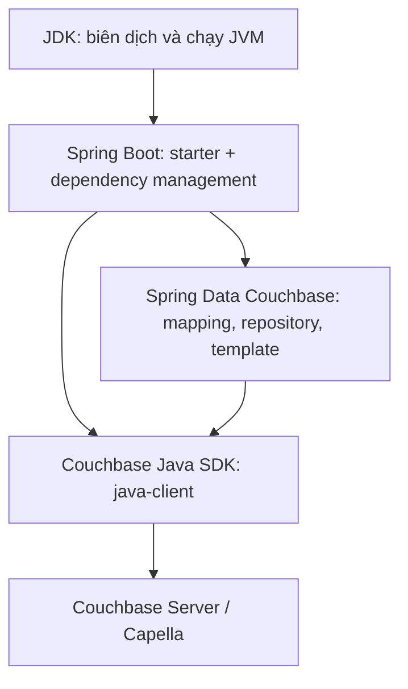

# Chọn bộ phiên bản tương thích của Java, Spring Boot, Spring Data và Java SDK

## Mục tiêu bài học

Khi xây dựng tầng truy cập Couchbase bằng **Spring Data Couchbase**, ứng dụng dùng nhiều thành phần có vòng đời phát hành riêng. Một dự án có thể biên dịch thành công nhưng vẫn gặp lỗi khi chạy nếu tự ghép những phiên bản không tương thích. Sau bài này, bạn có thể:

- Phân biệt **JDK**, **Spring Boot**, **Spring Data Couchbase** và **Couchbase Java SDK** cùng vai trò của từng lớp.
- Chọn một bộ phiên bản nhất quán cho dự án mới hoặc dự án đang duy trì.
- Để Spring Boot quản lý phiên bản thư viện thông qua dependency management/BOM thay vì tự điền phiên bản từng thư viện.
- Kiểm chứng **phiên bản thực sự được resolve** trong Maven hoặc Gradle, rồi xác nhận khả năng kết nối với Couchbase Server/Capella.
- Nhận diện những dấu hiệu do lệch phiên bản và lập kế hoạch nâng cấp có thể kiểm chứng.

> **Làm rõ thuật ngữ:** Trong bài này, **Java/JDK** là bộ công cụ để biên dịch và chạy ứng dụng Java. **Java SDK** là **Couchbase Java SDK**, thư viện client có tọa độ Maven `com.couchbase.client:java-client`. Hai thành phần này khác nhau.

## 1. Hiểu bốn lớp trước khi chọn phiên bản

| Thành phần | Vai trò trong ứng dụng | Cách xác định phiên bản |
| --- | --- | --- |
| **JDK (Java)** | Trình biên dịch, JVM và thư viện nền tảng; quyết định mức bytecode có thể chạy. | Chọn một phiên bản đáp ứng yêu cầu Java tối thiểu của Spring Boot, Spring Data, SDK và môi trường triển khai. |
| **Spring Boot** | Khởi động ứng dụng, tự cấu hình kết nối Couchbase, cung cấp starter và quản lý phiên bản phụ thuộc. | Chọn nhánh phát hành phù hợp, ưu tiên bản vá đang được hỗ trợ và thống nhất giữa môi trường. |
| **Spring Data Couchbase** | Ánh xạ document, repository, `CouchbaseTemplate`, cơ chế query và tích hợp với Spring. | Thông thường lấy phiên bản **do Spring Boot quản lý**. |
| **Couchbase Java SDK** | Client thực hiện giao tiếp với Couchbase Cluster, KV, SQL++ và API đồng bộ/bất đồng bộ/reactive. | Thông thường lấy phiên bản **do Spring Boot quản lý** qua starter; kiểm tra thêm khả năng tương thích với Couchbase Server. |

Sơ đồ phụ thuộc khái quát:



Mũi tên biểu thị vai trò và quan hệ phụ thuộc, **không** có nghĩa mọi thành phần phải cùng số phiên bản. Ví dụ, Spring Boot 4.x không kéo theo Spring Data Couchbase 4.x hay Couchbase Java SDK 4.x. Các dự án đặt số phiên bản theo lịch phát hành riêng.

Lý do nên chọn theo thứ tự từ **Spring Boot → thư viện được Boot quản lý → xác nhận JDK và Couchbase Server**: Spring Boot cung cấp bộ dependency đã được kiểm thử cùng nhau. Tự gán một phiên bản Spring Data mới hơn vào dự án Boot cũ có thể làm lệch Spring Framework, Spring Data Commons hoặc SDK trong classpath.

## 2. Hai bộ phiên bản tham khảo đã đối chiếu

Bảng dưới đây là **ảnh chụp tài liệu chính thức tại ngày 25/11/2026**, để minh họa cách đọc tương thích. Đây không phải cam kết rằng những số phiên bản này sẽ luôn là mới nhất.

| Cấu hình | JDK dùng để học/triển khai | Spring Boot | Spring Data Couchbase được Boot quản lý | Couchbase Java SDK được Boot quản lý |
| --- | --- | --- | --- | --- |
| Dự án tiếp tục trên Boot 3.5 | **Java 21** | **3.5.16** | **5.5.13** | **3.8.3** |
| Dự án bắt đầu trên Boot 4.2 | **Java 21** | **4.2.0** | **6.2.0** | **3.13.1** |

**Vì sao cả hai ví dụ dùng JDK 21?** Spring Boot 3.5.16 yêu cầu **Java 17 trở lên** và tài liệu của nhánh này xác nhận tương thích đến Java 25. Spring Boot 4.2.0 cũng yêu cầu ít nhất **Java 17**, tương thích đến Java 27. Couchbase Java SDK 3.8 và 3.13 đều hỗ trợ Java 21 theo tài liệu tương thích tương ứng. Chọn JDK 21 là một điểm giao dễ áp dụng; dự án có thể dùng JDK khác **nếu toàn bộ chuỗi công cụ và môi trường triển khai cùng hỗ trợ**.

Các con số Spring Data/SDK trong bảng lấy từ trang **Managed Dependency Coordinates** theo *đúng nhánh Spring Boot*. Chúng không được suy ra từ việc so sánh số major/minor và không nên chép sang một nhánh Boot khác.

Nguồn kiểm chứng:

- [Spring Boot 3.5 — yêu cầu hệ thống](https://docs.spring.io/spring-boot/3.5/system-requirements.html) và [danh sách dependency được quản lý](https://docs.spring.io/spring-boot/3.5/appendix/dependency-versions/coordinates.html).
- [Spring Boot 4.2 — yêu cầu hệ thống](https://docs.spring.io/spring-boot/system-requirements.html) và [danh sách dependency được quản lý](https://docs.spring.io/spring-boot/appendix/dependency-versions/coordinates.html).
- [Couchbase Java SDK — ma trận JDK, Server và SDK](https://docs.couchbase.com/java-sdk/current/project-docs/compatibility.html).

### Đừng nhầm "biên dịch được" với "được hỗ trợ"

Khả năng tương thích gồm nhiều câu hỏi độc lập:

1. **JDK ↔ Boot:** Boot có chạy trên phiên bản Java và công cụ build đang dùng không?
2. **Boot ↔ Spring Data:** Spring Data Couchbase có cùng hệ Spring Framework/Spring Data Commons mà Boot quản lý không?
3. **Spring Data ↔ Java SDK:** Phiên bản `java-client` được giải quyết trong classpath có đúng bộ phụ thuộc đã tích hợp/kiểm thử không?
4. **Java SDK ↔ Couchbase Server:** Phiên bản server có được SDK hỗ trợ và có các tính năng mà ứng dụng cần (scope, collection, SQL++, giao dịch, durability...) không?
5. **Build ↔ Runtime:** JDK trên máy lập trình, CI, container và máy chủ chạy thực tế có đáp ứng bytecode được tạo ra không?

Ngay cả khi SDK có khả năng chạy trên một JDK rất cũ, **giới hạn tối thiểu của Spring Boot vẫn phải được thỏa mãn**. Tương tự, kết nối được đến một bản Couchbase Server cũ không đồng nghĩa tổ hợp đó vẫn trong thời hạn hỗ trợ sản phẩm.

## 3. Quy trình chọn phiên bản cho một dự án thực tế

### Bước 1 — Chọn nhánh Spring Boot theo vòng đời dự án

- **Dự án đang ổn định trên Boot 3.5:** trước hết xem xét cập nhật bản vá cùng nhánh; chỉ chuyển major khi đã đánh giá migration guide, kiểm thử và môi trường vận hành.
- **Dự án mới:** cân nhắc nhánh Boot đang được hỗ trợ, yêu cầu tích hợp của tổ chức và mức sẵn sàng của các thư viện khác. Ví dụ tại ngày ghi tài liệu là Boot 4.2.
- **Dự án dùng thêm Spring Cloud, Security, thư viện nội bộ:** đối chiếu cả ma trận tương thích của các thành phần đó; không chọn Boot độc lập với hệ sinh thái còn lại.

Ghi rõ quyết định bằng phiên bản cụ thể trong `pom.xml`/`build.gradle` và quy tắc nâng bản vá, thay vì chỉ viết chung chung "dùng bản mới nhất".

### Bước 2 — Chọn JDK dùng xuyên suốt

Với hai cấu hình tham khảo, JDK 21 là lựa chọn hợp lệ và thuận tiện. Cần đồng bộ:

- JDK chạy Maven/Gradle trên máy phát triển và CI;
- Java toolchain hoặc `maven.compiler.release`/`java.version` dùng khi biên dịch;
- JVM trong image/container hoặc máy chủ triển khai.

Ví dụ: biên dịch thành bytecode Java 21 rồi chạy trên JVM 17 có thể gây `UnsupportedClassVersionError`, dù phiên bản Spring Data và Couchbase SDK hoàn toàn phù hợp.

### Bước 3 — Chọn starter và để Boot giải quyết dependency

Với Spring Data Couchbase đồng bộ:

- Maven/Gradle dependency: `org.springframework.boot:spring-boot-starter-data-couchbase`.

Với repository hoặc template reactive:

- Maven/Gradle dependency: `org.springframework.boot:spring-boot-starter-data-couchbase-reactive`.

Chọn dựa trên mô hình lập trình đồng bộ/reactive của ứng dụng. **Reactive starter không phải cách khắc phục xung đột phiên bản**. Trong đa số ứng dụng Spring Boot, không cần thêm một bản `spring-data-couchbase` hoặc `java-client` với số phiên bản tùy ý; starter và dependency management sẽ cung cấp chúng.

### Bước 4 — Đối chiếu SDK với Couchbase Server hoặc Capella

Sau khi đã biết SDK cụ thể từ dependency tree, mở **trang compatibility theo đúng dòng SDK đó**. Kiểm tra phiên bản Couchbase Server, trạng thái *supported/compatible/unsupported* và yêu cầu của tính năng đang dùng.

Ví dụ, ứng dụng dùng scope/collection và truy vấn SQL++ phải xác nhận cả khả năng hỗ trợ API của SDK lẫn cấu hình, quyền truy cập, chỉ mục và phiên bản Couchbase Server. Với Couchbase Capella, sử dụng hướng dẫn tương thích Capella và kết nối TLS (`couchbases://`) theo tài liệu của dịch vụ.

Không tự nâng `java-client` chỉ vì Couchbase Server được nâng cấp: trước tiên xem ma trận, sau đó xem liệu Spring Data Couchbase đang dùng có tương thích với SDK mới hay không.

### Bước 5 — Xác minh dependency đã resolve và chạy smoke test

Ghi lại bản đã *thực sự được tải* trong dependency tree, không dừng ở phiên bản viết trong file build. Cuối cùng khởi động một ứng dụng nhỏ, thực hiện kết nối và một vòng lưu/đọc document trong môi trường thử nghiệm phù hợp.

## 4. Ví dụ cấu hình Maven: Spring Boot 4.2.0 + JDK 21

Tạo một dự án Maven nhỏ với `pom.xml` sau. Các phiên bản Spring Data Couchbase và Couchbase Java SDK **cố ý không khai báo thủ công**:

```xml
<?xml version="1.0" encoding="UTF-8"?>
<project xmlns="http://maven.apache.org/POM/4.0.0"
         xmlns:xsi="http://www.w3.org/2001/XMLSchema-instance"
         xsi:schemaLocation="http://maven.apache.org/POM/4.0.0
             https://maven.apache.org/xsd/maven-4.0.0.xsd">
    <modelVersion>4.0.0</modelVersion>

    <groupId>com.example</groupId>
    <artifactId>couchbase-version-lab</artifactId>
    <version>0.0.1-SNAPSHOT</version>

    <parent>
        <groupId>org.springframework.boot</groupId>
        <artifactId>spring-boot-starter-parent</artifactId>
        <version>4.2.0</version>
        <relativePath/>
    </parent>

    <properties>
        <java.version>21</java.version>
    </properties>

    <dependencies>
        <dependency>
            <groupId>org.springframework.boot</groupId>
            <artifactId>spring-boot-starter-data-couchbase</artifactId>
        </dependency>
    </dependencies>
</project>
```

Giải thích:

1. Parent `spring-boot-starter-parent:4.2.0` import dependency management tương ứng với nhánh Boot đã chọn.
2. `java.version` đặt mức Java được dùng khi biên dịch; lệnh `mvn -version` vẫn cần xác nhận Maven đang chạy trên JDK phù hợp.
3. Starter đưa vào Spring Data Couchbase và SDK cần thiết, tránh phải ghép tay các phiên bản.
4. Theo dependency list của Boot **4.2.0**, ta kỳ vọng thấy `spring-data-couchbase:6.2.0` và `java-client:3.13.1`.

Tại thư mục có `pom.xml`, kiểm tra:

```bash
java -version
mvn -version
mvn dependency:tree -Dincludes=org.springframework.data:spring-data-couchbase
mvn dependency:tree -Dincludes=com.couchbase.client:java-client
mvn -DskipTests package
```

Đầu ra của `dependency:tree` phải cho thấy một phiên bản `spring-data-couchbase` và một phiên bản `java-client` phù hợp với BOM. Nếu project có dependency khác cùng kéo SDK, xem nhánh phụ thuộc nào đang áp đặt phiên bản; dùng `mvn help:effective-pom` khi cần kiểm tra dependency management hiệu lực. Các lệnh này xác minh **build/classpath**, chưa chứng minh kết nối Couchbase thành công.

### Nếu đang dùng Gradle

Áp dụng Spring Boot Gradle plugin và dependency management phù hợp, khai báo starter **không kèm phiên bản**; dùng Java toolchain để đồng nhất phiên bản biên dịch. Ví dụ cấu hình tương đương cho nhánh Boot 3.5:

```groovy
plugins {
    id 'java'
    id 'org.springframework.boot' version '3.5.16'
    id 'io.spring.dependency-management' version '1.1.7'
}

group = 'com.example'
version = '0.0.1-SNAPSHOT'

java {
    toolchain {
        languageVersion = JavaLanguageVersion.of(21)
    }
}

repositories {
    mavenCentral()
}

dependencies {
    implementation 'org.springframework.boot:spring-boot-starter-data-couchbase'
}
```

Kiểm tra phiên bản thực tế qua:

```bash
./gradlew dependencyInsight --dependency spring-data-couchbase --configuration runtimeClasspath
./gradlew dependencyInsight --dependency java-client --configuration runtimeClasspath
./gradlew classes
```

Trên Windows có thể dùng `gradlew.bat` thay cho `./gradlew`. Với nhánh **Boot 3.5**, tài liệu nêu Gradle 7.6.4+ trong dòng 7.x hoặc Gradle 8.4+ trong dòng 8.x. Với **Boot 4.2**, cần Gradle 8.14+ trong dòng 8.x hoặc Gradle 9.x. Vì thế nâng Boot major cũng có thể cần nâng Gradle wrapper, không chỉ thay số phiên bản plugin.

> Cả hai ví dụ Maven và Gradle đều chỉ minh họa **quản lý phiên bản** và chưa có lớp Java chứa `main`. Khi thêm ứng dụng `@SpringBootApplication` hoàn chỉnh, có thể bật `spring-boot-maven-plugin` và chạy quy trình package/build ứng dụng. Muốn chạy với Couchbase thật, vẫn cần cấu hình connection string, tài khoản, bucket, mạng/TLS và quyền truy cập. Không lưu mật khẩu thật trong mã nguồn hoặc file build.

## 5. Cách đọc lỗi khi phiên bản không phù hợp

| Triệu chứng | Khả năng cần kiểm tra đầu tiên | Cách xác minh |
| --- | --- | --- |
| `UnsupportedClassVersionError` khi khởi động | Runtime JDK thấp hơn mức bytecode của ứng dụng/thư viện. | `java -version`, `mvn -version`, toolchain và JDK của container. |
| `NoSuchMethodError`, `NoClassDefFoundError` liên quan Spring Data/Spring Framework/SDK | Classpath có jar bị ép sang phiên bản không tương thích hoặc thiếu dependency. | `dependency:tree`/`dependencyInsight`, parent/BOM, dependency exclusions. |
| Repository/CouchbaseTemplate không khởi tạo được | Có thể thiếu starter, auto-configuration hoặc cấu hình Couchbase. | Kiểm tra starter và log nguyên nhân gốc; không vội kết luận là do lệch SDK. |
| Lỗi khi dùng một tính năng mới của Server | SDK/Server chưa hỗ trợ đúng feature hoặc cách dùng API khác giữa các phiên bản. | Bảng feature availability, release notes, hướng dẫn migration. |
| Timeout/kết nối thất bại | Thường cần kiểm tra DNS, TLS, firewall, credential, cluster/bucket trước. | Log kết nối, endpoint, quyền truy cập và trạng thái Couchbase Server. |

**Điểm phân biệt:** lỗi biên dịch, tải class và lỗi kết nối là những nhóm sự cố khác nhau. Một `CouchbaseTimeoutException` tự nó không chứng minh Spring Data bị sai phiên bản.

## 6. Khi nào mới nên ghi đè phiên bản mặc định?

Dependency management của Spring Boot là **điểm xuất phát**, không phải quy tắc cấm mọi thay đổi. Có thể cần override vì bản vá bảo mật, lỗi SDK đã có bản sửa, tính năng mới bắt buộc hoặc yêu cầu nâng cấp hệ thống. Quy trình an toàn:

1. Ghi rõ **vấn đề cụ thể** và phiên bản hiện tại của `java-client`/Spring Data đang được resolve.
2. Tra release notes và ma trận tương thích của **SDK**, **Spring Data Couchbase**, **Boot** và **Server** cho cặp định dùng.
3. Ưu tiên cập nhật **Spring Boot patch** cùng nhánh nếu phiên bản đó đã quản lý bộ dependency sửa lỗi.
4. Nếu bắt buộc override riêng SDK, kiểm tra các phụ thuộc kéo theo (ví dụ Reactor/Netty) và chạy integration test có đọc, ghi, truy vấn, timeout, transaction/reactive nếu hệ thống dùng.
5. Ghi lại lý do override, kết quả kiểm thử và điều kiện gỡ bỏ override trong lần nâng cấp tiếp theo.

Không nên:

- Đặt trực tiếp `spring-data-couchbase:6.x` vào Boot 3.x chỉ vì 6.x mới hơn; việc đổi major thường gắn với một thế hệ Spring Framework/Spring Data Commons khác.
- Khai báo đồng thời nhiều phiên bản `java-client` do các thư viện phụ thuộc khác nhau rồi chỉ xem file khai báo trực tiếp.
- Tự đồng bộ số major giữa Boot, Spring Data và SDK; chúng không dùng chung quy tắc đánh số.
- Chọn JDK chỉ theo yêu cầu tối thiểu của SDK mà bỏ qua yêu cầu của Spring Boot và CI/runtime.
- Dùng bản SDK/Server đã hết hỗ trợ cho production chỉ vì thử nghiệm nội bộ vẫn chạy được.

## 7. Bài tập quyết định phiên bản

**Tình huống A.** Nhóm đang dùng JDK 11 và muốn triển khai Spring Boot 3.5.16 với Spring Data Couchbase. Có nên giữ JDK 11?

**Đáp án:** Không. Boot 3.5.16 yêu cầu ít nhất Java 17. Nâng JDK môi trường build/CI/runtime lên phiên bản được hỗ trợ (chẳng hạn Java 21) trước khi cấu hình ứng dụng.

**Tình huống B.** Dự án Boot 4.2.0 đã dùng starter Couchbase nhưng người phát triển thêm trực tiếp `spring-data-couchbase:5.5.13` do thấy nó từng chạy tốt ở dự án Boot 3.5.16. Cần làm gì?

**Đáp án:** Bỏ version override, để Boot 4.2.0 quản lý Spring Data Couchbase 6.2.0, rồi kiểm tra dependency tree và API/migration nếu đang nâng cấp từ Boot 3.5. Không dùng kết quả chạy được ở một nhánh Boot làm bằng chứng tương thích với nhánh major khác.

**Tình huống C.** Ứng dụng Boot 3.5.16 + JDK 21 + starter Couchbase build thành công nhưng không thể kết nối Couchbase Server. Có đủ cơ sở để nâng SDK lên phiên bản mới nhất không?

**Đáp án:** Chưa. Kiểm tra `java-client` thực sự được resolve (3.8.3 theo BOM Boot 3.5.16), kiểm tra phiên bản server với bảng tương thích, sau đó kiểm tra endpoint, TLS, mạng, tài khoản và quyền. Chỉ cân nhắc đổi SDK khi có bằng chứng lỗi hoặc yêu cầu tính năng cụ thể.

## 8. Checklist trước khi chốt bộ phiên bản

- [ ] Đã chọn nhánh và bản vá Spring Boot, kiểm tra vòng đời hỗ trợ.
- [ ] Đã xác nhận JDK trên máy phát triển, CI và nơi chạy thực tế.
- [ ] Đã dùng starter Couchbase đúng kiểu truy cập và để Boot quản lý dependency theo mặc định.
- [ ] Đã đọc dependency tree để xác nhận **một** phiên bản Spring Data Couchbase và Couchbase Java SDK đúng dự kiến.
- [ ] Đã kiểm tra Couchbase Server/Capella tương thích với SDK và các tính năng cần dùng.
- [ ] Đã kiểm tra phiên bản Maven/Gradle wrapper phù hợp với Boot.
- [ ] Đã build và chạy smoke test kết nối/lưu/đọc trên môi trường thử nghiệm.
- [ ] Đã lưu lại bản build, kết quả kiểm thử và lý do nếu có override.

### Tài liệu chính thức để đối chiếu khi nâng cấp

1. [Spring Boot — System Requirements](https://docs.spring.io/spring-boot/system-requirements.html).
2. [Spring Boot — Managed Dependency Coordinates](https://docs.spring.io/spring-boot/appendix/dependency-versions/coordinates.html) (đổi đường dẫn theo nhánh Boot của dự án).
3. [Spring Boot — Working with NoSQL Technologies / Couchbase](https://docs.spring.io/spring-boot/reference/data/nosql.html).
4. [Spring Data Couchbase — Installation & Configuration](https://docs.spring.io/spring-data/couchbase/reference/couchbase/configuration.html).
5. [Spring Data — Dependency Management và Release Train BOM](https://docs.spring.io/spring-data/couchbase/reference/data-commons/dependencies.html).
6. [Couchbase Java SDK — Compatibility](https://docs.couchbase.com/java-sdk/current/project-docs/compatibility.html) và [Java SDK Release Notes](https://docs.couchbase.com/java-sdk/current/project-docs/sdk-release-notes.html).

**Nguyên tắc mang sang các bài tiếp theo:** chọn Spring Boot làm đầu mối quản lý dependency, kiểm chứng các phiên bản *resolved*, sau đó đối chiếu Couchbase Server/Capella và thử luồng dữ liệu thật. Khi bộ phiên bản đã ổn định, mới mở rộng sang document mapping, repository, `CouchbaseTemplate`, SQL++, TTL/CAS, transaction và reactive API.
