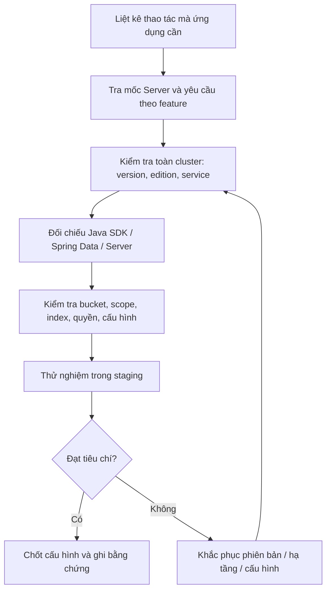

# Xác minh yêu cầu phiên bản Server cho từng tính năng sử dụng

## Mục tiêu

Trong dự án **Spring Data Couchbase**, việc chọn đúng phiên bản Java, Spring Boot, Spring Data và Couchbase Java SDK mới giải quyết được **phía ứng dụng**. Ở phía cơ sở dữ liệu, mỗi tính năng có thể còn phụ thuộc vào **phiên bản Couchbase Server**, edition, các service đang được triển khai, cấu hình bucket, quyền truy cập và trạng thái nâng cấp cluster. Bài học thuộc chương **Môi trường** này hướng dẫn bạn lập một bảng yêu cầu theo tính năng và kiểm chứng bằng tài liệu chính thức lẫn phép thử thực tế.

Sau bài học, bạn có thể:

- Xác định yêu cầu Server cho document mapping, repository, `CouchbaseTemplate`, truy vấn SQL++, bucket/scope/collection, chỉ mục, TTL, CAS, durability, giao dịch và reactive API.
- Phân biệt **mốc phiên bản đầu tiên cung cấp tính năng** với **tổ hợp còn được nhà cung cấp hỗ trợ**.
- Lấy thông tin phiên bản theo từng node, phát hiện cluster đang trong quá trình rolling upgrade, và kiểm tra edition/service/quyền liên quan.
- Đối chiếu Couchbase Java SDK mà Spring Data sử dụng với ma trận tương thích Server–SDK–feature.
- Tạo bằng chứng kiểm thử trước khi chấp nhận một môi trường phát triển, staging hoặc production.

> **Phạm vi:** Các mốc trong bài là mốc lịch sử để biết một tính năng bắt đầu có thể dùng từ khi nào. **Không** mặc định rằng phiên bản cũ vẫn đang được bảo trì, an toàn hoặc được hỗ trợ cho sản xuất. Các bảng hỗ trợ và hướng dẫn trên trang `current` của Couchbase có thể được cập nhật sau ngày biên soạn (25/11/2026).

## 1. "Server hỗ trợ" có ít nhất năm điều kiện

Ví dụ một repository Spring Data có thể gọi `findByStatus` và sinh truy vấn SQL++. Để thực thi được, không chỉ cần thư viện Java có phương thức đó; hệ thống còn cần:

1. **Version:** Server có cú pháp/protocol/feature tương ứng.
2. **Compatibility:** Phiên bản **Couchbase Java SDK** thực sự tải trong classpath được kiểm thử hoặc tương thích với Server; Spring Data Couchbase được tích hợp với SDK đó.
3. **Deployment:** Cluster có những service cần thiết: **Data** để lưu document, **Query** để chạy SQL++, **Index** để cung cấp index scan; feature khác có thể cần **Search/Analytics**.
4. **Configuration & permissions:** Bucket, scope, collection, index, replica, TTL và RBAC phù hợp với câu lệnh/API sẽ dùng.
5. **Operational state:** Cluster hoàn thành nâng cấp, feature không bị giới hạn bởi edition/tier, bản vá, lifecycle hoặc trạng thái mixed-version.

Sơ đồ quyết định:



**Không suy mốc Server từ tên hàm Java.** Ví dụ `ReactiveCouchbaseTemplate` là lựa chọn API phía client và không đòi hỏi một phiên bản Server riêng chỉ vì nó reactive; ngược lại, gọi SQL++ theo tên collection yêu cầu Server hiểu mô hình scope/collection.

## 2. Ma trận yêu cầu theo tính năng

Bảng tập trung vào các nhóm khả năng thường dùng trong tầng truy cập Spring Data Couchbase. Với tính năng đã tồn tại từ lâu, bảng ghi **không có mốc mới riêng trong phạm vi 6.5–8.x** thay vì đoán một phiên bản ra mắt chính xác.

| Tính năng ứng dụng cần | Mốc Couchbase Server cần lưu ý | Điều kiện bổ sung cần kiểm chứng | Bằng chứng thử nghiệm |
| --- | --- | --- | --- |
| **KV CRUD / document mapping / repository dùng theo ID / `CouchbaseTemplate` dùng KV** | Không có cổng phiên bản mới riêng trong dải Server 6.5–8.x; phụ thuộc ma trận SDK–Server và API thực dùng. | Data Service, bucket mở được, key đúng, RBAC đọc/ghi. | Đọc một key có sẵn; trong staging thử insert/get/replace/remove. |
| **CAS (optimistic concurrency)** | Cơ chế KV lâu đời; không cần Server 7.0 chỉ vì dùng CAS. | Gửi CAS nhận từ `get`/`MutationResult`; xử lý conflict đúng cách. | Hai luồng sửa cùng document: thao tác mang CAS cũ phải bị từ chối. |
| **TTL theo từng document; TTL mặc định của bucket** | Cơ chế expiration có từ các Server trước 7.0; kiểm tra semantics theo phiên bản thực tế. | Cấu hình `maxTTL` của bucket và thời điểm mutation. | Ghi document có TTL ngắn trong staging và xác nhận hết hạn đúng kỳ vọng. |
| **Giữ TTL khi `replace`/`upsert` (`preserveExpiry`)** | Yêu cầu **Server 7.0+** cho tùy chọn `preserveExpiry` của Java SDK. | SDK có API tương ứng; phải truyền tùy chọn, nếu không mutation có thể thay đổi expiry. | Đặt TTL rồi replace với `preserveExpiry(true)`, kiểm tra thời điểm hết hạn giữ nguyên. |
| **Scope/collection không mặc định; ánh xạ entity vào collection** | **Server 7.0+** hỗ trợ đầy đủ scope/collection. | Scope và collection phải tồn tại; quyền tại scope/collection; SDK và Spring Data phải hỗ trợ API tương ứng. | Truy cập `bucket.scope("commerce").collection("orders")` và đọc/ghi key thử. |
| **Truy vấn SQL++ theo collection; query context theo scope** | **Server 7.0+** cho mô hình collection và câu query có tên ba cấp. SQL++ truy vấn bucket đã có từ trước. | Query và Index Service, quyền SELECT, index phù hợp, SDK đủ API cho scope-level query. | `EXPLAIN` và thực thi `SELECT` trên `bucket.scope.collection`. |
| **Secondary index / repository derived query / `@Query`** | SQL++ và index là khả năng có trước 7.0; index **trên collection cụ thể** dựa vào mô hình Server **7.0+**. | Query + Index + Data Service; index hợp lệ và online; quyền tạo index nếu tự provision. | `EXPLAIN` xem plan, đo truy vấn với dữ liệu và tham số thực tế. |
| **Durable Writes do Server xác nhận** | **Server 6.5+** cho các mức durability đồng bộ phía Server. | Bucket có số replica hợp lý, topology đáp ứng mức `MAJORITY`/mức yêu cầu, SDK hỗ trợ tùy chọn. | Mutation đặt durability; kiểm tra kết quả và lỗi `DurabilityImpossibleException` khi cấu hình không đủ. |
| **Giao dịch ACID nhiều document qua SDK** | **Server 6.6.1+** theo yêu cầu của Java SDK Transactions; muốn dùng **SQL++ bên trong transaction** phải kiểm tra hỗ trợ tương ứng từ **Server 7.0+**. | Phiên bản Spring Data/SDK có API transaction phù hợp; time sync (NTP), replica, quyền, Query/Index nếu transaction dùng SQL++; metadata ATR. | Integration test commit, rollback, conflict và truy vấn trong giao dịch. |
| **Collection `maxTTL`** | Phụ thuộc scope/collection từ **Server 7.0+**; **7.6+** cho phép sửa `maxTTL` của collection sau khi tạo và đặt `-1` để miễn TTL kế thừa từ bucket. | SDK/API quản trị hỗ trợ tham số tương ứng; hiểu thứ tự ưu tiên của bucket/collection/document. | Kiểm tra cấu hình collection và expiry thực tế sau ghi/cập nhật. |
| **KV Range Scan** *(nếu ứng dụng dùng)* | Có từ **Server 7.6+**. | Java SDK đủ mới có API; giới hạn hiệu năng và mục đích khác SQL++/index. | Chạy range scan nhỏ trong staging, kiểm tra endpoint và lượng dữ liệu trả về. |
| **Vector Search / vector index** *(nếu ứng dụng dùng)* | **Server 7.6+** cho Vector Search; Vector Query thông qua GSI cần kiểm tra theo dòng **8.0** và yêu cầu SDK riêng. | Service/index/cấu hình và Java SDK phù hợp từng loại tìm kiếm. | Thử query/index vector tương ứng, không đánh đồng Search với SQL++ vector GSI. |
| **Reactive KV/query/repository** | **Không có mốc Server riêng chỉ vì API reactive**; lấy mốc của thao tác thực hiện (KV, SQL++, collection, transaction...). | Spring Data Couchbase reactive + SDK/reactive API, Data/Query/Index tương ứng, cấu hình timeout/backpressure. | Chạy `Mono`/`Flux` trên tác vụ thực, kiểm tra cả kết quả lẫn tải. |

### Nguồn xác định các mốc trong bảng

- Scope/collection hỗ trợ đầy đủ từ 7.0: [Couchbase Scopes and Collections](https://docs.couchbase.com/server/current/learn/data/scopes-and-collections.html), [SDK Collections](https://docs.couchbase.com/java-sdk/current/concept-docs/collections.html).
- SQL++ và các service cần thiết: [Query Data with SQL++](https://docs.couchbase.com/server/current/n1ql/query.html), [Java SDK Query](https://docs.couchbase.com/java-sdk/current/concept-docs/n1ql-query.html).
- Durable Writes từ 6.5: [Java SDK — Data, Durability & Transactions](https://docs.couchbase.com/java-sdk/current/concept-docs/data-durability-acid-transactions.html).
- Java SDK transactions yêu cầu Server 6.6.1+: [Distributed ACID Transactions from the Java SDK](https://docs.couchbase.com/java-sdk/current/howtos/distributed-acid-transactions-from-the-sdk.html). Phân biệt các khả năng query trong transaction theo [ma trận SDK 3.4](https://docs.couchbase.com/java-sdk/3.4/project-docs/compatibility.html) hoặc release notes đúng phiên bản SDK.
- `maxTTL`/`maxExpiry` và các thay đổi trong Server 7.6: [Couchbase Expiration](https://docs.couchbase.com/server/current/learn/data/expiration.html), [What's New in 7.6](https://docs.couchbase.com/server/7.6/introduction/whats-new.html).
- `preserveExpiry` yêu cầu Server 7.0: [Java SDK ReplaceOptions API](https://docs.couchbase.com/sdk-api/couchbase-java-client/com/couchbase/client/java/kv/ReplaceOptions.html).
- KV Range Scan và Vector Search: [What's New in 7.6](https://docs.couchbase.com/server/7.6/introduction/whats-new.html), [Java SDK Compatibility & Feature Matrix](https://docs.couchbase.com/java-sdk/current/project-docs/compatibility.html).

### Giới hạn quan trọng của bảng

**Mốc tính năng ≠ mốc hỗ trợ hiện tại.** Chẳng hạn, môi trường Server 7.0 về mặt lịch sử đã có scope/collection, nhưng tài liệu compatibility hiện tại có thể đánh dấu Server 7.0 đã **End of Life**. Vì vậy không thể kết luận "đủ cho production" chỉ bằng phép so sánh `serverVersion >= 7.0`.

**Mốc feature ≠ mọi biến thể API.** SQL++ chạy ngoài transaction và SQL++ bên trong transaction không nhất thiết có cùng yêu cầu; thay `maxTTL` trên collection lúc tạo và thay đổi sau khi tạo cũng khác nhau. Khi yêu cầu nói "hỗ trợ TTL" hoặc "hỗ trợ transaction", cần mô tả hành vi cụ thể thay vì một nhãn chung.

## 3. Xác minh phiên bản Server đang chạy

### 3.1. Ghi nhận thông tin từ toàn cluster, không chỉ một node

Với **Couchbase Server tự quản lý**, vào Web Console, kiểm tra phiên bản từng node trong phần **Servers/Nodes**, cùng danh sách service trên node đó. Ghi lại:

- Cluster/environment và cách kết nối; **Server version đầy đủ** (`major.minor.patch`), edition Enterprise/Community và phiên bản từng node.
- Những service hiện diện: `Data`, `Query`, `Index`; thêm `Search/Analytics` khi dùng.
- Trạng thái cluster có đang **rebalance**, failover hay **rolling upgrade** không.
- Tên bucket, scope/collection cần dùng, số replica, thiết lập TTL, loại index và quyền của tài khoản ứng dụng.

Nếu có quyền gọi **Cluster Management REST API**, có thể tra thông tin phiên bản từng node qua endpoint chỉ đọc `GET /pools/default`:

```bash
# Đặt hostname quản trị thực tế. --user chỉ có username để curl hỏi mật khẩu.
# Dùng chứng chỉ CA tin cậy; không thêm -k để bỏ qua TLS trong môi trường thực.
curl --fail --silent --show-error \
  --user 'cluster-auditor' \
  'https://cb-admin.example.com:18091/pools/default' \
  | jq -r '.nodes[] | [.hostname, .version] | @tsv'
```

Ví dụ cấu trúc đầu ra (chỉ để minh họa, không phải kết quả từ cluster thật):

```text
cb-node-a.example.com   8.0.1
cb-node-b.example.com   8.0.1
cb-node-c.example.com   8.0.1
```

Điều kiện chạy: `curl`, `jq`, DNS/mạng đến cổng quản trị TLS và tài khoản có quyền đọc thông tin cluster. Một số môi trường có CA riêng cần truyền `--cacert /path/to/ca.pem`. Nếu nhận HTTP 401/403, không suy ra lỗi phiên bản; hãy kiểm tra tài khoản và quyền. Có thể thay REST bằng Web Console. **Không chèn password vào câu lệnh hoặc log chia sẻ**.

Endpoint và ví dụ API chính thức: [Couchbase REST — Nodes & Clusters](https://docs.couchbase.com/server/current/rest-api/rest-cluster-intro.html), [General Settings / `GET /pools/default`](https://docs.couchbase.com/server/current/manage/manage-settings/general-settings.html).

**Vì sao phải kiểm tra từng node?** Trong khi rolling upgrade, cluster có thể đang ở trạng thái *mixed mode*. Couchbase chỉ hỗ trợ trạng thái đó trong quá trình nâng cấp; tính năng mới có thể chưa được phép dùng cho đến khi **toàn bộ node** nâng xong. Đặc biệt, **scope/collection không dùng được trong mixed mode khi nâng từ phiên bản trước 7.0 lên 7.0+**. Không ghi "PASS" chỉ vì một node trả về số phiên bản mới. Xem [Upgrade](https://docs.couchbase.com/server/current/install/upgrade.html) và [Feature Availability During Upgrade](https://docs.couchbase.com/server/7.6/install/upgrade-feature-availability.html).

### 3.2. Riêng Couchbase Capella

Capella là dịch vụ quản lý nên cách xem phiên bản và lịch cập nhật khác Server tự vận hành. Trong Capella Console, kiểm tra **loại deployment/tier, tính năng được mở và cấu hình cluster hiện tại**. Dùng trang [SDK Compatibility with Capella](https://docs.couchbase.com/cloud/reference/sdk-compatibility.html) để xác minh SDK thực tế của ứng dụng; **không giả định** vì đây là Capella mà mọi tùy chọn Server hoặc mọi feature thử nghiệm đều khả dụng.

Đối với Capella, ưu tiên ma trận tương thích/tài liệu tính năng riêng của dịch vụ và kiểm thử được phép trên một môi trường thử nghiệm. Việc Java SDK hỗ trợ một Couchbase Server version không tự động chứng minh rằng cùng tính năng được bật trên Capella tier đó.

## 4. Kiểm tra phiên bản client đi cùng Server

Spring Data Couchbase dùng **Couchbase Java SDK** bên dưới; ứng dụng Spring Boot thường lấy phiên bản thông qua BOM/starter. Vì vậy hãy ghi **bộ ba**:

```text
Spring Data Couchbase = <resolved version>
Couchbase Java SDK    = <resolved version, artifact com.couchbase.client:java-client>
Couchbase Server      = <version của toàn cluster>
```

Trong dự án Maven, xem dependency thực được tải:

```bash
mvn dependency:tree -Dincludes=org.springframework.data:spring-data-couchbase
mvn dependency:tree -Dincludes=com.couchbase.client:java-client
```

Hoặc Gradle:

```bash
./gradlew dependencyInsight --dependency spring-data-couchbase --configuration runtimeClasspath
./gradlew dependencyInsight --dependency java-client --configuration runtimeClasspath
```

**Không chạy các lệnh này trong repo khác chỉ để hoàn thành bài học; chúng là hướng dẫn cho người học chạy trên dự án của họ.** Trên Windows có thể dùng `gradlew.bat`.

Sau khi lấy các số thực tế:

1. Mở [Java SDK Compatibility](https://docs.couchbase.com/java-sdk/current/project-docs/compatibility.html), hoặc **trang tài liệu đúng phiên bản SDK** khi ứng dụng còn ở nhánh cũ.
2. Phân biệt nhãn **Supported** (đang được kiểm thử và hỗ trợ), **Compatible** (đã từng kiểm thử nhưng không phải tổ hợp khuyến nghị hiện hành) và **Unsupported**.
3. Đọc tiếp **New Feature Availability Matrix** của SDK: tương thích đường truyền không có nghĩa SDK cũ đã cung cấp API cho một tính năng Server mới.
4. Đối chiếu Spring Data Couchbase và Spring Boot đang dùng với ma trận của chính các sản phẩm đó; tránh tự nâng SDK một mình mà không kiểm tra tích hợp.
5. Kiểm tra EOL, phiên bản patch, release notes và giới hạn edition/tier trước khi chốt production.

**Ví dụ phân biệt:** Server 7.6 và SDK 3.8 có thể là một tổ hợp tương thích/hỗ trợ theo ma trận, nhưng nếu muốn chức năng xuất hiện ở SDK đời sau thì vẫn phải kiểm tra cột **feature availability**. Ngược lại, Server 7.0 có scope/collection từ khi phát hành nhưng trạng thái EOL quyết định liệu còn phù hợp để triển khai mới hay không.

## 5. Từ yêu cầu kinh doanh đến các phép thử cụ thể

Giả sử dịch vụ quản lý đơn hàng dùng:

- Bucket `shop`, scope `commerce`, collection `orders`;
- Spring Data Repository truy vấn đơn theo `status` bằng SQL++;
- TTL 30 phút trên một loại document tạm; CAS để tránh ghi đè thay đổi đồng thời;
- Durable Writes `MAJORITY` cho thao tác quan trọng;
- Giao dịch cập nhật nhiều document (`order` + `inventory`);
- Một số endpoint dùng repository/template reactive.

Với nhóm tính năng này, **mốc feature lịch sử** chịu chi phối bởi scope/collection **7.0+**, Durable Writes **6.5+**, SDK transactions **6.6.1+** và query trong transaction cần kiểm tra thêm. Tuy nhiên, **quyết định môi trường** phải chọn bản Server còn được hỗ trợ với SDK/Spring Data đã chọn, cùng edition/tier, service và cách vận hành thích hợp; không nên đặt sản xuất trên Server 7.0 chỉ vì đạt mốc tính năng.

### 5.1. Kiểm tra scope/collection và khả năng query (không ghi dữ liệu)

Trước tiên kiểm tra bucket/scope/collection và quyền đọc trong console. Sau đó chạy trên **Query Workbench của môi trường thử nghiệm**:

```sql
-- Truy vấn collection được định danh đủ 3 cấp.
SELECT META(o).id AS documentId, o.status
FROM `shop`.`commerce`.`orders` AS o
WHERE o.status = "NEW"
LIMIT 5;

-- Xem truy vấn có dùng index như dự kiến hay không.
EXPLAIN
SELECT META(o).id AS documentId, o.status
FROM `shop`.`commerce`.`orders` AS o
WHERE o.status = "NEW"
LIMIT 5;
```

Các tên bucket, scope và collection trong SQL++ được đặt trong dấu backtick để tránh nhầm với từ khóa hoặc ký tự đặc biệt. Nếu query thất bại, kiểm tra theo thứ tự:

1. Server hỗ trợ scope/collection? Cluster đã hết mixed mode?
2. Collection có tồn tại chính xác ở `shop.commerce.orders`?
3. Query và Index Service có đang phục vụ? User có quyền `Query Select` trên keyspace?
4. Có index đáp ứng điều kiện truy vấn, trạng thái index đã **online**?
5. Câu SQL++ có đúng cú pháp và Query Context không?

**Không tự tạo primary index cho toàn bộ dữ liệu trong production** chỉ để làm query vượt qua lỗi thiếu index. Hãy thiết kế secondary index phù hợp bộ lọc, kiểm tra `EXPLAIN`, và provision theo quy trình vận hành.

### 5.2. Phép thử ghi có TTL, CAS và durability trong staging

Đoạn Java SDK 3.x dưới đây thể hiện loại thao tác cần kiểm thử; giả sử biến `cluster` đã được tạo bằng thông tin kết nối hợp lệ. Hãy dùng **collection thử nghiệm**, quyền giới hạn, key riêng và bucket có replica đủ đáp ứng durability. Ví dụ không phải một class Java độc lập:

```java
var orders = cluster.bucket("shop")
        .scope("commerce")
        .collection("orders");

var id = "preflight::" + java.util.UUID.randomUUID();

// SDK 3.x; dùng các static factory method của các lớp Options.
var inserted = orders.upsert(
        id,
        com.couchbase.client.java.json.JsonObject.create()
                .put("status", "NEW"),
        com.couchbase.client.java.kv.UpsertOptions.upsertOptions()
                .expiry(java.time.Duration.ofMinutes(5))
                .durability(
                    com.couchbase.client.core.msg.kv.DurabilityLevel.MAJORITY
                )
);

var current = orders.get(id);
var updated = orders.replace(
        id,
        com.couchbase.client.java.json.JsonObject.create()
                .put("status", "PAID"),
        com.couchbase.client.java.kv.ReplaceOptions.replaceOptions()
                .cas(current.cas())
                .preserveExpiry(true)
);

// Dọn key thử sau khi đọc/đối chiếu kết quả.
orders.remove(id);
```

**Điều cần đo và ghi lại:** ghi thành công hay nhận lỗi durability; CAS cũ có bị từ chối trong thử nghiệm hai luồng không; `preserveExpiry(true)` có giữ TTL đã đặt không; thao tác vào collection mới có thực hiện được không. Với thử nghiệm TTL, tạo một key khác có TTL rất ngắn và xác minh expiration riêng; **không thể chứng minh TTL chỉ bằng cách ghi rồi xóa key ngay**.

**Lưu ý topology:** môi trường một node có bucket cấu hình một replica không tồn tại vật lý có thể gây `DurabilityImpossibleException`; đây là vấn đề topology/cấu hình, không chứng minh rằng Server thiếu feature Durable Writes. Với giao dịch, SDK dùng durable writes và cũng có thể thất bại vì cùng nguyên nhân.

### 5.3. Giao dịch và reactive cần những phép thử riêng

**Transactions:** tạo một integration test chỉ dùng KV để cập nhật hai document trong một giao dịch; thử nhánh commit và nhánh rollback. Nếu hệ thống dùng SQL++ bên trong transaction, bổ sung ca query với Index/Query Service, kiểm tra quyền và trạng thái ATR, sau đó gây xung đột cập nhật để xác nhận chiến lược retry. Theo [Java SDK Transactions](https://docs.couchbase.com/java-sdk/current/howtos/distributed-acid-transactions-from-the-sdk.html), cluster cần NTP đồng bộ thời gian và phiên bản Server đủ điều kiện. Chỉ bật giao dịch nhiều document khi nghiệp vụ thật sự đòi hỏi tính nguyên tử vượt phạm vi một document.

**Reactive:** dùng `ReactiveCouchbaseRepository` hoặc `ReactiveCouchbaseTemplate` kiểm tra các tác vụ KV/query mà hệ thống sẽ dùng; Server cần hỗ trợ **tác vụ** tương ứng, còn việc reactive hay đồng bộ là quyết định tầng API. Kiểm tra timeout, cancellation, mức đồng thời, quyền và Query/Index Service nếu có SQL++. Không tạo một yêu cầu nâng Server vô căn cứ chỉ vì muốn chuyển sang `Mono`/`Flux`.

## 6. Mẫu phiếu xác nhận tương thích để lưu cùng dự án

Ghi một phiếu cho **từng môi trường**; dữ liệu bên dưới chỉ là **ví dụ giả lập**, không phản ánh cluster thật:

| Hạng mục | Giá trị mẫu | Kết quả xác nhận |
| --- | --- | --- |
| Môi trường | Staging, self-managed | Đã xác định cluster cụ thể |
| Server | 3 node cùng bản 8.0.x, không mixed mode | Cần đối chiếu patch và lifecycle hiện tại |
| Edition/service | Enterprise; Data, Query, Index | Kiểm tra đúng service chạy và quyền truy cập |
| Client | Spring Data + Java SDK 3.x (lấy từ dependency tree) | Chưa PASS cho đến khi ghi số phiên bản đầy đủ |
| Collection | `shop.commerce.orders` | Chạy KV read và SQL++ theo ba cấp |
| Query/index | Query + Index + index trên `status` | Xem `EXPLAIN` và kết quả |
| TTL/CAS | 5 phút, optimistic locking | Thử expiry và CAS conflict |
| Durability | `MAJORITY` | Thử mutation với topology giống production |
| Transactions | KV commit/rollback; SQL++ nếu ứng dụng dùng | Test thành công, rollback, conflict, time sync |
| Reactive | Reactive repository query | Kiểm tra luồng và timeout |

Phiếu chưa điền đầy đủ **không được đánh dấu PASS**. Trạng thái nên là `PASS`, `FAIL` hoặc `NOT_TESTED`, kèm link log/test, thời điểm kiểm tra, phiên bản patch, người phụ trách và issue nếu cần sửa. Đừng chỉ ghi “Server 8” vì một bản vá cụ thể có thể chứa thay đổi hành vi hoặc lỗi đã được sửa ở bản vá tiếp theo.

### Quy tắc chọn đích khi phải nâng Server

Tính **floor theo tính năng** bằng yêu cầu cao nhất mà ứng dụng thật sự dùng, sau đó chọn **một phiên bản còn được hỗ trợ** và tương thích với SDK đã resolve:

```text
Ví dụ nghiệp vụ: scope/collection + durable writes + KV transaction

Feature floors:
  scope/collection   >= 7.0
  durable writes     >= 6.5
  KV transaction     >= 6.6.1

Floor gộp về mặt khả năng: >= 7.0

Nhưng để chốt môi trường:
  + kiểm tra SDK/Server matrix
  + kiểm tra Server patch, edition, EOL
  + kiểm tra services, RBAC, topology, mixed mode
  + chạy integration tests trong staging
```

Nếu nghiệp vụ bổ sung tính năng chỉ có từ 7.6 (ví dụ KV Range Scan, thay đổi collection `maxTTL` sau khi tạo), **floor sẽ thay đổi**. Khi upgrade qua nhiều major/minor, đọc [Couchbase Upgrade Paths](https://docs.couchbase.com/server/current/install/upgrade.html) thay vì mặc định có thể nhảy trực tiếp từ bất kỳ bản cũ nào lên bản đích.

## 7. Chẩn đoán khi một phép thử không đạt

| Hiện tượng | Điều cần xác minh trước | Nhóm nguyên nhân |
| --- | --- | --- |
| Không tìm được scope/collection | Server dưới 7.0? Cluster đang mixed mode? Scope/collection có thật và đúng tên? | Feature gate, topology nâng cấp hoặc tài nguyên chưa tạo |
| SQL++ trả lỗi keyspace/index | Đúng tên ba cấp? Có Query + Index Service, quyền SELECT và index online? | Service, RBAC, index; chưa chắc do version |
| Query trên collection chạy nhưng query bên trong transaction lỗi | Server/SDK đã hỗ trợ phối hợp SQL++ + transaction chưa? Quyền và index có đủ? | Biến thể feature và cấu hình |
| `DurabilityImpossibleException` | Số replica hiện hữu, bucket setting, node đang khỏe và mức durability yêu cầu | Topology/quorum |
| Document hết hạn sớm hoặc không hết hạn | `maxTTL` bucket/collection, expiry từng document, `preserveExpiry`; khả năng dùng `-1` từ 7.6 | Semantics TTL theo tầng/version |
| `CasMismatchException` hoặc lỗi conflict tương đương | Có luồng khác thay document từ lúc đọc CAS? | Kiểm soát đồng thời (thường là hành vi đúng) |
| Reactive request timeout nhưng synchronous đơn lẻ chạy | Query/index, tải hệ thống, timeout, backpressure, kết nối, Scheduler và giới hạn tài nguyên | Vận hành/hiệu năng, không tự suy version |
| SDK không có phương thức gọi feature mới | Version `java-client` thực tế và ma trận API/feature; Spring Data có expose chức năng đó không? | SDK/API, không nhất thiết Server |
| Một node đã lên bản mới nhưng feature vẫn bị khóa | Các node còn lại, trạng thái rolling upgrade/finalize | Mixed mode |

**Thứ tự điều tra nên dùng:** đọc thông báo lỗi gốc → xác nhận môi trường và phiên bản thực → kiểm tra feature matrix → kiểm tra services/permissions/config → thử nghiệm tái hiện tối thiểu → quyết định nâng cấp hoặc sửa cấu hình. Tránh gán mọi lỗi timeout, query hoặc transaction cho thiếu phiên bản Server.

## 8. Bài tập áp dụng

**Bài tập 1.** Cluster Server 6.6.1 đang lưu dữ liệu theo bucket. Ứng dụng Spring Data mới muốn ánh xạ `Order` vào scope `commerce`, collection `orders` và query SQL++ theo ba cấp. Có thể kết luận đáp ứng vì Server đã hỗ trợ transactions không?

**Đáp án gợi ý:** Không. Yêu cầu cốt lõi của scope/collection đầy đủ là Server 7.0+. Transaction khả dụng không suy ra collection khả dụng. Cần lên phiên bản còn được hỗ trợ, đối chiếu SDK, hoàn tất nâng cấp toàn cluster, tạo scope/collection/index rồi kiểm thử.

**Bài tập 2.** Cluster Server 7.2 có bucket `maxTTL` = 3.600 giây. Nhóm muốn chỉnh collection `orders` sau khi đã tạo để đặt `maxTTL = -1`, giúp đơn hàng không kế thừa TTL bucket. Cần kiểm tra điều gì?

**Đáp án gợi ý:** Khả năng đổi `maxTTL` collection sau khi tạo và giá trị `-1` thuộc thay đổi Server 7.6; Server 7.2 không đáp ứng đúng biến thể này. Cần kiểm tra patch Server 7.6+, SDK/API quản trị, trạng thái hỗ trợ hiện hành và thử nghiệm hành vi expiry.

**Bài tập 3.** Tất cả node chạy Server 8.0.x, nhưng transaction cập nhật hai document gặp `DurabilityImpossibleException` trong môi trường phát triển một node. Có nên nâng Java SDK trước?

**Đáp án gợi ý:** Kiểm tra bucket replica và số node thực có trước. Nếu replica được yêu cầu nhưng không tồn tại, durable write/transaction không thể đạt mức an toàn yêu cầu; việc nâng SDK không giải quyết thiếu replica. Dùng topology staging đại diện production để kiểm thử.

**Bài tập 4.** Nhóm đang dùng KV repository đồng bộ, dự kiến chuyển sang reactive repository mà không thay đổi thao tác dữ liệu hay query. Có cần tăng phiên bản Server riêng chỉ vì reactive không?

**Đáp án gợi ý:** Không có mức tối thiểu Server độc lập cho reactive. Cần xác minh phiên bản Spring Data Couchbase, Java SDK, support reactive API, các feature mà lệnh thực sự dùng và khả năng tải/timeout của hệ thống.

## 9. Checklist trước khi phê duyệt môi trường

- [ ] Đã lập danh sách **thao tác cụ thể**, không chỉ liệt kê công nghệ chung: collection query, Durable Writes, update collection maxTTL, KV/SQL++ transaction, v.v.
- [ ] Đã xác định **version + patch + edition** của **tất cả node**; cluster không ở mixed mode không được hỗ trợ cho tính năng muốn dùng.
- [ ] Đã kiểm tra **EOL**, release notes, đường nâng cấp và mức hỗ trợ của **Server–Java SDK–Spring Data**.
- [ ] Đã xác nhận SDK thực tế qua dependency tree, đối chiếu ma trận feature/API tương ứng.
- [ ] Đã kiểm tra Data/Query/Index và các service khác ứng dụng cần.
- [ ] Đã kiểm tra bucket/scope/collection, RBAC, chỉ mục, replica, TTL, đồng bộ thời gian khi dùng transactions.
- [ ] Đã thực hiện smoke/integration test ở staging với dữ liệu và topology phù hợp.
- [ ] Đã lưu phiếu xác nhận, kết quả kiểm thử, sai lệch và kế hoạch khắc phục.

### Nguồn tài liệu chính thức nên lưu trong phiếu

1. [Java SDK — Compatibility & Feature Availability](https://docs.couchbase.com/java-sdk/current/project-docs/compatibility.html).
2. [Couchbase Server — Release Notes/Upgrade](https://docs.couchbase.com/server/current/install/upgrade.html).
3. [Couchbase Server — Scopes and Collections](https://docs.couchbase.com/server/current/learn/data/scopes-and-collections.html).
4. [Couchbase Server — SQL++ Query](https://docs.couchbase.com/server/current/n1ql/query.html).
5. [Java SDK — Transactions](https://docs.couchbase.com/java-sdk/current/howtos/distributed-acid-transactions-from-the-sdk.html).
6. [Couchbase Server — Expiration](https://docs.couchbase.com/server/current/learn/data/expiration.html).
7. [Capella — SDK Compatibility](https://docs.couchbase.com/cloud/reference/sdk-compatibility.html).
8. [Server Upgrade — Feature Availability During Mixed Mode](https://docs.couchbase.com/server/7.6/install/upgrade-feature-availability.html).

**Thông điệp áp dụng:** Một phiên bản Server chỉ được chấp nhận khi **đúng tính năng, đúng biến thể API, đúng bộ SDK/Spring Data, đủ service/permissions/topology và còn phù hợp để vận hành**. Đối chiếu đủ năm nhóm này trước khi triển khai document mapping, repository, `CouchbaseTemplate`, SQL++, TTL/CAS, giao dịch hoặc reactive trong ứng dụng thực tế.
