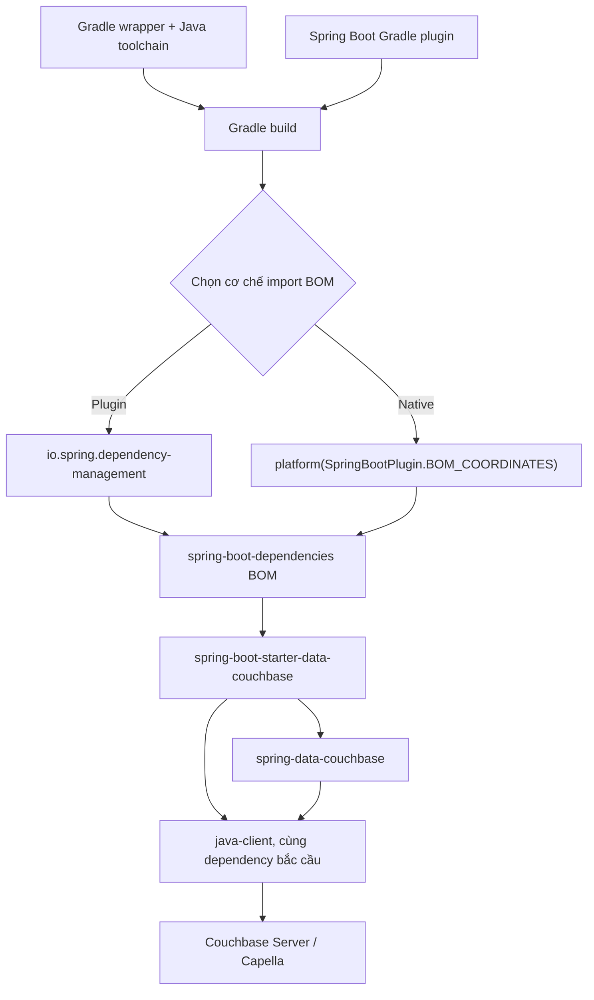

# Quản lý phiên bản phụ thuộc qua Spring Boot và Gradle

## Mục tiêu bài học

Trong module **SPRING_DATA_COUCHBASE**, một ứng dụng có thể sử dụng document mapping, repository, `CouchbaseTemplate`, truy vấn SQL++, TTL, CAS, giao dịch và API reactive. Những khả năng đó dựa trên nhiều thư viện: Spring Framework, Spring Data Couchbase, Couchbase Java SDK, Reactor và các dependency bắc cầu. Chọn mỗi thư viện một phiên bản "mới nhất" rất dễ tạo ra classpath không nhất quán.

Bài học thuộc chương **Môi trường** này tập trung vào cách để **Spring Boot quản lý tập phiên bản** và **Gradle giải quyết dependency** một cách có thể kiểm chứng. Hoàn thành bài học, bạn sẽ biết cách:

- Phân biệt nhiệm vụ của Spring Boot Gradle plugin, Spring Boot BOM, Gradle wrapper và Java toolchain.
- Cấu hình một ứng dụng Spring Data Couchbase bằng **Groovy DSL** hoặc **Kotlin DSL** mà không tự gắn version cho Spring Data và Couchbase Java SDK.
- Chọn đúng **một trong hai** cơ chế quản lý BOM: plugin `io.spring.dependency-management` hoặc Gradle `platform(...)`.
- Đọc dependency graph và `dependencyInsight` để xác định **phiên bản thực sự được chọn** và nguyên nhân của quyết định đó.
- Quản lý việc override, multi-module, dependency locking và nâng cấp mà vẫn kiểm soát được rủi ro tương thích.

> **Phân biệt hai loại Java:** **JDK/Java toolchain** quyết định cách biên dịch và chạy mã Java; **Couchbase Java SDK** là thư viện client `com.couchbase.client:java-client` dùng để truy cập Couchbase. Nâng JDK không tự nâng SDK và ngược lại.

## 1. Ai quản lý phiên bản nào?

| Thành phần | Vai trò | Điều dễ nhầm |
| --- | --- | --- |
| **Gradle wrapper (`gradlew`/`gradlew.bat`)** | Gọi đúng bản phân phối Gradle đã chỉ định cho dự án. | Gradle version **không phải** Spring Boot version hay JDK version. |
| **Plugin `java`** | Thiết lập các configuration và task biên dịch Java; hỗ trợ Java toolchain. | Nó không tự nạp BOM Spring Boot. |
| **Plugin `org.springframework.boot`** | Tích hợp Boot với Gradle; cấu hình task ứng dụng và cung cấp tọa độ BOM tương ứng phiên bản plugin. | **Chỉ áp dụng plugin Boot** chưa có nghĩa mọi dependency đã được quản lý phiên bản. |
| **Plugin `io.spring.dependency-management`** | Import BOM của phiên bản Boot khi dùng cùng Boot plugin; hỗ trợ ghi đè thuộc tính phiên bản do BOM cung cấp. | Là một cơ chế **tùy chọn**, không bắt buộc khi dùng native Gradle BOM. |
| **Spring Boot BOM (`spring-boot-dependencies`)** | Xác định bộ phiên bản phối hợp cho Spring Framework, Spring Data, SDK và nhiều thư viện khác. | BOM đặt quy tắc chọn phiên bản; bản **resolved** vẫn cần kiểm tra vì có thể bị dependency/constraint khác tác động. |
| **Gradle `platform(...)`** | Import BOM làm các version constraint do Gradle tự giải quyết. | Không hỗ trợ sửa version qua thuộc tính BOM như plugin dependency-management. |
| **Starter Couchbase** | Kéo những module Spring Data Couchbase và Java SDK cần thiết cho lựa chọn đồng bộ hoặc reactive. | Starter không thay thế việc xác minh quyền truy cập, bucket/collection, index hay Server feature. |

Sơ đồ với hai nhánh quản lý dependency:



**Điểm quyết định:** dùng đúng một phương pháp import BOM làm mặc định cho module ứng dụng, tránh cấu hình chồng chéo không có chủ ý. Cơ chế của Gradle và BOM giải quyết phần **phiên bản phía client**; khả năng thực thi SQL++, TTL, CAS, durable writes hay transaction còn phụ thuộc vào Couchbase Server và cấu hình cluster.

## 2. Chọn phiên bản Boot, Gradle và JDK trước

Các số trong bảng là **ví dụ cố định được đối chiếu với tài liệu Spring Boot ngày 25/11/2026**, không phải quy tắc tự suy số major của Spring Data hoặc SDK:

| Bộ tham chiếu | Spring Boot | Spring Data Couchbase do Boot quản lý | Couchbase Java SDK do Boot quản lý | JDK mẫu | Gradle được hỗ trợ |
| --- | --- | --- | --- | --- | --- |
| Nhánh đang duy trì | `3.5.16` | `5.5.13` | `3.8.3` | Java 21 | Gradle **7.6.4+ trong 7.x** hoặc **8.4+ trong 8.x** |
| Nhánh minh họa chính | `4.2.0` | `6.2.0` | `3.13.1` | Java 21 | Gradle **8.14+ trong 8.x** hoặc **9.x** |

Spring Boot 3.5.16 và 4.2.0 đều có yêu cầu JDK tối thiểu là **Java 17**; Java 21 là lựa chọn chung thuận tiện. **Spring Boot 3.5.16 là bản OSS cuối của dòng 3.5** theo thông báo ngày 25/06/2026, do đó dự án mới cần cân nhắc nhánh còn được hỗ trợ thay vì sao chép số version từ dự án cũ.

Đối chiếu ở tài liệu chính thức:

- [Spring Boot 4.2 — System Requirements](https://docs.spring.io/spring-boot/system-requirements.html) và [Managed Dependency Coordinates](https://docs.spring.io/spring-boot/appendix/dependency-versions/coordinates.html).
- [Spring Boot 3.5 — System Requirements](https://docs.spring.io/spring-boot/3.5/system-requirements.html) và [Managed Dependency Coordinates](https://docs.spring.io/spring-boot/3.5/appendix/dependency-versions/coordinates.html).
- [Spring Boot 3.5.16: End of OSS Support](https://spring.io/blog/2026/06/25/spring-boot-3-5-16-available-now/).

Nếu dự án đang dùng Spring Cloud, Spring Security, thư viện nội bộ hoặc Spring Framework được ép version riêng, cần đối chiếu thêm compatibility của các thành phần đó. **Bảng managed dependencies của Boot là mốc bắt đầu**, không chứng minh rằng mọi thư viện bên ngoài đều phù hợp.

### 2.1. Kiểm tra wrapper và JDK

Trên Linux/macOS:

```bash
./gradlew --version
java -version
```

Trên Windows, dùng `gradlew.bat --version` và `java -version`. Hãy ghi:

1. Gradle wrapper version (không phụ thuộc bản Gradle cài toàn máy).
2. JVM đang chạy Gradle daemon.
3. Java toolchain được chọn khi biên dịch nguồn (có thể khác JVM chạy Gradle).
4. Runtime JDK tại CI/container/deployment.

**Java toolchain không tự đổi JVM trong production.** Chẳng hạn, compile ra bytecode Java 21 nhưng đưa file jar sang runtime Java 17 có thể gây `UnsupportedClassVersionError`. Khi nâng Spring Boot, trước tiên kiểm tra wrapper có nằm trong dải hỗ trợ của Boot plugin hay không.

## 3. Cách A — Spring Boot Gradle plugin + dependency-management plugin

Đây là cách quen thuộc cho ứng dụng Boot muốn sử dụng BOM tương tự Maven. Ví dụ `build.gradle` **Groovy DSL** cho Spring Boot 4.2.0:

```groovy
plugins {
    id 'java'
    id 'org.springframework.boot' version '4.2.0'
}

// Spring Boot plugin đã làm plugin dependency-management
// khả dụng trên classpath của script.
apply plugin: 'io.spring.dependency-management'

group = 'com.example'
version = '0.0.1-SNAPSHOT'

java {
    toolchain {
        languageVersion = JavaLanguageVersion.of(21)
    }
}

repositories {
    mavenCentral()
}

dependencies {
    implementation 'org.springframework.boot:spring-boot-starter-data-couchbase'
}
```

Điều gì xảy ra khi Gradle giải quyết phụ thuộc?

1. Plugin `org.springframework.boot` được cố định tại **4.2.0** và nhận diện plugin quản lý phụ thuộc.
2. Plugin `io.spring.dependency-management` tự import **`org.springframework.boot:spring-boot-dependencies:4.2.0`** nhờ tích hợp với Boot plugin.
3. Dependency `spring-boot-starter-data-couchbase` **không ghi version** vì BOM quản lý nó.
4. Theo BOM Boot 4.2.0, phiên bản dự kiến của `spring-data-couchbase` là **6.2.0**, `java-client` là **3.13.1**; cần xác minh phiên bản resolved bằng lệnh Gradle ở mục 6.

Với dự án mới dùng cơ chế này, bạn cũng có thể khai báo `id 'io.spring.dependency-management' version '1.1.7'` trong khối `plugins`. Ví dụ trên dùng cách `apply plugin` theo tài liệu chính thức, tránh thêm một số version plugin khi Boot đã đưa nó vào classpath.

**Khả năng tùy biến riêng:** cơ chế này hiểu các thuộc tính trong BOM, chẳng hạn `couchbase-client.version`. Tuy nhiên, ghi đè SDK chỉ vì muốn dùng bản mới là một thay đổi cần đánh giá tương thích Spring Data/Netty/Reactor và có integration test.

### 3.1. Chọn starter đúng kiểu API

Với **repository hoặc `CouchbaseTemplate` đồng bộ**, dùng:

```groovy
dependencies {
    implementation 'org.springframework.boot:spring-boot-starter-data-couchbase'
}
```

Với **repository, template hoặc query reactive** khi kiến trúc ứng dụng cần `Mono`/`Flux`, thay dependency bằng:

```groovy
dependencies {
    implementation 'org.springframework.boot:spring-boot-starter-data-couchbase-reactive'
}
```

Đây là **hai phương án thay thế nhau cho ví dụ**, không phải yêu cầu thêm cả hai starter cho mọi ứng dụng. Một dự án cần cả hai kiểu truy cập phải đánh giá cấu hình cụ thể, sự trùng lặp bean và nhu cầu thực tế.

Thay starter không tự làm Couchbase Server hỗ trợ thêm một tính năng. Ví dụ derived query dùng SQL++ còn đòi hỏi Query/Index Service và index; dùng scope/collection cần Couchbase Server hỗ trợ và tài khoản có quyền truy cập.

## 4. Cách B — Spring Boot Gradle plugin + Gradle native BOM

Gradle có sẵn cơ chế `platform(...)` để import BOM mà **không cần áp dụng `io.spring.dependency-management`**. Đây là cách phù hợp nếu dự án muốn sử dụng version constraints theo chuẩn Gradle và thường có lợi cho tốc độ build.

Ví dụ `build.gradle` với Groovy DSL:

```groovy
plugins {
    id 'java'
    id 'org.springframework.boot' version '4.2.0'
}

group = 'com.example'
version = '0.0.1-SNAPSHOT'

java {
    toolchain {
        languageVersion = JavaLanguageVersion.of(21)
    }
}

repositories {
    mavenCentral()
}

dependencies {
    implementation platform(
        org.springframework.boot.gradle.plugin.SpringBootPlugin.BOM_COORDINATES
    )

    implementation 'org.springframework.boot:spring-boot-starter-data-couchbase'
}
```

`SpringBootPlugin.BOM_COORDINATES` được Spring Boot Gradle plugin cung cấp và trỏ đến BOM của **đúng phiên bản plugin**, giúp tránh gõ tay số `4.2.0` lần thứ hai.

Tương đương, nếu bạn quản lý phiên bản từ một nguồn chung, có thể viết tường minh `implementation platform('org.springframework.boot:spring-boot-dependencies:4.2.0')`. Khi dùng cách tường minh trong nhiều module, phải đảm bảo **không có module nào vô tình dùng BOM khác phiên bản**.

### 4.1. Bản Kotlin DSL

Với dự án sử dụng `build.gradle.kts`, cấu hình tương đương:

```kotlin
plugins {
    java
    id("org.springframework.boot") version "4.2.0"
}

java {
    toolchain {
        languageVersion = JavaLanguageVersion.of(21)
    }
}

repositories {
    mavenCentral()
}

dependencies {
    implementation(
        platform(org.springframework.boot.gradle.plugin.SpringBootPlugin.BOM_COORDINATES)
    )
    implementation("org.springframework.boot:spring-boot-starter-data-couchbase")
}
```

Đừng trộn cú pháp Groovy và Kotlin trong cùng một file. Trong Kotlin DSL cần ngoặc cho `implementation("...")`, còn Groovy DSL cho phép cú pháp chuỗi đơn không ngoặc.

### 4.2. `platform` khác `enforcedPlatform` ra sao?

| Cơ chế | Cách tác động đến phiên bản | Khi nào cân nhắc |
| --- | --- | --- |
| `platform(...)` | Các phiên bản BOM là **constraint/khuyến nghị**; phiên bản khác trong graph có thể thắng khi Gradle thực hiện conflict resolution. | Mặc định cho ứng dụng hoặc library khi cần giữ tính linh hoạt. |
| `enforcedPlatform(...)` | BOM được áp thành constraint nghiêm ngặt, có thể ép phụ thuộc về đúng phiên bản được liệt kê. | Chỉ khi có quyết định có chủ đích về việc ép toàn graph; cẩn trọng nếu artifact được publish cho dự án khác. |

`enforcedPlatform` có thể lan các version constraint nghiêm ngặt sang **consumer** khi dùng trong thư viện được publish. Đừng chọn nó như một cách "sửa hết conflict" mà chưa hiểu vì sao graph đang chọn version khác.

**Khác biệt rất quan trọng:** với `platform(...)`, các thuộc tính như `ext['couchbase-client.version']` **không thay đổi** các version constraint import từ BOM. Nếu cần phiên bản khác, hãy dùng cơ chế constraints/version override của Gradle, kiểm tra graph và xác nhận toàn bộ bộ dependency tương thích.

## 5. Không chỉ Spring Data: xem toàn bộ chuỗi dependency Couchbase

Trong dự án ví dụ, bạn khai báo một starter nhưng runtime classpath có thể gồm:

```text
spring-boot-starter-data-couchbase
    -> spring-data-couchbase
         -> spring-data-commons, spring-framework, ...
    -> Couchbase Java SDK
         -> Couchbase core-io, networking, Reactor/Netty, ...
```

Sơ đồ trên chỉ minh họa nhóm thành phần, **không phải kết quả dependency tree chính xác** của một phiên bản cụ thể. Hãy đọc graph thực tế để biết starter kéo những artifact nào.

| Tọa độ/nhóm | Tại sao liên quan |
| --- | --- |
| `org.springframework.boot:spring-boot-starter-data-couchbase` | Điểm vào cho cấu hình Spring Data Couchbase đồng bộ. |
| `org.springframework.boot:spring-boot-starter-data-couchbase-reactive` | Điểm vào cho cấu hình Spring Data Couchbase reactive. |
| `org.springframework.data:spring-data-couchbase` | Document mapping, repositories, `CouchbaseTemplate`, hỗ trợ query. |
| `com.couchbase.client:java-client` | Giao tiếp với Couchbase, thực thi KV, query, transactions qua SDK. |
| `org.springframework.data:spring-data-commons` | Các API nền tảng của repository, pagination, metadata; cần cùng thế hệ Spring Data. |
| Reactor và networking dependencies | Hỗ trợ các đường đi bất đồng bộ/reactive, timeout, truyền dữ liệu; version có thể được quản lý bởi nhiều BOM/constraint. |

Không thêm trực tiếp `spring-data-couchbase` hoặc `java-client` với một số version tùy ý nếu starter đã mang đến phiên bản thích hợp. Ví dụ, đưa Spring Data Couchbase **6.x** vào một dự án Boot **3.5.x** trong khi các module Spring Framework/Spring Data Commons vẫn thuộc nhánh cũ rất dễ gây lỗi linkage khi chạy.

**Các tính năng như TTL, CAS, transaction không có nghĩa mỗi tính năng cần một bộ dependency khác nhau**: trước hết xác minh rằng API đang dùng tồn tại ở bộ Spring Data + SDK hiện tại và Server hỗ trợ thao tác đó. Chỉ cân nhắc đổi dependency khi có yêu cầu API/bug/security cụ thể.

## 6. Xem phiên bản thực tế bằng Gradle

Trong thư mục dự án **đã có Gradle wrapper**, chạy:

```bash
./gradlew --version
./gradlew dependencies --configuration runtimeClasspath
./gradlew dependencyInsight --dependency spring-data-couchbase --configuration runtimeClasspath
./gradlew dependencyInsight --dependency java-client --configuration runtimeClasspath
./gradlew dependencyInsight --dependency spring-data-commons --configuration runtimeClasspath
./gradlew classes
```

Trên Windows dùng `gradlew.bat` tương ứng. Nếu là dự án nhiều module, chỉ rõ module, ví dụ `./gradlew :order-service:dependencyInsight --dependency java-client --configuration runtimeClasspath`. Bạn cần Internet hoặc repository proxy/mirror đã cấu hình để Gradle tải plugin và dependency ở lần chạy đầu.

| Lệnh | Bằng chứng cần đọc |
| --- | --- |
| `--version` | Gradle wrapper, JVM đang chạy Gradle, hệ điều hành. |
| `dependencies --configuration runtimeClasspath` | Graph phụ thuộc và các version đã được chọn cho runtime. |
| `dependencyInsight --dependency ...` | Ai kéo artifact, version **requested → selected**, tại sao Gradle chọn version này (constraint, conflict resolution, force, v.v.). |
| `classes` | Kiểm tra biên dịch nguồn Java và resolve compile classpath; **chưa kiểm thử kết nối Couchbase**. |

Với **Boot 4.2.0 và không override**, đầu ra cần phản ánh các tọa độ chính sau:

```text
org.springframework.boot:spring-boot-starter-data-couchbase:4.2.0
org.springframework.data:spring-data-couchbase:6.2.0
com.couchbase.client:java-client:3.13.1
```

Đây là **các version kỳ vọng từ BOM chính thức**, không phải log đầu ra đã chạy trên một dự án thật. Plugin có thể hiển thị chúng trên nhiều đường dependency trong graph. Một ký hiệu kiểu `3.12.0 -> 3.13.1` nghĩa là Gradle **đã chọn** 3.13.1 sau khi giải quyết yêu cầu/constraint, chứ không có nghĩa cả hai jar 3.12.0 và 3.13.1 đều được đưa vào cùng một configuration.

### 6.1. Nếu version không khớp BOM, kiểm tra gì?

1. Project đã áp dụng **dependency-management plugin** hoặc **native `platform(...)`** chưa? Boot plugin một mình chưa tự quản lý toàn bộ version.
2. Đang xem đúng configuration chưa? `runtimeClasspath`, `compileClasspath`, `testRuntimeClasspath` và `annotationProcessor` có thể chịu những constraint khác nhau.
3. Có dependency trực tiếp gắn version, version catalog, Gradle constraints, dependency locking, resolution strategy, `force` hoặc plugin thứ ba tác động không?
4. BOM được import có **đúng phiên bản Spring Boot Gradle plugin** không, nhất là trong multi-module?
5. Có thêm BOM khác (ví dụ Spring Cloud, thư viện tổ chức) làm version khác thắng trong Gradle resolution không?

**Lưu ý về thứ tự đọc kết quả:** `dependencies` cho cái nhìn toàn cảnh; `dependencyInsight` mới trả lời chính xác "tại sao phiên bản này được chọn". Chỉ nhìn `build.gradle` không đủ để kết luận.

### 6.2. Sự khác nhau giữa cấu hình dependency

| Configuration | Dùng khi nào | BOM nên kiểm tra |
| --- | --- | --- |
| `implementation` | Dependency để biên dịch/chạy mã ứng dụng. | Được BOM của cách A hoặc `implementation platform(...)` quản lý. |
| `runtimeOnly` | Chỉ cần khi chạy. | Kiểm tra constraint trong `runtimeClasspath`. |
| `testImplementation`, `testRuntimeOnly` | Dependency dành cho test. | Kiểm tra `testRuntimeClasspath` và các configuration có liên quan. |
| `annotationProcessor` | Annotation processors, thường có graph riêng. | Với native BOM, có thể cần `annotationProcessor platform(...)` riêng nếu processor cần version từ BOM. |

Theo tài liệu Gradle/Spring Boot, một `platform(...)` chỉ áp constraint cho configuration khai báo nó **hoặc configuration kế thừa**. Vì thế, không nên giả định rằng import BOM vào `implementation` sẽ bao phủ tất cả các configuration do plugin bổ sung.

## 7. Quản lý phiên bản cho nhiều module Gradle

Giả sử repository có:

```text
shop/
  settings.gradle
  build.gradle
  order-service/     # Spring Boot application
  order-domain/      # Java library
```

Một nguyên tắc thiết kế thực tế:

- **`order-service`**: áp dụng `org.springframework.boot` để có nhiệm vụ đóng gói/chạy ứng dụng; import BOM bằng cách A hoặc B.
- **`order-domain`**: chỉ áp dụng `java-library` nếu không phải ứng dụng có entry point Boot; có thể import cùng BOM qua `platform('org.springframework.boot:spring-boot-dependencies:4.2.0')` trong configuration cần thiết.
- **Root build/convention plugin/version catalog**: quản lý một nơi cho version plugin và tọa độ BOM; từng module vẫn phải nhận đúng constraint cần thiết. Không phải cứ khai báo ở root là mọi subproject tự có BOM.

Ví dụ tối giản cho thư viện dùng API Spring Data trực tiếp, trong `order-domain/build.gradle`:

```groovy
plugins {
    id 'java-library'
}

repositories {
    mavenCentral()
}

dependencies {
    implementation platform('org.springframework.boot:spring-boot-dependencies:4.2.0')
    implementation 'org.springframework.data:spring-data-couchbase'
}
```

Ví dụ này minh họa **import BOM cho module thư viện** và chưa bao gồm cấu hình publish. Nếu API public của library dùng kiểu từ Spring Data và cần truyền constraints cho consumer, phải thiết kế đúng `api`/`implementation` và version constraints theo hướng dẫn Gradle; không dùng `enforcedPlatform` một cách máy móc.

**Version catalog không thay BOM.** File `gradle/libs.versions.toml` có thể chuẩn hóa version Spring Boot plugin và alias starter cho các module, nhưng Gradle vẫn cần import BOM hoặc cơ chế dependency management để xác định các version được khai báo không có số.

## 8. Khi nào override phiên bản do Spring Boot quản lý?

Chỉ override khi có lý do có thể kiểm chứng: CVE đã có bản vá, lỗi SDK ảnh hưởng ứng dụng, yêu cầu tính năng mới hoặc một thay đổi có trong hướng dẫn nâng cấp. Với plugin dependency-management, BOM có property `couchbase-client.version`, và có thể đặt một giá trị được phê duyệt:

```groovy
// Chỉ áp dụng trong dự án dùng io.spring.dependency-management.
// Truyền -PapprovedCouchbaseSdkVersion=<phiên-bản-đã-kiểm-chứng>
// từ pipeline hoặc gradle.properties khi cần override.
def approvedSdk = findProperty('approvedCouchbaseSdkVersion')
if (approvedSdk) {
    ext['couchbase-client.version'] = approvedSdk.toString()
}
```

**Đặt đoạn này trong `build.gradle` cùng cơ chế A.** Nếu dùng cơ chế B với `platform(...)`, property `couchbase-client.version` sẽ **không** thay đổi constraint đã import. Khi ấy cần dùng Gradle dependency constraints, version declarations hoặc resolution rules một cách có chủ đích, sau đó dùng `dependencyInsight` xác minh.

Mỗi override nên có hồ sơ:

| Trường | Ví dụ cần ghi |
| --- | --- |
| Lý do | Lỗi SDK theo issue hoặc CVE cụ thể; feature được yêu cầu. |
| Tổ hợp trước/sau | Boot version, Spring Data version, Java SDK, Java/Gradle, Couchbase Server version. |
| Điểm thay đổi | Property override, explicit dependency, hoặc constraint ở configuration nào. |
| Phân tích rủi ro | Tương thích API/ABI, phụ thuộc Reactor/Netty, serialization, query, durability, transactions. |
| Bằng chứng | Dependency insight + test tích hợp KV, SQL++, repository, TTL/CAS và giao dịch nếu hệ thống dùng. |
| Điều kiện gỡ | Bản Boot patch/minor mới đã quản lý bộ dependency phù hợp. |

**Không nên** ghi đồng thời:

```groovy
// Ví dụ chống chỉ định: lấy số phiên bản từ hai thế hệ không tương thích.
implementation 'org.springframework.boot:spring-boot-starter-data-couchbase'
implementation 'org.springframework.data:spring-data-couchbase:5.5.13'
```

...trong dự án Boot **4.2.0** chỉ vì 5.5.13 từng chạy trên Boot 3.5.16. Boot 4.2.0 quản lý Spring Data Couchbase **6.2.0**; nếu thật sự cần lùi major, phải đánh giá khả năng chạy và cấu trúc framework thay vì xem đó là thay đổi vô hại.

### 8.1. Thứ tự nâng cấp khuyến nghị

1. Ghi lại bản đang chạy (`./gradlew --version`, dependency tree, Server/SDK tương ứng).
2. Chọn phiên bản Spring Boot đích và đọc migration guide, system requirements, release notes.
3. Cập nhật Gradle wrapper/JDK nếu cần; đổi Boot plugin version và để BOM cập nhật đồng bộ.
4. Chạy `dependencyInsight` cho Spring Data, Java SDK và các thư viện bắc cầu bị thay đổi; xem nguyên nhân chọn phiên bản.
5. Điều chỉnh mã do API đổi, rồi chạy compile/test và integration test với Couchbase thật hoặc môi trường thử nghiệm có cấu hình tương đương.
6. Chỉ deploy khi đã đối chiếu Couchbase Server/Capella, truy vấn SQL++/index, TTL/CAS, durable writes, transactions và reactive flow đang sử dụng.

## 9. Dependency locking và khả năng tái tạo build

BOM giúp **đồng bộ mặc định**. Nếu tổ chức yêu cầu CI tái tạo cùng một tập version transitive, có thể dùng **Gradle dependency locking**:

```groovy
// build.gradle
dependencyLocking {
    lockAllConfigurations()
}
```

Lần đầu (sau khi xem xét dependency graph):

```bash
./gradlew dependencies --write-locks
```

Gradle ghi trạng thái đã resolve vào `gradle.lockfile` hoặc các lockfile tương ứng, tùy cấu hình; nên commit cùng nguồn. Về sau, khi BOM hoặc explicit dependency thay đổi, lockfile có thể từ chối một graph khác cho đến khi bạn cập nhật lock có chủ đích. Với dự án nhiều module, nhớ chạy các task cần thiết trên **từng module/configuration cần khóa** thay vì giả định chỉ chạy `dependencies` ở root là đủ.

Các giới hạn cần hiểu:

- Lockfile ghi các **version đã chọn**, không xác nhận chúng tương thích với Couchbase Server.
- Locking không thay thế BOM; một bên đưa ra constraint, bên còn lại lưu kết quả resolve.
- Không kỳ vọng lock giải quyết được vấn đề artifact `-SNAPSHOT` thay đổi nội dung dưới cùng version.
- Khi cập nhật, xem diff lockfile để phát hiện thay đổi ngoài ý định (đặc biệt Netty/Reactor/Spring Framework).
- Gradle wrapper, plugin version, repositories và Java toolchain cũng là yếu tố cần cố định hoặc ghi nhận để tái tạo build.

Nguồn: [Gradle — Locking Versions](https://docs.gradle.org/current/userguide/dependency_locking.html) và [Gradle — Working with Platforms](https://docs.gradle.org/current/userguide/platforms.html).

## 10. Các lỗi quản lý dependency thường gặp

| Triệu chứng | Khả năng nguyên nhân | Cách xử lý |
| --- | --- | --- |
| `Could not find ... :` vì dependency không có version | Dự án chỉ dùng Boot plugin mà chưa import BOM bằng cách A/B, hoặc configuration chưa nhận constraint. | Kiểm tra `plugins`, `platform(...)`, configuration và repository. |
| Gradle báo Boot plugin không hỗ trợ version Gradle | Wrapper quá cũ cho nhánh Boot mới. | Đối chiếu system requirements; nâng Gradle wrapper theo phiên bản được hỗ trợ. |
| `NoSuchMethodError`/`NoClassDefFoundError` sau nâng Spring Data | Dependency graph chứa thành phần Spring Framework/Spring Data/SDK không cùng thế hệ. | Xem `dependencyInsight`, loại bỏ override thiếu căn cứ, đồng bộ bằng BOM. |
| SDK thực tế cao/thấp hơn BOM dù starter không ghi version | Explicit dependency, BOM khác, constraint, lock hoặc resolution rule đã thay kết quả chọn. | Xác minh **selected version** và selection reason. |
| Annotation processor báo thiếu version | `annotationProcessor` không nhận BOM native qua `implementation`. | Import `annotationProcessor platform(...)` khi cần. |
| Build thành công nhưng query repository lỗi index | Dependency đã resolve đúng nhưng Server thiếu index/service/quyền. | Kiểm tra Query/Index Service, scope/collection, `EXPLAIN` và RBAC. |
| Reactive flow timeout còn synchronous KV đơn lẻ chạy | Có thể do cấu hình/query/index, backpressure, tải hoặc mạng. | Kiểm thử luồng reactive và hạ tầng; không đổi SDK bằng suy đoán. |
| Compile bằng Java 21 nhưng runtime báo bytecode không hỗ trợ | JVM thực tế cũ hơn mức bytecode đã build. | Đồng bộ Java toolchain, Gradle JVM và container/runtime. |

Nên **phân loại lỗi theo pha**: plugin resolution → dependency resolution → compilation → application startup → kết nối/truy vấn Couchbase → vận hành. Mỗi pha cần loại bằng chứng khác nhau. Tránh coi mọi lỗi SQL++ hoặc timeout là xung đột dependency.

## 11. Bài tập tự kiểm tra

**Tình huống A.** Dự án có:

```groovy
plugins {
    id 'java'
    id 'org.springframework.boot' version '4.2.0'
}
repositories { mavenCentral() }
dependencies {
    implementation 'org.springframework.boot:spring-boot-starter-data-couchbase'
}
```

Khi resolve, Gradle không tìm được version cho dependency. **Thiếu gì?**

**Đáp án:** Chưa áp dụng `io.spring.dependency-management` hoặc import Spring Boot BOM qua `implementation platform(...)`. Boot plugin chỉ cung cấp tích hợp, không tự đảm bảo version dependency nếu bỏ cả hai cơ chế.

**Tình huống B.** Nhóm khai báo `implementation platform(...)` và đặt `ext['couchbase-client.version'] = '...'` nhưng `java-client` không đổi version. **Giải thích?**

**Đáp án:** Property override thuộc cơ chế của `io.spring.dependency-management`. Native BOM của Gradle làm việc với version constraints, không thay theo thuộc tính Maven BOM đó. Cần dùng công cụ quản lý version của Gradle và xem `dependencyInsight`, đồng thời đánh giá rủi ro override.

**Tình huống C.** Boot 4.2.0 dự kiến `java-client:3.13.1` nhưng `dependencyInsight` cho thấy một version cao hơn do conflict resolution. Có nên kết luận cả hai version cùng nằm trong runtime?

**Đáp án:** Không. Trong một configuration, Gradle chọn một version của cùng module theo quy tắc resolution. Cần xem đường phụ thuộc nào đưa version khác và kiểm thử tính tương thích của bản **selected**.

**Tình huống D.** Nhóm muốn dùng Couchbase transactions qua Spring Data, chỉ nâng `java-client` nhưng Server không đáp ứng yêu cầu feature. BOM đã resolve không lỗi. **Kết luận?**

**Đáp án:** Build thành công không chứng minh tính năng Server hoạt động. Đối chiếu phiên bản Server/SDK, cluster service, topology, durability, quyền truy cập và thực hiện integration test transaction. Dependency management chỉ giải quyết phần mã Java.

## 12. Checklist trước khi chốt cấu hình Gradle

- [ ] Đã chọn Spring Boot đang được hỗ trợ và version Gradle wrapper/JDK tương thích.
- [ ] Đã dùng Java toolchain rõ ràng và kiểm tra runtime Java tại CI/container.
- [ ] Đã chọn một cơ chế import BOM: `io.spring.dependency-management` **hoặc** Gradle native `platform(...)`.
- [ ] Đã dùng starter Couchbase phù hợp với đồng bộ hoặc reactive; mặc định không tự gắn version Spring Data/SDK.
- [ ] Đã xem `runtimeClasspath` và `dependencyInsight` của `spring-data-couchbase`, `java-client`, `spring-data-commons`.
- [ ] Đã kiểm tra phiên bản ở các configuration khác khi có processor, test hoặc multi-module.
- [ ] Đã ghi lại mọi override, lý do, ảnh hưởng transitive và kết quả integration test.
- [ ] Đã quyết định có dùng Gradle lockfile hay không và kiểm tra diff khi nâng cấp.
- [ ] Đã kiểm thử với Server/Capella, bucket/scope/collection, SQL++/index, TTL/CAS và transaction/reactive **nếu ứng dụng sử dụng**.

### Tài liệu chính thức

1. [Spring Boot Gradle Plugin — Getting Started](https://docs.spring.io/spring-boot/gradle-plugin/getting-started.html).
2. [Spring Boot Gradle Plugin — Managing Dependencies](https://docs.spring.io/spring-boot/gradle-plugin/managing-dependencies.html).
3. [Spring Boot — Managed Dependency Coordinates](https://docs.spring.io/spring-boot/appendix/dependency-versions/coordinates.html).
4. [Spring Boot — Dependency Version Properties](https://docs.spring.io/spring-boot/appendix/dependency-versions/properties.html).
5. [Gradle — Platforms](https://docs.gradle.org/current/userguide/platforms.html) và [Gradle — Dependency Insight](https://docs.gradle.org/current/userguide/viewing_debugging_dependencies.html).
6. [Gradle — Locking Versions](https://docs.gradle.org/current/userguide/dependency_locking.html).
7. [Couchbase Java SDK — Compatibility & Feature Availability](https://docs.couchbase.com/java-sdk/current/project-docs/compatibility.html).
8. [Spring Data Couchbase — Dependencies](https://docs.spring.io/spring-data/couchbase/reference/data-commons/dependencies.html).

**Nguyên tắc áp dụng:** cố định Spring Boot Gradle plugin và Gradle wrapper, import đúng một BOM tương ứng, để starter giải quyết Spring Data Couchbase + Couchbase Java SDK, đọc dependency tree thực tế, rồi kiểm tra tương thích Server và nghiệp vụ trước khi triển khai. Khi cần thay version mặc định, hãy giải thích được *vì sao Gradle chọn version đó* và chứng minh được bằng test thay vì chỉ sửa một dòng trong `build.gradle`.
