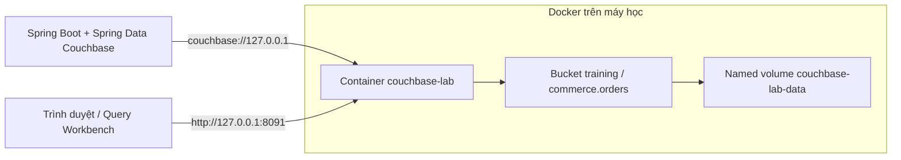

# Khởi tạo Couchbase phục vụ học tập bằng Docker

## Mục tiêu bài học

Để học **Spring Data Couchbase**, bạn cần Couchbase Server có thể kết nối từ Java, có dữ liệu thử nghiệm và đủ dịch vụ để thực hành **document mapping**, **repository**, **CouchbaseTemplate** và **SQL++**. Sau đó mới mở rộng sang thiết kế bucket/scope/collection, chỉ mục, TTL, CAS, giao dịch, durability và API reactive. Docker giúp tạo một môi trường riêng trên máy cá nhân, có thể dừng, khởi động lại và làm mới khi cần.

Sau bài này, bạn có thể:

- Chạy **Couchbase Server Community Edition một node** bằng image Docker có phiên bản cố định.
- Ánh xạ đúng cổng Web Console, Query và KV; duy trì dữ liệu trong **Docker named volume**.
- Khởi tạo cluster; tạo bucket `training`, scope `commerce` và collection `orders`.
- Thêm dữ liệu mẫu, tạo chỉ mục và chạy truy vấn SQL++.
- Kết nối từ ứng dụng Spring Boot/Spring Data, thử thao tác KV và hiểu cách kiểm tra lỗi.
- Phân biệt dừng container, xóa container và xóa volume để tránh mất dữ liệu không chủ ý.

> **Phạm vi:** Đây là lab cục bộ, **một node**, không có khả năng chịu lỗi như production. Ví dụ dùng `couchbase/server:community-8.0.1`, một image tag có trên [Docker Hub chính thức](https://hub.docker.com/r/couchbase/server/tags). Tag giúp tái lập bài học; người học cần tự đánh giá bản vá, lifecycle và ma trận tương thích Server–Java SDK khi áp dụng về sau. Không suy rằng 8.0.1 luôn là bản mới nhất.

## 1. Hình dung môi trường



| Thành phần | Vai trò |
| --- | --- |
| **Image** | Mẫu phần mềm Couchbase Server có phiên bản được chọn, ví dụ `community-8.0.1`. |
| **Container** | Tiến trình Couchbase Server chạy từ image. Container khởi động chưa có nghĩa cluster đã thiết lập. |
| **Named volume** | Dữ liệu và cấu hình Couchbase được giữ qua lần dừng hoặc thay container nếu mount lại đúng volume. |
| **Cluster** | Nhóm node Couchbase; lab này một node nhưng vẫn cần bước **Setup New Cluster**. |
| **Service** | Data phục vụ thao tác KV, Query xử lý SQL++, Index cung cấp index scan. |
| **Bucket/scope/collection** | Ba cấp tổ chức document; `training.commerce.orders` là đường dẫn sử dụng xuyên suốt bài. |
| **Couchbase Java SDK** | Client giao tiếp với Server; Spring Data Couchbase dùng SDK dưới tầng mapping/repository. |

### Chuẩn bị

1. Cài Docker Desktop (Windows/macOS) hoặc Docker Engine (Linux). Trên Windows hãy dùng **Linux containers**, thông thường qua WSL2.
2. Kiểm tra Docker daemon đã chạy: `docker version` phải có cả thông tin Client và Server.
3. Cấp đủ RAM/CPU/disk cho Docker. Với ba service Data + Query + Index, có thể **dành khoảng 6 GB RAM cho Docker** nếu máy cho phép, từ 2 CPU và vài GB đĩa trống; đây là gợi ý lab, **không phải** yêu cầu tối thiểu chính thức cho mọi hệ điều hành/phiên bản.
4. Đảm bảo cổng 8091, 8093 và 11210 trên máy host chưa có tiến trình khác sử dụng.
5. Chuẩn bị trình duyệt. Chưa cần Java/Gradle để tạo Server, nhưng cần JDK và project Spring Boot ở phần kết nối Java.

```bash
docker version
docker info
```

Nếu chỉ có `docker` CLI mà daemon không chạy, khởi động Docker Desktop/Engine trước khi làm tiếp. Xem yêu cầu chính thức: [Couchbase Server System Requirements](https://docs.couchbase.com/server/current/install/install-platforms.html).

### Các cổng sử dụng trong bài

| Cổng container | Chức năng | Có publish ra host? |
| --- | --- | --- |
| **8091/tcp** | Web Console, REST quản lý và bootstrap thông tin cluster | **Có** |
| **8093/tcp** | Query Service cho SQL++ | **Có** |
| **11210/tcp** | Data Service giao tiếp KV không TLS | **Có** |
| 8094/tcp | Search Service | Chỉ khi học Search và đã bật service |
| 8095/tcp | Analytics Service | Chỉ khi dùng Analytics và edition hỗ trợ |
| 18091/18093/11207 | Các cổng tương ứng dùng TLS | Chỉ khi cấu hình TLS |

Ở máy học, chỉ publish vào **`127.0.0.1`** để không mở Web Console trực tiếp ra LAN. Nếu học qua mạng từ máy khác, cần thiết kế mạng/TLS/quyền truy cập phù hợp; không dùng thông số loopback này cho production. Nguồn: [Couchbase Server Ports](https://docs.couchbase.com/server/current/install/install-ports.html).

## 2. Chạy Couchbase Server với Docker

Lệnh **một dòng** dưới đây dùng được với Bash, PowerShell và Command Prompt:

```bash
docker run -d --name couchbase-lab -p 127.0.0.1:8091:8091 -p 127.0.0.1:8093:8093 -p 127.0.0.1:11210:11210 -v couchbase-lab-data:/opt/couchbase/var couchbase/server:community-8.0.1
```

| Tham số | Ý nghĩa |
| --- | --- |
| `-d` | Chạy container ở chế độ nền. |
| `--name couchbase-lab` | Đặt tên cố định để dùng với `logs`, `start`, `stop`. |
| `-p 127.0.0.1:HOST:CONTAINER` | Xuất cổng container sang loopback của máy phát triển. |
| `-v couchbase-lab-data:/opt/couchbase/var` | Tạo/tái sử dụng **named volume** cho dữ liệu, metadata và log Couchbase. |
| `couchbase/server:community-8.0.1` | Chọn chính xác phiên bản Community Edition cho lab. |

Lần đầu Docker phải tải image, có thể chiếm nhiều dung lượng. Chờ container khởi động rồi kiểm tra:

```bash
docker ps --filter name=couchbase-lab
docker logs --tail 100 couchbase-lab
docker inspect --format '{{.Config.Image}}' couchbase-lab
docker volume inspect couchbase-lab-data
```

Mở **http://127.0.0.1:8091** trong trình duyệt. Nếu Web Console chưa hiện, đọc `docker logs`, kiểm tra RAM/disk và khả năng bind port. **Container ở trạng thái Up không đồng nghĩa Couchbase cluster đã khởi tạo**; đó mới là bước tiếp theo.

> Giữ image tag cố định để bài học có thể tái lập. Khi đổi image của một volume đã dùng, phải tra đường nâng cấp chính thức; **hạ cấp image trên dữ liệu đã được bản mới nâng format** có thể không được hỗ trợ.

## 3. Khởi tạo cluster qua Web Console

Giao diện có thể thay đổi theo phiên bản; luồng cơ bản như sau:

1. Ở `http://127.0.0.1:8091` chọn **Setup New Cluster**, không chọn **Join Existing Cluster**.
2. Đặt **cluster name** là `learning-cluster`; đặt username quản trị `Administrator` và một mật khẩu mạnh **chỉ dùng cho lab**. Lưu trong trình quản lý mật khẩu, không commit vào mã nguồn.
3. Tiếp tục theo trình thiết lập, chấp nhận điều khoản phù hợp. Chọn các service **Data**, **Query**, **Index**. Không cần Search, Analytics, Eventing ở bài đầu.
4. Cấp memory quota cho Data và Index dựa trên RAM Docker có sẵn. Nếu UI báo tổng quota lớn hơn bộ nhớ, điều chỉnh quota hoặc tăng RAM Docker; không tắt Index nếu muốn chạy SQL++ có index.
5. Hoàn thành wizard và chờ dashboard hiển thị node đã hoạt động. Vào mục **Servers** xác nhận một node, đúng Server version và có Data/Query/Index.

**Tại sao cần cả ba service?** Lệnh KV `collection.get(id)` sử dụng Data Service và không cần index. Repository derived query hoặc `@Query` dựa vào SQL++ cần Query Service và thường cần Index Service cùng chỉ mục phù hợp. Thiếu index không có nghĩa Java SDK bị sai version.

Nguồn: [Quick Install](https://docs.couchbase.com/server/current/getting-started/do-a-quick-install.html), [Install Couchbase Using Docker](https://docs.couchbase.com/server/current/install/getting-started-docker.html).

### 3.1. Tạo bucket

Trong **Buckets → Add Bucket**, dùng cấu hình minh họa:

| Thuộc tính | Giá trị lab | Giải thích |
| --- | --- | --- |
| Name | `training` | Tên bucket sẽ dùng trong Spring Boot. |
| Bucket type | **Couchbase** | Lưu document Couchbase. |
| Storage backend | **Couchstore** (Community Edition) | Chọn backend được edition hỗ trợ, không áp cấu hình Enterprise-only. |
| Memory quota | **256 MiB**, nếu UI và tài nguyên cho phép | Đủ cho tập dữ liệu nhỏ; có thể tăng khi cần. |
| Number of replicas | **0** trong lab một node | Không có node khác để giữ replica. |
| Max TTL | **0** theo mặc định | Không áp thời hạn hết hạn mặc định toàn bucket. |

Chờ bucket sẵn sàng rồi mới tạo scope. Với Couchstore, tài liệu mô tả quota bucket tối thiểu **100 MiB**; 256 MiB chỉ là giá trị thực hành. **Replica 0 không đáp ứng các bài kiểm thử HA/failover**; khi học durability hoặc transaction có yêu cầu replica, phải tạo topology nhiều node tương ứng.

Nguồn: [Create a Bucket](https://docs.couchbase.com/server/current/manage/manage-buckets/create-bucket.html).

### 3.2. Tạo scope và collection

Vào **Buckets → training → Scopes & Collections**:

1. Xem scope `_default` và collection `_default` được tạo sẵn; không xóa chúng.
2. Chọn **Add Scope**, tạo `commerce`.
3. Trong scope `commerce`, chọn **Add Collection**, tạo `orders`.
4. Có thể tạo thêm `sessions` trong `commerce` để thực hành TTL riêng, tránh trộn với order.
5. Kiểm tra cấu trúc cuối:

```text
training                              (bucket)
  _default                            (scope)
    _default                          (collection)
  commerce                            (scope)
    orders                            (collection)
    sessions                          (collection - tùy chọn)
```

Đường dẫn thực hành là **`training.commerce.orders`**. Nếu repository hoặc SDK dùng nhầm `_default._default`, truy vấn sẽ không thấy document ở `commerce.orders`. Việc tạo scope/collection có thể **bất đồng bộ**; khi vừa tạo xong mà SDK chưa thấy, kiểm tra manifest trên UI và thử lại sau khi cluster cập nhật.

Nguồn: [Manage Scopes and Collections](https://docs.couchbase.com/server/current/manage/manage-scopes-and-collections/manage-scopes-and-collections.html).

## 4. Thêm dữ liệu mẫu và kiểm tra SQL++

Mở **Query Workbench** của Web Console. Chạy trên bucket **học tập**, không áp vào môi trường có dữ liệu thật. Hai câu `UPSERT` sau sẽ tạo hoặc **ghi đè** document nếu key đã tồn tại:

```sql
UPSERT INTO `training`.`commerce`.`orders` (KEY, VALUE)
VALUES (
  "order::1001",
  {"type":"order","status":"NEW","customerId":"customer::42",
   "total":125000,"currency":"VND"}
);

UPSERT INTO `training`.`commerce`.`orders` (KEY, VALUE)
VALUES (
  "order::1002",
  {"type":"order","status":"PAID","customerId":"customer::55",
   "total":250000,"currency":"VND"}
);
```

Truy vấn trực tiếp theo document key có thể chạy **không cần index**:

```sql
SELECT META(o).id AS documentId, o.status, o.total
FROM `training`.`commerce`.`orders` AS o
USE KEYS "order::1001";
```

Để truy vấn theo thuộc tính, tạo một **secondary index** có mục đích:

```sql
CREATE INDEX idx_orders_status
ON `training`.`commerce`.`orders`(status);
```

Đợi index chuyển trạng thái **online**, sau đó:

```sql
EXPLAIN
SELECT META(o).id AS documentId, o.status, o.total
FROM `training`.`commerce`.`orders` AS o
WHERE o.status = "NEW";

SELECT META(o).id AS documentId, o.status, o.total
FROM `training`.`commerce`.`orders` AS o
WHERE o.status = "NEW";
```

**Kỳ vọng:** kết quả có document `order::1001` và không có `order::1002`. `EXPLAIN` cho thấy kế hoạch truy vấn, giúp xác nhận index/Query Service hoạt động. Không tạo primary index rộng cho toàn bộ bucket chỉ để vượt lỗi thiếu index; hãy học thiết kế secondary index theo bộ lọc cần dùng.

Nguồn: [Query Data with SQL++](https://docs.couchbase.com/server/current/n1ql/query.html), [CREATE INDEX](https://docs.couchbase.com/server/current/n1ql/n1ql-language-reference/createindex.html).

## 5. Kết nối Spring Data Couchbase

### 5.1. Dùng starter và biến môi trường

Trong ứng dụng Spring Boot có BOM/dependency management phù hợp, với repository và `CouchbaseTemplate` **đồng bộ**, khai báo:

```groovy
dependencies {
    implementation 'org.springframework.boot:spring-boot-starter-data-couchbase'
}
```

Khi học API **reactive** có thể chọn `spring-boot-starter-data-couchbase-reactive` tương ứng. Không cần đổi Server chỉ vì dùng `Mono`/`Flux`; phải kiểm tra phiên bản Server theo **thao tác KV/SQL++/transaction cụ thể**.

Đặt trong `application.yml`:

```yaml
spring:
  couchbase:
    connection-string: couchbase://127.0.0.1
    username: ${CB_USERNAME}
    password: ${CB_PASSWORD}
  data:
    couchbase:
      bucket-name: training
```

Truyền `CB_USERNAME`, `CB_PASSWORD` từ cấu hình môi trường của IDE, shell hoặc secret manager; **không** ghi mật khẩu vào source hoặc file build. Dùng `couchbase://` qua loopback ở lab không TLS; khi triển khai server từ xa nên dùng `couchbases://`, TLS/chứng chỉ hợp lệ và cấu hình kết nối phù hợp.

Trong Web Console, **Security → Users**, tạo tài khoản ứng dụng riêng như `training-app`. Chỉ trao các quyền cần cho bài: ví dụ **Data Reader**, **Data Writer**, **Query Select** trong phạm vi `training.commerce.orders`. Quản trị viên tạo bucket/index trước; ứng dụng thông thường không cần quyền quản trị toàn cluster.

Nguồn: [Spring Boot — Couchbase Support](https://docs.spring.io/spring-boot/reference/data/nosql.html).

### 5.2. Smoke test KV từ ứng dụng Spring Boot

Ví dụ Java sau sử dụng `Cluster` được Boot auto-configure và tự tạo/xóa document có key ngẫu nhiên. Đặt class trong package gốc của project Spring Boot, sau khi bucket/scope/collection đã tạo và tài khoản có quyền ghi/đọc:

```java
package com.example.couchbaselab;

import com.couchbase.client.java.Cluster;
import com.couchbase.client.java.json.JsonObject;
import org.springframework.boot.CommandLineRunner;
import org.springframework.boot.SpringApplication;
import org.springframework.boot.autoconfigure.SpringBootApplication;
import org.springframework.context.annotation.Bean;

import java.time.Duration;
import java.util.UUID;

@SpringBootApplication
public class CouchbaseLabApplication {

    public static void main(String[] args) {
        SpringApplication.run(CouchbaseLabApplication.class, args);
    }

    @Bean
    CommandLineRunner couchbaseSmoke(Cluster cluster) {
        return args -> {
            var bucket = cluster.bucket("training");
            bucket.waitUntilReady(Duration.ofSeconds(30));
            var orders = bucket.scope("commerce").collection("orders");

            String key = "smoke::" + UUID.randomUUID();
            orders.upsert(key, JsonObject.create()
                    .put("type", "smoke")
                    .put("status", "NEW"));
            try {
                System.out.println("KV smoke test OK: " +
                        orders.get(key).contentAsObject());
            } finally {
                orders.remove(key);
            }
        };
    }
}
```

**Kết quả mong đợi:** console in `KV smoke test OK`; document `smoke::...` được đọc rồi xóa. Bài kiểm tra này chỉ chứng minh thao tác **KV và collection**. Để chứng minh repository query/SQL++ hoạt động, vẫn phải kiểm tra Query/Index ở mục 4. Sau này, hãy viết integration test bằng entity, repository và `CouchbaseTemplate` để xác minh document mapping, TTL/CAS và truy vấn thật.

### 5.3. Spring Boot chạy ở container khác?

Nếu Spring Boot chạy **trực tiếp trên máy host**, `couchbase://127.0.0.1` sử dụng các port đã publish. Nếu Spring Boot chạy **trong container khác**, `127.0.0.1` bên trong container chỉ trỏ tới **container Spring Boot đó**; trong cùng mạng Compose, cần dùng DNS tên service như `couchbase://couchbase`.

Ngoài địa chỉ bootstrap, Couchbase SDK còn lấy các **địa chỉ node được Server quảng bá** trong topology. Khi đi qua Docker NAT, host/container khác hoặc port mapping phức tạp, cần kiểm tra port khả dụng, address translation và cơ chế **alternate network addresses** của Couchbase. Việc Web Console vào được không bảo đảm `11210` và `8093` đã kết nối được.

## 6. Phương án thay thế: dùng Docker Compose

Để lưu cấu hình container thành file dễ dùng lại trong **project thực hành của người học**, có thể dùng `compose.yaml`:

```yaml
name: couchbase-training

services:
  couchbase:
    image: couchbase/server:community-8.0.1
    ports:
      - "127.0.0.1:8091:8091"
      - "127.0.0.1:8093:8093"
      - "127.0.0.1:11210:11210"
    volumes:
      - couchbase-data:/opt/couchbase/var

volumes:
  couchbase-data:
```

Chạy ở thư mục chứa file:

```bash
docker compose up -d
docker compose ps
docker compose logs --tail 100 couchbase
```

**Compose chỉ tạo container/network/volume.** Bạn vẫn phải khởi tạo cluster bằng Web Console rồi tạo bucket/scope/collection/index. Nếu cần tự động hóa toàn bộ, phải dùng REST/CLI provisioning có cơ chế chờ cluster sẵn sàng, lưu secret an toàn và idempotency.

**Chọn một trong hai cách:** Nếu `couchbase-lab` của `docker run` đã chiếm port 8091/8093/11210, dừng nó trước khi chạy Compose. Compose volume có tên gắn với project (thường là `couchbase-training_couchbase-data`); nó **không tự động dùng chung** dữ liệu với `couchbase-lab-data`.

### Dừng, khởi động lại và dọn dẹp

| Lệnh | Tác động |
| --- | --- |
| `docker stop couchbase-lab` | Dừng container của cách `docker run`, không xóa dữ liệu. |
| `docker start couchbase-lab` | Chạy lại cùng container, dữ liệu vẫn nằm trong volume. |
| `docker rm couchbase-lab` | Xóa container đã dừng; **named volume vẫn còn**. |
| `docker volume ls` | Liệt kê volume hiện tại; thao tác đọc. |
| `docker volume inspect couchbase-lab-data` | Xác minh thông tin volume đang dùng. |
| `docker volume rm couchbase-lab-data` | **Xóa dữ liệu trong named volume** khi không còn container tham chiếu. |
| `docker compose down` | Xóa container/network của Compose; giữ named volume. |
| `docker compose down -v` | **Xóa cả volume Compose**; mất dữ liệu lab trong volume đó. |

Với bài tập restart, **không** dùng `docker volume rm` hay `docker compose down -v`. Nếu chủ động xóa volume để làm lại từ đầu, cần hiểu cluster, bucket và document sẽ không còn.

## 7. Xác minh toàn bộ lab

| Bước kiểm tra | Cách thực hiện | Kết quả đạt |
| --- | --- | --- |
| Docker/container | `docker ps` và `docker logs` | Container chạy ổn định, không bị restart liên tục. |
| Web Console | Mở `http://127.0.0.1:8091` | Cluster đã cấu hình, không còn wizard setup. |
| Cluster/services | Xem Servers/Cluster Settings | Một node và Data/Query/Index có mặt. |
| Lưu trữ | Buckets / Scopes & Collections | Có `training.commerce.orders`. |
| SQL++ | Chạy `EXPLAIN` và `SELECT` mục 4 | Index online và lọc ra `order::1001`. |
| Client | Chạy Java smoke test mục 5 | Upsert/get/remove thành công bằng tài khoản ứng dụng. |
| Persistence | Dừng/start lại container | `order::1001` và `order::1002` vẫn tồn tại. |

Để kiểm tra **REST chỉ đọc** sau khi khởi tạo cluster:

```bash
# -u Administrator khiến curl hỏi mật khẩu khi cần.
curl -u Administrator http://127.0.0.1:8091/pools/default
curl -u Administrator http://127.0.0.1:8091/pools/default/buckets/training/scopes
```

Trên **Windows PowerShell 5.1**, dùng `curl.exe` thay `curl` (vì `curl` có thể là alias của `Invoke-WebRequest`). Không chèn mật khẩu thật vào lịch sử lệnh hoặc log chia sẻ. Endpoint REST có thể trả nhiều metadata; hãy chỉ ghi những trường cần cho báo cáo lab.

## 8. Xử lý lỗi thường gặp

| Triệu chứng | Nguyên nhân cần kiểm tra | Hướng giải quyết |
| --- | --- | --- |
| Docker chỉ có thông tin Client, không có Server | Docker daemon/Desktop chưa khởi động. | Khởi động daemon, kiểm tra lại `docker version`. |
| `port is already allocated` | Có service/container khác chiếm host port. | Dừng tiến trình cũ hoặc đổi host port và cấu hình client. |
| Container `Exited` hoặc restart liên tục | Thiếu RAM/disk, cấu hình host hoặc lỗi khởi động. | `docker ps -a`, `docker logs couchbase-lab`, kiểm tra tài nguyên. |
| Web Console mở nhưng chưa đăng nhập được | Cluster chưa setup hoặc sai admin password. | Hoàn tất Setup New Cluster và xác minh credentials. |
| Không tạo được bucket | Quota không đủ, replica không phù hợp, backend không hỗ trợ edition. | Dùng giá trị hợp lệ theo UI; lab một node dùng replica = 0. |
| KV đọc key được nhưng SQL++ báo lỗi index | Chưa bật Query/Index hoặc index chưa online. | Xem services, tạo index theo `status`, chạy `EXPLAIN`. |
| SDK timeout sau khi bootstrap | Port 11210/8093, Docker NAT, advertised address hoặc service chưa sẵn sàng. | Kiểm tra network, SDK logs và topology; không chỉ tăng timeout. |
| `AuthenticationFailureException` hoặc 403 | Sai user/password hoặc thiếu RBAC. | Kiểm tra app user và quyền Data Reader/Writer/Query Select. |
| `CollectionNotFoundException` | Sai `commerce.orders` hoặc manifest chưa cập nhật. | Xác minh tên ba cấp và chờ cập nhật. |
| Dữ liệu không còn sau khi thay container | Mount khác volume, hoặc đã xóa volume. | `docker volume ls`/`inspect` và mount lại volume đúng. |
| Durable write/transaction không đạt quorum | Topology lab một node không có replica cần thiết. | Thử nghiệm trên cluster nhiều node/replica đúng yêu cầu. |

**Hai cách hiểu sai phổ biến:** (1) `docker ps` báo `Up` không đồng nghĩa SQL++/index đã sẵn sàng; (2) mở được Web Console tại 8091 không đồng nghĩa SDK có thể đến đúng Data/Query endpoint. Khi lỗi xảy ra, xác định rõ nó thuộc **Docker, cluster setup, service/index, RBAC, mạng hay phiên bản SDK/Server** trước khi chỉnh dependency Spring Boot.

## 9. Bài tập tự thực hành

**Bài tập A — Dữ liệu có tồn tại sau restart?** Tạo hai document bằng `UPSERT`, query thấy chúng. Dùng `docker stop couchbase-lab` và `docker start couchbase-lab`; chờ Server warm up và query lại. **Đáp án kỳ vọng:** hai document vẫn còn vì named volume giữ dữ liệu.

**Bài tập B — KV khác SQL++ như thế nào?** Dùng SDK `collection.get("order::1001")`, sau đó thử `SELECT ... WHERE status = "NEW"`. Giải thích vì sao query theo thuộc tính cần index mà KV get theo key không cần. **Đáp án:** thao tác KV và Query Service sử dụng đường thực thi khác nhau.

**Bài tập C — TTL và CAS.** Tạo một document `session::001` trong collection `sessions` (nếu đã tạo), ghi kèm `upsertOptions().expiry(Duration.ofSeconds(60))` rồi thử đọc sau thời điểm hết hạn. Ở `orders`, lấy CAS của document, để một luồng khác cập nhật key rồi thử `replace` bằng CAS cũ. **Đáp án kỳ vọng:** document hết hạn và CAS cũ bị từ chối; đó là hành vi KV, không phải bằng chứng về transaction nhiều document.

**Bài tập D — Lab có Web Console nhưng repository query lỗi.** Liệt kê điều kiện cần kiểm tra. **Đáp án gợi ý:** Data/Query/Index đã bật; bucket/scope/collection đúng tên; user có Query Select; index online; mapping của entity đúng collection; Spring Boot starter/BOM và Couchbase Java SDK tương thích với Server; Docker ports/topology truy cập được.

## 10. Checklist trước khi chuyển sang bài Spring Data

- [ ] Docker daemon hoạt động, có đủ RAM/disk.
- [ ] Image/tag cụ thể, port chỉ publish về `127.0.0.1`.
- [ ] Named volume mount đúng `/opt/couchbase/var`.
- [ ] Cluster một node khởi tạo thành công, có Data + Query + Index.
- [ ] Bucket `training`, scope `commerce` và collection `orders` tồn tại.
- [ ] Có hai document mẫu và chỉ mục `idx_orders_status` online.
- [ ] Query SQL++ theo `status` và `EXPLAIN` chạy được.
- [ ] Đã tạo app user có quyền cần thiết, truyền secret qua biến môi trường.
- [ ] Spring Boot kết nối và KV smoke test upsert/get/remove thành công.
- [ ] Đã thử restart và hiểu lệnh nào giữ, lệnh nào xóa dữ liệu.
- [ ] Đã ghi nhận rằng bài durability/transactions/failover đòi hỏi topology tương ứng, không lấy một-node lab làm bằng chứng production.

### Tài liệu tham khảo chính thức

1. [Couchbase Server — Install with Docker](https://docs.couchbase.com/server/current/install/getting-started-docker.html).
2. [Docker Hub — couchbase/server tags](https://hub.docker.com/r/couchbase/server/tags).
3. [Couchbase Server — Quick Install](https://docs.couchbase.com/server/current/getting-started/do-a-quick-install.html).
4. [Couchbase Server — Ports](https://docs.couchbase.com/server/current/install/install-ports.html).
5. [Couchbase Server — Create Bucket](https://docs.couchbase.com/server/current/manage/manage-buckets/create-bucket.html).
6. [Couchbase Server — Manage Scopes and Collections](https://docs.couchbase.com/server/current/manage/manage-scopes-and-collections/manage-scopes-and-collections.html).
7. [Couchbase Server — Query Data with SQL++](https://docs.couchbase.com/server/current/n1ql/query.html).
8. [Spring Boot — Working with NoSQL/Couchbase](https://docs.spring.io/spring-boot/reference/data/nosql.html).
9. [Couchbase Java SDK — Compatibility](https://docs.couchbase.com/java-sdk/current/project-docs/compatibility.html).
10. [Docker — Volumes](https://docs.docker.com/engine/storage/volumes/) và [Docker Compose](https://docs.docker.com/compose/).

**Kết quả cần đạt:** một Couchbase Server cục bộ chạy trong Docker, dữ liệu giữ trong named volume, có bucket/scope/collection và chỉ mục SQL++ thực tế, cùng kết nối KV kiểm chứng từ Spring Boot. Khi nền tảng này đã chạy ổn định, có thể tập trung học repository, `CouchbaseTemplate`, mapping, truy vấn và reactive; các tính năng phụ thuộc durability/HA cần thêm môi trường thử nghiệm đủ node/replica.
