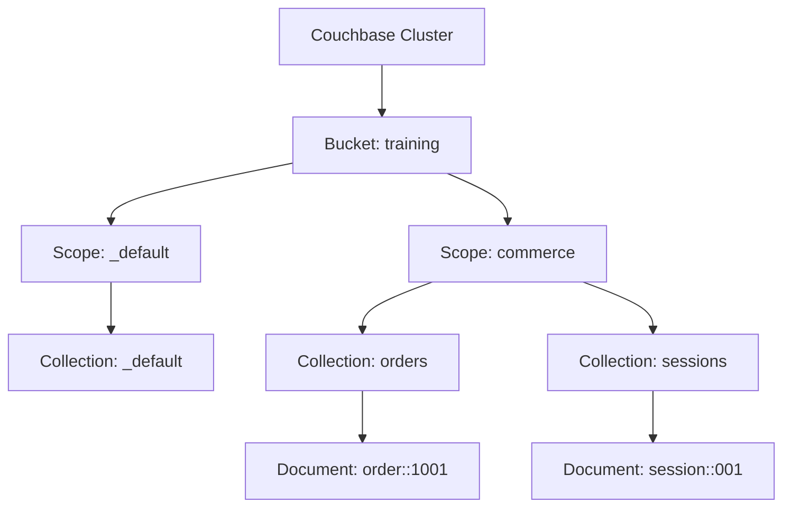

# Tạo bucket, scope, collection và tài khoản ứng dụng

## Mục tiêu bài học

Một ứng dụng **Spring Data Couchbase** không thể truy cập dữ liệu chỉ bằng cách khai báo `spring-boot-starter-data-couchbase`. Phía **Couchbase Server** còn phải có bucket, scope, collection, các dịch vụ phù hợp và một danh tính được cấp quyền. Đây là nền tảng để học document mapping, repository, `CouchbaseTemplate`, SQL++, TTL, CAS, giao dịch và API reactive một cách có kiểm soát.

Bài thuộc chương **Môi trường** này hướng dẫn tạo cấu trúc dữ liệu và quyền truy cập cho một ứng dụng quản lý đơn hàng giả lập. Sau bài học, bạn sẽ:

- Giải thích được **bucket → scope → collection → document**, phân biệt quyền quản trị và quyền ứng dụng.
- Tạo bucket `training`, scope `commerce`, collection `orders` và `sessions` trong Web Console.
- Hiểu các lựa chọn quan trọng khi tạo bucket: RAM quota, backend, replica và TTL.
- Tạo tài khoản ứng dụng khác với `Administrator`, phân quyền theo **edition** và theo thao tác KV/SQL++.
- Kiểm tra resource manifest, role assignments, đọc/ghi theo key và truy vấn có chỉ mục.
- Cấu hình Spring Boot dùng secret từ môi trường và ánh xạ đúng scope/collection.
- Chẩn đoán lỗi do thiếu tài nguyên, thiếu quyền, index hoặc topology, thay vì tự ý thay phiên bản SDK.

> **Điều kiện đầu vào:** Couchbase Server đã chạy và cluster đã được khởi tạo, có **Data Service**; nếu thực hành SQL++ cần thêm **Query** và **Index Service**. Người học có tài khoản quản trị lab. Scope/collection đầy đủ yêu cầu **Couchbase Server 7.0+** và SDK/Spring Data hỗ trợ. Bài sử dụng tên nhất quán với lab Docker một node nhưng các nguyên tắc áp dụng cho Server tự quản lý hoặc Couchbase Capella có tính năng tương ứng.

## 1. Tổ chức dữ liệu và trách nhiệm của từng cấp



| Cấp | Chức năng | Ví dụ | Điều cần quyết định |
| --- | --- | --- | --- |
| **Bucket** | Không gian chứa dữ liệu với cấu hình lưu trữ, RAM quota, replica và TTL. | `training` | Loại bucket, dung lượng, backend, số replica, durability và vòng đời dữ liệu. |
| **Scope** | Nhóm các collection, giúp tổ chức domain và giới hạn một số quyền. | `commerce` | Phạm vi nghiệp vụ hoặc tenant; ai có quyền tạo collection. |
| **Collection** | Tập document mà SDK/repository thực hiện CRUD và query. | `orders`, `sessions` | Kiểu dữ liệu, quy tắc TTL, chỉ mục, quyền đọc/ghi. |
| **Document** | Bản ghi JSON có **key duy nhất trong một collection**, CAS, có thể có expiry. | `order::1001` | Cấu trúc entity, ID, version/CAS, TTL và quy tắc truy vấn. |
| **User / role** | Danh tính và tập quyền truy cập vào các tài nguyên. | `training-app` | Cho phép thao tác gì, trên phạm vi nào, với credentials nào. |

Một bucket mới có scope `_default` và collection `_default`. **Không** nên mặc định rằng entity Spring Data đặt trong `commerce.orders` chỉ vì bucket tên `training`: phải cấu hình scope/collection riêng. Trong các phiên bản hiện đại còn có scope hệ thống `_system`; không tạo document ứng dụng trong đó.

### Vì sao tách `orders` và `sessions`?

Collection `orders` chứa đơn hàng dài hạn, có thể dùng optimistic locking bằng CAS và secondary index để tìm theo `status`. Collection `sessions` giữ dữ liệu phiên ngắn hạn, thường có TTL. Tách collection giúp chọn chỉ mục và quyền phù hợp từng loại dữ liệu; tuy nhiên **scope/collection không tự động biến thành một cụm vật lý độc lập**. Khi cần cách ly tài nguyên, độ bền hoặc chính sách khác nhau ở mức bucket/cluster, phải thiết kế thêm ở tầng đó.

**Ví dụ tên đầy đủ trong SQL++:**

```sql
SELECT META(o).id AS docId, o.status
FROM `training`.`commerce`.`orders` AS o
WHERE o.status = "NEW";
```

Phần `training` là bucket, `commerce` là scope, `orders` là collection. Các dấu backtick bao tên là cú pháp SQL++; nó khác với key string của document, ví dụ `"order::1001"`.

## 2. Xác nhận trạng thái cluster và khả năng sử dụng feature

Trước khi tạo tài nguyên, đăng nhập Web Console bằng tài khoản quản trị lab và xác nhận:

1. **Version/edition:** Server 7.0+ cho scopes/collections; ghi cả bản vá, edition (**Community** hay **Enterprise**) hoặc thông tin deployment Capella.
2. **Services:** Data đang chạy; Query + Index cần cho SQL++ có index. Không có Index Service thì CRUD theo key vẫn có thể hoạt động nhưng repository derived query dễ thất bại.
3. **Topology:** Lab một node có thể dùng replica = 0; không suy ra khả năng chịu lỗi, majority durability hay giao dịch phân tán thực tế từ kết quả lab này.
4. **Quyền người thao tác:** Tạo bucket/scope và quản lý user là thao tác **quản trị**, không phải nhiệm vụ thường xuyên của tài khoản runtime.
5. **Môi trường:** Chỉ tạo các tài nguyên `training` trong lab/staging được phép; không trùng tên dữ liệu hiện có.

**Đặc biệt về edition:** Theo tài liệu Couchbase Server hiện tại, **Community Edition** chỉ cung cấp một tập RBAC giới hạn cho việc gán role như `bucket_full_access`, `admin` và `ro_admin`. Phân quyền chi tiết `data_reader`/`data_writer`/`query_select` theo scope/collection trong các ví dụ bên dưới **cần Enterprise Edition hoặc môi trường hỗ trợ tương đương**. Không yêu cầu người học chọn role mà Web Console của Community không cho phép. Xem mục 5 để chọn đường học phù hợp.

Nguồn: [Scopes and Collections](https://docs.couchbase.com/server/current/learn/data/scopes-and-collections.html), [Roles](https://docs.couchbase.com/server/current/learn/security/roles.html), [RBAC API và giới hạn Community Edition](https://docs.couchbase.com/server/current/rest-api/rbac.html).

## 3. Tạo bucket `training`

Trong **Couchbase Server Web Console → Buckets → Add Bucket**, nhập:

| Thuộc tính | Đề xuất cho lab một node | Lý do |
| --- | --- | --- |
| Bucket name | `training` | Tên cố định cho cấu hình Spring Boot và SQL++. |
| Bucket type | **Couchbase** | Lưu document bền vững trên đĩa; khác với bucket Ephemeral. |
| Storage backend | **Couchstore** nếu edition/phiên bản hỗ trợ | Dùng backend phù hợp lab nhỏ; không mặc định mọi backend có ở Community. |
| Memory quota | **256 MiB** nếu quota cluster cho phép | Mức thực hành, không phải sizing chuẩn production. |
| Replica copies | **0** cho lab một node | Không có node thứ hai để đặt replica. |
| Bucket Max TTL | Để **không bật giới hạn** / 0 | Document của `orders` không bị áp expiry mặc định; TTL sẽ được học riêng. |
| Minimum durability level | Mặc định phù hợp lab | Không ép majority/replica topology mà cluster một node không đáp ứng. |

Nhấn **Add Bucket** và đợi bucket sẵn sàng trong danh sách. RAM quota của bucket không được vượt phần còn lại của quota cấp cho Data Service; một số backend yêu cầu quota tối thiểu khác nhau. **256 MiB chỉ là ví dụ**, không buộc đặt nếu phiên bản/UI yêu cầu giá trị khác.

Bucket là nơi chọn các đặc tính ảnh hưởng tất cả collection bên trong. Chẳng hạn, thiết lập `maxTTL` ở bucket có thể ảnh hưởng collection kế thừa; để quản lý TTL của `sessions` khác `orders`, cần hiểu thứ tự ưu tiên giữa bucket, collection và expiry của từng mutation.

### Hai cảnh báo thiết kế

**Replica = 0 là quyết định của lab, không phải khuyến nghị production.** Với môi trường thật, chọn số node/replica và mức durability dựa trên yêu cầu sẵn sàng dữ liệu. Transaction và durable writes có thể thất bại khi topology không đủ điều kiện.

**Không dùng thao tác Flush/Delete Bucket để sửa lỗi truy vấn.** Chúng có thể làm mất dữ liệu; nếu repository không thấy document, cần kiểm tra đúng collection, quyền và index trước.

Nguồn: [Create a Bucket](https://docs.couchbase.com/server/current/manage/manage-buckets/create-bucket.html), [Expiration](https://docs.couchbase.com/server/current/learn/data/expiration.html).

## 4. Tạo scope và collection

Từ danh sách bucket, mở **`training` → Scopes & Collections**:

1. Kiểm tra scope/collection `_default` đã tồn tại. Không xóa hoặc dùng chúng thay cho tên nghiệp vụ chỉ vì tiện.
2. Chọn **Add Scope**, nhập `commerce` và lưu.
3. Tại scope `commerce`, chọn **Add Collection**, nhập `orders`. Giữ collection Max TTL bằng **0** để kế thừa bucket Max TTL (bucket ở ví dụ này không đặt giới hạn).
4. Trong cùng scope `commerce`, tạo collection `sessions` để thực hành TTL sau này; việc đặt expiry 60 giây sẽ thực hiện trên một **document** khi ghi, không bắt mọi session hết hạn cùng lúc.
5. Xác minh cây tài nguyên:

```text
training (bucket)
├── _default (scope)
│   └── _default (collection)
└── commerce (scope)
    ├── orders (collection)
    └── sessions (collection)
```

**Lưu ý về TTL:** Collection Max TTL = 0 có nghĩa là **kế thừa bucket**; nó không nhất thiết luôn đồng nghĩa "document không bao giờ hết hạn" nếu bucket có chính sách TTL. Muốn hiểu chính xác việc ghi `expiry` và `preserveExpiry` khi cập nhật, cần kiểm tra phiên bản Server/SDK và tài liệu về expiration.

### 4.1. Phản hồi bất đồng bộ và tình trạng "vừa tạo xong nhưng chưa thấy"

Lệnh tạo bucket, scope và collection có thể **hoàn thành bất đồng bộ**. Sau khi UI báo thành công, manifest của cluster và SDK có thể cần thêm thời gian cập nhật. Nếu tạo collection rồi lập tức tạo index hoặc thao tác SDK báo không tìm thấy, hãy:

- kiểm tra collection đã xuất hiện trong Web Console và bucket đã ở trạng thái sẵn sàng;
- đọc lại manifest qua REST endpoint chỉ đọc ở mục 4.2;
- thử lại trong giới hạn có kiểm soát sau khi cluster đồng bộ; không tạo lại trùng tên ngay lập tức.

Không dùng tên scope/collection không tồn tại với hy vọng Spring Data sẽ tự tạo. Việc quản lý schema/tài nguyên nên là một bước triển khai rõ ràng.

### 4.2. Kiểm tra hoặc tạo scope/collection bằng REST API

Các lệnh sau dành cho môi trường **self-managed local** có Web Console ở `http://127.0.0.1:8091`. `curl -u Administrator` sẽ yêu cầu nhập mật khẩu khi cần, tránh đặt secret trực tiếp trên dòng lệnh.

Để **chỉ đọc** manifest:

```bash
curl --fail --show-error --user Administrator \
  http://127.0.0.1:8091/pools/default/buckets/training/scopes
```

Phản hồi JSON phải có `scopes` chứa `commerce` và mảng `collections` chứa `orders`, `sessions`. Có thể quan sát thêm manifest UID; không cần ghi cứng UID vì nó có thể thay đổi khi tài nguyên được cập nhật.

**Nếu chưa tạo** `commerce` và muốn dùng API thay cho UI, chạy tuần tự (chỉ trên lab):

```bash
curl --fail --show-error --user Administrator -X POST \
  http://127.0.0.1:8091/pools/default/buckets/training/scopes \
  --data-urlencode 'name=commerce'

# Chỉ gọi sau khi scope commerce đã hiện trong manifest.
curl --fail --show-error --user Administrator -X POST \
  http://127.0.0.1:8091/pools/default/buckets/training/scopes/commerce/collections \
  --data-urlencode 'name=orders'

curl --fail --show-error --user Administrator -X POST \
  http://127.0.0.1:8091/pools/default/buckets/training/scopes/commerce/collections \
  --data-urlencode 'name=sessions'
```

**Không chạy các lệnh tạo lần thứ hai nếu đã tạo bằng UI.** Khi tên tồn tại, API có thể trả lỗi conflict; việc đó không phải bằng chứng Couchbase hỏng. Khi dùng script provisioning thực tế, cần kiểm tra trạng thái và có chính sách retry/idempotency thay vì cứ gửi POST liên tục.

Trên Windows PowerShell 5.1, dùng `curl.exe` thay vì alias `curl`. Trên môi trường TLS, thay `http://...:8091` bằng `https://...:18091` và cài CA tin cậy; không bỏ qua xác minh chứng chỉ khi triển khai.

Nguồn: [Manage Scopes and Collections — UI/CLI/REST](https://docs.couchbase.com/server/current/manage/manage-scopes-and-collections/manage-scopes-and-collections.html).

## 5. Tạo tài khoản ứng dụng và cấp quyền

**Không cấu hình username/password của `Administrator` vào Spring Boot**: danh tính quản trị dùng để tạo bucket, collection, user và index, còn ứng dụng chỉ cần những quyền phục vụ luồng nghiệp vụ. Việc tách này giúp giới hạn tác động nếu credentials runtime bị lộ.

Trong Web Console, mở **Security → Users & Groups → Users → Add User**. Tạo tài khoản local tên `training-app` với mật khẩu riêng, đủ mạnh; chọn role đúng theo edition và mục đích bên dưới, rồi Save. Giao diện vai trò có thể thay đổi đôi chút giữa Server/Capella và phiên bản.

### 5.1. Phân quyền theo thao tác

| Thao tác từ ứng dụng | Role điển hình trong Enterprise/Capella | Điều role **không** tự cấp |
| --- | --- | --- |
| `get(id)`, `existsById(id)` trên KV | **Data Reader** (`data_reader`) | Không tự cho phép `SELECT` SQL++. |
| `insert`, `upsert`, `replace`, `remove` theo KV | **Data Writer** (`data_writer`) | Không tự cho phép đọc document hoặc `INSERT/UPDATE/DELETE` bằng SQL++. |
| Repository derived query `findByStatus`, SQL++ `SELECT` | **Query Select** (`query_select`) | Không tự cho phép KV write hoặc SQL++ mutation. |
| SQL++ `INSERT`, `UPDATE`, `DELETE` | **Query Insert / Query Update / Query Delete** tương ứng | Không tự cho phép tất cả các kiểu statement khác. |
| Tạo/sửa index | Role quản lý index thích hợp | Thông thường **không** cấp cho tài khoản chạy API sản xuất. |
| Tạo/drop scope hoặc collection | **Manage Scopes** (`scope_admin`) hoặc quyền quản trị tương ứng | Không tự cho phép đọc/ghi document. |
| Transaction nhiều document | Các quyền KV/Query cho **tất cả collection** có liên quan, kể cả metadata collection khi được cấu hình | Không thay thế điều kiện Server/SDK, replica, durability và đồng bộ thời gian. |

Đối với ứng dụng `orders` chỉ làm **KV CRUD + SQL++ SELECT** trên một collection, bộ quyền cơ sở để cân nhắc ở **Enterprise/Capella** là:

```text
data_reader[training:commerce:orders]
data_writer[training:commerce:orders]
query_select[training:commerce:orders]
```

Đây là **cú pháp mô tả role assignment của Couchbase Server**, không phải YAML hay command cần chạy nguyên văn. Khi dùng Web Console, chọn Bucket `training`, Scope `commerce`, Collection `orders` cho **từng role**. Chú ý lựa chọn `*` có thể có nghĩa **mọi scope/collection**; nếu muốn giới hạn đúng `orders` thì không để wildcard.

Nếu ứng dụng còn làm việc với `sessions`, chỉ cấp thêm đúng thao tác cần trên collection đó, ví dụ Data Reader/Writer nếu thực hiện KV. **Reactive repository** không cần một role tên "Reactive"; quyền phụ thuộc KV/SQL++ thực sự thực thi.

**Phân biệt Query Workbench với SQL++ API:** `query_select` cho phép thực thi `SELECT`, nhưng tài liệu roles nêu riêng role này **không cho dùng Query Workbench**. Để kiểm thử quyền query của ứng dụng, chạy thông qua Java SDK hoặc endpoint Query phù hợp bằng chính `training-app`. Dùng tài khoản quản trị riêng cho thao tác trên giao diện nếu cần.

### 5.2. Nếu lab dùng Community Edition

Theo [RBAC API hiện hành](https://docs.couchbase.com/server/current/rest-api/rbac.html), **Community Edition** giới hạn role có thể gán thành `bucket_full_access`, `admin`, `ro_admin`. Role legacy `bucket_full_access` (còn gọi Application Access) cho KV read/write trong bucket và **không cấp SQL++ Query Select**. Nó cũng được tài liệu đánh dấu deprecated, vì vậy **không xem đây là thiết kế quyền phù hợp production**.

Để thực hành **KV trong lab Community biệt lập**, có thể tạo `training-app` và gán `bucket_full_access[training]` **chỉ trên bucket thực hành** nếu giao diện cho phép. Tài khoản này có phạm vi rộng trong bucket, không có collection-level isolation. Vì thế:

- Dùng `training-app` để thử SDK `get/insert/upsert/remove` trên `training.commerce.orders`.
- Dùng `Administrator` **chỉ trong Web Console** để tạo index và chạy SQL++ lab; không đưa admin credentials vào Spring Boot.
- Muốn chạy **derived repository query bằng chính user ứng dụng** và kiểm tra least privilege `Query Select` theo collection, hãy dùng **Enterprise/Capella** hỗ trợ role đó.
- Đừng cấp `admin` cho tài khoản ứng dụng chỉ để làm query chạy được; điều đó phá vỡ mục tiêu tách quyền.

Kiểm tra danh sách role cluster thực sự cho phép trước khi tạo user:

```bash
curl --fail --show-error --user Administrator \
  http://127.0.0.1:8091/settings/rbac/roles
```

Thông tin trả về có tên role và các thuộc tính, giúp kiểm tra availability/edition. Không suy từ ví dụ Enterprise rằng mọi role đều có sẵn trên Community. Với **Couchbase Capella**, quản lý user và role theo Capella Console/tài liệu của dịch vụ; endpoint quản trị Couchbase Server self-managed không nhất thiết được expose giống nhau.

Nguồn: [Roles and Privileges](https://docs.couchbase.com/server/current/learn/security/roles.html), [Manage Users and Roles](https://docs.couchbase.com/server/current/manage/manage-security/manage-users-and-roles.html).

### 5.3. Đọc lại quyền user sau khi lưu

Với Server self-managed và tài khoản admin, dùng endpoint chỉ đọc:

```bash
curl --fail --show-error --user Administrator \
  http://127.0.0.1:8091/settings/rbac/users
```

Trong kết quả, tìm user `training-app` và các role có `bucket_name`, `scope_name`, `collection_name` đúng dự kiến. API có thể hiển thị quyền từ group và quyền trực tiếp; ghi nhận cả hai khi đánh giá thực quyền. Nếu có lỗi 401, xác minh credentials; nếu 403, kiểm tra quyền quản lý hoặc xem user. **Không in password** vào log; endpoint liệt kê người dùng/roles không cần hiển thị mật khẩu.

### 5.4. Tách tài khoản triển khai và runtime

| Danh tính | Nhiệm vụ | Cần hạn chế |
| --- | --- | --- |
| `Administrator` hoặc user provisioning | Tạo bucket, scope, collection, index, cấp role. | Không xuất hiện trong `application.yml` hoặc secret runtime. |
| `training-app` | Thực thi các thao tác dữ liệu mà nghiệp vụ cần. | Không có quyền tạo/drop bucket, quản lý user hay xóa index. |
| Tài khoản migration/index riêng (nếu cần) | Chạy thay đổi schema/index có kiểm soát. | Không tồn tại vĩnh viễn dưới vai trò runtime, quản lý qua pipeline/approval. |
| Tài khoản read-only để kiểm tra (nếu cần) | Quan sát/truy vấn theo phạm vi cần thiết. | Không có quyền mutation ngoài nhu cầu. |

Đối với môi trường nhiều service, mỗi service có thể dùng user/role riêng. Không chia sẻ một credential rộng cho mọi ứng dụng chỉ để giảm công tạo user.

## 6. Tạo chỉ mục và xác nhận SQL++ đúng collection

**Chỉ mục là bước quản trị dữ liệu độc lập với quyền runtime.** Dùng admin trong **Query Workbench** của lab, chọn đúng collection:

```sql
-- Secondary index cho truy vấn theo trạng thái đơn hàng.
CREATE INDEX idx_orders_status
ON `training`.`commerce`.`orders`(status);
```

Sau khi index online:

```sql
UPSERT INTO `training`.`commerce`.`orders` (KEY, VALUE)
VALUES ("order::1001", {"status":"NEW","total":125000,"type":"order"});

EXPLAIN
SELECT META(o).id AS docId, o.status, o.total
FROM `training`.`commerce`.`orders` AS o
WHERE o.status = "NEW";

SELECT META(o).id AS docId, o.status, o.total
FROM `training`.`commerce`.`orders` AS o
WHERE o.status = "NEW";
```

**Kết quả mong đợi:** một document có `docId = "order::1001"` và `status = "NEW"`. `EXPLAIN` cho biết Query Planner có dùng index hay không. Nếu trước đó đã tồn tại index cùng tên, không tạo lại; kiểm tra mục **Indexes** trước.

**Quyền khác nhau theo giao thức:** user có **Data Writer** có thể `upsert` bằng KV nhưng **không mặc nhiên** được chạy câu SQL++ `UPSERT` ở trên; các câu SQL++ mutation cần Query roles phù hợp. Vì thế ví dụ thao tác `UPSERT` và tạo index được thực hiện bởi **admin/provisioning user** trong lab, còn phần kiểm thử quyền ứng dụng ở mục 7 dùng SDK với tài khoản ứng dụng.

Trong Spring Data Couchbase, repository derived query thường dùng SQL++; ngoài index trên các trường filter còn có thể cần index/điều kiện cho trường phân biệt loại entity (ví dụ metadata `_class`). Hãy xem **câu SQL++ do Spring Data thực sự tạo** và `EXPLAIN`; không dựa vào một chỉ mục duy nhất cho mọi kiểu truy vấn.

Nguồn: [SQL++ Query](https://docs.couchbase.com/server/current/n1ql/query.html), [CREATE INDEX](https://docs.couchbase.com/server/current/n1ql/n1ql-language-reference/createindex.html), [Spring Data Couchbase Repository](https://docs.spring.io/spring-data/couchbase/reference/couchbase/repository.html).

## 7. Cấu hình và kiểm thử từ Spring Boot

### 7.1. Khai báo dependency và thông tin kết nối

Trong dự án có Spring Boot BOM/dependency management tương thích, với truy cập đồng bộ:

```groovy
dependencies {
    implementation 'org.springframework.boot:spring-boot-starter-data-couchbase'
}
```

Nếu dự án cần `ReactiveCouchbaseRepository` hoặc `ReactiveCouchbaseTemplate`, cân nhắc starter `spring-boot-starter-data-couchbase-reactive`; vẫn dùng cùng nguyên tắc scope/collection và RBAC theo thao tác.

`application.yml`:

```yaml
spring:
  couchbase:
    connection-string: couchbase://127.0.0.1
    username: ${CB_USERNAME}
    password: ${CB_PASSWORD}
  data:
    couchbase:
      bucket-name: training
```

**Không ghi mật khẩu thật** trong Git, README, log, shell history hay Docker image. Khai báo `CB_USERNAME=training-app` và `CB_PASSWORD` qua môi trường của IDE/secret manager. Dùng `couchbase://` chỉ cho lab loopback; với Capella và server từ xa, dùng `couchbases://`, TLS/CA và cấu hình mạng theo tài liệu của môi trường.

Bucket được chọn bằng `spring.data.couchbase.bucket-name`. **Scope/collection không tự suy từ tên bucket**; mapping ở mục 7.2 sẽ gắn riêng `commerce.orders`.

### 7.2. Ánh xạ entity vào collection được tạo

Spring Data Couchbase hỗ trợ `@Scope` và `@Collection` trên entity/repository. Ví dụ entity tối giản, đặt trong file `Order.java`:

```java
package com.example.orders;

import org.springframework.data.annotation.Id;
import org.springframework.data.couchbase.core.mapping.Collection;
import org.springframework.data.couchbase.core.mapping.Document;
import org.springframework.data.couchbase.core.mapping.Field;
import org.springframework.data.couchbase.core.mapping.Scope;

@Document
@Scope("commerce")
@Collection("orders")
public class Order {
    @Id
    private String id;

    @Field
    private String status;

    public Order() {}

    public Order(String id, String status) {
        this.id = id;
        this.status = status;
    }

    public String getId() { return id; }
    public String getStatus() { return status; }
}
```

Repository trong file `OrderRepository.java`:

```java
package com.example.orders;

import org.springframework.data.couchbase.repository.CouchbaseRepository;
import java.util.List;

public interface OrderRepository extends CouchbaseRepository<Order, String> {
    List<Order> findByStatus(String status);
}
```

**Giải thích hành vi:**

- `save(new Order("order::repo-1001", "NEW"))` sẽ làm việc với `training.commerce.orders` khi cấu hình đã nhận annotation.
- `findById("order::repo-1001")` truy cập theo key; cần quyền KV phù hợp.
- `findByStatus("NEW")` có thể tạo SQL++ và đòi hỏi **Query Select + Index Service + index đúng truy vấn**. Điều này không được kiểm chứng chỉ bằng `findById`.
- Document được Spring Data lưu có thể có metadata phân biệt kiểu như `_class`. Document mẫu tạo thủ công bằng SQL++ không nhất thiết thỏa predicate loại mà repository tạo; hãy thử bằng document lưu từ chính repository.

Thứ tự ưu tiên khi dùng `@Scope`/`@Collection`, cấu hình scope mặc định, mapping trên repository và fluent template API được giải thích trong [Spring Data Couchbase — Collection Support](https://docs.spring.io/spring-data/couchbase/reference/couchbase/collections.html). Trước khi vận hành production, xem API của đúng phiên bản Spring Data do Boot quản lý.

### 7.3. Smoke test quyền bằng Java SDK

Java SDK nằm dưới Spring Data. Đoạn sau là **ví dụ body của một `CommandLineRunner` trong ứng dụng Spring Boot đã auto-configure `Cluster`**, chỉ thao tác trên collection thử:

```java
var bucket = cluster.bucket("training");
bucket.waitUntilReady(java.time.Duration.ofSeconds(30));

var orders = bucket.scope("commerce").collection("orders");
var key = "smoke::" + java.util.UUID.randomUUID();

boolean inserted = false;
try {
    orders.insert(
        key,
        com.couchbase.client.java.json.JsonObject.create()
            .put("status", "NEW")
            .put("type", "smoke"),
        com.couchbase.client.java.kv.InsertOptions.insertOptions()
            .expiry(java.time.Duration.ofMinutes(5))
    );
    inserted = true;

    var readBack = orders.get(key);
    System.out.println("KV OK: " + readBack.contentAsObject());
} finally {
    // Không phát sinh thêm lỗi quyền ghi khi insert đã bị từ chối.
    // TTL 5 phút giới hạn thời gian tồn tại nếu cleanup thất bại.
    if (inserted) {
        orders.remove(key);
    }
}
```

Biến `cluster` được inject từ Spring Boot (ví dụ làm tham số của `@Bean CommandLineRunner`); đây không phải một file Java hoàn chỉnh. Nếu dùng một tài khoản **chỉ có Data Reader** thì bước `insert` phải bị từ chối; đây là kiểm tra ranh giới quyền. Với lab Community, `bucket_full_access[training]` cho phép KV trong bucket, vì vậy **không dùng** nó để chứng minh cách ly theo từng collection.

Để kiểm tra SQL++ bằng **tài khoản có Query Select** trong Enterprise/Capella, có thể chạy SDK:

```java
var result = cluster.query(
    "SELECT META(o).id AS docId, o.status " +
    "FROM `training`.`commerce`.`orders` AS o " +
    "WHERE o.status = $status",
    com.couchbase.client.java.query.QueryOptions.queryOptions()
        .parameters(
            com.couchbase.client.java.json.JsonObject.create()
                .put("status", "NEW")
        )
);

System.out.println(result.rowsAsObject());
```

Lệnh `SELECT` này **không ghi** dữ liệu. Mọi string truy vấn đều cố định tên bucket/scope/collection; giá trị lọc dùng tham số `$status` để tránh nối trực tiếp input vào SQL++. Nếu user chỉ có KV roles, query phải bị từ chối; nếu user có Query Select nhưng thiếu index, lỗi thường là ở index/service.

### 7.4. Bộ phép thử chấp nhận

| Kiểm tra | Danh tính | Kỳ vọng |
| --- | --- | --- |
| Đọc manifest và kiểm tra bucket/scope/collection | Admin/provisioning | `training.commerce.orders` và `sessions` tồn tại. |
| KV insert/get/remove một key `smoke::...` | `training-app` | **PASS** nếu role cấp đủ quyền KV. |
| SQL++ `SELECT` theo `status` với index | Enterprise/Capella user có Query Select | **PASS** nếu Query/Index và RBAC đúng. |
| Thử đọc collection không được cấp quyền | Enterprise/Capella user giới hạn `orders` | **DENIED** theo chính sách RBAC. |
| Thử tạo/drop collection bằng tài khoản runtime | `training-app` | **DENIED** nếu không có quyền quản trị. |
| Thử SQL++ bằng user chỉ có Data Reader/Writer | User KV-only | **DENIED**, vì KV roles không bao gồm Query Select. |

Không dùng `Administrator` làm tài khoản thực hiện positive test cho **quyền ứng dụng**: admin thành công không chứng minh role của `training-app` đã đúng.

## 8. Lỗi thường gặp

| Triệu chứng | Kiểm tra đầu tiên | Hướng xử lý |
| --- | --- | --- |
| Không thấy menu Add Bucket / Add Scope | User không có quyền quản trị, hoặc chưa chọn đúng bucket. | Dùng danh tính provisioning có role phù hợp; không cấp admin cho ứng dụng runtime. |
| Bucket không tạo được | RAM quota hoặc backend không phù hợp, bucket name đã tồn tại. | Đọc thông báo UI, đối chiếu quota/edition, chọn tên khác nếu đang có dữ liệu. |
| `ScopeNotFoundException` / `CollectionNotFoundException` | Sai `commerce.orders`, vừa tạo chưa đồng bộ manifest, Server/SDK chưa hỗ trợ. | Kiểm tra manifest và đợi đồng bộ rồi retry có giới hạn. |
| KV read hoạt động, KV write trả access denied | Có Data Reader nhưng không có Data Writer, hoặc role áp nhầm bucket/collection. | Kiểm tra role assignment và thao tác tương ứng. |
| KV CRUD thành công, `findByStatus` lỗi access denied | User thiếu Query Select; KV roles không cấp quyền SQL++. | Cấp quyền Query Select phù hợp nếu edition hỗ trợ. |
| `No index available` / query không dùng index | Index chưa tạo, chưa online, Query/Index Service thiếu hoặc index không phù hợp với predicate. | Xem Indexes, `EXPLAIN` và query thực do repository sinh. |
| Query Workbench không truy cập bằng `query_select` | Role SQL++ SELECT không đồng nghĩa quyền dùng Workbench. | Thử SQL++ qua SDK/query endpoint; dùng tài khoản quản trị riêng để provision. |
| Không chọn được role Data Reader/Writer theo collection trong Community | Edition chỉ có bộ role giới hạn. | Xem `/settings/rbac/roles`; chỉ thử KV với user phạm vi bucket trong lab, chuyển Enterprise/Capella để thử RBAC chi tiết. |
| Repository query trả rỗng dù SQL++ thủ công trả dữ liệu | Document mẫu có thể thiếu `_class`, filter khác, scope sai hoặc index consistency. | Tạo document bằng repository, xem query được tạo và kiểm tra consistency/index. |
| 401 khi kết nối | Sai username/password hoặc domain xác thực. | Kiểm tra secret runtime, user tồn tại, password đã đổi chưa. |
| 403 / insufficient privileges | User xác thực được nhưng không đủ RBAC cho thao tác. | Kiểm tra roles thực và target collection. |
| Timeout sau khi đăng nhập | Data/Query ports, Docker NAT, advertised addresses, tài nguyên cluster. | Kiểm tra network/service/log trước khi đổi dependency. |
| Giao dịch hoặc durable write thất bại trong lab một node | Topology/replica/mức durability không đáp ứng. | Dùng cluster nhiều node/replica để test giao dịch phân tán, kiểm tra quyền metadata collection. |

**Cách chẩn đoán:** xác định loại thao tác (KV, SQL++, quản trị) → kiểm tra đúng tài nguyên → xác nhận user/role/edition → kiểm tra index/service → xem version SDK/Server và log. Đừng coi một lần login thành công là bằng chứng đủ quyền trên mọi collection.

## 9. Bài tập thực hành

### Bài 1 — Thiết kế quyền

Ứng dụng đơn hàng cần `findById`, `save`, `deleteById` và `findByStatus` trong `training.commerce.orders`, không quản trị index. Hãy đề xuất role cho Enterprise/Capella và cho biết có cần gán quyền tạo collection không.

**Đáp án gợi ý:** Data Reader + Data Writer cho KV, Query Select cho derived SELECT, gắn riêng collection `orders`. Index được tạo qua provisioning, **không** gán Manage Scopes hay Manage Index cho runtime. Nếu thư viện thực hiện thêm SQL++ mutation hoặc transactions, khảo sát quyền phát sinh cụ thể trước khi cấp bổ sung.

### Bài 2 — Lab Community và yêu cầu SQL++

Bạn dùng Community Edition theo lab Docker, thấy chỉ có các role giới hạn và không thể tạo user `training-app` chỉ có `query_select` trên collection. Có nên cấp `admin` cho ứng dụng?

**Đáp án gợi ý:** Không. Với Community, dùng user `bucket_full_access[training]` **chỉ để thử KV trong lab biệt lập**, còn admin dùng Query Workbench để học SQL++. Muốn kiểm thử repository query bằng app user và RBAC chi tiết, chuyển sang môi trường hỗ trợ như Enterprise/Capella; không xem role legacy bucket_full_access là cấu hình bảo mật production.

### Bài 3 — Không thấy dữ liệu sau khi lưu

Entity `Order` dùng `@Scope("commerce")`, `@Collection("orders")` nhưng người học truy vấn `training._default._default` và nhận 0 row. Lỗi ở đâu?

**Đáp án gợi ý:** Sai collection. Document được ánh xạ vào `training.commerce.orders`. Query lại đúng ba cấp; nếu vẫn rỗng, xác minh document ID, type metadata và index.

### Bài 4 — Quyền và TTL

Phiên làm việc nằm ở `training.commerce.sessions`, mỗi document có expiry 60 giây; đơn hàng trong `orders` không được tự hết hạn. Bạn cần thay đổi gì?

**Đáp án gợi ý:** Tách collection như thiết kế, kiểm tra bucket/collection Max TTL và dùng expiry khi ghi session; không áp TTL toàn bucket làm ảnh hưởng orders. Chỉ cấp Data Reader/Writer trên `sessions` cho service cần truy cập session.

### Bài 5 — User có quyền SELECT nhưng không tìm thấy index

Ứng dụng Enterprise đã có `query_select[training:commerce:orders]`; `findByStatus` báo không có index. Cần cấp thêm Query Manage Index cho runtime không?

**Đáp án gợi ý:** Không nhất thiết. Dùng tài khoản provisioning tạo secondary index phù hợp; đợi index online rồi thử lại bằng user chỉ có Query Select. Đây là vấn đề provisioning/index, không phải lý do tự cấp quyền quản trị cho runtime.

## 10. Checklist chốt môi trường

- [ ] Server/Capella version và edition đã được xác minh; cluster không ở mixed-version ảnh hưởng feature.
- [ ] Data Service hoạt động; Query + Index Service có mặt nếu ứng dụng dùng SQL++.
- [ ] Bucket `training` đã tạo, quota/replica/TTL phù hợp mục tiêu lab.
- [ ] Scope `commerce` và collections `orders`, `sessions` có trong manifest.
- [ ] Hiểu `_default` và `_system`; entity/repository trỏ đến đúng collection.
- [ ] User `training-app` khác `Administrator`; credentials được quản lý qua biến môi trường/secret manager.
- [ ] Role áp đúng bucket/scope/collection theo edition; đã xem rõ giới hạn Community Edition.
- [ ] Index phục vụ SQL++ do admin/provisioning tạo, đã online.
- [ ] Đã thử KV bằng **chính tài khoản ứng dụng** và test SQL++ bằng user đủ Query Select khi có hỗ trợ.
- [ ] Đã thử một trường hợp **DENIED** để xác minh ranh giới quyền trên Enterprise/Capella.
- [ ] Có log/bằng chứng về tên tài nguyên, role assignments, version và kết quả kiểm thử; không lưu mật khẩu.

### Nguồn tài liệu chính thức

1. [Couchbase Server — Buckets, Scopes and Collections](https://docs.couchbase.com/server/current/learn/data/scopes-and-collections.html).
2. [Couchbase Server — Create a Bucket](https://docs.couchbase.com/server/current/manage/manage-buckets/create-bucket.html).
3. [Couchbase Server — Manage Scopes and Collections (UI/CLI/REST)](https://docs.couchbase.com/server/current/manage/manage-scopes-and-collections/manage-scopes-and-collections.html).
4. [Couchbase Server — Roles and Privileges](https://docs.couchbase.com/server/current/learn/security/roles.html).
5. [Couchbase Server — Manage Users, Groups and Roles](https://docs.couchbase.com/server/current/manage/manage-security/manage-users-and-roles.html).
6. [Couchbase Server — RBAC REST API và giới hạn edition](https://docs.couchbase.com/server/current/rest-api/rbac.html).
7. [Couchbase Server — SQL++ Query](https://docs.couchbase.com/server/current/n1ql/query.html).
8. [Spring Boot — Couchbase Auto-Configuration](https://docs.spring.io/spring-boot/reference/data/nosql.html).
9. [Spring Data Couchbase — Collection Support](https://docs.spring.io/spring-data/couchbase/reference/couchbase/collections.html).
10. [Couchbase Java SDK — Connection Management](https://docs.couchbase.com/java-sdk/current/howtos/managing-connections.html).

**Kết quả cần đạt:** người học có cấu trúc `training.commerce.orders`/`sessions` rõ ràng, dùng tài khoản ứng dụng riêng, biết quyền KV khác quyền SQL++ và kiểm chứng thực tế bằng SDK. Trên nền tảng đó có thể tiếp tục học mapping, repository, `CouchbaseTemplate`, SQL++, TTL/CAS, transaction và reactive với cấu hình bảo mật phù hợp.
