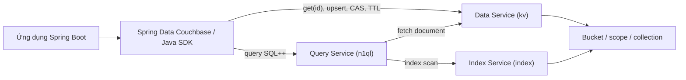

# Bật các dịch vụ cần cho Key-Value và SQL++

## Mục tiêu bài học

Trong **Spring Data Couchbase**, các thao tác như `findById`, `save`, `CouchbaseTemplate`, repository query và `@Query` có thể đi qua **những đường xử lý khác nhau trên Couchbase Server**. Ứng dụng đã khai báo đúng Java SDK và kết nối được tới cluster vẫn có thể thất bại khi truy vấn, nếu cluster chưa bật dịch vụ phù hợp hoặc chưa có chỉ mục.

Bài thuộc chương **Môi trường** này hướng dẫn cách bật, kiểm tra và sử dụng các service tối thiểu để học **Key-Value (KV)** và **SQL++**. Nội dung phục vụ mục tiêu xây dựng tầng truy cập dữ liệu bằng document mapping, repository, `CouchbaseTemplate`, đồng thời đặt nền tảng để học bucket/scope/collection, TTL, CAS, giao dịch, durability và API reactive.

Sau bài học, bạn có thể:

- Phân biệt vai trò **Data Service**, **Query Service** và **Index Service**; biết thao tác Spring Data nào cần service nào.
- Chọn ba service này khi tạo cluster một node trên Docker hoặc môi trường học tập.
- Kiểm tra service thực sự đang chạy bằng Web Console và REST API, thay vì chỉ nhìn cổng Docker.
- Xác nhận đường đi **KV theo document key** và **SQL++ theo thuộc tính** bằng các phép thử tách biệt.
- Tạo index, kiểm tra trạng thái `online` và dùng `EXPLAIN` để phân tích truy vấn.
- Xử lý trường hợp cluster đã khởi tạo nhưng còn thiếu Query/Index Service; hiểu yêu cầu phiên bản và rebalance.
- Nhận diện lỗi từ mạng, RBAC, index, quota và Server trước khi thay dependency Spring Boot.

> **Điều kiện trước khi thực hành:** Couchbase Server đã cài/khởi chạy và bạn có quyền quản trị cluster lab. Ví dụ dùng bucket `training`, scope `commerce`, collection `orders` trên Server hỗ trợ scope/collection (7.0+). Khi thực hành Docker, dùng loopback `127.0.0.1`; ví dụ chưa áp dụng cho production.

## 1. Ba service đóng vai trò gì?

| Dịch vụ | Tên trong REST/CLI | Vai trò | Ví dụ thao tác |
| --- | --- | --- | --- |
| **Data Service** | `kv` | Lưu document và xử lý truy cập theo key qua giao thức Key-Value. | SDK `collection.get("order::1001")`, `upsert`, `replace` theo CAS, expiry từng document. |
| **Query Service** | `n1ql` | Nhận, parse, lập kế hoạch và thực thi câu lệnh **SQL++**. | `SELECT` theo `status`, `UPDATE` qua SQL++, repository derived query hoặc `@Query`. |
| **Index Service** | `index` | Tạo, duy trì và phục vụ truy vấn trên **global secondary indexes (GSI)** và primary indexes. | `CREATE INDEX idx_orders_status ...`, index scan cho `WHERE status = "NEW"`. |

Đường đi khái quát:



**KV và SQL++ không đồng nghĩa.** Nếu đã biết key của document, `get(id)` có thể đi thẳng tới Data Service. Nếu muốn tìm nhiều document theo thuộc tính, tổng hợp, lọc hoặc JOIN bằng SQL++, Query Service phải thực hiện câu lệnh và thường sử dụng index. Vì vậy một phép thử KV thành công **không chứng minh** các câu query của repository đã sẵn sàng.

### 1.1. Có bắt buộc mọi câu SQL++ phải có index?

Đối với khóa học này, hãy bật **Data + Query + Index**, sau đó tạo secondary index phù hợp và xác minh kế hoạch thực thi. Cách làm này tạo môi trường ổn định để học truy vấn và tối ưu hiệu năng.

Có một ngoại lệ theo phiên bản: từ **Couchbase Server 7.6**, SQL++ có khả năng **sequential scan** dựa trên KV range scan cho một số truy vấn **không có index**. Tính năng này không thay thế thiết kế index cho bộ dữ liệu lớn; phạm vi, hiệu năng và hạn chế phải kiểm tra theo phiên bản Server. Không nên kết luận rằng **Index Service không cần thiết** chỉ vì một câu `SELECT` nhỏ chạy được mà chưa tạo index. Các bài về quản trị chỉ mục, scan bằng GSI và giải thích kế hoạch vẫn cần Index Service.

Nguồn: [Couchbase Query Service](https://docs.couchbase.com/server/current/learn/services-and-indexes/services/query-service.html), [Query Data with SQL++](https://docs.couchbase.com/server/current/n1ql/query.html), [SQL++ Query Concepts](https://docs.couchbase.com/server/current/n1ql/n1ql-intro/queriesandresults.html) và [SDK Query without Index (Server 7.6+)](https://docs.couchbase.com/cxx-sdk/current/concept-docs/querying-your-data.html).

## 2. Quyết định cấu hình dịch vụ cho từng bài thực hành

| Nhu cầu | Data | Query | Index | Giải thích |
| --- | :---: | :---: | :---: | --- |
| Lưu và đọc document theo ID bằng `CouchbaseRepository` | Có | Không bắt buộc | Không bắt buộc | Với thao tác KV thuần như `findById`/`save` theo key. |
| `CouchbaseTemplate` với các thao tác KV theo ID | Có | Không bắt buộc | Không bắt buộc | Xem **đúng phương thức** template đang gọi. |
| Repository `findByStatus("NEW")` | Có | Có | **Nên có** | Derived query dùng SQL++; index giúp lọc có kế hoạch và hiệu năng. |
| `@Query` với `SELECT`/`JOIN`/tổng hợp | Có | Có | **Nên có** | Query service lập kế hoạch; cần xem index và tính năng tương ứng. |
| `CREATE INDEX`, xem GSI, bài tối ưu SQL++ | Có | Có | Có | Quản trị và truy vấn index thực tế. |
| TTL của document, CAS khi replace | Có | Không bắt buộc | Không bắt buộc | Đây là các tính năng KV; không phải lý do tự bật Query Service. |
| Reactive repository/template | Tùy thao tác | Tùy thao tác | Tùy truy vấn | Reactive là cách lập trình phía client; yêu cầu Server phụ thuộc vào **KV hay SQL++** mà luồng reactive thực hiện. |
| Giao dịch nhiều document | Có | Khi giao dịch dùng SQL++ | Khi query cần index | Còn phụ thuộc vào Server/SDK version, quota, replica, durability, quyền truy cập và cấu hình transaction. |

Các ô **"Nên có"** thể hiện mục tiêu thực hành với secondary index. Không phải phát biểu rằng mọi Server/version đều từ chối SQL++ nếu không có index.

**Các dịch vụ khác chưa cần cho bài này:** Search (full-text/vector search), Analytics (OLAP), Eventing (hàm phản ứng với thay đổi document) và Backup Service. Không bật thêm chỉ để thử KV/SQL++ cơ bản, vì mỗi dịch vụ bổ sung tiêu thụ tài nguyên và có điều kiện triển khai riêng.

## 3. Chuẩn bị tài nguyên và các cổng mạng

### 3.1. RAM quota cho Data, Query, Index

Trong Couchbase, quota của Data và Index không giống nhau:

- **Data Service:** dùng RAM quota cho dữ liệu KV; tổng bucket quota trên node phải phù hợp với Data quota.
- **Index Service:** có buffer cache/index quota riêng để xây dựng và phục vụ GSI. Cần dung lượng đĩa, CPU và bộ nhớ cho index.
- **Query Service:** không yêu cầu một quota RAM cố định như Data/Index. Các phiên bản mới có thể có `queryMemoryQuota` làm **mục tiêu mềm** cho bộ gom rác; giá trị 0 thường nghĩa là không đặt mục tiêu mềm. Không nhầm `0` với việc Query Service không dùng RAM.

Theo tài liệu sizing, **Data Service** có mức quota tối thiểu 256 MB, **Index Service dùng Standard Global Secondary** có mức tối thiểu 256 MB; khi khởi tạo bằng API, quota mặc định của Index có thể là 512 MB. Ví dụ một lab nhỏ có thể phân bổ Data **512 MiB** và Index **512 MiB** khi phần cứng/UI cho phép. Đây là **gợi ý học tập**, không phải khuyến nghị sizing production.

Trên Docker Desktop, bộ nhớ cấp cho **toàn bộ Docker VM** phải đủ để chứa Couchbase, hai quota này, Query Service, hệ thống, logs và các tiến trình phụ. Nếu UI từ chối quota, xem tổng tài nguyên còn lại thay vì giảm tùy tiện dưới yêu cầu tối thiểu.

Nguồn: [Couchbase Sizing Guidelines](https://docs.couchbase.com/server/current/install/sizing-general.html), [General Settings](https://docs.couchbase.com/server/current/manage/manage-settings/general-settings.html) và [REST Getting Memory Information](https://docs.couchbase.com/server/current/rest-api/rest-get-memory-information.html).

### 3.2. Cổng cần mở từ máy học

| Cổng TCP | Dịch vụ/đường kết nối | Vai trò trong lab |
| --- | --- | --- |
| `8091` | Quản trị/Web Console, REST và bootstrap | Cần để mở UI và đọc cấu hình cluster. |
| `11210` | KV không mã hóa | Cần cho Java SDK khi thao tác Data Service từ host. |
| `8093` | SQL++ Query không mã hóa | Cần cho SDK/REST query từ host. |
| `18091`, `11207`, `18093` | Các cổng TLS tương ứng | Dùng khi kết nối TLS được cấu hình; không thay thế tùy tiện bằng kết nối HTTP lab. |
| `9100–9105` | Giao tiếp/indexer nội bộ giữa các node và một số công cụ quản trị | **Không cần publish ra host** cho bài SDK KV + SQL++ trên Docker một node. |

**Mở cổng không phải là bật service.** Lệnh Docker `-p 8093:8093` có thể tồn tại dù Query Service chưa được chọn lúc khởi tạo; khả năng kết nối thực tế vẫn thất bại. Tương tự, bật Query trong UI nhưng chặn port 8093 từ phía ứng dụng thì SDK có thể bootstrap qua 8091 nhưng query vẫn timeout.

Nguồn: [Couchbase Server Ports](https://docs.couchbase.com/server/current/install/install-ports.html).

## 4. Bật Data, Query và Index khi tạo cluster mới

### 4.1. Nếu dùng Docker local

Trên máy đã có Docker Engine/Desktop, có thể tạo một container Couchbase lab với **named volume**. Nếu đã có Couchbase Server chạy ở 8091, không chạy lại lệnh này:

```bash
docker run -d --name couchbase-services-lab -p 127.0.0.1:8091:8091 -p 127.0.0.1:11210:11210 -p 127.0.0.1:8093:8093 -v couchbase-services-data:/opt/couchbase/var couchbase/server:community-8.0.1
```

Image `community-8.0.1` chỉ là một tag minh họa có phiên bản cố định; hãy kiểm tra phiên bản đang còn được hỗ trợ, SDK compatibility và image thực tế trước khi áp dụng. Dùng `127.0.0.1` để tránh công khai Web Console ra mạng ngoài máy. Dữ liệu còn trong `couchbase-services-data` khi dừng container; xóa volume sẽ làm mất dữ liệu lab.

Xác minh container chạy:

```bash
docker ps --filter name=couchbase-services-lab
docker logs --tail 100 couchbase-services-lab
```

**Đây mới là bước chạy process Server.** Bạn vẫn cần khởi tạo cluster và chọn service ở bước tiếp theo.

### 4.2. Chọn ba dịch vụ trong Web Console

1. Mở **http://127.0.0.1:8091** (hoặc địa chỉ quản trị của môi trường lab) và chọn **Setup New Cluster**.
2. Đặt tên cluster và tài khoản quản trị/mật khẩu riêng. Không chép password vào source hoặc ví dụ console. Chỉ dùng `Administrator` cho bước provisioning.
3. Trong wizard cấu hình service, chọn **Data**, **Query** và **Index**. Bỏ Search/Analytics/Eventing nếu chưa cần.
4. Phân bổ quota **Data** và **Index** tương ứng RAM thật; Query có thể dùng mặc định. Nếu UI yêu cầu chọn backend/index storage, chọn phương án mà phiên bản/edition hiện tại hỗ trợ.
5. Hoàn tất wizard, chờ các service báo hoạt động. Vào **Servers** để xem dịch vụ trên từng node và trạng thái cluster.
6. Tạo bucket `training`, scope `commerce`, collection `orders` nếu chưa có. Với một node học tập, bucket có thể chọn **0 replica**; đừng dùng cấu hình này để kiểm chứng high availability/durable writes.

**Quan trọng:** sau khi chọn Data/Query/Index trên màn hình, hãy kiểm tra node thật sự có `kv`, `n1ql`, `index` và thực thi hai phép thử KV/SQL++ ở các mục sau. Tên dịch vụ ở UI có thể thay đổi, nhưng tên trong REST/CLI giúp đối chiếu.

Tài liệu: [Couchbase Create a Cluster](https://docs.couchbase.com/server/current/manage/manage-nodes/create-cluster.html).

### 4.3. Cách khởi tạo service qua REST khi tự động hóa lab

Nếu automation tạo một **node mới chưa khởi tạo**, tài liệu Couchbase cho phép gọi `POST /node/controller/setupServices` với chuỗi `kv,n1ql,index`. Ví dụ sau minh họa **duy nhất bước chọn service**:

```bash
curl --fail --show-error \
  -X POST http://127.0.0.1:8091/node/controller/setupServices \
  --data-urlencode 'services=kv,n1ql,index'
```

REST provisioning đầy đủ **còn cần** cấu hình quota (`/pools/default`), storage path nếu cần và thiết lập tài khoản quản trị (`/settings/web`); hãy làm theo tài liệu tạo cluster cho đúng phiên bản. **Không gửi POST này vào một cluster đã được cấu hình**, cũng không dùng nó như cách thêm service lên node production. Nếu đã hoàn tất Setup New Cluster bằng UI, bỏ qua hoàn toàn mục REST tạo mới này.

Lý do nêu tên REST endpoint: giúp hiểu chính xác ánh xạ `kv` = Data, `n1ql` = Query, `index` = Index khi đọc cấu hình hoặc viết script provisioning sau này.

## 5. Cluster đã khởi tạo nhưng thiếu Query hoặc Index thì sao?

Đừng xóa bucket hay tạo cluster mới vội. Trước hết mở **Servers** hoặc đọc trạng thái qua REST như mục 6.

### Với Couchbase Server 8.0 trở lên

Tài liệu chính thức mô tả chức năng **Modify Services and Rebalance** trên các node hiện có:

1. Đăng nhập bằng tài khoản **Full Administrator**, xem các node và service đang chạy.
2. Mở **Servers → Modify Services**.
3. Chọn thêm **Query (`n1ql`)** và/hoặc **Index (`index`)** trên node phù hợp. Không bỏ Data (`kv`).
4. Kiểm tra quota Index nếu đang bổ sung lần đầu, đồng thời kiểm tra disk path và resource.
5. Xác nhận **Rebalance and Change Services**. Chờ rebalance hoàn tất, kiểm tra lại node services và index.

**Điều kiện phiên bản:** tính năng thêm/bớt **non-Data Service trên node hiện có theo cách này yêu cầu Server 8.0+**. Không giả định menu/câu lệnh có thể dùng y hệt cho Server 7.x. Với phiên bản cũ hơn, xem hướng dẫn thay đổi topology bằng thêm/bớt node theo đúng release và lập kế hoạch riêng; nếu đây là lab mới chưa có dữ liệu, có thể khởi tạo lại **có chủ đích** sau khi đã xác nhận không cần giữ dữ liệu.

**Rủi ro thực tế:** thay đổi service có thể gây rebalance và ảnh hưởng tải hệ thống. **Xóa instance Index Service cuối cùng có thể làm mất toàn bộ index/metadata liên quan**; không thực hành thao tác loại bỏ service trên cluster đang dùng chung. Chỉ thêm những service còn thiếu, đúng quyền và trong môi trường được phép.

Nguồn: [Modify Services and Rebalance](https://docs.couchbase.com/server/current/manage/manage-nodes/modify-services-and-rebalance.html).

### Nếu dùng Capella

Capella quản lý hạ tầng và một số service/tier có cách cấu hình riêng. Xem service/deployment settings trong **Capella Console**, tài liệu tính năng của tier và trạng thái cluster. Đừng áp các REST endpoint quản trị `/node/controller/setupServices` hoặc `Modify Services` của Server self-managed lên Capella nếu dịch vụ không hỗ trợ.

## 6. Kiểm tra service thực sự được bật

### 6.1. Web Console

Mở **Servers**, xác nhận service hiển thị trên node và trạng thái khỏe mạnh. Với môi trường một node, kỳ vọng có đủ **Data, Query, Index**. Kiểm tra thêm:

- Quota Data/Index không bị vượt quá mức khả dụng, không có lỗi indexer initialization.
- Cluster không đang rebalance hoặc nâng cấp dang dở.
- Bucket `training` đã ready và scope `commerce`/collection `orders` có thật.
- Tài khoản ứng dụng có quyền KV và SQL++ đúng nhu cầu/edition; kiểm tra bằng chính danh tính ứng dụng ở các bước chấp nhận.

### 6.2. REST API chỉ đọc

Trên **Server tự quản lý**, địa chỉ quản trị lab `127.0.0.1:8091`, dùng:

```bash
# curl sẽ hỏi password vì chỉ truyền username.
curl --fail --show-error --user Administrator \
  http://127.0.0.1:8091/pools/default
```

Phản hồi JSON chứa mảng `nodes` và các trường `services` trên từng node. Nếu đã có `jq`, lọc ngắn:

```bash
curl --fail --silent --show-error --user Administrator \
  http://127.0.0.1:8091/pools/default \
  | jq -r '.nodes[] | [.hostname, .status, (.services | join(","))] | @tsv'
```

**Ví dụ minh họa** (không phải dữ liệu lấy từ cluster thật):

```text
cb-lab.local:8091   healthy   kv,n1ql,index
```

Nếu Node/Service list khác, **đừng đánh dấu PASS**. `healthy` cho biết node đang báo khỏe, nhưng các phép thử đường dữ liệu ở mục 7 vẫn cần thiết. Với cluster nhiều node, liệt kê **toàn bộ node**; Data, Query và Index có thể được phân phối trên các node khác nhau nhờ Multi-Dimensional Scaling.

Trên PowerShell 5.1, dùng `curl.exe` thay cho `curl` để tránh alias `Invoke-WebRequest`. `jq` là công cụ tùy chọn; có thể xem JSON trong UI/API tool nếu không cài. Không chèn mật khẩu thẳng vào URL/lịch sử shell. Nếu nhận 401/403, kiểm tra quyền xem cluster và credentials, không suy ra dịch vụ bị tắt.

Nguồn: [Getting Information on Nodes](https://docs.couchbase.com/server/current/rest-api/rest-node-get-info.html) và [Getting Memory Information](https://docs.couchbase.com/server/current/rest-api/rest-get-memory-information.html).

### 6.3. Kiểm tra cổng Query Service

`8093` là cổng truy vấn HTTP/SQL++ khi không bật TLS trong lab. Kiểm tra riêng bằng câu SQL++ chỉ tính hằng số, không cần bucket hay index:

```bash
curl --fail --show-error --user Administrator \
  --data-urlencode 'statement=SELECT 1 AS service_check' \
  http://127.0.0.1:8093/query/service
```

Kết quả kỳ vọng có hàng `{"service_check":1}`, trạng thái query thành công. Đây chỉ chứng minh đường **Query Service** hoạt động và thông tin đăng nhập hợp lệ, **không** chứng minh index đã online hoặc KV được đọc.

Nếu chỉ lỗi kết nối 8093, kiểm tra service `n1ql`, Docker port mapping, firewall và advertised node addresses. Nếu HTTP 401/403, kiểm tra RBAC. Nếu query hằng số chạy nhưng query dữ liệu thất bại, tiếp tục ở mục 7.

## 7. Hai phép thử thực tế: KV theo key và SQL++ theo thuộc tính

Giả sử bạn đã tạo:

```text
Bucket:     training
Scope:      commerce
Collection: orders
```

Với **Enterprise/Capella** hỗ trợ RBAC chi tiết, ứng dụng có thể cần `Data Reader`/`Data Writer` cho KV và `Query Select` cho SQL++ trên collection tương ứng. **Community Edition** có các giới hạn role khác; kiểm tra danh sách role thực sự có trong phiên bản/edition rồi dùng tài khoản quản trị lab cho Query Workbench nếu cần. Không dùng tài khoản `Administrator` làm secret chạy trong ứng dụng sản xuất.

### 7.1. Thử KV qua Couchbase Java SDK

Đoạn Java SDK 3.x dưới đây là mã **đặt trong một ứng dụng đã khởi tạo `Cluster`**, không phải class tự chạy độc lập. Thực hiện trên collection thử; key được sinh ngẫu nhiên để không đụng dữ liệu người khác:

```java
var bucket = cluster.bucket("training");
bucket.waitUntilReady(java.time.Duration.ofSeconds(30));
var orders = bucket.scope("commerce").collection("orders");

var key = "service-check::" + java.util.UUID.randomUUID();

orders.insert(
    key,
    com.couchbase.client.java.json.JsonObject.create()
        .put("type", "serviceCheck")
        .put("status", "NEW"),
    com.couchbase.client.java.kv.InsertOptions.insertOptions()
        .expiry(java.time.Duration.ofMinutes(5))
);

try {
    var result = orders.get(key);
    System.out.println("KV PASS: " + result.contentAsObject());
} finally {
    orders.remove(key);
}
```

**Kỳ vọng:** ghi, đọc và xóa document thành công; nếu cleanup thất bại thì TTL 5 phút giới hạn thời gian tồn tại. Phép thử dùng **Data Service**, không tạo SQL++ query và không cần index cho document này. Để thử CAS và TTL sâu hơn, xem kết quả CAS từ `get`/`replace` và expiration theo SDK; bản thân việc Data Service chạy không đảm bảo feature đa document.

Nếu ứng dụng dùng Spring Data, `CrudRepository.findById` thường có tính chất KV; `CouchbaseTemplate` cũng có API KV, nhưng những phương thức query qua SQL++ vẫn đi qua Query Service. Hãy xác định đúng API được gọi, không suy "mọi hàm repository đều dùng KV".

### 7.2. Tạo chỉ mục và đọc SQL++ trong Query Workbench

Trong **Query Workbench**, dùng tài khoản provisioning có quyền tương ứng (không phải tài khoản KV-only):

```sql
-- Chỉ tạo một lần trong collection học tập.
CREATE INDEX idx_orders_status
ON `training`.`commerce`.`orders`(status);
```

Chờ chỉ mục ở trạng thái **online**. Có thể đọc metadata bằng:

```sql
SELECT name, state, keyspace_id
FROM system:indexes
WHERE name = "idx_orders_status";
```

Lưu ý tên index có thể trùng ở các keyspace khác nhau; luôn xác minh nó thuộc `training.commerce.orders`. Để kiểm tra bằng dữ liệu thử, chèn một document mẫu:

```sql
UPSERT INTO `training`.`commerce`.`orders` (KEY, VALUE)
VALUES (
  "service-check::sqlpp-1001",
  {"type": "serviceCheck", "status": "NEW", "amount": 120000}
);

EXPLAIN
SELECT META(o).id AS docId, o.status, o.amount
FROM `training`.`commerce`.`orders` AS o
WHERE o.status = "NEW";

SELECT META(o).id AS docId, o.status, o.amount
FROM `training`.`commerce`.`orders` AS o
WHERE o.status = "NEW";
```

**Kỳ vọng:** `SELECT` trả document `service-check::sqlpp-1001`; `EXPLAIN` thể hiện kế hoạch truy vấn phù hợp, ưu tiên sử dụng secondary index. Vì `UPSERT` ở đây chạy **qua SQL++**, nó cần quyền SQL++ mutation tương ứng; tài khoản chỉ có Data Writer cho KV **không mặc nhiên** có quyền chạy SQL++ `UPSERT`. Dùng tài khoản provisioning/admin trong Query Workbench khi tạo mẫu lab.

Sau khi thực hành xong, có thể xóa **đúng key mẫu**:

```sql
DELETE FROM `training`.`commerce`.`orders`
USE KEYS "service-check::sqlpp-1001";
```

Không chạy `DROP INDEX` hoặc xóa hàng loạt dữ liệu trên cluster dùng chung chỉ để làm sạch bài tập.

### 7.3. Khi dùng Spring Data repository

Một repository Spring Data Couchbase đơn giản:

```java
public interface OrderRepository
        extends org.springframework.data.couchbase.repository.CouchbaseRepository<Order, String> {
    java.util.List<Order> findByStatus(String status);
}
```

Trong đó entity `Order` cần ánh xạ tới bucket đã cấu hình và đúng `commerce.orders` (chẳng hạn dùng `@Document`, `@Scope("commerce")` và `@Collection("orders")` trong Spring Data phiên bản tương ứng).

- `findById(id)` và `save(order)` dùng đường truy cập phù hợp với KV và cần Data Service.
- `findByStatus(status)` thường sinh SQL++, cần Query Service, quyền Query Select và index phù hợp.
- Spring Data có thể thêm predicate metadata type như `_class`. Document được chèn thủ công qua SQL++ có thể thiếu metadata, nên query thủ công thấy row nhưng derived repository query trả rỗng. Hãy tạo một document bằng chính repository rồi kiểm tra câu query sinh ra.
- Index cập nhật có tính bất đồng bộ; một query thực hiện ngay sau KV mutation có thể chưa thấy dữ liệu nếu không chọn consistency phù hợp. Đừng gán mọi kết quả rỗng cho việc thiếu Query Service.

Đối với API reactive (`ReactiveCouchbaseRepository` hoặc `ReactiveCouchbaseTemplate`), phân biệt y hệt KV và SQL++ theo thao tác, đồng thời kiểm thử timeout, cancellation và tải thực tế. Thư viện reactive không tự bật dịch vụ trên Server.

Nguồn: [Spring Data Couchbase Repositories](https://docs.spring.io/spring-data/couchbase/reference/couchbase/repository.html), [Spring Data Couchbase Collection Support](https://docs.spring.io/spring-data/couchbase/reference/couchbase/collections.html).

## 8. Đọc lỗi theo lớp thay vì đổi SDK ngay

| Triệu chứng | Khả năng cần kiểm tra | Cách xác minh |
| --- | --- | --- |
| `docker ps` báo container Up nhưng `127.0.0.1:8093` không phản hồi | Chưa bật `n1ql`, Query Service chưa ready hoặc chưa publish port 8093. | Xem Web Console/REST `nodes[].services`, logs, Docker port mapping. |
| `get(id)` thành công nhưng `findByStatus` timeout | Query Service/network/permission/index hoặc tải Query; đường KV vẫn khỏe. | `SELECT 1` trên 8093, query thực và `EXPLAIN`. |
| Query Service hoạt động nhưng `CREATE INDEX` thất bại | Index Service thiếu/chưa ready, quota/index storage không hợp lệ hoặc user thiếu quyền tạo index. | Kiểm tra `index` trên node, Quota, Indexes và RBAC. |
| `SELECT` báo không có index phù hợp | Index chưa tạo/chưa online; predicate không khớp; Server/version có thể không hỗ trợ scan không index cho kiểu query này. | Xem `system:indexes`, `EXPLAIN`, version và cú pháp SQL++. |
| `SELECT` chạy nhưng kết quả rỗng ngay sau KV `upsert` | Index chưa bắt kịp mutation, scope/collection sai hoặc filter khác. | Xác minh key bằng KV, consistency và metadata type. |
| KV báo `CollectionNotFoundException` | Sai bucket/scope/collection hoặc manifest chưa đồng bộ. | Kiểm tra cây tài nguyên, Server 7.0+ và quyền. |
| HTTP 401/403, unauthorized | Credentials sai hoặc user thiếu role cho loại thao tác. | Kiểm tra user, quyền KV vs SQL++, edition và phạm vi collection. |
| `UnsupportedClassVersionError`/`NoSuchMethodError` | JDK/runtime, dependency Spring Data/SDK không nhất quán. | `java -version` và dependency tree; lỗi này thuộc phía ứng dụng hơn là service Server. |
| Index Service khởi động lỗi vì thiếu RAM/disk | Quota Index, Docker VM memory, disk/index storage path không đủ. | General Settings, node logs, Docker resource usage. |
| Sửa service xong vẫn có lỗi | Rebalance chưa xong, index chưa online hoặc node topology không khỏe. | Servers/rebalance state, `system:indexes` và smoke test. |

### Quy trình điều tra thực tế

1. Xác định lệnh đang lỗi thuộc **KV, SQL++ hay quản trị index**.
2. Xem service trên **mọi node** và trạng thái rebalance; không chỉ kiểm tra container hay một port.
3. Kiểm tra bucket, scope, collection và RBAC bằng đúng tài khoản thực thi.
4. Với SQL++, chạy `SELECT 1` để tách vấn đề Query endpoint, sau đó kiểm tra `system:indexes`, `EXPLAIN` và câu query thực tế.
5. Với Docker/cluster nhiều node, kiểm tra network ports, địa chỉ node SDK được quảng bá và tài nguyên.
6. Chỉ xem xét nâng Spring Boot/Spring Data/Couchbase Java SDK khi có bằng chứng version/API tương thích hoặc lỗi dependency cụ thể.

## 9. Bài tập áp dụng

### Bài A — Một cluster chỉ có Data Service

Ứng dụng đang `get("order::1001")` thành công nhưng `findByStatus("NEW")` thất bại. Điều nào cần làm trước?

**Đáp án gợi ý:** Kiểm tra có Query Service `n1ql` hay chưa, khả năng truy cập 8093 và quyền Query Select. Để học truy vấn theo thuộc tính với GSI, bổ sung Index Service và chỉ mục thích hợp. Không cần đổi `findById` sang SQL++.

### Bài B — Có Query Service nhưng không có secondary index

`SELECT 1 AS service_check` hoạt động; query `WHERE status = "NEW"` cho dữ liệu `orders` không có kế hoạch index tốt hoặc báo thiếu index. Có thể kết luận Query Service bị tắt không?

**Đáp án gợi ý:** Không. Query endpoint đã hoạt động. Kiểm tra Index Service, secondary index đã tạo/online chưa, predicate và version Server. Một số truy vấn Server 7.6+ có thể dùng sequential scan, nhưng đó không phải lựa chọn hiệu năng mặc định cho ứng dụng nhiều dữ liệu.

### Bài C — Có đủ Data + Query + Index nhưng không chạy được SQL++

Quản trị viên vào Query Workbench và chạy `SELECT` thành công, nhưng tài khoản `order-app` chỉ có quyền KV gặp 403 với cùng câu SQL++. Thiếu service nào?

**Đáp án gợi ý:** Chưa có bằng chứng thiếu service. Hãy xem role **Query Select** theo bucket/scope/collection ở edition hỗ trợ. Quyền Data Reader/Writer của KV không thay thế quyền SQL++ Query Select.

### Bài D — Bổ sung Index Service trên cluster đang chạy

Cluster Couchbase Server **8.0+** có Data và Query, cần thêm Index. Nên dùng `Servers → Modify Services` hay xóa bucket để tạo lại?

**Đáp án gợi ý:** Có thể dùng **Modify Services and Rebalance** theo tài liệu 8.0+, sau khi kiểm tra quyền, quota và kế hoạch tác động tới cluster. Không xóa bucket. Đối với 7.x không giả định cùng tính năng UI; đọc hướng dẫn thay đổi topology theo phiên bản đó.

### Bài E — Môi trường chỉ có một node và bài durability

Ba service đều đang chạy, nhưng thao tác yêu cầu replica-level durability không đạt. Đây có phải lỗi Query/Index Service?

**Đáp án gợi ý:** Không nhất thiết. Data+Query+Index đủ cho bài KV/SQL++ cơ bản, nhưng durability/transactions có thể yêu cầu số node, replica và mức durability tương ứng. Cần một cluster thử nghiệm nhiều node khi muốn kiểm chứng độ bền và khả năng chịu lỗi thật.

## 10. Checklist trước khi học Spring Data Couchbase

- [ ] Cluster đã khởi tạo, Server/edition được xác nhận và không có rebalance/upgrade dang dở.
- [ ] Có **Data Service (`kv`)** trên node lưu dữ liệu.
- [ ] Có **Query Service (`n1ql`)** và cổng query truy cập được nếu ứng dụng dùng SQL++.
- [ ] Có **Index Service (`index`)** để tạo và kiểm thử GSI theo mục tiêu khóa học.
- [ ] RAM quota Data/Index phù hợp với phần cứng và bucket; indexer không lỗi khởi động.
- [ ] Đã xác minh `nodes[].services` và trạng thái node bằng Web Console/REST.
- [ ] Bucket/scope/collection đúng tên, các tài khoản có quyền riêng cho KV và SQL++.
- [ ] Có secondary index đã `online` và `EXPLAIN` sử dụng đường truy vấn phù hợp.
- [ ] Smoke test KV theo key và SQL++ theo thuộc tính đều thành công.
- [ ] Đã phân biệt yêu cầu của repository/query reactive với thao tác KV thuần.
- [ ] Biết giới hạn cluster một node đối với replica, durability, giao dịch và HA.

### Tài liệu chính thức để tham khảo

1. [Couchbase Server — Services](https://docs.couchbase.com/server/current/learn/services-and-indexes/services/services.html).
2. [Couchbase Server — Query Service](https://docs.couchbase.com/server/current/learn/services-and-indexes/services/query-service.html).
3. [Couchbase Server — Query Data with SQL++](https://docs.couchbase.com/server/current/n1ql/query.html).
4. [Couchbase Server — Create a Cluster](https://docs.couchbase.com/server/current/manage/manage-nodes/create-cluster.html).
5. [Couchbase Server — Modify Services and Rebalance (8.0+)](https://docs.couchbase.com/server/current/manage/manage-nodes/modify-services-and-rebalance.html).
6. [Couchbase Server — Ports](https://docs.couchbase.com/server/current/install/install-ports.html).
7. [Couchbase Server — General Settings and Memory Quotas](https://docs.couchbase.com/server/current/manage/manage-settings/general-settings.html).
8. [Couchbase Server — System Indexes](https://docs.couchbase.com/server/current/n1ql/n1ql-intro/sysinfo.html).
9. [Spring Data Couchbase — Repositories](https://docs.spring.io/spring-data/couchbase/reference/couchbase/repository.html).
10. [Spring Data Couchbase — Collections](https://docs.spring.io/spring-data/couchbase/reference/couchbase/collections.html).

**Kết quả cần đạt:** bạn không chỉ có một Couchbase container đang chạy, mà đã kiểm tra được **Data/Query/Index hoạt động**, đọc/ghi document bằng KV, thực thi SQL++ có index và hiểu rõ khi nào một repository Spring Data cần Query Service. Từ đó có thể tiếp tục thiết kế document mapping, `CouchbaseTemplate`, chỉ mục, TTL/CAS, transaction và reactive với yêu cầu hạ tầng phù hợp.
