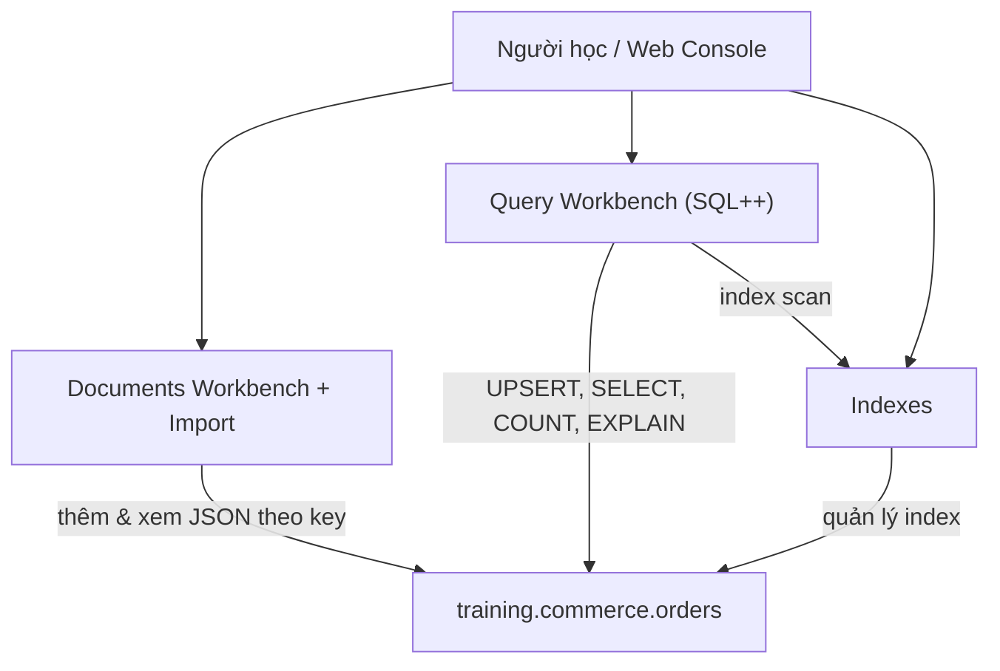

# Nạp dữ liệu mẫu và kiểm tra bằng giao diện quản trị

## Mục tiêu bài học

Sau khi đã dựng **Couchbase Server**, tạo bucket/scope/collection và bật các dịch vụ **Data, Query, Index**, chúng ta cần một bộ dữ liệu nhỏ, biết chính xác kết quả mong đợi, để kiểm tra môi trường trước khi viết mã **Spring Data Couchbase**. Việc này quan trọng vì lỗi khi gọi repository, `CouchbaseTemplate` hay truy vấn SQL++ đôi khi bắt nguồn từ **dữ liệu không có**, **nhầm collection**, **thiếu chỉ mục** hoặc **thiếu quyền** chứ không phải sai phiên bản thư viện.

Bài thuộc chương **Môi trường** này hướng dẫn nạp dữ liệu đơn hàng giả lập rồi xác minh bằng **Couchbase Web Console**. Trên nền dữ liệu đó, người học có thể tiếp tục thực hành document mapping, repository, SQL++, chỉ mục, TTL, CAS, giao dịch và reactive API.

Học xong bài này, bạn có thể:

- Tạo dữ liệu JSON có **document ID ổn định**, schema nhất quán và giá trị đủ để đối chiếu.
- Nạp một document qua **Documents Workbench**, nhiều document qua **Documents → Import**, hoặc qua **SQL++ UPSERT**.
- Chọn chính xác keyspace `training.commerce.orders`, phân biệt key document với trường `id` trong JSON.
- Kiểm tra dữ liệu và metadata (CAS, expiry) trong giao diện quản trị.
- Tạo và quan sát **secondary index**, chạy `SELECT`, `COUNT` và `EXPLAIN` trong Query Workbench.
- Phân biệt quyền **KV** với quyền **SQL++**, kết quả truy vấn chậm đồng bộ và sai sót dữ liệu.
- Ghi bằng chứng một môi trường đã sẵn sàng để kết nối từ Spring Data Couchbase.

> **Phạm vi an toàn:** Mọi ví dụ dùng dữ liệu **giả lập** và các key có tiền tố `order::demo-` trong bucket dành cho học tập. Câu `UPSERT` hoặc import lặp lại có thể **ghi đè** document trùng ID. Chỉ chạy trong lab/staging được phép; không thử trong collection đang chứa dữ liệu người dùng thật.

## 1. Chuẩn bị cluster và xác định đúng keyspace

Môi trường dùng xuyên suốt bài:

| Thành phần | Cấu hình ví dụ | Mục đích |
| --- | --- | --- |
| Couchbase Server | Server hỗ trợ scope/collection (7.0+), cluster đã khởi tạo | Chứa document JSON. |
| Data Service | Bật | Documents Workbench và SDK truy cập theo key. |
| Query Service | Bật | Chạy SQL++, import nhiều document từ giao diện. |
| Index Service | Bật | Tạo và sử dụng secondary index. |
| Bucket | `training` | Nơi đặt dữ liệu học tập. |
| Scope | `commerce` | Nhóm các collection cho nghiệp vụ. |
| Collection chính | `orders` | Nơi import và query bốn đơn hàng mẫu. |
| Collection tùy chọn | `sessions` | Dành cho những bài TTL sau này. |
| Web Console | Ví dụ `http://127.0.0.1:8091` | Chỉ dùng khi Couchbase chạy cục bộ; môi trường từ xa có URL khác. |
| Tài khoản | Tài khoản quản trị **riêng cho lab** | Có quyền tạo document, chạy SQL++ và tạo index. |

Trước khi nạp:

1. Đăng nhập Web Console, mở **Buckets** và tìm bucket `training`.
2. Trong cây **Scopes & Collections**, xác nhận scope `commerce` và collection `orders` đã tồn tại.
3. Mở **Servers** để xác nhận Data, Query, Index đang hoạt động; nếu mới khởi tạo, chờ các service ổn định.
4. Ghi lại Server version, edition và keyspace đích. Couchbase Capella có giao diện và mô hình quyền riêng; thao tác dưới đây mô tả chủ yếu **Web Console của Couchbase Server tự quản lý**.
5. Xác minh collection `orders` chưa có các key `order::demo-1001` đến `order::demo-1004`. Nếu có, dùng prefix khác hoặc backup dữ liệu lab trước khi import.



**Ba màn hình có nhiệm vụ khác nhau:** **Documents** để xem/chỉnh từng document và import file; **Query** để thực thi SQL++; **Indexes** để kiểm tra những index đã định nghĩa và tình trạng của chúng. Mở được một màn hình không chứng minh những dịch vụ còn lại đã hoạt động.

## 2. Thiết kế bộ dữ liệu mẫu có kết quả dự kiến

Ta dùng bốn đơn hàng có trạng thái khác nhau và không dùng dữ liệu nhận dạng cá nhân thật. Trong mỗi document:

- **Document ID** là key của Couchbase, ví dụ `order::demo-1001`.
- Trường JSON `id` trong ví dụ **trùng giá trị key** để tiện nạp bằng tùy chọn **Value of Field**; bản thân Couchbase vẫn quản lý document key ở metadata, không tự suy key từ trường JSON này.
- `type` mô tả nghiệp vụ; `status` phục vụ lọc và index; `total` là **số**, đơn vị VND; `items` là một mảng lồng nhau.
- `createdAt` được ghi thành chuỗi ISO 8601 có hậu tố `Z`; ứng dụng cần chuyển đổi/kiểm tra kiểu dữ liệu khi ánh xạ thành `Instant` hoặc tương đương.
- Không đặt một trường JSON tên `cas` để giả làm CAS. **CAS là metadata** do Couchbase Server tạo và thay đổi sau mutation.

### 2.1. File JSON cần import

Trên **máy học của bạn**, tạo file có tên `orders-sample.json`, mã hóa **UTF-8**, rồi dán nguyên văn nội dung:

```json
[
  {
    "id": "order::demo-1001",
    "type": "order",
    "status": "NEW",
    "customerId": "customer::demo-01",
    "total": 125000,
    "currency": "VND",
    "createdAt": "2026-11-01T08:00:00Z",
    "items": [
      {"sku": "BOOK-01", "quantity": 1, "unitPrice": 125000}
    ]
  },
  {
    "id": "order::demo-1002",
    "type": "order",
    "status": "PAID",
    "customerId": "customer::demo-02",
    "total": 250000,
    "currency": "VND",
    "createdAt": "2026-11-01T09:00:00Z",
    "items": [
      {"sku": "BOOK-02", "quantity": 2, "unitPrice": 125000}
    ]
  },
  {
    "id": "order::demo-1003",
    "type": "order",
    "status": "NEW",
    "customerId": "customer::demo-03",
    "total": 99000,
    "currency": "VND",
    "createdAt": "2026-11-02T08:00:00Z",
    "items": [
      {"sku": "PEN-01", "quantity": 3, "unitPrice": 33000}
    ]
  },
  {
    "id": "order::demo-1004",
    "type": "order",
    "status": "CANCELLED",
    "customerId": "customer::demo-04",
    "total": 45000,
    "currency": "VND",
    "createdAt": "2026-11-02T10:00:00Z",
    "items": [
      {"sku": "NOTE-01", "quantity": 1, "unitPrice": 45000}
    ]
  }
]
```

Các ngày trên là **dữ liệu cố định để kiểm thử**, không phải ngày hệ thống. Không thay chúng bằng ngày hiện tại khi chạy lại bài; như vậy kết quả sắp xếp có thể khác giữa các lần học.

### 2.2. Bảng kỳ vọng trước khi import

| ID | `status` | `total` (VND) | Số mặt hàng (`items` entries) |
| --- | --- | ---: | ---: |
| `order::demo-1001` | `NEW` | 125.000 | 1 |
| `order::demo-1002` | `PAID` | 250.000 | 1 |
| `order::demo-1003` | `NEW` | 99.000 | 1 |
| `order::demo-1004` | `CANCELLED` | 45.000 | 1 |

Tổng cộng có **4 document**, **2 đơn NEW**, **1 PAID**, **1 CANCELLED**. Tổng `total` của bốn đơn là **519.000 VND**; riêng hai đơn NEW là **224.000 VND**. Hãy dùng các số này để phát hiện import thiếu bản ghi, trùng key, sai kiểu dữ liệu hoặc câu query lọc nhầm collection.

**Chú ý:** `quantity` là số lượng sản phẩm trong một dòng `items`, không phải số document. Trong bộ mẫu, có bốn dòng item nhưng tổng `quantity` là 7 (1 + 2 + 3 + 1). Phân biệt số document, số dòng item và tổng quantity sẽ giúp kiểm tra các truy vấn aggregate về sau.

## 3. Cách A — Tạo một document bằng Documents Workbench

Đây là cách tốt để kiểm tra **Data Service** trước khi import cả file.

1. Từ Web Console, mở **Documents → Workbench**. Cũng có thể vào **Buckets**, chọn liên kết **Documents** của bucket/scope/collection tương ứng.
2. Ở vùng **Keyspace**, chọn đúng ba dropdown: **Bucket = training**, **Scope = commerce**, **Collection = orders**. Đừng để mặc định `_default._default`.
3. Chọn **Add Document**. Nhập **Document ID**: `order::demo-1001`.
4. Trong JSON editor, dán **một object** ở dưới (không có dấu `[ ... ]` của JSON array):

```json
{
  "id": "order::demo-1001",
  "type": "order",
  "status": "NEW",
  "customerId": "customer::demo-01",
  "total": 125000,
  "currency": "VND",
  "createdAt": "2026-11-01T08:00:00Z",
  "items": [
    {"sku": "BOOK-01", "quantity": 1, "unitPrice": 125000}
  ]
}
```

5. Nhấn **Save**. Quay lại Documents Workbench, nhập **Document ID** vừa tạo và chọn **Retrieve Docs** nếu cần làm mới. Nhấp key để mở document; quan sát vùng **Data** và **Metadata**.
6. Xác nhận `status = NEW`, `total` là number và `items` là array. Kiểm tra metadata có **CAS** do Couchbase sinh ra và thông tin expiry theo giao diện phiên bản đang dùng.

**Metadata khác body JSON.** Khi lưu một document, bạn không cần thêm trường `cas` vào JSON để Couchbase tạo CAS. CAS giúp phát hiện xung đột khi hai người cùng chỉnh sửa một document; mỗi mutation thành công sẽ tạo CAS mới. Trường `createdAt` trong JSON là giá trị nghiệp vụ do bạn cung cấp, không phải timestamp hệ thống tự động bảo đảm độ chính xác.

> Nếu đã tạo `order::demo-1001` theo cách này, đừng import lại bản ghi có cùng ID khi bạn muốn giữ những chỉnh sửa vừa thực hiện. Chọn **một** phương án nạp hoặc chấp nhận rằng import/UPSERT có thể cập nhật document có key trùng.

Nguồn: [Couchbase — Manage Documents in the Web Console](https://docs.couchbase.com/server/current/manage/manage-documents/manage-documents.html).

## 4. Cách B — Import bốn document JSON qua giao diện

Đây là **phương án chính** của bài khi bắt đầu với collection trống. Giao diện Import của Couchbase hỗ trợ **JSON List**, **JSON Lines**, **CSV** và **TSV**; với tài liệu học này, dùng JSON List để giữ kiểu số và mảng `items`.

### 4.1. Thao tác import

1. Mở **Documents → Import** trong Web Console.
2. Chọn **Select File to Import**, mở file `orders-sample.json` đã lưu ở mục 2.
3. Đảm bảo **Parse File As = JSON List**. Giao diện nên nhận ra **4 records**; dùng phần **File Contents / Parsed JSON / Parsed Table** để kiểm tra cấu trúc.
4. Trong mục **Keyspace**, chọn **training → commerce → orders**. Đây là bước bắt buộc: import vào `_default._default` sẽ khiến bài kiểm tra sau không thấy dữ liệu ở `commerce.orders`.
5. Trong **Import With Document ID**, chọn **Value of Field** rồi chọn trường `id`. Nếu chọn **UUID**, Couchbase sẽ tạo key ngẫu nhiên và bạn sẽ **không thể dùng** `get("order::demo-1001")` để kiểm tra.
6. Xem trước số records, tên collection đích và tùy chọn ID thêm một lần. Chỉ khi mọi thứ đúng mới nhấn **Import Data**.
7. Khi giao diện báo nhập thành công, mở **Documents → Workbench**, chọn đúng `training.commerce.orders`, tìm một key mẫu và đối chiếu JSON.

**Lưu ý:** tài liệu chính thức cho biết **import bằng Web Console cần Query Service**. Nếu Documents Workbench cho bạn đọc document theo key nhưng tab Import không hoạt động, hãy kiểm tra Query Service, quyền tài khoản và cổng Query trước khi nghi ngờ Data Service. Khi dữ liệu rất lớn, Couchbase khuyến nghị dùng công cụ `cbimport` thay cho import trực tiếp trên Web Console, đặc biệt với dữ liệu **lớn hơn 100 MB**.

Nguồn: [Couchbase — Import Documents with the Web Console](https://docs.couchbase.com/server/current/manage/import-documents/import-documents.html).

### 4.2. Điều gì xảy ra nếu import trùng ID?

Với lựa chọn **Value of Field = id**, giá trị trong trường `id` được sử dụng làm **document key**. Import một bộ dữ liệu mới có key đã tồn tại có thể **cập nhật/ghi đè** document đang lưu. Đây không phải cơ chế migration an toàn cho production.

Để làm bài có thể kiểm tra:

- Chạy import **một lần** trên collection `orders` dành riêng cho lab.
- Nếu muốn thử lại không ảnh hưởng dữ liệu khác, tạo collection thử riêng bằng tài khoản quản trị hoặc đổi tiền tố key của bộ sample.
- Không gắn ID mặc định là UUID nếu các ví dụ và expected results đều dùng key cố định.
- Đừng làm lại toàn bộ import chỉ vì màn hình Documents chưa refresh; hãy bấm **Retrieve Docs**, chọn đúng keyspace và đọc theo một key cụ thể.

### 4.3. Tùy chọn CSV/JSON Lines

Nếu nguồn dữ liệu của bài thực tế là CSV, tab Import có thể phân tích header và tạo document JSON. Tuy nhiên cần kiểm tra **kiểu dữ liệu** của cột `total` (number hay string), ký tự tiếng Việt, ký tự phân tách và cách lấy document ID. Với JSON Lines, mỗi dòng là **một object JSON**, khác với JSON List là một array. Cả hai cách đều phải kiểm tra số records và collection đích.

Đối với dữ liệu có cấu trúc lồng nhau như `items`, **JSON List** dễ bảo toàn hình dạng hơn CSV. Không coi việc có bốn hàng trên màn hình preview là bằng chứng đầy đủ nếu ID và kiểu field đã bị chuyển sai.

## 5. Cách C — Nạp bằng SQL++ trong Query Workbench

Khi cần bài tập có thể chạy lại bằng **một đoạn truy vấn**, thay import file bằng `UPSERT` trên Query Workbench. Đây là **phương án thay thế** cho cách B; nếu đã import đủ bốn document, không cần chạy lại đoạn dưới.

Mở **Query → Query Workbench**; dùng tài khoản lab có quyền thực hiện SQL++ mutation trên collection. Câu `UPSERT` có thể yêu cầu **Query Insert + Query Update**; chỉ có **Data Writer** cho KV không mặc nhiên đủ quyền thực thi SQL++ UPSERT.

```sql
UPSERT INTO `training`.`commerce`.`orders` (KEY, VALUE)
VALUES
  ("order::demo-1001",
   {"id":"order::demo-1001","type":"order","status":"NEW",
    "customerId":"customer::demo-01","total":125000,"currency":"VND",
    "createdAt":"2026-11-01T08:00:00Z",
    "items":[{"sku":"BOOK-01","quantity":1,"unitPrice":125000}]}),
  ("order::demo-1002",
   {"id":"order::demo-1002","type":"order","status":"PAID",
    "customerId":"customer::demo-02","total":250000,"currency":"VND",
    "createdAt":"2026-11-01T09:00:00Z",
    "items":[{"sku":"BOOK-02","quantity":2,"unitPrice":125000}]}),
  ("order::demo-1003",
   {"id":"order::demo-1003","type":"order","status":"NEW",
    "customerId":"customer::demo-03","total":99000,"currency":"VND",
    "createdAt":"2026-11-02T08:00:00Z",
    "items":[{"sku":"PEN-01","quantity":3,"unitPrice":33000}]}),
  ("order::demo-1004",
   {"id":"order::demo-1004","type":"order","status":"CANCELLED",
    "customerId":"customer::demo-04","total":45000,"currency":"VND",
    "createdAt":"2026-11-02T10:00:00Z",
    "items":[{"sku":"NOTE-01","quantity":1,"unitPrice":45000}]});
```

**Quan sát màn hình:** Query Workbench hiển thị trạng thái câu lệnh và **Mutation Count**. Kết quả thành công chỉ nói rằng câu lệnh đã thực thi; vẫn cần đọc lại document key thực tế và xác minh các trường sau khi ghi.

`UPSERT` là thao tác thêm **hoặc** cập nhật. Trong ví dụ này, dữ liệu lặp lại dùng key giống nhau để dễ kiểm tra, nhưng không dùng `UPSERT` như một công cụ kiểm tra không phá hủy trên dữ liệu bất kỳ. Nguồn: [SQL++ UPSERT](https://docs.couchbase.com/server/current/n1ql/n1ql-language-reference/upsert.html).

## 6. Đọc lại từng document trong Documents Workbench

Sau **một** trong ba cách nạp ở trên:

1. Mở **Documents → Workbench**.
2. Chọn **training**, **commerce**, **orders** trong ba dropdown Keyspace.
3. Đặt **Document ID** = `order::demo-1001`, chọn **Retrieve Docs**.
4. Mở document và kiểm tra **Data**: `id`, `status`, `total`, `createdAt`, `items[0].sku`.
5. Chuyển sang **Metadata** để xem key/CAS và các thông tin expiry nếu UI hiển thị.
6. Lặp lại với `order::demo-1002`, `order::demo-1003`, `order::demo-1004`.

| Kiểm tra | Kỳ vọng | Ý nghĩa |
| --- | --- | --- |
| `order::demo-1001` | `NEW`, `total = 125000` | Key và kiểu dữ liệu đúng. |
| `order::demo-1002` | `PAID`, `total = 250000` | Bộ mẫu có trạng thái khác NEW. |
| `order::demo-1003` | `NEW`, `total = 99000` | Có nhiều hơn một đơn NEW để thử WHERE/COUNT. |
| `order::demo-1004` | `CANCELLED`, `total = 45000` | Đủ ba nhóm trạng thái để thử GROUP BY. |
| Metadata | CAS được Server cung cấp | Có thể dùng để thử optimistic locking ở bài CAS. |
| Expiration | Không gắn TTL trong bộ mẫu | Không suy TTL từ trường `createdAt` hoặc `status`. |

**Đọc theo ID** phù hợp để xác nhận dữ liệu và địa chỉ keyspace trước khi tạo index. Documents Workbench còn có `Limit`/`Offset` và bộ lọc **N1QL WHERE**; với bộ lọc theo thuộc tính, bạn có thể cần Query Service, quyền SQL++ và index tùy cách thực thi. Khi mới bắt đầu, ưu tiên nhập ID cụ thể để tách lỗi dữ liệu khỏi lỗi query.

### 6.1. Thử sửa document bằng giao diện

Trong lab riêng, mở `order::demo-1001`, đổi `status` từ `NEW` thành `PROCESSING`, nhấn **Save**, rồi mở lại document.

Bạn cần thấy:

- Body JSON phản ánh `PROCESSING`.
- Metadata **CAS** thay đổi sau mutation thành công.
- Truy vấn thống kê nhóm ở mục sau thay đổi theo trạng thái mới.

Sau thử nghiệm, **đổi status trở lại `NEW` và Save** để các kết quả kỳ vọng của phần còn lại giữ nguyên. Nếu người khác cũng đang chỉnh cùng document, tránh coi bài sửa thủ công là phép thử concurrency hoàn chỉnh; chỉ sử dụng document thử riêng.

**Không nhầm TTL:** thêm field JSON như `"expiry": 60` **không đặt TTL của Couchbase**. Expiry thực phải được thiết lập qua option khi mutation/collection/bucket theo API phù hợp, và được phản ánh trong metadata, không phải giá trị JSON tự đặt.

## 7. Tạo secondary index và kiểm tra trong Indexes

Để truy vấn `WHERE status = "NEW"`, tạo một secondary index rõ mục đích thay vì mở primary index cho mọi câu query.

### 7.1. Tạo index từ Query Workbench

Trước hết mở **Indexes**, chọn bucket/scope phù hợp, tìm xem `idx_orders_status` đã tồn tại chưa. Nếu chưa, chạy **một lần** bằng tài khoản có quyền quản lý index:

```sql
CREATE INDEX idx_orders_status
ON `training`.`commerce`.`orders`(status);
```

Chờ xây dựng index hoàn tất. Ở màn hình **Indexes**, chọn bucket `training` và scope `commerce`, tìm `idx_orders_status`. Tùy phiên bản, giao diện có thể hiển thị trạng thái **ready/warmup/n mutations remaining**, còn metadata SQL++ có field `state` và giá trị `online`.

Kiểm tra thêm trong Query Workbench:

```sql
SELECT name, state, bucket_id, scope_id, keyspace_id
FROM system:indexes
WHERE name = "idx_orders_status"
  AND bucket_id = "training"
  AND scope_id = "commerce"
  AND keyspace_id = "orders";
```

**Kỳ vọng:** một dòng với `state = "online"`. Nếu index đang building/deferred/offline, chưa thể đánh dấu môi trường đã sẵn sàng cho bài query. Tên index có thể trùng ở keyspace khác; việc lọc bằng bucket/scope/collection hạn chế nhầm.

### 7.2. Tại sao cần xem Indexes thay vì chỉ chạy SELECT?

Một query nhỏ có thể chạy bằng kế hoạch không tối ưu hoặc, trên một số bản Server mới, bằng **sequential scan** mà không sử dụng secondary index. Việc đó không chứng minh rằng hệ thống đã sẵn sàng cho derived repository query hiệu năng cao. Hãy:

1. Kiểm tra index hiện diện và **online**.
2. Chạy `EXPLAIN` để xem operator/index thực được Query Service chọn.
3. Theo dõi thống kê index và kích thước dữ liệu khi mở rộng bài tập.

Nguồn: [Manage Indexes](https://docs.couchbase.com/server/current/manage/manage-indexes/manage-indexes.html), [CREATE INDEX](https://docs.couchbase.com/server/current/n1ql/n1ql-language-reference/createindex.html).

## 8. Kiểm chứng bằng SQL++ trong Query Workbench

Chọn **Query → Query Workbench**, chạy các câu truy vấn dưới đây từng câu, xem **Results** (JSON/Table), số kết quả và **Plan/Explain**. Để tránh phụ thuộc vào Query Context của phiên làm việc, tất cả ví dụ đều ghi **đầy đủ ba cấp** `bucket.scope.collection`.

### 8.1. Tìm đúng các đơn NEW

```sql
SELECT META(o).id AS documentId,
       o.status,
       o.total,
       o.createdAt
FROM `training`.`commerce`.`orders` AS o
WHERE o.status = "NEW"
  AND META(o).id LIKE "order::demo-%"
ORDER BY o.createdAt
LIMIT 10;
```

**Kết quả mong đợi:** có hai ID `order::demo-1001` và `order::demo-1003`, theo thứ tự `createdAt` tăng dần. Nếu collection còn dữ liệu khác, điều kiện prefix `order::demo-%` giúp chỉ lấy bộ mẫu, nhưng nếu có thêm key cùng prefix ngoài bốn key đã nêu thì kết quả có thể nhiều hơn.

Trong Results, xem **status = success**, số bản ghi trả về; chọn **Explain** hoặc **Plan** để quan sát index scan. Nếu kế hoạch không dùng `idx_orders_status` như mong muốn, kiểm tra index online, predicate và thông tin thống kê/index hiện tại. Một kết quả đúng **không đủ** để khẳng định kế hoạch tối ưu.

### 8.2. Đếm chính xác bốn document theo ID

Để loại trừ dữ liệu khác trong collection, dùng `USE KEYS` với danh sách chính xác:

```sql
SELECT COUNT(1) AS sampleCount,
       SUM(o.total) AS totalVnd
FROM `training`.`commerce`.`orders` AS o
USE KEYS [
  "order::demo-1001",
  "order::demo-1002",
  "order::demo-1003",
  "order::demo-1004"
];
```

**Kết quả mong đợi:** `sampleCount = 4`, `totalVnd = 519000`. Truy vấn theo key giúp tách lỗi mất document khỏi lỗi secondary index. Nếu số đếm nhỏ hơn bốn, quay về Documents Workbench kiểm tra từng ID.

### 8.3. Đếm và cộng tiền theo trạng thái

```sql
SELECT o.status,
       COUNT(1) AS orderCount,
       SUM(o.total) AS totalVnd
FROM `training`.`commerce`.`orders` AS o
USE KEYS [
  "order::demo-1001",
  "order::demo-1002",
  "order::demo-1003",
  "order::demo-1004"
]
GROUP BY o.status
ORDER BY o.status;
```

| `status` | `orderCount` | `totalVnd` |
| --- | ---: | ---: |
| `CANCELLED` | 1 | 45000 |
| `NEW` | 2 | 224000 |
| `PAID` | 1 | 250000 |

Đây là đối chiếu định lượng mạnh hơn việc xem bốn document bằng mắt. Nếu `total` đã bị import thành **string** hoặc một document thiếu trường, kết quả `SUM` có thể không như kỳ vọng. Kiểm tra kiểu JSON trong Documents Workbench trước khi sửa query.

### 8.4. Truy vấn nested array

```sql
SELECT META(o).id AS documentId,
       i.sku,
       i.quantity,
       i.unitPrice
FROM `training`.`commerce`.`orders` AS o
UNNEST o.items AS i
WHERE META(o).id = "order::demo-1002";
```

**Kỳ vọng:** một dòng với `sku = BOOK-02`, `quantity = 2`, `unitPrice = 125000`. Câu này minh họa truy vấn một field lồng nhau bằng `UNNEST`, giúp người học hiểu vì sao document mapping thường có object/array chứ không chỉ cột phẳng.

### 8.5. Đồng bộ sau mutation: tại sao có thể thấy kết quả cũ?

Mutation KV/SQL++ đã trả thành công **không phải lúc nào** cũng đồng nghĩa secondary index đã phản ánh dữ liệu ngay khi truy vấn tiếp theo bắt đầu. Với bài nhỏ, đợi index/cluster ổn định rồi query lại. Nếu nghiệp vụ cần "read your own write", xem tùy chọn **scan consistency**, ví dụ `REQUEST_PLUS` (đợi chỉ mục bắt kịp các mutation có trước query) hoặc cơ chế `AT_PLUS` dùng mutation tokens từ SDK; mỗi lựa chọn có chi phí latency.

**Không dùng `Thread.sleep` cố định như giải pháp tính nhất quán của ứng dụng production.** Thiết kế semantics về consistency dựa trên API Spring Data/Java SDK và yêu cầu nghiệp vụ. Các bài sau sẽ đi sâu vào trade-off giữa consistency, hiệu năng và chỉ mục.

Nguồn: [Query Workbench](https://docs.couchbase.com/server/current/tools/query-workbench.html), [Java SDK — Query](https://docs.couchbase.com/java-sdk/current/concept-docs/n1ql-query.html).

## 9. Liên hệ dữ liệu mẫu với Spring Data Couchbase

Sau khi xác nhận dữ liệu trong UI, bạn có thể cấu hình Spring Boot (phiên bản starter do BOM quản lý) trỏ tới:

```yaml
spring:
  couchbase:
    connection-string: couchbase://127.0.0.1
    username: ${CB_USERNAME}
    password: ${CB_PASSWORD}
  data:
    couchbase:
      bucket-name: training
```

Ở đây `CB_USERNAME`/`CB_PASSWORD` là biến môi trường, **không** điền mật khẩu thật vào Git. Dùng `couchbase://` chỉ cho lab loopback không TLS; Couchbase Capella và môi trường từ xa thường cần `couchbases://`, chứng chỉ và cấu hình mạng tương ứng.

Entity/repository có thể dùng `@Scope("commerce")` và `@Collection("orders")` (theo đúng phiên bản Spring Data Couchbase) để chọn collection. Nhưng cần phân biệt:

| Lệnh phía Spring Data/Java SDK | Đường xử lý | Điều kiện |
| --- | --- | --- |
| `collection.get("order::demo-1001")` | KV theo key | Data Service, tài khoản có quyền đọc. |
| `repository.findById(id)` | Thường là KV theo ID | Đúng mapping ID/collection, quyền KV. |
| `repository.save(entity)` | Ghi document theo ID | Quyền ghi; Spring Data có thể bổ sung metadata/type. |
| `repository.findByStatus("NEW")` | Derived SQL++ query | Query Service, Query Select, index và metadata mapping phù hợp. |
| `CouchbaseTemplate` / `ReactiveCouchbaseTemplate` | Tùy phương thức KV hoặc SQL++ | Kiểm tra API thực và các service tương ứng. |

**Document tạo thủ công không nhất thiết tương đương document do Spring Data ghi.** Spring Data Couchbase có thể thêm metadata loại như `_class` để repository query lọc đúng loại entity. JSON mẫu của bài **không tự thêm `_class`** vì tên Java class của từng dự án khác nhau. Nếu `findById` đọc được một key nhưng `findByStatus` trả rỗng, hãy tạo một document thử **bằng chính repository**, xem JSON được lưu và câu SQL++ mà repository sinh ra, rồi kiểm tra index/consistency; không vội sửa dữ liệu mẫu thành một tên class giả định.

Đặc biệt, **Community Edition** có thể giới hạn bộ role có thể gán; quyền KV không mặc nhiên là quyền Query Select. Với môi trường cần RBAC theo collection và derived query bằng user riêng, dùng edition/tier phù hợp; không đưa `Administrator` vào cấu hình runtime chỉ để query thành công.

## 10. Hai phương án mẫu khác và khi nào dùng

### 10.1. Dùng bucket mẫu chính thức `travel-sample`

Trong Web Console, vào **Settings → Sample Buckets**, chọn `travel-sample` rồi **Load Sample Data**. Bộ sample chính thức có nhiều scope/collection, ví dụ `inventory.airline` và `inventory.airport`, cùng index theo định nghĩa sample. Dùng khi muốn học JOIN/query đa dạng mà không tự tạo dữ liệu.

```sql
SELECT META(a).id AS documentId, a.name
FROM `travel-sample`.`inventory`.`airline` AS a
LIMIT 5;
```

**Không import `travel-sample` vào `training.commerce.orders`.** Cài sample tạo một **bucket riêng**, tốn RAM/disk và có bộ index của riêng nó. Nếu quota của lab một node không đủ, giữ bộ bốn đơn hàng ở mục 2; không ép thêm sample làm cluster mất ổn định.

Nguồn: [Couchbase — Install Sample Buckets](https://docs.couchbase.com/server/current/manage/manage-settings/install-sample-buckets.html).

### 10.2. Dùng `cbimport` cho dữ liệu lớn hoặc pipeline

Web Console phù hợp để nhìn trước và import vài document; dữ liệu lớn, quy trình CI/CD hoặc import có yêu cầu retry/throughput nên dùng `cbimport`/SDK với secret và cấu hình mạng phù hợp. Công cụ import có thể ghi đè key đã tồn tại theo chế độ hoạt động, vì vậy cần thiết kế idempotency, backup và log.

Bài học này tập trung **xác minh bằng giao diện quản trị**; không cần thiết lập pipeline import tự động hoặc tài khoản production. Khi học chuyển đổi schema, migration và tối ưu hiệu năng, hãy đánh giá kích thước batch, chỉ mục, consistency và khả năng quan sát đầy đủ.

## 11. Lỗi thường gặp và cách chẩn đoán

| Triệu chứng | Kiểm tra trước | Cách giải quyết |
| --- | --- | --- |
| Documents Workbench trống sau import | Đang chọn `_default._default` hay `commerce.orders`? Limit/ID filter còn giá trị cũ? | Chọn lại đúng ba cấp keyspace, xóa filter, nhập một key mẫu và **Retrieve Docs**. |
| Import nhận 4 records nhưng key không như kỳ vọng | Chọn **UUID** thay vì **Value of Field = id**. | Kiểm tra document key thực; với lab riêng có thể import lại vào collection trống và chọn ID đúng. |
| Import không chạy, trong khi đọc document bằng ID vẫn được | Query Service chưa chạy, RBAC không đủ, lỗi parser/file hoặc mạng. | Xem Query Service, quyền và **Parsed JSON**, kiểm tra log import. |
| JSON parser báo lỗi | File có dấu phẩy thừa, dùng JSON Lines nhưng chọn JSON List, mã hóa sai. | Xác minh file UTF-8 là JSON array hợp lệ hoặc đổi Parse File As đúng định dạng. |
| `total` có giá trị nhưng `SUM` sai | Import CSV biến number thành string; field thiếu hoặc dữ liệu bị chỉnh sửa. | Mở document ở **Data**, sửa kiểu/schema tại nguồn rồi import có kiểm soát. |
| Query `WHERE status = "NEW"` lỗi index | Chưa tạo `idx_orders_status`, index chưa online, Index Service không sẵn sàng. | Xem **Indexes**, `system:indexes`, `EXPLAIN`. |
| Câu `SELECT` theo key trả dữ liệu nhưng truy vấn thuộc tính không có row | Index chưa kịp cập nhật, predicate sai, filter prefix ID hoặc thiếu quyền Query. | Kiểm tra key thực, type field, scan consistency, index và RBAC. |
| `UPSERT` lỗi 403 dù SDK KV write được | Thiếu role SQL++ Query Insert/Update; KV Data Writer không tương đương SQL++ mutation. | Dùng tài khoản lab/provisioning đúng quyền; tách quyền runtime. |
| JSON mẫu không hiện trong `findByStatus` của Spring Data | Metadata loại entity `_class` có thể không khớp; SQL++ repository sinh ra có điều kiện bổ sung. | Ghi thử entity bằng repository và xem câu query/mapping thực. |
| Không thấy `CAS` trong body JSON | CAS thuộc metadata, không phải trường JSON do ứng dụng tự thêm. | Mở tab **Metadata** của document. |
| `createdAt` có giá trị nhưng document tự hết hạn hoặc không hết hạn | Expiry không quyết định bởi `createdAt`; bucket/collection/document TTL là cấu hình riêng. | Kiểm tra metadata expiry, Max TTL, tùy chọn ghi. |
| Một document bị mất sau thao tác làm sạch | Đã xóa key hoặc collection/bucket, hay import lại với key trùng. | Chỉ xóa các key `order::demo-*` của lab và có bản sao nguồn trước khi thử. |

**Thứ tự điều tra:** kiểm tra đúng bucket/scope/collection → đọc từng document ID → kiểm tra JSON và metadata → kiểm tra Query/Index Service và RBAC → đọc index/`EXPLAIN` → kiểm tra consistency và Spring Data mapping. Cách này giúp phân biệt lỗi dữ liệu với lỗi cấu hình hoặc API.

## 12. Bài tập tự luyện

### Bài 1 — Xác minh import

Bạn đã import `orders-sample.json` và thấy bốn records trong preview. Nhưng `GET` theo `order::demo-1001` thất bại. Hãy liệt kê ba điều cần kiểm tra.

**Đáp án gợi ý:** (1) đã chọn `Value of Field = id` hay UUID; (2) keyspace đích có đúng `training.commerce.orders` không; (3) import thật sự hoàn tất hay chỉ mới preview file. Sau đó xem quyền đọc và trạng thái Data Service.

### Bài 2 — Kiểm tra tổng tiền

Đọc chính xác bốn ID mẫu bằng `USE KEYS` rồi tính `COUNT` và `SUM(total)`. Kết quả nào cho thấy dữ liệu đúng? Có thể dùng `COUNT` của toàn collection để thay thế không?

**Đáp án gợi ý:** `4 document` và `519000 VND`. Không nên chỉ đếm toàn collection nếu các bài tập trước đã thêm document khác; dùng danh sách ID mẫu hoặc collection riêng.

### Bài 3 — Dữ liệu trước và sau thay đổi

Đổi `order::demo-1001.status` từ `NEW` thành `PROCESSING` trong Documents Workbench. Dự đoán số đơn NEW trước khi chạy query lại và điều gì thay đổi trong metadata.

**Đáp án gợi ý:** nhóm NEW giảm từ **2 xuống 1**, CAS của document đổi. Sau thử nghiệm cần trả trạng thái về NEW để tiếp tục các câu query kỳ vọng.

### Bài 4 — Truy vấn theo trạng thái

`SELECT` đúng hai đơn NEW nhưng `EXPLAIN` cho thấy không dùng `idx_orders_status`. Có thể đánh dấu hoàn tất kiểm tra chỉ mục chưa?

**Đáp án gợi ý:** Chưa. Kiểm tra index đã tồn tại/online và kế hoạch query. Kết quả đúng trên bốn document không chứng minh hiệu năng khi dữ liệu lớn.

### Bài 5 — Từ SQL++ sang Spring Data

SQL++ trong Query Workbench tìm được `order::demo-1001`, SDK `get(id)` đọc được, nhưng `CouchbaseRepository.findByStatus("NEW")` trả rỗng. Nêu những kiểm tra quan trọng.

**Đáp án gợi ý:** xem entity `@Scope`/`@Collection`, câu SQL++ được Spring Data sinh, metadata `_class`, trạng thái index, query consistency và quyền Query Select. Nên tạo một document thử bằng repository để đối chiếu.

## 13. Checklist xác nhận môi trường dữ liệu mẫu

- [ ] Bucket `training`, scope `commerce`, collection `orders` tồn tại.
- [ ] Data/Query/Index Service hoạt động; tài khoản thao tác có quyền phù hợp.
- [ ] Đã tạo file `orders-sample.json` hợp lệ với bốn document giả lập.
- [ ] Đã **chọn một** cách nạp và xác minh đúng keyspace đích.
- [ ] Nếu dùng Import, đã chọn **JSON List** và **Value of Field = id**; preview cho thấy 4 records.
- [ ] Documents Workbench tìm thấy đủ bốn key mẫu, dữ liệu JSON đúng kiểu.
- [ ] Đã xem metadata CAS/expiry và phân biệt chúng với field JSON.
- [ ] Secondary index `idx_orders_status` đã được tạo, trạng thái online.
- [ ] `SELECT` theo `status = "NEW"` ra hai document mẫu; đã xem `EXPLAIN`.
- [ ] Query `USE KEYS` cho `COUNT = 4` và `SUM(total) = 519000`.
- [ ] Nếu đã thử sửa `status`, đã đưa dữ liệu về trạng thái ban đầu.
- [ ] Đã ghi nhận hạn chế giữa dữ liệu JSON thủ công và mapping/metadata của Spring Data.
- [ ] Không dùng tài khoản quản trị làm credentials runtime và không nhập dữ liệu thật vào lab.

### Tài liệu tham khảo chính thức

1. [Couchbase Server — Manage Documents in the Web Console](https://docs.couchbase.com/server/current/manage/manage-documents/manage-documents.html).
2. [Couchbase Server — Import Documents with the Web Console](https://docs.couchbase.com/server/current/manage/import-documents/import-documents.html).
3. [Couchbase Server — Query Workbench](https://docs.couchbase.com/server/current/tools/query-workbench.html).
4. [Couchbase Server — Manage Indexes](https://docs.couchbase.com/server/current/manage/manage-indexes/manage-indexes.html).
5. [Couchbase Server — SQL++ UPSERT](https://docs.couchbase.com/server/current/n1ql/n1ql-language-reference/upsert.html).
6. [Couchbase Server — CREATE INDEX](https://docs.couchbase.com/server/current/n1ql/n1ql-language-reference/createindex.html).
7. [Couchbase Server — Sample Buckets](https://docs.couchbase.com/server/current/manage/manage-settings/install-sample-buckets.html).
8. [Couchbase Server — Roles](https://docs.couchbase.com/server/current/learn/security/roles.html).
9. [Spring Data Couchbase — Repositories](https://docs.spring.io/spring-data/couchbase/reference/couchbase/repository.html).
10. [Spring Data Couchbase — Collection Support](https://docs.spring.io/spring-data/couchbase/reference/couchbase/collections.html).

**Kết quả cần đạt:** một bộ document có **key ổn định và dữ liệu dự kiến rõ ràng** đã được nạp vào đúng collection; người học xác nhận chúng qua Documents Workbench, kiểm tra secondary index trong Indexes và giải thích được kết quả `SELECT`/`COUNT`/`EXPLAIN` trên Query Workbench. Đây là dữ liệu nền để kiểm thử document mapping, repository, `CouchbaseTemplate`, SQL++, CAS/TTL và reactive API ở các bài tiếp theo.
