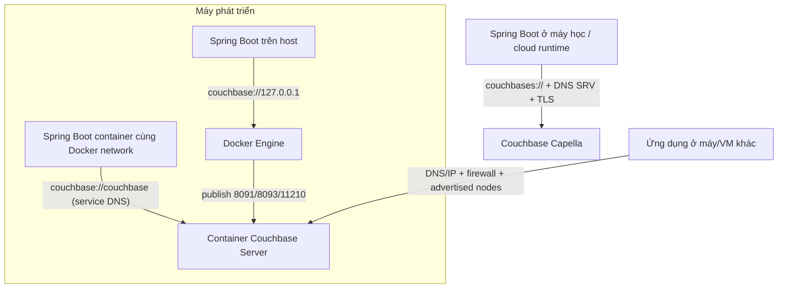
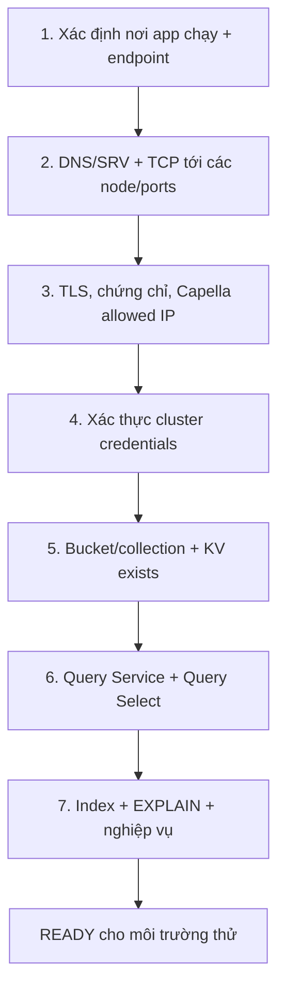

# Kết nối từ máy chủ ứng dụng tới môi trường Docker hoặc Capella

## Mục tiêu bài học

Trong hệ thống **Spring Data Couchbase**, một ứng dụng Java muốn sử dụng **document mapping**, **CouchbaseRepository**, **CouchbaseTemplate** hoặc truy vấn **SQL++** phải kết nối được tới Couchbase Server trước. Sau khi kết nối mới có thể kiểm tra bucket/scope/collection, chỉ mục, TTL, CAS, transaction, mức nhất quán và API reactive. Nhiều trường hợp "ứng dụng khởi động được nhưng repository timeout" là vấn đề **mạng, địa chỉ node được quảng bá, DNS, TLS hoặc quyền truy cập**, không phải lỗi mapping.

Bài thuộc chương **Môi trường** này hướng dẫn kết nối từ **máy chủ chạy ứng dụng** tới hai nhóm môi trường:

1. **Couchbase Server chạy trong Docker**: ứng dụng chạy trên máy host, trong container cùng mạng hoặc ở một máy khác.
2. **Couchbase Capella**: ứng dụng truy cập cluster qua endpoint public/TLS với IP allowlist, hoặc kết nối riêng khi hạ tầng đã được cấu hình.

Sau bài học, bạn có thể:

- Chọn **connection string** đúng với vị trí của ứng dụng, tránh dùng `localhost` sai ngữ cảnh.
- Phân biệt **bootstrap address** và **node/service address** được SDK khám phá sau khi bootstrap.
- Hiểu các cổng KV, quản trị và Query; biết khi nào cần **alternate addresses** do Docker NAT/port mapping.
- Cấu hình Spring Boot/Spring Data Couchbase bằng biến môi trường và tài khoản có quyền tối thiểu.
- Thiết lập kết nối **`couchbases://`, TLS, DNS SRV, IP allowlist và cluster access credentials** với Capella.
- Thực hiện smoke test **KV** và **SQL++** riêng, đọc lỗi theo từng tầng mạng/TLS/xác thực/quyền/service.
- Nhận diện giới hạn của lab single-node và thiết kế đường kết nối phù hợp môi trường production.

> **An toàn:** Các lệnh trong bài là ví dụ để người học chạy trên môi trường do mình quản lý. Không mở cổng quản trị/KV/Query của một container Couchbase thử nghiệm trực tiếp ra Internet, không dùng mật khẩu quản trị làm secret runtime, không tắt xác minh TLS để xử lý lỗi chứng chỉ. Với Capella, dùng chính endpoint từ **Connect → SDK** thay vì tự đoán tên miền.

## 1. Mô hình kết nối: ứng dụng nằm ở đâu?



**Quan trọng:** `127.0.0.1` và `localhost` luôn trỏ về **môi trường mạng nơi tiến trình ứng dụng đang chạy**. `localhost` trong một container Spring Boot không phải là Couchbase container kế bên. `localhost` trên VM A cũng không phải VM B. Đừng sao chép một connection string giữa các môi trường mà chưa xem topology.

### 1.1. Bảng quyết định nhanh

| Ứng dụng chạy ở đâu? | Couchbase ở đâu? | Connection string khởi đầu | Điều phải kiểm tra thêm |
| --- | --- | --- | --- |
| Java/Spring Boot chạy **trực tiếp trên host** | Container Couchbase publish cổng về host | `couchbase://127.0.0.1` | Port mapping 8091/11210/8093; node address SDK khám phá có tới được không. |
| Spring Boot container cùng **user-defined Docker network** | Couchbase container khác trong mạng đó | `couchbase://couchbase` (tên Docker service/container theo mạng) | DNS Docker, cổng nội bộ và cluster advertised address; **không** dùng host port ngẫu nhiên. |
| Java/Spring Boot trên **máy khác** | Docker host hoặc cluster tự quản lý | `couchbase://cb-host.internal.example` trong mạng nội bộ tin cậy | Firewall, routing, mọi node/service, external/alternate addresses; cân nhắc TLS. |
| Java/Spring Boot trên máy học | Capella public endpoint | `couchbases://cb.<endpoint-do-capella-cung-cap>` | Public outbound IP nằm trong allowlist, DNS SRV, TLS và cluster credentials. |
| Ứng dụng và Capella trong cùng cloud/VPC đã thiết lập private connectivity | Capella qua private endpoint | **Chuỗi kết nối do Capella cung cấp cho chế độ private** | DNS private, route/VPC peering/PrivateLink tương ứng, bảo mật và RBAC; không tự suy từ public endpoint. |

**Connection string là seed, không phải danh sách tất cả các socket.** Java SDK dùng địa chỉ ban đầu để bootstrap rồi nhận thông tin topology, tìm KV nodes, Query nodes và các địa chỉ/port tương ứng. Vì vậy **mở được Web Console** hoặc **TCP 8091** chưa chứng minh rằng SDK đã kết nối tới KV 11210 hay Query 8093.

Nguồn: [Java SDK — Managing Connections](https://docs.couchbase.com/java-sdk/current/howtos/managing-connections.html) và [Couchbase Server — Connectivity / Alternate Addresses](https://docs.couchbase.com/server/current/learn/clusters-and-availability/connectivity.html).

## 2. Ba tầng phải hoạt động cùng lúc

| Tầng | Thông tin cần đúng | Lỗi ví dụ |
| --- | --- | --- |
| **Kết nối mạng** | DNS/IP, route, NAT, TCP port, firewall, node addresses SDK khám phá | `UnknownHostException`, bootstrap timeout, connect refused. |
| **Bảo mật** | `couchbase://` hay `couchbases://`, CA tin cậy, hostname khớp chứng chỉ, user/password hoặc chứng thực được hỗ trợ | `SSLHandshakeException`, authentication failure, access denied. |
| **Tài nguyên và thao tác** | Bucket/scope/collection, Data/Query/Index Service, RBAC, index online, consistency | `BucketNotFound`, `CollectionNotFound`, `No index available`, query 403. |

`CouchbaseTemplate`, repository đồng bộ và reactive cùng phụ thuộc các tầng này. **Reactive không có một connection string riêng**; cách lập trình thay đổi nhưng kết nối vẫn phải được SDK thiết lập và các thao tác thực tế vẫn cần service/role tương ứng.

### 2.1. Các cổng thường gặp

| Chức năng | Không TLS trong lab | Có TLS (khi Server/edition hỗ trợ và đã cấu hình) |
| --- | --- | --- |
| Quản trị/bootstrap HTTP | **8091** | **18091** |
| KV/Data Service | **11210** | **11207** |
| SQL++ Query Service | **8093** | **18093** |

Đây là các cổng mặc định thường gặp, **không phải** tập tất cả các cổng của cluster. Cấu hình service, NAT, cổng được công bố và phương thức kết nối có thể khác. Đối với Capella, ưu tiên hướng dẫn từ **Connect → SDK** và DNS SRV của dịch vụ; **không** cố truy cập Web Console trên 8091 như một container Docker tự quản lý.

Nguồn: [Couchbase Server — Required Ports](https://docs.couchbase.com/server/current/install/install-ports.html).

## 3. Trường hợp A: Spring Boot chạy trên host, Couchbase trong Docker

### 3.1. Khởi tạo container local

Nếu chưa có Couchbase chạy và bạn được phép dựng lab, ví dụ:

```bash
docker run -d --name cb-connect-lab -p 127.0.0.1:8091:8091 -p 127.0.0.1:8093:8093 -p 127.0.0.1:11210:11210 -v cb-connect-data:/opt/couchbase/var couchbase/server:community-8.0.1
```

- `--name cb-connect-lab` đặt tên container để xem log và trạng thái.
- Ba ánh xạ `-p` cho phép máy host truy cập quản trị, SQL++ và KV qua loopback.
- Named volume `cb-connect-data` giữ dữ liệu khi container được stop/start hoặc tái tạo có dùng cùng volume.
- Tag `community-8.0.1` là **ví dụ cố định cho bài thực hành**, không khẳng định phiên bản đó luôn là lựa chọn production. Hãy kiểm tra lifecycle và hỗ trợ tính năng trước khi triển khai.

Nếu máy đã có container Couchbase từ bài khác dùng các cổng này, **không tạo container thứ hai gây xung đột**. Có thể dùng cluster đang chạy và bỏ qua lệnh `docker run`.

Kiểm tra:

```bash
docker ps --filter name=cb-connect-lab
docker logs --tail 100 cb-connect-lab
docker port cb-connect-lab
```

Sau khi container khởi động, mở **http://127.0.0.1:8091** để **Setup New Cluster**, bật **Data + Query + Index**, tạo bucket `training`, scope `commerce` và collection `orders`. Tạo tài khoản ứng dụng riêng, không dùng tài khoản admin trong Spring Boot.

### 3.2. Kết nối từ tiến trình Java trên host

Connection string khởi đầu:

```text
couchbase://127.0.0.1
```

Trong `application.yml`:

```yaml
spring:
  couchbase:
    connection-string: ${CB_CONNECTION_STRING}
    username: ${CB_USERNAME}
    password: ${CB_PASSWORD}
  data:
    couchbase:
      bucket-name: ${CB_BUCKET_NAME:training}
```

Ví dụ **giá trị biến môi trường trên máy học**:

```text
CB_CONNECTION_STRING=couchbase://127.0.0.1
CB_USERNAME=training-app
CB_PASSWORD=<mật khẩu app user đã cấp, không ghi vào Git>
CB_BUCKET_NAME=training
```

**Lưu ý về bí mật:** Khối trên minh họa tên biến, không phải một file `.env` nên commit. Lưu mật khẩu trong secret manager, cấu hình IDE không chia sẻ hoặc biến môi trường của terminal. Tránh echo password trong CI log.

### 3.3. Kiểm tra port trước khi chạy Spring Boot

Trên Windows PowerShell:

```powershell
Test-NetConnection -ComputerName 127.0.0.1 -Port 8091
Test-NetConnection -ComputerName 127.0.0.1 -Port 11210
Test-NetConnection -ComputerName 127.0.0.1 -Port 8093
```

Trên Linux/macOS có `nc`:

```bash
nc -vz 127.0.0.1 8091
nc -vz 127.0.0.1 11210
nc -vz 127.0.0.1 8093
```

Kết quả **TCP thông** chỉ chứng minh cổng có listener và đường mạng tới đó, **không** chứng minh service đã sẵn sàng hoặc xác thực thành công. Đọc thêm kết quả smoke test KV/Query ở mục 7.

> Nếu Spring Boot connect được lúc bootstrap nhưng thao tác KV/SQL++ lại timeout, đừng chỉ tăng timeout. Hãy xem **địa chỉ/port mà cluster quảng bá** trong topology. Với container nằm sau NAT, SDK có thể thấy IP nội bộ không truy cập được từ host. Mục 5 trình bày alternate addresses.

## 4. Trường hợp B: Spring Boot chạy trong container khác

### 4.1. Hai container cùng Docker network

Thực hành dễ quản lý nhất là cho Spring Boot và Couchbase ở cùng một **user-defined bridge network** hoặc cùng mạng của **Docker Compose**. Tên service `couchbase` được Docker DNS phân giải trong mạng đó.

Ví dụ **mô tả topology** của một Compose setup (đường dẫn image ứng dụng cần có sẵn từ dự án của bạn; đây không phải lệnh có thể chạy nguyên trạng nếu chưa build app):

```yaml
name: couchbase-app-lab
services:
  couchbase:
    image: couchbase/server:community-8.0.1
    ports:
      - "127.0.0.1:8091:8091"
      - "127.0.0.1:8093:8093"
      - "127.0.0.1:11210:11210"
    volumes:
      - couchbase-data:/opt/couchbase/var

  app:
    image: my-spring-app:dev
    environment:
      CB_CONNECTION_STRING: couchbase://couchbase
      CB_USERNAME: training-app
      CB_PASSWORD: ${CB_PASSWORD:?Set CB_PASSWORD outside Compose}
      CB_BUCKET_NAME: training
    depends_on:
      - couchbase

volumes:
  couchbase-data:
```

Đối với **container app**, `couchbase://couchbase` dùng **cổng nội bộ** của service `couchbase`; không dùng `127.0.0.1` trừ khi Couchbase cũng nằm trong cùng network namespace (không phải trường hợp này). Các port `127.0.0.1:...` trong ví dụ phục vụ **host** để mở UI; hai container trên cùng Compose network có thể kết nối nhau mà không phụ thuộc vào host-published ports.

**Hai điều không được nhầm:**

1. `depends_on` chỉ sắp thứ tự khởi động container, **không chờ Couchbase cluster hoàn tất Setup New Cluster, bucket ready hoặc index online**. Ứng dụng cần cơ chế readiness/retry có giới hạn.
2. Docker DNS `couchbase` phân giải được **không chắc chắn** Server đã quảng bá cùng hostname cho SDK. Với một số cách khởi tạo node, Couchbase quảng bá tên/IP nội bộ khác. Phải kiểm tra topology mà Java SDK nhận và đường kết nối thực tế; có thể cần cấu hình hostname/alternate address cho deployment cụ thể.

Để thử DNS trong container app (nếu image có lệnh phù hợp), có thể dùng `getent hosts couchbase`; với image tối giản không có `getent`, dùng một công cụ diagnostic container nằm trong cùng network thay vì sửa image production.

### 4.2. Nếu app ở container còn Couchbase được publish lên host

Trong Docker Desktop, hostname đặc biệt `host.docker.internal` thường trỏ từ container tới máy host. Trên Linux Docker Engine, cần hỗ trợ và cấu hình host-gateway tương ứng. **Đó chỉ là đường tới host**, không giải quyết tự động những địa chỉ Couchbase quảng bá sau bootstrap.

Ưu tiên **mạng Compose chung** nếu hai container thuộc cùng dự án; không tùy tiện dùng `couchbase://host.docker.internal` chỉ vì Web Console host mở được. Với deployment đa node, lựa chọn đúng hơn thường là cung cấp tên DNS nội bộ mà **mọi node Couchbase** và container app có thể cùng truy cập.

## 5. Trường hợp C: ứng dụng ở máy khác, Couchbase Server sau Docker/NAT

Ví dụ Spring Boot chạy trên một VM có địa chỉ khác Docker host. `couchbase://127.0.0.1` lúc này sai vì trỏ về VM ứng dụng. Dùng **DNS/IP được cấp cho Couchbase** và bảo đảm mạng có đường đi hai chiều theo thiết kế hạ tầng.

### 5.1. Không chuyển cổng lab loopback thành cổng Internet

Lệnh Docker ở mục 3 ánh xạ vào `127.0.0.1`, nên **máy khác không thể truy cập** bằng IP của Docker host. Không sửa thành `-p 0.0.0.0:8091:8091` và mở toàn bộ cổng cho Internet chỉ để "test nhanh".

Đối với môi trường công ty:

- Dùng **VPC/VPN/private network** hoặc giải pháp mạng được quản trị phê duyệt.
- Áp firewall/ACL chỉ cho **máy chủ ứng dụng** và đúng những cổng dịch vụ cần truy cập.
- Dùng TLS khi kết nối đi qua mạng không hoàn toàn tin cậy, với **Server/edition hỗ trợ** và chứng chỉ hợp lệ.
- Mọi node của cluster phải có DNS/địa chỉ mà ứng dụng có thể phân giải và truy cập; một IP bootstrap duy nhất không đủ nếu node khác quảng bá địa chỉ nội bộ.
- Không dùng Web Console 8091/18091 làm điểm vào chung cho mọi thao tác dữ liệu; SDK sẽ kết nối KV/Query trực tiếp khi cần.

### 5.2. Alternate addresses và custom ports

Với một cluster Docker/Kubernetes/nhiều mạng, Couchbase Server có thể quảng bá **internal address** (ví dụ IP bridge Docker) không có route từ app server bên ngoài. Couchbase Server hỗ trợ **alternate/external addresses** để một node công bố thêm hostname/port dùng từ mạng bên ngoài.

Mỗi node cần được cấu hình phù hợp với router/NAT thực tế, theo hướng dẫn:

- [Couchbase — Connectivity and Alternate Addresses](https://docs.couchbase.com/server/current/learn/clusters-and-availability/connectivity.html).
- [`couchbase-cli setting-alternate-address`](https://docs.couchbase.com/server/current/cli/cbcli/couchbase-cli-setting-alternate-address.html).
- [Java SDK — Alternate Addresses and Custom Ports](https://docs.couchbase.com/java-sdk/current/howtos/managing-connections.html).

**Không có một lệnh `setting-alternate-address` duy nhất đúng cho mọi lab.** Giá trị hostname bên ngoài và các port phải khớp với mạng thật, DNS, firewall và mapping của **từng node**. Việc gán IP ngẫu nhiên hoặc tự ý sửa advertised node addresses trên môi trường dùng chung có thể làm client khác mất kết nối.

Java SDK thường chọn đường `default` hay `external` tự động khi cluster công bố cả hai. Nếu cơ chế tự nhận diện không phù hợp và **Server đã cấu hình alternate addresses đúng**, có thể thử một connection string:

```text
couchbase://cb-public.internal.example?io.networkResolution=external
```

Hoặc ở client nằm cùng mạng nội bộ của cluster:

```text
couchbase://cb-node.internal.example?io.networkResolution=default
```

Hai tùy chọn trên là **ví dụ khi xử lý sự cố**, không phải phải đặt mặc định cho mọi hệ thống. Chúng không thể sửa một cluster chưa công bố external addresses, hoặc firewall không mở đường đi. Trường hợp custom KV/manager ports cần chỉ định đúng cổng trong connection string và khớp với mapping được Server quảng bá.

## 6. Trường hợp D: kết nối Spring Boot tới Couchbase Capella

Capella là Couchbase được quản lý. Đường kết nối tiêu chuẩn khác Docker lab ở chỗ cần **TLS**, **cluster credentials**, **IP allowlist** và **DNS SRV** theo endpoint do Capella cung cấp.

### 6.1. Các bước trong Capella Console

1. Mở **Capella Operational Cluster** của dự án, vào **Connect → SDK**.
2. Sao chép chính xác **Public Connection String** (hoặc private connection string nếu hạ tầng đã thiết lập private connectivity).
3. Tạo hoặc chọn **Cluster Access Credentials** riêng cho ứng dụng. Đây là user truy cập dữ liệu, **khác** với tài khoản đăng nhập giao diện Capella. Chỉ gán quyền cần cho bucket/scope/collection ứng dụng sử dụng.
4. Trong **Settings → Allowed IP Addresses**, thêm **public egress IP** mà Capella thấy từ **máy chủ ứng dụng** hoặc NAT gateway. Có thể đặt thời hạn cho IP được phép thử nghiệm.
5. Đợi mục IP có trạng thái **Active**; IP mới thêm có thể chưa áp dụng ngay. Xác minh firewall/outbound policy cho TCP/TLS các dịch vụ SDK cần.
6. Xác nhận bucket, scope, collection đã tồn tại và user được phân quyền. Chọn Java SDK/Spring Data version tương thích với Capella theo hướng dẫn hiện hành.
7. Không nhầm **public IP của trình duyệt quản trị** với **public IP ra Internet của server chạy ứng dụng**: trên cloud có NAT gateway, proxy hoặc nhiều máy ra ngoài bằng địa chỉ khác.

**Không dùng `0.0.0.0/0` như cấu hình lâu dài.** Capella cho phép lựa chọn cấp quyền truy cập từ mọi IP, nhưng nhà cung cấp không khuyến nghị cách đó cho production. Gắn phạm vi IP hẹp nhất, có thời hạn khi cần, và tránh lưu thông tin credential ở nơi chia sẻ.

Nguồn: [Capella — Connect to Your Cluster](https://docs.couchbase.com/cloud/get-started/connect.html) và [Configure Allowed IP Addresses](https://docs.couchbase.com/cloud/clusters/allow-ip-address.html).

### 6.2. Chuỗi kết nối và TLS

Mẫu để nhận diện định dạng (tên miền thực phải lấy từ Capella Console):

```text
couchbases://cb.<endpoint-thuc-te-do-capella-cung-cap>.cloud.couchbase.com
```

Dấu **s** cuối `couchbases://` kích hoạt **TLS** cho client. **Không thay bằng `couchbase://`** hoặc truyền IP riêng để tránh lỗi DNS. Capella cung cấp endpoint có DNS SRV để SDK khám phá các node/port; Java SDK hiện đại hỗ trợ DNS SRV mặc định khi connection string có **một hostname và không kèm port**.

Java SDK hiện đại **đã đóng gói CA gốc tiêu chuẩn của Capella**, nên thông thường bạn **không phải** tải chứng chỉ rồi nhét vào project chỉ để có TLS. Với kết nối đặc biệt, CA tuỳ chỉnh hoặc proxy doanh nghiệp chặn/thay chứng chỉ TLS, cần xử lý **trust chain thực tế**; tuyệt đối không vô hiệu hóa certificate verification.

Xem [Java SDK — Managing Connections (TLS, DNS SRV)](https://docs.couchbase.com/java-sdk/current/howtos/managing-connections.html), [Capella — Security Certificates](https://docs.couchbase.com/cloud/security/security-certificates.html).

### 6.3. Cấu hình ứng dụng cho Capella mà không đổi mã nguồn

Giữ cùng một `application.yml` có placeholder, rồi đặt biến môi trường khác giữa các deployment:

```yaml
spring:
  couchbase:
    connection-string: ${CB_CONNECTION_STRING}
    username: ${CB_USERNAME}
    password: ${CB_PASSWORD}
  data:
    couchbase:
      bucket-name: ${CB_BUCKET_NAME}
```

Ví dụ các giá trị **không chứa secret thật**:

```text
CB_CONNECTION_STRING=<nguyên chuỗi từ Capella Connect; bắt đầu bằng couchbases://>
CB_USERNAME=<cluster-access-credential-name>
CB_PASSWORD=<secret-do-Capella-cap-va-secret-manager-luu>
CB_BUCKET_NAME=<bucket-da-tao>
```

Spring Data Couchbase sẽ được auto-configure nếu starter phù hợp đã được khai báo bằng Spring Boot BOM. Với ứng dụng reactive có thể chọn `spring-boot-starter-data-couchbase-reactive`; kết nối TLS/DNS/RBAC vẫn dựa trên cùng SDK và yêu cầu Server.

**Không hardcode certificate, username, password trong Java class.** Với triển khai Kubernetes/cloud, dùng Secret Manager/Kubernetes Secrets theo chính sách bảo mật của tổ chức và hạn chế log environment variables có giá trị nhạy cảm.

### 6.4. DNS SRV và kiểm tra tên miền

Trên máy có `dig`:

```bash
# Thay <host-capella> bằng hostname thật, không có "couchbases://".
dig SRV _couchbases._tcp.<host-capella>
```

Trên Windows PowerShell:

```powershell
Resolve-DnsName -Type SRV "_couchbases._tcp.<host-capella>"
```

**Kỳ vọng:** có các SRV records với node đích và port phục vụ TLS, cùng các DNS A records IPv4 có thể phân giải và truy cập từ mạng ứng dụng. Với Capella public hiện tại, tài liệu yêu cầu môi trường có thể dùng **IPv4**; kết nối chỉ có IPv6 có thể không được hỗ trợ. Nếu DNS resolver trong mạng công ty không trả SRV đúng, SDK có thể fallback rồi timeout; hãy kiểm tra từ **chính app server**, không chỉ trên laptop.

Đừng chép giá trị host/port từ một cụm Capella khác. Các endpoint, node và DNS có thể thay đổi trong vòng đời cụm; SDK nên dùng connection string được dịch vụ cấp.

### 6.5. Public hay private connectivity?

**Public endpoint + allowlist** phù hợp cho lab phát triển nhỏ, miễn là tổ chức cho phép và client dùng TLS. Với ứng dụng production ở cloud, có thể cân nhắc **VPC peering/PrivateLink hoặc private connectivity** do Capella và nền tảng cloud hỗ trợ để giảm tiếp xúc mạng công cộng và latency.

Trong chế độ private, đường DNS, route và endpoint mà ứng dụng sử dụng phải khớp với cấu hình private đó; **không** cứ lấy public connection string rồi kỳ vọng nó tự chạy qua private VPC. Nên triển khai app trong vùng cloud gần Capella để giảm độ trễ; kiểm tra chính sách IP/security riêng của chế độ kết nối.

## 7. Smoke test kết nối bằng Spring Boot và Java SDK

### 7.1. Dependency starter

Trong `build.gradle`, khi dự án dùng Spring Boot plugin/BOM phù hợp:

```groovy
dependencies {
    implementation 'org.springframework.boot:spring-boot-starter-data-couchbase'
}
```

Nếu nghiệp vụ cần reactive, dùng starter reactive tương ứng và kiểm tra tổ hợp Spring Boot–Spring Data Couchbase–Java SDK hiện có. **Chọn đúng dependency không thể thay thế yêu cầu DNS, firewall, TLS hoặc RBAC**.

### 7.2. Đọc thử một document bằng KV

Đoạn Java hoàn chỉnh bên dưới chạy khi ứng dụng Spring Boot khởi động; biến `Cluster` được Boot auto-configure từ `spring.couchbase.*`. Đặt file trong package gốc của ứng dụng để Spring Boot quét. Giả sử đã có bucket `training`, scope `commerce`, collection `orders` và document `order::demo-1001`; nếu document chưa có, kết quả `exists = false` **không tự nó là lỗi kết nối**.

```java
package com.example.couchbaseconnect;

import com.couchbase.client.java.Cluster;
import org.springframework.beans.factory.annotation.Value;
import org.springframework.boot.CommandLineRunner;
import org.springframework.boot.SpringApplication;
import org.springframework.boot.autoconfigure.SpringBootApplication;
import org.springframework.context.annotation.Bean;

import java.time.Duration;

@SpringBootApplication
public class CouchbaseConnectApplication {

    public static void main(String[] args) {
        SpringApplication.run(CouchbaseConnectApplication.class, args);
    }

    @Bean
    CommandLineRunner checkKv(
            Cluster cluster,
            @Value("${spring.data.couchbase.bucket-name}") String bucketName) {
        return args -> {
            var bucket = cluster.bucket(bucketName);
            bucket.waitUntilReady(Duration.ofSeconds(30));
            var orders = bucket.scope("commerce").collection("orders");

            var result = orders.exists("order::demo-1001");
            System.out.println("KV CONNECTION OK; sample exists = " +
                    result.exists());
        };
    }
}
```

**Đọc kết quả đúng cách:**

- In được `KV CONNECTION OK` và `exists = true`: đã xác thực, tìm thấy bucket/collection và đọc được metadata của key mẫu.
- In `KV CONNECTION OK` nhưng `exists = false`: đường KV có thể khỏe nhưng không có key đó trong collection; xác minh data seed, ID và môi trường.
- Timeout lúc `waitUntilReady` hoặc `exists`: kiểm tra network/topology/SSL/health service/timeout.
- `AuthenticationFailureException` hoặc insufficient privileges: kiểm tra credentials và vai trò KV trước khi sửa connection string.

**Khuyến nghị:** dùng `Cluster` mà Spring Boot quản lý; không tự tạo một `Cluster.connect(...)` mới trên **mỗi request**. SDK dùng connection pool và các tài nguyên I/O; tạo cluster liên tục vừa chậm vừa làm tăng số kết nối. Nếu tự tạo cluster ngoài Spring Boot thì phải `disconnect` khi ứng dụng kết thúc.

### 7.3. Smoke test SQL++ độc lập

Sau khi KV PASS, chạy một query đọc đơn giản **bằng tài khoản có quyền Query Select** để xác minh thêm Query Service và permission:

```java
var rows = cluster.query(
    "SELECT META(o).id AS docId, o.status " +
    "FROM `training`.`commerce`.`orders` AS o " +
    "USE KEYS $keys",
    com.couchbase.client.java.query.QueryOptions.queryOptions()
        .parameters(
            com.couchbase.client.java.json.JsonObject.create()
                .put("keys", java.util.List.of("order::demo-1001"))
        )
).rowsAsObject();

System.out.println("SQL++ result rows: " + rows.size());
```

Đoạn trên là **một snippet** chạy trong method đã có `Cluster cluster` (không phải Java class độc lập). Truy vấn `USE KEYS` không phụ thuộc secondary index; do đó nó giúp tách **đường Query và RBAC** khỏi lỗi thiếu index. Sau khi thành công, chạy thêm query `WHERE status = "NEW"` và `EXPLAIN` để xác minh **Index Service và index phù hợp**.

**Thành công KV không chứng minh SQL++ sẵn sàng.** Role **Data Reader/Writer** cho KV không tự cấp **Query Select**; riêng một số edition (ví dụ Community) có giới hạn role. Phải kiểm tra quyền theo phiên bản/edition thực tế và không cấp admin cho tài khoản runtime chỉ để query hoạt động.

### 7.4. Thử kết nối mà không ghi dữ liệu

Hai ví dụ `exists` và `SELECT ... USE KEYS` ở trên là **read-only**. Chúng phù hợp cho smoke test kết nối hơn việc `UPSERT` một document cố định vào production.

Nếu cần kiểm tra quyền **Data Writer** và CAS, hãy làm riêng trong staging với key ngẫu nhiên, TTL ngắn và cleanup có kiểm soát. Với giao dịch nhiều document, cần topology/replica/SDK và quyền transaction metadata phù hợp; không coi kết quả hai smoke tests này là bằng chứng toàn bộ tính năng đã sẵn sàng.

## 8. Quy trình kiểm tra từ máy chủ ứng dụng

Đi theo thứ tự để khoanh vùng lỗi. Các phép kiểm tra nên được chạy **tại nơi ứng dụng thật sự chạy** (host, container hoặc VM/cloud runtime), chứ không chỉ tại laptop của người quản trị.



### 8.1. Mức mạng

- **Docker host:** `docker ps`, `docker port`, port 8091/11210/8093, Web Console 8091; nếu container app thì kiểm tra DNS service name và Docker network.
- **VM khác:** DNS của node, firewall giữa VM và Docker host, TLS/cổng dịch vụ; xem alternate addresses.
- **Capella:** Public/private connection string đúng nguồn, DNS SRV từ app server, đường egress IPv4 và allowed IP có trạng thái Active.

Nếu TCP 8091 thông nhưng SDK KV timeout, kiểm tra **KV 11210/11207 và node addresses** thay vì kết luận mọi thứ ổn. Nếu KV được mà SQL++ timeout, kiểm tra Query 8093/18093, service và quyền riêng.

### 8.2. Mức TLS và xác thực

- Sai scheme (`couchbase://` vs `couchbases://`) có thể dẫn đến handshake lỗi hoặc client cố dùng cổng không phù hợp.
- Capella dùng TLS; SDK Java hiện đại tự tin cậy CA tiêu chuẩn Capella. Nếu có `SSLHandshakeException`, kiểm tra DNS hostname/certificate chain/proxy SSL inspection/JVM trust store trước.
- `401`/authentication failure: xem username/password và đúng **cluster access credentials**; tài khoản đăng nhập Capella Console không tự là user dữ liệu.
- `403`/authorization failure: user hợp lệ nhưng thiếu quyền trên bucket/scope/collection hoặc lệnh SQL++ đang chạy. Đây không phải lỗi TCP/TLS.

### 8.3. Mức tài nguyên và hiệu năng

- `BucketNotFound`/`CollectionNotFound`: tên bucket/scope/collection sai, tạo chưa đồng bộ hoặc thiếu quyền.
- KV hoạt động, query theo thuộc tính lỗi: Query/Index Service, secondary index, query consistency hoặc metadata `_class` mà Spring Data bổ sung.
- SQL++ query chạy nhưng chậm: inspect `EXPLAIN`, index, latency mạng, tải cluster và timeout phù hợp. Không ép `timeout = 5m` cho mọi API nếu chưa tìm nguyên nhân.
- SDK bị timeout khi app và Capella cách xa khu vực địa lý: xem latency RTT, network egress/proxy, theo khuyến nghị đặt app gần cluster và các thiết lập timeout **có cơ sở đo đạc**.

## 9. Bảng chẩn đoán sự cố thực tế

| Triệu chứng | Nguyên nhân thường gặp | Hướng kiểm tra |
| --- | --- | --- |
| Spring Boot trên host kết nối Docker thành công; cùng cấu hình chuyển sang container thì fail | `localhost` trong container trỏ vào chính container đó. | Dùng tên service trong cùng Docker network; xác nhận DNS và advertised address. |
| 8091 mở nhưng `waitUntilReady` timeout | Port 11210/Query không mở hoặc SDK được thông báo IP bridge không truy cập được. | Kiểm tra Docker publish, topology SDK và alternate addresses. |
| Docker host port bị đổi, SDK vẫn truy cập port mặc định | Server quảng bá service port nội bộ, NAT chưa ánh xạ alternate ports. | Cấu hình alternate address/port cả Server và client, kiểm tra từng node. |
| App trên VM khác không kết nối được Docker lab | Docker port chỉ bind `127.0.0.1`, không đi ra VM khác. | Thiết kế mạng riêng, firewall + TLS; không mở thử cổng admin trên Internet. |
| Capella bootstrap DNS thất bại | Dùng IP thay hostname, DNS SRV không phản hồi hoặc resolver công ty chặn. | Lấy hostname từ Capella, kiểm tra `_couchbases._tcp` từ app server. |
| Capella vẫn timeout dù đã tạo credential | Egress IP của server chưa nằm trong Allowed IP list hoặc entry còn Pending/Expired. | Xem public NAT egress IP và trạng thái allowlist trong Capella. |
| Capella `SSLHandshakeException` | Scheme sai, CA/trust store/proxy MITM, hostname certificate mismatch. | Dùng `couchbases://`; kiểm tra CA và proxy, không disable validation. |
| SDK báo authentication failure | Credentials sai hoặc dùng tài khoản Console thay vì cluster access user. | Kiểm tra username, secret và phạm vi cluster; thay đổi qua secret manager. |
| KV PASS nhưng `findByStatus` 403 | Thiếu Query Select, edition/tier/role chưa hỗ trợ. | Kiểm tra RBAC SQL++, không cấp Admin cho runtime. |
| KV PASS và SQL++ `USE KEYS` PASS, nhưng `WHERE status` lỗi | Thiếu index, Index Service chưa online, query predicate không phù hợp. | Xem indexes, `EXPLAIN` và câu query Spring Data thực tạo. |
| Spring Data repository query trả rỗng trong khi query tay thấy document | Mapping sai scope/collection hoặc metadata `_class`; consistency. | Tạo entity bằng repository, xem document và câu SQL++ được sinh. |
| Reactive API timeout dưới tải còn thao tác đơn lẻ chạy | Pool, network RTT, Query service, backpressure, scheduler hoặc timeout. | Dùng metrics/log và test tải; không đổi Server version theo suy đoán. |

**Kỷ luật xử lý lỗi:** chỉ thay một lớp cấu hình mỗi lần và giữ log có timestamp, version SDK, Server/Capella, topology, endpoint không chứa secret. Không in full connection URI chứa user/password (không nên có secret trong URI) và không chụp credential màn hình Capella vào tài liệu dùng chung.

## 10. Triển khai và vận hành: những điểm cần giữ ổn định

### 10.1. Một cluster client được quản lý, không tạo theo request

Spring Boot auto-configure `Cluster` và các template/repository. Tái sử dụng lifecycle do Spring quản lý; việc tự gọi `Cluster.connect` trong từng controller method hoặc tạo `ClusterEnvironment` riêng mỗi request có thể làm số kết nối tăng, ảnh hưởng hiệu năng. Khi application shutdown, để Spring/SDK đóng tài nguyên theo lifecycle.

### 10.2. Secret rotation và cấu hình

Sử dụng các biến `CB_CONNECTION_STRING`, `CB_USERNAME`, `CB_PASSWORD`, `CB_BUCKET_NAME` hoặc giải pháp configuration/secret management của tổ chức. Tách cấu hình giữa **local Docker**, **staging Capella** và **production Capella**; tuyệt đối không commit password hoặc certificate private key vào Git. Khi xoay secret, cần thiết kế rollout/reconnect và kiểm tra user/role được cập nhật.

### 10.3. Health check không phải một `ping` tổng quát

Health endpoint ứng dụng có thể kiểm tra khả năng kết nối cơ bản, nhưng **không cần** mỗi request health chèn document hoặc chạy một SQL++ query nặng. Phân tầng readiness:

- **Kết nối cluster/bucket:** `waitUntilReady` hoặc health indicator phù hợp SDK.
- **Quyền truy cập KV:** một phép đọc `exists`/`get` vào collection dự kiến, nếu thực sự cần xác nhận quyền ở lúc triển khai.
- **SQL++ readiness:** phép query nhỏ với Query Select và Index Service khi ứng dụng phụ thuộc vào derived query.
- **Business readiness:** kiểm tra migration/index đã online trước khi nhận tải thật.

Khi outage, không vô hạn retry mà làm tăng tải cluster. Thiết kế retry có giới hạn, backoff và log đủ thông tin chẩn đoán.

### 10.4. Vị trí triển khai và nhất quán

Đặt app và Couchbase/Capella gần nhau về vùng mạng/cloud để giảm latency và chi phí egress. KV CAS, TTL, durability và giao dịch **không tự được bảo đảm** chỉ nhờ kết nối thành công; cần đối chiếu phiên bản SDK/Server, replica/quorum, index consistency và quyền của đúng thao tác.

## 11. Bài tập áp dụng

### Bài 1 — Sai `localhost`

Một ứng dụng Spring Boot chạy trên máy host với `couchbase://127.0.0.1` thành công. Khi đóng gói thành container chạy cùng Compose với Couchbase, ứng dụng bị connection refused. Bạn thay đổi gì?

**Đáp án gợi ý:** Trong container app, `127.0.0.1` là chính app. Nếu hai container cùng user-defined network, đổi seed sang tên service `couchbase://couchbase`, kiểm tra Docker DNS, readiness và địa chỉ cluster quảng bá. Không phải chỉ đổi `127.0.0.1` thành host IP ngẫu nhiên.

### Bài 2 — Capella có credential nhưng vẫn không kết nối

App trên cloud VM đã đặt `couchbases://...` và credentials đúng, nhưng vẫn timeout. Một kỹ sư thêm **IP laptop** vào Allowed IP list. Việc đó có đủ không?

**Đáp án gợi ý:** Chưa. Capella cần cho phép **public egress/NAT IP của app VM**; IP của laptop chỉ giúp laptop kết nối. Kiểm tra entry Active, DNS SRV từ app VM, IPv4 outbound network và TLS.

### Bài 3 — Dùng sai scheme

App đang truy cập Capella với `couchbase://...` và báo lỗi handshake/protocol. Có nên tắt xác minh chứng chỉ?

**Đáp án gợi ý:** Không. Phải dùng `couchbases://` và hostname đúng từ Capella Console. Java SDK hiện đại đã tin cậy CA chuẩn của Capella; nếu còn lỗi, điều tra trust store/proxy hoặc CA được dùng, không vô hiệu hóa TLS validation.

### Bài 4 — KV thành công, query thất bại

`orders.exists("order::demo-1001")` trả thành công nhưng `repository.findByStatus("NEW")` lỗi 403. Điều này nói gì về kết nối?

**Đáp án gợi ý:** Kết nối KV có thể đã khỏe; thiếu quyền SQL++ **Query Select** là nghi vấn chính. Cần kiểm tra Query Service, RBAC theo scope/collection và edition; nếu 403 thì ưu tiên permission thay vì nâng Java SDK.

### Bài 5 — App remote Docker không đến được node thứ hai

Ứng dụng có thể kết nối seed node qua NAT nhưng timeout khi SDK cần node/port khác mà cluster trả về trong topology. Sửa bằng cách thêm seed node thứ hai vào URI có đủ không?

**Đáp án gợi ý:** Không nếu node thứ hai vẫn quảng bá IP nội bộ hoặc port không route được. Phải cấu hình DNS, NAT/firewall, **alternate addresses/ports theo từng node** và kiểm tra SDK network resolution. Seed bổ sung không thay thế route tới node sau bootstrap.

### Bài 6 — SQL++ query trả rỗng ngay sau write

KV `upsert` thành công, sau đó SQL++ query qua index không thấy document mới. Có phải mất kết nối?

**Đáp án gợi ý:** Chưa đủ bằng chứng. KV và Query Service có thể hoạt động bình thường nhưng index cập nhật bất đồng bộ. Kiểm tra index consistency (ví dụ request-plus theo nhu cầu), query predicate, metadata loại entity và keyspace; phân biệt với lỗi mạng thực tế.

## 12. Checklist nghiệm thu kết nối

- [ ] Đã xác định app chạy trên **host**, **container**, **VM khác** hay cloud và biết ý nghĩa của `localhost` tại vị trí đó.
- [ ] Connection string của Docker/Capella đúng scheme, hostname, port và mạng đang dùng.
- [ ] Đã xác minh cổng/tuyến kết nối tới KV/Query **sau bootstrap**, không chỉ Web Console.
- [ ] Nếu có Docker NAT/port mapping, đã kiểm tra node/service addresses và alternate addresses thực tế.
- [ ] Nếu dùng Capella, đã lấy endpoint từ Connect → SDK và kiểm tra DNS SRV/IPv4.
- [ ] Public egress IP thực sự của app nằm trong **Allowed IP list** Capella và trạng thái Active, hoặc private connection được cấu hình đúng.
- [ ] TLS được bật cho Capella; chứng chỉ/trust chain được xác minh, không bỏ qua validation.
- [ ] Dùng cluster access credentials/tài khoản ứng dụng riêng, secret được lưu an toàn.
- [ ] Bucket/scope/collection tồn tại, user có quyền KV/SQL++ đúng thao tác.
- [ ] Smoke test KV read-only thành công bằng chính credential của ứng dụng.
- [ ] Smoke test SQL++ riêng thành công khi có Query Select; index được xác minh khi dùng query theo thuộc tính.
- [ ] Đã ghi log/cấu hình **không chứa secret**, SDK/Server version, topology và kết quả test trước khi triển khai.

### Nguồn tài liệu chính thức

1. [Couchbase Java SDK — Managing Connections](https://docs.couchbase.com/java-sdk/current/howtos/managing-connections.html).
2. [Couchbase Java SDK — Troubleshooting Cloud Connections](https://docs.couchbase.com/java-sdk/current/howtos/troubleshooting-cloud-connections.html).
3. [Couchbase Server — Connectivity and Alternate Addresses](https://docs.couchbase.com/server/current/learn/clusters-and-availability/connectivity.html).
4. [Couchbase Server — Setting Alternate Address CLI](https://docs.couchbase.com/server/current/cli/cbcli/couchbase-cli-setting-alternate-address.html).
5. [Couchbase Server — Ports](https://docs.couchbase.com/server/current/install/install-ports.html).
6. [Couchbase Capella — Connect to Your Cluster](https://docs.couchbase.com/cloud/get-started/connect.html).
7. [Couchbase Capella — Allowed IP Addresses](https://docs.couchbase.com/cloud/clusters/allow-ip-address.html).
8. [Couchbase Capella — Security Certificates](https://docs.couchbase.com/cloud/security/security-certificates.html).
9. [Spring Boot — Working with NoSQL/Couchbase](https://docs.spring.io/spring-boot/reference/data/nosql.html).
10. [Couchbase Java SDK — Querying with SQL++](https://docs.couchbase.com/java-sdk/current/concept-docs/n1ql-query.html).

**Kết quả cần đạt:** bạn biết **ứng dụng đang ở mạng nào**, cấu hình đúng seed/topology, TLS và credentials cho Docker hoặc Capella; xác minh riêng KV và SQL++ bằng Java SDK. Khi các tầng kết nối và quyền đã ổn, mới chuyển sang bài về document mapping, repository, `CouchbaseTemplate`, chỉ mục, TTL/CAS, transactions và reactive để tránh nhầm lỗi hạ tầng với lỗi ứng dụng.
