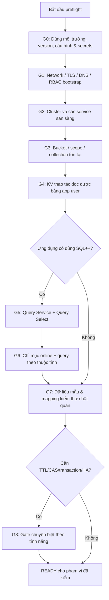

# Kiểm tra sẵn sàng trước khi chạy ứng dụng và bài kiểm thử

## Mục tiêu bài học

Một dự án **SPRING_DATA_COUCHBASE** có thể biên dịch thành công và kết nối được vào Couchbase Server, nhưng vẫn gặp lỗi khi dùng **document mapping**, **CouchbaseRepository**, **CouchbaseTemplate** hoặc truy vấn **SQL++**. Nguyên nhân có thể nằm ở mạng, chứng chỉ, quyền tài khoản, bucket/scope/collection, chỉ mục chưa online, dữ liệu chưa nạp hoặc một tính năng chưa được hỗ trợ bởi phiên bản Server. Vì vậy, **readiness** (đủ điều kiện để phục vụ yêu cầu) phải được kiểm tra **trước khi khởi chạy ứng dụng và bài integration test**, không chỉ nhìn trạng thái container.

Bài thuộc chương **Môi trường** này xây dựng quy trình kiểm tra có tiêu chí **PASS/FAIL** rõ ràng cho hai dạng môi trường phổ biến: **Couchbase Server trong Docker/self-managed** và **Couchbase Capella**. Quy trình cũng chỉ ra những bước kiểm tra mở rộng khi bài thực hành cần TTL, CAS, durable writes, giao dịch hoặc reactive API.

Sau bài học, bạn sẽ biết cách:

- Phân biệt **container Up**, **node healthy**, **SDK bootstrap xong**, **KV sẵn sàng**, **SQL++ sẵn sàng** và **ứng dụng đủ quyền**.
- Xác định tiêu chí bắt buộc theo loại bài: KV-only, repository query, transaction hay reactive.
- Kiểm tra Docker/Capella, DNS, cổng TCP, TLS, RBAC, phiên bản và tài nguyên của cluster.
- Xác minh đúng `training.commerce.orders`, dữ liệu mẫu và chỉ mục `idx_orders_status`.
- Dùng `waitUntilReady`, `ping`, `diagnostics` cùng phép thử **KV và SQL++** để có bằng chứng đáng tin cậy.
- Tạo một bài **JUnit integration test chỉ đọc**, nhận cấu hình từ môi trường và báo FAIL khi thiếu điều kiện.
- Phân biệt điều kiện để **chạy ứng dụng** với điều kiện để **chạy bài kiểm thử**, hạn chế phép thử gây thay đổi dữ liệu.

> **Nguyên tắc:** Không có một phép `ping` nào chứng minh tất cả thao tác của Spring Data Couchbase sẽ thành công. Tính sẵn sàng là **thuộc tính theo khả năng cần dùng**; một ứng dụng chỉ dùng KV có yêu cầu khác một ứng dụng chạy SQL++ hoặc transaction. Ví dụ dùng Couchbase Java SDK 3.x qua Spring Boot starter; cú pháp và đặc tính phải được đối chiếu với bộ phiên bản Boot/SDK/Server thực tế.

## 1. Thiết kế các cổng kiểm tra readiness

Thay vì kết luận "database đã bật", hãy đi qua các **gate**:



| Gate | Nội dung cần xác minh | Ví dụ bằng chứng PASS |
| --- | --- | --- |
| **G0 — Cấu hình** | Endpoint và edition/Server version, JDK/Gradle/Spring Boot/SDK tương thích, cấu hình không chứa secret hardcode. | Manifest môi trường, version đã ghi nhận, profile đang dùng đúng. |
| **G1 — Kết nối** | Từ **đúng nơi chạy app**, DNS và TCP đi được; TLS/CA hợp lệ; credential xác thực thành công. | SDK bootstrap; không có authentication/TLS/network error. |
| **G2 — Cluster** | Node/service khỏe mạnh; Data Service có; Query/Index bật khi cần; không rebalance/upgrade dang dở. | Web Console/REST có `kv`, `n1ql`, `index` theo nhu cầu. |
| **G3 — Tài nguyên** | Bucket `training`, scope `commerce`, collection `orders` đã hiện và truy cập được. | REST manifest hoặc SDK lấy collection không phát sinh lỗi. |
| **G4 — KV** | App user thực sự được đọc key mẫu trong collection đích. | `exists`/`get` bằng SDK thành công, có dữ liệu mẫu kỳ vọng. |
| **G5 — Query** | Query Service reachable và user có quyền SQL++ tương ứng. | `SELECT ... USE KEYS` qua SDK trả row đã biết. |
| **G6 — Index** | Secondary index cần cho derived repository query online, kế hoạch truy vấn phù hợp. | `system:indexes` và `EXPLAIN` được kiểm tra bằng user có quyền. |
| **G7 — Dữ liệu** | Seed đúng ID, field/type, repository mapping và query consistency. | Test xác nhận `order::demo-1001` và status `NEW` trong bộ mẫu. |
| **G8 — Nâng cao** | TTL, CAS, durability, transaction metadata, replica/topology hoặc reactive/backpressure, **chỉ khi dùng**. | Integration test chuyên biệt đã chạy trên cluster phù hợp. |

**Thứ tự có ý nghĩa:** nếu G1 lỗi TLS, chưa nên đi tìm lỗi index. Nếu G4 đã PASS nhưng G6 FAIL, SDK KV không hỏng; tiếp tục kiểm tra Query/Index. Gate chưa kiểm tra phải được ghi **NOT RUN**, không tự động xem như PASS.

### 1.1. Định nghĩa READY theo mục tiêu thực hành

| Loại thực hành | Gate bắt buộc | Gate chưa bắt buộc |
| --- | --- | --- |
| Đọc/ghi theo key, TTL, CAS trên một document | G0–G4; phép thử tính năng cụ thể khi dùng TTL/CAS | G5–G6 nếu hoàn toàn không chạy SQL++. |
| `CouchbaseRepository.findById` / `save` | G0–G4 và ánh xạ entity/collection đúng | Không nhất thiết cần Query/Index chỉ cho thao tác KV. |
| Derived query như `findByStatus`, `@Query` | G0–G7 | Transaction/replica test nếu chưa dùng. |
| Giao dịch KV/SQL++ nhiều document | G0–G4, G8; thêm G5–G7 nếu dùng SQL++ | Không thể lấy kết quả KV-only làm bằng chứng transaction. |
| API reactive `Mono`/`Flux` | Gate theo thao tác KV/SQL++ thực tế; test luồng reactive riêng | Reactive **không** là một Server Service khác. |
| Failover, durable writes, HA | Gate topology/replica/durability của G8 | Không kết luận đạt từ lab Docker một node, replica = 0. |

## 2. Preflight cấu hình: đang kiểm tra môi trường nào?

Một báo cáo readiness cần ghi lại:

| Thuộc tính | Ví dụ lab | Vì sao cần |
| --- | --- | --- |
| Môi trường | `local-docker` hoặc `capella-staging` | Tránh chạy test trên production. |
| Connection string | `couchbase://127.0.0.1` (lab) | Seed ban đầu; không chứa mật khẩu. |
| Security mode | Không TLS trên loopback Docker; TLS cho Capella | Sai scheme gây lỗi handshake hoặc kết nối. |
| Server version/edition | Giá trị đọc từ Dashboard/REST | Scope/collection và feature gating phụ thuộc Server/edition. |
| Java/Gradle/Boot/SDK | Version lấy từ wrapper và dependency graph | Nhận diện sai tổ hợp trước khi debug dữ liệu. |
| Bucket/scope/collection | `training / commerce / orders` | Không truy vấn nhầm `_default._default`. |
| Account runtime | `training-app` hoặc Capella cluster access credential | Đánh giá quyền của **chính ứng dụng**, không dùng quyền admin. |
| Kiểu bài test | KV-only, query, transaction, reactive | Quyết định gate nào cần FAIL khi không sẵn sàng. |
| Seed document | `order::demo-1001` | Cho phép test đọc có kết quả ổn định. |

### 2.1. Kiểm tra bộ dependency mà không tự đoán version

Với dự án Gradle đã có wrapper, người học chạy **trên máy phát triển/CI của mình**:

```bash
./gradlew --version
./gradlew dependencyInsight --dependency spring-data-couchbase --configuration runtimeClasspath
./gradlew dependencyInsight --dependency java-client --configuration runtimeClasspath
./gradlew dependencyInsight --dependency spring-data-commons --configuration runtimeClasspath
```

Trên Windows dùng `gradlew.bat`. Trong multi-module, thay `./gradlew` bằng tác vụ đúng module, ví dụ `./gradlew :order-service:dependencyInsight --dependency java-client --configuration runtimeClasspath`.

Ghi nhận **selected version** thực tế; không chỉ nhìn version khai báo trong `build.gradle`. Spring Boot BOM giúp đồng bộ mặc định Spring Data/Java SDK, nhưng dependency override, version catalog, constraint hoặc locking có thể tác động resolution. Đối chiếu system requirements của Spring Boot, Java SDK compatibility và Server feature support trước khi chạy bài TTL/CAS/transaction.

**Chạy `classes` chỉ chứng minh được bước compile trong điều kiện hiện tại**, không kiểm thử kết nối Couchbase. Đây là hai gate khác nhau.

## 3. Kiểm tra môi trường Docker self-managed

Nếu Couchbase đã chạy trong Docker từ bài lab trước, **dùng lại container hiện có**, không tạo thêm container trùng cổng. Tùy chọn dưới đây minh họa việc kiểm tra container tên `couchbase-lab`; nếu bạn đặt tên khác, thay tên tương ứng:

```bash
docker ps --filter name=couchbase-lab
docker logs --tail 100 couchbase-lab
docker port couchbase-lab
docker inspect --format '{{.State.Status}}' couchbase-lab
```

**Kỳ vọng:** container đang `running`, không crash/restart liên tục, các port cần truy cập từ **máy chạy ứng dụng** đã được publish hoặc kết nối trong Docker network. Với lab Spring Boot chạy trực tiếp trên host:

| Port | Mục đích | Kỳ vọng |
| --- | --- | --- |
| `127.0.0.1:8091` | Web Console/REST/SDK bootstrap | Truy cập được, cluster đã setup. |
| `127.0.0.1:11210` | Key-Value Data Service không TLS | SDK thực hiện KV thành công. |
| `127.0.0.1:8093` | Query Service không TLS | Chạy được SQL++ qua SDK/REST khi cần. |

**Container Up chưa đủ:** Web Console có thể vẫn hiển thị wizard **Setup New Cluster**, bucket chưa tạo hoặc Query Service chưa sẵn sàng. Đừng đánh dấu G2 chỉ từ `docker ps`.

### 3.1. Phân biệt host, container và mạng từ xa

| Vị trí chạy Spring Boot | Seed thường dùng | Điều cần xem |
| --- | --- | --- |
| Trên Docker host | `couchbase://127.0.0.1` | Port được publish về loopback và node addresses SDK khám phá. |
| Container khác cùng Compose network | `couchbase://couchbase` | Tên service trong Docker DNS, mạng nội bộ và hostname được Server quảng bá. |
| VM khác | DNS/IP nội bộ của Couchbase Server | Port/routing/firewall, TLS và **alternate addresses** khi đi qua NAT. |

Trong container ứng dụng, `localhost` là **chính container ứng dụng**; thay connection string đúng network. Nếu bootstrap được qua 8091 mà KV vẫn timeout, cần xem IP/port của node mà Couchbase quảng bá trong topology, không chỉ tăng timeout.

### 3.2. Kiểm tra tài nguyên, quota và trạng thái node

Đăng nhập Web Console `http://127.0.0.1:8091` bằng tài khoản quản trị **lab**:

1. **Servers:** node đang healthy; Data Service hoạt động, Query/Index có mặt nếu dùng SQL++; cluster không rebalance hay nâng cấp dang dở.
2. **Buckets:** `training` ready, quota phù hợp RAM Docker; không có cảnh báo thiếu RAM/disk nghiêm trọng.
3. **Scopes & Collections:** `commerce.orders` có trong bucket.
4. **Indexes:** `idx_orders_status` online nếu bài `findByStatus` cần query theo `status`.
5. **Security → Users:** tài khoản ứng dụng có quyền tương ứng. Edition Community có thể không hỗ trợ các role Query Select theo collection như Enterprise/Capella; kiểm tra khả năng của edition thay vì dùng admin làm account runtime.

Với Server self-managed, admin có thể **đọc** thông tin node qua REST:

```bash
# curl yêu cầu nhập password khi chỉ truyền username.
curl --fail --show-error --user Administrator \
  http://127.0.0.1:8091/pools/default
```

Phản hồi có metadata của cluster và từng node; kiểm tra các trường liên quan `nodes[].status` và `nodes[].services`. Nếu đã cài `jq`, chỉ in các thông tin cần:

```bash
curl --fail --silent --show-error --user Administrator \
  http://127.0.0.1:8091/pools/default \
  | jq -r '.nodes[] | [.hostname, .status, (.services | join(","))] | @tsv'
```

**Ví dụ dữ liệu minh họa**, không phải log của cluster đang được chạy:

```text
cb-lab.internal:8091    healthy    kv,n1ql,index
```

Nếu app chỉ cần KV, tối thiểu phải có `kv`. Nếu dùng SQL++ có index, cần `n1ql` và `index` cùng tài nguyên đủ vận hành. Với cluster đa node, các service có thể phân tán; **đọc tất cả node**, không chỉ node bootstrap.

### 3.3. Kiểm tra manifest bucket/scope/collection

Với REST API chỉ đọc:

```bash
curl --fail --show-error --user Administrator \
  http://127.0.0.1:8091/pools/default/buckets/training/scopes
```

**Kỳ vọng:** JSON có `scopes`, gồm `commerce` và trong `collections` của scope đó có `orders`. Nếu vừa tạo xong mà chưa hiện, chờ cluster cập nhật manifest và thử lại trong giới hạn; không gọi Create Collection lặp lại liên tục.

Tài liệu: [Couchbase Server — Manage Scopes and Collections](https://docs.couchbase.com/server/current/manage/manage-scopes-and-collections/manage-scopes-and-collections.html).

## 4. Kiểm tra Couchbase Capella trước khi chạy app

Capella không cho bạn cùng mô hình quản trị hạ tầng như Docker self-managed. Điểm quyết định của readiness là **endpoint kết nối mà dịch vụ cấp**, network egress, TLS, credentials và bucket/collection/index.

1. **Operational Cluster:** xác nhận cluster đang hoạt động, không trong quá trình tạo/nâng cấp/tạm dừng làm gián đoạn truy cập.
2. Vào **Connect → SDK**, lấy **đúng connection string** cho public hoặc private connectivity; không tự chế DNS từ một cluster khác.
3. Chọn hoặc tạo **Cluster Access Credentials** riêng cho ứng dụng. Đây là user truy cập dữ liệu, **khác** tài khoản đăng nhập Capella Console. Cấp quyền đúng bucket/scope/collection.
4. Với public connectivity, tại **Allowed IP Addresses**, thêm **public egress/NAT IPv4** của **máy chủ chạy ứng dụng** (không chỉ IP laptop của người quản trị). Chờ rule ở trạng thái **Active**, tránh dùng `0.0.0.0/0` lâu dài.
5. Dùng `couchbases://` và TLS. Java SDK hiện đại đã hỗ trợ CA tiêu chuẩn Capella; nếu có lỗi certificate/trust store, điều tra đúng chuỗi chứng chỉ và DNS hostname, **không tắt xác thực TLS**.
6. Kiểm tra resolver của máy chủ ứng dụng có trả về DNS SRV và bản ghi IPv4 cho endpoint; nếu mạng chỉ có IPv6 hoặc chặn DNS SRV, kết nối có thể không hoạt động.
7. Xác minh bucket/scope/collection và index qua giao diện/dịch vụ được Capella cung cấp; không áp các REST endpoint quản trị self-managed lên Capella nếu không có hỗ trợ.

**Từ nơi chạy app** có thể kiểm tra DNS SRV:

```bash
# Thay host bằng hostname thật từ Capella Connect, không có scheme.
dig SRV _couchbases._tcp.<hostname-tu-capella>
```

Trên Windows PowerShell:

```powershell
Resolve-DnsName -Type SRV "_couchbases._tcp.<hostname-tu-capella>"
```

**Đừng kết luận FAIL chỉ từ một phép ping ICMP** đến Capella: hạ tầng cloud có thể chặn ICMP dù SDK TLS hoạt động. Quyết định cuối phải dựa trên DNS/TLS/SDK thao tác tới dịch vụ thực tế.

Nguồn: [Capella — Connect To Your Cluster](https://docs.couchbase.com/cloud/get-started/connect.html), [Capella — Allowed IP Addresses](https://docs.couchbase.com/cloud/clusters/allow-ip-address.html), [Java SDK — Managing Connections](https://docs.couchbase.com/java-sdk/current/howtos/managing-connections.html).

## 5. Cấu hình Spring Boot có thể dùng chung cho Docker và Capella

### 5.1. Starter và cấu hình

Trong một dự án **Spring Boot** đã dùng BOM/dependency management tương thích, truy cập đồng bộ với `CouchbaseRepository` hoặc `CouchbaseTemplate`:

```groovy
dependencies {
    implementation 'org.springframework.boot:spring-boot-starter-data-couchbase'
    testImplementation 'org.springframework.boot:spring-boot-starter-test'
}
```

Nếu bài học dùng reactive repository/template, chọn starter reactive theo bộ Spring Boot đang dùng và kiểm thử với API `Mono`/`Flux`. Điều này **không thay đổi** yêu cầu DNS/TLS/RBAC của cluster.

Trong `src/main/resources/application.yml`:

```yaml
spring:
  couchbase:
    connection-string: ${CB_CONNECTION_STRING}
    username: ${CB_USERNAME}
    password: ${CB_PASSWORD}
  data:
    couchbase:
      bucket-name: ${CB_BUCKET_NAME:training}
```

**Không commit mật khẩu** vào source hoặc đưa vào URL, log, ảnh chụp. Thiết lập `CB_CONNECTION_STRING`, `CB_USERNAME`, `CB_PASSWORD`, `CB_BUCKET_NAME` qua biến môi trường của IDE/CI hoặc secret manager. Ví dụ:

| Môi trường | `CB_CONNECTION_STRING` | Lưu ý |
| --- | --- | --- |
| Docker trên host | `couchbase://127.0.0.1` | Chỉ dùng lab loopback không TLS. |
| Docker Compose cùng network | `couchbase://couchbase` | Cần DNS service và node addresses phù hợp. |
| Capella public | **Chuỗi `couchbases://...` lấy từ Connect → SDK** | Cần IP allowlist, DNS SRV, TLS và cluster access user. |
| Capella private | Chuỗi kết nối **private** từ cấu hình Capella | DNS, route/VPC và security rules private phải đúng. |

**Tránh khởi tạo thêm `Cluster.connect(...)` trong mỗi request.** Spring Boot quản lý lifecycle `Cluster` cho ứng dụng; tạo client mới cho từng thao tác tốn connection pool và dễ gây timeout.

### 5.2. Đừng nhầm compile, context load và readiness

| Phép thử | Bằng chứng | Chưa chứng minh |
| --- | --- | --- |
| `./gradlew classes` | Biên dịch được mã ứng dụng. | Couchbase Server reachable. |
| `./gradlew test` với unit test mock repository | Logic đơn vị chạy được. | Cluster thật, RBAC, index, SQL++ hoạt động. |
| `@SpringBootTest` khởi tạo context | Auto-configuration/bean wiring hợp lệ tại thời điểm khởi tạo. | Mọi thao tác KV/SQL++ đều thành công. |
| SDK `cluster.waitUntilReady(...)` | SDK hoàn tất bootstrap/độ sẵn sàng ở mức client trong timeout. | Quyền truy cập collection, dữ liệu mẫu hay index online. |
| `bucket.ping()` / `cluster.ping()` | Chủ động kiểm tra endpoint/service được chọn. | Nội dung document, RBAC trên mọi collection, transaction. |
| `cluster.diagnostics()` | Trạng thái kết nối **SDK đang biết**. | Một kiểm tra mạng mới; kết quả có thể chưa cập nhật. |
| `exists/get` và `SELECT` bằng **app user** | Thao tác thực tế được chấp nhận theo đường tương ứng. | Tất cả use case còn lại khi cần role/index khác. |

## 6. Kiểm tra SDK bootstrap, Ping và Diagnostics

### 6.1. `waitUntilReady`: dùng đúng mức

Couchbase Java SDK 3.x hỗ trợ chờ cluster/bucket sẵn sàng trong một thời hạn:

```java
// cluster do Spring Boot quản lý, không tạo mới mỗi lần gọi.
cluster.waitUntilReady(java.time.Duration.ofSeconds(30));
var bucket = cluster.bucket("training");
bucket.waitUntilReady(java.time.Duration.ofSeconds(30));
```

**PASS ở đây chưa đủ cho repository query.** Sau đó vẫn phải kiểm tra chính collection, permission và Query/Index Service. Cần chọn timeout theo latency và chính sách môi trường, không mặc định rằng 30 giây là chuẩn production.

### 6.2. `ping()`: đo chủ động nhưng không thay bài test dữ liệu

```java
var ping = bucket.ping();
System.out.println(ping.exportToJson());
```

Ping chủ động kiểm tra các service endpoint liên quan và trả trạng thái/độ trễ của endpoint. **Ở một số phiên bản Server, `cluster.ping()` có thể không bao gồm KV**, vì thế `bucket.ping()` là lựa chọn tốt để kiểm tra Data Service. Kiểm tra nội dung report và service cụ thể; **không** chỉ tìm một chuỗi `OK` rồi coi toàn bộ cluster sẵn sàng.

### 6.3. `diagnostics()`: thông tin quan sát thụ động

```java
var diagnostics = cluster.diagnostics();
System.out.println(diagnostics.exportToJson());
```

`diagnostics` không tạo thêm I/O để đo trực tiếp và phản ánh trạng thái các endpoint mà SDK đã biết. Kết quả có thể là `ONLINE`, `DEGRADED` hoặc `OFFLINE` ở mức quan sát của client, **không phải cam kết rằng mọi API hay node đều khỏe**.

Sử dụng ping/diagnostics để **tìm đầu mối sự cố**, không dùng chúng như phép thử duy nhất trong integration test. `ping` cũng không hoàn toàn "miễn tác động": nó chủ động trao đổi mạng và có thể làm một kết nối được mở lại. Không gọi ping tần suất quá cao ở mọi HTTP request.

Nguồn: [Couchbase Java SDK — Health Check](https://docs.couchbase.com/java-sdk/current/howtos/health-check.html) và [Managing Connections — Waiting for Bootstrap](https://docs.couchbase.com/java-sdk/current/howtos/managing-connections.html).

## 7. Readiness theo nghiệp vụ: KV, SQL++ và dữ liệu mẫu

### 7.1. G4 — Kiểm tra KV bằng chính user của ứng dụng

Ví dụ ở đây giả sử đã nạp `order::demo-1001` vào `training.commerce.orders`. `exists` là phép đọc metadata, không sửa dữ liệu:

```java
var orders = bucket.scope("commerce").collection("orders");
var result = orders.exists("order::demo-1001");

if (!result.exists()) {
    throw new IllegalStateException(
        "Missing seed document: order::demo-1001 in training.commerce.orders"
    );
}

System.out.println("KV seed check PASS");
```

**Phân loại kết quả:**

- `exists = true`: SDK đã tìm được key ở collection đúng, dùng được đường KV với account đang chạy.
- `exists = false`: có thể kết nối đã ổn nhưng **chưa nạp data seed**, nhầm bucket/scope/collection hoặc key đã hết hạn/xóa. Với bài kiểm thử yêu cầu seed, đây là **FAIL của G7**, không tự kết luận Data Service down.
- `AuthenticationFailureException`: kiểm tra credentials/user.
- `CollectionNotFoundException`: kiểm tra scope/collection và manifest.
- `TimeoutException`: kiểm tra network, advertised node addresses, tải, server health; không nhầm với thiếu document.

Nếu muốn xác nhận **giá trị** chứ không chỉ sự tồn tại, đọc `orders.get("order::demo-1001")` rồi kiểm tra field `status` bằng `contentAsObject().getString("status")`.

**Không dùng tài khoản admin thay tài khoản runtime khi chạy positive test.** Admin truy cập được không chứng minh user của ứng dụng đã được cấp quyền.

### 7.2. G5 — Kiểm tra Query Service và quyền Query Select

Để loại trừ yếu tố index, trước tiên dùng `USE KEYS` với document biết trước:

```sql
SELECT META(o).id AS docId, o.status
FROM `training`.`commerce`.`orders` AS o
USE KEYS "order::demo-1001";
```

Với Java SDK:

```java
var qr = cluster.query(
    "SELECT META(o).id AS docId, o.status " +
    "FROM `training`.`commerce`.`orders` AS o " +
    "USE KEYS $docKey",
    com.couchbase.client.java.query.QueryOptions.queryOptions()
        .parameters(
            com.couchbase.client.java.json.JsonObject.create()
                .put("docKey", "order::demo-1001")
        )
);

var rows = qr.rowsAsObject();
if (rows.size() != 1) {
    throw new IllegalStateException("SQL++ seed query did not return one row");
}
```

**Kỳ vọng:** có một row `docId = "order::demo-1001"`. Vì `USE KEYS` chỉ định document ID, phép thử không cần secondary index. Nó giúp phân biệt **Query Service/Query Select** với **Index Service**.

Lưu ý quyền: `Data Reader` và `Data Writer` của KV **không tự cấp** `Query Select`. Trên một số edition, đặc biệt Community Edition, tập role có thể gán bị giới hạn. Nếu không có role Query Select cho app user trong lab, chỉ đánh dấu **KV READY** và dùng môi trường hỗ trợ phù hợp cho bài derived repository query; không cấp `Administrator` cho runtime để “cho nhanh”.

### 7.3. G6 — Kiểm tra Index Service và truy vấn theo thuộc tính

Tài khoản provisioning/admin có thể dùng **Query Workbench** để xem index:

```sql
SELECT name, state, bucket_id, scope_id, keyspace_id
FROM system:indexes
WHERE name = "idx_orders_status"
  AND bucket_id = "training"
  AND scope_id = "commerce"
  AND keyspace_id = "orders";
```

**Kỳ vọng:** index có `state = "online"`. Truy vấn `system:indexes` yêu cầu quyền truy cập system catalog và các tài nguyên liên quan; **đừng coi user runtime không đọc được catalog là Index Service hỏng**. Có thể xem index qua **Indexes** trong Web Console bằng user quản trị.

Sau đó kiểm tra query dữ liệu:

```sql
EXPLAIN
SELECT META(o).id AS docId, o.status
FROM `training`.`commerce`.`orders` AS o
WHERE o.status = "NEW";

SELECT META(o).id AS docId, o.status
FROM `training`.`commerce`.`orders` AS o
WHERE o.status = "NEW";
```

Với data seed có hai đơn NEW, câu query thứ hai nên trả các document của bộ mẫu nếu collection chỉ chứa bộ đó; nếu có dữ liệu khác thì phải lọc thêm ID/prefix để so sánh. **`EXPLAIN` mới cho biết có dùng index phù hợp hay không.**

**Theo phiên bản:** từ Couchbase Server **7.6+**, một số câu SQL++ có thể chạy không cần secondary index bằng sequential scan. Một query chạy thành công **không đồng nghĩa** `idx_orders_status` đã online hay có hiệu năng phù hợp. Đối với môn học về chỉ mục và tối ưu SQL++, gate G6 chỉ PASS khi index/plan thực đã được đối chiếu.

### 7.4. G7 — Đúng kiểu dữ liệu và semantics Spring Data

Với bộ sample:

| Key | `status` | `total` |
| --- | --- | ---: |
| `order::demo-1001` | `NEW` | 125000 |
| `order::demo-1002` | `PAID` | 250000 |
| `order::demo-1003` | `NEW` | 99000 |
| `order::demo-1004` | `CANCELLED` | 45000 |

Kỳ vọng `COUNT = 4` và `SUM(total) = 519000` khi chỉ truy vấn bốn ID này. Dùng SQL++:

```sql
SELECT COUNT(1) AS sampleCount, SUM(o.total) AS totalVnd
FROM `training`.`commerce`.`orders` AS o
USE KEYS [
  "order::demo-1001", "order::demo-1002",
  "order::demo-1003", "order::demo-1004"
];
```

**Lưu ý quan trọng cho repository:** document tự nạp qua UI/SQL++ có thể không có metadata loại `_class` mà Spring Data Couchbase sử dụng trong câu derived query. Nếu `findById` đọc được document nhưng `findByStatus` trả rỗng, xem entity mapping `@Scope`/`@Collection`, câu query thực Spring Data sinh, type metadata và scan consistency. Thực hành tốt là tạo ít nhất **một entity bằng chính repository** trong bộ dữ liệu riêng, rồi kiểm tra đường query của repository đó.

Index được cập nhật bất đồng bộ. Nếu bài test query ngay sau KV mutation, cần cân nhắc `REQUEST_PLUS` hoặc cơ chế consistency thích hợp khi nghiệp vụ yêu cầu read-your-own-write, không giải quyết bằng `Thread.sleep` tùy tiện.

## 8. JUnit integration test chỉ đọc: một điều kiện GO/NO-GO có thể chạy lại

Khác với unit test mock repository, **integration test phải gọi thật** Couchbase từ cùng loại môi trường sẽ chạy ứng dụng. Ví dụ này sử dụng Spring Boot starter Couchbase và JUnit Jupiter (thông qua `spring-boot-starter-test`).

### 8.1. Test độc lập, không ghi hoặc xóa dữ liệu

Tạo file test trong **dự án thực hành riêng**, ví dụ `src/test/java/com/example/orders/CouchbaseReadinessTest.java`:

```java
package com.example.orders;

import com.couchbase.client.java.Cluster;
import com.couchbase.client.java.json.JsonObject;
import com.couchbase.client.java.query.QueryOptions;
import org.junit.jupiter.api.Tag;
import org.junit.jupiter.api.Test;
import org.springframework.beans.factory.annotation.Autowired;
import org.springframework.beans.factory.annotation.Value;
import org.springframework.boot.test.context.SpringBootTest;

import java.time.Duration;

import static org.junit.jupiter.api.Assertions.assertEquals;
import static org.junit.jupiter.api.Assertions.assertTrue;

@Tag("integration")
@SpringBootTest
class CouchbaseReadinessTest {

    private static final String SEED_ID = "order::demo-1001";

    @Autowired
    Cluster cluster;

    @Value("${spring.data.couchbase.bucket-name}")
    String bucketName;

    @Test
    void keyValueIsReadyAndSeedDocumentExists() {
        var bucket = cluster.bucket(bucketName);
        bucket.waitUntilReady(Duration.ofSeconds(30));

        var orders = bucket.scope("commerce").collection("orders");
        assertTrue(
            orders.exists(SEED_ID).exists(),
            "Seed " + SEED_ID + " is absent from " +
                bucketName + ".commerce.orders"
        );

        var document = orders.get(SEED_ID).contentAsObject();
        assertEquals("NEW", document.getString("status"));
    }

    @Test
    void queryServiceCanReadSeedByKey() {
        cluster.waitUntilReady(Duration.ofSeconds(30));

        var options = QueryOptions.queryOptions()
            .parameters(JsonObject.create().put("id", SEED_ID));

        var result = cluster.query(
            "SELECT META(o).id AS docId, o.status " +
            "FROM `training`.`commerce`.`orders` AS o USE KEYS $id",
            options
        );

        var rows = result.rowsAsObject();
        assertEquals(1, rows.size(), "SQL++ seed row missing");
        assertEquals(SEED_ID, rows.get(0).getString("docId"));
    }
}
```

**Điều kiện để test có ý nghĩa:**

- Ứng dụng Spring Boot phải có main class/configuration mà `@SpringBootTest` tìm được, và starter Couchbase tương thích.
- Test **chỉ đọc**; dữ liệu `order::demo-1001` phải được seed trước, đúng giá trị `status = "NEW"`.
- Phép thử `queryServiceCanReadSeedByKey` yêu cầu **Query Service và Query Select**. Với account chỉ có KV rights, **không** chạy cả suite như gate KV-only; tách/loại riêng bài query theo chiến lược test của dự án.
- SQL++ trong test cố định bucket `training`; nếu dự án dùng bucket khác, thay câu query cho khớp `CB_BUCKET_NAME`. Không được để một tham số môi trường trỏ tới bucket này còn test query bucket khác.
- Test chưa xác nhận **Index Service** vì `USE KEYS` không cần index. Nếu mục tiêu là derived query, thêm bài test `WHERE status = ...` và kiểm tra index online ở mục 7.3.

### 8.2. Chạy bài test bằng Gradle

Trong thư mục project đã cấu hình Gradle wrapper:

```bash
./gradlew test --tests "com.example.orders.CouchbaseReadinessTest"
```

Trên Windows dùng `gradlew.bat`. Các biến `CB_CONNECTION_STRING`, `CB_USERNAME`, `CB_PASSWORD` và `CB_BUCKET_NAME` phải được **cấp ở môi trường thực thi Gradle/CI** từ secret manager hoặc cấu hình terminal/IDE; không điền thật vào file nguồn.

**Ý nghĩa của kết quả:**

- Hai test PASS: ứng dụng có thể đọc KV và SQL++ theo key bằng account cấu hình, với data seed sẵn.
- Test KV PASS, test SQL++ FAIL vì 403: kiểm tra Query Select và giới hạn edition; không coi KV đã lỗi.
- Test FAIL vì không có seed: môi trường hoặc bước data provisioning thiếu; không thay đổi cluster mà chưa xác nhận đường kết nối.
- Test PASS **không** chứng minh transaction, durability, mọi derived query, tất cả index hay khả năng chịu lỗi.

Nếu CI không có kết nối tới môi trường Couchbase thật, **không** biến integration test thành unit test bằng cách mock `Cluster` rồi gọi đó là readiness. Hãy phân tách task/test suite hoặc chỉ thực hiện gate này trong job có môi trường đã provisioning.

### 8.3. Khi nào mới thêm phép thử ghi?

Với service có chức năng ghi, chỉ kiểm thử **Data Writer** bằng thao tác mutation trong **staging/test cluster** được phép. Dùng key ngẫu nhiên (ví dụ `preflight::<UUID>`), đặt TTL ngắn, đọc lại và dọn đúng key đã tạo. Thiết kế cleanup trong `finally` nhưng **không** để cleanup che lấp lỗi chính; nếu insert thất bại thì không cố remove. Không thực hiện một phép write trên key nghiệp vụ cố định ở production chỉ để test readiness.

Để thử **CAS**, thực hiện hai mutation cạnh tranh trên cùng key test và xác minh CAS cũ bị từ chối. Để thử **expiry/TTL**, kiểm tra expiry theo SDK/Server semantics. Để thử **transaction**, tạo dữ liệu riêng, cấu hình metadata collection/role và topology theo tài liệu; cluster một node replica = 0 không đại diện cho HA/durability.

## 9. Quy trình điều phối: trước khi chạy app, trong CI và khi vận hành

### 9.1. Trước khi khởi chạy Spring Boot ở môi trường học tập

1. **G0**: chọn đúng env profile, đọc version Spring Boot/SDK/Server; xác nhận biến môi trường đã có mà không in secret.
2. **G1–G2**: kiểm tra DNS/network/TLS, trạng thái cluster, Data/Query/Index theo loại bài.
3. **G3**: xem bucket/scope/collection đã có và đúng tên.
4. **G4**: chạy KV `exists`/`get` bằng user ứng dụng.
5. Nếu cần SQL++, chạy **G5–G6**: query `USE KEYS`, index online, `EXPLAIN`.
6. **G7**: data seed/kiểu dữ liệu/mapping đúng. Chỉ sau đó chạy `./gradlew test` integration test hoặc khởi động app.

Nếu gate bắt buộc FAIL, dừng quá trình chạy bài test **có phụ thuộc** vào nó và báo nguyên nhân. Không chạy một loạt test để thu hàng chục lỗi timeout giống nhau, vì chúng khó chẩn đoán hơn một preflight thất bại sớm.

### 9.2. Trong CI/CD

Một pipeline điển hình phân tầng:

```text
Compile + Unit Tests
        |
        v
Provision / Select Isolated Couchbase Test Environment
        |
        v
Preflight: DNS/TLS/RBAC -> Cluster -> Keyspace -> Seed -> Index
        |
    PASS / FAIL
        |
        v
Integration Tests: KV -> SQL++ -> Advanced Features
        |
        v
Build / Release Decision
```

**Nên ưu tiên môi trường độc lập và có thể tái tạo.** Có thể dựng Couchbase test bằng Docker/Testcontainers hoặc cluster chuyên dụng; nếu dùng Capella staging, cần cô lập bucket/scope/collection và dữ liệu theo test run, có chính sách dọn dẹp. `depends_on` của Docker Compose chỉ đảm bảo thứ tự start container, **không chờ** cluster hoàn tất setup, quota, bucket và index.

Với bài chỉ kiểm tra khả năng bootstrapping, có thể dùng test nhẹ. Với transaction/durability, cần topology/replica đúng; không ép các kiểm thử nặng vào local single-node rồi diễn giải thất bại là SDK hỏng.

### 9.3. Phân biệt startup check, liveness và readiness khi triển khai

| Mục đích | Ý nghĩa | Khuyến nghị |
| --- | --- | --- |
| **Startup** | Quá trình khởi tạo app đã hoàn tất tới mức có thể đánh giá sức khỏe. | Cho app đủ thời gian khởi tạo SDK/bean/index startup, theo giới hạn đã thiết kế. |
| **Liveness** | Tiến trình ứng dụng còn hoạt động hay bị treo không thể phục hồi. | **Không** gắn cứng với Couchbase availability; database outage không nhất thiết là lý do restart tất cả app pods. |
| **Readiness** | Instance hiện có thể nhận yêu cầu phụ thuộc Couchbase hay không. | Có thể kiểm tra kết nối/khả năng tối thiểu với timeout và caching thích hợp, tránh quá tải cluster bằng polling. |
| **Integration preflight** | Môi trường test/ứng dụng có đủ schema/data/index/rights trước một lượt chạy không. | Kiểm tra sâu hơn readiness runtime, nhưng **không** chạy trên từng HTTP request. |

Spring Boot Actuator có thể cung cấp health indicators cho Couchbase khi starter/Actuator hiện diện; chi tiết tên indicator, group readiness và behavior phụ thuộc phiên bản Boot và cấu hình. **Không suy rằng HTTP 200 từ `/actuator/health` tự động xác nhận Query Select, index online và seed data.** Thiết kế custom health/readiness chỉ kiểm tra những phụ thuộc tối thiểu cần để nhận traffic; kiểm tra sâu dành cho preflight hoặc monitor độc lập.

## 10. Bảng chẩn đoán lỗi trước khi chạy test

| Triệu chứng | Nguyên nhân có khả năng | Gate / bước xử lý |
| --- | --- | --- |
| `docker ps` là Up nhưng Web Console còn wizard | Cluster chưa Setup New Cluster. | G2: hoàn tất thiết lập node/services trước. |
| `8091` truy cập được nhưng SDK timeout trên KV | Port 11210/11207, advertised addresses hoặc network NAT không phù hợp. | G1: xem endpoint sau bootstrap, Docker network và firewall. |
| App chạy ở container, `couchbase://127.0.0.1` fail | `localhost` trỏ vào container ứng dụng. | G1: dùng service DNS/alternate addresses đúng topology. |
| Capella timeout dù credentials đúng | Egress IP server chưa allowed, entry chưa Active hoặc DNS SRV/TLS bị chặn. | G1: kiểm tra từ app runtime và Capella Connect. |
| `SSLHandshakeException` | Scheme/chứng chỉ/hostname/trust store/proxy TLS sai. | G1: dùng TLS hợp lệ; không disable verification. |
| `AuthenticationFailureException` | Sai user/password hoặc dùng Capella Console login thay cluster credential. | G1: xác nhận secret và account đúng. |
| `CollectionNotFoundException` | Sai `commerce.orders`, manifest chưa đồng bộ hoặc Server chưa hỗ trợ feature. | G3: xem bucket/scopes API và mapping. |
| SDK `exists` thành công nhưng trả `false` | Không có key `order::demo-1001`, đã bị xóa/expiry hoặc trỏ sai collection. | G4/G7: seed lại trong lab, không đoán Data Service hỏng. |
| KV PASS, SQL++ trả 403 | User thiếu Query Select, edition/role không hỗ trợ. | G5: kiểm tra RBAC theo loại thao tác. |
| SQL++ `USE KEYS` PASS, query `WHERE status` lỗi | Index thiếu, offline, predicate không phù hợp hoặc Index Service không ready. | G6: xem `system:indexes`, Indexes UI, `EXPLAIN`. |
| Query chạy nhưng kết quả chưa thấy mutation mới | Index cập nhật bất đồng bộ, consistency lựa chọn chưa phù hợp. | G7: cân nhắc `REQUEST_PLUS`/mutation tokens và check dữ liệu. |
| Query SQL++ thủ công thấy row, repository derived query rỗng | Metadata `_class`/mapping khác, sai collection hoặc consistency. | G7: ghi entity thử bằng repository và xem SQL++ thực tế. |
| Test environment single-node không đạt replica/durability | Topology/replica không đáp ứng điều kiện feature. | G8: dùng cluster multi-node cho bài durability/HA. |
| `NoSuchMethodError` sau đổi dependency | Spring Data/Java SDK/Framework resolved không nhất quán. | G0: đọc `dependencyInsight`, xem BOM/override. |
| `ping` trả vài endpoint healthy nhưng query vẫn lỗi | `ping` không thử SQL++ quyền/index/dữ liệu. | G5–G7: kiểm tra thao tác thực bằng app user. |
| Tất cả test timeout hàng loạt | Không có preflight hoặc job chạy trước khi cluster/seed sẵn sàng. | Chặn sớm bằng gate có bằng chứng; giới hạn retry. |

**Chẩn đoán theo lớp:** xác định loại thao tác đang lỗi → kiểm tra connection/credentials → service → bucket/scope/collection → role → index → dữ liệu/mapping → feature-specific topology. Không tăng mọi timeout lên mức rất lớn để che đi lỗi thiếu quyền hoặc thiếu index.

## 11. Bài tập tình huống

### Bài 1 — Container Up có phải READY?

Docker báo `couchbase-lab` đang running và cổng 8091 mở. Nhưng Java SDK `get` timeout. Hãy chỉ ra những gate chưa được chứng minh.

**Gợi ý đáp án:** G1 (tuyến KV 11210, advertised address, auth), G2 (cluster/services đã thiết lập), G3 (bucket/collection), G4 (thao tác KV). `docker ps` chỉ chứng minh tiến trình container tồn tại.

### Bài 2 — `waitUntilReady` PASS nhưng repository query FAIL

`bucket.waitUntilReady` không báo lỗi, `findById` trả về entity, còn `findByStatus` báo không có index. Có nên thay Java SDK?

**Gợi ý đáp án:** Chưa. G4 đã có bằng chứng PASS, nhưng G5/G6 chưa hoàn tất. Kiểm tra Query/Index Service, role Query Select, index online và câu SQL++ repository sinh. Thay SDK không tự tạo index.

### Bài 3 — Data seed có bốn document nhưng JUnit FAIL

Documents Workbench cho thấy `order::demo-1001` có `status = PAID` do một bài sửa trước đó. `CouchbaseReadinessTest` kỳ vọng `NEW` và fail. Đây là lỗi kết nối?

**Gợi ý đáp án:** Không; đây là **G7 data fixture mismatch**. Trả dữ liệu lab về trạng thái seed bằng quy trình có kiểm soát, hoặc dùng fixture cô lập theo test run. Không sửa kỳ vọng thành một giá trị tùy ý chỉ để test xanh.

### Bài 4 — Query System Catalog không đọc được

Ứng dụng Enterprise/Capella có Query Select và `SELECT ... WHERE status` chạy, nhưng user không thể đọc `system:indexes`. Có nên cấp toàn quyền admin cho app?

**Gợi ý đáp án:** Không. System catalog có quyền truy cập riêng; dùng danh tính provisioning/quan sát có quyền phù hợp để kiểm tra index, tách với runtime user. G6 có thể được xác minh bằng UI/admin và query thực của app user.

### Bài 5 — Capella đã cho phép IP laptop

Developer kết nối Capella trên máy cá nhân thành công; GitHub Actions/cloud CI job không kết nối được. Vì sao?

**Gợi ý đáp án:** CI có **public egress/NAT IP khác laptop**; có thể cần rule Allowed IP riêng hoặc private connectivity. Cần kiểm tra DNS SRV, TLS và credentials từ chính CI runner, không suy từ máy cá nhân.

### Bài 6 — Tại sao không dùng phép query nặng trong liveness?

Một Kubernetes liveness probe chạy SQL++ aggregate mỗi vài giây. Khi Query Service chậm, toàn bộ pod bị restart rồi query lặp lại. Thiết kế lại thế nào?

**Gợi ý đáp án:** Liveness nên phản ánh tình trạng tiến trình, không buộc database luôn khỏe. Readiness có thể phản ánh khả năng phục vụ với timeout và caching phù hợp; kiểm tra schema/index/aggregate nặng chuyển sang preflight/monitor riêng. Dùng backoff và tránh hiệu ứng restart hàng loạt.

## 12. Checklist GO / NO-GO trước khi chạy app và test

### GO — Bắt buộc theo phạm vi

- [ ] **G0:** Đúng profile/môi trường; Spring Boot, Java SDK, Server versions và Gradle wrapper đã được đối chiếu.
- [ ] **G1:** Connection string khớp host/container/Capella; DNS/TCP/TLS/credentials chạy từ **chính nơi app chạy**.
- [ ] **G2:** Cluster healthy, Data Service có; Query/Index có khi bài cần.
- [ ] **G3:** Bucket/scope/collection đã tạo, manifest đồng bộ, không có lỗi permission ở tài nguyên đích.
- [ ] **G4:** KV đọc `order::demo-1001` qua app user thành công.
- [ ] **G5:** Nếu dùng SQL++, query `USE KEYS` bằng account runtime thành công.
- [ ] **G6:** Nếu dùng derived query theo thuộc tính, index đúng đã online và `EXPLAIN` được xác minh.
- [ ] **G7:** Dữ liệu seed có ID/kiểu/giá trị kỳ vọng; Spring Data mapping không bị nhầm `_default`/`_class`.
- [ ] **G8:** Nếu có transaction/TTL/CAS/durability/reactive, thêm gate và test chuyên biệt phù hợp với topology.
- [ ] Kết quả PASS/FAIL/NOT RUN, thời điểm, phiên bản và bằng chứng được lưu **không chứa secret**.

### NO-GO — Dừng bài test phụ thuộc khi

- Một gate **bắt buộc** chưa thể chứng minh hoặc đang FAIL.
- Không chắc mình đang trỏ tới lab/staging hay production; mọi phép mutation phải tạm dừng.
- Cluster đang rebalance/nâng cấp khiến kết quả không ổn định hoặc tài nguyên vượt quota.
- Test cần SQL++/index nhưng chỉ KV hoạt động, hoặc user runtime không có role.
- Test cần replica/durability/transaction nhưng topology single-node không đáp ứng.

**Định nghĩa “READY”:** Chỉ công bố **“READY cho KV”**, **“READY cho SQL++”** hoặc **“READY cho transaction”** khi đúng các gate của phạm vi đó đã PASS. Không có nhãn READY chung cho mọi tính năng của Couchbase.

### Tài liệu tham khảo chính thức

1. [Couchbase Java SDK — Managing Connections / waitUntilReady](https://docs.couchbase.com/java-sdk/current/howtos/managing-connections.html).
2. [Couchbase Java SDK — Health Check (Ping, Diagnostics)](https://docs.couchbase.com/java-sdk/current/howtos/health-check.html).
3. [Couchbase Java SDK — Query with SQL++](https://docs.couchbase.com/java-sdk/current/concept-docs/n1ql-query.html).
4. [Couchbase Server — Manage Scopes and Collections](https://docs.couchbase.com/server/current/manage/manage-scopes-and-collections/manage-scopes-and-collections.html).
5. [Couchbase Server — System Information / Indexes](https://docs.couchbase.com/server/current/n1ql/n1ql-intro/sysinfo.html).
6. [Couchbase Server — Manage Indexes](https://docs.couchbase.com/server/current/manage/manage-indexes/manage-indexes.html).
7. [Couchbase Server — Ports](https://docs.couchbase.com/server/current/install/install-ports.html).
8. [Capella — Connect To Your Cluster](https://docs.couchbase.com/cloud/get-started/connect.html).
9. [Capella — Allowed IP Addresses](https://docs.couchbase.com/cloud/clusters/allow-ip-address.html).
10. [Spring Boot — Couchbase Support](https://docs.spring.io/spring-boot/reference/data/nosql.html).
11. [Spring Data Couchbase — Repositories](https://docs.spring.io/spring-data/couchbase/reference/couchbase/repository.html).
12. [Gradle — Dependency Insight](https://docs.gradle.org/current/userguide/viewing_debugging_dependencies.html).

**Kết luận:** Chạy ứng dụng Spring Data Couchbase sau khi có bằng chứng **network và TLS đúng**, **Server và bucket/collection đã sẵn sàng**, **tài khoản ứng dụng được phép truy cập**, và **KV/SQL++/index phục vụ đúng nhu cầu**. Một bộ gate rõ ràng giúp phát hiện lỗi hạ tầng sớm, bảo vệ dữ liệu test và giảm việc chẩn đoán nhầm lỗi repository, `CouchbaseTemplate` hoặc reactive thành lỗi dependency.
