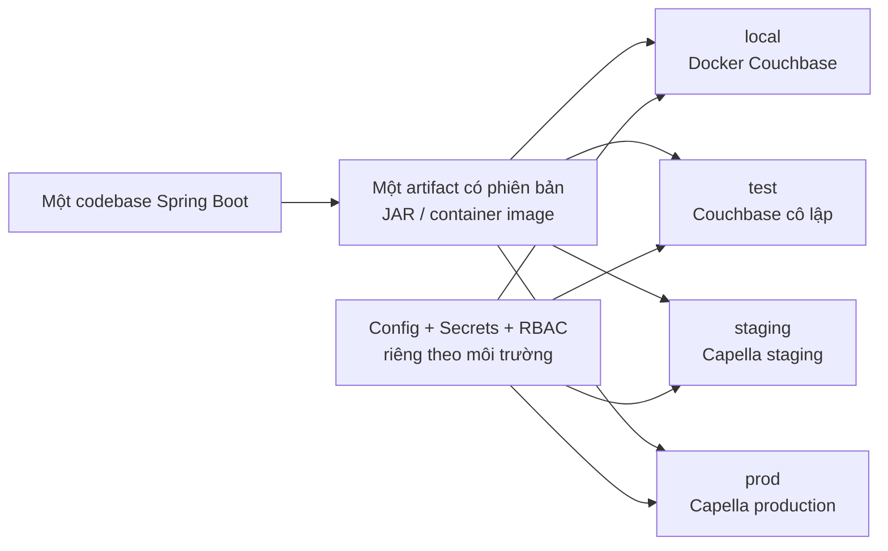

# Tổ chức cấu hình riêng cho phát triển, kiểm thử và triển khai

## Mục tiêu bài học

Một ứng dụng **Spring Data Couchbase** có thể dùng cùng mã Java để chạy trên Couchbase Docker ở máy lập trình, cluster dành riêng cho integration test và Couchbase Capella ở staging/production. Tuy nhiên, **đường kết nối, thông tin xác thực, bucket, quyền truy cập, dữ liệu mẫu và yêu cầu vận hành không giống nhau**. Nếu lưu trực tiếp tất cả vào một `application.yml`, rất dễ kết nối nhầm cơ sở dữ liệu hoặc đưa mật khẩu lên Git.

Trong module **SPRING_DATA_COUCHBASE**, cấu hình ảnh hưởng trực tiếp đến việc sử dụng **document mapping**, **CouchbaseRepository**, **CouchbaseTemplate**, truy vấn **SQL++**, chỉ mục, TTL, CAS, giao dịch và API reactive. Bài thuộc chương **Môi trường** này tập trung vào **cách tổ chức cấu hình** và quy trình kiểm chứng theo vòng đời phát triển, kiểm thử, triển khai; không phải hướng dẫn tạo mới toàn bộ Couchbase cluster.

Sau bài học, bạn có thể:

- Tách **cấu hình chung**, **cấu hình theo Spring Profile** và **secret do môi trường cung cấp**.
- Thiết kế các profile `local`, `test`, `staging`, `prod` mà **không cần build bốn bản ứng dụng khác nhau**.
- Hiểu thứ tự ưu tiên của `application.yml`, `application-{profile}.yml`, biến môi trường, command-line và nguồn cấu hình dành cho test.
- Dùng Docker trên máy phát triển, môi trường integration test riêng và Capella staging/production mà không lộ credential.
- Ngăn bài kiểm thử vô tình truy cập hoặc ghi dữ liệu production; tách unit test, integration test và smoke test.
- Phân biệt **cấu hình client** với **provisioning Server** (bucket/scope/collection/index/RBAC).
- Xác minh profile, endpoint, quyền, dữ liệu và chỉ mục trước khi chạy ứng dụng hoặc triển khai.

> **Nguyên tắc cốt lõi:** Cùng một artifact ứng dụng, nhưng cấu hình runtime và quyền truy cập được cấp riêng cho từng môi trường. **Profile không phải cơ chế bảo mật**: chọn profile `test` không tự động chặn kết nối tới production nếu người chạy cấp nhầm endpoint hoặc credential.

## 1. Vì sao phải phân tách môi trường?



| Môi trường | Mục tiêu | Couchbase thường dùng | Quyền và dữ liệu | Điều không nên làm |
| --- | --- | --- | --- | --- |
| **local** | Phát triển nhanh, debug repository/template | Couchbase Server trong Docker, có thể single-node | Bộ dữ liệu mẫu nhỏ, tài khoản riêng của lab | Dùng credential production; công khai port quản trị ra Internet |
| **test** | Test tự động, lặp lại, kiểm tra integration | Testcontainers hoặc cluster/bucket dùng riêng | Seed xác định, tên tài nguyên riêng, cleanup có kiểm soát | Dùng bucket production hoặc chia sẻ key cố định giữa các job chạy song song |
| **staging** | Kiểm thử phiên bản gần production, migration/index, smoke | Capella staging hoặc cluster tự quản lý dành riêng | RBAC gần giống prod, dữ liệu thử/ẩn danh, secret staging | Đổi index trên production để sửa staging; dùng dữ liệu khách hàng thật không được phép |
| **prod** | Phục vụ người dùng thực, yêu cầu HA/giám sát | Capella production hoặc Couchbase cluster production | Secret từ vault, quyền tối thiểu, backup/DR và theo dõi | Hardcode secret, tự động xóa dữ liệu, đưa script reset bucket vào runtime |

Phân biệt hai trục:

1. **Profile của Spring** quyết định cấu hình bean và property của ứng dụng (`local`, `test`, `staging`, `prod`).
2. **Couchbase deployment** là một hệ thống thực tế có network, users, bucket, scope, collection, chỉ mục, quota và quyền riêng.

Chỉ đổi `SPRING_PROFILES_ACTIVE` không tạo bucket mới, không khởi động Index Service và không tự thay đổi RBAC trên cluster.

### 1.1. Những giá trị phải tách theo môi trường

| Nhóm cấu hình | Khác nhau ở đâu? | Cách quản lý |
| --- | --- | --- |
| Connection string | `couchbase://127.0.0.1` ở host local; `couchbase://couchbase` trong mạng Docker; `couchbases://...` tại Capella | Biến môi trường hoặc secret/config được mount ở runtime |
| Username/password | Mỗi môi trường dùng account riêng; prod không dùng Administrator | Secret manager, không đặt trong repo |
| Bucket | `training` ở local, `it_orders_...` ở test, bucket staging/prod riêng | Biến môi trường `CB_BUCKET_NAME` hoặc provisioning config |
| Scope/collection | Thường giữ cùng tên nghiệp vụ, ví dụ `commerce.orders`; thay khi cần cách ly test | Cấu hình mapping có chủ đích, không để mặc định `_default` |
| Chỉ mục | Có thể khác thông số replica, partitions, thời điểm tạo | Migration/provisioning có version; không tạo trên mỗi request |
| TTL/durability/replica | Lab có thể đơn giản; prod phải phù hợp SLA và topology | Chính sách Server/collection/mutation cùng thiết kế hạ tầng |
| Scan consistency, timeout | Phụ thuộc yêu cầu nghiệp vụ và độ trễ môi trường | Cấu hình có kiểm chứng/metrics; không tăng timeout để giấu lỗi |
| Logs/health/metrics | Local có thể chi tiết; prod hạn chế dữ liệu nhạy cảm | Cấu hình logging/Actuator và observability riêng |

## 2. Cấu trúc file khuyến nghị trong dự án Spring Boot

Trong **dự án ứng dụng** của người học, bố trí:

```text
order-service/
├── build.gradle                        # Spring Boot plugin và BOM
├── gradlew
├── gradlew.bat
├── src/
│   ├── main/
│   │   ├── java/...                    # entity, repository, service, config
│   │   └── resources/
│   │       ├── application.yml         # phần CHUNG, không secret
│   │       ├── application-local.yml   # default an toàn cho lab local
│   │       ├── application-staging.yml # staging overlay không chứa secret
│   │       └── application-prod.yml    # prod overlay không chứa secret
│   └── test/
│       ├── java/...                    # unit + integration test
│       └── resources/
│           └── application-test.yml    # chỉ dùng khi profile test được bật
├── deploy/                             # manifest/Helm/IaC nếu có
└── .gitignore                          # loại local secrets/.env khỏi Git
```

**Không bắt buộc** có tất cả file; điều quan trọng là quy ước rõ ràng và không nhân bản một bộ thông tin kết nối chứa secret ở mọi nơi. Trong nhiều hệ thống, staging/prod chỉ cần **một** file `application.yml` chung và môi trường triển khai cấp `CB_*` hoàn toàn từ ngoài. Profile-specific file chỉ nên chứa những **khác biệt có chủ đích**.

Spring Boot mặc định nạp `application.yml` và các file `application-{profile}.yml` ứng với profile đang bật. File trong `src/test/resources` chỉ có mặt trên test classpath, không được đóng gói như tài nguyên runtime thông thường.

## 3. Cấu hình chung bằng `application.yml`

Ví dụ dành cho ứng dụng `order-service` dùng Spring Data Couchbase:

```yaml
# src/main/resources/application.yml
spring:
  application:
    name: order-service
  couchbase:
    connection-string: ${CB_CONNECTION_STRING}
    username: ${CB_USERNAME}
    password: ${CB_PASSWORD}
  data:
    couchbase:
      bucket-name: ${CB_BUCKET_NAME}
```

**Giải thích các khóa:**

- `spring.couchbase.connection-string`: địa chỉ seed để Java SDK bootstrap/khám phá cluster. Không nhầm địa chỉ seed với mọi node/port sau bootstrap.
- `spring.couchbase.username` và `password`: thông tin xác thực **dữ liệu** được cấp cho ứng dụng, không phải tài khoản quản trị Capella Console.
- `spring.data.couchbase.bucket-name`: bucket mà Spring Data Couchbase dùng để tạo client factory/template/repository.
- `${CB_...}` là cú pháp placeholder của Spring: lấy giá trị từ môi trường runtime; nếu thiếu và không có override hợp lệ, cấu hình phụ thuộc vào giá trị đó không thể hoạt động. **Không thêm mật khẩu mặc định như `:admin123`**.

**Vì sao không ghi `spring.profiles.active: local` vào file chung?** Một cấu hình chung bị đóng gói trong JAR có thể vô tình kéo profile local vào staging/prod nếu người triển khai quên override. Trong bài này, profile phải được chọn **bên ngoài** bằng biến môi trường, tham số khi chạy, hoặc `@ActiveProfiles` trong test.

> Thuộc tính `spring.couchbase.*` và `spring.data.couchbase.bucket-name` là **cấu hình thực được Spring Boot hỗ trợ**. Không có nghĩa Spring Boot tự đọc những key tùy ý như `app.orders.collection`: chúng chỉ có tác dụng khi code của bạn dùng `@ConfigurationProperties` hoặc một cơ chế binding phù hợp.

### 3.1. Scope và collection được quản lý ở đâu?

Trong nhiều ứng dụng, tên nghiệp vụ **không đổi giữa các môi trường**:

```java
import org.springframework.data.annotation.Id;
import org.springframework.data.couchbase.core.mapping.Collection;
import org.springframework.data.couchbase.core.mapping.Document;
import org.springframework.data.couchbase.core.mapping.Scope;

@Document
@Scope("commerce")
@Collection("orders")
public class Order {
    @Id
    private String id;
    private String status;

    public Order() {}
    public Order(String id, String status) {
        this.id = id;
        this.status = status;
    }
    public String getId() { return id; }
    public String getStatus() { return status; }
}
```

Nếu local/test/staging/prod đều có scope `commerce` và collection `orders` **trong các bucket khác nhau**, chỉ cần đổi `CB_BUCKET_NAME`, không cần nhân bốn class entity.

Nếu tên scope/collection thực sự **phải khác theo môi trường**, hãy dùng cơ chế mapping/configuration được Spring Data Couchbase của phiên bản đang chạy hỗ trợ, ví dụ cấu hình repository/`CouchbaseTemplate` có scope/collection được chọn rõ ràng. Không nghĩ rằng khai báo `app.couchbase.scope` trong YAML là đủ để tự thay đổi `@Scope("commerce")`. Trong thiết kế production, giữ tên collection ổn định thường giúp giảm cấu hình trôi (configuration drift).

## 4. Cấu hình riêng cho local: Docker

Tạo file:

```yaml
# src/main/resources/application-local.yml
spring:
  config:
    activate:
      on-profile: local
  couchbase:
    connection-string: ${CB_CONNECTION_STRING:couchbase://127.0.0.1}
  data:
    couchbase:
      bucket-name: ${CB_BUCKET_NAME:training}
```

**Điểm quan trọng:** chỉ endpoint và bucket có default thuận tiện cho lab; `CB_USERNAME` và `CB_PASSWORD` vẫn **bắt buộc** từ môi trường hoặc cấu hình bí mật khác. Default `couchbase://127.0.0.1` chỉ đúng khi Spring Boot chạy **trên máy host** và Couchbase container đã publish cổng thích hợp. Nếu Spring Boot là container cùng Docker Compose network, đặt `CB_CONNECTION_STRING=couchbase://couchbase` theo tên service thực tế.

Để chạy ứng dụng từ Bash/Linux/macOS:

```bash
export SPRING_PROFILES_ACTIVE=local
export CB_USERNAME=training-app
# Điền CB_PASSWORD bằng secret manager/thiết lập không ghi vào shell history.
./gradlew bootRun
```

Trên Windows PowerShell:

```powershell
$env:SPRING_PROFILES_ACTIVE = "local"
$env:CB_USERNAME = "training-app"
# Cấu hình CB_PASSWORD qua môi trường/IDE an toàn trước khi chạy.
.\gradlew.bat bootRun
```

Không commit lệnh có mật khẩu thật vào README, shell script hay ví dụ. Ngoài biến môi trường, có thể chạy:

```bash
./gradlew bootRun --args='--spring.profiles.active=local'
```

Đây là **lựa chọn thay thế** khi người học không muốn export profile; vẫn phải cung cấp secret. Với cấu hình local qua container, tránh chạy một container Couchbase thứ hai khi cổng `8091/8093/11210` đang được sử dụng.

### 4.1. Docker Compose: cùng network hay chạy trên host?

Ví dụ Compose **chỉ mô tả ứng dụng** khi Couchbase service đã được thêm vào cùng project. `mycompany/order-service:dev` là image **người học phải tự build**, không phải image có sẵn:

```yaml
services:
  app:
    image: mycompany/order-service:dev
    environment:
      SPRING_PROFILES_ACTIVE: local
      CB_CONNECTION_STRING: couchbase://couchbase
      CB_BUCKET_NAME: training
      CB_USERNAME: ${CB_USERNAME:?Set user outside Compose}
      CB_PASSWORD: ${CB_PASSWORD:?Set password outside Compose}
    depends_on:
      - couchbase
```

`depends_on` chỉ điều khiển thứ tự khởi động, **không bảo đảm Couchbase đã hoàn tất Setup New Cluster, bucket ready, index online**. Ứng dụng cần startup readiness/retry có giới hạn hoặc một bước provisioning/check riêng.

**Chú ý bảo mật:** Dù Compose lấy mật khẩu từ môi trường hoặc `.env`, giá trị vẫn có thể xuất hiện trong thông tin cấu hình/container mà người có quyền Docker đọc được. `.env` không phải secret manager; thêm `.env` vào `.gitignore` và dùng Docker secrets/Kubernetes Secrets/secret manager khi yêu cầu bảo mật cao. Tránh gửi output `docker compose config` lên log vì nó có thể chứa giá trị đã nội suy.

## 5. Cấu hình riêng cho kiểm thử tích hợp

**Unit test** có thể dùng mock repository và không cần kết nối Couchbase. **Integration test** phải xác minh hành vi thật với bucket/scope/collection/index và dữ liệu seed; vì vậy phải có tài nguyên **cô lập**, không dùng bucket sản xuất.

### 5.1. Profile test nhận biến chuyên biệt

Trong `src/test/resources/application-test.yml`:

```yaml
spring:
  config:
    activate:
      on-profile: test
  couchbase:
    connection-string: ${CB_IT_CONNECTION_STRING}
    username: ${CB_IT_USERNAME}
    password: ${CB_IT_PASSWORD}
  data:
    couchbase:
      bucket-name: ${CB_IT_BUCKET_NAME}
```

**Tại sao dùng tiền tố `CB_IT_*` thay vì tái sử dụng `CB_*`?** Nếu CI runner đã có `CB_CONNECTION_STRING` và `CB_PASSWORD` dành cho deployment, integration test sẽ không tự "thừa hưởng" chúng một cách dễ dàng. Khi không được cấp `CB_IT_*`, test phải **FAIL trước khi thử ghi**. Đây chỉ là một lớp giảm rủi ro; bạn còn cần tách tài khoản, network và bucket để **cấm truy cập production thực sự**.

Ví dụ `@ActiveProfiles("test")` trên test class:

```java
package com.example.orders;

import org.junit.jupiter.api.Test;
import org.springframework.beans.factory.annotation.Value;
import org.springframework.boot.test.context.SpringBootTest;
import org.springframework.test.context.ActiveProfiles;

import static org.junit.jupiter.api.Assertions.assertTrue;

@SpringBootTest
@ActiveProfiles("test")
class CouchbaseEnvironmentIT {

    @Value("${spring.data.couchbase.bucket-name}")
    String bucketName;

    @Test
    void neverUseAnUnscopedProductionBucket() {
        assertTrue(
            bucketName.startsWith("it_"),
            "Integration test must use an explicitly isolated it_* bucket"
        );
    }
}
```

**Giới hạn của kiểm tra này:** tên bucket `it_*` là một quy ước, không phải biện pháp xác thực hạ tầng. Cần xác minh endpoint/user và **policy IAM/RBAC/network** để CI **không được** truy cập production. Một test có tên bucket đẹp nhưng credential admin trỏ vào production vẫn nguy hiểm.

Khi ứng dụng dùng `@Scope("commerce")` và `@Collection("orders")`, bước chuẩn bị test phải tạo **đúng hai tài nguyên đó** trong bucket `it_*`. Việc đặt `spring.data.couchbase.bucket-name` không tự tạo scope, collection hay secondary index.

### 5.2. Dữ liệu seed, TTL và trạng thái test

Mỗi lượt integration test cần tiêu chí rõ ràng:

- **Seed**: tạo các key trong phạm vi test, ví dụ `order::it-1001`, chỉ dùng dữ liệu giả.
- **Idempotency**: script provisioning có thể chạy lại mà không ghi đè document không thuộc lượt test.
- **Isolation**: không để nhiều job CI chia sẻ cùng bucket + key trừ khi test được thiết kế chịu đồng thời; ưu tiên bucket/scope/collection khác hoặc prefix ID theo run.
- **Cleanup**: chỉ xóa dữ liệu test do job tạo; không gọi `Flush Bucket` hay `DROP COLLECTION` trên cluster dùng chung.
- **TTL**: bài kiểm tra expiry phải chủ động đặt expiry ở document/collection theo semantics tương ứng; không dùng thời gian hệ thống giả định.
- **CAS**: test xung đột cần hai phiên bản CAS trên **cùng key test**, không thay đổi đơn hàng thật.
- **SQL++**: index được tạo trước khi chạy derived query; chọn scan consistency phù hợp khi đọc ngay sau mutation.

**Cảnh báo về transaction:** một Couchbase container single-node với replica = 0 không đại diện cho HA/durability. Bài test transaction/durable writes phải có topology, quyền metadata collection và phiên bản Server/SDK hỗ trợ tính năng đang kiểm thử.

### 5.3. Chạy test theo profile mà không làm bẩn test khác

Các lệnh sau chỉ là ví dụ **để người học chạy trong dự án của mình**:

```bash
./gradlew test --tests "com.example.orders.CouchbaseEnvironmentIT"
```

Vì test đã khai báo `@ActiveProfiles("test")`, Spring TestContext sử dụng profile này theo thiết kế. **Đừng dựa vào `SPRING_PROFILES_ACTIVE=prod` của CI runner để quyết định profile của test**; `@ActiveProfiles` có quy tắc riêng và được khai báo rõ trên test. Trong pipeline, ưu tiên tách **unit test job** với **integration test job**, và chỉ cấp `CB_IT_*` cho job cần Couchbase.

Thực tế nên tạo một Gradle task riêng cho integration tests hoặc cấu hình chọn JUnit `@Tag("integration")`. Các lựa chọn phụ thuộc vào Gradle/JUnit/Boot version đang dùng; chỉ đặt suffix `IT` **không tự động** bảo đảm Gradle `test` loại trừ chúng.

## 6. Lựa chọn tự động hóa bằng Testcontainers

Thay vì một cluster test dùng chung, bạn có thể để **Testcontainers khởi tạo Couchbase tạm thời cho từng suite**. Mục tiêu là **container + bucket/credentials sinh động**, rồi lập trình provisioning scope, collection, index và dữ liệu seed cần thiết.

### 6.1. Hai phương thức tích hợp với Spring Boot

| Cách | Ưu điểm | Điều cần chú ý |
| --- | --- | --- |
| **`@ServiceConnection`** của Spring Boot Testcontainers | Boot nhận `CouchbaseConnectionDetails` từ container mà không cần tự gán từng property kết nối. | Cần module `spring-boot-testcontainers` và loại `CouchbaseContainer` được hỗ trợ; bucket/provisioning vẫn cần cấu hình. |
| **`@DynamicPropertySource`** | Có thể cấp connection string, user/password và bucket từ container qua registry, linh hoạt cho phiên bản/cấu trúc test. | Cần giữ test/container lifecycle đúng và đảm bảo property được đăng ký trước context start. |

**Dependency:** dùng module Testcontainers Couchbase phù hợp BOM/version, ví dụ với Testcontainers **2.x** là `org.testcontainers:testcontainers-couchbase` và các module JUnit Jupiter tương ứng. Với một số tổ hợp Testcontainers 1.x, tọa độ artifact và package class khác. **Không ghim một version ngẫu nhiên** rồi đồng thời dùng API/package của một major khác; tra [Testcontainers Couchbase Module](https://java.testcontainers.org/modules/databases/couchbase/).

Trong Spring Boot có BOM tương thích, một cấu hình dependency minh họa:

```groovy
dependencies {
    implementation 'org.springframework.boot:spring-boot-starter-data-couchbase'

    testImplementation 'org.springframework.boot:spring-boot-starter-test'
    testImplementation 'org.springframework.boot:spring-boot-testcontainers'
    // Tên module và version do Testcontainers BOM/đúng major của dự án quản lý.
    testImplementation 'org.testcontainers:testcontainers-couchbase'
    testImplementation 'org.testcontainers:testcontainers-junit-jupiter'
}
```

Đoạn trên **giả định BOM/Testcontainers 2.x** đã được cấu hình để quản lý version. Nếu dependency không resolve, cần chọn tên module/BOM đúng major thay vì vội thêm hardcoded version vào từng artifact. Với Spring Boot release khác, tham khảo version management chính thức.

### 6.2. Ví dụ container với `@ServiceConnection`

Đây là **phần khai báo container** trong một lớp JUnit test dùng Testcontainers 2.x, khi dự án đã thêm đúng dependency ở trên:

```java
import org.junit.jupiter.api.Test;
import org.springframework.boot.test.context.SpringBootTest;
import org.springframework.boot.testcontainers.service.connection.ServiceConnection;
import org.springframework.test.context.ActiveProfiles;
import org.testcontainers.couchbase.BucketDefinition;
import org.testcontainers.couchbase.CouchbaseContainer;
import org.testcontainers.junit.jupiter.Container;
import org.testcontainers.junit.jupiter.Testcontainers;
import org.testcontainers.utility.DockerImageName;

@Testcontainers
@SpringBootTest
@ActiveProfiles("testcontainers")
class CouchbaseContainerIT {

    @Container
    @ServiceConnection
    static final CouchbaseContainer couchbase =
        new CouchbaseContainer(
            DockerImageName.parse("couchbase/server:community-8.0.1")
        ).withBucket(new BucketDefinition("it_orders"));

    @Test
    void testWithProvisionedResources() {
        // Setup commerce.orders, seed và index bằng cơ chế provisioning
        // riêng trước khi thực hiện các kiểm tra repository/query.
    }
}
```

Tạo bucket bằng `withBucket` **không mặc nhiên** tạo scope `commerce`, collection `orders`, GSI, quyền RBAC chi tiết hoặc data seed. Trong ví dụ, phương thức test chưa chứa phép kiểm tra nghiệp vụ: hãy bổ sung provisioner (idempotent), chờ index online rồi viết assertion.

**Lưu ý cấu hình:** Khi sử dụng `@ServiceConnection`, thông tin kết nối được cung cấp qua `ConnectionDetails` và **ưu tiên hơn** các property kết nối thông thường. Do đó không viết assertion chỉ dựa vào chuỗi `spring.couchbase.connection-string` rồi cho rằng đó nhất thiết là giá trị client dùng. Cần kiểm tra cluster thực tế và bucket test. Vì profile `test` ở mục 5 yêu cầu `CB_IT_*`, ví dụ này chủ động dùng profile `testcontainers` riêng. Bạn có thể tạo `src/test/resources/application-testcontainers.yml`:

```yaml
spring:
  config:
    activate:
      on-profile: testcontainers
  couchbase:
    # Chỉ là giá trị dự phòng cho binding cấu hình.
    # @ServiceConnection phải cung cấp CouchbaseConnectionDetails thực.
    connection-string: couchbase://127.0.0.1
    username: unused-test-only
    password: unused-test-only
  data:
    couchbase:
      bucket-name: it_orders
```

Các chuỗi `unused-test-only` **không phải** mật khẩu của cluster test, và không được dùng để kết nối production. Nếu `@ServiceConnection` không được nhận diện thì test phải FAIL thay vì âm thầm dùng credential thực; cần kiểm tra Boot/Testcontainers versions, `ConnectionDetails` và endpoint thực tế trước khi thực hiện thao tác ghi. Không bắt buộc `CB_IT_CONNECTION_STRING` trong nhánh này vì container quản lý connection details.

**Lựa chọn một mô hình test mỗi lần:** `application-test.yml` ở mục 5 dùng **cluster test có sẵn với CB_IT_***, còn `@ServiceConnection` ở đây dùng **container do test tạo**. Không trộn cả hai mà không quy định rõ nguồn cấu hình cuối cùng.

### 6.3. Với `@DynamicPropertySource`

Nếu không dùng `@ServiceConnection`, có thể cung cấp property động do container cấp:

```java
@org.springframework.test.context.DynamicPropertySource
static void couchbaseProperties(
        org.springframework.test.context.DynamicPropertyRegistry registry) {
    registry.add("spring.couchbase.connection-string",
                 couchbase::getConnectionString);
    registry.add("spring.couchbase.username",
                 couchbase::getUsername);
    registry.add("spring.couchbase.password",
                 couchbase::getPassword);
    registry.add("spring.data.couchbase.bucket-name",
                 () -> "it_orders");
}
```

Đây là **snippet** đặt trong lớp test đã khai báo container `couchbase`, không phải file Java độc lập. `@DynamicPropertySource` có độ ưu tiên cao trong Spring TestContext; cách này tiện khi port/credentials chỉ được biết sau khi Testcontainers khởi động.

**Tài nguyên và tốc độ:** Couchbase Server khởi động lâu hơn một database in-memory. Không dùng Testcontainers cho mọi unit test; chia suite theo mục tiêu. Khi muốn kiểm chứng multi-node durability, Capella TLS hoặc replica/HA, cần môi trường test phù hợp — một container Community single-node không thể thay thế.

Nguồn: [Spring Boot — Testcontainers](https://docs.spring.io/spring-boot/reference/testing/testcontainers.html), [Testcontainers — Couchbase](https://java.testcontainers.org/modules/databases/couchbase/), [Spring TestContext — `@ActiveProfiles`](https://docs.spring.io/spring-framework/reference/testing/annotations/integration-spring/annotation-activeprofiles.html).

## 7. Staging và production: cùng mã, secret và hạ tầng riêng

Giả sử staging/production dùng **Couchbase Capella**. Connection string được lấy từ **Connect → SDK**, thường bắt đầu bằng `couchbases://` (TLS). Cluster Access Credentials và IP allowlist/public egress/private network phải được thiết lập từ hạ tầng, không do Spring Profile tự làm.

### 7.1. Profile staging và prod chỉ mô tả khác biệt không bí mật

Ví dụ `application-staging.yml`:

```yaml
spring:
  config:
    activate:
      on-profile: staging
  couchbase:
    env:
      timeouts:
        connect: ${CB_CONNECT_TIMEOUT:10s}
```

Ví dụ `application-prod.yml`:

```yaml
spring:
  config:
    activate:
      on-profile: prod
  couchbase:
    env:
      timeouts:
        connect: ${CB_CONNECT_TIMEOUT:10s}
```

`spring.couchbase.env.timeouts.connect` là thuộc tính được Spring Boot hỗ trợ để tùy chỉnh connect timeout. **10s chỉ là giá trị minh họa**, phải đo đạc và lựa chọn theo latency và SLO của hệ thống. Tránh tăng timeout tùy tiện khi nguyên nhân thực là DNS, firewall, chứng chỉ hoặc role.

**Staging và prod không cần chứa endpoint khác nhau ngay trong hai file này.** Cả hai kế thừa `application.yml` và nhận **CB_CONNECTION_STRING/CB_USERNAME/CB_PASSWORD/CB_BUCKET_NAME** từ hai môi trường triển khai **độc lập**. Điều này giúp đóng gói một image cho cả hai môi trường và giảm nguy cơ commit hostname/bucket nhạy cảm hoặc secret vào source.

Ví dụ bảng cung cấp cấu hình ở **orchestrator/secret manager**, không phải nội dung cần ghi vào Git:

| Key | Staging (ví dụ) | Production (ví dụ) |
| --- | --- | --- |
| `SPRING_PROFILES_ACTIVE` | `staging` | `prod` |
| `CB_CONNECTION_STRING` | Chuỗi `couchbases://...` của Capella staging | Chuỗi `couchbases://...` của Capella production |
| `CB_USERNAME` | User ứng dụng staging | User ứng dụng production riêng |
| `CB_PASSWORD` | Secret staging | Secret production riêng |
| `CB_BUCKET_NAME` | `orders_staging` | `orders_prod` |
| Đường mạng | Allowed IP/private route của staging | Allowed IP/private route của production |

Không đặt username/password production trong biến dành cho staging, và không cấp cùng một tài khoản quyền trên cả hai cluster. Khi nhiều service truy cập chung một cluster, mỗi service nên có user/role riêng theo chức năng.

### 7.2. Các điều kiện kết nối Capella

Trước mỗi triển khai:

1. Kiểm tra **endpoint thật** do Capella Console cấp; không tự tạo hostname.
2. Dùng `couchbases://` và Java SDK có trust chain phù hợp. Không tắt certificate validation.
3. Kiểm tra DNS SRV và **IPv4** từ **môi trường chạy ứng dụng**; tránh dựa vào kết quả trên laptop cá nhân.
4. Public endpoint yêu cầu public egress/NAT IP có trong **Allowed IP Addresses** và đã active; hoặc chuẩn bị private connectivity đúng tài liệu.
5. Cấp **Cluster Access Credentials** riêng; không dùng tài khoản Capella Console làm user dữ liệu.
6. Kiểm tra bucket/scope/collection, Data/Query/Index, index online và RBAC trước khi nhận traffic.

Nguồn: [Capella — Connect to Your Cluster](https://docs.couchbase.com/cloud/get-started/connect.html), [Capella — Allowed IP Addresses](https://docs.couchbase.com/cloud/clusters/allow-ip-address.html).

### 7.3. Docker/Kubernetes/CI: tại sao không nhúng secret vào image?

Image/JAR được **build một lần** và chạy nhiều môi trường. Nếu mật khẩu nằm trong `application-prod.yml` trong JAR hoặc một Docker `ARG`/`ENV` dùng khi build, nó có thể lộ qua layer/history, registry, log hoặc artifact. Thay vào đó, cấp secret khi **khởi động container/pod** qua secret manager; giới hạn quyền đọc secret và xoay khóa định kỳ.

Một cách lưu secret dạng **mounted files** trong Kubernetes là cấu hình tree. Ví dụ, secret volume có:

```text
/run/secrets/
  spring.couchbase.username
  spring.couchbase.password
```

Trong một **phương án cấu hình thay thế cho container đã mount secret**, import:

```yaml
spring:
  config:
    import: "configtree:/run/secrets/"
```

Spring Boot ánh xạ tên file thành property name, ví dụ `spring.couchbase.password`. Đây là cơ chế thay thế hoặc override theo quy tắc ưu tiên nguồn cấu hình; **không nhất thiết cần cả biến `CB_PASSWORD` và mounted secret cho cùng giá trị**. Với production, không thêm `optional:` nếu **thiếu secret phải là lỗi startup**. Cần kiểm tra quyền file, lifetime, reload/rotation semantics và sự phối hợp với cấu hình `application.yml` để tránh override bất ngờ.

> `configtree:` là cú pháp **Spring Boot**, không phải một tính năng riêng của Couchbase. Không để secret tree nằm trong thư mục đồng bộ Git hoặc public volume.

## 8. Hiểu thứ tự ưu tiên cấu hình và tránh override ngoài ý muốn

Spring Boot dùng các **PropertySource** theo thứ tự ưu tiên. Rút gọn cho những nguồn thường gặp:

```text
Thấp hơn
  application.yml trong JAR
  application-{profile}.yml trong JAR
  application.yml ở vị trí cấu hình ngoài JAR
  application-{profile}.yml ngoài JAR
  OS environment variables
  Java system properties (-D...)
  Command-line arguments (--...)
  Test property / @DynamicPropertySource / @TestPropertySource (khi chạy test)
Cao hơn (theo quy tắc cụ thể của từng nguồn)
```

Đây là mô hình **rút gọn**. Tài liệu Spring Boot còn có default properties, JNDI, `SPRING_APPLICATION_JSON` và các nguồn đặc biệt; vị trí `spring.config.import`, grouping, hồ sơ và property được test override có quy tắc chi tiết. Dùng tài liệu [Externalized Configuration](https://docs.spring.io/spring-boot/reference/features/external-config.html) để xử lý các trường hợp phức tạp.

### 8.1. Ví dụ ai thắng?

Giả sử:

- `application.yml` đặt `spring.data.couchbase.bucket-name: ${CB_BUCKET_NAME}`.
- `application-local.yml` override bằng `${CB_BUCKET_NAME:training}`.
- Môi trường đặt `CB_BUCKET_NAME=training_alternate`.

Kết quả local dùng bucket `training_alternate` vì **giá trị biến môi trường** được giải trong placeholder. Nhưng nếu truyền tham số:

```bash
java -jar order-service.jar --spring.profiles.active=local --spring.data.couchbase.bucket-name=manual_override
```

Thì **command-line argument** có độ ưu tiên cao hơn cấu hình file và có thể chọn `manual_override`. Đây là công cụ tiện khi debug nhưng **nguy hiểm nếu pipeline chèn tham số ngoài ý muốn**.

### 8.2. Hai lỗi profile thường gặp

**Lỗi 1 — Bật nhiều profile xung đột.**

`SPRING_PROFILES_ACTIVE=local,prod` khiến các file profile đều có thể được nạp; với cùng property, thứ tự ưu tiên profile và vị trí cấu hình quyết định giá trị cuối. Không dựa vào hành vi "profile cuối thắng" để phân ranh giới an toàn. Trong pipeline, chỉ cho phép **một profile môi trường** trong `local/test/staging/prod`; profile bổ sung cho chức năng (nếu có) không được tự mang endpoint/secret trái ngược.

**Lỗi 2 — `spring.profiles.active` nằm trong file profile-specific.**

Spring Boot quy định `spring.profiles.active` và `spring.profiles.default` **không được đặt trong tài liệu YAML đã được kích hoạt bằng `spring.config.activate.on-profile`** hoặc trong `application-{profile}.yml`. Hãy chọn profile từ môi trường/command-line hoặc tệp cấu hình không thuộc profile. Đây là lỗi cấu hình, không phải lỗi Couchbase.

### 8.3. Cấu hình nhiều tài liệu YAML

Spring Boot cho phép một file `application.yml` có các tài liệu ngăn bằng `---`; document sau có thể có:

```yaml
spring:
  config:
    activate:
      on-profile: local
  couchbase:
    connection-string: couchbase://127.0.0.1
```

Ví dụ trên là **một document profile-specific**, chỉ dùng để minh họa. Trong dự án nhiều môi trường, file `application-local.yml` riêng thường dễ đọc và review hơn. **Không** đặt `spring.profiles.active` bên trong document activated, và không sao chép mật khẩu thật giữa các document.

## 9. Cấu hình Server và client là hai trách nhiệm khác nhau

Một lỗi kiến trúc phổ biến là cho rằng đổi `application-prod.yml` sẽ tự chỉnh Couchbase Server. Thực tế:

| Thứ cần chuẩn bị | Nằm ở đâu? | Ai nên thực hiện? |
| --- | --- | --- |
| Connection string, username, password, bucket name | Spring Boot runtime config | Deployment/secret manager |
| Bucket, scope, collection | Couchbase Server/Capella | IaC/provisioning hoặc admin, trước khi app nhận request |
| Role Data Reader/Writer, Query Select, Transaction metadata permissions | RBAC của Couchbase | Security/provisioning theo edition và nghiệp vụ |
| Secondary index phục vụ `findByStatus`/`@Query` | Index Service của Couchbase | Migration/provisioner có quyền tạo index |
| Bucket/collection Max TTL | Server schema | Provisioning và data retention policy |
| Expiry từng document | Mutation option trong SDK/Spring Data | Business logic khi cần |
| CAS/`@Version` | Metadata/version của document | SDK, entity mapping và concurrency logic |
| Durability, replica, multi-node topology | Server cluster và operation options | Hạ tầng + kiến trúc dữ liệu |
| Scan consistency, timeout, retry | SDK/Spring Data và business operation | App code/config có đo lường |
| Backup/restore, HA/DR | Nền tảng vận hành | DevOps/SRE/DBA |

**Phân quyền theo edition:** Couchbase Community Edition self-managed có thể chỉ cho gán bộ role giới hạn; các role Data Reader/Writer, Query Select **theo scope/collection** thường cần Enterprise/Capella. Khi môi trường khác edition, đừng kỳ vọng cùng tập RBAC; kiểm tra tài liệu và role thực tế trước khi đánh dấu integration test đã đủ quyền.

**Index consistency:** KV write thành công không luôn khiến query trên secondary index nhìn thấy mutation ngay lập tức. Khi cần read-your-own-write, cấu hình scan consistency theo khả năng và API phiên bản đang dùng (ví dụ `REQUEST_PLUS` hoặc cơ chế dựa trên mutation tokens) thay vì thêm `sleep` cố định vào test.

## 10. Tách cấu hình và quyền giữa đồng bộ, reactive và các tính năng nâng cao

`spring-boot-starter-data-couchbase` và `spring-boot-starter-data-couchbase-reactive` đưa vào các abstraction khác nhau, nhưng đều dựa trên Couchbase SDK và cluster config. Không tạo profile `reactive` chỉ vì dự án có `Mono`/`Flux`, trừ khi kiến trúc thực sự cần bean/config khác.

| Trường hợp | Điều phải đảm bảo từ môi trường |
| --- | --- |
| `findById`/`save`/KV template | Data Service, scope/collection đúng, Data Reader/Writer tương ứng |
| `findByStatus`/SQL++ template | Query Service, Query Select, index thích hợp và consistency |
| Reactive repository theo key | Cùng quyền KV và endpoint; thêm kiểm thử cancellation/backpressure phù hợp |
| CAS/optimistic locking | `@Version`/CAS và điều kiện xung đột; test có nhiều mutation cùng document |
| TTL của sessions | Policy bucket/collection, expiry từng document; test có clock/timing phù hợp |
| Durable write và transaction | Server/SDK hỗ trợ, replica/quorum/topology, transaction metadata, timeout và quyền cần thiết |

**Không copy topology single-node từ local sang prod.** Một lab Docker có replica = 0 có thể chạy CRUD, nhưng không chứng minh khả năng chịu lỗi hoặc đáp ứng độ bền yêu cầu. Đối với transaction hay durable writes, phải chạy suite riêng trên cluster staging phù hợp.

## 11. Kiểm tra cấu hình trước khi chạy hoặc triển khai

### 11.1. Ma trận GO/NO-GO

| Gate | Kiểm tra | Kỳ vọng |
| --- | --- | --- |
| **C0 — Profile** | Xác nhận active profile chính xác; không có `local+prod` vô ý | Một profile môi trường tương ứng runtime |
| **C1 — Secret** | Các biến/secret đã cấp đủ, không in password; không có default password | App auth dùng account môi trường đó |
| **C2 — Endpoint** | Scheme `couchbase://` local hoặc `couchbases://` Capella; DNS/TLS/routing đúng | SDK bootstrap không lỗi |
| **C3 — Server** | Server version/edition, Data/Query/Index Service, quota/topology đúng nhu cầu | Không có cảnh báo chặn ứng dụng |
| **C4 — Keyspace** | Bucket/scope/collection tồn tại, tên không trỏ nhầm môi trường | App user có quyền đúng keyspace |
| **C5 — Data/Index** | Fixture riêng, index online, query plan phù hợp | Test KV + SQL++ theo đường thực |
| **C6 — Isolation** | Test job không có production secret, network/RBAC giới hạn | Không thể tác động prod ngoài ý muốn |
| **C7 — Advanced** | TTL/CAS/durability/transaction/reactive test nếu dùng | Gate chuyên biệt PASS trên topology tương ứng |

Đừng dùng `SpringApplication.run` thành công làm bằng chứng C5–C7. Repository có thể chưa chạy truy vấn thực nào khi application context được tạo.

### 11.2. Hai phép thử chỉ đọc

Sau khi Spring Boot auto-configure `com.couchbase.client.java.Cluster`, một smoke test KV:

```java
var bucket = cluster.bucket(bucketName);
bucket.waitUntilReady(java.time.Duration.ofSeconds(30));
var orders = bucket.scope("commerce").collection("orders");

var result = orders.exists("order::demo-1001");
System.out.println("KV reachable, seed exists = " + result.exists());
```

**Kết quả `exists = false`** không nhất thiết là lỗi kết nối: seed có thể chưa nạp. Đối với bài test có fixture, hãy đánh dấu FAIL của bước seed; đối với deployment production không có key demo, **không dùng key demo làm liveness probe**.

Phép thử SQL++ theo key, cần Query Service và Query Select nhưng **không cần secondary index**:

```java
var rows = cluster.query(
    "SELECT META(o).id AS docId, o.status " +
    "FROM `training`.`commerce`.`orders` AS o " +
    "USE KEYS $docKey",
    com.couchbase.client.java.query.QueryOptions.queryOptions()
        .parameters(
            com.couchbase.client.java.json.JsonObject.create()
                .put("docKey", "order::demo-1001")
        )
).rowsAsObject();

System.out.println("SQL++ rows = " + rows.size());
```

**Chú ý:** chuỗi SQL++ trên cố ý dùng bucket lab `training`, không phải tên biến `bucketName`. Khi chạy staging/test/prod phải dùng **keyspace mục tiêu được cấu hình và xác minh**, không sao chép nguyên câu lab. Nếu tạo SQL++ động, không nối trực tiếp tên keyspace từ input người dùng; dùng identifier đã được allowlist/validate, còn giá trị lọc dùng query parameters.

### 11.3. Phép thử theo thuộc tính và index

Trên tài khoản provisioning/test có quyền thích hợp:

```sql
SELECT name, state, bucket_id, scope_id, keyspace_id
FROM system:indexes
WHERE name = "idx_orders_status";

EXPLAIN
SELECT META(o).id, o.status
FROM `training`.`commerce`.`orders` AS o
WHERE o.status = "NEW";
```

Đây là truy vấn **lab `training`**. Trong staging/prod, kiểm tra index đúng bucket bằng tài khoản có quyền quan sát; runtime user không bắt buộc được đọc `system:indexes`. Tránh tạo/drop index trên mỗi app startup. Nếu index chưa online, dừng bài integration test phụ thuộc truy vấn theo thuộc tính trước khi nó sinh lỗi hàng loạt.

### 11.4. Health, logging và observability

| Loại kiểm tra | Nên làm | Tránh |
| --- | --- | --- |
| Liveness | Kiểm tra tiến trình ứng dụng còn chạy | Gắn với một query Couchbase nặng khiến mọi pod bị restart khi DB chậm |
| Readiness | Đánh giá các dependency tối thiểu để instance nhận request | Cứ mỗi vài giây ghi/xóa dữ liệu hoặc quét toàn bucket |
| CI integration preflight | Kiểm tra sâu: auth, keyspace, seed, index, permissions | Chạy trên production vì thiếu môi trường test |
| Logging | Ghi active profile, tên app, phiên bản, loại lỗi và correlation ID | Ghi password, full secret env, token hay raw document chứa dữ liệu nhạy cảm |

Nếu dùng Spring Boot Actuator, kiểm tra health indicator Couchbase theo version và cấu hình; HTTP 200 ở endpoint health **không tự chứng minh** quyền Query Select hoặc index. Điều chỉnh mức độ công bố health details trong production để tránh lộ thông tin nội bộ.

## 12. Quy trình chuyển cấu hình từ local sang staging/prod

1. **Review mã và dependency:** cùng commit và cùng artifact, kiểm tra Spring Boot BOM/Java SDK tương thích với Server/Capella mục tiêu.
2. **Provision tài nguyên** qua IaC/migration: tạo bucket, scope, collection, roles, chỉ mục; xác minh quota/replica/TTL và độ sẵn sàng index.
3. **Cấp endpoint và secret** từ runtime của staging; cấu hình Capella Allowed IP/private connectivity và TLS.
4. **Bật profile staging**, chạy readiness và integration smoke trên dữ liệu staging không nhạy cảm.
5. **Đánh giá thay đổi schema/index** và chỉ tiêu latency/consistency, tránh copy cứng các thông số local sang prod.
6. **Thúc đẩy đúng artifact** sang prod, cấp secret/endpoint **prod** riêng, tuyệt đối không copy file `.env` từ máy developer.
7. **Triển khai có quan sát**: rollout/canary theo quy trình tổ chức, xác nhận error rate/timeout, không để migration destructive chạy tự động mỗi lần app start.
8. **Rollback an toàn**: rollback mã không nhất thiết rollback được schema/index/format dữ liệu đã nâng cấp. Có phương án migration tương thích ngược, backup và kế hoạch phục hồi riêng.

**Cần tránh "works on my machine":** local Docker có thể dùng không TLS và một node; Capella staging/prod dùng TLS, DNS SRV, IP allowlist, multi-node và RBAC chi tiết. Sự khác biệt này phải được ghi vào **deployment contract** chứ không ẩn trong default config.

## 13. Sai lầm thường gặp

| Triệu chứng | Nguyên nhân phổ biến | Cách xử lý |
| --- | --- | --- |
| App chạy với `application-local.yml` trên production | Profile active bị hardcode ở file chung hoặc entrypoint. | Không set `spring.profiles.active` trong file chung; chọn profile từ deployment và xác minh khi startup. |
| Profile test vẫn dùng bucket production | Test kế thừa `CB_*`/profile prod hoặc injected config không rõ nguồn. | Dùng `CB_IT_*`, account/network/bucket test riêng; guard chống tài nguyên prod. |
| Hai profile bật cùng lúc, endpoint không như mong đợi | Last-wins và precedence giữa profile/config file. | Chỉ cho một profile môi trường, kiểm tra effective config không chứa secret. |
| Capella TLS handshake fail | Dùng `couchbase://` thay `couchbases://`, sai DNS hoặc trust chain. | Lấy endpoint từ Capella Connect, kiểm tra CA/TLS và DNS SRV. |
| Docker host chạy được, container app lại không kết nối | `127.0.0.1` là container app; node addresses sau bootstrap không route được. | Dùng Docker service DNS, kiểm tra network/alternate addresses. |
| Spring Boot báo thiếu `spring.couchbase.password` | Chưa cấp secret hoặc mounted file/configtree sai. | Xác minh nguồn secret và quyền truy cập; không thêm password mặc định vào Git. |
| `@Scope("commerce")` vẫn ghi vào collection khác | Entity/repository mapping đang dùng config khác hoặc default collection. | Đọc annotations và actual SDK keyspace; không chỉ thay bucket name. |
| KV PASS, repository `findByStatus` FAIL | Query Select thiếu, index chưa online, Query Service hoặc metadata `_class` chưa phù hợp. | Tách KV/SQL++ gate, xem query thực và index. |
| Spring Boot `@SpringBootTest` PASS nhưng integration test FAIL | Context load không kiểm tra mọi data operation. | Kiểm tra bằng app user, data seed và SQL++ thực tế. |
| Testcontainers không tạo được `commerce.orders` | Container dựng cluster/bucket, chưa provisioning scope/collection. | Thêm bước tạo keyspace/index idempotent và chờ sẵn sàng. |
| Testcontainers module không resolve | Trộn tọa độ/class của Testcontainers 1.x với 2.x. | Tra BOM và artifact/module của đúng major. |
| Production log lộ `CB_PASSWORD` | In cả environment/Compose resolved config hoặc actuator env không hạn chế. | Redact, kiểm soát endpoints/log, rotate secret bị lộ. |
| CI chạy integration tests trước khi Couchbase ready | Container start không đồng nghĩa cluster/index ready. | Chờ readiness theo service/keyspace/index, retry có giới hạn. |
| Giao dịch/durability test fail trên local một node | Không có replica/quorum hoặc cấu hình transaction phù hợp. | Dùng cluster multi-node/staging được provisioning đúng điều kiện. |
| Application query ngay sau KV write không thấy record | Index consistency/scan lag, không nhất thiết lỗi connection. | Chọn consistency phù hợp; test đúng semantics thay vì `Thread.sleep`. |

## 14. Bài tập tự đánh giá

### Bài 1 — Một artifact, bốn môi trường

Bạn có file `application.yml` đang hardcode `couchbase://127.0.0.1`, username `Administrator`, password rõ trong Git. Hãy đề xuất cấu trúc mới.

**Đáp án gợi ý:** Dùng base `application.yml` chứa `${CB_CONNECTION_STRING}`, `${CB_USERNAME}`, `${CB_PASSWORD}` và `${CB_BUCKET_NAME}`; local profile chỉ default non-secret cho loopback/bucket; test dùng `CB_IT_*`; staging/prod nhận secret từ deployment. Thu hồi/xoay mật khẩu đã đưa lên Git và xóa/khử ảnh hưởng secret khỏi lịch sử theo quy trình tổ chức — sửa commit hiện tại **không tự làm secret cũ hết bị lộ**.

### Bài 2 — Integration test dùng sai bucket

CI runner có biến `CB_BUCKET_NAME=orders_prod`. Lớp `@SpringBootTest` đang dùng `@ActiveProfiles("test")` nhưng không có file test-specific và không override bucket. Điều gì có thể xảy ra?

**Đáp án gợi ý:** Test có thể nhận bucket prod từ base config. Chuyển sang `application-test.yml` với `CB_IT_BUCKET_NAME` bắt buộc, thêm guard `it_*`, dùng CI credential/network không thể truy cập production; kiểm tra effective config và luôn dùng fixture giả.

### Bài 3 — Profile staging có TLS mà local không cần

Staging dùng Capella; local dùng Couchbase Server Docker. Có nên đặt `spring.couchbase.env.ssl.enabled: false` mặc định trong `application.yml` rồi kỳ vọng `couchbases://` tự sửa không?

**Đáp án gợi ý:** Không nên áp một override SSL mặc định có thể xung đột với scheme Capella. Dùng connection string `couchbase://` cho lab không TLS, `couchbases://` từ Capella Console cho staging/prod; nếu cần tùy chỉnh trust material thì cấu hình rõ theo profile/deployment và kiểm tra handshake. Không tắt certificate validation.

### Bài 4 — Testcontainers chạy nhưng repository query lỗi

Testcontainers đã tạo bucket `it_orders` và Spring Boot inject `Cluster` thành công, nhưng `findByStatus` báo collection không tồn tại hoặc thiếu index. Cần làm gì?

**Đáp án gợi ý:** Bước `withBucket` không tạo `commerce.orders` và secondary index. Viết provisioning idempotent tạo scope/collection, index online, seed dữ liệu; sau đó chạy assertions theo đúng entity mapping/metadata.

### Bài 5 — Prod deployment có cấu hình đúng nhưng vẫn timeout

Ứng dụng dùng `couchbases://...`, user/password đúng và profile `prod` đã bật; KV vẫn timeout. Có thể kết luận Spring Profile lỗi không?

**Đáp án gợi ý:** Chưa. Kiểm tra public egress IP trong Capella allowlist, DNS SRV/IPv4 từ runtime, private route, TLS trust chain, node topology, port/service và SDK diagnostics trước khi chỉnh file profile.

### Bài 6 — Vì sao không nên tự tạo index khi mỗi pod startup?

Một service `order-service` có 20 pod; mỗi pod đều cố chạy `CREATE INDEX` nếu không thấy index. Điều gì cần thay đổi?

**Đáp án gợi ý:** Chuyển index provisioning vào migration/IaC job có phối hợp và quyền riêng, chờ index online trước rollout. App runtime chỉ cần quyền dữ liệu và Query Select phù hợp, không cần quyền DDL. Tránh race condition và thay đổi schema ngoài ý muốn.

### Bài 7 — Phân biệt test KV và SQL++

`findById` PASS, `findByStatus` FAIL trên Capella staging. Có nên đánh dấu tất cả kết nối là FAIL?

**Đáp án gợi ý:** Chỉ kết luận **KV READY**; SQL++ cần Query Service, Query Select, index và metadata mapping. Tách gate, xem error code và query plan; đừng đổi connection string chỉ vì một derived query lỗi.

## 15. Checklist sẵn sàng cho dự án đa môi trường

- [ ] Một codebase và một artifact có thể chạy `local`, `test`, `staging`, `prod` bằng cấu hình ngoài.
- [ ] `application.yml` chỉ có giá trị chung và placeholder; không chứa secret hoặc profile active cố định.
- [ ] Các file `application-{profile}.yml` được dùng đúng mục đích, không bật profile xung đột.
- [ ] Local có endpoint/bucket mặc định **chỉ dành cho lab**, credential riêng không commit.
- [ ] Integration test dùng `CB_IT_*`/Testcontainers hoặc môi trường tách biệt, không có quyền tác động production.
- [ ] Nếu dùng Testcontainers, chọn module/Boot/Testcontainers major tương thích và provisioning đầy đủ scope/collection/index.
- [ ] Staging/prod lấy `couchbases://` và credentials từ Capella/deployment runtime, có TLS/CA, DNS và Allowed IP đúng.
- [ ] Bucket, scope, collection, RBAC, index, quota, TTL và replica được quản lý qua provisioning/migration, không dựa vào profile để tự tạo.
- [ ] Đã kiểm tra quyền KV và SQL++ riêng bằng user của ứng dụng; không sử dụng `Administrator` cho runtime.
- [ ] Health/readiness và test data seed được tách khỏi liveness; không làm đột biến dữ liệu production để test.
- [ ] Logging/Actuator/Compose output không tiết lộ secret; có chính sách rotation và audit.
- [ ] Đã kiểm chứng tính tương thích Spring Boot/Java SDK/Server theo môi trường và lập kế hoạch rollback cấu hình/schema an toàn.

### Tài liệu chính thức

1. [Spring Boot — Externalized Configuration](https://docs.spring.io/spring-boot/reference/features/external-config.html).
2. [Spring Boot — Profiles](https://docs.spring.io/spring-boot/reference/features/profiles.html).
3. [Spring Boot — Couchbase Support](https://docs.spring.io/spring-boot/reference/data/nosql.html).
4. [Spring Boot — Testcontainers and Service Connections](https://docs.spring.io/spring-boot/reference/testing/testcontainers.html).
5. [Spring Framework — `@ActiveProfiles`](https://docs.spring.io/spring-framework/reference/testing/annotations/integration-spring/annotation-activeprofiles.html).
6. [Testcontainers — Couchbase Module](https://java.testcontainers.org/modules/databases/couchbase/).
7. [Couchbase Capella — Connect to Your Cluster](https://docs.couchbase.com/cloud/get-started/connect.html).
8. [Couchbase Capella — Configure Allowed IP Addresses](https://docs.couchbase.com/cloud/clusters/allow-ip-address.html).
9. [Couchbase Server — Roles and Privileges](https://docs.couchbase.com/server/current/learn/security/roles.html).
10. [Spring Data Couchbase — Collection Support](https://docs.spring.io/spring-data/couchbase/reference/couchbase/collections.html).
11. [Spring Data Couchbase — Repositories](https://docs.spring.io/spring-data/couchbase/reference/couchbase/repository.html).
12. [Couchbase Java SDK — Managing Connections](https://docs.couchbase.com/java-sdk/current/howtos/managing-connections.html).

**Kết luận:** Tổ chức cấu hình theo **profile + nguồn bên ngoài + secret tách biệt** giúp một ứng dụng Spring Data Couchbase chạy nhất quán giữa local Docker, integration test và Capella mà không đổi mã nguồn. Tuy nhiên, an toàn thật sự cần **môi trường test độc lập, credentials/role riêng, provisioner rõ ràng và kiểm chứng KV/SQL++/index**. Nhờ vậy, khi học document mapping, repository, `CouchbaseTemplate`, TTL/CAS, giao dịch hoặc reactive, bạn có thể phân biệt đúng lỗi cấu hình môi trường với lỗi logic ứng dụng.
