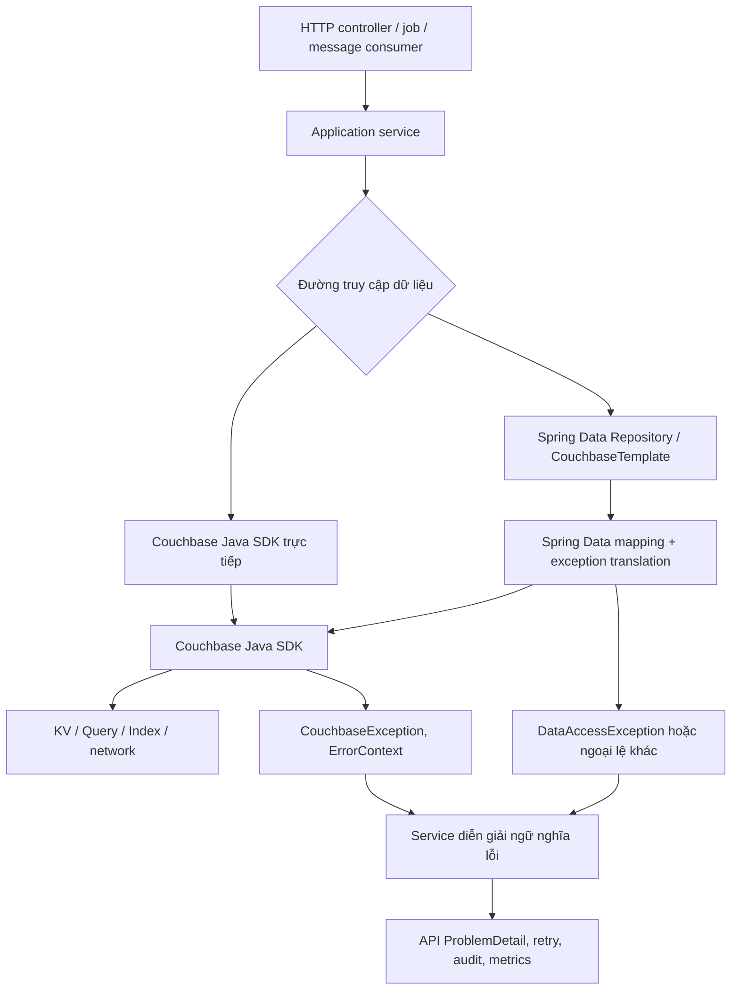
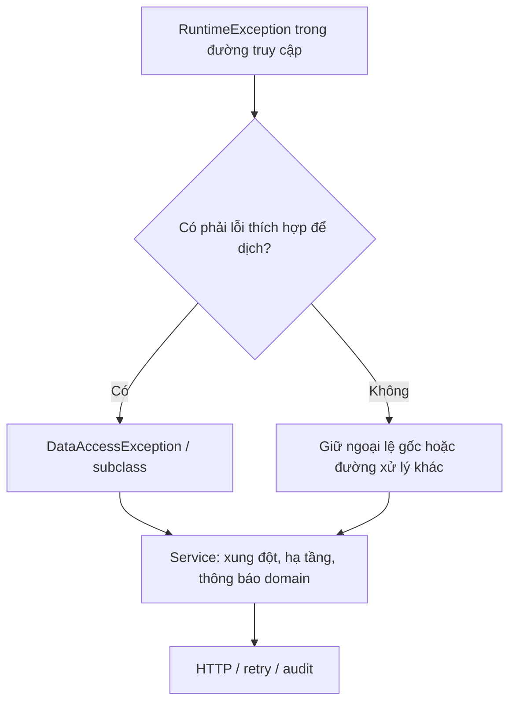
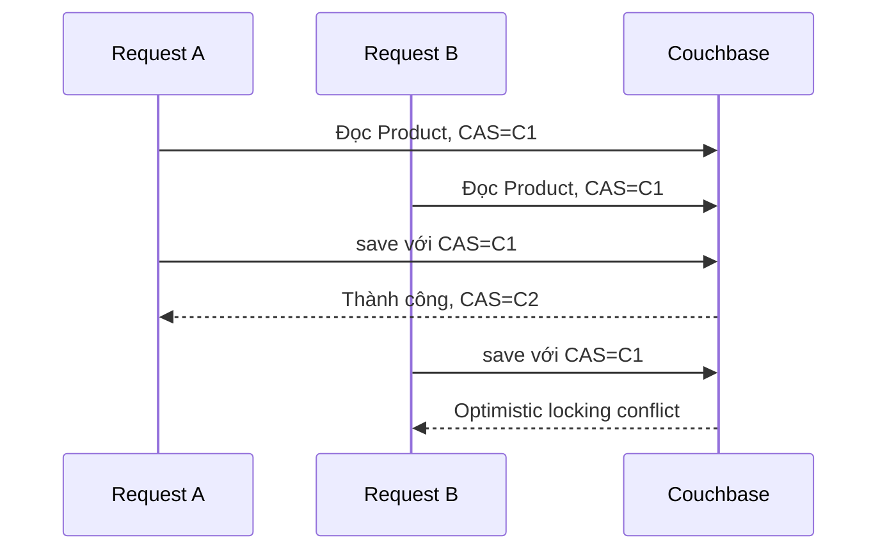
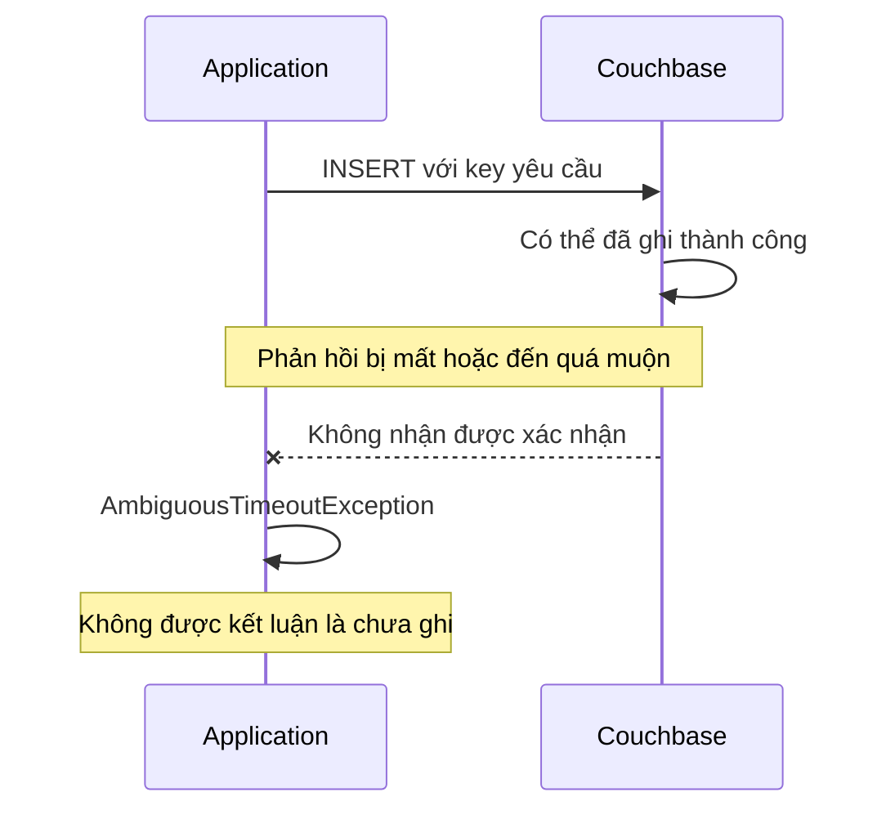

# Hệ thống ngoại lệ Spring Data và ngoại lệ gốc từ Couchbase SDK

> **Mục tiêu:** Hiểu các lớp ngoại lệ khi ứng dụng Java dùng Spring Data Couchbase và Couchbase Java SDK; phân biệt `DataAccessException` với `CouchbaseException`; hiểu cách dịch ngoại lệ, lỗi thiếu document, trùng key, CAS/`@Version`, timeout không rõ kết quả và lỗi Query Service; thiết kế xử lý đồng bộ, reactive, retry, thông báo API và logging an toàn.

Trong module **SPRING_DATA_COUCHBASE**, tầng truy cập dữ liệu kết hợp **document mapping**, Repository, `CouchbaseTemplate`, Java SDK và truy vấn **SQL++**. Dữ liệu nằm trong bucket/scope/collection; hiệu năng và nhất quán còn liên quan đến index, TTL, CAS, transaction và lựa chọn API reactive.

Một request đọc hoặc ghi document có thể gặp lỗi ở nhiều lớp: validation đầu vào, ánh xạ entity, Spring Data, Couchbase SDK, mạng, Key/Value Service hoặc Query Service. **Không phải mọi lỗi đều là “không tìm thấy dữ liệu”, và không phải mọi timeout đều có nghĩa thao tác ghi thất bại.** Quyết định xử lý dựa trên **lớp API được gọi**, **loại thao tác** và **độ chắc chắn về tác dụng phụ**.

## 1. Sơ đồ các tầng phát sinh và truyền ngoại lệ



**Hai họ ngoại lệ cần nhớ:**

| Họ/lớp | Nguồn | Gói Java | Ý nghĩa |
| --- | --- | --- | --- |
| `DataAccessException` | Spring | `org.springframework.dao` | Giao diện lỗi truy cập dữ liệu thống nhất giữa các công nghệ |
| `CouchbaseException` | Couchbase Java SDK | `com.couchbase.client.core.error` | Lỗi gốc từ SDK/cluster, có thể kèm `ErrorContext` |
| `OptimisticLockingFailureException` | Spring | `org.springframework.dao` | Xung đột phiên bản khi thao tác với `@Version` |
| `DocumentNotFoundException` | Couchbase SDK | `com.couchbase.client.core.error` | KV yêu cầu một document key không tồn tại |
| `DocumentExistsException` | Couchbase SDK | `com.couchbase.client.core.error` | Lệnh insert theo key bị trùng |
| `AmbiguousTimeoutException` | Couchbase SDK | `com.couchbase.client.core.error` | Timeout nhưng **chưa chắc mutation có thành công hay chưa** |

Spring Data có `CouchbaseExceptionTranslator` cài đặt `PersistenceExceptionTranslator` để chuyển **những ngoại lệ phù hợp** sang họ `DataAccessException`. Tuy nhiên, **không suy ra tất cả ngoại lệ SDK đều luôn được đổi thành một subclass Spring cố định**. Hành vi phụ thuộc đường gọi, phiên bản Spring Data/SDK và ngoại lệ có được translator nhận diện hay không.

### Ba lớp cần tách biệt khi thiết kế code

1. **Lỗi kỹ thuật:** SDK không kết nối được, document không tồn tại, index chưa sẵn sàng, CAS sai, truy vấn timeout.
2. **Lỗi domain:** sản phẩm không bán, hết hàng, phiên bản giỏ hàng đã cũ, người dùng không có quyền sửa. Những lỗi này do **ứng dụng** định nghĩa; không phải mỗi lỗi domain đều tương ứng một lỗi database.
3. **Hợp đồng biên:** HTTP `404`, `409`, `503`; retry job; dead-letter queue; audit và thông báo UI. Không trả trực tiếp stack trace/`ErrorContext` cho client.

## 2. Dataset mẫu và entity dùng để quan sát lỗi

Giả sử ứng dụng thương mại điện tử quản lý:

| Thành phần | Giá trị minh họa |
| --- | --- |
| Bucket | `catalog` |
| Scope | `commerce` |
| Collection | `products` |
| Entity | `Product` |
| Repository | `ProductRepository` |

Hai document trong collection:

**ID `product::KB-101`**

```json
{
  "sku": "KB-101",
  "name": "Bàn phím cơ",
  "category": "keyboard",
  "price": 1450000,
  "stock": 12,
  "active": true
}
```

**ID `product::MS-202`**

```json
{
  "sku": "MS-202",
  "name": "Chuột văn phòng",
  "category": "mouse",
  "price": 430000,
  "stock": 0,
  "active": false
}
```

Các JSON trên chỉ nêu trường nghiệp vụ. Khi lưu bằng Spring Data, converter có thể thêm discriminator như `_class`; `@Id` và `@Version` liên quan **metadata document** (ID, CAS), không nhất thiết xuất hiện dưới các field JSON `id` và `version`.

Định nghĩa entity:

```java
import org.springframework.data.annotation.Id;
import org.springframework.data.annotation.Version;
import org.springframework.data.couchbase.core.mapping.Document;
import org.springframework.data.couchbase.repository.Scope;
import org.springframework.data.couchbase.repository.Collection;

@Document
@Scope("commerce")
@Collection("products")
public class Product {
    @Id
    private String id;

    @Version
    private long version;

    private String sku;
    private String name;
    private String category;
    private Long price;
    private Integer stock;
    private Boolean active;

    public Product() {}

    public String getId() { return id; }
    public long getVersion() { return version; }
    public Long getPrice() { return price; }
    public void setPrice(Long price) { this.price = price; }

    // Bổ sung getter/setter còn lại theo convention dự án.
}
```

Repository:

```java
import org.springframework.data.couchbase.repository.CouchbaseRepository;

public interface ProductRepository
        extends CouchbaseRepository<Product, String> {
}
```

Bucket `catalog` được cấu hình tại Spring Data. Khi gọi `findById` hoặc `save`, Repository sử dụng mapping đã khai báo. Cùng ID `product::KB-101` ở **collection khác** vẫn là một document độc lập: kiểm tra sai bucket/scope/collection trước khi kết luận dữ liệu “biến mất”.

## 3. Ngoại lệ chuẩn của Spring: `DataAccessException`

`DataAccessException` là một **unchecked exception** của Spring (`RuntimeException`). Spring Data cung cấp hệ phân cấp này để service không phải phụ thuộc hoàn toàn vào mọi chi tiết của SDK.

Phân nhóm thường gặp:

| Loại ngoại lệ Spring | Ý nghĩa khái quát | Cách nhìn ở tầng service |
| --- | --- | --- |
| `DataAccessException` | Lớp cha của ngoại lệ truy cập dữ liệu do Spring diễn giải | Catch cuối cùng cho lỗi data access đã được dịch |
| `TransientDataAccessException` | Nhóm sự cố tạm thời theo phân loại Spring | Xem xét retry **chỉ nếu thao tác an toàn** |
| `NonTransientDataAccessException` | Nhóm sự cố không được kỳ vọng tự hết chỉ bằng retry | Xem input, schema, cấu hình, quyền |
| `OptimisticLockingFailureException` | Version/CAS đã cũ trong quy trình optimistic locking | Giải quyết xung đột, tải lại và thử lại toàn bộ đơn vị công việc nếu hợp lệ |
| `DuplicateKeyException` | Trùng khóa theo ngữ nghĩa Spring | Chuyển thành conflict khi đúng với hoạt động hiện tại |
| `DataAccessResourceFailureException` | Không thể tiếp cận tài nguyên dữ liệu | Kiểm tra cluster/kết nối; không luôn retry lập tức |
| `QueryTimeoutException` | Query bị timeout trong phân loại Spring | Điều tra index, tải, deadline và độ chắc chắn của mutation |

**Lưu ý quan trọng:** bảng này mô tả **họ ngoại lệ Spring có ý nghĩa ứng dụng**, **không phải bảng ánh xạ một-một bất biến từ Couchbase SDK**. Ví dụ không được khẳng định `DocumentExistsException` **luôn** trở thành `DuplicateKeyException`, hay mọi timeout SDK **luôn** trở thành `QueryTimeoutException` trong mọi phiên bản/đường gọi. Kiểm thử lớp ngoại lệ thực tế ở ranh giới đang sử dụng.

### Lợi ích của dịch ngoại lệ

Giả sử một service dùng Spring Data Repository:

```java
import org.springframework.dao.DataAccessException;
import org.springframework.dao.OptimisticLockingFailureException;

public class ProductWriteService {
    private final ProductRepository repository;

    public ProductWriteService(ProductRepository repository) {
        this.repository = repository;
    }

    public Product changePrice(String id, long newPrice) {
        if (newPrice < 0) {
            throw new IllegalArgumentException("Price must be non-negative");
        }

        Product product = repository.findById(id)
            .orElseThrow(() -> new ProductNotFoundException(id));

        product.setPrice(newPrice);
        try {
            return repository.save(product);
        } catch (OptimisticLockingFailureException ex) {
            throw new ProductVersionConflictException(id, ex);
        } catch (DataAccessException ex) {
            throw new ProductStorageException("Cannot save product", ex);
        }
    }
}
```

`ProductNotFoundException`, `ProductVersionConflictException` và `ProductStorageException` là **ngoại lệ domain do ứng dụng tự định nghĩa**, không phải class có sẵn của Spring Data. Chúng được trình bày đầy đủ ở phần sau.

Mẫu trên giúp service tách ba quyết định:

- Không có ID → lỗi nghiệp vụ “không tồn tại”.
- CAS xung đột qua cơ chế `@Version` → lỗi phiên bản cũ.
- Lỗi truy cập dữ liệu khác → lỗi cơ sở hạ tầng để tầng trên phân loại/log.

**Cần kiểm tra lớp ngoại lệ thực tế:** nếu thao tác đi thẳng qua SDK hoặc một lớp hỗ trợ không áp dụng translation, `CouchbaseException` có thể đi lên khác với `DataAccessException`. Không catch `DataAccessException` rồi giả định bao phủ mọi đường truy cập dữ liệu của ứng dụng.

## 4. `CouchbaseExceptionTranslator` và ranh giới translation

Spring Data Couchbase cung cấp:

```java
org.springframework.data.couchbase.core.CouchbaseExceptionTranslator
```

Lớp này triển khai giao diện `org.springframework.dao.support.PersistenceExceptionTranslator` và cung cấp phương thức:

```java
DataAccessException translateExceptionIfPossible(RuntimeException ex)
```

Theo hợp đồng của giao diện, phương thức **có thể trả `null` khi không nên dịch ngoại lệ**. Lý do: không phải mọi `RuntimeException` phát sinh trong một đường truy cập đều do Couchbase gây ra; nó có thể đến từ logic ứng dụng, dữ liệu đầu vào hoặc lỗi lập trình.

### Diễn giải kết quả translation



Ví dụ minh họa cách gọi translator **để hiểu hợp đồng**, không cần tự triển khai việc dịch thủ công ở mỗi Repository:

```java
import org.springframework.dao.DataAccessException;
import org.springframework.data.couchbase.core.CouchbaseExceptionTranslator;

public class TranslationExample {
    private final CouchbaseExceptionTranslator translator =
        new CouchbaseExceptionTranslator();

    public DataAccessException translateIfAppropriate(
            RuntimeException original) {
        return translator.translateExceptionIfPossible(original);
        // Có thể trả null: caller cần xét kết quả.
    }
}
```

`original` là ngoại lệ runtime do tầng gọi chuyển vào; phương thức có thể trả `null` thay vì một `DataAccessException`. Đoạn code này chỉ giúp quan sát hợp đồng của translator; **không khuyến nghị mọi service tự gọi nó khi dùng Repository đã có cơ chế translation**.

### `@Repository` và SDK trực tiếp không phải một ranh giới giống nhau

| Đường gọi | Nhóm lỗi thường nhìn thấy | Cảnh báo |
| --- | --- | --- |
| `ProductRepository.findById/save` | `DataAccessException` hoặc ngoại lệ domain/mapping tùy tình huống | Translation được Spring Data tích hợp, nhưng kiểm tra thực tế theo version |
| `CouchbaseTemplate` | Spring Data data-access exceptions và ngoại lệ khác tùy thao tác | Dùng cơ chế mapping của template |
| `Cluster.query(...)` trực tiếp | SDK `CouchbaseException` và subclasses | Không tự đi qua translator của Repository |
| `collection.get/insert/replace` trực tiếp | SDK `DocumentNotFoundException`, `DocumentExistsException`, timeout, CAS... | API KV có hợp đồng riêng |
| Reactive Repository/Template | Error signal khi subscribe | Không coi `Mono.empty()` là lỗi |
| SDK reactive | Error signal SDK, có thể là exception gốc | Không mặc nhiên được đổi sang `DataAccessException` |

**Không mất nguyên nhân gốc:** khi một ngoại lệ được bọc/dịch, nên giữ `cause` để người vận hành có thể lần theo SDK error context. Nhưng ở ranh giới API HTTP, tuyệt đối không trả toàn bộ `cause` hoặc exception message có thể chứa chi tiết hệ thống cho người dùng cuối.

### Đừng catch tất cả `RuntimeException` rồi gán lỗi database

```java
// Chống chỉ định về mặt thiết kế.
try {
    productRepository.save(product);
} catch (RuntimeException ex) {
    throw new ProductStorageException("Database unavailable", ex);
}
```

Đoạn trên có thể biến `IllegalArgumentException`, lỗi tính toán nghiệp vụ hay lỗi lập trình thành “database unavailable”, gây sai HTTP status và che khuất lỗi thật. Chỉ catch nhóm ngoại lệ **thích hợp với điều định xử lý** rồi để lỗi không dự kiến được log ở tầng biên theo chính sách.

## 5. Ngoại lệ gốc từ Couchbase Java SDK

SDK 3.x có lớp cha:

```java
com.couchbase.client.core.error.CouchbaseException
```

Đây là unchecked exception (`RuntimeException`). Những ngoại lệ đặc thù SDK thường kế thừa từ lớp này và có thể mang `ErrorContext` để chẩn đoán request. Ngoài lỗi SDK, mã ứng dụng vẫn có thể gặp lỗi validation/mapping hay `RuntimeException` khác, nên không thể quy mọi lỗi trong một thao tác Java về `CouchbaseException`.

### Bảng các ngoại lệ SDK phổ biến

| SDK exception | Trường hợp phát sinh điển hình | Phân loại ở ứng dụng |
| --- | --- | --- |
| `DocumentNotFoundException` | `collection.get(id)` cho ID không tồn tại | Not found; không retry mù |
| `DocumentExistsException` | `collection.insert(id, body)` khi ID đã tồn tại | Duplicate/conflict; không tự chuyển sang upsert |
| `CasMismatchException` | `replace/remove` với CAS đã cũ | Concurrency conflict |
| `AmbiguousTimeoutException` | Request timeout nhưng mutation **có thể đã áp dụng** | Trạng thái chưa xác định; cần reconciliation |
| `UnambiguousTimeoutException` | SDK xác định operation không thành công trước timeout | Có thể cân nhắc retry sau phân tích điều kiện |
| `RequestCanceledException` | SDK ngừng request do điều kiện dispatch/retry/cancellation | Xem ErrorContext, không retry vô hạn |
| `TemporaryFailureException` | Dịch vụ hoặc KV trả lỗi tạm thời | Tín hiệu điều tra tính sẵn sàng |
| `ServiceNotAvailableException` | Service cần thiết chưa sẵn sàng | Hạ tầng/config, cân nhắc fail fast |
| `AuthenticationFailureException` | Credential/quyền truy cập dịch vụ không hợp lệ | Kiểm tra auth/config/RBAC, không coi 401 của DB là 401 của user |
| `CollectionNotFoundException` | Collection/scope đích không tìm được | Sai keyspace hoặc chưa provision |
| `ParsingFailureException` | SQL++ syntax không hợp lệ | Sửa query, không retry nguyên câu |
| `IndexNotFoundException` | Query phụ thuộc index không tìm thấy | DDL/index/query context, không tạo index tùy tiện từ request |
| `DurabilityAmbiguousException` | Durable write có kết quả chưa rõ | Reconcile theo khóa/idempotency, tránh retry mù |

Tên và ngữ nghĩa cụ thể nên kiểm tra với Couchbase Java SDK đang dùng. Một số lỗi khác như Query planner, decoding, encoding, khóa document hoặc timeout có thể cần xử lý riêng. **Không nên xem bảng là danh sách đầy đủ**.

### Ví dụ dùng SDK trực tiếp

```java
import com.couchbase.client.java.Cluster;
import com.couchbase.client.java.Collection;
import com.couchbase.client.java.json.JsonObject;
import com.couchbase.client.core.error.CouchbaseException;
import com.couchbase.client.core.error.DocumentExistsException;
import com.couchbase.client.core.error.AmbiguousTimeoutException;
import com.couchbase.client.core.error.RequestCanceledException;

public class RawProductWriter {
    private final Collection products;

    public RawProductWriter(Cluster cluster) {
        products = cluster.bucket("catalog")
            .scope("commerce")
            .collection("products");
    }

    public void insertOnce(String id, JsonObject body) {
        try {
            products.insert(id, body);
        } catch (DocumentExistsException ex) {
            throw new ProductVersionConflictException(id, ex);
        } catch (AmbiguousTimeoutException ex) {
            throw new WriteOutcomeUnknownException(id, ex);
        } catch (RequestCanceledException ex) {
            throw new ProductStorageException(
                "Product storage request was canceled", ex
            );
        } catch (CouchbaseException ex) {
            throw new ProductStorageException("Product insert failed", ex);
        }
    }
}
```

Ở đây `ProductVersionConflictException` được dùng làm một nhóm conflict của ứng dụng; trong hệ thống thật có thể tạo ngoại lệ domain `ProductAlreadyExistsException` riêng để phân biệt **trùng key** với **CAS xung đột**. `WriteOutcomeUnknownException` mô tả một trạng thái khác với thất bại chắc chắn. **Không biến timeout mơ hồ thành lỗi “chưa ghi”**.

### Tại sao SDK error type đáng giữ ở tầng hạ tầng?

SDK có thông tin mà `DataAccessException` trừu tượng có thể không biểu đạt hết, như **request lifecycle**, KV/Query service, retry reasons, tình trạng response và độ chắc chắn về side effect. Một adapter dùng SDK có thể phân loại thành domain exception **sau khi đọc đặc tính lỗi**, thay vì gộp mọi SDK exception thành một lỗi chung rồi mất ngữ nghĩa timeout mơ hồ.

Service nghiệp vụ không nên phụ thuộc vào từng SDK subclass ở mọi nơi. Thông thường nên cô lập logic SDK tại adapter/gateway, ánh xạ thành một số loại lỗi có ý nghĩa với ứng dụng, rồi xử lý thống nhất ở service/controller.

## 6. “Không tìm thấy” khác “lỗi truy cập dữ liệu”

Giả sử cần đọc document ID `product::UNKNOWN`.

### Spring Data Repository: `Optional.empty()`

```java
import java.util.Optional;

Optional<Product> found =
    productRepository.findById("product::UNKNOWN");

if (found.isEmpty()) {
    // Document không tồn tại theo kết quả thao tác đọc.
    // Đây không mặc nhiên là DataAccessException.
}
```

`findById` của `CrudRepository` dùng `Optional<Product>` cho kiểu trả về đồng bộ. **Không tìm thấy ID** thông thường được biểu diễn bằng `Optional.empty()`, không nhất thiết ném ngoại lệ. Một service có thể chọn biến kết quả rỗng thành **ngoại lệ domain**:

```java
Product product = productRepository.findById(id)
    .orElseThrow(() -> new ProductNotFoundException(id));
```

Đây là quyết định API/domain, không phải một phép translation SDK → Spring. Với endpoint `GET /products/{id}`, trả `404 Not Found` có thể phù hợp nếu người dùng được phép biết document không tồn tại.

### SDK trực tiếp: `DocumentNotFoundException`

```java
import com.couchbase.client.java.Collection;
import com.couchbase.client.core.error.DocumentNotFoundException;
import com.couchbase.client.core.error.CouchbaseException;

public ProductDto loadRaw(
        Collection collection, String id) {
    try {
        var result = collection.get(id);
        var json = result.contentAsObject();
        return new ProductDto(
            json.getString("sku"),
            json.getString("name")
        );
    } catch (DocumentNotFoundException ex) {
        throw new ProductNotFoundException(id);
    } catch (CouchbaseException ex) {
        throw new ProductStorageException("Product read failed", ex);
    }
}
```

`ProductDto` là DTO do ứng dụng định nghĩa (ví dụ `record ProductDto(String sku, String name)`). Trong SDK, `collection.get(id)` yêu cầu document hiện hữu; nếu ID không tồn tại, SDK có thể ném `DocumentNotFoundException`, khác `findById` của Spring Data.

**Điều kiện áp dụng:** “not found” không phải lời chứng rằng tài liệu chưa từng được tạo. Nó có thể đã bị xóa, hết TTL, ứng dụng đọc **sai collection**, hoặc một thao tác ghi trước đó đang có kết quả chưa rõ. Tùy nghiệp vụ, có thể cần audit/đối chiếu thêm.

### `SELECT` không trả hàng khác lỗi `QUERY`

```sql
SELECT p.sku, p.price
FROM `catalog`.`commerce`.`products` AS p
WHERE p.category = "nonexistent-category";
```

Query trả **0 hàng** nếu không document nào khớp. Điều này khác `ParsingFailureException` khi SQL++ sai cú pháp, `IndexNotFoundException` khi không có chỉ mục phù hợp hoặc timeout khi Query Service không hoàn thành.

| Tình huống | Kết quả “bình thường” | Xử lý |
| --- | --- | --- |
| `repository.findById(id)` không tìm thấy | `Optional.empty()` | Domain not found hoặc hành vi mặc định theo contract |
| `collection.get(id)` không tìm thấy | `DocumentNotFoundException` | Chuyển sang domain not found nếu phù hợp |
| `@Query` tìm theo category không có hàng | Danh sách rỗng | Trả danh sách rỗng; không tự biến thành 500 |
| Query có lỗi parse/index/quyền | Ngoại lệ/Query failure | Điều tra lỗi hạ tầng/cấu hình |
| `DELETE` không khớp document | Có thể không có hàng `RETURNING` | Xác định contract idempotency và số mutation |

### Tránh biến lỗi hạ tầng thành “không có sản phẩm”

```java
// Phản diện: nuốt mọi lỗi và giả vờ không tìm thấy.
try {
    return repository.findById(id);
} catch (RuntimeException ex) {
    return Optional.empty();
}
```

Nếu cluster timeout hoặc credential sai, đoạn này khiến UI hiển thị “sản phẩm không tồn tại”, che mất sự cố vận hành, tạo dữ liệu giả và gây nguy hiểm cho những luồng tiếp theo. **Chỉ trả rỗng khi dữ liệu thật sự không có theo hợp đồng của thao tác.**

## 7. Trùng document key và optimistic locking là hai loại xung đột

### Trùng key khi `insert`

Khi tạo một document mới bằng SDK:

```java
collection.insert(
    "product::KB-101",
    JsonObject.create().put("sku", "KB-101")
);
```

Nếu key đã tồn tại, SDK thường trả `DocumentExistsException`. Điều này có nghĩa lệnh yêu cầu **tạo mới** nhưng key không còn trống.

Với API `POST /products`, ứng dụng có thể trả `409 Conflict`, trừ khi hợp đồng sản phẩm cho phép idempotency key và coi request lặp là lần gọi lại cùng một thao tác đã hoàn tất.

**Không tự đổi `insert` thành `upsert` để “hết lỗi”**: upsert có thể thay thế document có sẵn, làm mất trường, TTL hoặc thay đổi dữ liệu người khác. Phải quyết định bằng nghiệp vụ.

### CAS và `@Version`

Spring Data Couchbase hỗ trợ optimistic locking bằng `@Version` trên một trường `long`. Khi entity được nạp bằng Repository/Template, trường version nhận CAS hiện tại; khi `save`, cơ chế phiên bản giúp phát hiện người khác đã sửa document.



Khi thao tác bằng Repository/Template phù hợp, ứng dụng có thể nhận:

```java
org.springframework.dao.OptimisticLockingFailureException
```

Khi dùng KV SDK với CAS đặt tường minh (ví dụ `ReplaceOptions.cas(expectedCas)`), exception gốc thường là:

```java
com.couchbase.client.core.error.CasMismatchException
```

Hai ngoại lệ liên quan **cùng một ý tưởng nghiệp vụ** — bản ghi đã đổi kể từ khi được đọc — nhưng thuộc **hai API** khác nhau.

### Ví dụ replace có CAS bằng SDK

```java
import com.couchbase.client.java.Collection;
import com.couchbase.client.java.kv.GetResult;
import com.couchbase.client.java.kv.ReplaceOptions;
import com.couchbase.client.core.error.CasMismatchException;
import com.couchbase.client.java.json.JsonObject;

public void renameWithCas(
        Collection collection, String id, String name) {

    GetResult current = collection.get(id);
    long expectedCas = current.cas();
    JsonObject body = current.contentAsObject();
    body.put("name", name);

    try {
        collection.replace(
            id,
            body,
            ReplaceOptions.replaceOptions().cas(expectedCas)
        );
    } catch (CasMismatchException ex) {
        throw new ProductVersionConflictException(id, ex);
    }
}
```

Đoạn mã dùng API SDK cho thao tác đọc → sửa → ghi. Nếu một tác nhân khác cập nhật document giữa `get` và `replace`, CAS cũ có thể không còn khớp.

### Xử lý conflict đúng cách

Có ba hướng tùy nghiệp vụ:

1. **Trả conflict** cho client để người dùng quyết định có tải lại dữ liệu hay không.
2. **Đọc lại, áp dụng lại thay đổi và thử lại toàn bộ chu trình** với số lần tối đa; chỉ khi thao tác có thể lặp an toàn.
3. **Dùng transaction/command nghiệp vụ** nếu cần giữ nhiều invariant qua nhiều document.

Không nên catch `OptimisticLockingFailureException` rồi lập tức gọi `save` trên **chính object với CAS cũ** mà không tải/giải quyết trạng thái mới. Cũng không tự tăng `@Version` hay gán CAS tùy ý: CAS là metadata opaque do Couchbase quản lý.

## 8. Timeout: kết quả chắc chắn thất bại hay chưa rõ?

Trong hệ thống phân tán, request có thể tới server và thực hiện ghi thành công, nhưng client mất kết nối trước khi nhận phản hồi. SDK không có cách nào luôn biết chính xác trạng thái cuối cùng của một mutation.

### `UnambiguousTimeoutException`

SDK xác định rằng **request đã không hoàn tất thành công**. Ví dụ lỗi xảy ra trước khi request có thể gây tác dụng phụ, hoặc có đủ thông tin để kết luận không thành công.

Điều này **không tự bảo đảm retry an toàn ở cấp nghiệp vụ**. Cần xem thao tác có idempotent không, người dùng có còn quyền thao tác không, deadline, giới hạn retry và tải hệ thống.

### `AmbiguousTimeoutException`

SDK **không biết chắc thao tác đã có tác dụng phụ hay chưa**. Điều này đặc biệt quan trọng với `insert`, `upsert`, `replace` và các nghiệp vụ như trừ tồn kho.



Một `AmbiguousTimeoutException` không nên được chuyển thành **“thao tác chắc chắn thất bại”** rồi retry mù. Khi ghi lặp có thể sinh tác dụng phụ, cần:

- Dùng **document key ổn định** hoặc **idempotency key** cho mỗi yêu cầu logic.
- Đọc lại trạng thái theo key và so sánh request ID/business version khi an toàn để làm vậy.
- Nếu chưa xác minh được, trả trạng thái “chưa xác định” hoặc đưa vào hàng chờ đối soát.
- Không trừ tồn kho/đặt tiền/gửi sự kiện bên ngoài lần nữa nếu chưa xác nhận giao dịch trước có thực thi hay chưa.

### `DurabilityAmbiguousException`

Khi dùng cơ chế durable write của Couchbase, `DurabilityAmbiguousException` cũng biểu thị **kết quả độ bền/ghi chưa được xác nhận dứt khoát**. Không nên xem nó là lời khẳng định “document chưa được lưu”.

**Thông điệp vận hành:** timeout là **triệu chứng**, không phải lúc nào là nguyên nhân. Có thể có nghẽn mạng, kết nối chưa sẵn sàng, Query Service quá tải, index chậm, node tái cân bằng hoặc GC pressure. Chỉ tăng timeout mà không xử lý nguyên nhân có thể làm queue/tải xấu hơn.

## 9. `RequestCanceledException` và cơ chế retry nội bộ SDK

Couchbase Java SDK có **RetryStrategy** và tự thử lại một số request khi điều kiện đủ an toàn. Quyết định retry phụ thuộc vào **giai đoạn request** và tính **idempotent** của thao tác.

Theo vòng đời khái quát:

1. **Pre-dispatch:** request chưa được gửi tới endpoint; một số lỗi tạm thời có thể thử lại mà chưa gây tác dụng phụ.
2. **Dispatch:** request đã lên đường; nếu kết nối mất, chưa chắc server đã nhận hay áp dụng mutation.
3. **Response arrived:** SDK có kết quả từ server để quyết định thành công, lỗi cụ thể hoặc khả năng retry theo response.

`RequestCanceledException` có thể xảy ra khi SDK quyết định không thể tiếp tục retry, hệ thống bị backpressure, request bị hủy trước deadline hoặc SDK đang đóng. **Nó không đồng nghĩa tất cả yêu cầu bị hủy đều chắc chắn chưa tạo tác dụng phụ.**

Ví dụ xử lý ở adapter:

```java
import com.couchbase.client.core.error.RequestCanceledException;

try {
    products.insert(documentId, body);
} catch (RequestCanceledException ex) {
    // Ghi nhận ErrorContext an toàn và chuyển lỗi cho quy trình đối soát
    // nếu thao tác có nguy cơ đã được dispatch.
    throw new ProductStorageException(
        "Insert canceled; outcome requires investigation", ex
    );
}
```

Không viết vòng `while(true)` retry trong ứng dụng khi SDK đã retry nhiều lần. Nếu retry ở tầng service, phải xác định **budget chung** (tổng số lần, deadline, backoff, jitter), tránh làm tăng tải khi cluster đang quá tải.

### Idempotency không phải “thực thi bao nhiêu lần cũng vô hại” trong mọi ngữ cảnh

| Thao tác | Đặc tính cần chú ý | Khi retry |
| --- | --- | --- |
| `GET` theo ID | Đọc, không thay đổi document | Thường là ứng viên retry nếu hạ tầng tạm lỗi |
| `SELECT` chỉ đọc | Thường không có side effect | Cân nhắc chi phí query/index và deadline |
| `INSERT` với key ổn định | Không ghi đè key có sẵn | Nếu lần đầu đã thành công, lần sau có thể trả `DocumentExists`; phải reconcile |
| `UPSERT` cùng body | Có thể cho kết quả cuối gần giống nhau | Vẫn đổi CAS/expiry, callback/event hoặc trạng thái phụ thuộc thời điểm |
| `UPDATE SET count = count + 1` | **Không idempotent** | Retry mù có nguy cơ tăng hai lần |
| Trừ tồn kho và tạo đơn | Nhiều side effect | Cần idempotency/transaction/outbox |
| `DELETE` theo ID | Về trạng thái cuối thường “không còn document” | Lần 2 có thể nhận not found; vẫn phải kiểm tra audit và quyền |

**Quy tắc:** Không đánh giá idempotency chỉ qua cú pháp SQL++. Hãy xét **toàn bộ tác vụ nghiệp vụ**, bao gồm TTL, CAS, event phát ra, thanh toán và trạng thái ngoài Couchbase.

## 10. `ErrorContext`: đọc nguyên nhân mà không lộ dữ liệu

Hầu hết `CouchbaseException` có thể cung cấp `ErrorContext` thông qua phương thức `context()`. Tài liệu SDK lưu ý context **có thể là `null`**, đồng thời các trường trong context có thể thay đổi theo loại request và phiên bản.

Ví dụ một timeout KV có thể chứa các thông tin:

```text
requestType: GetRequest
reason: TIMEOUT
service: KV
bucket: catalog
scope: commerce
collection: products
timeoutMs: 2500
retried: 3
retryReasons: [ENDPOINT_NOT_AVAILABLE]
```

Đây là **cấu trúc minh họa**, không phải schema JSON ổn định của mọi `ErrorContext`. Trong production, context có thể chứa document ID, endpoint, đường dẫn query hoặc dữ liệu mang tính nội bộ; không hiển thị nguyên văn cho người dùng cuối.

### Cách lấy `ErrorContext` trong SDK

```java
import com.couchbase.client.core.error.CouchbaseException;
import com.couchbase.client.core.error.context.ErrorContext;

public void recordSdkFailure(
        CouchbaseException ex, String operation) {
    ErrorContext context = ex.context();

    // Pseudocode logging: trong production cần logger, masking và trace id.
    String category = ex.getClass().getSimpleName();
    String contextKind =
        context == null ? "none" : context.getClass().getSimpleName();

    System.err.println("operation=" + operation
        + ", exception=" + category
        + ", errorContextType=" + contextKind);
}
```

Mẫu trên chủ ý **không in `context.toString()`** vì nó có thể chứa dữ liệu nhạy cảm. Trong ứng dụng thật, dùng logger tập trung, correlation/trace ID, mã lỗi ổn định và chính sách retention; chỉ trích xuất những trường được phê duyệt.

### Một bảng câu hỏi điều tra từ ErrorContext

| Câu hỏi | Dấu hiệu có thể tìm |
| --- | --- |
| Đã gửi tới server chưa? | Request lifecycle/retry reason, timeout ambiguous hay unambiguous |
| Dịch vụ nào có vấn đề? | KV, Query, Search, Analytics... |
| Có dấu hiệu kết nối không? | `ENDPOINT_NOT_AVAILABLE`, `CHANNEL_CLOSED...`, thời gian chờ |
| SDK đã retry bao nhiêu lần? | `retried` và `retryReasons` khi có |
| Có phải nhầm keyspace? | Bucket/scope/collection được định danh trong context, query context |
| Có phải query/index? | Query service và error code/statement được log có kiểm soát |
| Có phải latency? | Deadline, timeout, tổng thời gian xử lý |

**Không dùng tên field của ErrorContext làm contract API công khai.** Tài liệu SDK coi nhiều chi tiết context là chẩn đoán và có thể thay đổi. Dựa trên loại exception, nhóm lỗi ổn định của ứng dụng và trace ID để xây monitoring.

## 11. SQL++: lỗi truy vấn và index khác lỗi document KV

Spring Data Couchbase hỗ trợ `@Query` và `CouchbaseTemplate` để tìm theo trường JSON; SDK trực tiếp có `Cluster.query(...)`. Các truy vấn này chạy qua **Query Service**, khác đường KV `collection.get(id)`.

### Một truy vấn hợp lệ

```java
import java.util.List;
import org.springframework.data.couchbase.repository.Query;
import org.springframework.data.repository.query.Param;

public interface ProductQueryRepository
        extends CouchbaseRepository<Product, String> {

    @Query("#{#n1ql.selectEntity} WHERE #{#n1ql.filter} "
         + "AND category = $category AND active = true")
    List<Product> findActiveByCategory(
        @Param("category") String category
    );
}
```

`#{#n1ql.selectEntity}` và `#{#n1ql.filter}` là **SpEL của Spring Data** phục vụ phép chiếu/keyspace và type discriminator. `$category` là tham số giá trị SQL++; Java SDK `Cluster.query` trực tiếp **không tự phân giải SpEL**.

### Các nhóm lỗi Query Service

| Vấn đề | Dấu hiệu/SDK exception có thể gặp | Hướng xử lý |
| --- | --- | --- |
| Sai cú pháp SQL++ | `ParsingFailureException` | Sửa câu `@Query`/SQL++, không retry nguyên câu |
| Không có/chưa sẵn sàng index phù hợp | `IndexNotFoundException` hoặc lỗi planner/query khác | Đúng collection, index, `EXPLAIN` |
| Query context sai bucket/scope | Query failure, thiếu keyspace, 0 hàng bất thường | Xác minh `FROM`, `@Scope`, `@Collection` |
| Thiếu quyền Query/Index | Authentication/authorization failure | Kiểm tra RBAC, không trả chi tiết credential |
| Query quá chậm | Timeout/cancellation | Index, phép chiếu, pagination, giới hạn tải |
| Tham số SQL++ không đúng | Lỗi bind/parse/logic | Đối chiếu `$1`/`$name`, `@Param` và kiểu dữ liệu |
| Schema JSON không giống entity | Conversion/mapping failure hoặc field rỗng | Kiểm tra discriminator, alias, `MISSING/NULL` và converter |

### SQL++ đúng nhưng thiếu index

```sql
SELECT p.sku, p.price
FROM `catalog`.`commerce`.`products` AS p
WHERE p.category = "keyboard"
  AND p.price <= 1600000;
```

Câu này hợp lệ về cú pháp. Nếu collection chưa có index thích hợp, Query Service có thể trả lỗi lập kế hoạch/index hoặc dùng một kế hoạch rất chậm nếu có index khác cho phép quét rộng.

Một index ứng viên:

```sql
CREATE INDEX idx_products_category_price
ON `catalog`.`commerce`.`products`(category, price);
```

Đây chỉ là **đề xuất kiểm tra**, không phải index tối ưu chung cho mọi workload. Khi chạy `EXPLAIN`, phải xem filter discriminator, điều kiện tenant, `ORDER BY`, phép chiếu entity và độ chọn lọc thực tế.

### Không bắt tất cả Query errors rồi trả rỗng

Một `@Query` trả `List<Product>` rỗng là kết quả nghiệp vụ **hợp lệ** nếu không có document khớp. `IndexNotFoundException`/timeout không phải là “không có sản phẩm”; chuyển chúng thành `List.of()` có thể che sự cố và khiến báo cáo sai.

### Không ghép input vào câu truy vấn để “né lỗi tham số”

```java
// Phản diện: đầu vào người dùng có thể thay cú pháp SQL++.
String sql = "SELECT p.sku FROM `catalog`.`commerce`.`products` AS p "
           + "WHERE p.category = '" + userCategory + "'";
```

```java
// Mẫu SDK: query cố định, tham số riêng.
String sql = """
    SELECT p.sku
    FROM `catalog`.`commerce`.`products` AS p
    WHERE p.category = $category
    """;
JsonObject params = JsonObject.create()
    .put("category", userCategory);

var result = cluster.query(
    sql,
    queryOptions().parameters(params)
);
```

Nhớ import `JsonObject` và `queryOptions` khi đặt đoạn này vào class Java. Một câu query được binding đúng **vẫn có thể thiếu tenant filter** hoặc trả quá nhiều hàng, vì binding giải quyết vấn đề cú pháp, không phải authorization hay hiệu năng.

## 12. Lỗi ánh xạ entity không giống lỗi Query Service

Document Couchbase là JSON bán cấu trúc. Khi Spring Data đọc một document, converter phải ánh xạ body và metadata vào Java entity. Query Service có thể chạy SQL++ thành công nhưng **phần chuyển đổi row → entity vẫn thất bại**.

Ví dụ body thay đổi không tương thích:

```json
{
  "sku": "KB-101",
  "price": "khong-ro",
  "active": true
}
```

Trong entity `Product` ở phần 2, `price` là `Long`. Giá trị JSON chuỗi `"khong-ro"` không phải số phù hợp, có thể gây lỗi converter/mapping thay vì lỗi SQL++ syntax. Một trường `price` là `NULL`/`MISSING` lại có thể ánh xạ thành Java `null` tùy cấu hình; đây là những tình huống khác nhau.

### Phân loại ba nguyên nhân

| Tầng | Tình huống | Điều cần kiểm tra |
| --- | --- | --- |
| SQL++ Query Service | Lỗi parse/planner/index | Câu SQL++, query context, index |
| Mapping/Converter | Field đổi tên, kiểu sai, discriminator không tương thích, constructor thiếu | `@Field`, `@TypeAlias`, conversion, schema JSON |
| Domain/Validation | Giá âm, hết hàng, dữ liệu bị khóa theo trạng thái | Validator, invariant nghiệp vụ |

Đừng “sửa” lỗi mapping bằng cách catch exception và trả `Product` với toàn bộ field `null`. Điều đó tạo entity không hợp lệ và có thể gây ghi đè document nếu service tiếp tục `save`.

### `@Id`, `@Version` và metadata trong truy vấn

Với Repository trả full entity bằng `@Query`:

```java
@Query("#{#n1ql.selectEntity} WHERE #{#n1ql.filter} "
     + "AND sku = $sku")
List<Product> findBySku(@Param("sku") String sku);
```

`#n1ql.selectEntity` sinh phép chiếu có metadata cần cho Spring Data ánh xạ ID/CAS. Một câu SQL++ tự viết như `SELECT p.sku, p.price` có thể trả JSON hợp lệ nhưng **thiếu ID/CAS hoặc alias tương thích** để dựng full `Product`.

Đây có thể là **lỗi hợp đồng truy vấn với mapper**, không phải Couchbase “đánh mất ID”. Khi chỉ cần hiển thị vài field, hãy dùng projection/DTO đúng với shape result thay vì cố dựng một full entity thiếu metadata.

### Lỗi kiểu discriminator

Nếu các document được insert bằng SDK/Workbench không có type discriminator mà `#{#n1ql.filter}` yêu cầu, `@Query` có thể trả rỗng **không ném exception**. Phải so sánh:

- Document được lưu qua Spring Data có type key/alias gì?
- Document legacy có cùng key/alias không?
- Repository có map đúng scope/collection không?
- Query theo JSON thuần có thấy dữ liệu nhưng query với `#n1ql.filter` thì không?

Không bỏ type filter một cách tùy tiện trong collection chứa nhiều loại document để “sửa lỗi không có kết quả”; có thể khiến mapper đọc nhầm loại entity.

### Validation exception cũng cần tách riêng

Nếu entity hoặc DTO được validate bằng Bean Validation, lỗi ràng buộc có thể được biểu diễn bằng ngoại lệ validation (chẳng hạn `jakarta.validation.ConstraintViolationException` trong stack Jakarta hiện đại), không nhất thiết là `DataAccessException` hay SDK `CouchbaseException`. Hãy trả HTTP `400` cho lỗi input do người dùng có thể sửa và phân biệt với lỗi dữ liệu lưu trữ nội bộ.

## 13. Thiết kế ngoại lệ domain cho tầng ứng dụng

Một API ổn định không nên trả tên các class SDK cho caller. Có thể định nghĩa **một số ngoại lệ domain** có mục đích rõ:

```java
public class ProductNotFoundException extends RuntimeException {
    public ProductNotFoundException(String id) {
        super("Product not found");
    }
}

public class ProductVersionConflictException extends RuntimeException {
    public ProductVersionConflictException(
            String id, Throwable cause) {
        super("Product version conflict", cause);
    }
}

public class ProductStorageException extends RuntimeException {
    public ProductStorageException(
            String message, Throwable cause) {
        super(message, cause);
    }
}

public class WriteOutcomeUnknownException extends RuntimeException {
    public WriteOutcomeUnknownException(
            String id, Throwable cause) {
        super("Write outcome cannot be confirmed", cause);
    }
}
```

Trong dự án Java thật, bốn class `public` nên được đặt trong **các file tương ứng** hoặc chuyển thành nested classes phù hợp convention; đoạn trên trình bày hợp đồng ngắn gọn để người học thấy sự khác nhau, **không phải một file Java duy nhất để biên dịch nguyên trạng**.

Trong mã mẫu, constructor nhận `id` để cho thấy context nghiệp vụ được biết ở nơi ném exception, nhưng **không đưa ID vào thông điệp public**. Ứng dụng có thể lưu ID ở một field kiểm soát hoặc đưa vào log đã mask, không gửi key nội bộ chứa dữ liệu nhạy cảm tới tất cả caller.

### Bảng ánh xạ từ lỗi kỹ thuật sang quyết định domain

| Hoàn cảnh | Lỗi/kết quả ở lớp dưới | Quyết định domain có thể phù hợp |
| --- | --- | --- |
| GET theo ID không có document | Repository `Optional.empty()` hoặc SDK `DocumentNotFoundException` | `ProductNotFoundException` |
| POST tạo mới trùng ID | SDK `DocumentExistsException` hoặc lỗi Spring được dịch tương đương | `ProductAlreadyExistsException` / conflict |
| Save entity đã cũ | Spring `OptimisticLockingFailureException` | `ProductVersionConflictException` |
| KV replace CAS cũ | SDK `CasMismatchException` | `ProductVersionConflictException` |
| Ghi timeout ambiguous | `AmbiguousTimeoutException` / `DurabilityAmbiguousException` | `WriteOutcomeUnknownException` + đối soát |
| Query index/cluster unavailable | SDK/`DataAccessException` phù hợp | `ProductStorageException`, có thể báo dịch vụ tạm lỗi |
| Giá âm | Validation/service | Lỗi input `400`, không ném lỗi database |
| Không có quyền sửa sản phẩm | Authorization | `403` hoặc chính sách không tiết lộ tồn tại, không phải lỗi SDK |

**Không bắt buộc phải tạo một class riêng cho mọi SDK exception.** Chỉ tạo domain code có ý nghĩa với hành vi API/ứng dụng, và giữ `cause` để điều tra kỹ thuật. Một lỗi có thể cần nhiều hành động theo ngữ cảnh: trùng key của `insert` là conflict, nhưng request đã được xử lý trước đó với cùng idempotency key có thể trả kết quả đã ghi.

## 14. Biên HTTP: chuyển lỗi thành thông điệp an toàn

Trong Spring MVC/Spring WebFlux, tầng API có thể trả **Problem Details** (`ProblemDetail` của Spring Framework 6) hoặc response schema do hệ thống định nghĩa. Mục tiêu là trả mã lỗi có ý nghĩa mà không làm lộ stack trace, credentials, Query Service statement hoặc document body.

### Quy tắc gợi ý cho API sản phẩm

| Tình huống | HTTP status thường phù hợp | Ghi chú |
| --- | --- | --- |
| ID không tồn tại, caller có quyền biết | `404 Not Found` | Không dùng cho timeout |
| JSON request sai kiểu/validation | `400 Bad Request` | Chỉ rõ field public hợp lệ |
| Conflict version hoặc trùng key | `409 Conflict` | Client có thể tải lại state |
| Caller không đủ quyền | `403 Forbidden` | Có thể chọn 404 theo chính sách không tiết lộ tồn tại |
| DB/Query Service không khả dụng tạm thời | `503 Service Unavailable` | Chỉ dùng khi ứng dụng thực sự kết luận unavailable |
| Timeout của backend | `503` hoặc `504` tùy vai trò gateway/API policy | Không khẳng định kết quả mutation thất bại |
| Lỗi lập trình hoặc converter bất ngờ | `500 Internal Server Error` | Log nội bộ, response tối thiểu |
| Mutation outcome unknown | Trạng thái theo thiết kế API, có thể `202 Accepted` với ID đối soát hoặc `503` phù hợp | Không trả “failed” dứt khoát khi chưa biết |

**HTTP status không được quyết định chỉ bởi class exception.** `AuthenticationFailureException` của SDK thường phản ánh credential cấu hình **giữa ứng dụng và Couchbase**, không tự có nghĩa người dùng HTTP cần đăng nhập lại. Nếu DB user sai, thường đó là vấn đề **server configuration**, không nên chuyển thẳng thành `401 Unauthorized` cho client.

### Ví dụ `@RestControllerAdvice`

```java
import org.springframework.http.HttpStatus;
import org.springframework.http.ProblemDetail;
import org.springframework.web.bind.annotation.ExceptionHandler;
import org.springframework.web.bind.annotation.RestControllerAdvice;
import org.springframework.dao.DataAccessException;

@RestControllerAdvice
public class ProductErrorHandler {

    @ExceptionHandler(ProductNotFoundException.class)
    public ProblemDetail notFound(ProductNotFoundException ex) {
        ProblemDetail problem =
            ProblemDetail.forStatus(HttpStatus.NOT_FOUND);
        problem.setTitle("Product not found");
        problem.setDetail("The requested product was not found.");
        return problem;
    }

    @ExceptionHandler(ProductVersionConflictException.class)
    public ProblemDetail versionConflict(
            ProductVersionConflictException ex) {
        ProblemDetail problem =
            ProblemDetail.forStatus(HttpStatus.CONFLICT);
        problem.setTitle("Product version conflict");
        problem.setDetail("Refresh the product and retry if appropriate.");
        return problem;
    }

    @ExceptionHandler(ProductStorageException.class)
    public ProblemDetail storageProblem(ProductStorageException ex) {
        ProblemDetail problem =
            ProblemDetail.forStatus(HttpStatus.SERVICE_UNAVAILABLE);
        problem.setTitle("Product storage is temporarily unavailable");
        problem.setDetail("Please retry later.");
        return problem;
    }
}
```

Ví dụ chỉ là **handler tối thiểu cho ba lỗi domain**; ứng dụng thật cần thêm xử lý `WriteOutcomeUnknownException`, validation và lỗi không dự kiến theo chính sách API, đồng thời sử dụng structured logging/tracing. Không thể mặc định mọi `ProductStorageException` đều là lỗi tạm thời; một số lỗi cấu hình/schema có thể cần 500 thay vì 503.

### Không lộ thông tin nội bộ

Không trả trực tiếp:

```java
problem.setDetail(ex.getMessage());  // Không khuyến nghị cho SDK/DB errors.
```

Exception message có thể chứa bucket, collection, document ID, query statement, endpoint và context hạ tầng. Dùng **thông điệp public do ứng dụng kiểm soát**. Đặt mã lỗi ổn định như `PRODUCT_VERSION_CONFLICT` hoặc `STORAGE_UNAVAILABLE` trong response nếu client cần phân biệt, và ghi trace ID để hỗ trợ điều tra.

## 15. Reactive: ngoại lệ được phát qua error signal

Khi dùng `ReactiveCouchbaseRepository` hoặc `ReactiveCouchbaseTemplate`, kết quả được trả dưới dạng Reactor `Mono`/`Flux`. Lỗi phát sinh trong luồng xử lý thường đi qua **onError**, không phải `throw` trực tiếp ở chỗ tạo publisher.

### `Mono.empty()` khác `Mono.error(...)`

```java
import reactor.core.publisher.Mono;
import org.springframework.data.couchbase.repository.ReactiveCouchbaseRepository;

public interface ReactiveProductRepository
        extends ReactiveCouchbaseRepository<Product, String> {
}
```

`findById(id)` khi không tìm thấy thường trả `Mono.empty()`. Để biến sự vắng mặt của một product thành domain error:

```java
public Mono<Product> loadRequired(String id) {
    return reactiveProductRepository.findById(id)
        .switchIfEmpty(Mono.error(
            new ProductNotFoundException(id)
        ));
}
```

**Không dùng `onErrorResume(ex -> Mono.empty())` cho mọi lỗi**. Nếu kết nối tới cluster bị lỗi, biến lỗi thành empty sẽ đánh đồng hạ tầng unavailable với “không tìm thấy”.

### Ánh xạ conflict trong một luồng đọc-sửa-ghi

```java
import reactor.core.publisher.Mono;
import org.springframework.dao.OptimisticLockingFailureException;

public Mono<Product> changePriceReactive(
        String id, long newPrice) {

    if (newPrice < 0) {
        return Mono.error(
            new IllegalArgumentException("Negative price")
        );
    }

    return reactiveProductRepository.findById(id)
        .switchIfEmpty(Mono.error(
            new ProductNotFoundException(id)
        ))
        .flatMap(product -> {
            product.setPrice(newPrice);
            return reactiveProductRepository.save(product);
        })
        .onErrorMap(
            OptimisticLockingFailureException.class,
            ex -> new ProductVersionConflictException(id, ex)
        );
}
```

`onErrorMap` chỉ chuyển những lỗi optimistic locking cụ thể; lỗi validation/domain khác giữ nguyên. Hệ thống thật phải kiểm tra Spring Data version, cấu hình CAS và behavior mapping để xác định loại ngoại lệ thực tế từ `save`.

### `doOnError` để quan sát, không để nuốt lỗi

```java
return reactiveProductRepository.findById(id)
    .doOnError(ex -> logger.warn(
        "productReadFailed errorType={}",
        ex.getClass().getSimpleName()
    ))
    .switchIfEmpty(Mono.error(new ProductNotFoundException(id)));
```

`logger` là logger của ứng dụng. `doOnError` là side effect quan sát, **không tự xử lý hay khôi phục lỗi**. Nếu `logger` cần trace ID, lấy từ tracing context phù hợp; tránh ghi raw document ID hoặc message nhạy cảm tùy chính sách.

### Retry trong Reactor phải đặt đúng chỗ

```java
import java.time.Duration;
import org.springframework.dao.TransientDataAccessException;
import reactor.util.retry.Retry;

Mono<Product> readWithLimitedRetry(String id) {
    return reactiveProductRepository.findById(id)
        .retryWhen(
            Retry.backoff(2, Duration.ofMillis(100))
                .filter(ex -> ex instanceof TransientDataAccessException)
        )
        .switchIfEmpty(Mono.error(new ProductNotFoundException(id)));
}
```

Ví dụ chỉ retry **đường đọc idempotent** khi lỗi thuộc nhóm tạm thời theo Spring. Trong project dùng trực tiếp reactive SDK, lỗi có thể thuộc SDK `CouchbaseException` thay vì `TransientDataAccessException`; phải điều chỉnh predicate sau khi xác minh dữ liệu thực. **Không copy đoạn retry này sang đường ghi tùy tiện**.

Không gọi `block()` giữa luồng WebFlux nếu không có lý do và phương án tách scheduler thích hợp; chặn event loop có thể gây nghẽn, tăng timeout và làm lỗi dây chuyền.

## 16. Chính sách retry an toàn theo thao tác

Không có một quy tắc “retry mọi `DataAccessException`” hoặc “retry mọi `CouchbaseException`”. Chính sách phải xét cả **tính chất thao tác** và **mức chắc chắn của lỗi**.

### Ma trận quyết định đề xuất

| Tình huống | Retry ngay? | Hành động hợp lý |
| --- | --- | --- |
| `findById` đọc bị timeout không rõ kết quả | Có thể retry có giới hạn nếu read idempotent | Backoff, deadline, observability |
| `DocumentNotFoundException` khi get | Không | Trả not found/kiểm tra keyspace khi bất thường |
| `DocumentExistsException` khi insert | Không tự động | Conflict hoặc kiểm tra idempotency key |
| `OptimisticLockingFailureException` | Không retry nguyên `save` với CAS cũ | Đọc lại và tính lại nghiệp vụ |
| `CasMismatchException` | Không retry replace nguyên body với CAS cũ | Refresh state/reconcile |
| `AmbiguousTimeoutException` khi mutation | **Không retry mù** | Xác minh trạng thái theo key/idempotency |
| `DurabilityAmbiguousException` | **Không retry mù** | Reconcile durability/outcome |
| `ParsingFailureException` | Không | Sửa câu query/đầu vào |
| `IndexNotFoundException` | Không theo kiểu retry vô hạn | Provision/đợi index sẵn sàng bằng quy trình deploy |
| `AuthenticationFailureException` | Không | Sửa credential/RBAC/cấu hình |
| `TemporaryFailureException` | Có thể, có giới hạn | Đánh giá retry SDK và tải cluster |
| `RequestCanceledException` | Tùy nguyên nhân | Phân tích context và idempotency, có thể fail fast |

### Deadline và retry budget

Giả sử HTTP request có deadline 2 giây, SDK query timeout 5 giây và ứng dụng lại retry 4 lần. Khi đó cấu hình **không nhất quán**: client có thể bỏ cuộc trước khi server xử lý xong, trong khi backend tiếp tục tạo tải.

Nên xác định:

1. **Deadline tổng** cho một request nghiệp vụ.
2. Timeout từng thao tác KV/Query hợp lý với latency mong đợi.
3. Số retry bổ sung **sau retry nội bộ của SDK**.
4. Backoff/jitter tránh đồng loạt retry khi nhiều pod cùng bị lỗi.
5. Giới hạn concurrency/circuit breaker/bulkhead cho hệ thống chịu tải.
6. Quy tắc idempotency và reconciliation cho mọi mutation có tác dụng phụ.

Không chỉ tăng timeout hoặc cho retry không giới hạn khi tỷ lệ lỗi tăng; có thể làm lỗi nặng hơn do queue và saturation.

### Không xem retry là cơ chế đồng bộ dữ liệu

Một `@Query` tìm theo thuộc tính có thể chưa thấy document vừa lưu bởi Query/Index Service cập nhật bất đồng bộ theo mức scan consistency. Nếu ứng dụng biết ID và cần xác nhận ghi mới, **đọc KV theo ID** thường hợp lý hơn retry vô hạn câu SQL++ theo category.

Với SQL++ cần nhìn thấy index mới, có thể cân nhắc scan consistency `REQUEST_PLUS`; đổi lại truy vấn có thể chậm hơn. `REQUEST_PLUS` không bảo đảm toàn bộ luồng nhiều bước có tính nguyên tử, không thay CAS và không biến ambiguous mutation thành confirmed success.

## 17. Transaction, TTL và durability khi xử lý lỗi

### Transaction retry khác retry một phương thức bất kỳ

Couchbase transactions cung cấp các cơ chế kiểm soát cho một nhóm thao tác trên nhiều document. Nhưng retry transaction có thể **chạy lại logic ứng dụng** trong attempt, vì vậy không đặt side effect ngoài DB (gửi email, charge payment, publish message) trực tiếp vào vùng có thể chạy lại nếu chưa có cơ chế idempotency/outbox.

Tùy API, transaction có thể trả failure/exception đặc thù và kết quả không hoàn toàn xác định nếu kết nối trục trặc. **Không suy diễn toàn bộ transaction đã rollback chỉ từ một timeout mạng**, nhất là khi ngoại lệ là ambiguous.

### TTL hết hạn không phải một sự cố kết nối

Một document có TTL có thể bị xóa theo expiration. Sau đó `findById` có thể trả empty/SDK get có thể báo `DocumentNotFoundException`, dù trước đó document từng tồn tại hợp lệ.

Trong nghiệp vụ session/job tạm, đây có thể là hành vi đúng. Không retry mãi một document đã hết hạn và cũng không tự khôi phục nó trừ khi có chính sách domain rõ ràng.

### Durability và trạng thái ghi

Durability level ảnh hưởng xác nhận ghi của Couchbase. Khi nhận `DurabilityAmbiguousException` hoặc `AmbiguousTimeoutException`, có thể cần cơ chế đối soát trạng thái document và record nghiệp vụ.

Ví dụ với tạo Order/Reservation, nên tạo document key có thể suy ra từ một **idempotency key của request**. Khi trạng thái chưa rõ, kiểm tra cùng key thay vì tạo một Order mới với random ID khác; nếu không, một yêu cầu có thể biến thành hai đơn.

**Không hứa “exactly once” chỉ vì SDK có retry hoặc durable write**. Exactly-once ở mức nghiệp vụ đòi hỏi idempotency, trạng thái bền vững và cách xử lý sự kiện bên ngoài DB.

## 18. Quan sát vận hành: log, metrics và trace

Một exception name chỉ cho biết **triệu chứng**. Để phân biệt lỗi kết nối, query chậm, index sai hay thiếu quyền, cần quan sát tại nhiều lớp.

### Các dữ liệu nên ghi nhận

| Dữ liệu | Giá trị vận hành | Nguy cơ/cách bảo vệ |
| --- | --- | --- |
| Operation | `kv.get`, `kv.insert`, `repository.save`, `sqlpp.select` | Chỉ dùng tên thao tác tĩnh |
| Exception category | `OptimisticLockingFailureException`, `AmbiguousTimeoutException` | Không cần stack trace trong mọi log |
| Trace/correlation ID | Nối HTTP request, service, SDK và cluster logs | Không dùng làm credential |
| Bucket/scope/collection | Tìm sai keyspace | Không tự công khai cho end user |
| Latency và deadline | Tìm timeout, nghẽn | Dùng histogram/percentiles |
| Retry count/reasons | Tìm kết nối bất ổn, quá tải | Giới hạn cardinality |
| Query fingerprint | Phân biệt loại query | Không log nguyên literal/PII |
| Rows/scanned/mutations | Phát hiện query quét lớn hoặc sai phạm vi | Kiểm soát metric labels |
| Ambiguous outcome count | Biết số request cần reconciliation | Cần workflow xử lý đến khi được xác nhận |

Trong ứng dụng Spring Boot, có thể dùng Micrometer và OpenTelemetry để ghi latency, exception count, service name và trace ID. **Không đưa raw document ID, email, tenant ID hoặc SQL++ statement chứa thông tin nhạy cảm làm metric label** vì nguy cơ lộ dữ liệu và cardinality tăng cao.

### Mẫu logging theo loại lỗi

```java
import org.slf4j.Logger;
import org.slf4j.LoggerFactory;
import org.springframework.dao.DataAccessException;

public class ProductLogExample {
    private static final Logger log =
        LoggerFactory.getLogger(ProductLogExample.class);

    public void logFailure(DataAccessException ex) {
        log.warn("product_operation_failed type={}",
            ex.getClass().getSimpleName());

        // Với lỗi không dự kiến, log stack/cause trong hệ thống bảo mật
        // có kiểm soát; không trả chúng trong HTTP response.
    }
}
```

Logging cấp WARN cho mọi lỗi cần được cân nhắc để tránh log storm. Khi retry nội bộ nhiều lần, nên có metric tổng số retry và log có sampling, không ghi một stack trace nặng cho mỗi attempt.

### Không đặt exception message làm contract

Không viết nghiệp vụ dựa trên:

```java
if (ex.getMessage().contains("not found")) {
    // ...
}
```

Message có thể thay đổi theo ngôn ngữ, SDK version, server response, request context và các thông tin được đính kèm. Dùng **exception class**, error category/code được tài liệu hóa hoặc domain result do ứng dụng xác định. Thông điệp người dùng phải được tạo từ mã lỗi ổn định của ứng dụng.

## 19. Bảng chẩn đoán triệu chứng

| Triệu chứng | Nguyên nhân nên xét trước | Kiểm tra |
| --- | --- | --- |
| `findById` empty nhưng SDK `get` báo not found | Cùng một tình huống, khác contract API | Kiểm tra ID, bucket/scope/collection, TTL |
| `insert` bị trùng key | Document ID đã tồn tại | Idempotency policy, `insert` vs `upsert` |
| Save báo optimistic locking | CAS đã đổi | Truy vấn luồng đọc-sửa-ghi, version stale |
| SDK `replace` báo `CasMismatch` | CAS expected khác current | Tải lại, không tự gán CAS |
| Ghi timeout, client không biết kết quả | `AmbiguousTimeout` hoặc durable outcome ambiguous | Reconcile bằng key/request ID |
| Query SQL++ parse fail | Sai cú pháp, tên alias, SpEL chưa được phân giải | Kiểm tra `@Query` vs SDK SQL++ thuần |
| Query đúng nhưng `IndexNotFound` | Thiếu/chưa sẵn sàng index ở đúng collection | `FROM`, query context, `EXPLAIN` |
| Workbench thấy dữ liệu, Repository trả rỗng | Type discriminator/scan consistency/keyspace | `_class`, `#n1ql.filter`, index |
| Result JSON có nhưng entity map lỗi | Sai type field/constructor/alias/metadata | Converter, `@Field`, `@Id`/`@Version` |
| SDK báo auth fail | Credential hoặc RBAC của DB | Secret/config, role của application account |
| Request canceled tăng nhanh | SDK không thể retry, backpressure, shutdown | Endpoint, retry reasons, thread/concurrency |
| Timeout tăng sau deploy | Query mới, thiếu index, timeout/deadline lệch | p95/p99 latency, `EXPLAIN`, rollout |
| Reactive API trả `Mono.empty()` liên tục | Document không có hoặc logic mapping/filter | ID, TTL, type filter; không tự giả lỗi hạ tầng |
| Reactive error bị biến thành 404 | `onErrorResume` đang nuốt mọi lỗi | Đổi sang `switchIfEmpty` và catch theo type |
| Đã retry nhưng tạo hai đơn | Mutation không idempotent hoặc ID không ổn định | Idempotency key, outbox/reconciliation |
| Cập nhật TTL không đúng | Preserve expiry/cấu hình document | Metadata expiration trước/sau |

### Quy trình debug có thứ tự

1. **Đọc ý nghĩa nghiệp vụ:** thao tác là GET, insert, update, delete, SQL++ query hay transaction? Có tác dụng phụ không?
2. **Xác định lớp API:** Repository/Template hay raw SDK? Đồng bộ hay reactive? Kỳ vọng `Optional/Mono.empty` hay exception?
3. **Xác định exception thật:** class, cause chain, có `DataAccessException` được dịch hay SDK exception gốc?
4. **Xác định trạng thái side effect:** failure chắc chắn hay ambiguous? Có idempotency key, CAS, audit để đối soát không?
5. **Xác định nguồn dữ liệu:** bucket/scope/collection, query context, type discriminator, tenant và quyền.
6. **Xác định hạ tầng:** index, connectivity, node health, latency, request timeout, retry reasons.
7. **Phân loại và đáp ứng:** 404/409/503/500, retry hữu hạn hay can thiệp vận hành, logging/trace/audit.

Chỉ khi đã xác định nguyên nhân mới chọn hành động khắc phục. Tăng timeout, bỏ CAS hoặc thay `findById` bằng `@Query` không phải câu trả lời mặc định cho một lỗi chưa được phân loại.

## 20. Kiểm thử các lớp ngoại lệ theo hợp đồng API

### Unit test: Repository không tìm thấy ID

Ví dụ dùng JUnit 5 và Mockito, không cần khởi động Couchbase:

```java
import static org.junit.jupiter.api.Assertions.assertThrows;
import static org.mockito.Mockito.when;

import java.util.Optional;
import org.junit.jupiter.api.Test;
import org.mockito.Mockito;

class ProductNotFoundTest {
    @Test
    void missingProductBecomesDomainNotFound() {
        ProductRepository repo = Mockito.mock(ProductRepository.class);
        when(repo.findById("product::UNKNOWN"))
            .thenReturn(Optional.empty());

        assertThrows(
            ProductNotFoundException.class,
            () -> repo.findById("product::UNKNOWN")
                .orElseThrow(() ->
                    new ProductNotFoundException("product::UNKNOWN")
                )
        );
    }
}
```

Test trên xác minh logic chuyển `Optional.empty` sang domain exception. Tốt hơn nữa là test **service thật** để kiểm tra trọn hợp đồng ứng dụng, thay vì chỉ kiểm tra cơ chế `Optional.orElseThrow` của Java.

### Unit test: xung đột CAS

Mock Repository để `save` ném `OptimisticLockingFailureException` rồi xác minh service chuyển sang `ProductVersionConflictException`. Không cần dựng Couchbase thật chỉ để kiểm tra một nhánh catch.

```java
import static org.junit.jupiter.api.Assertions.assertThrows;
import static org.mockito.ArgumentMatchers.any;
import static org.mockito.Mockito.when;

import java.util.Optional;
import org.junit.jupiter.api.Test;
import org.mockito.Mockito;
import org.springframework.dao.OptimisticLockingFailureException;

class ProductConflictTest {
    @Test
    void staleVersionIsReportedAsConflict() {
        ProductRepository repo = Mockito.mock(ProductRepository.class);
        Product product = new Product();
        when(repo.findById("product::KB-101"))
            .thenReturn(Optional.of(product));
        when(repo.save(any(Product.class)))
            .thenThrow(new OptimisticLockingFailureException("stale CAS"));

        ProductWriteService service = new ProductWriteService(repo);

        assertThrows(
            ProductVersionConflictException.class,
            () -> service.changePrice("product::KB-101", 1500000L)
        );
    }
}
```

Đây là unit test cho **mã chuyển lỗi**; nó không chứng minh SDK hoặc Spring Data bản đang dùng thực sự ném class đó trong mọi tình huống. Để xác minh **bản chất CAS**, cần integration test với hai bản entity đọc cùng phiên bản.

### Integration test với Couchbase thật hoặc container test

Các kịch bản nên kiểm tra:

1. Repository `findById` với ID thiếu → `Optional.empty()`/reactive empty.
2. Raw SDK `collection.get` với ID thiếu → `DocumentNotFoundException`.
3. Raw SDK `insert` cùng ID hai lần → `DocumentExistsException`.
4. Hai luồng sửa cùng một document có `@Version` → optimistic locking conflict.
5. SDK `replace` dùng CAS cũ → `CasMismatchException`.
6. SQL++ có lỗi cú pháp → lỗi Query Service, không phải empty results.
7. Query trên collection không có index phù hợp → lỗi index/planner như môi trường thực tế.
8. Spring Data entity mapping sai field/type → kiểm tra conversion và logging.
9. Test `Mono.empty()`, `Mono.error(...)` và `switchIfEmpty` ở reactive.
10. Test quyền RBAC bằng application user **không đủ quyền**, không chỉ bằng admin.
11. Test timeout với network fault injection/latency lab và quan sát class ambiguous/unambiguous; **không cố tình phá production**.
12. Test workflow idempotency: gửi lặp một request nghiệp vụ rồi xác minh không tạo hai order/reservation.
13. Test document có TTL hết hạn rồi đọc lại theo ID và theo `@Query`.
14. Test HTTP error handler chỉ trả message public, không để lộ endpoint, query string hoặc stack trace.

**Đây là kế hoạch thực hành, không phải các test đã chạy khi viết bài.** Kiểm thử timeout mơ hồ đặc biệt cần mô phỏng mạng một cách kiểm soát; không có cách ép mọi lần fault injection luôn tạo đúng một exception cụ thể.

## 21. Bài thực hành và đáp án

Các bài tập dưới đây dùng `Product`, `ProductRepository` và đường SDK được mô tả trong bài. Khi thực thi ví dụ có ghi/xóa, chỉ dùng **bucket/collection test cách ly**, không dùng dữ liệu production.

### Bài 1 — Phân loại ba kết quả của `findById`

**Đầu bài:** Một service gọi `repository.findById(id)`. Kết quả có thể là document, `Optional.empty()` hoặc exception.

**Đáp án:**

| Kết quả | Diễn giải |
| --- | --- |
| `Optional.of(product)` | Đọc thành công một entity |
| `Optional.empty()` | Không tìm thấy ID theo hợp đồng Repository, không phải database exception |
| `DataAccessException`/ngoại lệ khác | Có lỗi truy cập/mapping cần phân loại; không tự chuyển thành empty |

Ứng dụng nên chuyển `Optional.empty()` thành domain not found nếu endpoint yêu cầu có ID; lỗi hạ tầng phải được giữ để log/điều tra.

### Bài 2 — Thao tác SDK tương đương trả lỗi gì?

**Đầu bài:** Dùng `collection.get("product::UNKNOWN")` thay vì Repository.

**Đáp án:** SDK thường ném `DocumentNotFoundException` khi ID không tồn tại. Một adapter có thể catch riêng ngoại lệ này để chuyển thành `ProductNotFoundException`. Không catch tất cả `CouchbaseException` rồi coi là document not found.

### Bài 3 — Khác biệt giữa `DocumentExists` và `CasMismatch`

**Đầu bài:** Hai request đồng thời tạo cùng ID, rồi hai request khác sửa cùng ID theo CAS.

**Đáp án:**

- `DocumentExistsException`: thao tác `insert` yêu cầu key chưa tồn tại, nhưng key đã được tạo.
- `CasMismatchException`: thao tác `replace/remove` với CAS cũ không khớp version hiện tại.
- Cả hai có thể chuyển thành HTTP `409` nhưng **cách xử lý khác nhau**: duplicate create cần idempotency/conflict; CAS stale cần tải lại/giải quyết thay đổi đồng thời.

### Bài 4 — Xử lý `OptimisticLockingFailureException`

**Đầu bài:** Hai luồng đọc `Product` với CAS `C1`. A lưu trước, CAS thành `C2`. B gọi `repository.save` với object cũ.

**Đáp án:** Với entity dùng `@Version` và optimistic locking được cấu hình đúng, B có thể nhận `OptimisticLockingFailureException`. Không sửa trực tiếp `version` để lưu bằng mọi giá. Có thể trả conflict hoặc tải lại document và thử lại **toàn bộ** phép tính nghiệp vụ theo version mới, có giới hạn số lần.

### Bài 5 — Trạng thái của mutation sau ambiguous timeout

**Đầu bài:** Một yêu cầu tạo Order gửi `insert`, server có thể đã ghi thành công, nhưng kết nối bị mất. SDK ném `AmbiguousTimeoutException`.

**Đáp án:** Không thể khẳng định “Order chưa được tạo”. Cần một **idempotency key/document key ổn định**, truy vấn đối soát khi thích hợp và không tạo Order mới với ID khác cho cùng yêu cầu. Nếu chưa biết kết quả cuối, giữ trạng thái pending/unknown và báo người gọi bằng contract phù hợp.

### Bài 6 — Có nên retry tất cả lỗi tạm thời?

**Đầu bài:** Cùng một `TemporaryFailureException` có thể xảy ra khi `GET` hoặc `UPDATE SET stock = stock - 1`.

**Đáp án:** Với `GET`, retry hữu hạn kèm backoff và deadline có thể phù hợp. Với phép trừ tồn kho, **không retry mù** nếu chưa biết mutation trước đã áp dụng chưa. Phải xét idempotency, CAS/transaction và context lỗi. SDK có thể đã retry một phần trước khi trả exception.

### Bài 7 — Khi Query trả danh sách rỗng

**Đầu bài:** `@Query` `WHERE category = "printer"` trả `List.of()`. Một request khác gọi `@Query` sai cú pháp.

**Đáp án:** Danh sách rỗng là kết quả dữ liệu hợp lệ nếu không document nào khớp. Query sai cú pháp là lỗi thực thi, có thể được SDK nhận diện bằng `ParsingFailureException` hoặc được Spring Data dịch theo cơ chế riêng. Không chuyển lỗi parse thành danh sách rỗng.

### Bài 8 — Workbench thấy hàng, Repository không thấy

**Đầu bài:** SQL++ thuần thấy document KB-101 nhưng `ProductRepository` với `#{#n1ql.filter}` trả rỗng.

**Đáp án:** Kiểm tra **type discriminator** (`_class` hoặc type key tùy cấu hình), dữ liệu legacy nhập bằng SDK, bucket/scope/collection và scan consistency. Đây có thể là vấn đề mapping/query semantics mà không hề phát sinh exception.

### Bài 9 — Query timeout có nên tăng mặc định?

**Đầu bài:** Sau deploy, p99 latency tăng mạnh và Query timeout tăng. Một đồng nghiệp đề xuất tăng timeout từ 2 giây lên 30 giây cho mọi query.

**Đáp án:** Trước tiên kiểm tra index, `EXPLAIN`, query fingerprint, `LIMIT/OFFSET`, số document Fetch, tải Query Service, kết nối và deadline HTTP. Tăng timeout toàn cục có thể làm queue lớn hơn. Chỉ điều chỉnh timeout khi hiểu workload và có ngân sách latency phù hợp.

### Bài 10 — Reactive empty khác error

**Đầu bài:** Một pipeline có:

```java
return reactiveProductRepository.findById(id)
    .onErrorResume(ex -> Mono.empty());
```

**Đáp án:** Code đang **nuốt mọi lỗi** (timeout, mapping, auth) thành “không có document”. Nên giữ error signal và chỉ biến **empty** thành domain not found:

```java
return reactiveProductRepository.findById(id)
    .switchIfEmpty(Mono.error(
        new ProductNotFoundException(id)
    ));
```

Nếu muốn recovery trong trường hợp cụ thể, dùng `onErrorResume` theo **loại lỗi đã xác định** và bảo đảm không làm mất thông tin vận hành.

### Bài 11 — Chọn HTTP status cho lỗi backend

**Đầu bài:** SDK `AuthenticationFailureException` khi ứng dụng kết nối bằng credential DB đã hết hiệu lực.

**Đáp án:** Đây là sự cố cấu hình/quyền giữa ứng dụng và DB, **không chứng minh HTTP caller thiếu đăng nhập**. Không trả máy móc `401` cho client. Nên log nội bộ, báo lỗi service `5xx` theo API policy, điều tra credential/RBAC và không tiết lộ secret.

### Bài 12 — Chẩn đoán `RequestCanceledException`

**Đầu bài:** Trong thời gian cluster rebalance, SDK báo `RequestCanceledException` với nhiều `retryReasons`.

**Đáp án:** Xem request lifecycle, ErrorContext, endpoint, retry strategy, deadline và khả năng request đã có tác dụng phụ. Không mặc định retry vô hạn. Với lệnh đọc idempotent có thể cân nhắc retry hữu hạn; với mutation cần đánh giá side effect và idempotency trước.

### Bài 13 — Vì sao CAS không phải timestamp?

**Đầu bài:** Developer muốn dùng `product.version` từ `@Version` làm “lần sửa thứ N” hoặc so sánh CAS lớn/nhỏ để quyết định bản ghi mới hơn.

**Đáp án:** CAS là giá trị **opaque** dùng cho kiểm tra thay đổi tương đương compare-and-swap; không nên diễn giải như timestamp hoặc số lần cập nhật. Dùng field nghiệp vụ `updatedAt`/revision riêng nếu cần hiển thị lịch sử, cùng quy tắc cập nhật nhất quán.

### Bài 14 — Viết hợp đồng xử lý lỗi cho thao tác ghi

**Yêu cầu:** Thiết kế một service tạo sản phẩm mới theo document ID cố định, cần xử lý create duplicate, timeout ambiguous và lỗi hạ tầng khác.

**Đáp án tham khảo:**

```java
public void createProduct(
        Collection products, String id, JsonObject body) {
    try {
        products.insert(id, body);
    } catch (DocumentExistsException ex) {
        // Conflict hoặc kiểm tra request trước đã hoàn thành
        // bằng idempotency key; không mặc định ghi đè.
        throw new ProductVersionConflictException(id, ex);
    } catch (AmbiguousTimeoutException ex) {
        // Không khẳng định chưa ghi.
        throw new WriteOutcomeUnknownException(id, ex);
    } catch (CouchbaseException ex) {
        throw new ProductStorageException("Create failed", ex);
    }
}
```

Code minh họa cần các import SDK đã trình bày ở phần 5 và có thể dùng một domain exception `ProductAlreadyExistsException` riêng để chính xác về ngữ nghĩa. Khi xảy ra ambiguous outcome, cần workflow đối soát/idempotency; **không chỉ ném exception rồi quên request**.

### Bài 15 — Bảo vệ log và response

**Đầu bài:** `@RestControllerAdvice` trả `ex.getMessage()` của SDK vào `ProblemDetail.detail` và log toàn bộ `ErrorContext` ở cấp INFO.

**Đáp án:** Thông điệp SDK/context có thể chứa đường dẫn hạ tầng, document ID, endpoint hoặc thông tin query. Nên trả **message public cố định**, log mã lỗi/trace ID/category, mask các field nhạy cảm, điều chỉnh log level và retention. Chỉ nhân sự có quyền mới được xem stack/cause chi tiết.

### Bài 16 — Đọc document hết TTL

**Đầu bài:** Một session document hợp lệ hôm qua nhưng `findById` hôm nay empty.

**Đáp án:** Kiểm tra TTL/expiration. Đây có thể là hành vi dữ liệu đúng, không phải timeout. Không tự tạo lại session đã hết hạn chỉ vì SDK trước đó từng đọc được nó. Khi cần audit phiên làm việc, lưu lịch sử theo thiết kế riêng.

## 22. Câu hỏi tự kiểm tra

1. **`DataAccessException` thuộc thư viện nào?** Spring, package `org.springframework.dao`.
2. **`CouchbaseException` thuộc thư viện nào?** Couchbase Java SDK, package `com.couchbase.client.core.error`.
3. **`CouchbaseExceptionTranslator` trả gì khi không có bản dịch phù hợp?** Có thể trả `null`.
4. **Cả Repository và SDK trực tiếp có luôn ném cùng class exception không?** Không; ranh giới translation và hợp đồng API khác nhau.
5. **`findById` không tìm thấy có luôn là exception không?** Không; Repository đồng bộ dùng `Optional.empty()`, reactive dùng empty signal.
6. **`collection.get` theo key thiếu thường báo gì?** `DocumentNotFoundException`.
7. **`insert` trùng key thường báo gì?** `DocumentExistsException`.
8. **`@Version` dùng giá trị nào của Couchbase?** CAS cho optimistic locking.
9. **`OptimisticLockingFailureException` khác `CasMismatchException` thế nào?** Cùng ý nghĩa conflict nhưng thuộc Spring và SDK tương ứng.
10. **`AmbiguousTimeoutException` có chứng minh mutation thất bại không?** Không.
11. **Khi ghi timeout mơ hồ cần gì?** Reconciliation, key ổn định/idempotency, kiểm tra side effect.
12. **Có nên retry query sai cú pháp không?** Không; cần sửa query.
13. **`ErrorContext` có luôn tồn tại và cùng schema không?** Không; có thể null và trường dữ liệu biến đổi.
14. **DB authentication failure có đồng nghĩa HTTP caller không được xác thực không?** Không.
15. **`Mono.empty()` có giống `Mono.error()` không?** Không; một bên là vắng mặt, một bên là error signal.
16. **Vì sao không dùng `onErrorResume(... -> Mono.empty())` cho mọi lỗi?** Vì có thể che sự cố DB thành không có dữ liệu.
17. **Retry `UPDATE count = count + 1` có chắc an toàn không?** Không; có nguy cơ tăng hai lần.
18. **Tăng timeout có sửa được thiếu index không?** Không; cần phân tích query/index và nguyên nhân nghẽn.
19. **Lỗi converter sau khi SQL++ chạy có phải lỗi Query Service không?** Không nhất thiết.
20. **`REQUEST_PLUS` có thay CAS hoặc transaction không?** Không.

## 23. Checklist review xử lý lỗi Spring Data Couchbase

- [ ] Phân biệt **Repository/Template** với **SDK trực tiếp**, và kiểm chứng loại exception mỗi đường trả.
- [ ] Dùng **not found result** riêng với lỗi hạ tầng; không chuyển timeout thành danh sách rỗng.
- [ ] Giữ `cause` khi đổi từ exception kỹ thuật sang domain exception.
- [ ] Bảo đảm `@Version`/CAS được kiểm tra ở mọi đường ghi cần optimistic locking.
- [ ] Không retry mù mutation khi `AmbiguousTimeoutException` hoặc `DurabilityAmbiguousException`.
- [ ] Có idempotency key và quy trình đối soát cho create order/payment/reservation.
- [ ] Bảo vệ bucket/scope/collection, type discriminator, tenant và quyền ở cả đường KV và SQL++.
- [ ] Không nuốt error signal trong Reactive Repository/Template.
- [ ] Có backoff, retry limit, timeout và deadline tổng phù hợp.
- [ ] Có index đúng collection, kiểm tra `EXPLAIN` khi query timeout hoặc missing index.
- [ ] Log/tracing đủ dữ liệu điều tra nhưng không lộ query/raw document/credential ra HTTP response.
- [ ] Unit test domain mapping và integration test SDK/Spring translation trên phiên bản thực tế.

## 24. Một ca lỗi tổng hợp: “Tạo đơn hàng báo timeout nhưng đơn đã tồn tại”

### Bối cảnh

Một endpoint tạo Order sử dụng Couchbase KV `insert` với document ID mới được tạo từ random UUID **mỗi lần request**. Trong giờ cao điểm, một request tới server, ghi thành công, nhưng phản hồi bị mất. Java SDK báo `AmbiguousTimeoutException`.

Controller trước đây catch `RuntimeException`, trả `500` với message “Tạo đơn thất bại”. Client tự retry request HTTP, ứng dụng tạo **một UUID khác** và insert thêm một Order. Hậu quả: **hai Order cho một lần đặt hàng**.

### Phân tích nguyên nhân

| Quyết định lỗi | Vì sao nguy hiểm? |
| --- | --- |
| Coi timeout là “ghi thất bại chắc chắn” | Không xác định được trạng thái write sau mất phản hồi |
| Retry một command không idempotent | Có thể tạo side effect lần thứ hai |
| Sinh ID mới mỗi lần HTTP retry | Không có khóa ổn định để đối soát |
| Log quá ít ngữ cảnh | Khó xác nhận request nào trùng |
| Chỉ catch `RuntimeException` | Mất phân biệt ambiguous vs syntax/config/duplicate |

### Hướng cải thiện

1. Client gửi **idempotency key** cho hành động tạo đơn hoặc server phát hành một request ID bền vững theo hợp đồng API.
2. Order document key được xác định ổn định theo idempotency key, có kiểm tra ràng buộc người dùng/ngữ cảnh và chống trùng không đúng người.
3. Khi `insert` bị `DocumentExistsException`, service không tự coi là lỗi mới: kiểm tra record yêu cầu đã được xử lý theo cùng idempotency key, payload hash và trạng thái domain.
4. Khi `AmbiguousTimeoutException`, service không tự tạo Order khác. Chuyển sang **reconciliation** theo key/bản ghi trạng thái, có deadline và quan sát.
5. Hệ thống ghi metric số mutation outcome unknown và thời gian đối soát, cảnh báo nếu tồn đọng.
6. Nếu có thanh toán hoặc publish event ngoài DB, thiết kế outbox/saga hoặc cơ chế idempotent tương ứng; không xem một thao tác insert đơn lẻ là toàn bộ giao dịch.

**Bài học:** Phần lớn tổn thất không đến từ việc “chọn sai một exception class”, mà từ việc **đánh đồng trạng thái chưa biết với thất bại** và áp dụng retry thiếu idempotency. Hệ thống ngoại lệ chỉ cung cấp tín hiệu; quy trình nghiệp vụ phải quyết định xử lý an toàn.

## Tài liệu tham khảo chính thức

- [Spring Data Couchbase — Template & direct operations](https://docs.spring.io/spring-data/couchbase/reference/couchbase/template.html): cơ chế `PersistenceExceptionTranslator` và họ `DataAccessException`.
- [Spring Data Couchbase — CouchbaseExceptionTranslator API](https://docs.spring.io/spring-data/couchbase/docs/current/api/org/springframework/data/couchbase/core/CouchbaseExceptionTranslator.html): phương thức `translateExceptionIfPossible` và khả năng trả `null`.
- [Spring Data Couchbase — Modeling Entities](https://docs.spring.io/spring-data/couchbase/reference/couchbase/entity.html): `@Version`, CAS và `OptimisticLockingFailureException`.
- [Spring Data Couchbase — Repositories](https://docs.spring.io/spring-data/couchbase/reference/couchbase/repository.html): Repository, `@Query` và mapping query results.
- [Couchbase Java SDK — Handling Errors](https://docs.couchbase.com/java-sdk/current/howtos/error-handling.html): timeout ambiguous/unambiguous, `RequestCanceledException`, retry strategy và `ErrorContext`.
- [Couchbase Java SDK — Error Messages](https://docs.couchbase.com/java-sdk/current/ref/error-codes.html): danh sách nhóm lỗi KV, Query, timeout, CAS, durability và các exception.
- [Couchbase Java SDK — SQL++ Queries](https://docs.couchbase.com/java-sdk/current/howtos/n1ql-queries-with-sdk.html): `Cluster.query`, query parameters và hoạt động của Query Service.
- [Spring Framework — Consistent Exception Hierarchy](https://docs.spring.io/spring-framework/reference/data-access/dao.html): mục đích hệ thống `DataAccessException`.
- [Project Reactor — Handling Errors](https://projectreactor.io/docs/core/release/reference/coreFeatures/error-handling.html): `onErrorMap`, `onErrorResume`, `doOnError` và error signals.
- [Spring Framework — Error Responses](https://docs.spring.io/spring-framework/reference/web/webmvc/mvc-ann-rest-exceptions.html): `ProblemDetail` và xử lý lỗi REST.

**Ghi nhớ:** Với Spring Data Couchbase, **`DataAccessException` là lớp trừu tượng hóa lỗi data access**; SDK trực tiếp cung cấp **`CouchbaseException` và các subclasses cụ thể**. `CouchbaseExceptionTranslator` chỉ dịch khi phù hợp, không bảo đảm mọi exception có bản dịch một-một. `findById` trả empty khác `collection.get` ném `DocumentNotFoundException`; `@Version`/CAS conflict khác trùng key; lỗi Query Service khác lỗi mapper. Đặc biệt, **`AmbiguousTimeoutException` không chứng minh ghi thất bại**: cần đối soát, idempotency và retry có giới hạn. Ở biên API, trả lỗi domain có ý nghĩa, giữ nguyên nhân gốc cho chẩn đoán và không lộ thông tin nội bộ ra client.
