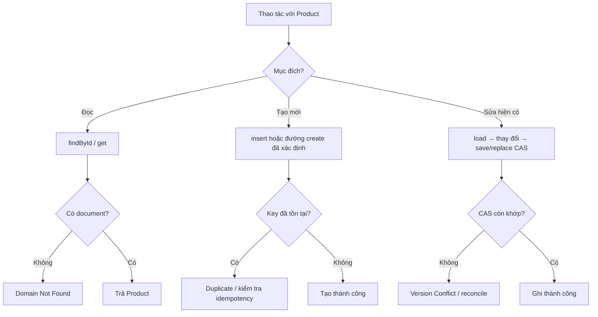
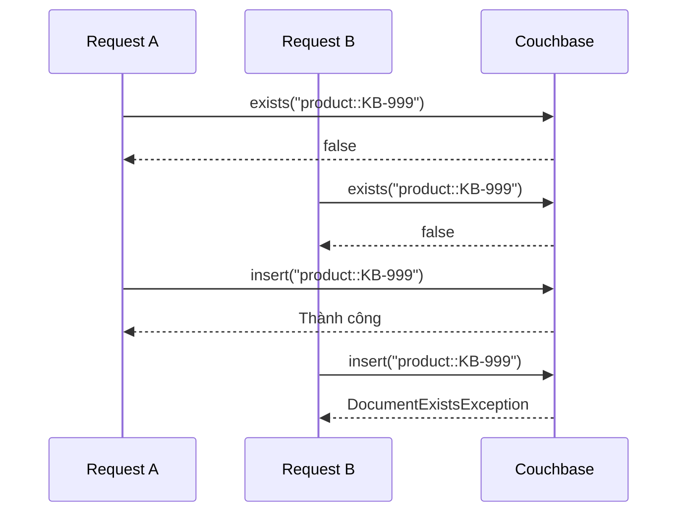
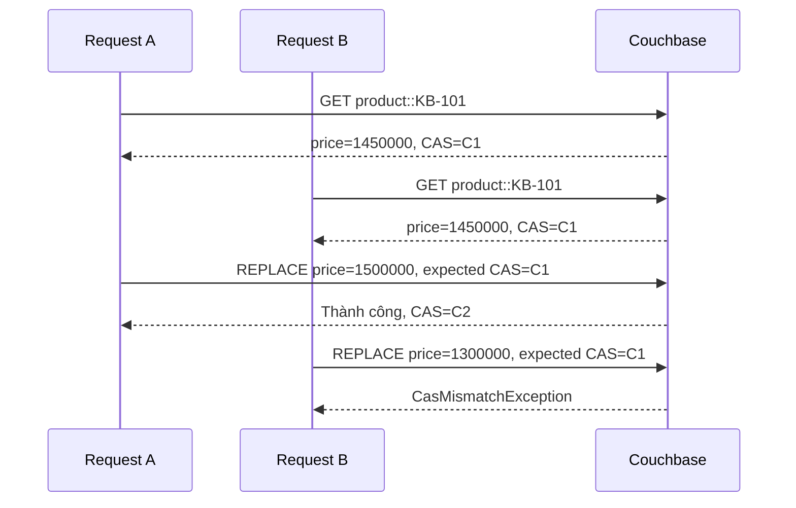
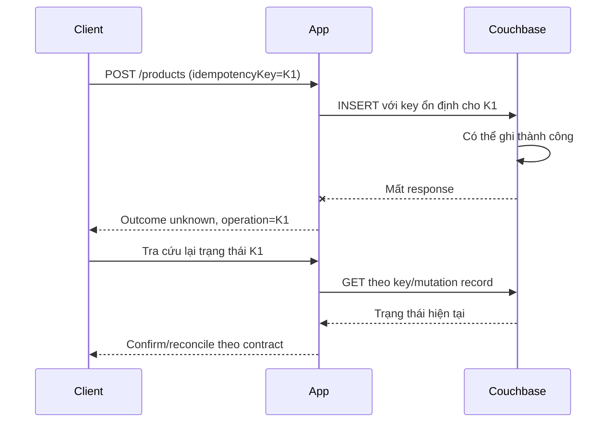

# Tài liệu không tồn tại, khóa trùng và xung đột phiên bản trong Spring Data Couchbase

> **Mục tiêu:** Phân biệt **document không tồn tại**, **document key đã tồn tại** và **CAS/phiên bản đã thay đổi**; hiểu chúng được biểu diễn bằng kết quả rỗng hay ngoại lệ ở Spring Data Couchbase và Couchbase Java SDK; thiết kế các thao tác tạo–đọc–sửa–xóa không ghi đè ngoài ý muốn; sử dụng `@Version`, CAS, giới hạn retry và idempotency; xử lý tình huống timeout khiến kết quả ghi chưa xác định.

Trong module **SPRING_DATA_COUCHBASE**, tầng truy cập dữ liệu sử dụng Java entity mapping, Repository, `CouchbaseTemplate` và truy vấn **SQL++** (tên cũ: N1QL). Document được lưu trong **bucket/scope/collection**, có metadata **ID, CAS và expiry/TTL**. Khi biết ID, thao tác Key/Value (KV) thường phù hợp; khi lọc theo trường JSON, Query Service và secondary index được sử dụng. Với công việc nhiều document, ứng dụng còn phải cân nhắc transaction và API reactive.

Ba tình huống sau dễ bị nhầm là một “database conflict”:

1. **Không tồn tại:** caller yêu cầu đọc/sửa/xóa một document key nhưng key không có ở collection đích.
2. **Khóa trùng:** caller yêu cầu **tạo mới** với một key nhưng đã có document cùng key trong collection đó.
3. **Xung đột phiên bản:** caller đã đọc phiên bản cũ, nhưng document bị sửa bởi luồng khác trước khi caller ghi theo CAS.

Chúng có **hành vi và cách phục hồi khác nhau**. Ví dụ: document không tồn tại có thể trả `Optional.empty()`; trùng key khi `insert` là lỗi chính sách tạo mới; CAS mismatch phải xử lý bằng **đọc lại và tính lại nghiệp vụ**, không phải bỏ điều kiện CAS.

## 1. Cùng một key, ba ý nghĩa khác nhau

Giả sử hệ thống có bucket `catalog`, scope `commerce` và collection `products`. Document:

**ID (metadata):** `product::KB-101`

```json
{
  "_class": "catalog-product",
  "sku": "KB-101",
  "name": "Bàn phím cơ TKL",
  "category": "keyboard",
  "price": 1450000,
  "stock": 12,
  "active": true,
  "tenantId": "shop-a"
}
```

Một document thứ hai có ID `product::MS-202`, category `mouse`, stock `0` và thuộc cùng tenant. Còn `product::UNKNOWN` **không tồn tại** trong collection này. Trường `_class` trên chỉ minh họa alias type do Spring Data có thể lưu; type key thực tế phụ thuộc converter.

### Định nghĩa entity

```java
import org.springframework.data.annotation.Id;
import org.springframework.data.annotation.TypeAlias;
import org.springframework.data.annotation.Version;
import org.springframework.data.couchbase.core.mapping.Document;
import org.springframework.data.couchbase.repository.Scope;
import org.springframework.data.couchbase.repository.Collection;

@Document
@TypeAlias("catalog-product")
@Scope("commerce")
@Collection("products")
public class Product {
    @Id
    private String id;

    @Version
    private long version;

    private String sku;
    private String name;
    private String category;
    private Long price;
    private Integer stock;
    private Boolean active;
    private String tenantId;

    public Product() {}

    public String getId() { return id; }
    public void setId(String id) { this.id = id; }
    public long getVersion() { return version; }
    public Long getPrice() { return price; }
    public void setPrice(Long price) { this.price = price; }
    public Integer getStock() { return stock; }
    public void setStock(Integer stock) { this.stock = stock; }
    public String getTenantId() { return tenantId; }

    // Thêm getter/setter cần thiết cho các trường còn lại.
}
```

Bucket `catalog` được chọn trong cấu hình ứng dụng. `@Scope` và `@Collection` điều hướng tới `commerce.products`. `@Id` là key Couchbase, không nhất thiết là một field `id` bên trong JSON; `@Version` liên kết với metadata **CAS**, không phải một trường JSON version do ta tự tăng.

Repository:

```java
import org.springframework.data.couchbase.repository.CouchbaseRepository;

public interface ProductRepository
        extends CouchbaseRepository<Product, String> {
}
```

### Kết quả của các thao tác theo ID

| Thao tác | Document không có | Document đã có | CAS đã cũ |
| --- | --- | --- | --- |
| `repository.findById(id)` | `Optional.empty()` theo hợp đồng Repository | Trả `Optional<Product>` | Không ghi nên không có CAS conflict |
| SDK `collection.get(id)` | `DocumentNotFoundException` | Trả `GetResult` với body và CAS | Không ghi nên không có CAS conflict |
| SDK `collection.insert(id, body)` | Thường tạo mới | `DocumentExistsException` | Insert không dùng CAS kỳ vọng từ một lần đọc cũ |
| SDK `collection.replace(id, body)` | `DocumentNotFoundException` | Thay body nếu không yêu cầu CAS | `CasMismatchException` khi truyền CAS không khớp |
| SDK `collection.remove(id)` | `DocumentNotFoundException` | Xóa nếu không yêu cầu CAS | `CasMismatchException` khi truyền CAS không khớp |
| `repository.save(entity)` có `@Version` | Phụ thuộc new/existing state và mapping | Có thể tạo/lưu theo hợp đồng Repository | `OptimisticLockingFailureException` khi version cũ không còn hợp lệ |

**Lưu ý:** bảng diễn tả hành vi KV SDK phổ biến và ý nghĩa repository; ngoại lệ quan sát được từ Spring Data có thể đã qua **exception translation**. Không giả định mọi `DocumentNotFoundException` hay `DocumentExistsException` luôn ánh xạ thành một lớp Spring cố định trên mọi phiên bản.

## 2. Chọn đúng keyspace trước khi kết luận “không tồn tại”

Document key có phạm vi trong **collection**. Hai collection `catalog.commerce.products` và `catalog.archive.products` có thể chứa cùng key `product::KB-101` nhưng là **hai document độc lập**.

```text
catalog
├── commerce
│   └── products
│       └── product::KB-101  (Product đang hoạt động)
└── archive
    └── products
        └── product::KB-101  (Product lịch sử)
```

Nếu Repository gắn `@Scope("commerce")` nhưng một đoạn SDK lại mở `scope("archive")`, chúng có thể trả kết quả khác nhau dù dùng cùng ID.

SDK mở đúng collection:

```java
import com.couchbase.client.java.Cluster;
import com.couchbase.client.java.Collection;

Collection products = cluster.bucket("catalog")
    .scope("commerce")
    .collection("products");
```

Trước khi tìm lỗi timeout, retry hoặc mapping, cần xác định **đúng bucket/scope/collection, document key, quyền và TTL**.

### Document có thể “biến mất” vì TTL

Document có expiry/TTL có thể hết hạn. Sau khi hết hạn, lần đọc sau có thể coi như không tồn tại. Đây là hành vi **vòng đời dữ liệu** chứ không nhất thiết là lỗi mạng. Ví dụ job tạm, session hoặc giỏ hàng hết hạn có thể được thiết kế như vậy.

Không tự khôi phục document từ dữ liệu stale chỉ vì trước đó từng đọc được. Nếu cần giữ lịch sử, phải thiết kế dữ liệu audit/archival riêng.

### Khi tìm qua SQL++ thì sao?

```sql
SELECT META(p).id AS documentId, p.sku
FROM `catalog`.`commerce`.`products` AS p
WHERE p.sku = "KB-101";
```

Truy vấn trả **0 hàng** khi không có document khớp. Nhưng kết quả rỗng không luôn chứng minh document key không tồn tại:

- SQL++ đang lọc theo `sku` chứ không đọc theo key;
- có thể đang truy vấn nhầm collection hoặc thiếu query context;
- `@Query` của Spring Data có `#{#n1ql.filter}` lọc discriminator;
- secondary index có thể chưa phản ánh ghi mới, tùy scan consistency.

Nếu đã biết chính xác ID và chỉ cần đọc một document, KV `findById` hoặc SDK `get` thường trực tiếp hơn việc suy luận từ query theo thuộc tính.

## 3. Ngoại lệ gốc của SDK và ngoại lệ Spring Data

Hệ thống ngoại lệ Spring Data/Couchbase có hai tầng:

| Loại | Java package | Điểm xuất hiện thường gặp |
| --- | --- | --- |
| `DocumentNotFoundException` | `com.couchbase.client.core.error` | SDK `get`, `replace`, `remove` với key không tồn tại |
| `DocumentExistsException` | `com.couchbase.client.core.error` | SDK `insert` với key đã tồn tại |
| `CasMismatchException` | `com.couchbase.client.core.error` | SDK replace/remove với CAS cũ |
| `CouchbaseException` | `com.couchbase.client.core.error` | Lớp cha của nhiều lỗi SDK; có thể chứa `ErrorContext` |
| `DataAccessException` | `org.springframework.dao` | Họ ngoại lệ truy cập dữ liệu được Spring thống nhất |
| `OptimisticLockingFailureException` | `org.springframework.dao` | Spring Data phát hiện version conflict khi lưu entity |

Spring Data có `CouchbaseExceptionTranslator` để dịch một số ngoại lệ phù hợp sang họ `DataAccessException`. **Không có bảo đảm một-một** rằng SDK `DocumentExistsException` luôn trở thành `DuplicateKeyException` hoặc SDK `DocumentNotFoundException` luôn trở thành cùng một Spring subclass. Khi xây logic xử lý, phải xác minh **đường API và phiên bản dependency**.

Một ngoại lệ domain như `ProductNotFoundException` hoặc `ProductAlreadyExistsException` là do **ứng dụng tự định nghĩa**, không phải tên bắt buộc từ SDK.

### Sơ đồ quyết định



Sơ đồ giả định request và response đủ rõ. Khi xảy ra **ambiguous timeout**, không đi thẳng tới nhánh thành công hoặc thất bại; phải đối soát trạng thái ghi trước khi quyết định.

## 4. Trường hợp 1 — Document không tồn tại

### Spring Data Repository: `Optional.empty()` không phải exception

```java
import java.util.Optional;

Optional<Product> product =
    productRepository.findById("product::UNKNOWN");

if (product.isEmpty()) {
    // Không có document theo kết quả đọc qua Repository.
}
```

`CrudRepository.findById` trả `Optional<T>`. Đây là hợp đồng biểu diễn **kết quả vắng mặt bình thường**, không có nghĩa Spring Data đã ném `DocumentNotFoundException` rồi yêu cầu caller bắt lỗi.

Nếu use case *yêu cầu* document phải tồn tại, service có thể chuyển `Optional.empty()` thành lỗi domain:

```java
public Product requireProduct(String id) {
    return productRepository.findById(id)
        .orElseThrow(() -> new ProductNotFoundException(id));
}
```

`ProductNotFoundException` là class ứng dụng tự định nghĩa. Sự vắng mặt không tự là sự cố hệ thống; có thể là `404` của endpoint truy cập một tài nguyên, còn API tìm kiếm danh sách thường trả `[]`.

### SDK trực tiếp: `DocumentNotFoundException`

```java
import com.couchbase.client.java.Collection;
import com.couchbase.client.java.kv.GetResult;
import com.couchbase.client.core.error.DocumentNotFoundException;

public ProductSummary requireFromKv(Collection products, String id) {
    try {
        GetResult result = products.get(id);
        var body = result.contentAsObject();
        return new ProductSummary(
            body.getString("sku"),
            body.getString("name")
        );
    } catch (DocumentNotFoundException ex) {
        throw new ProductNotFoundException(id);
    }
}
```

Giả sử DTO được khai báo:

```java
public record ProductSummary(String sku, String name) {}
```

Với `collection.get`, SDK phát `DocumentNotFoundException` nếu key không tồn tại. Đoạn SDK ở trên **không** sử dụng Spring Data converter; body được đọc thành `JsonObject` rồi dựng DTO. Nó cũng không tự bảo đảm quyền tenant khi caller cung cấp bất kỳ document ID.

### `exists` trước `get` có loại bỏ lỗi không?

Không. Ví dụ:

```java
boolean exists = products.exists(id).exists();
if (exists) {
    return products.get(id).contentAsObject();
}
```

Giữa `exists` và `get`, một request khác có thể xóa hoặc thay đổi expiry. Vì vậy, `get` **vẫn có thể báo not found**; đây là race condition kiểu *time-of-check to time-of-use (TOCTOU)*. Nếu chỉ cần lấy document, **thực hiện `get` một lần và xử lý kết quả** thường hợp lý hơn.

`exists` có ích khi thật sự chỉ cần một câu trả lời tồn tại hay không, nhưng không nên dùng nó như khóa hay cam kết về trạng thái tương lai.

### `replace` và `remove` trên document thiếu

```java
products.replace("product::UNKNOWN", newBody);
products.remove("product::UNKNOWN");
```

Nếu key không tồn tại, SDK KV thường ném `DocumentNotFoundException`. Đây khác `upsert`, vốn có thể tạo document mới. Vì vậy, **không đổi `replace` sang `upsert` chỉ để tránh not found** khi nghiệp vụ yêu cầu *chỉ được sửa document hiện hữu*.

Với REST `DELETE /products/{id}`, hệ thống có thể chọn hai hợp đồng hợp lệ:

- **Strict:** document không tồn tại → trả `404` để người dùng biết ID không có.
- **Idempotent absence:** sau khi xác minh quyền và phạm vi, trạng thái “không còn document” được xem là đã đạt, có thể trả `204` kể cả request lặp.

Chọn một hợp đồng rõ ràng và áp dụng nhất quán. Không catch mọi lỗi rồi coi như đã xóa: `DocumentNotFoundException` khác timeout hay thiếu quyền.

### Khi `findById` rỗng là điều bất thường

Checklist:

1. ID có đúng prefix/case/encoding không? `product::KB-101` khác `product::kb-101`.
2. Bucket/scope/collection có chính xác không?
3. Document đã hết TTL hoặc bị xóa bởi job nào không?
4. Caller có quyền đọc keyspace không? Quyền bị từ chối phải báo lỗi, không nên giả empty.
5. Vừa tạo document nhưng ghi có `AmbiguousTimeoutException` không? Nếu có, cần đối soát kết quả trước.
6. Có đang nhầm `findById` KV với `@Query` SQL++ dùng type filter/index không?

## 5. Trường hợp 2 — Khóa trùng khi tạo mới

Với Couchbase KV, `insert(id, body)` có ý nghĩa **tạo mới khi key chưa tồn tại**:

```java
import com.couchbase.client.java.json.JsonObject;
import com.couchbase.client.core.error.DocumentExistsException;

JsonObject body = JsonObject.create()
    .put("sku", "KB-101")
    .put("name", "Bàn phím cơ TKL")
    .put("price", 1450000);

try {
    products.insert("product::KB-101", body);
} catch (DocumentExistsException ex) {
    // Chỉ riêng lỗi trùng key của lệnh create.
    throw new ProductAlreadyExistsException("product::KB-101", ex);
}
```

Vì ID `product::KB-101` đã có trong dữ liệu mẫu, SDK báo `DocumentExistsException`. SDK không cần kiểm tra `sku`, `name` hay các trường body: **khóa document trong collection** mới quyết định uniqueness cho `insert`.

### Document key là unique, còn field `sku` thì sao?

Document ID `product::KB-101` khác ID `product::another-key`, dù cả hai body có `"sku": "KB-101"`. Couchbase không tự áp đặt rằng **mọi giá trị field JSON `sku` là duy nhất** chỉ vì chúng cùng tên.

Nếu SKU phải duy nhất, có thể:

- Chọn quy ước document key ổn định từ SKU, như `product::<SKU>`, và dùng `insert` để loại trùng tại **đúng keyspace**.
- Dùng một document khóa/lookup riêng và transaction khi ràng buộc liên quan nhiều document.
- Thiết kế cơ chế uniqueness theo khả năng Couchbase và workflow đang dùng, thay vì chỉ `SELECT` trước rồi tin kết quả.

**Đừng dùng `SELECT ... WHERE sku = ...` rồi `INSERT` như một cơ chế khóa duy nhất.** Hai request có thể cùng thấy không có SKU ở bước đọc, sau đó cùng insert hai key khác nhau.

### Tại sao `exists` rồi `insert` vẫn có thể trùng?



Đây là kết quả **mong muốn**: chính lệnh `insert` là thao tác tạo có tính nguyên tử theo key, giúp một request thắng và request còn lại nhận conflict. Có thể dùng `exists` để tối ưu UX, nhưng **vẫn bắt đúng ngoại lệ ở thao tác insert**.

### `upsert` không thay thế hợp đồng “create only”

```java
products.upsert("product::KB-101", body);
```

`upsert` sẽ tạo mới nếu chưa có, hoặc **thay thế body** nếu key đã tồn tại. Nó không còn biểu đạt chính sách “không ghi đè product đã có”.

So sánh:

| Yêu cầu | SDK KV phù hợp | Hành vi khi key đã có |
| --- | --- | --- |
| Tạo mới, không đụng dữ liệu cũ | `insert` | `DocumentExistsException` |
| Đồng bộ toàn bộ snapshot theo ID | `upsert`, nếu nghiệp vụ cho phép | Thay thế body |
| Chỉ sửa document hiện hữu | `replace`, nên xét CAS | Ghi trên document hiện có |
| Chỉ sửa một path trong body | `mutateIn`/sub-document API nếu phù hợp | Không thay toàn body |
| Đọc hiện trạng theo ID | `get` | Trả body/CAS |

Nếu chỉ muốn cập nhật giá, thay toàn document bằng `upsert` với body `{"price": 1500000}` có thể làm mất `tenantId`, `category` và discriminator. Đây là **mất dữ liệu do chọn sai thao tác**, không phải lỗi xử lý ngoại lệ.

### `repository.save` có tương đương `insert` không?

Không nên coi là tương đương. Repository `save` dùng state/mapping của entity để quyết định đường ghi, và có thể liên quan `@Version`. API này nhằm **lưu entity**, không mang thông điệp create-only rõ bằng KV `insert`.

Nếu nghiệp vụ bắt buộc “chỉ tạo nếu key chưa tồn tại”, hãy dùng API create/insert có hợp đồng rõ trong Spring Data/`CouchbaseTemplate` của phiên bản đang dùng hoặc một adapter KV `insert` có mapping, thay vì dựa vào phỏng đoán về `save`.

### Conflict chưa chắc là sự cố độc lập

Với request tạo tài nguyên có **idempotency key**, lần gọi đầu có thể thành công, nhưng client mất response. Lần gọi lại với **cùng key** nhận `DocumentExistsException`. Lúc này cần xác minh request thứ hai có **cùng payload/owner/operation ID** với lần đầu không:

- Nếu đúng là request lặp đã được xử lý → trả lại kết quả đã ghi theo contract.
- Nếu là người khác hoặc payload khác dùng cùng key → trả conflict.
- Nếu không có đủ thông tin để xác minh → không tự xem như thành công.

Không để một caller dò sự tồn tại của key thuộc tenant khác qua thông báo conflict chi tiết.

## 6. Trường hợp 3 — CAS và xung đột phiên bản

**CAS (Compare And Swap)** là metadata của document Couchbase. Mỗi khi document bị mutation, CAS thay đổi; giá trị này đóng vai trò **token phiên bản opaque** để kiểm tra dữ liệu có bị luồng khác sửa kể từ lần đọc trước hay không.

Không nên hiểu CAS là:

- timestamp chuẩn nghiệp vụ;
- số lần document được sửa;
- một `Long` có thể tự `++` để dự đoán phiên bản tiếp theo;
- một khóa phân quyền hay chữ ký xác thực.

CAS là token dành cho **equality check**, do Couchbase Server quản lý.

### Ví dụ xung đột hai request



Không có CAS, request B có thể ghi đè thay đổi của A bằng bản document cũ, gây **lost update**. Với CAS đúng, B nhận conflict và phải quyết định: tải lại, tính lại hoặc trả lỗi để người dùng giải quyết.

### CAS trong Couchbase Java SDK

```java
import com.couchbase.client.java.Collection;
import com.couchbase.client.java.json.JsonObject;
import com.couchbase.client.java.kv.GetResult;
import com.couchbase.client.java.kv.MutationResult;
import com.couchbase.client.java.kv.ReplaceOptions;
import com.couchbase.client.core.error.CasMismatchException;

public void changePriceWithCas(
        Collection products, String id, long newPrice) {

    if (newPrice < 0) {
        throw new IllegalArgumentException("Negative price");
    }

    GetResult read = products.get(id);
    long expectedCas = read.cas();
    JsonObject body = read.contentAsObject();
    body.put("price", newPrice);

    try {
        MutationResult saved = products.replace(
            id,
            body,
            ReplaceOptions.replaceOptions().cas(expectedCas)
        );
        // saved.cas() là CAS mới; không tự cộng số vào expectedCas.
    } catch (CasMismatchException ex) {
        throw new ProductVersionConflictException(id, ex);
    }
}
```

Mã này giả định service đã kiểm tra **quyền sửa document** và body có kiểu phù hợp. Nếu `get` không tìm thấy document, SDK có thể ném `DocumentNotFoundException` **trước khi vào khối try/catch CAS**. Nếu document bị xóa sau `get` nhưng trước `replace`, thao tác cuối có thể trả not found thay vì CAS mismatch.

### CAS khi xóa

`remove` cũng có thể kèm expected CAS:

```java
import com.couchbase.client.java.kv.RemoveOptions;

GetResult current = products.get(id);
products.remove(
    id,
    RemoveOptions.removeOptions().cas(current.cas())
);
```

Nếu document bị sửa sau `get`, xóa với CAS cũ có thể báo `CasMismatchException`. Nếu document đã bị xóa, có thể nhận `DocumentNotFoundException`. Đây là hai trường hợp **khác nhau về ý nghĩa**:

| Kết quả | Cách hiểu |
| --- | --- |
| Remove thành công | Đã xóa đúng phiên bản đọc được |
| `CasMismatchException` | Document còn nhưng version đã thay đổi, không nên xóa “bằng mọi giá” |
| `DocumentNotFoundException` | Tại lúc remove, key không còn tồn tại |
| `AmbiguousTimeoutException` | Không thể kết luận chắc request đã xóa hay chưa |

### Spring Data `@Version` và optimistic locking

`@Version` trên entity `Product` ở phần 1 hỗ trợ **optimistic locking** bằng CAS. Khi Spring Data Repository/Template đọc entity, field `version` được nạp từ CAS của document; khi `save`, Spring Data kiểm soát việc ghi theo version đó.

```java
import org.springframework.dao.OptimisticLockingFailureException;

public Product updatePriceThroughRepository(
        String id, long newPrice) {
    if (newPrice < 0) {
        throw new IllegalArgumentException("Negative price");
    }

    Product product = productRepository.findById(id)
        .orElseThrow(() -> new ProductNotFoundException(id));

    product.setPrice(newPrice);
    try {
        return productRepository.save(product);
    } catch (OptimisticLockingFailureException ex) {
        throw new ProductVersionConflictException(id, ex);
    }
}
```

Đây là đường **đọc → sửa → lưu** do Spring Data quản lý. Lỗi Spring `OptimisticLockingFailureException` có ý nghĩa domain tương tự SDK `CasMismatchException`, nhưng **không cùng loại Java** và chỉ xuất hiện khi điều kiện mapping/optimistic locking phù hợp.

Không sửa `product.setVersion(product.getVersion() + 1)`. CAS là token opaque, **không phải counter**. Nếu cần hiển thị lịch sử phiên bản dạng số thứ tự hoặc timestamp, dùng một field nghiệp vụ riêng có quy tắc cập nhật rõ.

### Trường hợp thao tác không dùng CAS

SDK `replace(id, body)` không có `ReplaceOptions.cas(...)` có thể ghi đè một phiên bản mới hơn do luồng khác vừa lưu. Đây có thể là hành vi cho phép trong một tác vụ quản trị nhất định, nhưng **không được dùng như cách “xử lý xung đột” tự động** trong thao tác nghiệp vụ thông thường.

Tương tự, `upsert` là lựa chọn thay thế body theo key, không mặc nhiên là read-modify-write có optimistic locking.

## 7. Một retry CAS đúng phải làm gì?

Chỉ gọi lại `save` hoặc `replace` với **cùng bản body và expected CAS cũ** không giải quyết conflict. Đối với nhiều use case, phải **đọc lại trạng thái mới rồi tái áp dụng ý định nghiệp vụ**.

Ví dụ một thao tác *đặt giá tuyệt đối* có thể được phép tải lại và đặt lại giá:

```java
import java.time.Duration;
import com.couchbase.client.core.error.CasMismatchException;
import com.couchbase.client.java.Collection;
import com.couchbase.client.java.json.JsonObject;
import com.couchbase.client.java.kv.GetResult;
import com.couchbase.client.java.kv.ReplaceOptions;

public void replacePriceWithBoundedRetry(
        Collection products, String id, long requestedPrice) {

    if (requestedPrice < 0) {
        throw new IllegalArgumentException("Negative price");
    }

    int maxAttempts = 3;
    for (int attempt = 1; attempt <= maxAttempts; attempt++) {
        GetResult current = products.get(id);  // Đọc MỚI mỗi lần.
        JsonObject body = current.contentAsObject();

        // Trước khi ghi, kiểm tra lại quyền/trạng thái nghiệp vụ.
        validateCanChangePrice(body);
        body.put("price", requestedPrice);

        try {
            products.replace(
                id,
                body,
                ReplaceOptions.replaceOptions().cas(current.cas())
            );
            return;
        } catch (CasMismatchException ex) {
            if (attempt == maxAttempts) {
                throw new ProductVersionConflictException(id, ex);
            }
            // Thử lại bằng lần GET mới, không tái dùng CAS cũ.
        }
    }
}
```

`validateCanChangePrice(body)` là hàm **do ứng dụng triển khai** để kiểm tra trạng thái, tenant, quyền và những invariant trước khi ghi; code nhằm minh họa vòng retry bounded. Trong môi trường tải cao, cân nhắc **backoff/jitter** theo chính sách, deadline tổng và metric conflict. Nếu nghiệp vụ không cho phép retry tự động, trả `409` ngay sau CAS conflict.

### “Đặt giá” khác “trừ tồn kho”

Với giá mong muốn `1500000`, retry sau khi tải lại có thể hợp lý nếu quyền và trạng thái vẫn cho phép. Với tồn kho:

```text
stock mới = stock hiện tại - số lượng đặt
```

phải đọc lại `stock` mới và kiểm tra `stock >= quantity` ở **mỗi** attempt. Nếu yêu cầu này có thể đã thành công rồi client không nhận được phản hồi, thực hiện lại phép trừ sẽ gây **trừ hai lần**. Do đó:

- CAS conflict được xác nhận có thể retry toàn chu trình sau khi xét nghiệp vụ.
- **Ambiguous timeout không phải CAS conflict**, cần đối soát idempotency trước khi retry.
- Khi đặt hàng liên quan nhiều document, đánh giá **transaction**, outbox/idempotency và khả năng retry logic theo SDK.

### Bất biến của vòng retry CAS

1. Mỗi attempt đọc document và CAS **mới**.
2. Mỗi attempt kiểm tra lại quyền/tenant và điều kiện nghiệp vụ.
3. Chỉ retry các lỗi được xác định là **CAS conflict**, không gộp mọi `CouchbaseException` vào một vòng.
4. Có **số lần tối đa** và **deadline tổng**.
5. Không gửi email, thanh toán, publish event bất idempotent trong phần có thể thực thi lặp.
6. Khi thất bại, trả conflict hoặc trạng thái đối soát phù hợp, **không xóa CAS** để cố ghi thành công.

## 8. Not found, duplicate và version conflict trong REST API

Một REST API nên công khai lỗi **nghiệp vụ**, không phải tên subclass SDK:

| Endpoint minh họa | Tình huống | HTTP status gợi ý | Có nên retry nguyên request? |
| --- | --- | --- | --- |
| `GET /products/{id}` | Document không tồn tại | `404 Not Found` | Không trừ khi có lý do sẽ xuất hiện lại |
| `POST /products` | Document key đã tồn tại và request khác | `409 Conflict` | Không; sửa input/ID hoặc giải quyết trùng |
| `PUT /products/{id}` | Version/CAS đã cũ | `409 Conflict` hoặc `412 Precondition Failed` nếu dùng điều kiện HTTP phù hợp | Tải lại, xử lý xung đột |
| `PUT /products/{id}` | ID không tồn tại trong hợp đồng “chỉ cập nhật” | `404 Not Found` | Không tự upsert |
| `DELETE /products/{id}` | Key đã bị xóa | `404` hoặc `204` tùy contract idempotent | Xác định hợp đồng |
| Bất kỳ mutation | Ambiguous timeout | Trạng thái không xác định, API có thể `202` với mã đối soát | **Không retry mù** |

`412 Precondition Failed` phù hợp khi API có contract `If-Match`/ETag và điều kiện HTTP không còn khớp. **Không tự coi CAS số của Couchbase là một timestamp hay ETag public có thể suy luận**; nếu muốn dùng ETag, thiết kế biểu diễn opaque và kiểm soát quyền.

Trong trường hợp người dùng không có quyền biết tài nguyên có tồn tại hay không, ứng dụng có thể dùng `404` thay vì tiết lộ bằng `403`/`409` tùy chính sách authorization. Việc bọc lỗi không thay thế kiểm tra quyền trên từng document.

## 9. Lớp domain: không để exception SDK tràn ra controller

Để một API hoạt động ổn định dù thay adapter từ Repository sang SDK, service có thể dùng những loại lỗi domain có ý nghĩa riêng:

```java
// Mỗi public class thuộc một file Java riêng trong dự án thực.
public class ProductNotFoundException extends RuntimeException {
    public ProductNotFoundException(String id) {
        super("Product not found");
    }
}

public class ProductAlreadyExistsException extends RuntimeException {
    public ProductAlreadyExistsException(
            String id, Throwable cause) {
        super("Product already exists", cause);
    }
}

public class ProductVersionConflictException extends RuntimeException {
    public ProductVersionConflictException(
            String id, Throwable cause) {
        super("Product version conflict", cause);
    }
}

public class ProductStorageException extends RuntimeException {
    public ProductStorageException(
            String message, Throwable cause) {
        super(message, cause);
    }
}

public class WriteOutcomeUnknownException extends RuntimeException {
    public WriteOutcomeUnknownException(
            String id, Throwable cause) {
        super("Write outcome is not confirmed", cause);
    }
}
```

Các class trên **không phải class có sẵn của Spring Data**. Phần code được nhóm lại để so sánh, **không phải một file Java duy nhất có thể biên dịch nguyên trạng**. Trong hệ thống production, nên thêm mã lỗi ổn định và giữ `cause`, nhưng không đưa raw document ID/stack trace vào thông điệp HTTP công khai.

### Adapter SDK phân loại riêng từng nhánh

```java
import com.couchbase.client.java.Collection;
import com.couchbase.client.java.json.JsonObject;
import com.couchbase.client.core.error.DocumentExistsException;
import com.couchbase.client.core.error.AmbiguousTimeoutException;
import com.couchbase.client.core.error.CouchbaseException;

public class ProductKvGateway {
    private final Collection products;

    public ProductKvGateway(Collection products) {
        this.products = products;
    }

    public void create(String id, JsonObject body) {
        try {
            products.insert(id, body);
        } catch (DocumentExistsException ex) {
            throw new ProductAlreadyExistsException(id, ex);
        } catch (AmbiguousTimeoutException ex) {
            throw new WriteOutcomeUnknownException(id, ex);
        } catch (CouchbaseException ex) {
            throw new ProductStorageException("Insert failed", ex);
        }
    }
}
```

**Thứ tự catch quan trọng**: catch subclass cụ thể trước `CouchbaseException`. Ví dụ trên không thay cho quy trình đối soát: khi trả `WriteOutcomeUnknownException`, hệ thống cần gắn command ID/idempotency key và theo dõi outcome đến khi có bằng chứng rõ.

### Service Spring Data có thể kiểm thử độc lập

```java
import org.springframework.dao.OptimisticLockingFailureException;

public class ProductWriteService {
    private final ProductRepository repository;

    public ProductWriteService(ProductRepository repository) {
        this.repository = repository;
    }

    public Product changePrice(String id, long requestedPrice) {
        if (requestedPrice < 0) {
            throw new IllegalArgumentException("Negative price");
        }

        Product product = repository.findById(id)
            .orElseThrow(() -> new ProductNotFoundException(id));
        product.setPrice(requestedPrice);

        try {
            return repository.save(product);
        } catch (OptimisticLockingFailureException ex) {
            throw new ProductVersionConflictException(id, ex);
        }
    }
}
```

Service này làm nền cho unit test ở phần sau. Nó cố ý **không tự retry** CAS. Khi thực tế cần kiểm tra tenant, trạng thái bán hàng hay authorization, các điều kiện đó phải được đặt trong service/gateway và đánh giá lại phù hợp, chứ không thể chỉ dựa vào ID do caller truyền.

### Không bắt tất cả `RuntimeException` thành “not found”

```java
// Không đúng: lỗi mạng, quyền, converter đều biến thành 404.
try {
    return productRepository.findById(id).orElse(null);
} catch (RuntimeException ex) {
    return null;
}
```

Đoạn phản diện làm hệ thống khó chẩn đoán và khiến caller tin rằng sản phẩm không tồn tại khi cluster gặp sự cố. Hãy để `DataAccessException`/SDK failure được phân loại thích hợp hoặc chuyển sang lỗi domain hạ tầng có `cause`; **chỉ “not found” khi thao tác thực sự xác nhận vắng mặt**.

### `@RestControllerAdvice` dùng `ProblemDetail`

```java
import org.springframework.http.HttpStatus;
import org.springframework.http.ProblemDetail;
import org.springframework.web.bind.annotation.ExceptionHandler;
import org.springframework.web.bind.annotation.RestControllerAdvice;

@RestControllerAdvice
public class ProductExceptionHandler {

    @ExceptionHandler(ProductNotFoundException.class)
    public ProblemDetail missing(ProductNotFoundException ex) {
        ProblemDetail pd =
            ProblemDetail.forStatus(HttpStatus.NOT_FOUND);
        pd.setTitle("Product not found");
        pd.setDetail("The requested product is unavailable.");
        return pd;
    }

    @ExceptionHandler(ProductAlreadyExistsException.class)
    public ProblemDetail duplicate(ProductAlreadyExistsException ex) {
        ProblemDetail pd =
            ProblemDetail.forStatus(HttpStatus.CONFLICT);
        pd.setTitle("Product already exists");
        pd.setDetail("A product with the requested identifier exists.");
        return pd;
    }

    @ExceptionHandler(ProductVersionConflictException.class)
    public ProblemDetail stale(ProductVersionConflictException ex) {
        ProblemDetail pd =
            ProblemDetail.forStatus(HttpStatus.CONFLICT);
        pd.setTitle("Product version conflict");
        pd.setDetail("Refresh the product before saving changes.");
        return pd;
    }

    @ExceptionHandler(ProductStorageException.class)
    public ProblemDetail storage(ProductStorageException ex) {
        ProblemDetail pd =
            ProblemDetail.forStatus(HttpStatus.SERVICE_UNAVAILABLE);
        pd.setTitle("Storage temporarily unavailable");
        pd.setDetail("Please try again later.");
        return pd;
    }
}
```

Đây là handler tối giản cho các lỗi xác định, không phải quy tắc tuyệt đối rằng **mọi** `ProductStorageException` đều là 503: lỗi schema/cấu hình có thể yêu cầu 500 và can thiệp vận hành. `WriteOutcomeUnknownException` cần handler/contract riêng, ví dụ trả một **operation ID** để đối soát thay vì thông báo dứt khoát thất bại.

### Tại sao không trả `ex.getMessage()`?

Message SDK/ErrorContext có thể chứa bucket, scope, collection, document ID, endpoint hoặc query text. Những thông tin này phục vụ chẩn đoán nội bộ, không nên gửi cho HTTP caller. Trả **mã lỗi và thông điệp công khai do ứng dụng kiểm soát**, giữ trace ID để đội vận hành tìm log chi tiết.

## 10. Xung đột phiên bản và `If-Match` trong HTTP

Nhiều giao diện cho người dùng sửa Product theo mô hình:

1. Client tải Product cùng một token phiên bản (ETag/opaque revision).
2. Client sửa giá hoặc tên.
3. Client gửi `PUT/PATCH` kèm `If-Match` cho version đã thấy.
4. Server so sánh điều kiện và chỉ ghi nếu phiên bản vẫn phù hợp.

Nếu version không còn khớp, server có thể trả `412 Precondition Failed` (theo hợp đồng HTTP conditional request) thay vì tự ghi đè. Nếu hệ thống không triển khai `If-Match` mà dùng quy tắc domain, `409 Conflict` thường được chọn cho optimistic locking conflict.

**Không được đưa CAS như một “số thời gian” để client tự cộng.** Nếu chuyển CAS thành ETag, biểu diễn phải là **opaque token** với quy tắc encode/decode, kiểm tra quyền, định danh resource và quản lý đời sống rõ ràng.

### Tránh nhầm PUT với upsert “luôn tạo”

HTTP `PUT` có thể mang các semantics tạo/thay thế tùy contract API, nhưng trong ứng dụng này có thể quyết định **chỉ cập nhật Product đã tồn tại**. Khi đó, `replace` KV với CAS hoặc `save` của entity đã được đọc là hợp đồng phù hợp hơn một lệnh `upsert` vô điều kiện.

Client cần biết:

- `404`: tài nguyên không có trong phạm vi được phép;
- `409`/`412`: tài nguyên có thể đã đổi kể từ lần client đọc;
- `503`/operation pending: hệ thống không thể xác nhận kết quả hoặc tạm unavailable.

Đừng rút gọn cả ba thành “Lưu không thành công, hãy thử lại ngay”.

## 11. Timeout mơ hồ: lỗi thứ tư dễ bị lẫn với conflict

Giả sử `products.insert("product::KB-900", body)` được gửi tới server, server có thể đã tạo document nhưng response bị mất. SDK có thể ném:

```java
com.couchbase.client.core.error.AmbiguousTimeoutException
```

Khi dùng durable write, một tình huống tương tự có thể biểu diễn bằng `DurabilityAmbiguousException`. Đây **không** phải `DocumentExistsException`, **không** phải `CasMismatchException` và cũng **không chứng minh document chưa được tạo**.



### Tại sao retry mù tạo trùng?

Nếu sau timeout, client gọi lại tạo Product với **một random ID khác**, có thể có hai document cho cùng một SKU. Nếu client dùng cùng ID, lần hai có thể gặp `DocumentExistsException` — cần đối chiếu xem đây là **kết quả của lần trước** hay key thuộc một request khác.

Một cơ chế idempotency đầy đủ cần:

- key ổn định cho **mỗi hành động logic**, không chỉ mỗi TCP/HTTP request;
- kiểm tra owner/tenant/loại thao tác;
- kiểm tra payload hoặc request fingerprint nếu tái sử dụng key;
- record trạng thái bền vững khi có nhiều bước/side effect;
- thời hạn lưu idempotency record đủ dài cho cửa sổ retry;
- cơ chế đối soát khi outcome còn ambiguous.

Chỉ gọi `exists(id)` rồi thấy document tồn tại **chưa đủ** để kết luận nó được tạo bởi chính request này nếu ID có thể bị chia sẻ hoặc payload khác. Cần ràng buộc rõ request ID/owner/hash theo thiết kế.

### Ambiguous khác unambiguous timeout

| SDK exception | Điều có thể kết luận | Điều không được suy ra |
| --- | --- | --- |
| `AmbiguousTimeoutException` | SDK không xác định được mutation có tác dụng phụ hay chưa | “Chắc chắn chưa ghi” |
| `UnambiguousTimeoutException` | SDK tin rằng thao tác không hoàn tất thành công | “Retry luôn an toàn cho cả nghiệp vụ” |
| `DocumentExistsException` | Insert nhận kết quả key đã có | “Key chắc chắn do request khác tạo” |
| `CasMismatchException` | CAS yêu cầu không còn khớp | “Có thể bỏ CAS rồi ghi lại không mất dữ liệu” |

SDK có retry strategy nội bộ. Retry thêm ở tầng service phải có **deadline tổng, số lần tối đa, backoff/jitter** và phân loại tính idempotent; không gọi `while(true)` trên một mutation khi chưa biết outcome.

## 12. Reactive Repository và SDK: empty khác error

Trong Spring Data Couchbase reactive, lỗi không nhất thiết được ném ngay khi gọi phương thức tạo publisher; nó được gửi dưới dạng **error signal** khi subscribe. Điều này thay đổi nơi bắt/xử lý lỗi, **không thay đổi ý nghĩa** not found, duplicate hay CAS conflict.

### Reactive Repository: `Mono.empty()` cho not found

```java
import reactor.core.publisher.Mono;
import org.springframework.data.couchbase.repository.ReactiveCouchbaseRepository;

public interface ReactiveProductRepository
        extends ReactiveCouchbaseRepository<Product, String> {
}
```

```java
public Mono<Product> requireProductReactive(String id) {
    return reactiveProductRepository.findById(id)
        .switchIfEmpty(
            Mono.error(new ProductNotFoundException(id))
        );
}
```

Ở đây `Mono.empty()` là kết quả hợp lệ khi không tìm thấy document; `switchIfEmpty` chỉ áp dụng nhánh domain not found trong trường hợp đó.

**Phản diện:**

```java
// Không đúng: lỗi kết nối, quyền, converter cũng biến thành not found.
return reactiveProductRepository.findById(id)
    .onErrorResume(ex -> Mono.empty());
```

`onErrorResume` dùng để xử lý **error signal**, còn `switchIfEmpty` dùng để xử lý **publisher không phát giá trị**. Không dùng hai thứ này thay cho nhau.

### Reactive Repository: conflict khi save

```java
import reactor.core.publisher.Mono;
import org.springframework.dao.OptimisticLockingFailureException;

public Mono<Product> changePriceReactive(String id, long price) {
    if (price < 0) {
        return Mono.error(
            new IllegalArgumentException("Price must be non-negative")
        );
    }

    return reactiveProductRepository.findById(id)
        .switchIfEmpty(Mono.error(
            new ProductNotFoundException(id)
        ))
        .flatMap(product -> {
            product.setPrice(price);
            return reactiveProductRepository.save(product);
        })
        .onErrorMap(
            OptimisticLockingFailureException.class,
            ex -> new ProductVersionConflictException(id, ex)
        );
}
```

Mã này không tự retry CAS. Nếu phiên bản đã cũ, kết quả error signal được chuyển sang domain conflict. Thử lại ở **bên ngoài** toàn bộ luồng đọc–sửa–lưu chỉ được cân nhắc khi nghiệp vụ cho phép và có giới hạn số lần.

### SDK reactive: một nguồn exception khác

SDK cung cấp `ReactiveCollection`:

```java
import com.couchbase.client.java.ReactiveCollection;
import com.couchbase.client.core.error.DocumentNotFoundException;
import reactor.core.publisher.Mono;

public Mono<ProductSummary> readSdkReactive(
        ReactiveCollection products, String id) {

    return products.get(id)
        .map(result -> {
            var json = result.contentAsObject();
            return new ProductSummary(
                json.getString("sku"),
                json.getString("name")
            );
        })
        .onErrorMap(
            DocumentNotFoundException.class,
            ex -> new ProductNotFoundException(id)
        );
}
```

Trong SDK reactive, một document không tồn tại thường phát **`DocumentNotFoundException`** qua error signal, không phải `Mono.empty()` như hợp đồng `ReactiveCrudRepository.findById`. Nếu một adapter đã tự dịch ngoại lệ, ứng dụng cần xem loại lỗi cuối cùng thay vì catch nhầm một tầng.

### Không dùng `retry()` vô hạn cho mutation

```java
// Nguy hiểm nếu một mutation có thể đã được áp dụng.
return products.insert(id, body).retry();
```

Khi một lần ghi đã có tác dụng phụ nhưng bị timeout mơ hồ, retry có thể gây `DocumentExistsException` hoặc tạo tác dụng phụ khác ở workflow. Hãy dùng SDK retry strategy, idempotency/reconciliation và retry budget; không tự thêm `retry()` cho mọi publisher vì muốn “ổn định”.

## 13. SQL++ và `@Query`: kết quả rỗng không chứng minh key thiếu

Spring Data Repository `findById` thường sử dụng đường KV; một `@Query` lọc theo category hoặc SKU chạy qua **Query/Index Service**.

```java
import java.util.List;
import org.springframework.data.couchbase.repository.Query;
import org.springframework.data.repository.query.Param;

// Khai báo bên trong ProductRepository.
@Query("#{#n1ql.selectEntity} WHERE #{#n1ql.filter} "
     + "AND sku = $sku")
List<Product> findBySku(@Param("sku") String sku);
```

Với một document được lưu từ SDK/Workbench thiếu type discriminator mà `#{#n1ql.filter}` yêu cầu, phương thức trên có thể trả **danh sách rỗng**, ngay cả khi `findById(id)` thấy document. Các nguyên nhân khác gồm sai keyspace, dữ liệu vừa ghi chưa xuất hiện qua index hoặc `sku` không khớp.

### So sánh hai đường truy cập

| Câu hỏi | KV `get/findById` | SQL++ `@Query` |
| --- | --- | --- |
| Biết document ID | Dùng trực tiếp theo key | Có thể làm, nhưng thường không cần |
| Lọc theo field JSON | Không phải nhiệm vụ chính | Là thế mạnh của Query Service |
| Không thấy document | Missing key/TTL/sai collection/quyền | Có thể do bộ lọc, discriminator, index freshness |
| CAS metadata | `GetResult.cas()` hoặc `@Version` qua mapper | Cần phép chiếu tương thích khi trả full entity |
| Yêu cầu index | KV theo key không cần secondary index | Truy vấn theo thuộc tính thường cần index |
| Consistency | Đọc KV theo document key | Có scan consistency của Query Service |

**Không sửa lỗi “Query trả rỗng” bằng cách bắt ngoại lệ not found**: query không có hàng là một kết quả bình thường, còn SDK KV `get` missing là exception. Hãy phân tích điều kiện và độ mới index.

### `REQUEST_PLUS` không giải quyết CAS conflict

Một Query Service chạy với `NOT_BOUNDED` có thể chưa nhìn thấy document vừa ghi. `REQUEST_PLUS` yêu cầu index bắt kịp những thay đổi trước lúc query bắt đầu, đổi lại có thể tăng độ trễ.

Tuy nhiên, hai request cùng đọc một Product rồi lưu với `@Version` cũ vẫn có thể xung đột; **scan consistency không biến nhiều thao tác thành một transaction** và không thay cơ chế CAS.

### SQL++ DML không mặc nhiên có `@Version`

Ví dụ:

```sql
UPDATE `catalog`.`commerce`.`products` AS p
USE KEYS "product::KB-101"
SET p.price = 1550000
WHERE p.tenantId = "shop-a"
RETURNING META(p).id AS documentId,
          p.price AS newPrice;
```

Đây là câu SQL++ cập nhật field theo điều kiện; nó **không tự dùng CAS đã nạp vào Java entity** hoặc gọi các callback Repository. Nếu nghiệp vụ cần optimistic locking theo bản đọc cũ, phải thiết kế phiên bản/transaction phù hợp; thường ưu tiên KV replace với CAS hoặc `repository.save` của entity có `@Version`.

Không dùng `UPDATE` qua SQL++ để “lách” conflict rồi vô tình ghi đè người vừa lưu. Nếu thực sự muốn last-write-wins, phải ghi rõ chính sách nghiệp vụ và hậu quả.

### SQL++ DML không có `RETURNING`

Một `UPDATE/DELETE` không có `RETURNING` có thể không trả hàng dữ liệu dù đã có mutation. Vì vậy, **không kết luận có 0 document bị ảnh hưởng chỉ từ danh sách row rỗng**. Dùng query metadata/metrics phù hợp hoặc thiết kế kết quả `RETURNING` rõ ràng, đồng thời xác định trước phạm vi type/tenant.

## 14. Transaction, nhiều document và giới hạn của CAS

CAS bảo vệ **một document** khỏi lost update khi thao tác được đặt expected CAS. Nhưng một nghiệp vụ có thể phải đồng thời:

- giảm tồn kho của Product;
- tạo Order;
- tạo Reservation/Payment intent;
- ghi audit hoặc phát sự kiện.

Nếu một bước thành công và bước khác thất bại, chỉ thêm CAS trên Product **không** tự bảo đảm toàn bộ công việc nguyên tử. Cần xem xét **Couchbase transactions**, thiết kế trạng thái nghiệp vụ và cơ chế idempotency.

### Một tình huống đặt hàng

Hai request cùng muốn đặt 8 sản phẩm khi stock = 12:

```text
Ban đầu: stock = 12
Request A: đặt 8
Request B: đặt 8

Nếu cả hai đều đọc stock 12 rồi ghi stock 4 không CAS,
cả hai có thể tưởng đặt thành công dù chỉ còn 4 trong document.
```

Với CAS, chỉ một thao tác ghi dựa trên CAS cũ được chấp nhận; request còn lại phải đọc lại stock 4 rồi kết luận **không đủ 8 sản phẩm**. Tuy nhiên, nếu một Order đã được tạo ở document khác trước khi CAS thất bại, workflow vẫn cần rollback/compensation/transaction.

### Khi transaction retry logic

Các API transaction có thể **thử lại attempt** theo quy tắc riêng. Không đặt side effect ngoài DB không idempotent (gửi email, thanh toán, publish event) trong đoạn có thể được thực thi lặp mà không dùng outbox/idempotency. Cũng không coi một timeout transaction là bằng chứng tuyệt đối toàn bộ thao tác đã rollback.

### TTL/expiry trong quy trình đa bước

Nếu Product hoặc Reservation có TTL, document có thể hết hạn giữa các bước. `DocumentNotFoundException` có thể là hệ quả hết hạn thay vì ID sai. Khi dùng `replace`/`upsert` hoặc SQL++ DML, cần xem **chính sách giữ expiry** của API/phiên bản để tránh vô tình thay đổi thời gian sống.

**CAS không giữ document khỏi TTL**, và TTL không thay thế cơ chế version conflict.

## 15. Bảng chẩn đoán khi nhận lỗi production

| Triệu chứng | Khả năng cần xét | Kiểm tra trước khi sửa |
| --- | --- | --- |
| `findById` trả empty | Key thật không có, TTL hết hạn, sai collection | ID, bucket/scope/collection, expiry |
| SDK `get` ném `DocumentNotFoundException` | Key không tồn tại tại thời điểm đọc | Phân biệt missing với lỗi quyền/timeout |
| `replace` báo not found | Document bị xóa sau khi đọc hoặc gọi nhầm key | Keyspace, race với delete, TTL |
| `remove` lần 2 báo not found | Document đã bị xóa bởi request trước | Xem hợp đồng DELETE idempotent |
| `insert` báo `DocumentExistsException` | Key đã tồn tại | Duplicate thật hay retry sau ambiguous success |
| Hai record có cùng `sku` | ID khác nhau nhưng body trùng SKU | Quy ước ID và cơ chế uniqueness domain |
| `save` báo `OptimisticLockingFailureException` | Entity có `@Version` stale | Chu trình đọc–sửa–lưu, không tự sửa CAS |
| SDK `replace` báo `CasMismatchException` | Expected CAS không khớp hiện tại | Đọc lại current, tính lại nghiệp vụ |
| SDK `remove` báo CAS mismatch | Document bị thay đổi sau khi đọc | Có nên xóa bản mới hơn hay trả conflict? |
| Cập nhật thành công nhưng dữ liệu luồng A bị ghi đè | `replace`/`upsert` không kiểm tra CAS | Bổ sung optimistic locking và test concurrent writes |
| Ghi timeout rồi client retry tạo hai Order | Outcome ambiguous, không có idempotency | Key ổn định, audit, reconciliation |
| Query theo SKU không tìm thấy nhưng `get` tìm được | Filter, discriminator, index freshness | `#n1ql.filter`, scope, consistency |
| Vừa lưu xong, SQL++ SELECT chưa thấy | Index chưa phản ánh ghi mới | KV theo ID hoặc scan consistency thích hợp |
| Không có index, query chậm/lỗi | Secondary index thiếu/sai collection | `EXPLAIN` và quyền/index |
| Không đọc được nhưng SDK báo authentication | Credential/RBAC của ứng dụng | Không chuyển thành HTTP 404/401 tùy tiện |
| Reactive API trả empty dù cluster lỗi | Code dùng `onErrorResume(... Mono.empty())` quá rộng | Giữ error signal, dùng `switchIfEmpty` |
| CAS conflict tăng mạnh | Nhiều writer trên cùng key, retry quá dày | Metric contention, giới hạn concurrency/backoff |
| Ứng dụng trả raw exception message | Lộ keyspace/endpoint/ID từ SDK | Dùng mã lỗi public, trace ID, mask context |
| Document vừa bị xóa lại xuất hiện | Upsert không kiểm tra tồn tại, retry/migration | Audit mutation, policy create/update |
| `@Version` không hoạt động như kỳ vọng | Converter/mapping, thao tác ngoài Repository | Kiểm tra entity và đường ghi thật |

### Quy trình phân loại trong 60 giây đầu

1. **Xác định thao tác**: `findById`, `insert`, `replace`, `remove`, `save` hay `@Query`.
2. **Xác định API**: Spring Data Repository/`CouchbaseTemplate` hay raw Java SDK; đồng bộ hay reactive?
3. **Đọc exception thật**: `Optional.empty()` khác `DocumentNotFoundException`, `CasMismatchException` khác `DocumentExistsException`.
4. **Kiểm tra side effect**: thao tác đọc hay ghi? Có `AmbiguousTimeoutException` không?
5. **Xác định phạm vi**: bucket/scope/collection, tenant, document ID, TTL, type discriminator.
6. **Kiểm tra phiên bản**: expected CAS từ lần đọc nào, có writer khác hoặc job nền không?
7. **Chọn hành động**: not found, conflict, retry bounded, reconciliation hay xử lý sự cố hạ tầng.

Không bắt đầu bằng cách tăng timeout, bỏ CAS hoặc đổi `insert` thành `upsert` khi chưa biết nguyên nhân. Những thay đổi ấy có thể che lỗi nhưng **làm suy yếu tính đúng đắn dữ liệu**.

## 16. `ErrorContext`, logging và metrics

SDK `CouchbaseException` có thể chứa `ErrorContext`. Đây là thông tin **chẩn đoán**, không phải contract domain. Context có thể `null` và chi tiết khác nhau theo request/phiên bản.

```java
import com.couchbase.client.core.error.CouchbaseException;
import com.couchbase.client.core.error.context.ErrorContext;

public void recordFailure(
        CouchbaseException ex, String operation) {
    ErrorContext context = ex.context();
    String contextType =
        context == null ? "none" : context.getClass().getSimpleName();

    // Trong dự án thực: dùng logger có trace ID và masking.
    System.err.println("operation=" + operation
        + ", errorType=" + ex.getClass().getSimpleName()
        + ", contextType=" + contextType);
}
```

Mã minh họa cố ý không in `context.toString()` vì một số thông tin có thể chứa document ID, endpoint, câu SQL++ hoặc dữ liệu nội bộ. Trong hệ thống thật, dùng logger/tracing tập trung, lọc thông tin nhạy cảm và kiểm soát quyền xem log.

### Các chỉ số nên quan sát

| Metric/trace field | Ý nghĩa |
| --- | --- |
| `kv_get_not_found_total` | Tỷ lệ thiếu key khi đọc |
| `kv_insert_duplicate_total` | Có tăng request trùng/idempotency retry không? |
| `cas_conflict_total` | Mức cạnh tranh cập nhật trên document |
| `mutation_ambiguous_total` | Các write cần đối soát |
| `mutation_reconciliation_pending` | Số kết quả chưa rõ còn tồn |
| `db_operation_latency` | P95/P99 của KV và Query |
| `sdk_retry_total` | SDK/application đang phải thử lại bao nhiêu? |
| `query_index_errors_total` | Lỗi index/query context |
| `http_conflict_total` | Số conflict công khai cho client |

Đây là **tên metric đề xuất**, không phải các metric có sẵn mặc định trong mọi SDK/Spring Boot. Tránh đưa raw ID, email, tenant hoặc query literal làm label metric vì rủi ro lộ dữ liệu và cardinality quá cao.

### Thông tin tối thiểu cho một incident

```text
traceId      = <correlation id>
operation    = kv.replace
errorType    = CasMismatchException
keyspace     = catalog/commerce/products
requestState = confirmed conflict
retryCount   = 2
httpOutcome  = 409
```

Không ghi token, credential, body JSON đầy đủ hay ID gắn với cá nhân vào log nếu không được cho phép. Sử dụng `ErrorContext` để điều tra **có kiểm soát**, không gửi context nguyên văn cho HTTP caller.

### Tại sao không parse exception message?

```java
// Không dùng: message là thông tin chẩn đoán không ổn định.
if (ex.getMessage().contains("already exists")) {
    // ...
}
```

Thông điệp có thể đổi theo SDK version, server response hoặc ngôn ngữ. Dùng **exception class**, SDK error category/contract được tài liệu hóa hoặc một enum domain lỗi do ứng dụng định nghĩa.

## 17. Kiểm thử: chứng minh behavior chứ không chỉ kiểm tra text

Để một tầng xử lý lỗi đáng tin, cần kiểm thử cả **mapping exception trong service** và **tính nguyên tử của các KV operations**. Unit test không thể thay thế hoàn toàn integration test cạnh tranh với Couchbase.

### Unit test: Optional empty thành domain not found

```java
import static org.junit.jupiter.api.Assertions.assertThrows;
import static org.mockito.Mockito.when;

import java.util.Optional;
import org.junit.jupiter.api.Test;
import org.mockito.Mockito;

class ProductNotFoundTest {
    @Test
    void missingIdBecomesDomainError() {
        ProductRepository repo =
            Mockito.mock(ProductRepository.class);
        when(repo.findById("product::UNKNOWN"))
            .thenReturn(Optional.empty());

        assertThrows(
            ProductNotFoundException.class,
            () -> repo.findById("product::UNKNOWN")
                .orElseThrow(() ->
                    new ProductNotFoundException("product::UNKNOWN")
                )
        );
    }
}
```

Test trên xác minh một **nhánh logic Java**; tốt hơn nữa là kiểm tra **service thật** để bảo đảm exception được chuyển đúng tại biên ứng dụng, không chỉ dựa trên `Optional.orElseThrow` của Java.

### Unit test: Spring optimistic locking conflict

```java
import static org.junit.jupiter.api.Assertions.assertThrows;
import static org.mockito.ArgumentMatchers.any;
import static org.mockito.Mockito.when;

import java.util.Optional;
import org.junit.jupiter.api.Test;
import org.mockito.Mockito;
import org.springframework.dao.OptimisticLockingFailureException;

class ProductVersionConflictTest {
    @Test
    void staleSaveBecomesDomainConflict() {
        ProductRepository repo =
            Mockito.mock(ProductRepository.class);
        Product product = new Product();
        when(repo.findById("product::KB-101"))
            .thenReturn(Optional.of(product));
        when(repo.save(any(Product.class)))
            .thenThrow(
                new OptimisticLockingFailureException("stale")
            );

        ProductWriteService service = new ProductWriteService(repo);

        assertThrows(
            ProductVersionConflictException.class,
            () -> service.changePrice("product::KB-101", 1550000L)
        );
    }
}
```

`ProductWriteService` trong test trên là service application cần có phương thức `changePrice` bắt lỗi Spring và ném domain conflict; nếu copy bài vào dự án, cần cài đặt class đó. Unit test này **không chứng minh** bản Couchbase/Spring Data thực tế đã ném đúng class trong mọi đường gọi.

### Integration test: CAS thật bằng hai bản đọc

Kịch bản cần chạy trên collection test riêng:

1. `insert` document thử nghiệm với một key duy nhất.
2. Gọi `get` hai lần, nhận hai `GetResult` với cùng CAS ban đầu.
3. `replace` từ bản A với CAS ban đầu, xác nhận thành công.
4. `replace` từ bản B với CAS cũ, xác nhận `CasMismatchException`.
5. Đọc lại document, xác minh nội dung của A **không bị ghi đè**.
6. Thử xóa bằng CAS cũ và so sánh hành vi.

Đây là kiểm thử có tính quyết định nếu làm theo thứ tự, không cần phụ thuộc vào race timing của hai thread. Khi test concurrency song song thực sự, dùng barrier để đồng bộ hai request nhưng **không khẳng định request cụ thể nào luôn thắng**.

### Integration test: duplicate key

```java
String id = "test::unique-product-001";
JsonObject body = JsonObject.create().put("sku", "TEST-001");

products.insert(id, body);   // Lần đầu: phải thành công.

assertThrows(
    DocumentExistsException.class,
    () -> products.insert(id, body)
);
```

Đây là đoạn trong một test đã chuẩn bị `products`, `assertThrows` và các import tương ứng. Cần cleanup key test theo hợp đồng và xác định không dùng key chung giữa các test chạy song song.

### Không “kiểm thử” ambiguous timeout bằng đoán

Fault injection mạng có thể tạo `AmbiguousTimeoutException`, `RequestCanceledException` hoặc phản hồi thành công tùy thời điểm. Không có cam kết một lần cắt kết nối chắc chắn phát ra đúng class ngoại lệ cần thử. Nên kiểm tra workflow idempotency/reconciliation bằng **test double được điều khiển** cho nhánh ambiguous, và kiểm thử lỗi mạng trong môi trường cách ly.

## 18. Bộ test hồi quy tối thiểu cho một Product service

| Test case | Kết quả mong muốn |
| --- | --- |
| `findById` với key thiếu | Empty hoặc domain 404 theo tầng đang test |
| `get` SDK với key thiếu | `DocumentNotFoundException` |
| `replace` SDK với key thiếu | `DocumentNotFoundException` |
| `remove` SDK với key thiếu | `DocumentNotFoundException` |
| `insert` lần đầu | Tạo mới một document |
| `insert` lặp cùng key | `DocumentExistsException`, không overwrite |
| `upsert` cùng key | Được phép thay body chỉ khi contract cho phép |
| `replace` với CAS đúng | Thành công, trả CAS mới |
| `replace` với CAS stale | `CasMismatchException` |
| `remove` với CAS stale | Conflict hoặc not found tùy thay đổi đồng thời |
| `save` Spring entity có `@Version` stale | `OptimisticLockingFailureException` khi mapping hỗ trợ |
| Retry CAS có giới hạn | Nạp lại/cập nhật theo nghiệp vụ hoặc kết thúc conflict |
| Timeout mơ hồ khi insert | Không tạo một key mới cho cùng request, kích hoạt đối soát |
| Document hết TTL | Missing theo contract; không tự retry vô hạn |
| Document ở scope khác | Được coi độc lập với key cùng tên |
| SQL++ thiếu discriminator | Query có thể rỗng dù KV get thấy document |
| Reactive `Mono.empty` | Chỉ được đổi thành domain not found |
| Reactive SDK missing | Xử lý error signal `DocumentNotFoundException` |
| API conflict | Trả status/message public không lộ SDK context |
| Tenant khác gọi sửa/xóa | Không sửa dữ liệu dù biết document key |

Một bộ test đầy đủ còn cần invalid input, quyền, batch operations, cancellation và sự cố cluster. Những kịch bản liệt kê là **đề xuất để người học thực hành**, không phải các test đã chạy khi viết bài.

## 19. Bài thực hành có đáp án

Các bài sau giả định Product `product::KB-101` ban đầu có `price = 1450000`, `stock = 12` và thuộc tenant `shop-a`. Những bài có ghi dữ liệu phải thực hiện **độc lập trên collection test đã khôi phục trạng thái gốc**, trừ khi mô tả rõ một chuỗi thao tác.

### Bài 1 — Repository không thấy document

**Đầu bài:** `repository.findById("product::UNKNOWN")` trả `Optional.empty()`. Có nên catch `DocumentNotFoundException` để trả 404 không?

**Đáp án:** Không cần catch SDK exception cho nhánh này. Hợp đồng Repository trả `Optional.empty()` khi không tìm thấy. Service dùng `orElseThrow(() -> new ProductNotFoundException(id))` nếu endpoint yêu cầu một tài nguyên cụ thể. Không nhầm kết quả trống với lỗi kết nối.

### Bài 2 — SDK không thấy document

**Đầu bài:** `products.get("product::UNKNOWN")` phát `DocumentNotFoundException`.

**Đáp án:** Adapter SDK có thể catch class này và đổi sang domain not found. Nếu ứng dụng có đường Repository và SDK, nên nhất quán ở **domain boundary**, không nhất thiết ném cùng một loại exception ở tầng thấp.

### Bài 3 — Trùng key hai request

**Đầu bài:** A và B cùng chạy `insert("product::KB-999", body)` với key chưa có.

**Đáp án:** Một request có thể tạo document; request còn lại nhận `DocumentExistsException`. Không cần chạy `exists` trước để bảo đảm nguyên tử; `insert` đã có contract create-only. Cần xử lý request trùng theo chính sách domain/idempotency.

### Bài 4 — Field `sku` trùng nhưng document ID khác

**Đầu bài:** `product::KB-101` và `product::random-876` cùng chứa `sku = "KB-101"`. Couchbase có tự từ chối document thứ hai không?

**Đáp án:** Không chỉ vì field body `sku` trùng. `insert` kiểm tra **document key** trong collection. Muốn bảo đảm uniqueness của SKU, nên quy ước key theo SKU hoặc thiết kế ràng buộc domain/lookup/transaction khác. `SELECT` kiểm tra SKU rồi insert key ngẫu nhiên không tránh race.

### Bài 5 — Có nên dùng upsert sửa giá?

**Đầu bài:** Developer muốn đổi giá KB-101 bằng `upsert("product::KB-101", {"price": 1500000})`.

**Đáp án:** Không nếu cần giữ các field khác. `upsert` thay document body, có thể làm mất discriminator, tenant, SKU, stock và field khác. Dùng read-modify-write với CAS, hoặc một API sub-document/`CouchbaseTemplate` phù hợp với yêu cầu cập nhật.

### Bài 6 — Xác định CAS stale

**Đầu bài:** Request A và B đọc cùng CAS `C1`. A replace thành công và nhận CAS `C2`; B replace với CAS `C1`.

**Đáp án:** B nhận `CasMismatchException` ở SDK, hoặc `OptimisticLockingFailureException` khi đi qua Spring Data mapping `@Version`. B phải giải quyết conflict, không được tự đặt CAS `C2` nếu chưa đọc lại body và quyền/trạng thái.

### Bài 7 — Tính tồn kho sau retry CAS

**Đầu bài:** Ban đầu stock 12. A bán 8 và lưu stock 4 thành công. B cũng muốn bán 8, đang giữ bản đọc stock 12/CAS cũ và bị CAS mismatch.

**Đáp án:** Nếu B tải lại, sẽ thấy stock 4; nghiệp vụ phải trả **không đủ hàng**, không được tự ghi stock -4. CAS giúp loại lost update, nhưng logic kiểm tra tồn kho vẫn phải được đánh giá lại mỗi attempt. Nếu Order B đã tạo trước đó, cần transaction/compensation.

### Bài 8 — Xóa dựa trên version

**Đầu bài:** Người dùng tải Product và nhấn xóa. Trong lúc đó, người khác đổi price. Nên dùng `remove(id)` hay `remove(id, cas)`?

**Đáp án:** Nếu giao diện muốn bảo đảm xóa **đúng bản người dùng đã xem**, dùng `remove` với expected CAS có ý nghĩa hơn. CAS mismatch trả conflict; không tự xóa bản mới hơn. Nếu nghiệp vụ quy định “xóa bất kể sửa đổi mới”, cần xác nhận rõ quyền và chính sách trước khi dùng xóa không CAS.

### Bài 9 — Phân biệt 404 và 409

**Đầu bài:** API cập nhật Product theo ID, Product không có; một request khác Product còn nhưng CAS stale.

**Đáp án:** ID không tồn tại theo contract chỉ-update → thường `404`. CAS stale → `409` hoặc `412` nếu sử dụng HTTP conditional request `If-Match`. Không trả 404 cho conflict phiên bản hoặc trả 409 cho mọi document thiếu.

### Bài 10 — Timeout ambiguous sau insert

**Đầu bài:** SDK phát `AmbiguousTimeoutException` sau khi gửi insert Product. Client định gọi lại với ID ngẫu nhiên khác.

**Đáp án:** Không được tạo key mới ngay. Giữ **idempotency key** ổn định, kiểm tra trạng thái mutation theo key/record, xác nhận owner/payload và chỉ cho retry nếu biết cách đảm bảo không tạo hai tài nguyên cho cùng yêu cầu. Nếu chưa rõ, lưu trạng thái đối soát.

### Bài 11 — Không có key trong SQL++ nhưng KV lại có

**Đầu bài:** `repository.findById("product::KB-101")` thấy document; `@Query` `WHERE sku = "KB-101"` trả rỗng.

**Đáp án:** Kiểm tra `#n1ql.filter` (discriminator), bucket/scope/collection, tên field trong JSON/`@Field`, index và scan consistency. `@Query` rỗng không tự đồng nghĩa document key thiếu.

### Bài 12 — Vì sao reactive code che lỗi?

**Đầu bài:**

```java
return reactiveProductRepository.findById(id)
    .onErrorResume(ex -> Mono.empty());
```

**Đáp án:** Mọi lỗi hạ tầng, quyền hoặc mapping bị biến thành empty. Đúng cho nhánh không tìm thấy là dùng `switchIfEmpty(Mono.error(new ProductNotFoundException(id)))` trên Publisher của Repository; giữ `onErrorMap` cho các loại lỗi cụ thể như optimistic locking.

### Bài 13 — Viết test CAS không phụ thuộc timing

**Yêu cầu:** Kiểm tra hai bản đọc cùng CAS, sau đó một replace thành công, replace còn lại thất bại.

**Đáp án:**

```java
GetResult first = products.get(id);
GetResult second = products.get(id);

JsonObject bodyA = first.contentAsObject();
bodyA.put("price", 1500000);
products.replace(
    id, bodyA, ReplaceOptions.replaceOptions().cas(first.cas())
);

JsonObject bodyB = second.contentAsObject();
bodyB.put("price", 1200000);
assertThrows(
    CasMismatchException.class,
    () -> products.replace(
        id, bodyB,
        ReplaceOptions.replaceOptions().cas(second.cas())
    )
);
```

Đặt đoạn trong test đã khai báo `products` và `id`, import JUnit/SDK. Cuối test, đọc lại Product và xác minh giá **1500000**; đó mới là chứng cứ không bị ghi đè. Không so sánh giá trị CAS theo lớn/nhỏ, chỉ kiểm tra equality/mismatch.

### Bài 14 — Chọn cách xử lý conflict trong giao diện

**Đầu bài:** Hai quản trị viên mở trang Product, một người đổi giá, người còn lại đổi tên. User thứ hai gặp `OptimisticLockingFailureException`.

**Đáp án:** Trả `409`/`412` với thông điệp tải lại. Nếu ứng dụng hỗ trợ merge field có kiểm soát, phải tải bản mới và quyết định thay đổi tên của user thứ hai có thể kết hợp với giá vừa sửa không; không tự ghi cả object stale vì có thể ghi đè giá. Đây là bài toán **merge domain**, không chỉ retry exception.

### Bài 15 — Lỗi không tồn tại do TTL

**Đầu bài:** Document phiên tạm sống 15 phút được tìm thấy lúc 10:00, nhưng `get` lúc 10:20 báo not found.

**Đáp án:** Có thể document đã hết TTL; đây là hành vi hợp lệ. Không tự tăng timeout/retry vì “đã từng tồn tại”. Kiểm tra expiry metadata và lifecycle khi cần audit.

### Bài 16 — Class ngoại lệ nào cần catch?

**Đầu bài:** Service dùng cả `ProductRepository.save` và `products.replace(...cas(...))`.

**Đáp án:** Với Repository, logic optimistic locking chủ yếu catch `OptimisticLockingFailureException` (Spring). Với raw SDK, catch `CasMismatchException`. Trong adapter nên chuyển cả hai sang một domain error version conflict, nhưng không giả định SDK tự dịch qua Spring Data translator.

### Bài 17 — Khi nào retry đọc–sửa–ghi?

**Đầu bài:** Một phép update giá tuyệt đối nhận `CasMismatchException`. Có được thử lại ngay không?

**Đáp án:** Có thể nếu nghiệp vụ cho phép và implementation thực hiện **GET mới, kiểm tra lại quyền/trạng thái, tạo body mới, replace với CAS mới**. Có retry limit, deadline và backoff. Không áp dụng mù cho `stock - 1` sau ambiguous timeout.

### Bài 18 — Kiểm soát tenant trên đường KV

**Đầu bài:** Caller `shop-b` biết document ID `product::KB-101` của `shop-a` và gọi endpoint sửa price. Chỉ dùng CAS có đủ an toàn không?

**Đáp án:** Không. CAS chỉ kiểm soát version, **không kiểm tra authorization**. Service phải kiểm tra quyền/tenant trên document ở thời điểm đọc và trước khi ghi theo chính sách phù hợp. Không trả thông tin raw key/CAS để lộ dữ liệu tenant khác; nếu cần, áp dụng mô hình keyspace/access control.

## 20. Câu hỏi tự kiểm tra

1. **`findById` Repository không thấy key trả gì?** Thường `Optional.empty()`.
2. **`collection.get(id)` không thấy key thường ném gì?** `DocumentNotFoundException`.
3. **`insert(id, body)` khi key đã tồn tại ném gì?** `DocumentExistsException`.
4. **`replace` với CAS stale ném gì?** `CasMismatchException`.
5. **`@Version` trong Spring Data Couchbase liên quan metadata nào?** CAS.
6. **CAS có phải số lần document được sửa không?** Không, là token opaque.
7. **`replace` thiếu CAS có thể gây gì?** Lost update/ghi đè thay đổi của writer khác.
8. **`upsert` có giữ mọi field cũ khi body chỉ chứa price?** Không; nó có thể thay toàn bộ body.
9. **`exists` rồi `insert` có tránh race không?** Không; `insert` vẫn phải xử lý duplicate.
10. **Hai document khác ID có thể cùng `sku` không?** Có nếu không có cơ chế uniqueness domain.
11. **`save` Repository có luôn tương đương KV `insert` không?** Không.
12. **CAS conflict có retry bằng đúng body cũ/CAS cũ được không?** Không; cần tải lại và tính lại nghiệp vụ.
13. **`DocumentExistsException` sau retry có chắc do request khác không?** Không; request trước có thể đã ghi thành công.
14. **`AmbiguousTimeoutException` có chứng minh ghi thất bại không?** Không.
15. **`Mono.empty()` có giống error signal không?** Không.
16. **SQL++ Query không có hàng có chứng minh document key không tồn tại không?** Không.
17. **`REQUEST_PLUS` có thay CAS không?** Không; nó liên quan độ mới index.
18. **CAS có bảo đảm toàn bộ transaction nhiều document không?** Không.
19. **TTL có thể gây not found không?** Có, khi document hết hạn.
20. **HTTP code nào thường dùng cho version conflict?** `409` hoặc `412` khi hợp đồng `If-Match` phù hợp.
21. **Có nên log raw `ErrorContext` cho mọi request không?** Không, vì có thể chứa dữ liệu nhạy cảm.
22. **Muốn xóa đúng bản người dùng đã xem, cần gì?** Xóa có CAS/điều kiện phiên bản và kiểm tra quyền.

## 21. Ca lỗi tổng hợp: mất giá mới vì “sửa lỗi version” bằng upsert

### Bối cảnh

Ứng dụng có hai màn hình cùng chỉnh sửa một Product:

- Nhân viên bán hàng A cập nhật `price` từ 1.450.000 lên 1.550.000.
- Quản lý kho B đang mở một bản Product cũ và chỉ muốn sửa `stock` từ 12 xuống 10.

Hai người đã đọc cùng một bản có CAS `C1`. A ghi trước với CAS và thành công, server trả CAS `C2`. B ghi bản cũ với `@Version`/CAS `C1` và bị conflict.

Developer sửa lỗi bằng cách bỏ `@Version` hoặc dùng `upsert(id, bodyB)` với body của B vì nghĩ “chỉ muốn lưu stock”. Kết quả, body của B vẫn có `price = 1.450.000` nên **ghi đè mất giá mới** của A, dù B không có ý định sửa giá.

### Phân tích nguyên nhân

| Hành động | Kết quả | Đánh giá |
| --- | --- | --- |
| A lưu với CAS `C1` | Thành công, giá 1.550.000 và CAS mới | Đúng |
| B lưu với CAS `C1` | Xung đột phiên bản | **Đúng**: bảo vệ thay đổi của A |
| B bỏ CAS và upsert body cũ | Có thể ghi đè giá của A | **Sai**: che lost update |
| B tải lại Product mới, chỉ đổi stock | Giữ giá 1.550.000, stock còn 10 | Phù hợp nếu đã xác minh quyền và invariant |

### Quy trình sửa

1. Giữ optimistic locking ở mọi đường ghi cần chống lost update.
2. Khi B nhận conflict, kiểm tra xem yêu cầu sửa stock có được phép **merge** với giá mới của A không.
3. Nếu được phép, tải lại Product với CAS hiện tại, chỉ áp dụng trường `stock` được yêu cầu và kiểm tra invariant.
4. Lưu với CAS mới. Nếu vẫn bị writer khác sửa, thực hiện retry **hữu hạn** hoặc trả conflict.
5. Kiểm thử concurrency để chứng minh giá mới của A không bị ghi đè.

Nếu có cả cập nhật Order/Reservation, việc chỉ cập nhật Product có CAS không đủ; cân nhắc transaction và idempotency cho toàn luồng nghiệp vụ.

### Khi vừa xảy ra ambiguous timeout

Giả sử lần B thử lại với CAS mới đã gửi thành công nhưng response bị mất. Hệ thống **không thể kết luận ngay** B chưa sửa stock. Không tiếp tục trừ stock lần hai. Cần đối soát theo key/document và command ID hoặc idempotency record, rồi xác định trạng thái cuối.

### Bốn bất biến cần bảo vệ

1. **Không tạo trùng tài nguyên** khi lệnh create có cùng idempotency key.
2. **Không ghi đè thay đổi của người khác** chỉ vì một request dùng body cũ.
3. **Không lặp side effect** khi timeout không xác định được trạng thái.
4. **Không bỏ qua quyền truy cập** khi thực hiện retry hoặc reconciliation.

## 22. Checklist áp dụng trong dự án

- [ ] Xác định **bucket/scope/collection và ID** trước khi đánh giá not found.
- [ ] Phân biệt Repository `Optional.empty()` với SDK `DocumentNotFoundException`.
- [ ] Dùng `insert` cho create-only, xử lý `DocumentExistsException` và idempotency.
- [ ] Không đổi `insert` thành `upsert` để “sửa lỗi trùng” nếu ghi đè chưa được phép.
- [ ] Không kiểm tra `exists` rồi tin thao tác phía sau sẽ không race.
- [ ] Dùng `@Version`/CAS cho các cập nhật cần chống lost update.
- [ ] Không tự tính CAS hay ghi đè không CAS để né conflict.
- [ ] Khi retry CAS, **đọc lại + kiểm tra lại nghiệp vụ** trên mỗi attempt.
- [ ] Tách `AmbiguousTimeoutException` khỏi CAS/duplicate; có đối soát/idempotency.
- [ ] Bảo vệ quyền/tenant ở cả đường KV và SQL++, không chỉ theo type discriminator.
- [ ] Xác định rõ HTTP 404, 409, 412, 503 và response cho trạng thái chưa xác định.
- [ ] Reactive: phân biệt `Mono.empty()` với `Mono.error(...)`; không nuốt lỗi.
- [ ] Có giới hạn retry, deadline, backoff và metrics conflict/outcome-unknown.
- [ ] Kiểm thử cạnh tranh với hai bản đọc/CAS cố ý khác nhau.
- [ ] Kiểm tra expiry/TTL và query consistency nếu “document vừa có đã mất”.
- [ ] Log exception class và trace ID, không lộ raw `ErrorContext` ra API.

## Tài liệu tham khảo chính thức

- [Spring Data Couchbase — Entity Mapping](https://docs.spring.io/spring-data/couchbase/reference/couchbase/entity.html): `@Id`, `@Version` và optimistic locking theo CAS.
- [Spring Data Couchbase — Repositories](https://docs.spring.io/spring-data/couchbase/reference/couchbase/repository.html): Repository, `findById`, `save`, truy vấn và mapping.
- [Spring Data Couchbase — Template Operations](https://docs.spring.io/spring-data/couchbase/reference/couchbase/template.html): `CouchbaseTemplate` và hoạt động truy cập document.
- [Spring Framework — DataAccessException](https://docs.spring.io/spring-framework/reference/data-access/dao.html): hệ ngoại lệ truy cập dữ liệu của Spring.
- [Couchbase Java SDK — Data Operations](https://docs.couchbase.com/java-sdk/current/howtos/kv-operations.html): `get`, `insert`, `upsert`, `replace`, `remove` và CAS.
- [Couchbase Java SDK — Handling Errors](https://docs.couchbase.com/java-sdk/current/howtos/error-handling.html): timeout ambiguous/unambiguous, retry, idempotency và `ErrorContext`.
- [Couchbase Java SDK — Error Messages](https://docs.couchbase.com/java-sdk/current/ref/error-codes.html): `DocumentNotFound`, `DocumentExists`, `CasMismatch` và các loại lỗi gốc.
- [Couchbase Java SDK — Sub-Document Operations](https://docs.couchbase.com/java-sdk/current/howtos/subdocument-operations.html): thao tác trên các path JSON khi không cần thay toàn document.
- [Couchbase Java SDK — SQL++ Queries](https://docs.couchbase.com/java-sdk/current/howtos/n1ql-queries-with-sdk.html): Query Service, query parameters, index và consistency.
- [Couchbase Java SDK — Distributed Transactions](https://docs.couchbase.com/java-sdk/current/howtos/distributed-acid-transactions-from-the-sdk.html): giao dịch và retry trong luồng nhiều document.
- [Project Reactor — Handling Errors](https://projectreactor.io/docs/core/release/reference/coreFeatures/error-handling.html): `switchIfEmpty`, `onErrorMap` và phân biệt empty/error signal.
- [Spring Framework — Error Responses](https://docs.spring.io/spring-framework/reference/web/webmvc/mvc-ann-rest-exceptions.html): `ProblemDetail` và lỗi REST.

**Ghi nhớ:** Trong Spring Data Couchbase, **document không tồn tại**, **document key trùng** và **version/CAS xung đột** là ba tình huống **khác nhau về nguyên nhân và cách xử lý**. Repository `findById` thường biểu diễn vắng mặt bằng `Optional.empty()`, còn SDK KV `get` dùng `DocumentNotFoundException`; SDK `insert` với key trùng phát `DocumentExistsException`; SDK `replace/remove` với CAS cũ phát `CasMismatchException`, trong khi Spring Data `@Version` có thể phát `OptimisticLockingFailureException`. Không dùng `upsert`/bỏ CAS để che conflict. Khi retry, tải lại và tính lại nghiệp vụ; khi timeout mơ hồ, **đối soát thay vì kết luận ghi thất bại**. Luôn kết hợp kiểm tra quyền, TTL, index/consistency, transaction và idempotency với mục đích của thao tác.
