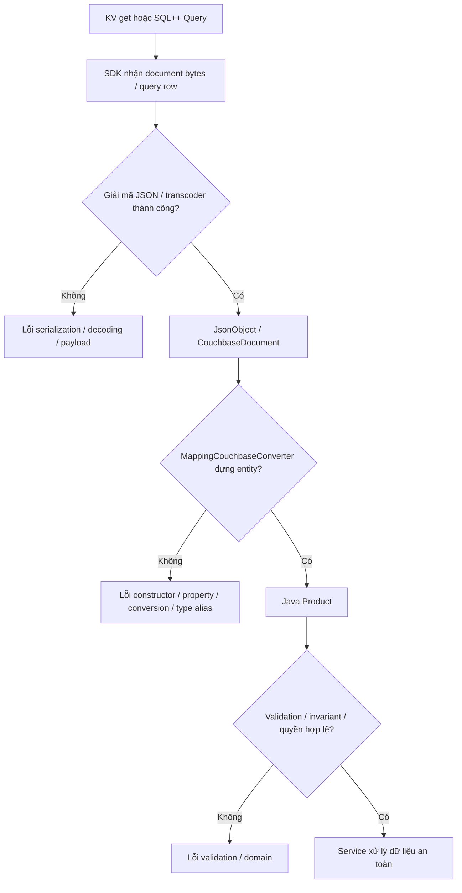

# Lỗi ánh xạ, lỗi chuyển đổi và dữ liệu không hợp lệ trong Spring Data Couchbase

> **Mục tiêu:** Phân biệt lỗi giải mã JSON, lỗi ánh xạ document vào entity, lỗi chuyển đổi kiểu và lỗi validation; xác định nơi phát sinh lỗi khi dùng Spring Data Couchbase Repository, `CouchbaseTemplate`, SQL++ hoặc SDK trực tiếp; thiết kế entity, custom converter, cơ chế version hóa schema, quy trình xử lý document lỗi, logging và kiểm thử mà không che giấu dữ liệu hỏng hoặc ghi đè document ngoài ý muốn.

Trong module **SPRING_DATA_COUCHBASE**, tầng truy cập dữ liệu ánh xạ document Couchbase vào Java bằng **document mapping**, Repository, `CouchbaseTemplate` và truy vấn **SQL++** (tên cũ: N1QL). Dữ liệu được tổ chức theo **bucket/scope/collection**, có ID, CAS và TTL. Khi mở rộng schema, triển khai enum mới hoặc chuyển đổi kiểu dữ liệu, lỗi có thể xuất hiện **sau khi Couchbase Server đã trả document thành công**. Chúng không nhất thiết là lỗi kết nối, thiếu index, document không tồn tại hay xung đột phiên bản.

Một lỗi “Không đọc được Product” có thể đến từ các tình huống khác nhau:

- Couchbase trả về **body không phải JSON** hoặc JSON không giải mã được theo định dạng mà SDK đang mong đợi.
- JSON hợp lệ, nhưng một field như `price` chứa chuỗi `"không-rõ"` trong khi entity yêu cầu `Long`.
- JSON hợp lệ, kiểu field đúng, nhưng **constructor** Java/`record` không chấp nhận giá trị `null` hoặc thiếu tham số bắt buộc.
- Dữ liệu ánh xạ thành Java **không lỗi kỹ thuật**, nhưng vi phạm invariant: `price < 0`, `stock < 0`, `tenantId` không đúng.
- SQL++ trả **phép chiếu không đủ metadata** để dựng full entity có `@Id`/`@Version`.
- Document được tạo bởi SDK/Workbench dùng type discriminator (`_class` hoặc tên cấu hình khác) **không tương thích** với mapper Spring Data.

**Nguyên tắc chính:** **“JSON đọc được” không đồng nghĩa “entity tạo được”; “entity tạo được” không đồng nghĩa “dữ liệu hợp lệ để xử lý nghiệp vụ”**. Mỗi ranh giới cần một cách chẩn đoán và phục hồi khác nhau.

## 1. Sơ đồ các bước đọc/ghi document



Ở chiều ghi, luồng đi ngược lại:

```text
Java entity
   → validation/callback theo cấu hình
   → MappingCouchbaseConverter / custom writing converters
   → JSON/transcoder
   → Couchbase SDK
   → bucket.scope.collection
```

Chiều đọc có thể thành công nhưng chiều ghi thất bại, hoặc ngược lại. Ví dụ một custom `@ReadingConverter` xử lý chuỗi legacy đặc biệt nhưng không có converter đối xứng để ghi lại kiểu dữ liệu mới.

| Giai đoạn | Tác vụ | Dạng lỗi cần xét |
| --- | --- | --- |
| Chọn nguồn | Bucket/scope/collection, ID hoặc SQL++ `FROM` | Sai keyspace, quyền, document thiếu |
| SDK decode | Bytes → JSON/`JsonObject`/POJO | Dữ liệu không phải JSON, serializer/transcoder sai |
| Mapping Spring Data | JSON + metadata → entity | Sai tên field, type alias, constructor, kiểu field |
| Chuyển đổi giá trị | JSON value → Java type | `String`/`Number`/`Enum`/`UUID`/value object không tương thích |
| Validation | Entity/DTO → business rules | Field bắt buộc thiếu, số âm, ràng buộc chéo |
| Viết document | Entity → JSON bytes | Converter ghi không hợp lệ, giá trị không thể serialize |
| SQL++ projection | Query row → DTO/entity | Alias, thiếu ID/CAS, result shape khác kỳ vọng |

## 2. Bộ dữ liệu mẫu dùng xuyên suốt bài

Giả sử ứng dụng bán sản phẩm có bucket `catalog`, scope `commerce`, collection `products`. **Document chuẩn** của ID `product::KB-101`:

```json
{
  "_class": "catalog-product",
  "schemaVersion": 2,
  "sku": "KB-101",
  "name": "Bàn phím cơ TKL",
  "priceMinor": 1450000,
  "stock": 12,
  "active": true,
  "tenantId": "shop-a",
  "tags": ["mechanical", "gaming"],
  "specs": {
    "connection": "wired",
    "layout": "TKL"
  }
}
```

Giả sử hệ thống có thêm các document legacy hoặc bị lỗi:

**ID `product::KB-OLD` — field cũ `price` dưới dạng chuỗi:**

```json
{
  "_class": "catalog-product",
  "schemaVersion": 1,
  "sku": "KB-OLD",
  "name": "Bàn phím cũ",
  "price": "850000",
  "stock": 6,
  "active": true,
  "tenantId": "shop-a"
}
```

**ID `product::MS-BAD` — lỗi kiểu dữ liệu:**

```json
{
  "_class": "catalog-product",
  "schemaVersion": 2,
  "sku": "MS-BAD",
  "name": "Chuột lỗi nhập liệu",
  "priceMinor": "không-rõ",
  "stock": "rất-nhiều",
  "active": true,
  "tenantId": "shop-a"
}
```

**ID `product::HS-INVALID` — JSON hợp lệ, vi phạm nghiệp vụ:**

```json
{
  "_class": "catalog-product",
  "schemaVersion": 2,
  "sku": "HS-INVALID",
  "name": "Tai nghe thử nghiệm",
  "priceMinor": -50000,
  "stock": -1,
  "active": true,
  "tenantId": "shop-a"
}
```

Các ví dụ là dữ liệu giả. Trường `_class` ở đây minh họa discriminator do Spring Data có thể lưu theo `@TypeAlias`; tên type key, alias và cách ánh xạ thực tế phải được xác nhận theo **converter/phiên bản** của dự án. Khi document được chèn bằng SDK/Workbench, nó **không tự đi qua** mapping callback và validation của Spring Data.

### Entity tương ứng với schema hiện tại

```java
import java.util.List;
import org.springframework.data.annotation.Id;
import org.springframework.data.annotation.TypeAlias;
import org.springframework.data.annotation.Version;
import org.springframework.data.couchbase.core.mapping.Document;
import org.springframework.data.couchbase.repository.Scope;
import org.springframework.data.couchbase.repository.Collection;
import org.springframework.data.couchbase.core.mapping.Field;

@Document
@TypeAlias("catalog-product")
@Scope("commerce")
@Collection("products")
public class Product {
    @Id
    private String id;

    @Version
    private long version;

    private Integer schemaVersion;
    private String sku;
    private String name;

    @Field("priceMinor")
    private Long priceInMinorUnits;

    private Integer stock;
    private Boolean active;
    private String tenantId;
    private List<String> tags;
    private ProductSpecs specs;

    public Product() {}

    public String getId() { return id; }
    public Long getPriceInMinorUnits() { return priceInMinorUnits; }
    public Integer getStock() { return stock; }
    public String getTenantId() { return tenantId; }
    // Bổ sung getter/setter hoặc constructor theo convention dự án.
}

public class ProductSpecs {
    private String connection;
    private String layout;
    public ProductSpecs() {}
    // Getter/setter.
}
```

**Lưu ý về đoạn Java:** `Product` và `ProductSpecs` là hai top-level `public class` riêng, nên trong dự án thực chúng phải nằm ở **hai file Java** hoặc một class nested `static` phù hợp. `@Field("priceMinor")` ánh xạ **tên JSON** sang property `priceInMinorUnits` — nó không làm phép chuyển `"850000"` từ trường `price` cũ thành số trong `priceMinor`.

Repository:

```java
import org.springframework.data.couchbase.repository.CouchbaseRepository;

public interface ProductRepository
        extends CouchbaseRepository<Product, String> {
}
```

**Mục tiêu của schema mới:** `priceMinor` là số nguyên đơn vị nhỏ nhất để tránh mơ hồ tiền tệ. Khi dự án dùng tiền tệ với phần thập phân, phải quy định quy đổi, rounding và range rõ ràng; không tự dùng `double` làm nguồn chuẩn cho tiền chính xác.

## 3. Lỗi SDK giải mã JSON khác lỗi Spring Data mapping

Couchbase Server lưu document theo key. SDK Java có thể đọc body bằng `JsonObject` hoặc serializer/transcoder khác. Spring Data thêm một tầng ánh xạ để dựng Java entity.

### Đọc raw JSON với Couchbase Java SDK

```java
import com.couchbase.client.java.Cluster;
import com.couchbase.client.java.Collection;
import com.couchbase.client.java.json.JsonObject;
import com.couchbase.client.java.kv.GetResult;

Collection products = cluster.bucket("catalog")
    .scope("commerce")
    .collection("products");

GetResult result = products.get("product::MS-BAD");
JsonObject raw = result.contentAsObject();

System.out.println(raw.get("priceMinor"));
System.out.println(raw.get("stock"));
```

Nếu body thực sự là JSON object, `contentAsObject()` có thể đọc dữ liệu **dù giá trị có kiểu không phù hợp với `Product`**. Ở ví dụ, SDK có thể trả raw `"không-rõ"` và `"rất-nhiều"` như chuỗi; nó chưa buộc chuyển chúng thành `Long`/`Integer`. Nếu ứng dụng gọi `raw.getLong("priceMinor")` hoặc `getInt("stock")`, kiểu không tương thích có thể gây lỗi tại chính getter SDK.

### Khi body không phải JSON object

Nếu collection có dữ liệu được lưu dưới dạng **binary/non-JSON** hoặc body JSON là array/scalar thay vì object, `contentAsObject()` có thể thất bại vì **hợp đồng transcoder/shape** không phù hợp. Đó không phải lỗi SQL++ syntax hay lỗi `@Version`. Kiểm tra đúng loại nội dung và codec, không cố “đổi @Field” để chữa dữ liệu không thể giải mã.

### SDK đọc được nhưng Repository thất bại

```java
// SDK kiểm tra raw document.
JsonObject raw = products.get("product::MS-BAD")
    .contentAsObject();

// Spring Data cố tạo Product từ chính document này.
Product mapped = productRepository.findById("product::MS-BAD")
    .orElseThrow();
```

Nếu converter không hỗ trợ chuyển `"không-rõ"` thành `Long`, bước Repository có thể ném exception liên quan chuyển đổi hoặc ánh xạ; **không bảo đảm một class duy nhất** cho mọi phiên bản. Ngược lại, với `product::HS-INVALID`, mapper vẫn có thể tạo `Product` vì `-50000` là một số Java hợp lệ, dù nghiệp vụ không cho phép giá âm.

### Tập hợp các nguyên nhân theo tầng

| Tình huống | SDK `contentAsObject` | Repository `findById` | Validation nghiệp vụ |
| --- | --- | --- | --- |
| JSON chuẩn `KB-101` | Thường thành công | Thường thành công | Thành công |
| Giá chuỗi sai `MS-BAD` | Có thể đọc raw string | Có thể lỗi converter hoặc mapping | Chưa tới bước validation |
| `priceMinor = -50000` | Thành công | Có thể ánh xạ thành `Long` | Phải báo lỗi domain |
| Document không còn tồn tại | SDK `DocumentNotFoundException` khi `get` | `Optional.empty()` thông thường | Không có object |
| Body không phải JSON object | Có thể lỗi decode/shape | Thường không thể dựng entity mong muốn | Không có object |

**Cẩn trọng:** dữ liệu “không hợp lệ về domain” nhưng không được validation tự động có thể đi xuyên qua Repository và gây lỗi muộn hơn ở service. Một hệ thống an toàn cần xác định chính xác nơi chạy validation thay vì hy vọng converter tự hiểu mọi invariant nghiệp vụ.

## 4. `MappingCouchbaseConverter` và cơ chế dựng entity

Spring Data Couchbase sử dụng `MappingCouchbaseConverter`, mapping metadata và các converter đăng ký để biến document thành domain object. Quá trình đọc không chỉ là chuyển một JSON string thành POJO theo tên field một cách tùy ý.

```text
Document key, CAS, expiry metadata
                  │
           JSON body + type key
                  │
      CouchbaseMappingContext
                  │
      MappingCouchbaseConverter
           ├─ xác định entity/type alias
           ├─ chọn constructor/factory
           ├─ lấy property từ field JSON
           ├─ chuyển kiểu dữ liệu
           └─ gán ID/CAS và thuộc tính
                  │
               Product
```

Các bước chính:

1. **Chọn kiểu domain:** type information trong JSON và lớp mục tiêu (`Product.class`) được mapper sử dụng theo cấu hình.
2. **Tạo instance:** dùng constructor, factory method hoặc cơ chế property mapping mà Spring Data Commons hỗ trợ.
3. **Đọc thuộc tính:** tìm field tương ứng, có xét `@Field` và mapping metadata.
4. **Chuyển giá trị:** từ các kiểu JSON sang `String`, `Long`, enum, collection, nested object hoặc value object.
5. **Hoàn thiện metadata:** document ID và CAS khi ánh xạ entity có `@Id`/`@Version`.

Khi có lỗi, call stack có thể chứa `MappingCouchbaseConverter`/Spring Data mapping classes dù nguyên nhân sâu nhất chỉ là **một giá trị JSON không tương thích**.

### Phân biệt lỗi mapping với lỗi kết nối

| Tín hiệu | Hướng điều tra |
| --- | --- |
| SDK `get` thành công, `contentAsObject` thành công, Repository đọc lỗi | Entity mapping, constructor, type conversion, discriminator |
| SDK `get` không tìm thấy | ID, keyspace, TTL, race với delete |
| SDK báo timeout/endpoint unavailable | Mạng, cluster, deadline, retry |
| SQL++ `@Query` trả rỗng | Điều kiện `WHERE`, type filter, index freshness, keyspace |
| SQL++ trả row, nhưng mapping DTO/entity lỗi | Projection shape, alias, metadata hoặc conversion |
| `save` entity lỗi trước khi gửi SDK | Writing converter, validation/callback hoặc mã Java |

Không xử lý mọi lỗi đọc bằng một nhánh “document không tồn tại”. Ví dụ một converter thất bại không có nghĩa document đã bị xóa; việc trả HTTP `404` sẽ làm che lỗi dữ liệu và gây nguy cơ khi API khác tiếp tục tạo document cùng key.

## 5. `@Field`: tên field JSON không trùng tên property Java

Một nhầm lẫn phổ biến là đổi tên property Java và kỳ vọng dữ liệu cũ tự đổi tên:

```java
@Field("priceMinor")
private Long priceInMinorUnits;
```

Annotation này nói rằng **property `priceInMinorUnits` đọc/ghi field JSON `priceMinor`**. Nó không tìm field cũ `price` và cũng không đổi `"850000"` thành `850000L` nếu chưa có cơ chế chuyển đổi tương ứng.

### Bài toán nâng schema

| Đời document | JSON thực tế | Property Java hiện tại |
| --- | --- | --- |
| v1 | `"price": "850000"` | `priceInMinorUnits` mong `priceMinor` |
| v2 | `"priceMinor": 1450000` | `@Field("priceMinor")` |
| v2 lỗi | `"priceMinor": "không-rõ"` | Không có giá hợp lệ để chuyển |

Nếu Spring Data đọc v1, `priceInMinorUnits` có thể không được gán do **field `priceMinor` thiếu** và trở thành `null` đối với `Long`. Đây là “silent data loss” ở tầng object: converter không nhất thiết báo lỗi chỉ vì property không có trong JSON. Nếu service lại dùng giá trị mặc định `0` và `save` toàn entity, nó có thể vô tình thay schema cũ.

### Không tự suy luận field alias từ tên property

Nếu entity khai báo:

```java
private Long price;
```

nhưng document chứa `unitPrice`, Spring Data không có nghĩa vụ tự đoán `price == unitPrice`. Cần:

- dùng `@Field("unitPrice")` nếu muốn property Java mang tên khác nhưng vẫn đọc đúng field đang lưu;
- migration document khi thực sự đổi schema;
- custom converter có **hợp đồng chuyển đổi được kiểm chứng** khi cần hỗ trợ schema legacy.

### Kiểu nested object

Với field `specs`:

```json
{
  "specs": {
    "connection": "wireless",
    "layout": "75%"
  }
}
```

Mapper cần dựng `ProductSpecs`. Nếu `specs` đột nhiên là chuỗi `"wireless"` hoặc array, kiểu cấu trúc khác với Java object. Tùy converter, lỗi có thể xuất hiện ở nested mapping, không phải ở `Product` constructor trực tiếp.

Một biến thể thiết kế DTO ở biên có thể giúp kiểm soát schema trước khi tạo domain object:

```java
public record ProductSpecsDto(
    String connection,
    String layout
) {}
```

**Không tự tin rằng dùng Java record luôn sửa được lỗi mapping.** Record có canonical constructor và các field immutable; nếu dữ liệu thiếu/null/sai kiểu, vẫn cần quy tắc compatibility/validation.

## 6. Type discriminator `_class` và `@TypeAlias`

Khi một collection chứa nhiều loại domain object, Spring Data Couchbase có thể ghi field type discriminator, mặc định thường là `_class`, hoặc tên khác do cấu hình. Entity có thể dùng:

```java
@Document
@TypeAlias("catalog-product")
@Scope("commerce")
@Collection("products")
public class Product {
    // Các field của Product.
}
```

Document:

```json
{
  "_class": "catalog-product",
  "sku": "KB-101",
  "priceMinor": 1450000
}
```

### Các tình huống dẫn tới lỗi hoặc kết quả rỗng

- Document nhập qua SDK không có `_class`; `@Query` với `#{#n1ql.filter}` có thể **không chọn document**.
- Document dùng alias legacy khác với alias hiện tại; mapper có thể không nhận diện kiểu tương thích.
- Type key của converter được cấu hình thành tên khác, ví dụ `documentType`; query hardcode `_class` không còn đúng.
- JSON có type information trỏ tới một kiểu không thuộc mapping dự kiến; converter có thể từ chối hoặc ánh xạ sai.

**Không sửa bằng cách bỏ `#{#n1ql.filter}` một cách vô điều kiện.** Khi collection có `Product` và `Promotion` dùng chung các field `sku`, `category`, bỏ discriminator có thể khiến Repository cố ánh xạ một document khác loại thành `Product`.

### Không dùng type key như authorization

Type discriminator giúp Spring Data phân biệt kiểu entity, **không chứng minh** người gọi được đọc dữ liệu. Một Product của tenant `shop-b` vẫn là Product. Các truy vấn theo tenant cần điều kiện riêng và service phải xác thực quyền, kể cả khi mọi document đều có `_class` đúng.

### Cảnh báo về type information không tin cậy

Trong môi trường nhận JSON từ nhiều nguồn, không cho phép external caller tự quyết định lớp Java được instantiate thông qua một field type key tùy ý. Sử dụng mapping/alias đã được ứng dụng cho phép, quyền ghi hạn chế và validate trước khi xử lý. Với document legacy hoặc type name lạ, cần một quy trình migration có kiểm soát thay vì cố “nạp mọi class name” từ body.

## 7. `@Id`, `@Version` và metadata không phải body JSON

Một Product có:

```java
@Id
private String id;

@Version
private long version;
```

`@Id` đại diện document key, còn `@Version` thường ánh xạ Couchbase **CAS** phục vụ optimistic locking. Chúng không nhất thiết được lưu dưới các field JSON `id` và `version`.

### Tại sao SDK thấy JSON nhưng Repository entity bị thiếu ID?

SDK:

```java
GetResult current = products.get("product::KB-101");
long cas = current.cas();
JsonObject body = current.contentAsObject();
```

Body có thể không chứa `id` nhưng SDK biết ID từ tham số `get` và CAS từ `GetResult`.

Khi dùng Spring Data Repository `findById`, mapper nhận metadata từ đường KV phù hợp. Nhưng nếu tự viết:

```sql
SELECT p.sku, p.priceMinor
FROM `catalog`.`commerce`.`products` AS p
WHERE p.category = "keyboard";
```

và cố ánh xạ thành `List<Product>` đầy đủ, query có thể thiếu phép chiếu ID/CAS hoặc alias mà Spring Data cần.

### Ưu tiên `#{#n1ql.selectEntity}` khi trả full entity

```java
import java.util.List;
import org.springframework.data.couchbase.repository.Query;
import org.springframework.data.repository.query.Param;

// Khai báo bên trong ProductRepository.
@Query("#{#n1ql.selectEntity} WHERE #{#n1ql.filter} "
     + "AND category = $category")
List<Product> findByCategory(
    @Param("category") String category
);
```

`#{#n1ql.selectEntity}` tạo `SELECT/FROM` cùng phép chiếu thích hợp cho entity; `#{#n1ql.filter}` hỗ trợ điều kiện type. `$category` là binding giá trị, **khác SpEL `#{...}`**.

Nếu API chỉ cần SKU/giá, dùng DTO/projection tương ứng thay vì dựa vào full entity thiếu metadata. Cũng không tự coi kết quả từ `SELECT *` của SQL++ có cùng shape mà `MappingCouchbaseConverter` mong muốn.

### Rủi ro khi lưu lại entity thiếu ID/CAS

Nếu một DTO thiếu ID hoặc CAS bị đưa ngược vào `save` như một Product, thao tác có thể bị hiểu thành document mới hoặc bỏ qua một điều kiện optimistic locking cần thiết, tùy mapping/new-state detection. Không coi “đọc được vài field” là đủ để dùng một object làm entity cập nhật.

**CAS là opaque token**, không phải số lần sửa, timestamp hay mã version có thể tự tăng. Khi cần lưu lại document dựa trên bản đã đọc, dùng API/mapping có CAS rõ ràng, và xử lý `OptimisticLockingFailureException`/SDK `CasMismatchException` riêng với lỗi conversion.

## 8. Constructor, immutable entity và `@PersistenceCreator`

Spring Data Commons có quy tắc chọn **persistence constructor/factory method** để dựng entity. Một trong các vấn đề phổ biến là đổi từ class mutable có constructor không tham số sang immutable class/Java `record` nhưng **không bảo đảm mapping đọc đúng tên/thứ tự tham số**.

### Entity mutable đơn giản

```java
public class ProductDraft {
    private String sku;
    private Long priceMinor;

    public ProductDraft() {}

    public String getSku() { return sku; }
    public void setSku(String sku) { this.sku = sku; }
    public Long getPriceMinor() { return priceMinor; }
    public void setPriceMinor(Long priceMinor) {
        this.priceMinor = priceMinor;
    }
}
```

Đối với kiểu mutable thông thường, mapper có thể tạo instance rồi gán field. Tuy nhiên, khi dữ liệu thiếu `priceMinor`, `Long` có thể trở thành `null`; class vẫn được tạo thành công. **Không được hiểu thành công khi instantiation là thành công về validation**.

### Java record dùng canonical constructor

```java
public record ProductSummary(
    String sku,
    Long priceMinor
) {
    public ProductSummary {
        if (sku == null || sku.isBlank()) {
            throw new IllegalArgumentException("sku is required");
        }
        if (priceMinor == null || priceMinor < 0) {
            throw new IllegalArgumentException(
                "priceMinor must be non-negative"
            );
        }
    }
}
```

Khi một mapping path dùng record và constructor tương ứng, record có thể **chủ động chặn dữ liệu invalid**. Nhưng khi constructor ném `IllegalArgumentException`, Spring Data có thể bọc nó trong exception liên quan instantiation/mapping; **đừng bắt đúng duy nhất một lớp Java mà chưa kiểm tra cause chain**.

Một record dùng làm DTO chưa chắc thay thế được entity có `@Id`/`@Version` hoặc lifecycle callback. Chọn mô hình theo hợp đồng truy cập, không chỉ để có ít getter/setter.

### Nhiều constructor và `@PersistenceCreator`

```java
import org.springframework.data.annotation.PersistenceCreator;

public class ProductSnapshot {
    private final String sku;
    private final Long priceMinor;

    @PersistenceCreator
    public ProductSnapshot(String sku, Long priceMinor) {
        this.sku = sku;
        this.priceMinor = priceMinor;
    }

    public ProductSnapshot(String sku) {
        this(sku, null);
    }

    public String getSku() { return sku; }
    public Long getPriceMinor() { return priceMinor; }
}
```

Annotation giúp Spring Data lựa chọn constructor dành cho persistence khi có nhiều ứng viên. Constructor parameters phải được nhận diện đúng theo property; cấu hình build Java như `-parameters`, `@ConstructorProperties`, mapping metadata và tên property có thể ảnh hưởng cách gán.

**Các lỗi thường gặp:**

- Constructor được Spring Data chọn không nhận được tên tham số.
- Tên tham số Java và tên property không tương ứng.
- Constructor cần `Long` không null nhưng document legacy thiếu field.
- Non-static inner class cần outer instance, không thể được dựng đơn giản như POJO độc lập.
- Immutable field không được cung cấp qua persistence constructor, mapper không có cách gán phù hợp.
- Constructor business có side effect hoặc gọi remote service gây lỗi khi đọc document.

**Khuyến nghị:** persistence constructor nên chủ yếu dựng một object hợp lệ từ dữ liệu đã quy định; tránh query mạng, publish sự kiện hoặc thao tác ghi bên trong constructor, vì một lần đọc có thể kích hoạt side effect ngoài ý muốn.

## 9. `NULL`, `MISSING` và Java `null`

Couchbase JSON phân biệt **field không tồn tại** và **field tồn tại với giá trị `null`**:

```json
{
  "sku": "KB-A",
  "discount": null
}
```

Khác với:

```json
{
  "sku": "KB-B"
}
```

Trong document thứ nhất, `discount` tồn tại nhưng là JSON `null`; trong document thứ hai, field `discount` **MISSING**. Khi ánh xạ sang property Java kiểu tham chiếu, cả hai trường hợp **có thể cho `null`** tùy converter/default, làm mất thông tin về sự khác biệt ngay trong object.

### So sánh SQL++ chuẩn

```sql
SELECT META(p).id AS id, p.sku
FROM `catalog`.`commerce`.`products` AS p
WHERE p.discount IS NULL;
```

```sql
SELECT META(p).id AS id, p.sku
FROM `catalog`.`commerce`.`products` AS p
WHERE p.discount IS MISSING;
```

```sql
SELECT META(p).id AS id, p.sku
FROM `catalog`.`commerce`.`products` AS p
WHERE p.discount IS VALUED;
```

`IS VALUED` nhắm đến giá trị không `NULL/MISSING`. Không dùng `discount = NULL` như phép kiểm tra `IS NULL`; logic SQL++ với unknown/null/missing không tương đương so sánh số/chuỗi thông thường.

### Java primitive có rủi ro default value

| Java type | Khi field vắng mặt | Rủi ro |
| --- | --- | --- |
| `Long` | Có thể `null` | Cần kiểm tra trước phép tính |
| `long` | Có thể giữ mặc định `0` hoặc lỗi khi constructor cần giá trị | Nhầm “thiếu giá” thành “giá 0” |
| `Boolean` | Có thể `null` | Phân biệt chưa biết với `false` |
| `boolean` | Có thể mặc định `false` | Nhầm trạng thái legacy thiếu thành tắt |
| `Integer` | Có thể `null` | Không được tự tính stock = 0 nếu dữ liệu chưa xác định |
| `int` | Có thể mặc định `0` | Có thể che dữ liệu không hợp lệ |

Các giá trị cụ thể tùy constructor/mapping; **không khẳng định tất cả kiểu primitive luôn không lỗi**. Với field cần phân biệt *missing/unknown* và giá trị hợp lệ `0/false`, dùng wrapper hoặc domain type rõ ràng, validation tường minh và schema migration.

### Khi nào dùng `Optional<T>` cho field?

`Optional` hợp lý ở ranh giới **kết quả tìm kiếm** (`repository.findById`). Nhưng không mặc định rằng mọi entity property nên là `Optional<T>` hoặc các converter đều hỗ trợ giống nhau. Với JSON schema lâu dài, thường nên dùng field nullable có hợp đồng rõ hoặc value object, rồi chuyển thành DTO có ý nghĩa không-giá-trị ở service.

## 10. Sai kiểu Number/String/Boolean và overflow

Couchbase lưu số dưới dạng JSON number; Java có nhiều kiểu số với các giới hạn khác nhau. Một số chuỗi có thể được converter hỗ trợ chuyển sang số, nhưng không nên **trông chờ** điều đó như schema chuẩn.

| JSON value | Java target | Nguy cơ |
| --- | --- | --- |
| `1450000` | `Long` | Thông thường phù hợp trong khoảng cho phép |
| `"1450000"` | `Long` | Có thể được converter chuyển, nhưng schema không nhất quán |
| `"không-rõ"` | `Long` | Lỗi chuyển đổi |
| `1.75` | `Integer` | Mất phần thập phân, bị từ chối hoặc quy tắc conversion khác mong muốn |
| Số quá lớn | `Integer`/`Long` | Overflow/lỗi range |
| `true` | `Boolean` | Phù hợp |
| `"true"` | `Boolean` | Không nên coi là schema chuẩn |
| `[]` | `String` | Lỗi cấu trúc/kiểu |
| `{"amount":100}` | `Long` | Không thể giả định là số đơn |

### Validation ở ranh giới API

Nếu HTTP client gửi `priceMinor`:

```java
public record CreateProductRequest(
    String sku,
    Long priceMinor,
    Integer stock
) {}
```

Chuyển JSON HTTP thành DTO là trách nhiệm của web serializer. Sau đó service cần kiểm tra:

```java
public static void validateCreateProduct(CreateProductRequest request) {
    if (request.sku() == null || request.sku().isBlank()) {
        throw new IllegalArgumentException("sku is required");
    }
    if (request.priceMinor() == null || request.priceMinor() < 0) {
        throw new IllegalArgumentException("invalid price");
    }
    if (request.stock() == null || request.stock() < 0) {
        throw new IllegalArgumentException("invalid stock");
    }
}
```

**Không truyền trực tiếp HTTP DTO vào Repository để tin rằng Couchbase sẽ từ chối giá âm.** Couchbase document store không tự biết invariant của domain Product. Với dữ liệu nhận từ queue/import, phải dùng một ranh giới validation tương tự.

### Không dùng `double` cho giá tiền chính xác

`double` là số chấm động nhị phân, có sai số biểu diễn thập phân. Với tiền, ưu tiên một trong:

1. Lưu **số nguyên đơn vị nhỏ nhất** (ví dụ VND theo quy ước ứng dụng) dưới JSON number trong khoảng `Long` cho phép.
2. Lưu decimal dưới biểu diễn chuỗi có schema rõ hoặc kiểu được hệ thống hỗ trợ, sử dụng `BigDecimal` và converter được kiểm chứng; quy định rounding/scale.

Nếu vừa lưu `price` dạng `"850000"` ở v1 và `priceMinor` dạng number ở v2, phải thực hiện migration **theo schemaVersion**, không tự suy rằng một converter toàn cục có thể xử lý mọi định dạng của mọi entity.

## 11. Enum không còn hợp lệ trong dữ liệu legacy

Giả sử schema Java có:

```java
public enum ProductStatus {
    DRAFT,
    ACTIVE,
    ARCHIVED
}
```

JSON mới lưu:

```json
{
  "status": "ACTIVE"
}
```

Nhưng JSON cũ lưu `"PUBLISHED"`, giá trị không còn trong enum. Nếu conversion theo tên enum không nhận biết giá trị cũ, quá trình map có thể thất bại (ví dụ `IllegalArgumentException`/conversion exception trong cause chain).

### Không đổi mọi giá trị lạ thành `ACTIVE`

```java
// Cách dễ làm sai ý nghĩa: mọi chuỗi lạ đều thành ACTIVE.
ProductStatus value = ProductStatus.ACTIVE;
```

Nếu trạng thái legacy không được hiểu rõ, việc mặc định active có thể khiến sản phẩm không được phép bán lại xuất hiện trên website. Cần chọn một chính sách có bằng chứng:

- Migrate `PUBLISHED` → `ACTIVE` nếu thật sự tương đương về domain.
- Migrate `DISCONTINUED` → `ARCHIVED` nếu hợp đồng mới quy định.
- Với giá trị không nhận diện được, từ chối có kiểm soát/đưa vào hàng chờ xử lý thay vì tự chuyển sang trạng thái “cho phép” nhất.

### Khi enum là input API

Nếu client gửi status không thuộc enum, trả lỗi validation (`400`) với danh sách giá trị public được chấp nhận. Nếu dữ liệu **đã được lưu trong database** có enum không nhận diện, đây là **sự cố data quality/internal schema**, không tự chuyển thành `400` của HTTP caller đang đọc Product.

## 12. Ngày giờ và timezone trong converter

Các dự án có thể lưu `createdAt` dưới dạng epoch milliseconds, chuỗi ISO 8601 hoặc một representation do converter quy định. Nếu Java property chuyển thành `Instant`/`LocalDateTime`, phải biết dữ liệu cũ mang timezone nào.

Ví dụ:

```json
{
  "createdAt": "2026-11-25T08:00:00Z"
}
```

so với:

```json
{
  "createdAt": "2026-11-25T08:00:00"
}
```

Chuỗi thứ nhất có timezone UTC rõ ràng, chuỗi thứ hai là local datetime **không có offset**. Dùng một converter tự ngầm lấy `ZoneId.systemDefault()` có thể biến cùng một JSON thành các thời điểm khác nhau khi deploy ở container/máy chủ có timezone khác nhau.

### Khuyến nghị

- Chuẩn hóa thời điểm thành **UTC `Instant`** hoặc epoch unit rõ ràng và nhất quán.
- Phân biệt **thời điểm tuyệt đối** với **giờ địa phương nghiệp vụ** (ví dụ cửa hàng mở lúc 08:00 ở một timezone).
- Chọn converter tương ứng với biểu diễn đã lưu; test ở nhiều timezone.
- Khi đổi schema thời gian, thiết kế migration thay vì cài converter “đoán” chuỗi cũ theo ngày hiện tại.

**Lưu ý:** thư viện Spring Data cung cấp một số converter thời gian mặc định; không bảo đảm tất cả kiểu Java time cùng định dạng nếu dự án đã override converter hoặc dùng custom serializer SDK. Kiểm tra đúng phiên bản và cấu hình runtime.

## 13. Custom converter: dùng đúng chỗ, không che dữ liệu hỏng

Spring Data hỗ trợ custom conversions để ánh xạ giữa **kiểu domain** và **kiểu lưu trữ**. Với Spring Data Couchbase, `CouchbaseCustomConversions` là cấu trúc đăng ký converters; các annotation `@ReadingConverter` và `@WritingConverter` giúp chỉ rõ **hướng chuyển đổi**.

Một converter nên có:

1. **Kiểu nguồn và đích cụ thể**, tránh bắt toàn bộ kiểu String/Number của ứng dụng.
2. **Quy tắc chuyển đổi deterministic**; không gọi HTTP service hoặc dựa vào trạng thái ngoài DB.
3. **Kiểm tra giá trị không hợp lệ** và ném lỗi rõ ở domain/conversion boundary.
4. **Tính đảo chiều phù hợp** nếu cần đọc rồi ghi lại cùng kiểu dữ liệu.
5. **Tests cho dữ liệu legacy**, null/missing, sai định dạng, overflow và Unicode.

### Ví dụ: value object `ProductCode`

Giả sử Product SKU được lưu thành JSON string, nhưng domain dùng một value object:

```java
public record ProductCode(String value) {
    public ProductCode {
        if (value == null || !value.matches("[A-Z0-9-]{2,40}")) {
            throw new IllegalArgumentException(
                "Invalid product code"
            );
        }
    }
}
```

Converter hướng đọc:

```java
import org.springframework.core.convert.converter.Converter;
import org.springframework.data.convert.ReadingConverter;

@ReadingConverter
public final class ProductCodeReadConverter
        implements Converter<String, ProductCode> {

    @Override
    public ProductCode convert(String source) {
        return new ProductCode(source);
    }
}
```

Converter hướng ghi:

```java
import org.springframework.core.convert.converter.Converter;
import org.springframework.data.convert.WritingConverter;

@WritingConverter
public final class ProductCodeWriteConverter
        implements Converter<ProductCode, String> {

    @Override
    public String convert(ProductCode source) {
        return source.value();
    }
}
```

Nếu class entity khai báo property kiểu `ProductCode`, converter đã đăng ký có thể đọc/ghi representation JSON string theo cách Spring Data hỗ trợ. Những nguồn dữ liệu `sku` là number/array hoặc chuỗi không hợp lệ sẽ cần xử lý rõ, không tự ép thành SKU hợp lệ.

### Đăng ký converter với Couchbase

Theo API Spring Data Couchbase hiện đại, có thể tạo tập custom conversions:

```java
import java.util.List;
import org.springframework.data.couchbase.core.convert.CouchbaseCustomConversions;

public final class ProductConversionFactory {
    private ProductConversionFactory() {}

    public static CouchbaseCustomConversions create() {
        return new CouchbaseCustomConversions(
            List.of(
                new ProductCodeReadConverter(),
                new ProductCodeWriteConverter()
            )
        );
    }
}
```

**Chú ý:** khởi tạo đối tượng `CouchbaseCustomConversions` là bước **tạo danh sách converter**, chưa tự cài nó vào mapping pipeline. Cần đăng ký qua **hook cấu hình Spring Data Couchbase phù hợp với phiên bản** (`AbstractCouchbaseConfiguration` hoặc cơ chế auto-configuration được dự án sử dụng), không chỉ tạo một instance rời hoặc gắn `@Component` rồi kỳ vọng được auto-discover.

Ở một số phiên bản, signature của method cấu hình `customConversions()` có thể dùng type `CustomConversions` kế thừa `CouchbaseCustomConversions` hoặc các adapter khác. Hãy kiểm tra source/API của đúng version; không ghi đè bean/cấu hình mặc định của Spring Data một cách tùy tiện.

### Vì sao không viết `Converter<String, Long>` toàn cục để đọc giá legacy?

Ví dụ nguy hiểm về mặt thiết kế:

```java
// Cảnh báo: không đăng ký toàn cục khi chưa phân tích phạm vi.
class EverythingStringToLong
        implements Converter<String, Long> {
    @Override
    public Long convert(String raw) {
        return Long.parseLong(raw);
    }
}
```

Converter này quá **tổng quát**, có thể được dùng ở những property String→Long không liên quan `price`, dẫn đến thay đổi cách mapping cả ứng dụng và che dữ liệu nguồn lệch schema.

Giải pháp tốt hơn cho đổi `price` cũ sang `priceMinor` mới:

- Migration theo **`schemaVersion`** ngoài luồng request.
- Một adapter xử lý riêng **document v1** và chuyển rõ field cũ `price` sang số đúng unit, có kiểm tra range.
- Giữ mapping entity v2 đơn giản, type-safe và rõ ràng.
- Chỉ dùng custom converter toàn entity/field khi phạm vi và semantics của Spring Data version đã được kiểm chứng.

### Converter đọc được không chứng minh converter ghi đúng

Một value object có thể đọc thành công từ chuỗi `"KB-101"`, nhưng nếu writing converter vô tình ghi object `{"value":"KB-101"}` thay cho chuỗi, các truy vấn SQL++ cũ `WHERE sku = "KB-101"` sẽ không còn khớp.

Đối với converter mới, test cả hai chiều:

```text
JSON canonical
    └─ read → Java value object
                   └─ write → JSON canonical
```

Round-trip cần giữ **ngữ nghĩa domain**, không nhất thiết giữ từng byte JSON, nhưng field name/type/version phải đúng contract.

## 14. Validation: đầu vào API, entity và dữ liệu đã lưu

Bean Validation có thể được dùng ở ranh giới HTTP:

```java
import jakarta.validation.constraints.NotBlank;
import jakarta.validation.constraints.NotNull;
import jakarta.validation.constraints.PositiveOrZero;

public record CreateProductRequest(
    @NotBlank String sku,
    @NotBlank String name,
    @NotNull @PositiveOrZero Long priceMinor,
    @NotNull @PositiveOrZero Integer stock
) {}
```

Controller Spring MVC:

```java
import jakarta.validation.Valid;
import org.springframework.web.bind.annotation.PostMapping;
import org.springframework.web.bind.annotation.RequestBody;
import org.springframework.web.bind.annotation.RestController;

@RestController
public class ProductController {
    private final ProductService service;

    public ProductController(ProductService service) {
        this.service = service;
    }

    @PostMapping("/products")
    public ProductResponse create(
            @Valid @RequestBody CreateProductRequest request) {
        return service.create(request);
    }
}
```

`ProductService` và `ProductResponse` là type do ứng dụng định nghĩa; controller trên minh họa **nơi đặt validation**. Với Spring Boot, cần dependency/configuration Bean Validation tương ứng; chỉ viết `@NotBlank` mà không có validator hoặc không bật validation tại điểm gọi thì không tự tạo hàng rào hoàn chỉnh.

### Những điều Bean Validation không tự bảo đảm

- Không tự chạy khi dùng SDK `collection.upsert(id, JsonObject)`.
- Không bảo đảm mọi document legacy được đọc qua Repository sẽ **tự động chạy constraint validation**, trừ khi dự án đã cấu hình callback/validation rõ ràng.
- Không tự bảo đảm tính duy nhất của SKU giữa các document cạnh tranh.
- Không thay thế kiểm tra **authorization/tenant**.
- Không bảo đảm field có type an toàn nếu Jackson/HTTP converter đã thất bại trước khi gọi validator.
- Không tự chặn SQL++ DML trực tiếp cập nhật JSON thành giá trị sai nếu câu query không kiểm tra bất biến.

### Phân biệt lỗi input của client với dữ liệu lưu trữ hỏng

| Nơi phát hiện | Ví dụ | Cách trả lỗi thường hợp lý |
| --- | --- | --- |
| HTTP JSON parser | `priceMinor: "abc"` khi DTO cần `Long` | `400 Bad Request` |
| Bean Validation tại HTTP | `priceMinor: -1` | `400` với field public |
| Service authorization | Client không thuộc tenant | `403` hoặc chính sách không tiết lộ |
| Spring Data converter khi đọc DB | DB có `"priceMinor":"không-rõ"` | Sự cố dữ liệu nội bộ, không gán lỗi cho HTTP caller |
| Domain validation sau đọc DB | `stock = -1` do dữ liệu legacy | Data quality / domain invariant; cần sửa nguồn |
| SDK timeout/cluster unavailable | Không truy cập được DB | `5xx` theo chính sách hạ tầng |

Không trả `400` cho một request GET hoàn toàn hợp lệ chỉ vì **document đang lưu trong DB có giá trị sai**. Đó là lỗi server-side/data quality, cần xử lý nội bộ, đồng thời không lộ raw document cho người dùng.

### Đừng bọc mọi lỗi thành `IllegalArgumentException`

Nếu một converter đọc document cũ ném `IllegalArgumentException`, nó có thể được Spring Data bọc thành mapping exception. Ở tầng API, đừng đơn giản catch mọi `IllegalArgumentException` rồi trả `400` mà không xét nguồn gốc: lỗi phát sinh từ **dữ liệu nội bộ** khác lỗi validation trên DTO của client.

Một thiết kế rõ ràng nên chuyển lỗi ở adapter:

```text
HTTP input invalid → InvalidProductRequest
Stored document invalid → CorruptProductDocument
Mapping configuration invalid → ProductMappingFailure
Infrastructure unavailable → ProductStorageUnavailable
```

Đây là tên **nhóm lỗi domain/application tự định nghĩa**, không phải tên class mặc định của Spring Data.

## 15. Schema version và migration: xử lý legacy đúng cách

MongoDB/Couchbase-style document không bảo đảm mọi document có cùng cấu trúc. Một ứng dụng phát triển lâu năm thường có nhiều phiên bản schema cùng tồn tại.

```text
v1: price       = "850000" (String)
v2: priceMinor  = 850000   (Number)
v3: priceMinor  = 850000, currency = "VND"
```

Một quy trình migration tốt có các bước:

1. **Inventory dữ liệu:** số lượng document theo `schemaVersion`/type/keyspace, cả những record thiếu version.
2. **Định nghĩa mapping nguồn/đích:** `price` chuỗi ở v1 có unit gì, có dấu phân cách hàng nghìn hoặc ký hiệu tiền tệ không?
3. **Validate trước khi chuyển:** từ chối chuỗi trống, overflow, số âm không hợp lệ hoặc định dạng không chuẩn.
4. **Viết migration idempotent:** nếu gặp document đã là v2, không convert lần nữa.
5. **Kiểm soát concurrent write:** dùng CAS/transaction hoặc chiến lược dual-write có kiểm chứng.
6. **Quản lý TTL/expiry:** không vô tình làm thay đổi thời hạn sống document.
7. **Đối chiếu sau migration:** số lượng, checksum/aggregate, sampling và test đọc bằng Repository.
8. **Có rollback/reconciliation:** xác định sửa lỗi cho record không chuyển được.

### Ví dụ logic chuyển v1 → v2 ở mức JSON

```java
import com.couchbase.client.java.json.JsonObject;

public final class ProductSchemaMigration {
    private ProductSchemaMigration() {}

    public static JsonObject upgradeV1(JsonObject raw) {
        Integer version = raw.getInt("schemaVersion");
        if (version != null && version >= 2) {
            return raw; // Không chuyển lặp đối với bản mới.
        }

        String oldPrice = raw.getString("price");
        if (oldPrice == null || !oldPrice.matches("[0-9]{1,18}")) {
            throw new IllegalArgumentException(
                "Invalid legacy price representation"
            );
        }

        long converted = Long.parseLong(oldPrice);
        raw.removeKey("price");
        raw.put("priceMinor", converted);
        raw.put("schemaVersion", 2);
        return raw;
    }
}
```

Ví dụ giả định v1 lưu giá đã ở **đơn vị nhỏ nhất** dưới dạng chuỗi số không âm. Nếu v1 là tiền đơn vị khác, phải tính quy đổi và rounding rõ; không tự cộng/bớt số 0. Hàm nhận `JsonObject` và **sửa bản object được truyền vào**, do đó khi dùng thực tế nên copy body hoặc chú thích hợp đồng mutability để tránh thay đổi giá trị gốc trước khi hoàn thành kiểm tra.

**Không trực tiếp lưu kết quả bằng `upsert` vô điều kiện** trên document có thể được writer khác cập nhật. Với mỗi record migration, đọc CAS, tạo body mới, thực hiện `replace(...cas(expected))` hoặc API transaction phù hợp; khi CAS stale, đọc lại và đánh giá còn cần migration hay không.

### Record không thể migrate

Đối với `product::MS-BAD`, `priceMinor = "không-rõ"` không có cách chuyển hợp lệ sang giá số. Đừng đổi nó thành `0` vì giá 0 có ý nghĩa nghiệp vụ thật. Ghi lại **mã lỗi, document ID đã mask/hashed và schemaVersion** ở hàng chờ điều tra, không phát body nhạy cảm vào log.

Nếu dữ liệu đến từ import/queue, có thể đưa thông điệp không hợp lệ vào **dead-letter queue/quarantine collection** với quyền và TTL riêng. Không đồng nghĩa phải xóa document nguồn trước khi xử lý xong.

## 16. Những lớp ngoại lệ có thể gặp khi mapping/conversion

Lớp exception cụ thể phụ thuộc **đường API**, phiên bản Spring Data/Spring Framework/Couchbase SDK và cách mapper bọc `cause`. Bảng dưới đây là **hướng phân loại**, không phải khẳng định một JSON sai luôn sinh một exception duy nhất.

| Tên ngoại lệ/họ lỗi | Thuộc tầng | Ngữ cảnh điển hình |
| --- | --- | --- |
| `MappingInstantiationException` | Spring Data Commons `org.springframework.data.mapping.model` | Không thể khởi tạo entity bằng constructor/factory đã chọn |
| `MappingException` | Spring Data mapping | Metadata/property mapping không hợp lệ hoặc không nhất quán |
| `ConversionFailedException` | Spring Framework `org.springframework.core.convert` | Có converter nhưng việc chuyển giá trị thất bại |
| `ConverterNotFoundException` | Spring Framework `org.springframework.core.convert` | Không tìm thấy converter cho cặp kiểu cần chuyển |
| `IllegalArgumentException` | Java/domain hoặc nguyên nhân sâu trong converter | Value object/enum/validator từ chối giá trị |
| `DataAccessException` | Spring data access abstraction | Một số lỗi được Spring Data dịch theo cơ chế tương ứng |
| SDK `CouchbaseException` hoặc serialization error | Couchbase Java SDK | Lỗi đọc/ghi/transcode JSON hoặc request KV/Query |
| `MethodArgumentNotValidException` | Spring Web MVC | DTO request được `@Valid` kiểm tra không đạt |
| `HttpMessageNotReadableException` | Spring Web MVC | HTTP body không parse được sang DTO |
| `ConstraintViolationException` | Bean Validation | Một ràng buộc được kích hoạt không đạt |

**Không đồng nhất `org.springframework.dao.DataAccessException` với mọi `RuntimeException` trong mapper.** Có đường conversion lỗi trực tiếp, có đường bị bọc qua Repository/Template. Phải giữ `cause` và biết điểm catch đang xử lý lớp nào.

### Ví dụ lỗi constructor

```java
import org.springframework.data.mapping.model.MappingInstantiationException;

try {
    Product product = repository.findById(id).orElseThrow();
} catch (MappingInstantiationException ex) {
    // Kiểm tra entity type, constructor và cause chain trong log nội bộ.
    throw new CorruptProductDocumentException(
        "Cannot materialize stored Product", ex
    );
}
```

Nếu exception đã bị một lớp data-access khác bọc bên ngoài, catch trực tiếp `MappingInstantiationException` có thể không bắt được nhánh đó. Ở adapter thực tế cần inspect cause chain **an toàn**, không phân tích message bằng `contains("cannot create")` hoặc hardcode thứ tự wrapper.

### Ví dụ conversion thất bại

```java
import org.springframework.core.convert.ConversionFailedException;

try {
    Product product = repository.findById(id).orElseThrow();
} catch (ConversionFailedException ex) {
    // Có thể xuất phát từ value type, enum, số, thời gian...
    throw new CorruptProductDocumentException(
        "Stored Product has incompatible value", ex
    );
}
```

Đây là mẫu minh họa một nhánh cụ thể, không phải bộ catch hoàn chỉnh. **Không gọi tất cả `IllegalArgumentException` là dữ liệu DB hỏng**, vì caller cũng có thể truyền tham số sai hoặc lập trình viên đặt một điều kiện không hợp lệ.

### Nên phân loại theo ngữ cảnh thao tác

Một adapter có thể biết:

- Nó đang **đọc stored Product**, nên lỗi converter bên trong body không phải lỗi input mới của HTTP client.
- Nó đang **nhận CreateProductRequest**, nên lỗi parse/Bean Validation thuộc hợp đồng input.
- Nó đang **đọc SQL++ projection**, nên shape result/alias cần được kiểm tra trước khi sửa entity.
- Nó đang **ghi document qua SDK trực tiếp**, nên serialization/transcoder không được giả định sẽ kích hoạt Spring Data entity callbacks.

Do đó, một exception class không đủ để xác định HTTP status hoặc retry policy nếu tách khỏi ngữ cảnh.

## 17. Lỗi khi ghi: converter, callback và dữ liệu không thể serialize

Trong đường Spring Data Repository/Template, trước khi gửi document vào Couchbase, entity có thể đi qua các callback và mapping converter.

### Callback trước chuyển đổi

Spring Data Couchbase có `BeforeConvertCallback<T>` được gọi trước khi domain object chuyển thành dạng lưu trữ:

```java
import org.springframework.data.couchbase.core.mapping.event.BeforeConvertCallback;
import org.springframework.stereotype.Component;

@Component
public class ProductBeforeConvertCallback
        implements BeforeConvertCallback<Product> {

    @Override
    public Product onBeforeConvert(
            Product product, String collection) {

        // Minh họa: kiểm tra những field không thể lưu sai.
        if (product.getPriceInMinorUnits() == null
                || product.getPriceInMinorUnits() < 0) {
            throw new InvalidProductStateException(
                "Invalid product price"
            );
        }
        return product;
    }
}
```

`InvalidProductStateException` là class ứng dụng tự định nghĩa. Callback có thể được dùng để bảo vệ một số invariant ở **đường Spring Data**; nó **không tự chặn** SDK `collection.upsert(...)`, SQL++ `UPDATE` hoặc các writer ngoài Spring Data.

**Chú ý:** callback có thể chạy nhiều lần theo retry/flow lưu, vì vậy không nên gửi email/thanh toán hoặc làm tác vụ ngoài DB không idempotent trong `onBeforeConvert`. Những logic dựa vào tenant/authorization vẫn phải được kiểm tra ở service; callback không có ngữ cảnh bảo mật đầy đủ chỉ vì được gọi trong mapping pipeline.

### Writing converter cũng có thể thất bại

Giả sử `ProductCodeWriteConverter` chỉ hỗ trợ `ProductCode` hợp lệ. Nếu `ProductCode` được dựng bằng một lối đi bypass constructor validation hoặc một converter gọi ngoại lệ khi mã không đúng format, `repository.save` có thể thất bại **trước khi SDK gửi mutation**.

Không phải mọi lỗi `save` đều đã thay đổi document; nhưng cũng **không tự khẳng định điều này khi có SDK ambiguous timeout**. Phải phân biệt lỗi pre-serialization thuần local với lỗi network/mutation sau dispatch.

### SDK ghi trực tiếp không đi qua Spring Data converter

```java
import com.couchbase.client.java.json.JsonObject;

JsonObject invalid = JsonObject.create()
    .put("sku", "MS-BAD")
    .put("priceMinor", "không-rõ")
    .put("stock", "rất-nhiều");

products.upsert("product::MS-BAD", invalid);
```

Đây là ví dụ **dữ liệu xấu có thể được ghi nếu ứng dụng không validate**, không phải khuyến nghị chạy vào production. SDK thao tác JSON không tự biết `Product.priceInMinorUnits` phải là `Long`. Nếu hệ thống có nhiều writer (batch, import, microservice), phải đặt **contract schema/validation chung** cho mọi writer hoặc một lớp gateway thống nhất.

### TTL, CAS và callback không được trộn lẫn

Một callback xác thực giá chỉ trả lời “giá có hợp lệ không”; nó không:

- giữ TTL/expiry theo chính sách document;
- bảo vệ cập nhật đồng thời bằng CAS nếu đường ghi không dùng version;
- bảo đảm dữ liệu đã có được sửa đúng schema khi service khác dùng SQL++;
- tạo transaction cho cập nhật nhiều document;
- ngăn chèn JSON sai từ SDK của một ứng dụng khác.

Validation, concurrency, expiry và transaction là **các mối quan tâm độc lập** cần kiểm tra theo từng đường ghi.

## 18. Lỗi JSON từ SDK và lỗi serialization tùy biến

Couchbase Java SDK hỗ trợ JSON transcoding/serialization, trong đó có cách đọc/ghi `JsonObject`/`JsonArray` và có thể cấu hình serializer/transcoder riêng.

### Ví dụ khác biệt về shape

```java
GetResult read = products.get(id);
JsonObject object = read.contentAsObject();
```

Lời gọi này kỳ vọng nội dung là **JSON object**. Nếu dữ liệu thực là một JSON array:

```json
[
  { "sku": "KB-101" },
  { "sku": "KB-202" }
]
```

thì cần một API/decoder thích hợp với **JSON array**; không biến kết quả thành một Product duy nhất chỉ bằng cách ép kiểu.

### `contentAs` với POJO

SDK có các cơ chế đọc body thành class bằng serializer:

```java
GetResult read = products.get(id);
ProductPayload payload = read.contentAs(ProductPayload.class);
```

`ProductPayload` phải tương thích với **SDK serializer**. Việc `contentAs(ProductPayload.class)` thành công hay thất bại không chứng minh Spring Data `MappingCouchbaseConverter` cũng hoạt động giống hệt: đây là **hai pipeline khác nhau**, có annotation/constructor/type handling và configuration riêng.

Nếu dùng Jackson `@JsonProperty` trong SDK POJO nhưng Spring Data dùng `@Field` cho entity, một field có thể được ánh xạ đúng ở đường này và sai ở đường kia. Không coi hai annotation là hoàn toàn thay thế nhau.

### Binary document

Nếu ứng dụng lưu binary value bằng một transcoder riêng, không yêu cầu `JsonObject` hoặc Spring Data entity mapping trên cùng payload trừ khi đã có quy tắc decode/chuyển đổi tương ứng. Document store có thể chứa nhiều loại payload, nhưng **entity mapping theo JSON không tự đọc được mọi payload**.

### Kế hoạch xử lý khi decode lỗi

1. Xác nhận keyspace, document ID và loại payload.
2. Kiểm tra transcoder/serializer đang dùng ở đường đọc.
3. Dùng một công cụ được cấp quyền để kiểm tra shape/metadata; không đẩy raw content lên log hoặc ticket.
4. Phân biệt document JSON bị hỏng với document binary hợp lệ của workflow khác.
5. Sửa consumer hoặc migrate source có kiểm soát; không “try/catch rồi trả Product rỗng”.

## 19. Error handling ở service và HTTP API

Đối với **dữ liệu đã lưu bị hỏng**, nên ánh xạ thành **mã lỗi nội bộ có nghĩa** chứ không trả SDK/converter stack trace cho caller:

```java
public class CorruptProductDocumentException
        extends RuntimeException {

    public CorruptProductDocumentException(
            String message, Throwable cause) {
        super(message, cause);
    }
}

public class InvalidProductStateException
        extends RuntimeException {

    public InvalidProductStateException(String message) {
        super(message);
    }
}
```

Đây là hai **exception do dự án tạo**, nên đặt ở file Java riêng trong dự án. Chúng phân biệt:

- `CorruptProductDocumentException`: dữ liệu hiện hữu **không thể ánh xạ tin cậy** (mapping/conversion).
- `InvalidProductStateException`: dữ liệu/đối tượng **đã có dạng Java** nhưng vi phạm quy tắc domain.

### HTTP `400` hay `500`?

| Nguồn lỗi | Ví dụ | Cách xử lý biên thường hợp lý |
| --- | --- | --- |
| Input request không parse được | `priceMinor = "abc"` | `400` |
| Input request vi phạm validation | `priceMinor = -1` | `400` |
| Document trong DB sai kiểu | `priceMinor = "không-rõ"` | `500` hoặc lỗi nội bộ theo policy, gắn trace ID |
| Schema mismatch sau deploy | Constructor/alias mới không đọc legacy | `500` + kế hoạch migration/rollback |
| Query Service/index unavailable | Query không thể chạy | `5xx` theo loại hạ tầng |
| Document không tồn tại | KV `findById` trả empty | `404` nếu contract yêu cầu |
| Version conflict khi lưu | CAS stale/`@Version` | `409`/`412` theo HTTP contract |

Không chuyển mọi dữ liệu lỗi thành `404`/`400`: người dùng không thể sửa một document DB sai schema chỉ bằng thay query parameter.

### `ProblemDetail` an toàn

```java
import org.springframework.http.HttpStatus;
import org.springframework.http.ProblemDetail;
import org.springframework.web.bind.annotation.ExceptionHandler;
import org.springframework.web.bind.annotation.RestControllerAdvice;

@RestControllerAdvice
public class ProductDataErrorHandler {

    @ExceptionHandler(CorruptProductDocumentException.class)
    public ProblemDetail corrupt(CorruptProductDocumentException ex) {
        ProblemDetail problem =
            ProblemDetail.forStatus(HttpStatus.INTERNAL_SERVER_ERROR);
        problem.setTitle("Product data unavailable");
        problem.setDetail(
            "The product could not be loaded. Contact support."
        );
        return problem;
    }
}
```

**Không** viết `problem.setDetail(ex.getMessage())` đối với lỗi converter/SDK: message/cause có thể chứa document ID, field value, query, class name và chi tiết backend. Một request error handler đầy đủ còn xử lý validation của HTTP, lỗi không tìm thấy, conflict, timeout và sự cố chưa biết outcome.

### Retry có giúp gì khi dữ liệu đã hỏng?

Hầu hết lỗi **schema/field conversion deterministic** không tự hết chỉ bằng retry cùng request: đọc lại document `priceMinor = "không-rõ"` sẽ vẫn lỗi cho tới khi dữ liệu/schema được sửa.

Không retry vô hạn vì thấy lỗi là `RuntimeException` hoặc `DataAccessException`. Retry chỉ khi có **bằng chứng lỗi tạm thời** và thao tác an toàn; với dữ liệu corrupt, hướng xử lý là quarantine, migration hoặc sửa nguồn.

## 20. Reactive Repository: mapping lỗi là error signal

Với `ReactiveCouchbaseRepository` hoặc `ReactiveCouchbaseTemplate`, quá trình đọc/ghi entity thực thi theo mô hình Reactor. **Không tìm thấy document** và **không dựng được entity** là hai kết quả khác nhau:

- Không có document theo ID → Publisher có thể kết thúc **empty**.
- Document tồn tại nhưng converter thất bại → Publisher có thể phát **error signal**.

### Reactive Repository ví dụ

```java
import reactor.core.publisher.Mono;
import org.springframework.data.couchbase.repository.ReactiveCouchbaseRepository;

public interface ReactiveProductRepository
        extends ReactiveCouchbaseRepository<Product, String> {
}
```

```java
public Mono<Product> requireProduct(String id) {
    return reactiveProductRepository.findById(id)
        .switchIfEmpty(Mono.error(
            new ProductNotFoundException(id)
        ));
}
```

`ProductNotFoundException` là exception domain đã định nghĩa hoặc có thể được tạo trong ứng dụng; không phải class tự động của Reactor.

### Phản diện: nuốt mọi lỗi thành empty

```java
// KHÔNG khuyến nghị: che lỗi mapping thành "không có document".
return reactiveProductRepository.findById(id)
    .onErrorResume(ex -> Mono.empty());
```

Nếu `product::MS-BAD` có JSON hợp lệ nhưng `priceMinor` không chuyển được, pipeline trên sẽ trả **empty** và khiến API kết luận document không tồn tại. Đây là sai về mặt dữ liệu và chẩn đoán.

### Ghi nhận lỗi và giữ error signal

```java
import reactor.core.publisher.Mono;

public Mono<Product> loadWithDiagnostics(String id) {
    return reactiveProductRepository.findById(id)
        .doOnError(ex -> logger.warn(
            "product_read_failed errorType={}",
            ex.getClass().getSimpleName()
        ))
        .switchIfEmpty(Mono.error(
            new ProductNotFoundException(id)
        ));
}
```

`logger` là logger ứng dụng. `doOnError` ghi nhận side effect quan sát nhưng **không chữa lỗi**. Không ghi raw body, access token, toàn bộ query parameters hoặc giá trị nhạy cảm vào log.

### Đọc một stream nhiều document

Khi `Flux<Product>` nhận nhiều row, một row không ánh xạ được có thể làm **cả stream chấm dứt bằng onError**. Không mặc định có một chiến lược “bỏ qua row hỏng” an toàn bằng `onErrorContinue`; cách operator xử lý khác nhau và có thể phá thứ tự/dữ liệu của pipeline.

Với các hệ thống batch muốn quarantine từng record, thường nên:

1. Đọc **raw JSON/DTO trung gian theo lô** với ID và version.
2. Validate/convert từng record trong một bước được kiểm soát.
3. Thành công → đưa vào pipeline nghiệp vụ.
4. Thất bại → ghi mã lỗi và thông tin nhận diện đã mask vào DLQ/quarantine.
5. Giữ checkpoint và idempotency để xử lý lặp không tạo duplicate.

Đừng gọi `block()` bên trong request loop WebFlux vì có thể chặn event loop, làm tăng latency và timeout.

### Reactive SDK khác Spring Data reactive

SDK reactive đọc raw JSON và Spring Data reactive ánh xạ entity là **hai pipeline khác**. Cùng document `MS-BAD` có thể đọc được dưới dạng `JsonObject` từ reactive SDK nhưng lại gây mapping error khi đi qua Reactive Repository. Không giả định những lỗi ấy luôn có cùng exception class.

## 21. Dữ liệu sai schema trong batch, import và event-driven pipeline

Các lỗi dữ liệu thường xuất hiện ở **record rải rác**, không phải toàn bộ batch. Một batch có 10.000 record nhưng chỉ 7 record `stock = "unknown"` không nên bắt buộc phải làm mất cả 9.993 record hợp lệ.

### Phân loại theo mức độ phục hồi

| Loại record | Ví dụ | Quy trình |
| --- | --- | --- |
| Hợp lệ và đúng schema | `priceMinor = 1450000` | Xử lý bình thường |
| Legacy có quy tắc xác định | `price = "850000"` v1, đã xác nhận unit | Migrate idempotent |
| Thiếu trường optional | Không có `tags` | Dùng default có chủ đích |
| Thiếu trường bắt buộc | Không có `sku` | Quarantine hoặc từ chối |
| Sai kiểu không thể suy ra | `priceMinor = "không-rõ"` | Quarantine và sửa nguồn |
| Domain invalid | `stock = -1` | Từ chối, audit và điều tra |
| Bản ghi từ tenant không được phép | `tenantId` trái authorization | Security incident/reject, không tự sửa tenant |

### Khung xử lý mỗi record

```java
public enum ImportStatus {
    ACCEPTED,
    MIGRATED,
    REJECTED
}

public record ImportOutcome(
    String recordKey,
    ImportStatus status,
    String publicReasonCode
) {}
```

Một converter/migration function chỉ trả success khi dữ liệu đã được **kiểm tra**; không âm thầm thay `null` bằng `0` nếu 0 là giá trị nghiệp vụ hợp lệ.

```text
read raw record
    |
    +-- invalid JSON/shape ------> REJECTED / quarantine
    |
    +-- legacy schema ----------> validate -> MIGRATED
    |
    +-- current schema ---------> validate -> ACCEPTED
    |
    +-- authorization mismatch -> reject + security audit
```

### DLQ/quarantine phải được bảo vệ

DLQ có thể lưu payload chứa dữ liệu khách hàng. Cần tách quyền truy cập, TTL/retention và chính sách mask phù hợp. Không đưa raw document vào log/ticket không giới hạn hoặc để một người dùng đầu cuối có thể đọc qua mã lỗi.

Một record bị từ chối không nên tự động bị xóa khỏi nguồn khi chưa có bằng chứng xử lý an toàn. Với import queue, phải xác định semantics ack/retry để record corrupt không làm vòng lặp retry vô hạn.

## 22. Quan sát và chẩn đoán dữ liệu lỗi trong production

### Metrics nên có

| Metric đề xuất | Ý nghĩa |
| --- | --- |
| `document_decode_error_total` | SDK/serializer không thể giải mã payload |
| `document_mapping_error_total` | Converter/constructor/property mapping thất bại |
| `document_validation_error_total` | Domain validation thất bại |
| `document_schema_version_count` | Phân bố document theo schemaVersion |
| `migration_failure_total` | Số record không thể nâng schema |
| `quarantine_backlog` | Số record chờ xử lý |
| `document_repair_success_total` | Số record sửa thành công có kiểm chứng |
| `query_projection_error_total` | Kết quả SQL++ không khớp DTO/entity contract |
| `custom_converter_failure_total` | Lỗi converter tùy biến |

Đây là **tên metric đề xuất**, không phải metric có sẵn mặc định trong Couchbase SDK/Spring Boot. Không dùng raw document ID, SKU, tenantId hoặc full exception message làm **label** vì cardinality và nguy cơ dữ liệu nhạy cảm.

### Log chẩn đoán tối thiểu

```text
traceId       = 85c0...
operation     = repository.findById
entityType    = Product
schemaVersion = 2
errorCategory = CONVERSION_FAILED
jsonPath      = priceMinor
documentRef   = hash-or-redacted-id
status        = investigation_required
```

Một exception có thể chứa field value trong message; không mặc định log `ex.getMessage()` hoặc toàn bộ `ErrorContext` ở production. Ghi **loại lỗi**, tên field/path công khai, schemaVersion, trace ID và reference đã mask/hashed để tra ngược qua quy trình được cấp quyền.

### Giữ `cause` nhưng kiểm soát quyền đọc

```java
try {
    return productRepository.findById(id).orElseThrow();
} catch (RuntimeException ex) {
    // Chỉ minh họa một adapter đã nhận diện đây là lỗi mapping.
    throw new CorruptProductDocumentException(
        "Stored Product mapping failed", ex
    );
}
```

**Đừng dùng catch rộng này nguyên vẹn trong ứng dụng**: `findById` có thể ném timeout, auth error hoặc những lỗi lập trình khác, không phải tất cả đều là corrupt document. Trước khi bọc, cần phân loại exception/cause chain và xác định ngữ cảnh. `cause` chỉ nên được log ở kênh nội bộ có kiểm soát; response HTTP dùng message public.

### Quy trình phân loại 7 bước

1. **Nguồn:** ID, bucket/scope/collection nào? Raw document còn tồn tại không?
2. **Decode:** SDK có đọc được `JsonObject` hay payload không phải JSON?
3. **Schema:** `schemaVersion`, type key, `@Field` và alias có đúng không?
4. **Mapping:** constructor, property, generic collection và custom converter có phù hợp không?
5. **Domain:** entity đã tạo có hợp lệ về tiền, stock, status, tenant không?
6. **Projection:** nếu qua SQL++, query có trả ID/CAS/alias và type filter đúng không?
7. **Biện pháp:** sửa nguồn, migration, quarantine, rollback deployment hay thay converter — có test/metric theo dõi chưa?

Nếu SDK đọc raw OK, không cần tăng timeout hoặc tạo index chỉ để sửa lỗi constructor. Nếu Repository trả danh sách rỗng vì type discriminator không khớp, cũng không thể chứng minh conversion không hoạt động bằng một stack trace không tồn tại.

## 23. Kiểm thử converter, schema và data quality

Nên kết hợp **unit tests cho logic conversion/validation** và **integration tests thật với mapping Spring Data Couchbase**, vì mocking không chứng minh Spring Data đã đăng ký converter đúng vào pipeline.

### Unit test cho value object

```java
import static org.junit.jupiter.api.Assertions.*;
import org.junit.jupiter.api.Test;

class ProductCodeTest {
    @Test
    void acceptsCanonicalSku() {
        ProductCode code = new ProductCode("KB-101");
        assertEquals("KB-101", code.value());
    }

    @Test
    void rejectsInvalidSku() {
        assertThrows(
            IllegalArgumentException.class,
            () -> new ProductCode("lower case")
        );
    }
}
```

### Unit test cho hai hướng converter

```java
import static org.junit.jupiter.api.Assertions.*;
import org.junit.jupiter.api.Test;

class ProductCodeConverterTest {
    @Test
    void convertsBidirectionally() {
        ProductCodeReadConverter reader =
            new ProductCodeReadConverter();
        ProductCodeWriteConverter writer =
            new ProductCodeWriteConverter();

        ProductCode entityValue = reader.convert("KB-101");
        assertEquals(
            "KB-101",
            writer.convert(entityValue)
        );
    }

    @Test
    void rejectsCorruptValue() {
        ProductCodeReadConverter reader =
            new ProductCodeReadConverter();
        assertThrows(
            IllegalArgumentException.class,
            () -> reader.convert("bad value")
        );
    }
}
```

### Unit test schema migration

```java
import static org.junit.jupiter.api.Assertions.*;
import com.couchbase.client.java.json.JsonObject;
import org.junit.jupiter.api.Test;

class ProductMigrationTest {
    @Test
    void upgradesLegacyPriceOnce() {
        JsonObject legacy = JsonObject.create()
            .put("schemaVersion", 1)
            .put("price", "850000");

        JsonObject current =
            ProductSchemaMigration.upgradeV1(legacy);

        assertEquals(2, current.getInt("schemaVersion"));
        assertEquals(850000L, current.getLong("priceMinor"));
        assertFalse(current.containsKey("price"));

        JsonObject twice =
            ProductSchemaMigration.upgradeV1(current);

        assertEquals(850000L, twice.getLong("priceMinor"));
    }

    @Test
    void refusesUnknownLegacyValue() {
        JsonObject corrupt = JsonObject.create()
            .put("schemaVersion", 1)
            .put("price", "unknown");

        assertThrows(
            IllegalArgumentException.class,
            () -> ProductSchemaMigration.upgradeV1(corrupt)
        );
    }
}
```

### Integration tests với Couchbase

1. Ghi Product v2 bằng Repository, đọc lại, đối chiếu field name, type alias, ID/CAS.
2. Ghi raw JSON legacy v1 vào **collection test**, đọc bằng SDK, thử mapping Repository; xác minh hành vi được thiết kế.
3. Chạy migration v1→v2 với CAS, đọc lại bằng Repository; xác minh cả số và schemaVersion.
4. Thử `priceMinor = "không-rõ"` và kiểm tra lỗi không bị biến thành `Optional.empty()` hoặc HTTP `404`.
5. Thử `priceMinor = -1` và kiểm tra validation domain được kích hoạt ở đúng ranh giới.
6. Kiểm tra `@Field("priceMinor")` tương ứng JSON field; kiểm tra v1 không tự đổi tên.
7. Thử JSON thiếu `tags`, thiếu `priceMinor`, `priceMinor:null` và nested `specs` sai kiểu.
8. Thử unknown enum, unknown `_class` và dữ liệu không có discriminator theo policy đã thống nhất.
9. Test `@Query` có `#{#n1ql.selectEntity}` so với DTO projection chỉ có `sku`.
10. Test ngày giờ trên hai môi trường timezone khác nhau nếu có custom time conversion.
11. Đảm bảo raw SDK writer không bypass validation ngoài ý muốn tại ingress.
12. Test rollback sau lỗi converter để không bị ghi đè document cũ; kiểm chứng TTL/CAS sau migration.

**Đây là danh sách bài thực hành đề xuất, không phải kết quả kiểm thử đã chạy trong bước viết nội dung.**

## 24. Bài thực hành có đáp án

Các bài dùng dữ liệu mẫu `KB-101`, `KB-OLD`, `MS-BAD` và `HS-INVALID` từ phần 2. Khi phải chạy các ví dụ ghi dữ liệu, hãy dùng **collection lab riêng**. Kết quả trong đáp án là suy luận từ dữ liệu được mô tả, không phải kết quả thử trên Couchbase production.

### Bài 1 — Phân loại lỗi trong ba document

**Yêu cầu:** Phân loại `KB-OLD`, `MS-BAD` và `HS-INVALID` theo schema/type/domain.

**Đáp án:**

| Document | Vấn đề chính | Hành động |
| --- | --- | --- |
| `KB-OLD` | Legacy schema v1, tên field và kiểu lưu khác v2 | Migration khi đã xác nhận unit |
| `MS-BAD` | Field `priceMinor`/`stock` có chuỗi không thể chuyển thành số hợp lệ | Quarantine/repair; không tự gán 0 |
| `HS-INVALID` | JSON number hợp lệ nhưng giá và tồn kho âm | Domain validation, sửa nguồn |

`HS-INVALID` không bắt buộc phải ném conversion exception: `-50000L` ánh xạ được thành `Long` nhưng vẫn vi phạm invariant.

### Bài 2 — `@Field` có phải migration không?

**Đầu bài:** Entity đổi property `price` thành `priceInMinorUnits` và đặt `@Field("priceMinor")`. Document cũ vẫn có `"price": "850000"`.

**Đáp án:** `@Field("priceMinor")` chỉ đổi **tên field JSON mà property hiện tại trỏ tới**, không chuyển đổi field v1. Cần migration hoặc adapter đọc v1 có kiểm chứng. Nếu property kiểu `Long` nhận `null` do field mới missing, không được mặc định giá 0 và lưu lại như dữ liệu đúng.

### Bài 3 — SDK đọc được nhưng Repository thất bại

**Đầu bài:** `products.get("product::MS-BAD").contentAsObject()` thành công, nhưng `repository.findById("product::MS-BAD")` lỗi.

**Đáp án:** SDK mới giải mã JSON object; Repository phải map `priceMinor` sang `Long` và `stock` sang `Integer`. Các giá trị chuỗi `"không-rõ"` và `"rất-nhiều"` có thể khiến converter thất bại. Cần phân loại **lỗi mapping/conversion**, không báo key không tồn tại hoặc lỗi Query Service nếu không có bằng chứng.

### Bài 4 — JSON `NULL` khác `MISSING`

**Yêu cầu:** Tìm các Product có field `discount` là JSON null và các Product không có field `discount` bằng SQL++.

**Đáp án:**

```sql
SELECT META(p).id AS documentId
FROM `catalog`.`commerce`.`products` AS p
WHERE p.discount IS NULL;
```

```sql
SELECT META(p).id AS documentId
FROM `catalog`.`commerce`.`products` AS p
WHERE p.discount IS MISSING;
```

Hai phép kiểm tra có tập kết quả khác nhau. Trong Java, một property `Long` có thể đều là `null` nên không bảo tồn khác biệt ấy nếu mapper không có cơ chế bổ sung.

### Bài 5 — Tại sao primitive `long` gây hiểu nhầm?

**Đầu bài:** Entity định nghĩa `private long priceMinor`. Document v1 không có field mới này. Tại sao nguy hiểm?

**Đáp án:** Một đường mapping có thể để primitive ở mặc định `0` hoặc constructor không nhận được giá trị như mong muốn; tùy cách instantiation có thể còn lỗi. Trong mọi trường hợp, không được cho rằng `0` là giá thật. Với schema cần phân biệt “chưa biết” và “miễn phí”, dùng kiểu có khả năng biểu đạt missing như `Long`, sau đó validation/migration rõ ràng.

### Bài 6 — Dữ liệu legacy enum

**Đầu bài:** Java enum mới có `DRAFT/ACTIVE/ARCHIVED` nhưng document cũ ghi `"PUBLISHED"`.

**Đáp án:** Nếu business xác nhận `PUBLISHED` tương đương `ACTIVE`, migrate giá trị có kiểm soát. Nếu chưa chắc, quarantine/tham khảo owner domain. Không mặc định mọi enum lạ thành ACTIVE vì có thể đưa sản phẩm không được phép bán trở lại trang web.

### Bài 7 — Chọn converter có phạm vi hợp lý

**Yêu cầu:** Ứng dụng cần ánh xạ `sku` từ JSON string thành `ProductCode`. Có nên tạo `Converter<String, Long>` toàn cục để đồng thời sửa field `price` cũ?

**Đáp án:** Không. Tạo cặp `Converter<String, ProductCode>` và `Converter<ProductCode, String>` có `@ReadingConverter`/`@WritingConverter`, đăng ký với `CouchbaseCustomConversions` theo hook phiên bản. Với giá legacy, dùng migration theo schemaVersion để tránh ảnh hưởng những field String→Long không liên quan.

### Bài 8 — Constructor bắt lỗi từ dữ liệu DB

**Đầu bài:** Record `ProductSummary` ném `IllegalArgumentException` khi `priceMinor < 0`. Controller GET nhận `MappingInstantiationException` sau khi đọc dữ liệu `HS-INVALID`.

**Đáp án:** Lỗi phát sinh khi Spring Data dựng object từ **document đã lưu**, không phải vì request GET gửi giá âm. Phân loại lỗi đọc dữ liệu/constructor, giữ cause nội bộ và trả lỗi API an toàn; không chuyển thành `400` của người đang GET.

### Bài 9 — Vấn đề khi `SELECT *` map thành entity

**Đầu bài:** `@Query("SELECT p.sku, p.priceMinor FROM ...")` trả `List<Product>`, sau đó gọi `save` trên một Product thiếu `@Id`/CAS.

**Đáp án:** Phép chiếu chưa đủ metadata cho full entity. Dùng `#{#n1ql.selectEntity}` với `#{#n1ql.filter}` khi muốn ánh xạ entity, hoặc DTO/projection chỉ chứa những field UI cần. Không đem partial DTO trở lại `save` như một entity đầy đủ.

### Bài 10 — Type discriminator không khớp

**Đầu bài:** Workbench `SELECT` thấy document, nhưng `@Query` với `#{#n1ql.filter}` không trả hàng.

**Đáp án:** Kiểm tra `_class`/type key theo converter, `@TypeAlias`, dữ liệu được tạo bằng SDK, keyspace và scan consistency. Đây có thể là **filter không khớp**, không phải converter crash. Không bỏ discriminator nếu collection có nhiều entity.

### Bài 11 — Validation ở đâu?

**Đầu bài:** Controller dùng `@Valid` trên `CreateProductRequest`, nhưng một batch job dùng SDK vẫn ghi `priceMinor = -50000` vào collection.

**Đáp án:** `@Valid` ở controller không tự bảo vệ SDK writer. Cần validator chung cho các nguồn, schema contract, gateway hoặc check tại worker import. Nếu batch thực hiện SQL++ DML, nó cũng phải giữ invariant và tenant/quyền tương ứng.

### Bài 12 — Không âm thầm thay giá lỗi bằng 0

**Đầu bài:** Migration gặp `"priceMinor":"không-rõ"` và lập trình viên đề xuất:

```java
try {
    return Long.parseLong(rawPrice);
} catch (NumberFormatException ex) {
    return 0L;
}
```

**Đáp án:** Cách đó **không an toàn về domain**: giá 0 có thể được hiểu là miễn phí, gây sai doanh thu. Nên từ chối có kiểm soát, ghi mã lỗi/record ref đã mask và chuyển sang quy trình repair. Chỉ chấp nhận fallback nếu business có quy tắc chính thức và có test.

### Bài 13 — Thứ tự migration và CAS

**Yêu cầu:** Đang migrate `KB-OLD` từ v1 sang v2, đồng thời một nhân viên sửa document. Làm sao tránh ghi đè bản mới?

**Đáp án:** Đọc document cùng CAS, kiểm tra `schemaVersion`, tạo body v2 có đủ field, rồi replace bằng expected CAS. Nếu gặp `CasMismatchException`, đọc lại và đánh giá record đã migrate chưa, không upsert body v1 đã sửa sẵn. Giữ TTL theo chính sách và ghi nhận kết quả migration.

### Bài 14 — Timezone của createdAt

**Đầu bài:** JSON `"2026-11-25T08:00:00"` không có offset, nhưng converter coi là giờ địa phương trên mỗi server.

**Đáp án:** Cùng chuỗi có thể biểu diễn instant khác nhau tùy timezone hệ thống. Cần chuẩn hóa UTC `Instant`/ISO 8601 có `Z` hoặc epoch timestamp, tách lịch hẹn giờ địa phương nếu có. Test converter khi JVM chạy ở ít nhất hai timezone.

### Bài 15 — Reactive pipeline làm mất lỗi dữ liệu

**Đầu bài:**

```java
return reactiveProductRepository.findById(id)
    .onErrorResume(ex -> Mono.empty());
```

**Đáp án:** Code nuốt cả conversion failure thành empty. Phải phân biệt **`Mono.empty()` là không có document** và **`Mono.error(...)` là lỗi đọc/mapping**. Dùng `switchIfEmpty` cho not found, `doOnError`/`onErrorMap` cho các nhóm lỗi xác định; không coi mọi lỗi là absent.

### Bài 16 — Phân loại HTTP status

**Đầu bài:** Cùng API `GET /products/{id}`, một request ID không có, một request document có nhưng `priceMinor = "không-rõ"`.

**Đáp án:** ID thiếu có thể trả `404` theo contract. Document tồn tại nhưng converter không đọc được là **lỗi dữ liệu nội bộ**, thường trả `5xx` với mã lỗi/trace ID an toàn, không phải `404` hoặc `400` do caller không cung cấp dữ liệu sai.

### Bài 17 — Test double khác integration test

**Đầu bài:** Mockito test làm `ProductCodeReadConverter.convert("KB-101")` thành công. Nhóm kết luận Repository đã map đúng field `sku`.

**Đáp án:** Chưa đủ. Unit test chỉ kiểm tra hàm converter, không xác nhận nó đã được đăng ký vào `MappingCouchbaseConverter`, được gọi ở field tương ứng hoặc query trả đúng shape. Cần integration test với entity và JSON body thật trong collection test.

### Bài 18 — Có nên tự sửa JSON trong GET?

**Đầu bài:** GET một Product v1, service nhận ra `price` cũ rồi tự gọi `upsert` body v2, không dùng CAS.

**Đáp án:** Có thể ghi đè thay đổi concurrent, làm đổi TTL hoặc gây side effect bất ngờ trong đường đọc. Nếu cần lazy migration, phải có policy rõ, CAS/expiry hợp lệ, observability và idempotency; thường batch migration riêng dễ kiểm soát hơn. Đường GET không nên âm thầm ghi.

## 25. Câu hỏi tự kiểm tra

1. **SDK đọc `JsonObject` được có chứng minh `Product` mapper thành công không?** Không.
2. **JSON field âm `-1` có luôn gây conversion failure với `Long` không?** Không; có thể map được nhưng sai domain.
3. **`@Field("priceMinor")` có đọc trường `price` cũ không?** Không tự động.
4. **`@TypeAlias` dùng để làm gì?** Cung cấp alias type cho mapping discriminator theo cấu hình Spring Data.
5. **Discriminator có thay authorization tenant không?** Không.
6. **`@Id` có phải field JSON `id` không?** Không nhất thiết; nó ánh xạ document key.
7. **`@Version` đại diện gì trong Couchbase?** Metadata CAS cho optimistic locking.
8. **Vì sao `SELECT p.sku` không đủ để dựng full entity?** Có thể thiếu metadata ID/CAS và field cần thiết.
9. **`MappingInstantiationException` thường liên quan điều gì?** Không thể tạo entity bằng constructor/factory đã chọn.
10. **`ConversionFailedException` chứng minh dữ liệu HTTP sai không?** Không; cần biết nó xuất phát từ API ingress hay stored DB.
11. **Vì sao nên phân biệt `NULL` và `MISSING`?** Một field tồn tại-null khác field không có; logic domain/SQL++ có thể khác.
12. **Dùng `long` thay `Long` có rủi ro gì?** Có thể che missing thành giá trị mặc định 0 hoặc gây constructor error.
13. **String `"850000"` có luôn tự chuyển đúng thành số tiền không?** Không; còn schema, unit và converter.
14. **Tại sao enum lạ không nên mặc định ACTIVE?** Có thể mở quyền bán hàng trái business rules.
15. **`@ReadingConverter` và `@WritingConverter` giải quyết gì?** Chỉ rõ hướng chuyển đổi trong hệ thống custom conversions.
16. **Định nghĩa converter class có tự đăng ký vào Spring Data không?** Không; cần cấu hình custom conversions.
17. **Bean Validation ở HTTP có tự áp dụng cho SDK writer không?** Không.
18. **Quy trình migration nên dùng CAS khi nào?** Khi có thể có writer khác thay document trong lúc migration.
19. **Retry cùng query có sửa được document hỏng deterministic không?** Không, trừ khi source được sửa.
20. **Dùng `onErrorResume(... Mono.empty())` cho mọi lỗi reactive có đúng không?** Không.
21. **Cùng JSON có thể được Jackson SDK và Spring Data mapper hiểu khác nhau không?** Có.
22. **Tại sao không log raw field value khi converter lỗi?** Có thể chứa dữ liệu nhạy cảm và làm lộ thông tin.
23. **Đổi `@Field`/constructor có tự migrate document không?** Không.
24. **SQL++ `UPDATE` có tự chạy Spring Data BeforeConvertCallback không?** Không.

## 26. Ca lỗi tổng hợp: đổi tên field giá làm dữ liệu legacy thành “miễn phí”

### Trước khi thay schema

Phiên bản v1 lưu Product:

```json
{
  "_class": "catalog-product",
  "schemaVersion": 1,
  "sku": "KB-OLD",
  "price": "850000",
  "stock": 6
}
```

Phiên bản v2 đổi property Java từ `String price` sang:

```java
@Field("priceMinor")
private Long priceInMinorUnits;
```

Nhóm phát triển giả định Spring Data tự chuyển chuỗi giá legacy, nhưng thực tế JSON v1 **không có field `priceMinor`**. Mapper có thể gán property mới `null`. Service lại có code:

```java
// Mẫu phản diện: che missing bằng giá miễn phí.
long amount = product.getPriceInMinorUnits() == null
    ? 0L
    : product.getPriceInMinorUnits();
```

API hiển thị sản phẩm cũ với giá 0 đồng. Nếu một quy trình `save` entity sau khi cập nhật tên, body mới còn có nguy cơ ghi lại field `priceMinor` sai và bỏ mất biểu diễn legacy theo converter, làm dữ liệu càng khó khôi phục.

### Nguyên nhân gốc

| Nhận định sai | Thực tế |
| --- | --- |
| `@Field` là công cụ đổi schema | Nó đổi mapping tên field, không di chuyển/convert data |
| `null` nghĩa là giá 0 | `null` có thể nghĩa là field thiếu hoặc unknown |
| Đọc được entity nghĩa là dữ liệu hợp lệ | Validation không tự chạy ở mọi đường đọc |
| Retry sẽ chữa lỗi | Schema mismatch vẫn lặp khi đọc cùng document |
| `upsert` giúp sửa nhanh | Có thể ghi đè body/TTL và mất dữ liệu legacy |

### Cách xử lý đúng

1. **Dừng hiển thị giá 0 theo fallback thiếu cơ sở**, nếu giá là field bắt buộc.
2. **Phân loại schemaVersion**: document v1 đọc bằng adapter/migration đã định nghĩa, v2 đọc qua entity mới.
3. Xác minh unit của field `price` v1, quy tắc parse và overflow/rounding.
4. Migrate v1→v2 với **CAS**, không ghi đè writer concurrent; bảo toàn TTL theo chính sách.
5. Từ chối hoặc quarantine những giá trị như `"không-rõ"`, không tự sửa thành 0.
6. Test bằng cả KV SDK, Spring Data Repository, `@Query` full entity và DTO.
7. Monitor phân bố `schemaVersion`, mapping errors, conversion errors và backlog migration.
8. Khi số document legacy về 0, mới cân nhắc xóa compatibility code theo kế hoạch rollout.

### Bất biến cần bảo vệ

- Giá sản phẩm không được âm hoặc không xác định tại nơi nghiệp vụ yêu cầu một giá chính xác.
- Cập nhật schema không làm mất CAS/ID/tenant/type discriminator.
- Không biến dữ liệu corrupt thành record hợp lệ giả tạo.
- Không cho người dùng khác tenant truy cập giá trị chỉ vì type alias đúng.
- Không chấp nhận migration “thành công” khi chỉ sửa được vài field mà vẫn thiếu giá trị bắt buộc.

## 27. Checklist trước khi phát hành schema/converter mới

- [ ] Đã xác định **source of truth** của JSON field name/type và `schemaVersion`.
- [ ] `@Field` mapping đúng tên JSON, không dựa vào tên Java suy đoán.
- [ ] `@Id`/`@Version` được bảo toàn và có test CAS.
- [ ] Type key/`@TypeAlias` của document legacy và v2 được kiểm tra.
- [ ] Constructor/factory/record dùng được khi field optional thiếu/null.
- [ ] Không dùng primitive default `0/false` để che field bắt buộc missing.
- [ ] Enum legacy có bảng tương thích rõ hoặc bị quarantine.
- [ ] Số tiền và timestamp có unit/zone được quy định cụ thể.
- [ ] `@ReadingConverter`/`@WritingConverter` có tests hai chiều và được đăng ký thực tế.
- [ ] Không đưa converter quá rộng như `String → Long` vào toàn bộ application mà chưa kiểm chứng.
- [ ] Validation chạy ở HTTP, message consumer, batch và đường ghi cần thiết.
- [ ] Raw SDK/SQL++ writer không bypass contract dữ liệu.
- [ ] `@Query` full entity dùng phép chiếu ID/CAS đúng, DTO được map đúng result shape.
- [ ] Có migration CAS, idempotency, TTL policy và rollback/reconciliation.
- [ ] Có chiến lược xử lý document corrupt: reject/quarantine/repair, không ghi đè giá trị giả.
- [ ] Reactive không biến mọi mapping error thành `Mono.empty()`.
- [ ] HTTP trả mã lỗi công khai có ý nghĩa, không lộ stack/body/`ErrorContext`.
- [ ] Metrics/log phân biệt decode, mapping, conversion và validation.
- [ ] Unit tests và integration tests chạy trên đúng phiên bản Spring Data/Couchbase SDK được dùng.

## Tài liệu tham khảo chính thức

- [Spring Data Couchbase — MappingCouchbaseConverter API](https://docs.spring.io/spring-data/couchbase/reference/api/java/org/springframework/data/couchbase/core/convert/MappingCouchbaseConverter.html): đọc/ghi entity, type key, metadata mapping.
- [Spring Data Couchbase — @Field API](https://docs.spring.io/spring-data/couchbase/reference/api/java/org/springframework/data/couchbase/core/mapping/Field.html): ánh xạ tên JSON field khác tên property.
- [Spring Data Couchbase — CouchbaseCustomConversions API](https://docs.spring.io/spring-data/couchbase/docs/current/api/org/springframework/data/couchbase/core/convert/CouchbaseCustomConversions.html): đăng ký converter kiểu domain.
- [Spring Data Commons — Custom Conversions](https://docs.spring.io/spring-data/couchbase/reference/data-commons/custom-conversions.html): `@ReadingConverter`, `@WritingConverter`, converter registration.
- [Spring Data Commons — Object Mapping Fundamentals](https://docs.spring.io/spring-data/commons/reference/object-mapping.html): constructor, `@PersistenceCreator`, property population, Java records.
- [Spring Data Commons — MappingInstantiationException API](https://docs.spring.io/spring-data/commons/docs/current/api/org/springframework/data/mapping/model/MappingInstantiationException.html): lỗi dựng entity.
- [Spring Framework — ConverterNotFoundException API](https://docs.spring.io/spring-framework/docs/6.2.x/javadoc-api/org/springframework/core/convert/ConverterNotFoundException.html): lỗi không tìm thấy converter.
- [Spring Data Couchbase — BeforeConvertCallback API](https://docs.spring.io/spring-data/couchbase/docs/current/api/org/springframework/data/couchbase/core/mapping/event/BeforeConvertCallback.html): callback trước khi chuyển entity để lưu.
- [Couchbase Java SDK — KV Data Operations](https://docs.couchbase.com/java-sdk/current/howtos/kv-operations.html): JsonObject/JsonArray, contentAs, get/replace và CAS.
- [Couchbase Java SDK — Client Settings](https://docs.couchbase.com/java-sdk/current/ref/client-settings.html): serializer/transcoder và cấu hình SDK.
- [Couchbase Java SDK — SQL++ Queries](https://docs.couchbase.com/java-sdk/current/howtos/n1ql-queries-with-sdk.html): query rows, parameters và consistency.
- [Project Reactor — Error Handling](https://projectreactor.io/docs/core/release/reference/coreFeatures/error-handling.html): `Mono.empty`, `onError`, `onErrorResume`, `doOnError`.
- [Spring Framework — Error Responses](https://docs.spring.io/spring-framework/reference/web/webmvc/mvc-ann-rest-exceptions.html): `ProblemDetail` ở HTTP boundary.

**Ghi nhớ:** Với Spring Data Couchbase, **một document có thể tồn tại và giải mã JSON thành công nhưng không ánh xạ được entity**, hoặc ánh xạ thành công nhưng vi phạm dữ liệu nghiệp vụ. `@Field` và `@TypeAlias` là metadata mapping, **không tự migration dữ liệu**. `MappingCouchbaseConverter`, custom converters và persistence constructors cần schema có kiểm chứng; `@Valid` ở HTTP không bảo vệ mọi SDK/SQL++ writer. Khi đọc document legacy hoặc corrupt, **phân loại đúng lỗi, giữ cause nội bộ, không gán giá trị mặc định sai, không nuốt reactive error thành empty**. Đổi schema bằng migration có kiểm soát CAS/TTL/idempotency và kiểm thử trọn đường KV, Repository, SQL++, reactive trước khi phát hành.
