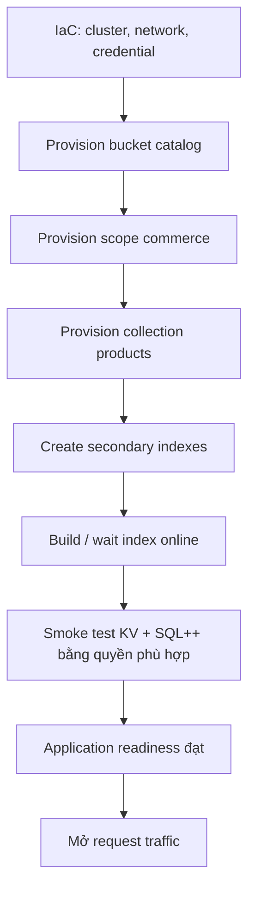
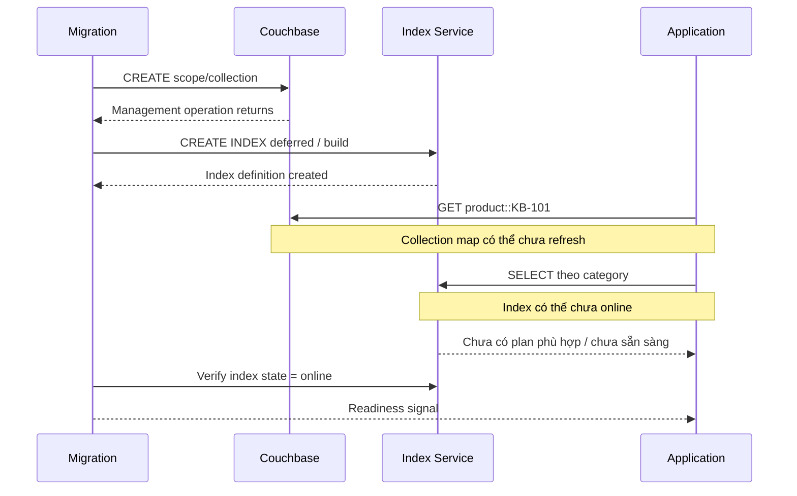

# Không tìm thấy bucket, scope, collection hoặc chỉ mục trong Spring Data Couchbase

> **Mục tiêu:** Phân biệt lỗi không tìm thấy **bucket**, **scope**, **collection** và **SQL++ index** với lỗi document không tồn tại; nhận biết ngoại lệ Couchbase Java SDK, khác biệt giữa KV và Query Service, cấu hình Spring Data Repository/`CouchbaseTemplate`, trạng thái index và quyền RBAC; chẩn đoán lỗi khi triển khai, migration, multi-tenant và API reactive; xây dựng readiness, observability và kiểm thử tích hợp thay vì tự động tạo tài nguyên giữa request.

Trong module **SPRING_DATA_COUCHBASE**, document được ánh xạ sang Java entity và truy cập bằng Repository, `CouchbaseTemplate`, Java SDK hoặc SQL++ (tên cũ: N1QL). Hệ thống dùng **bucket/scope/collection** để tổ chức document; **secondary index** để tìm theo field JSON; metadata CAS để kiểm soát ghi đồng thời; TTL để quản lý thời gian sống; transaction khi cần nhất quán nhiều document; và API reactive cho luồng bất đồng bộ.

**Tình huống:** Ứng dụng chạy tốt trong môi trường phát triển, nhưng sau deploy có lỗi `CollectionNotFoundException` ở `findById` và một trang khác báo “no index available for keyspace”. Cả hai đều liên quan tài nguyên Couchbase, nhưng **không cùng nguyên nhân, không cùng thao tác sửa và không nhất thiết xuất hiện ở cùng dịch vụ**.

Điểm cần ghi nhớ ngay từ đầu:

- **Bucket** là đơn vị chứa dữ liệu và tài nguyên cấp cao nhất trong namespace minh họa.
- **Scope** nhóm nhiều collection bên trong bucket.
- **Collection** chứa document key/value; key chỉ duy nhất **trong collection**, không phải toàn cluster.
- **Index** là cấu trúc hỗ trợ truy vấn SQL++/Query Service; **không phải điều kiện bắt buộc cho KV `get(id)`**, và trong những phiên bản Couchbase Server mới, Query Service có thể sử dụng *sequential scan* nếu được hỗ trợ/cấp quyền.
- Không thấy **document** trong collection có thật khác việc **collection không tồn tại**.

## 1. Sơ đồ phân cấp và tên tài nguyên

```text
Cluster
└── Bucket: catalog
    ├── Scope: commerce
    │   ├── Collection: products
    │   │   ├── Document: product::KB-101
    │   │   └── Document: product::MS-202
    │   └── Collection: orders
    │       └── Document: order::O-101
    ├── Scope: archive
    │   └── Collection: products
    │       └── Document: product::KB-101
    └── Scope: _default
        └── Collection: _default
```

Trong môi trường lab, ứng dụng dự kiến lưu `Product` tại:

| Thành phần | Giá trị | Dùng ở đâu? |
| --- | --- | --- |
| Bucket | `catalog` | Cấu hình kết nối Spring Data và `cluster.bucket(...)` |
| Scope | `commerce` | `@Scope("commerce")` và SDK `scope(...)` |
| Collection | `products` | `@Collection("products")` và SDK `collection(...)` |
| Document ID | `product::KB-101` | `@Id` / KV `get(id)` |
| Type alias | `catalog-product` | `@TypeAlias` và discriminator khi mapping |
| Index ví dụ | `idx_product_tenant_type_category` | SQL++ Query/Index Service |

**Cùng một document ID trong hai collection khác nhau là hai document khác nhau.** Nếu Product có ID `product::KB-101` trong `catalog.commerce.products`, việc đọc `catalog.archive.products` bằng ID đó không chứng minh object của scope commerce đã bị xóa hoặc đổi CAS.

### JSON document minh họa

Document key (metadata): `product::KB-101`.

```json
{
  "_class": "catalog-product",
  "sku": "KB-101",
  "name": "Bàn phím cơ TKL",
  "category": "keyboard",
  "price": 1450000,
  "active": true,
  "tenantId": "shop-a"
}
```

Trường `_class` ở đây là **giả định của mapping minh họa**; Spring Data có thể lưu type key/alias khác theo cấu hình. Document ID, CAS và expiry/TTL là metadata do Couchbase quản lý, không bắt buộc có trường JSON tương ứng.

### Câu SQL++ dùng keyspace ba cấp

```sql
SELECT META(p).id AS documentId,
       p.sku AS sku,
       p.price AS price
FROM `catalog`.`commerce`.`products` AS p
WHERE p.tenantId = "shop-a"
  AND p.category = "keyboard";
```

Đường dẫn `catalog`.`commerce`.`products` xác định **bucket.scope.collection**. Backtick dùng để quote định danh; các chuỗi `"shop-a"`/`"keyboard"` trong ví dụ là literal. Trong Java ứng dụng, nên **binding giá trị** thay vì nối input từ HTTP vào query.

**Không dùng tên collection do client tự chọn** như `GET /products?collection=private_docs` để xây `FROM`. Query parameters thay thế **giá trị**, không thay định danh; việc chọn keyspace phải đến từ mapping/cấu hình có whitelist và quyền truy cập.

## 2. Triệu chứng thuộc bucket, scope, collection hay index?

| Triệu chứng | Thành phần cần kiểm tra trước | Không nên vội kết luận |
| --- | --- | --- |
| `BucketNotFoundException` khi truy cập bucket | Bucket name, provision, cluster, trạng thái bucket | “Document đã bị xóa” |
| KV `CollectionNotFoundException` | Scope + collection trong **đúng bucket** | “Không có document key” |
| Management API `ScopeNotFoundException` | Tên scope trong thao tác quản trị | “Mọi KV scope-missing đều ném class này” |
| Query báo keyspace không tồn tại | SQL++ `FROM`, query context, bucket/scope/collection, quyền | “Không có index” |
| `IndexNotFoundException` | Index name, collection đích, trạng thái và thao tác query/index | “Bucket đã mất” |
| “No index available” / planner error | Index phù hợp, bản Server, sequential scan/RBAC | “Chắc chắn collection không tồn tại” |
| Query chậm nhưng không báo lỗi | Scan lớn, index không tối ưu, `LIKE`, dữ liệu | “Query đã chọn đúng index” |
| `findById` trả `Optional.empty()` | Document key, đúng collection, TTL | “Collection chắc chắn đã bị drop” |
| Query `SELECT` trả 0 rows | `WHERE`, discriminator, index freshness, query context | “Query Service không có index” |
| SDK không kết nối được/timeout | Cluster, credential, mạng, service readiness | “Thiếu collection” |

### Cùng một tên lỗi, các API có thể xử lý khác nhau

Couchbase Java SDK có các ngoại lệ gốc thuộc package `com.couchbase.client.core.error` như `BucketNotFoundException`, `CollectionNotFoundException`, `ScopeNotFoundException` và `IndexNotFoundException`. Theo phân loại lỗi của SDK, **`ScopeNotFoundException` đặc biệt gắn với API quản trị scope**, còn KV truy cập scope không có thường thể hiện là **`CollectionNotFoundException`** (scope và collection không tồn tại được gộp ở thao tác KV).

Khi đi qua **Spring Data Couchbase Repository/Template**, ngoại lệ có thể được dịch sang nhóm `org.springframework.dao.DataAccessException` hoặc được bọc, tùy thao tác và phiên bản. **Không giả định mọi subclass SDK luôn được ánh xạ sang một subclass Spring cố định.**

## 3. Vì sao lỗi không xuất hiện ngay khi tạo SDK handle?

Java SDK cho phép lấy handle đại diện tài nguyên:

```java
import com.couchbase.client.java.Cluster;
import com.couchbase.client.java.Bucket;
import com.couchbase.client.java.Scope;
import com.couchbase.client.java.Collection;

Bucket bucket = cluster.bucket("catalog");
Scope scope = bucket.scope("commerce");
Collection collection = scope.collection("products");
```

**Việc có một object `Bucket/Scope/Collection` trong Java không chứng minh tài nguyên thực đã tồn tại hoặc đang sẵn sàng.** Nhiều bước chỉ tạo/nhận handle trong SDK; lỗi có thể xuất hiện **khi thao tác KV/Query/management thực sự được gửi**. Thời điểm thất bại còn phụ thuộc SDK/bootstrap, caching và trạng thái cluster.

Đối chiếu:

```java
// Đây là thao tác KV thật trên keyspace đích.
var result = collection.get("product::KB-101");
```

Nếu scope/collection bị đặt sai, có thể nhận `CollectionNotFoundException`. Nếu scope/collection tồn tại nhưng không có document key `product::KB-101`, có thể nhận `DocumentNotFoundException`. Đây là **hai tầng vắng mặt hoàn toàn khác nhau**.

### Sai kỳ vọng khi dùng `exists(id)`

```java
boolean exists = collection.exists("product::UNKNOWN").exists();
```

Kết quả `false` chỉ mang ý nghĩa của **document ID** trong một keyspace có thể truy cập được. Không dùng `exists(id)` để kiểm tra bucket/scope/collection “đã provision xong” hay “đủ quyền” một cách tổng quát. Khi keyspace sai, SDK có thể phát exception thay vì trả false.

**Quy trình đúng:** kiểm tra resource metadata/provision ở giai đoạn deployment hoặc readiness theo quyền cho phép; kiểm tra document ID ở nơi nghiệp vụ thật sự cần biết document có tồn tại hay không.

## 4. Bucket không tồn tại hoặc không sẵn sàng

Một ứng dụng dự định truy cập bucket `catalog` nhưng cấu hình thành `catalog-dev`, hoặc deploy tới cluster chưa provision `catalog`. Khi SDK thực hiện thao tác dựa trên bucket không có, nó có thể phát `BucketNotFoundException`. Tuy nhiên, trong giai đoạn bootstrap, đợi readiness hoặc kết nối, ứng dụng cũng có thể nhận **timeout, cancellation hoặc lỗi hạ tầng** trước khi nhận được kết luận “bucket không tồn tại” rõ ràng.

### Các nguyên nhân chính

| Nguyên nhân | Biểu hiện | Cách xác minh |
| --- | --- | --- |
| Typo/case của bucket name | Dev OK, staging/prod lỗi | Đối chiếu cấu hình với bucket thật |
| Nhầm cluster | Bucket có ở cluster A nhưng ứng dụng kết nối cluster B | Kiểm tra endpoint/TLS, environment, deployment |
| Chưa provision tài nguyên | Triển khai application trước migration IaC | Xem trạng thái rollout/provision |
| Bucket đã bị drop/đổi tên | Ứng dụng đang chạy bỗng lỗi trên nhiều operation | Audit thao tác quản trị, sự kiện cluster |
| Bucket đang khởi tạo/tái cân bằng | Readiness/timeout tạm thời | Kiểm tra bucket health, node, thời gian bootstrap |
| Credential/RBAC không đủ | Auth/permission failure | Kiểm tra tài khoản ứng dụng và role đúng phạm vi |
| Cấu hình network/DNS/TLS sai | Connect/bootstrap timeout | Kiểm tra đường mạng/endpoint, không tự tạo bucket |

### Spring Boot cấu hình bucket

Ví dụ `application.yml` minh họa:

```yaml
spring:
  couchbase:
    connection-string: ${COUCHBASE_CONNECTION_STRING}
    username: ${COUCHBASE_USERNAME}
    password: ${COUCHBASE_PASSWORD}
  data:
    couchbase:
      bucket-name: catalog
```

Đây là cấu hình kiểu Spring Boot phù hợp với nhiều phiên bản hiện đại; hãy đối chiếu property names và cấu hình thực của **Spring Boot/Spring Data Couchbase version dự án**. Không hardcode password trong repository hoặc log. Mặc dù IDE cho phép nhiều profile, cần kiểm tra profile/biến môi trường **đang được chạy thật**, không chỉ file mặc định.

Nếu class cấu hình tự kế thừa `AbstractCouchbaseConfiguration`, có thể có phương thức trả bucket name riêng. Đừng mặc định `application.yml` sẽ thắng cấu hình Java tùy biến; hãy đối chiếu mapping và bean đã được tạo trong runtime.

### Kiểm tra bucket bằng Java SDK

```java
import com.couchbase.client.java.Cluster;
import com.couchbase.client.java.Bucket;
import java.time.Duration;

Bucket catalog = cluster.bucket("catalog");
catalog.waitUntilReady(Duration.ofSeconds(10));
```

`waitUntilReady(...)` giúp chờ tài nguyên đạt điều kiện readiness trong **một khoảng có giới hạn**. Việc chờ không tự tạo bucket; khi thất bại, ngoại lệ có thể là timeout/SDK error tùy trạng thái, không luôn luôn `BucketNotFoundException`. Cũng không xem một lần readiness thành công là bằng chứng mọi SQL++ index đã `online`.

### Kiểm tra tồn tại bằng BucketManager

SDK có `cluster.buckets()` cung cấp API quản trị bucket. Ví dụ dùng cho **script vận hành/test**:

```java
import com.couchbase.client.java.manager.bucket.BucketManager;

BucketManager manager = cluster.buckets();
var settings = manager.getBucket("catalog");
System.out.println(settings.name());
```

Tài khoản thực hiện cần quyền quản trị/metadata thích hợp. Nếu thiếu quyền quản trị, không nên suy ra “bucket không tồn tại” chỉ vì không xem được metadata. Ứng dụng request thường chỉ cần quyền đọc/ghi đúng collection, không cần quyền quản lý bucket.

### Phương án khắc phục

1. Xác minh **cluster/environment đang kết nối** và tên bucket trong cấu hình runtime.
2. Xác minh bucket đã được provision bởi IaC/script migration theo deployment.
3. Xác minh bucket đã sẵn sàng và tài khoản ứng dụng có quyền cần thiết.
4. Kiểm tra startup logs, SDK ErrorContext, trace ID, timeout/retry reasons.
5. Nếu bucket thực sự chưa có, để **quy trình provision có quyền phù hợp** tạo tài nguyên; application request không tự tạo một bucket với thông số mặc định.

**Không tự gọi `createBucket(...)` khi bắt `BucketNotFoundException` trong endpoint GET/POST.** Bucket cần quota, replication, durability, eviction, TTL và phân quyền theo kiến trúc; tự tạo sai có thể làm hệ thống tưởng đã chữa lỗi nhưng lưu dữ liệu ở nơi không đúng.

## 5. Scope không tồn tại: management API khác KV

Scope `commerce` là namespace trung gian giữa `catalog` và collection `products`. Khi scope thiếu, các API Couchbase có thể báo lỗi khác nhau:

| Đường truy cập | Tình huống | Lỗi có thể thấy |
| --- | --- | --- |
| API quản trị scope | Tác vụ nhắm tới scope không tồn tại | `ScopeNotFoundException` |
| KV `bucket.scope("commerce").collection("products").get(id)` | Scope `commerce` hoặc collection `products` không có | Thường là `CollectionNotFoundException` |
| SQL++ `FROM catalog.commerce.products` | Scope/keyspace không có | Query failure về keyspace/namespace, không bảo đảm `ScopeNotFoundException` |
| Spring Data Repository có `@Scope("commerce")` | Mapping trỏ scope thiếu | Lỗi truy cập được SDK/Spring Data truyền/dịch, phụ thuộc đường gọi |

**Lý do quan trọng:** không nên chỉ catch `ScopeNotFoundException` quanh KV `collection.get` rồi tưởng đã xử lý tất cả lỗi thiếu scope. Tài liệu lỗi Java SDK phân loại `ScopeNotFoundException` cho **management API**, còn `CollectionNotFoundException` có thể đại diện cho cả tình huống scope hoặc collection không tìm thấy trong đường KV.

### Ví dụ sai scope khi deployment

Ứng dụng chuẩn:

```java
var products = cluster.bucket("catalog")
    .scope("commerce")
    .collection("products");
```

Nhưng một environment có scope tên `sales`, collection `products`. Nếu chỉ sửa `@Collection("products")` mà bỏ `@Scope` thì Repository vẫn không trỏ đúng tài nguyên. Phải thống nhất **mapping config và sơ đồ provision**.

### Kiểm tra bằng công cụ quản trị collection

SDK cung cấp `CollectionManager` từ `Bucket.collections()`:

```java
import com.couchbase.client.java.Bucket;
import com.couchbase.client.java.manager.collection.CollectionManager;

Bucket bucket = cluster.bucket("catalog");
CollectionManager collectionManager = bucket.collections();

var scopes = collectionManager.getAllScopes();
// Xem tên scope và collection theo API metadata của SDK version.
```

Ví dụ dùng trong **script/chẩn đoán có quyền**. Khi lấy metadata thất bại do RBAC, timeout hoặc bootstrap, không coi danh sách trống/exception là bằng chứng scope không tồn tại. Với ứng dụng sản phẩm, một dashboard/IaC state đã kiểm tra cũng là nguồn xác minh quan trọng.

### Khi scope bị xóa hoặc đổi tên

Một thao tác drop scope có thể ảnh hưởng **toàn bộ collection bên trong**. Đây là sự kiện vận hành nghiêm trọng, không phải lỗi domain “Product 404”. Cần:

- dừng/giảm write workload có nguy cơ đưa dữ liệu tới keyspace khác;
- xác minh backup, audit và migration/provision history;
- tránh tự tạo lại scope trống rồi coi dữ liệu cũ đã được phục hồi;
- phối hợp chủ sở hữu hạ tầng để recovery đúng dữ liệu.

**Scope mới cùng tên không đồng nghĩa dữ liệu cũ quay lại.** Việc tạo scope/collection trống có thể biến một sự cố mất dữ liệu thành lỗi khó nhận biết hơn.

## 6. Collection không tồn tại: lỗi KV phổ biến

Giả sử `catalog` và `commerce` đã có, nhưng collection `products` chưa được tạo. Đoạn SDK:

```java
import com.couchbase.client.core.error.CollectionNotFoundException;

var products = cluster.bucket("catalog")
    .scope("commerce")
    .collection("products");

try {
    var product = products.get("product::KB-101");
} catch (CollectionNotFoundException ex) {
    // Lỗi keyspace: scope/collection không tìm thấy.
    throw new ProductStorageConfigurationException(
        "Expected collection unavailable", ex
    );
}
```

`ProductStorageConfigurationException` là **exception ứng dụng tự định nghĩa**, không thuộc SDK. Khi tên/ID collection bị sai, SDK có thể ném `CollectionNotFoundException`. Ngược lại, nếu collection đúng và document ID không có, lỗi KV là `DocumentNotFoundException`; hai lỗi này **không cùng ý nghĩa**.

### Những nguyên nhân collection-missing

1. **Sai tên collection**, khác chữ hoa/thường hoặc ký tự đặc biệt.
2. **Sai scope**: collection đúng tên trong scope khác.
3. **Sai bucket**: collection đó có trong bucket ở environment khác.
4. **Chưa chạy migration/provision**: deploy app dùng collection mới trước khi tài nguyên được tạo.
5. **Drop/recreate**: thao tác quản trị xóa collection, cluster chưa phản ánh metadata mới.
6. **SDK đang dùng collection map cũ** trong một giai đoạn thay đổi metadata; có thể có propagation/refresh bất đồng bộ.
7. **Credential/role sai**, hoặc Query access khác KV access khiến đường truy cập cho kết quả khác nhau.

### So sánh thật rõ ba tình huống

```text
products là collection tồn tại:
  GET product::KB-101      -> có document
  GET product::UNKNOWN     -> DocumentNotFoundException

products là collection không tồn tại:
  GET product::KB-101      -> CollectionNotFoundException (có thể dù ID hợp lệ)

bucket catalog không tồn tại:
  request dùng bucket     -> BucketNotFoundException hoặc lỗi bootstrap/tài nguyên
```

**Không dùng một catch chung `CouchbaseException` rồi trả HTTP 404** cho cả ba. Một endpoint `GET /products/{id}` chỉ nên trả 404 domain khi *resource đang có thể truy cập* nhưng document ID xác nhận không có, theo policy authorization.

### Collection mặc định khác collection có tên

Couchbase có `_default` scope/collection. Một số code cũ dùng:

```java
var defaultCollection =
    cluster.bucket("catalog").defaultCollection();
```

Đường này trỏ `catalog._default._default`, **không phải** `catalog.commerce.products`. Nếu Product được lưu ở collection có tên `products`, `defaultCollection().get(id)` có thể báo document not found dù collection `products` có dữ liệu.

Một lỗi thường gặp khi migration từ mô hình bucket-level cũ sang scope/collection là **Repository truy cập collection mới nhưng raw SDK vẫn đọc collection mặc định**. Cần thống nhất mọi adapter.

### Collection management là hoạt động triển khai

SDK có API tạo collection:

```java
// Chạy trong migration/provisioner có quyền, sau khi scope đã có.
collectionManager.createCollection("commerce", "products");
```

Nếu collection đã tồn tại, thao tác quản trị có thể gặp `CollectionExistsException`; nếu scope không có, có thể gặp `ScopeNotFoundException`. API `createCollection(String scopeName, String collectionName)` của Java SDK mới còn giúp tránh sử dụng một số overload `CollectionSpec` đã được đánh dấu deprecated. Luôn đối chiếu version cụ thể khi triển khai.

**Đừng copy câu `createCollection` này vào catch của `repository.findById`.** Migration phải kiểm tra idempotency, quyền, TTL/maximum expiry, cơ chế backup/rollback và có thể đợi metadata phản ánh trước khi application mở traffic. Nếu một tài nguyên từng tồn tại rồi bị drop, việc tạo lại collection mới **không khôi phục document đã mất**.

## 7. Spring Data mapping: Repository đang đọc ở đâu?

Spring Data Couchbase định tuyến entity vào bucket/scope/collection theo **cấu hình mặc định** và **mapping metadata**. Đối với `Product`, ví dụ:

```java
import org.springframework.data.annotation.Id;
import org.springframework.data.annotation.TypeAlias;
import org.springframework.data.annotation.Version;
import org.springframework.data.couchbase.core.mapping.Document;
import org.springframework.data.couchbase.repository.Scope;
import org.springframework.data.couchbase.repository.Collection;

@Document
@TypeAlias("catalog-product")
@Scope("commerce")
@Collection("products")
public class Product {
    @Id
    private String id;

    @Version
    private long version;

    private String sku;
    private String category;
    private Long price;
    private String tenantId;

    public Product() {}
    // Getter/setter hoặc constructor hợp lệ cho mapping.
}
```

`@Document` đánh dấu entity Couchbase, `@TypeAlias` xác định alias type theo mapping, `@Scope` và `@Collection` chỉ rõ keyspace. Bucket `catalog` thuộc cấu hình Spring Data. Metadata `@Id` và `@Version` liên quan document key/CAS, không nhất thiết nằm trong JSON body.

Repository:

```java
import org.springframework.data.couchbase.repository.CouchbaseRepository;

public interface ProductRepository
        extends CouchbaseRepository<Product, String> {
}
```

### Bốn điểm dễ bị sai sau refactor

| Thay đổi | Rủi ro | Cần kiểm tra |
| --- | --- | --- |
| Đổi `spring.data.couchbase.bucket-name` | Repository trỏ bucket khác | Config runtime, IaC state |
| Đổi `@Scope("commerce")` thành `"sales"` | Scope mới chưa có hoặc đọc dữ liệu khác | Scope manifest, migration |
| Đổi `@Collection("products")` | Collection mới chưa provision | Namespace và quyền KV |
| Bỏ hai annotation | Có thể quay về default scope/collection theo config | Dữ liệu mới/legacy ở đâu? |

**Cần xác minh kết quả ánh xạ thực tế.** `CouchbaseTemplate` hoặc Repository có thể dùng cấu hình scope/collection tùy chọn ở cấp thao tác; ứng dụng cũng có thể có custom mapping và nhiều bucket/cluster. Không kết luận namespace chỉ từ một annotation khi dự án đã cấu hình đặc biệt.

### Một lỗi có thể đổi dạng theo đường truy cập

```java
// Spring Data:
var fromRepository = productRepository.findById("product::KB-101");

// SDK trực tiếp:
var fromSdk = cluster.bucket("catalog")
    .scope("commerce")
    .collection("products")
    .get("product::KB-101");
```

Nếu một adapter mặc định dùng `_default._default`, hai lệnh này **không còn tương đương**. Khi dùng SQL++ `@Query`, phép `FROM` được Spring Data tạo có thể phụ thuộc SpEL:

```java
import java.util.List;
import org.springframework.data.couchbase.repository.Query;
import org.springframework.data.repository.query.Param;

// Method khai báo trong ProductRepository.
@Query("#{#n1ql.selectEntity} WHERE #{#n1ql.filter} "
     + "AND tenantId = $tenantId "
     + "AND category = $category")
List<Product> findVisibleProducts(
    @Param("tenantId") String trustedTenantId,
    @Param("category") String category
);
```

`#{#n1ql.selectEntity}` tạo phần truy vấn theo entity/keyspace; `#{#n1ql.filter}` lọc type discriminator; `$tenantId` và `$category` là placeholder giá trị. **SpEL không làm cho collection tự xuất hiện.** Nếu keyspace mà mapper chỉ tới không tồn tại, query sẽ báo lỗi thay vì tạo collection.

### Lỗi mapping không phải keyspace missing

Ngay cả khi bucket/scope/collection đều có, `@Query` có thể trả 0 hàng do discriminator `_class` hoặc tenant không khớp. Tương tự, JSON có field không tương thích với Java entity có thể khiến converter lỗi **sau khi Query Service trả row**. Đừng “sửa” các trường hợp đó bằng tạo collection/index mới.

## 8. Query Service: không tìm thấy keyspace

SQL++ dùng Query Service, khác với đường KV theo document ID. Với đường dẫn đầy đủ:

```sql
SELECT META(p).id AS documentId, p.sku
FROM `catalog`.`commerce`.`products` AS p
WHERE p.category = "keyboard";
```

Nếu bucket/scope/collection trong `FROM` sai, Query Service có thể trả lỗi về **keyspace/namespace chưa tồn tại**. Lỗi SDK nhìn thấy có thể thuộc các nhóm Query failure/`ParsingFailureException`, `CouchbaseException` hoặc subclass khác tùy mã lỗi và phiên bản. **Không khẳng định `CollectionNotFoundException` luôn là class của lỗi SQL++ keyspace không tồn tại**; class này được tài liệu SDK mô tả rõ ở đường request KV.

### Query context và đường dẫn rút gọn

Trong Query Workbench hoặc SDK, một query context có thể cho phép dùng:

```sql
SELECT p.sku
FROM `products` AS p;
```

Nhưng câu lệnh `FROM` với tên keyspace `products` chỉ đúng khi query context trỏ đến scope mong muốn, ví dụ `catalog.commerce`. Nếu context trỏ `catalog.archive`, câu lệnh có thể:

- trả dữ liệu của collection `archive.products`, không phải `commerce.products`;
- báo keyspace không tồn tại nếu context đó không có `products`;
- trả 0 hàng vì tài liệu/điều kiện ở keyspace khác.

Để chẩn đoán, **ưu tiên ba cấp `bucket.scope.collection`** trong câu SQL++ thử nghiệm. Sau đó mới đối chiếu query context được cấu hình ở SDK/Workbench/`Scope.query(...)` và câu do Spring Data sinh thực sự.

### Sai keyspace khác Query trả 0 rows

```sql
-- Collection đúng nhưng không có product loại "scanner":
SELECT p.sku
FROM `catalog`.`commerce`.`products` AS p
WHERE p.category = "scanner";
```

Kết quả 0 hàng là **kết quả dữ liệu hợp lệ**. Câu sai collection:

```sql
-- Chỉ minh họa lỗi: collection giả định không tồn tại.
SELECT p.sku
FROM `catalog`.`commerce`.`products_typo` AS p;
```

Lỗi keyspace xảy ra khi Query Service không thể resolve `products_typo`; không được catch nó rồi trả `List.of()` làm như danh mục không có sản phẩm. Nếu một collection thực sự đã có nhưng Query không được cấp quyền, lỗi có thể thuộc RBAC/access thay vì missing; phân tích bằng quyền thích hợp.

### Thao tác `EXPLAIN` phải giải quyết keyspace trước

```sql
EXPLAIN
SELECT p.sku
FROM `catalog`.`commerce`.`products` AS p
WHERE p.category = "keyboard";
```

`EXPLAIN` giúp quan sát kế hoạch và index/scan khi keyspace có thể được truy vấn. Nếu `FROM` sai, chưa đến giai đoạn tối ưu index hữu ích. **Thứ tự chẩn đoán: cluster → bucket → scope → collection → quyền → plan/index → filter/result mapping.**

## 9. Chỉ mục SQL++ không tồn tại: ba trường hợp khác nhau

**Index** hỗ trợ Query Service tìm document theo field JSON. Nó không phải một collection chứa document, và không bắt buộc với KV operations:

```java
// Theo document key; không yêu cầu secondary query index.
var product = products.get("product::KB-101");
```

Truy vấn theo thuộc tính:

```sql
SELECT p.sku, p.price
FROM `catalog`.`commerce`.`products` AS p
WHERE p.tenantId = "shop-a"
  AND p.category = "keyboard";
```

có thể cần **index phù hợp** để vận hành hiệu quả.

| Trường hợp | Dấu hiệu | Cách điều tra |
| --- | --- | --- |
| Index được gọi đích danh nhưng không tồn tại | `IndexNotFoundException` hoặc Query error tương ứng | Tên index, keyspace đích, `USE INDEX`, migration |
| Không có index **phù hợp** để Query planner chọn | “No index available”, planner error hoặc scan fallback | `EXPLAIN`, cấu trúc index, version/RBAC |
| Index có definition nhưng **chưa online** | `deferred`, `building`, `pending`, `offline` ... | `system:indexes`, Index Service, job build |

**Không có index chưa chắc luôn gây lỗi.** Từ **Couchbase Server 7.6**, Query Service có thể chạy một số truy vấn không có primary/secondary index bằng **sequential scan** (dùng KV range scan), tùy hỗ trợ, loại bucket và quyền `Query Use Sequential Scans`. Sequential scan **không hỗ trợ ephemeral buckets**, thường đắt hơn index scan ở tập dữ liệu lớn và không nên được xem là giải pháp performance mặc định.

Điều này giải thích vì sao cùng một `SELECT` trên hai cluster có thể khác hành vi: một cluster báo thiếu index, cluster khác chạy được nhưng chậm. **Cần xác minh Couchbase Server version, loại bucket và quyền trước khi kết luận.**

### Index không có nghĩa dữ liệu không có

Một số index chỉ index những document khớp điều kiện hoặc những field nhất định. Ví dụ **partial index** có điều kiện type/tenant khác với query đang chạy có thể không được planner chọn. Việc planner không chọn index không đồng nghĩa các document không tồn tại trong collection.

Ngược lại, primary index có thể cho phép query rộng nhưng dẫn tới scan lớn. **Không tạo primary index trên toàn bộ dữ liệu production chỉ để xóa lỗi tạm thời** nếu yêu cầu thực tế cần secondary index chọn lọc.

### SQL++ `USE INDEX` có thể tham chiếu index đã đổi tên

```sql
-- Ví dụ phản diện nếu idx_products_old đã bị xóa.
SELECT p.sku
FROM `catalog`.`commerce`.`products` AS p
USE INDEX (idx_products_old)
WHERE p.category = "keyboard";
```

Nếu query cố ép một index cụ thể đã bị drop/đổi tên, hãy sửa **migration/query definition** hoặc bỏ hint nếu optimizer có index khác phù hợp. Không tự phát lệnh `CREATE INDEX` bằng credential của application request.

## 10. Xác minh index bằng `system:indexes` và `EXPLAIN`

Couchbase SQL++ có system catalog `system:indexes` chứa metadata như `name`, `state`, `index_key`, `condition`, `bucket_id`, `scope_id`, `keyspace_id` và `is_primary`.

### Liệt kê index của collection có tên

```sql
SELECT i.name,
       i.state,
       i.index_key,
       i.condition,
       i.is_primary,
       i.bucket_id,
       i.scope_id,
       i.keyspace_id
FROM system:indexes AS i
WHERE i.bucket_id = "catalog"
  AND i.scope_id = "commerce"
  AND i.keyspace_id = "products"
ORDER BY i.name;
```

**Lưu ý:** các trường `bucket_id`/`scope_id` xuất hiện theo loại keyspace và phiên bản. Với **default collection**, `keyspace_id` có thể chính là tên bucket, không có cùng bộ trường như collection có tên. Trong bài, `commerce.products` là collection có tên nên bộ lọc ba trường phù hợp. Nếu danh sách trống, cần xét **quyền xem system catalog**, tên keyspace, query context và việc index chưa được tạo; không coi danh sách trống là chứng cứ đầy đủ collection không tồn tại.

### Đọc trạng thái index

| `state` | Ý nghĩa vận hành |
| --- | --- |
| `online` | Index sẵn sàng phục vụ query theo metadata hệ thống |
| `deferred` | Definition đã tạo, chưa bắt đầu build |
| `building` | Đang xây index; chưa nên coi là online |
| `pending` | Đang chờ bước tiếp theo trong lifecycle |
| `offline` | Không phục vụ query bình thường |
| Các trạng thái khác | Phụ thuộc phiên bản, lifecycle/replicas; xem tài liệu chính thức |

Tại thời điểm kiểm tra, **definition tồn tại nhưng `state != online` không đồng nghĩa Query planner đã dùng được index**. Một số triển khai còn có replica index, rebalance và trạng thái chuyển đổi; kiểm tra index cụ thể đúng collection và tất cả replica cần thiết.

### Giải thích kế hoạch

```sql
EXPLAIN
SELECT p.sku, p.price
FROM `catalog`.`commerce`.`products` AS p
WHERE p.tenantId = "shop-a"
  AND p.category = "keyboard"
  AND p.active = true
ORDER BY p.price ASC;
```

Trong plan, tìm toán tử scan và tên index được chọn. Một index `online` nhưng không có trong `EXPLAIN` chưa chắc là lỗi: optimizer có thể chọn index khác có cost tốt hơn, hoặc index không phù hợp predicate/order/partial-index condition.

Nếu `EXPLAIN` cho thấy `#sequentialscan` hoặc `using: "sequentialscan"`, Query Service đang sử dụng sequential scan fallback trên phiên bản hỗ trợ, **không phải một index thật tên `#sequentialscan`**. Nó có thể tạo latency lớn với collection đông document.

### So sánh metadata, query và index readiness

Một checklist hữu ích:

1. `SELECT ... FROM catalog.commerce.products` có resolve đúng keyspace không?
2. `system:indexes` có index đúng `bucket_id/scope_id/keyspace_id` không?
3. Index có `state = "online"` không?
4. Predicate `WHERE`/type discriminator có phù hợp với `index_key`/`condition` không?
5. `EXPLAIN` có chọn index đó hay scan fallback không?
6. Quyền của **application user** có cho chạy Query/Index Scan/Sequential Scan phù hợp không?
7. Latency và số document scanned có phù hợp SLA không?

## 11. Tạo và xây index đúng collection

Giả sử API tìm Product active của một tenant theo category và sort giá. Index ứng viên:

```sql
CREATE INDEX idx_products_tenant_type_category_price
ON `catalog`.`commerce`.`products`(
  tenantId,
  _class,
  category,
  active,
  price
);
```

Tên index là **một lựa chọn minh họa**. Cấu trúc tối ưu phụ thuộc cardinality, thứ tự predicate, sort, projection và workload. Khi Spring Data `@Query` dùng `#{#n1ql.filter}`, index phải tính đến **discriminator thực sự** do converter đã lưu; ví dụ giả định type key `_class`.

### Không tạo nhầm index ở default collection

Đoạn SQL++:

```sql
CREATE INDEX idx_category
ON `catalog`(category);
```

không tương đương:

```sql
CREATE INDEX idx_category
ON `catalog`.`commerce`.`products`(category);
```

Trong ngữ cảnh kiểu bucket legacy/default scope, câu đầu có thể tạo index ở **default collection**, không phục vụ query trên named collection `commerce.products`. Vì vậy với named collection, nên dùng đầy đủ ba cấp.

### Tạo index ở trạng thái deferred

Khi cần tạo nhiều index cùng lúc, DBA có thể deferred build:

```sql
CREATE INDEX idx_products_tenant_category
ON `catalog`.`commerce`.`products`(tenantId, category)
WITH {"defer_build": true};
```

Rồi build:

```sql
BUILD INDEX ON `catalog`.`commerce`.`products`(
  idx_products_tenant_category
) USING GSI;
```

Sau `BUILD INDEX`, cần kiểm tra `system:indexes.state` về `online`. **Không dùng `Thread.sleep(1000)` làm bằng chứng index đã sẵn sàng**; thời gian build phụ thuộc kích thước dataset, tải Index Service và trạng thái cluster.

### Index do SDK quản lý

Java SDK hiện đại có `Collection.queryIndexes()` để quản lý index **trực tiếp trên collection đã chọn**:

```java
import com.couchbase.client.java.manager.query.CollectionQueryIndexManager;
import java.util.List;

CollectionQueryIndexManager manager = cluster.bucket("catalog")
    .scope("commerce")
    .collection("products")
    .queryIndexes();

manager.createIndex(
    "idx_products_tenant_category",
    List.of("tenantId", "category")
);
```

Java SDK cũng có `cluster.queryIndexes()` / `QueryIndexManager` cho quản lý theo bucket. Với API kiểu bucket-level, **named collection cần cả `scopeName` và `collectionName` trong options**; nếu bỏ, một số overload mặc định trỏ default collection. Các setter ấy đã được đánh dấu deprecated trong Java SDK mới để khuyến nghị dùng `collection.queryIndexes()`.

Đây là **mẫu API quản trị**, chỉ chạy trong migration/provisioner có quyền, không trong handler của từng request. Khi dùng SDK version cụ thể, kiểm tra method/options qua JavaDoc tương ứng. Index management thường yêu cầu role `Query Manage Index`, không nên cấp cho tài khoản chỉ phục vụ truy vấn ứng dụng.

### Khi index bị drop trong lúc traffic đang chạy

Không tạo lại ngay mà không kiểm soát vì có thể:

- bỏ qua sự cố vận hành hoặc deployment drift;
- gây thêm tải build lên cluster đang có lỗi;
- không phục hồi kịp SLA cho query;
- tạo index sai bucket/scope/collection;
- gây conflict với migration đang tiến hành.

Thay vào đó cần rollback/restore index theo **kế hoạch deployment**, xác minh online, cập nhật readiness, giám sát Query Service rồi mới khôi phục traffic.

## 12. “Không có index” không đồng nghĩa “index không mới”

**Thiếu index** ảnh hưởng khả năng lập kế hoạch/truy cập dữ liệu; **index freshness** ảnh hưởng Query Service có nhìn thấy mutation mới nhất hay không.

Giả sử service:

```java
productRepository.save(product); // KV mutation.
var latest = productRepository.findById(product.getId());
// findById theo ID thường dùng KV.
```

và sau đó chạy `@Query` theo category. Với scan consistency `NOT_BOUNDED`, query có thể chưa thấy một số thay đổi mới do Index Service cập nhật bất đồng bộ, **dù index đã `online`**. `REQUEST_PLUS` có thể yêu cầu đợi chỉ mục bắt kịp những thay đổi trước thời điểm truy vấn, đổi lại thêm latency.

| Vấn đề | Cơ chế cần xem | Không phải giải pháp |
| --- | --- | --- |
| Collection không tồn tại | Provision/keyspace metadata | `REQUEST_PLUS` |
| Index chưa được tạo | Migration/index DDL | Retry `SELECT` không giới hạn |
| Index `deferred`/`building` | Build lifecycle/readiness | Tăng giá trị `LIMIT` |
| Index có nhưng query vừa ghi chưa thấy | Scan consistency, index propagation | Drop/recreate collection |
| CAS stale khi hai writer cùng sửa | `@Version` / KV CAS | Tạo secondary index |
| TTL làm document biến mất | Expiry settings, lifecycle | Tăng query timeout |

**Cần phân biệt dữ liệu không có** với **dữ liệu chưa được index phản ánh** và **query dùng nhầm keyspace**. Ba trường hợp có thể đều tạo danh sách rỗng ở UI nếu ứng dụng sai lầm nuốt mọi lỗi thành `[]`.

## 13. RBAC: quyền thiếu không phải tài nguyên thiếu

Couchbase hỗ trợ **Role-Based Access Control** ở các dịch vụ và keyspace. Tài khoản dùng cho request thường không có quyền quản lý bucket, scope, collection hoặc index — và điều đó có thể là **thiết kế bảo mật đúng**.

| Nhiệm vụ | Nhóm quyền cần đánh giá | Ghi chú |
| --- | --- | --- |
| Đọc KV theo ID | Quyền Data Reader trên keyspace | Không cần Query index chỉ để `get(id)` |
| Ghi KV | Quyền Data Writer phù hợp | Có thể cần quyền/constraint khác theo thao tác |
| Chạy SQL++ SELECT | Query Select và quyền liên quan tài nguyên/plan | Không giống KV read |
| Sử dụng sequential scan | Query Use Sequential Scans | Cần thiết khi áp dụng fallback không index |
| Tạo/drop index | Query Manage Index | Dành cho provisioner/DBA, không dành cho endpoint thường |
| Tạo/drop collection/scope | Quyền quản trị collection | Không cấp cho user request chỉ để “tự chữa lỗi” |
| Tạo/drop bucket | Quyền quản trị bucket | Có thể ảnh hưởng quota/data và availability |

Quyền cụ thể còn phụ thuộc Couchbase Server/Capella edition và chính sách deployment. Tài liệu SDK/Server định nghĩa các role chi tiết; không suy ra quyền chỉ từ tên class Java.

### Vì sao SQL++ thất bại còn KV thành công?

Ứng dụng có thể có quyền `Data Reader` qua KV nhưng **thiếu Query Select** trên collection `products`. Khi đó:

```java
products.get("product::KB-101");
```

có thể thành công, nhưng:

```sql
SELECT p.sku
FROM `catalog`.`commerce`.`products` AS p
WHERE p.category = "keyboard";
```

có thể gặp Query authorization error. Đó không nhất thiết là collection/index không tồn tại.

### Vì sao script admin nhìn thấy index còn application không query được?

Script quản trị có thể xem `system:indexes` và tạo DDL, nhưng tài khoản ứng dụng không có quyền Query Select hoặc thiếu quyền dùng sequential scan. Cần thử bằng **application principal có quyền thực tế**, thay vì chỉ kiểm tra qua tài khoản Administrator.

### Không xem `AuthenticationFailureException` là HTTP 401 của caller

Nếu Java SDK báo lỗi xác thực giữa **service account** và Couchbase, đó thường là sự cố credential/config/RBAC của **backend**. Không trả ngay `401 Unauthorized` cho người dùng HTTP như thể họ nhập sai mật khẩu sản phẩm; điều tra credential quản trị secret, scope role, rotation và endpoint.

### Phân quyền tenant là mối quan tâm riêng

Ngay cả khi user có quyền đọc collection chung, **quyền xem từng Product của tenant** vẫn do thiết kế ứng dụng thực hiện. Điều kiện `tenantId = $trustedTenantId` trong SQL++ hoặc kiểm tra sau KV `get(id)` phải được kết hợp với authentication/authorization.

**Index và type discriminator không phải security boundary.** Bỏ `#n1ql.filter` để “query chạy được” có thể đọc document kiểu khác; bỏ tenant filter để “không có kết quả” có thể lộ dữ liệu tenant khác.

## 14. Phân loại ngoại lệ ở Java SDK và Spring Data

SDK exception gốc có thể được đưa vào adapter để phân nhóm. Spring Data Repository/Template có thể dịch một số lỗi sang họ `DataAccessException`, nên **cần quan sát class thật ở ranh giới đang sử dụng**.

| Exception hoặc nhóm lỗi | Ý nghĩa thông thường | Hành động không nên làm |
| --- | --- | --- |
| `BucketNotFoundException` | Bucket đích không có ở thời điểm request | Tự tạo bucket trong controller |
| `CollectionNotFoundException` | KV không resolve scope/collection | Trả HTTP 404 như Product key thiếu |
| `ScopeNotFoundException` | Management API nhắm scope thiếu | Dùng làm catch duy nhất cho KV |
| `IndexNotFoundException` | Query/Index API không tìm index được tham chiếu | Tạo primary index vô điều kiện |
| Query planner failure | Không có plan/index phù hợp | Giả sử bucket bị mất |
| `DocumentNotFoundException` | KV key thiếu trong collection có thể truy cập | Sửa cấu hình index khi chỉ thiếu ID |
| `AuthenticationFailureException` | Credential/RBAC/service authorization | Chuyển thành HTTP 401 của user |
| `UnambiguousTimeoutException` | SDK xác định request không hoàn tất thành công | Retry vô hạn trên deployment lỗi |
| `AmbiguousTimeoutException` | Mutation có thể đã xảy ra | Khẳng định “chưa ghi” rồi retry |
| `DataAccessException` của Spring | Một nhóm lỗi data access được dịch | Cho rằng mọi subclass SDK đều được dịch như nhau |

**Thứ tự catch:** subclass cụ thể trước lớp cha `CouchbaseException`. Với các API quản trị khác nhau, một SDK exception có thể được bọc trong một lỗi khác theo call path; khi log, giữ `cause` nội bộ để điều tra.

### Adapter ví dụ phân biệt lỗi KV

```java
import com.couchbase.client.java.Collection;
import com.couchbase.client.core.error.BucketNotFoundException;
import com.couchbase.client.core.error.CollectionNotFoundException;
import com.couchbase.client.core.error.DocumentNotFoundException;
import com.couchbase.client.core.error.CouchbaseException;
import com.couchbase.client.java.json.JsonObject;

public class ProductKvGateway {
    private final Collection products;

    public ProductKvGateway(Collection products) {
        this.products = products;
    }

    public JsonObject getRequired(String documentId) {
        try {
            return products.get(documentId).contentAsObject();
        } catch (DocumentNotFoundException ex) {
            throw new ProductNotFoundException(ex);
        } catch (CollectionNotFoundException | BucketNotFoundException ex) {
            throw new ProductResourceUnavailableException(ex);
        } catch (CouchbaseException ex) {
            throw new ProductStorageException(ex);
        }
    }
}
```

`ProductNotFoundException`, `ProductResourceUnavailableException` và `ProductStorageException` là **exception domain/application cần tự định nghĩa**, ví dụ constructor nhận `Throwable` và đặt message public. Mã là khung phân loại; trong ứng dụng thật, chỉ dùng thông điệp cố định cho response, giữ cause/log/tracing và kiểm tra quyền tenant trước khi trả object.

### Các domain exception để dùng trong ví dụ

```java
// Mỗi public class dưới đây phải nằm trong file Java riêng.
public class ProductNotFoundException extends RuntimeException {
    public ProductNotFoundException() {
        super("Product not found");
    }
    public ProductNotFoundException(Throwable cause) {
        super("Product not found", cause);
    }
}

public class ProductResourceUnavailableException
        extends RuntimeException {
    public ProductResourceUnavailableException(Throwable cause) {
        super("Product keyspace unavailable", cause);
    }
}

public class ProductStorageConfigurationException
        extends RuntimeException {
    public ProductStorageConfigurationException(
            String message, Throwable cause) {
        super(message, cause);
    }
}

public class ProductStorageException extends RuntimeException {
    public ProductStorageException(Throwable cause) {
        super("Product storage request failed", cause);
    }
}
```

Các class này là **thiết kế của ứng dụng**, không phải ngoại lệ có sẵn của Spring Data. Trên thực tế, có thể gom chúng trong một mã lỗi domain có cấu trúc, nhưng phải phân biệt missing document với missing infrastructure và giữ `cause` cho kênh chẩn đoán nội bộ.

### Một mapping domain gợi ý

| Lỗi lớp dưới | Mã lỗi application | HTTP/response hướng tới |
| --- | --- | --- |
| Document key thiếu, caller có quyền xem | `PRODUCT_NOT_FOUND` | `404` |
| Bucket/scope/collection app cần không khả dụng | `PRODUCT_STORAGE_MISCONFIGURED` | `503` hoặc `500` tùy tính chất và API policy |
| Index quan trọng chưa online | `PRODUCT_SEARCH_UNAVAILABLE` | `503`, readiness chưa đạt |
| Credential ứng dụng sai | `BACKEND_AUTH_CONFIGURATION` | `5xx` nội bộ, không phải `401` user |
| Query thiếu quyền | `BACKEND_QUERY_PERMISSION` | `5xx` nội bộ nếu là misconfiguration |
| Input client sai `category` | `INVALID_PRODUCT_FILTER` | `400` |
| Caller không được xem tenant | `PRODUCT_ACCESS_DENIED` | `403` hoặc `404` theo policy không tiết lộ |

Các status là **gợi ý thiết kế**, không phải một quy tắc chuyển exception class → HTTP status bất biến. Một lỗi do code/schema không thể tự phục hồi có thể phù hợp `500` hơn `503`. **Không trả chi tiết keyspace, stack trace hoặc SDK ErrorContext nguyên văn cho caller.**

## 15. Readiness sau deployment: thứ tự provision quan trọng

Một lỗi phổ biến là ứng dụng mới khởi động **trước khi tạo scope, collection và index tương ứng**. Thời điểm rollout có thể có nhiều pod chạy phiên bản khác nhau; chạy DDL động ở mọi pod làm tăng cạnh tranh và che deployment drift.

Quy trình gợi ý:



### Cách kiểm tra tối thiểu theo use case

| Application feature | Readiness cần xác minh |
| --- | --- |
| Chỉ đọc KV theo document ID | Cluster/bucket/collection sẵn sàng, quyền KV |
| Repository tìm theo category bằng `@Query` | Các điều kiện trên **và** Query Service, index/scan path thích hợp |
| Import/batch ghi dữ liệu | Quyền writer, collection tồn tại, TTL/durability policy |
| Endpoint giao dịch nhiều document | Tính sẵn sàng của keyspace và transaction preconditions |
| Reactive search | Cùng các điều kiện về dữ liệu/index; chỉ khác publisher model |

**Lưu ý:** Health check chỉ làm **đọc** trên tài nguyên phù hợp; không dùng một lệnh `insert` thử nghiệm vào production mỗi vài giây mà không có cleanup/idempotency. Với keyspace chưa có document, health check cần dựa vào metadata/permission phù hợp thay vì “findById một ID bất kỳ phải thành công”.

### Readiness không đồng nghĩa liveness

- **Liveness:** tiến trình JVM vẫn còn khả năng phục vụ yêu cầu hoặc cần restart.
- **Readiness:** có nên nhận traffic đối với tính năng phụ thuộc Couchbase hiện tại không.
- **Startup/migration check:** cấu hình/provision đã hoàn tất hay chưa.

Nếu index của tính năng Product Search tạm chưa online, có thể làm **readiness của chức năng search** không đạt, thay vì luôn giết mọi pod đang xử lý các tính năng KV khác. Chính sách phụ thuộc kiến trúc và mức độ quan trọng của tính năng.

### Không chờ vô hạn

Một readiness probe chờ index online cần:

1. Thời gian tối đa rõ ràng.
2. Khoảng chờ/backoff hợp lý, không spam Query Service.
3. Log ngắn gọn về keyspace và index state, có trace/correlation ID.
4. Biện pháp cảnh báo khi quá deadline.
5. Cơ chế roll-forward/rollback deployment nếu tài nguyên không được tạo đúng.

Nếu chỉ dùng `Thread.sleep(5000)` cố định sau `CREATE INDEX`, đôi khi đủ trong lab nhưng không phải chứng minh index đã online trong production.

## 16. Reactive Repository và SDK: lỗi thuộc error signal

Trong ứng dụng Spring WebFlux, `ReactiveCouchbaseRepository` hoặc `ReactiveCouchbaseTemplate` trả `Mono`/`Flux`, còn SDK có `ReactiveCollection`. Không tìm thấy document ID và **không có collection** vẫn là hai tình huống khác nhau; reactive chỉ thay cách truyền kết quả/lỗi.

### Repository không thấy ID

```java
import reactor.core.publisher.Mono;
import org.springframework.data.couchbase.repository.ReactiveCouchbaseRepository;

public interface ReactiveProductRepository
        extends ReactiveCouchbaseRepository<Product, String> {
}

// Ở một class service có field reactiveProductRepository.
public Mono<Product> requireProduct(String id) {
    return reactiveProductRepository.findById(id)
        .switchIfEmpty(Mono.error(
            new ProductNotFoundException()
        ));
}
```

`findById` với ID không tồn tại thường tạo `Mono.empty()`. Nếu keyspace không tồn tại hoặc cluster không khả dụng, publisher phải **phát error signal**; không được biến thành empty một cách mù quáng.

### Phản diện: che mọi lỗi

```java
// Không làm: sẽ biến lỗi collection/index/timeout thành "không có Product".
return reactiveProductRepository.findById(id)
    .onErrorResume(ex -> Mono.empty());
```

Điều này khiến monitoring mất tín hiệu sự cố và API trả 404 giả. Dùng `switchIfEmpty` chỉ cho kết quả vắng mặt hợp lệ, `onErrorMap` cho những loại exception đã xác định, `doOnError` để logging có kiểm soát.

### Reactive SDK giữ lỗi collection của SDK

```java
import com.couchbase.client.java.ReactiveCollection;
import com.couchbase.client.core.error.CollectionNotFoundException;
import reactor.core.publisher.Mono;

public Mono<String> findSku(
        ReactiveCollection products, String id) {
    return products.get(id)
        .map(result -> result.contentAsObject().getString("sku"))
        .onErrorMap(
            CollectionNotFoundException.class,
            ex -> new ProductResourceUnavailableException(ex)
        );
}
```

`ReactiveCollection` là SDK API, không tự chạy qua Spring Data exception translator. Nếu document key thiếu, SDK có thể phát `DocumentNotFoundException`; đoạn này chỉ ánh xạ **collection-missing**, không biến cả hai thành cùng một error.

### Retry reactive có giới hạn

```java
import java.time.Duration;
import reactor.util.retry.Retry;

// Phù hợp cho nhánh đọc sau khi đã phân loại lỗi tạm thời.
return products.get(id)
    .retryWhen(
        Retry.backoff(2, Duration.ofMillis(100))
            .filter(ex -> isTransientReadFailure(ex))
    );
```

`isTransientReadFailure` là predicate do application định nghĩa: ví dụ dựa vào SDK error class/`RetryReason` đã xác minh, **không tự coi `CollectionNotFoundException` do cấu hình sai là lỗi transient**. Nếu thiếu collection do deployment chưa hoàn tất, hãy chờ qua readiness/migration, không cho mỗi request tự retry vô hạn.

Với mutation có `AmbiguousTimeoutException`, không áp dụng `retry()` vô điều kiện: có thể ghi đã thực thi nhưng response mất. Cần idempotency/reconciliation. Không gọi `block()` tùy tiện trong event loop WebFlux.

## 17. ErrorContext, logs và metrics

Ngoại lệ `CouchbaseException` từ SDK có thể đi kèm `ErrorContext`; context có thể `null`, các field thay đổi theo loại request và version. Khi bucket/scope/collection/index không sẵn sàng, context giúp phân biệt tên tài nguyên, endpoint, retry reason và dịch vụ liên quan.

### Logging tối thiểu an toàn

```java
import com.couchbase.client.core.error.CouchbaseException;
import com.couchbase.client.core.error.context.ErrorContext;
import org.slf4j.Logger;
import org.slf4j.LoggerFactory;

public final class CouchbaseResourceDiagnostics {
    private static final Logger log =
        LoggerFactory.getLogger(CouchbaseResourceDiagnostics.class);

    public static void record(
            String operation, CouchbaseException ex) {
        ErrorContext context = ex.context();
        String contextType = context == null
            ? "none" : context.getClass().getSimpleName();

        log.warn("couchbase_resource_failure operation={} type={} contextType={}",
            operation, ex.getClass().getSimpleName(), contextType);
    }
}
```

Không log `context.toString()` hoặc raw `ex.getMessage()` ở mọi request nếu chúng có thể chứa document IDs, endpoint nội bộ, SQL++ statements, thông tin auth hoặc dữ liệu nhạy cảm. Khi cần debug sâu, áp dụng quyền truy cập log, masking, retention và trace ID.

### Nhóm metric đề xuất

| Metric | Ý nghĩa |
| --- | --- |
| `couchbase_bucket_missing_total` | Sai bucket/provision theo deployment |
| `couchbase_collection_missing_total` | KV không resolve scope/collection |
| `couchbase_query_keyspace_error_total` | SQL++ keyspace/query context lỗi |
| `couchbase_index_missing_total` | Index được tham chiếu không có |
| `couchbase_index_not_online_count` | Index chưa phục vụ Query |
| `couchbase_sequential_scan_total` | Truy vấn fallback dùng sequential scan |
| `couchbase_auth_failure_total` | Lỗi credential/RBAC của application |
| `couchbase_kv_latency_ms` | Độ trễ KV, p95/p99 |
| `couchbase_sqlpp_latency_ms` | Độ trễ Query Service, p95/p99 |
| `couchbase_retry_total` | Tổng retry với lý do được phân loại |
| `couchbase_readiness_fail_total` | Số lần readiness không đạt |

Đây là **metric names do bài gợi ý**, không phải metric mặc định có sẵn ở SDK. Không đặt raw document ID, query literal, tenant ID hoặc exception message làm label vì cardinality cao và rủi ro lộ thông tin.

### Đặt trace context theo tác vụ, không theo người dùng

Ví dụ:

```text
operation       = product.searchByCategory
resource        = catalog/commerce/products
service         = Query
errorCategory   = INDEX_UNAVAILABLE
indexState      = deferred
traceId         = <correlation id>
deployment      = release-2026-11-25
requestOutcome  = failed_before_data_read
```

Đây là **log mẫu**, không phải schema bắt buộc của ErrorContext. Tên bucket/scope/collection thuộc cấu hình backend; chỉ công khai cho nhân sự có quyền xem. Một log không nên chứa toàn bộ sản phẩm hoặc chuỗi SQL++ có literal nhạy cảm.

## 18. Lỗi chỉ xuất hiện một thời gian ngắn sau migration

Một số bước provision có thể hoàn tất ở quản trị node trước khi SDK client hoặc Query Service nhìn thấy metadata mới một cách ổn định. Các tác vụ tạo collection/index còn có pha thực thi khác nhau:



### Có nên retry missing collection?

**Có điều kiện.** Nếu hệ thống có bằng chứng **migration vừa tạo collection** và metadata đang được propagate, SDK có cơ chế retry/refresh riêng. Có thể có thêm **bounded readiness polling** ở startup. Nhưng nếu cấu hình tên sai vĩnh viễn, retry 1000 lần chỉ làm lãng phí tài nguyên và che deployment bug.

**Không gọi API tạo scope/collection trong một vòng catch-retry** nếu không có quyền và quy trình migration rõ. Khi phát hiện collection bị drop ngoài ý muốn, ưu tiên incident response và kiểm tra backup trước khi cho application ghi tiếp.

### Có nên retry missing index?

Nếu index **đang `building`** sau migration được phê duyệt, readiness có thể chờ đến `online` trong deadline. Nếu index **không tồn tại** vì migration bị bỏ quên, retry `SELECT` không tự tạo index. Nếu Query Service có sequential scan fallback, API có thể “chạy được” nhưng với latency tăng; vẫn phải kiểm tra plan và cảnh báo.

### Tại sao không chỉ tăng SDK timeout?

Timeout chỉ thay thời gian đợi. Nó không sửa:

- sai `bucket-name` hoặc `@Scope`;
- thiếu quyền Query Select/Index;
- index `deferred` chưa chạy `BUILD INDEX`;
- query ép dùng index đã bị drop;
- collection bị drop và mất dữ liệu;
- schema mapper trỏ default collection thay named collection.

Chỉ điều chỉnh timeout khi đã đo latency và hiểu vì sao thao tác có thể hoàn tất trong budget mới; nếu không, tăng timeout có thể làm tăng hàng đợi.

## 19. Troubleshooting theo triệu chứng

| Triệu chứng production | Nguyên nhân thường gặp | Bước xác minh ưu tiên |
| --- | --- | --- |
| Toàn bộ repository trả lỗi sau deploy | Bucket/config/credential hoặc scope bị đổi | Runtime config, cluster ID, release diff |
| `BucketNotFoundException` | Tên bucket sai/chưa có | BucketManager/Web Console có quyền |
| `CollectionNotFoundException` | Scope/collection sai hoặc vừa thay metadata | `getAllScopes`, mapping, SDK retries |
| SDK KV get ID thiếu | `DocumentNotFoundException` | Kiểm tra TTL/key, không tạo index |
| `ScopeNotFoundException` khi tạo collection | Scope chưa được tạo | Provision order, scope name |
| `@Query` báo keyspace missing | `FROM`/query context sai | Dùng đường dẫn ba cấp |
| `@Query` không có hàng nhưng KV thấy | Type filter, tenant, index freshness | `#n1ql.filter`, `REQUEST_PLUS` khi phù hợp |
| `IndexNotFoundException` | Hint/index name không có | `system:indexes`, DDL migrations |
| Query “no index available” | Không có index thích hợp/fallback không khả dụng | Server version, scan RBAC, `EXPLAIN` |
| Query chạy nhưng latency tăng | Sequential scan hoặc index kém chọn lọc | `EXPLAIN`, p95/p99, index keys |
| Index state `deferred` | Chưa `BUILD INDEX` | DDL và migration status |
| Index state `building` lâu | Collection lớn hoặc Index Service quá tải | Index health, resources, wait budget |
| Index `online` nhưng query không chọn | Predicate/partial index/optimizer | `EXPLAIN` với query thực tế |
| Java SDK thao tác đúng nhưng Spring Data sai | Mapping scope/collection khác nhau | `@Scope`, `@Collection`, bucket config |
| Admin thấy tài nguyên, app báo auth | RBAC thiếu | Test bằng application account |
| Retry tăng và có timeout | Bootstrap/rebalance/saturation | ErrorContext, retryReasons, cluster health |
| Reactive API trả 404 thay vì 5xx | `onErrorResume(...Mono.empty())` quá rộng | Giữ error signal |
| Sau “sửa lỗi” ứng dụng không còn document | Đã tạo lại collection trống sau drop | Incident recovery, backup/audit |

### Thứ tự debug hiệu quả

1. **Đúng cluster?** Endpoint/TLS/credential/profile và môi trường chạy.
2. **Đúng bucket?** Tên, trạng thái, quyền, provisioning.
3. **Đúng scope/collection?** Kiểm tra metadata, annotation, default collection và SDK handle.
4. **Đúng quyền?** KV reader/writer, Query Select, index management, sequential scan.
5. **Đúng Query context?** `FROM` ba cấp, SpEL, type discriminator.
6. **Đúng index?** `system:indexes`, `state`, `EXPLAIN` và Server version.
7. **Đúng dữ liệu?** Document ID/TTL, predicate, index consistency, mapping.
8. **Đúng hành động?** Cấu hình, migration, readiness, recovery hoặc bugfix, có log và test.

Đừng đảo thứ tự bằng cách tạo primary index, tăng timeout hoặc xóa CAS trước khi chắc chắn đã xác minh tài nguyên và quyền.

## 20. Kế hoạch kiểm thử tích hợp cho keyspace và index

Unit tests chỉ kiểm tra logic chuyển exception hoặc điều kiện trong service; chúng **không chứng minh** resource thật đã tồn tại, mapping đúng hay index online. Với bài học này, cần integration tests trên **cluster/collection cách ly có quyền quản trị test**.

### Kiểm thử phân biệt missing document và missing collection

```java
import static org.junit.jupiter.api.Assertions.assertThrows;
import org.junit.jupiter.api.Test;
import com.couchbase.client.java.Collection;
import com.couchbase.client.core.error.DocumentNotFoundException;
import com.couchbase.client.core.error.CollectionNotFoundException;

class KeyspaceErrorIntegrationTest {
    private final Collection realProducts = /* fixture test collection */;
    private final Collection missingCollection = /* fixture wrong collection */;

    @Test
    void missingDocumentIsNotMissingCollection() {
        assertThrows(
            DocumentNotFoundException.class,
            () -> realProducts.get("test::never-created")
        );
    }

    @Test
    void nonexistentCollectionHasDifferentError() {
        assertThrows(
            CollectionNotFoundException.class,
            () -> missingCollection.get("test::some-id")
        );
    }
}
```

Đây là **khung test** chứ không phải một class copy chạy ngay: hai field fixture có comment placeholder, phải được khởi tạo bằng đúng Java SDK trên bucket/scope/collection của test. **Không tạo/drop collection trong test chạy song song trên production.** Nếu môi trường có metadata propagation/caching hoặc wrapper khác, cần xem exception thực tế và root cause thay vì bám máy móc một class trong mọi thời điểm.

### Kiểm thử Spring Data mapping sau provision

1. Provision test bucket/scope/collection bằng migration được cấp quyền.
2. Dùng Spring Data Repository lưu Product mẫu với `@Scope("commerce")`/`@Collection("products")`.
3. Kiểm tra SDK KV đọc cùng ID từ `catalog.commerce.products` và thấy JSON đúng.
4. Kiểm tra `catalog._default._default` **không bị ghi nhầm Product**.
5. Kiểm tra `@Query` với `#{#n1ql.selectEntity}`/`#{#n1ql.filter}` cùng query context.
6. Xác minh application user có quyền KV và Query như thiết kế; không chỉ test bằng admin.

### Kiểm thử index lifecycle

Trên fixture nhỏ:

1. Tạo index `WITH {"defer_build": true}`; quan sát `state = "deferred"` theo version.
2. Gọi `BUILD INDEX` và chờ trạng thái `online` trong deadline hữu hạn.
3. Chạy `EXPLAIN` trên truy vấn có predicate phù hợp, xác định scan operator và index.
4. Kiểm tra index đặt **đúng bucket/scope/collection**; một index cùng tên ở default collection không thay thế named collection.
5. Kiểm tra một hint `USE INDEX` trỏ tên không tồn tại; xác nhận lỗi không bị nuốt thành empty results.
6. Với Couchbase Server 7.6+ và quyền thích hợp, thử sequential scan **trên lab nhỏ**, xác minh kế hoạch `#sequentialscan` và latency.
7. Thử quyền application không có Query Use Sequential Scans để hiểu RBAC; không cần cố tình scan tập dữ liệu lớn.
8. Sau sửa index, đo latency; đừng chỉ kiểm tra câu SELECT không ném exception.

### Kiểm thử negative case trong môi trường cách ly

| Kịch bản | Kết quả kỳ vọng |
| --- | --- |
| Cluster có bucket nhưng collection sai | Lỗi collection/resource, không phải Product 404 |
| Scope thiếu trong management operation | Lỗi scope metadata |
| Collection có nhưng document ID thiếu | Document not found/Repository empty |
| Query SQL++ `FROM` sai | Query failure về keyspace |
| Query có index `deferred` | Chưa được xem là index online |
| Query chạy bằng sequential scan fallback | Có plan fallback, phải đánh giá cost |
| App credentials thiếu Query Select | Authorization failure |
| App credentials có KV read nhưng thiếu Query | KV có thể OK, SQL++ lỗi |
| Product type discriminator không khớp | Query có thể rỗng dù resource/index có |
| Readiness chạy trước migration | Báo chưa sẵn sàng, không tạo resource tự phát |
| Collection bị drop trong test | App không được tự tạo lại và ghi dữ liệu trống |
| Reactive SDK gặp missing collection | Error signal được giữ lại |

Các bài test này cần được **cô lập, cleanup cẩn thận và không xóa tài nguyên dùng chung**. Đặc biệt, drop scope/bucket là thao tác phá hủy dữ liệu; trong test chỉ dùng tài nguyên ephemeral riêng theo automation, có bảo vệ tên và quyền.

## 21. Bài thực hành có đáp án

### Bài 1 — Trường hợp nào là resource missing?

**Đầu bài:** Ở cùng một cluster, `collection.get("product::UNKNOWN")` ném `DocumentNotFoundException`, trong khi `collection("wrong_name").get("product::KB-101")` ném `CollectionNotFoundException`.

**Đáp án:** Lần đầu collection có thể truy cập nhưng ID không có; lần hai scope/collection không resolve được. Không trả `404 Product` cho lỗi thứ hai, vì hệ thống **không đọc được nguồn dữ liệu đúng** để kết luận Product thiếu.

### Bài 2 — Vì sao `cluster.bucket("bad")` chưa ném lỗi?

**Đầu bài:** Một đoạn Java lấy `Bucket` bằng tên sai nhưng không exception ngay.

**Đáp án:** API có thể chỉ trả handle và khởi tạo/lazy bootstrap. Lỗi thường thể hiện khi đợi readiness hoặc gửi request thực tế; tùy tình huống SDK có thể ném `BucketNotFoundException` hoặc timeout/bootstrapping failure. **Có object Java không chứng minh bucket tồn tại.**

### Bài 3 — KV scope thiếu nên catch loại nào?

**Đầu bài:** Coder chỉ catch `ScopeNotFoundException` quanh `products.get(id)`.

**Đáp án:** Không đủ. SDK error reference mô tả `ScopeNotFoundException` cho **management API**. KV khi scope hoặc collection không tồn tại thường phát `CollectionNotFoundException`. Adapter có thể catch loại đó, rồi phân loại lỗi cấu hình và log nội bộ.

### Bài 4 — Hai scope có cùng tên collection

**Đầu bài:** `catalog.commerce.products` và `catalog.archive.products` đều có document key `product::KB-101`.

**Đáp án:** Đây là **hai document độc lập**. Muốn đọc Product đang bán, phải trỏ `commerce.products`; cùng ID không ngụ ý cùng body hoặc cùng CAS. Một bug chọn `archive` có thể trả dữ liệu sai mà không ném exception.

### Bài 5 — SDK mặc định làm Product “biến mất”

**Đầu bài:** Repository tìm được Product trong `commerce.products`, nhưng SDK `cluster.bucket("catalog").defaultCollection().get(id)` báo not found.

**Đáp án:** `defaultCollection()` trỏ `_default._default`, không tự chuyển sang `commerce.products`. Sửa SDK để dùng `bucket.scope("commerce").collection("products")` và test trọn đường.

### Bài 6 — SQL++ query rút gọn chạy ở scope nào?

**Đầu bài:** `SELECT p.sku FROM `products` AS p` chạy trên Workbench nhưng lỗi trong SDK.

**Đáp án:** Query context của Workbench có thể trỏ `catalog.commerce`, còn SDK không có context tương ứng. Dùng đường dẫn ba cấp `catalog`.`commerce`.`products` trong `FROM` để chẩn đoán, sau đó cấu hình `QueryOptions`/`Scope.query` đúng theo hợp đồng version.

### Bài 7 — `@Query` trả rỗng, có nên tạo index?

**Đầu bài:** `findByCategory("keyboard")` trả `[]` dù KV đọc được KB-101.

**Đáp án:** Không tạo index ngay. Cần kiểm tra type discriminator `#n1ql.filter`, tenant filter, field JSON, keyspace, data freshness và query plan. Một query trả 0 hàng **không đồng nghĩa thiếu index**.

### Bài 8 — Index cùng tên nhưng khác keyspace

**Đầu bài:** `idx_category` đã có ở `catalog._default._default`, trong khi query là `catalog.commerce.products`.

**Đáp án:** Index ở default collection không phục vụ named collection. Xem `system:indexes.bucket_id/scope_id/keyspace_id` rồi provision index **đúng collection** theo migration.

### Bài 9 — Index definition có nhưng không truy vấn được

**Đầu bài:** `system:indexes` hiển thị `idx_products_tenant_category` ở trạng thái `deferred`.

**Đáp án:** Cần chạy `BUILD INDEX` trên đúng keyspace bằng quy trình quản trị, chờ `state = "online"` và kiểm tra `EXPLAIN`. Không xem câu `CREATE INDEX` trả thành công là bằng chứng index đã sử dụng được.

### Bài 10 — Không có index mà SELECT vẫn chạy

**Đầu bài:** Một cluster Couchbase Server mới không có primary/secondary index nhưng SELECT vẫn trả hàng.

**Đáp án:** Từ Server 7.6, trong điều kiện được hỗ trợ và có quyền `Query Use Sequential Scans`, Query Service có thể fallback sang sequential scan; `EXPLAIN` có thể hiển thị `#sequentialscan`. Nó không phải index thật, thường tốn tài nguyên ở collection lớn và không hỗ trợ ephemeral buckets.

### Bài 11 — KV thành công, Query thất bại vì quyền

**Đầu bài:** Application user có Data Reader, `get(id)` thành công nhưng SQL++ SELECT bị từ chối.

**Đáp án:** Cần kiểm tra role **Query Select**/quyền scan phù hợp; KV read và SQL++ query không có cùng yêu cầu quyền. Không đổi collection name hoặc tạo index mù khi lỗi là RBAC.

### Bài 12 — Ứng dụng tự tạo collection khi bị lỗi

**Đầu bài:**

```java
try {
    return products.get(id).contentAsObject();
} catch (CollectionNotFoundException ex) {
    collectionManager.createCollection("commerce", "products");
    return JsonObject.create();
}
```

**Đáp án:** Sai nghiêm trọng. Application có thể tự tạo một collection **trống** sau khi collection thật bị drop, che sự cố mất dữ liệu và trả object giả. Tách provisioning/migration khỏi request, fail readiness, điều tra log/backup, không trả data giả.

### Bài 13 — Bucket readiness có đủ cho SQL++?

**Đầu bài:** `bucket.waitUntilReady(...)` thành công. Có thể kết luận index `idx_products_tenant_category` đã online?

**Đáp án:** Không. Bucket readiness và Index Service readiness khác nhau. Kiểm tra `system:indexes` state, `EXPLAIN` và smoke test SQL++ bằng application principal.

### Bài 14 — Timeout do tên sai có nên retry vô hạn?

**Đầu bài:** Query liên tục fail vì `@Scope("commerce_typo")`, service retry 200 lần rồi timeout.

**Đáp án:** Đây là **lỗi cấu hình không tự hết**. Sửa mapping hoặc migration; chỉ retry hữu hạn trong startup nếu có bằng chứng metadata đang propagate, không retry request vô hạn.

### Bài 15 — Lỗi keyspace hay lỗi TTL?

**Đầu bài:** `findById("product::TEMP")` hôm qua trả document, hôm nay trả empty, mọi document khác trong collection vẫn đọc được.

**Đáp án:** Có thể document hết TTL hoặc bị xóa, không phải bucket/collection thiếu. Kiểm tra expiry/audit trên ID có quyền, không tạo collection mới.

### Bài 16 — Reactive `Mono.empty()` có che lỗi collection không?

**Đầu bài:**

```java
return reactiveProductRepository.findById(id)
    .onErrorResume(ex -> Mono.empty());
```

**Đáp án:** Có. Code nuốt tất cả error signal thành empty, khiến missing collection/timeout trông như not found. Dùng `switchIfEmpty` cho ID thật sự thiếu, `onErrorMap` cho các exception đã phân loại, không dùng catch mọi `RuntimeException` thành rỗng.

### Bài 17 — Chọn HTTP status

**Đầu bài:** Một Product ID thiếu, một collection sai và một index chưa online.

**Đáp án:** ID thiếu theo đúng keyspace có thể trả `404`. Collection sai thường là lỗi ứng dụng/hạ tầng, trả `5xx` phù hợp, không phải `404 Product`. Index chưa online làm chức năng search chưa sẵn sàng, có thể trả `503`/degraded theo contract; không tự trả `[]`.

### Bài 18 — Vừa drop index và đổi tên

**Đầu bài:** Migration drop `idx_category_old` và tạo `idx_category_v2`, nhưng Repository có một SQL++ hint `USE INDEX(idx_category_old)`.

**Đáp án:** Cập nhật query/hint hoặc loại bỏ hint nếu optimizer có index thay thế; kiểm tra trạng thái index mới `online` trước khi chuyển traffic. Không tạo lại index cũ ở mọi request để “chữa lỗi”.

## 22. Câu hỏi tự kiểm tra

1. **Document key có duy nhất trong toàn cluster không?** Không; key có phạm vi trong một collection.
2. **`cluster.bucket("catalog")` trả object có chứng minh bucket đã tồn tại không?** Không nhất thiết; SDK có thể dùng handle và bootstrap/lazy execution.
3. **Ngoại lệ SDK cho bucket không tìm thấy tên gì?** `BucketNotFoundException` khi SDK nhận diện bucket không có.
4. **KV scope không có thường ném `ScopeNotFoundException` hay `CollectionNotFoundException`?** Thường `CollectionNotFoundException`; `ScopeNotFoundException` gắn với management API.
5. **Có nên tự tạo scope trong catch KV read không?** Không; dùng provision/migration có quyền.
6. **KV `get` với ID không có thường ném gì?** `DocumentNotFoundException`.
7. **Spring Data `findById` với ID thiếu thường trả gì?** `Optional.empty()` hoặc publisher empty trong reactive.
8. **`defaultCollection()` có đọc named collection `commerce.products` không?** Không.
9. **`@Scope` và `@Collection` ảnh hưởng điều gì?** Keyspace mapping của entity.
10. **`@Query` trả `[]` có chứng minh collection không tồn tại không?** Không.
11. **SQL++ dùng `FROM products` xác định scope bằng cách nào?** Phụ thuộc query context đã thiết lập; dùng đường dẫn ba cấp để chẩn đoán.
12. **`IndexNotFoundException` có chứng minh bucket không có không?** Không.
13. **Index nằm trên bucket default có phục vụ named collection cùng bucket không?** Không như một index chung; index thuộc keyspace cụ thể.
14. **Có index definition là query dùng được ngay không?** Không; cần xem `state`, build và plan.
15. **`deferred` nghĩa là gì?** Đã tạo definition nhưng chưa build.
16. **Trạng thái nào thường báo sẵn sàng query?** `online`.
17. **`EXPLAIN` dùng để làm gì?** Quan sát kế hoạch, index/scan mà optimizer chọn.
18. **Couchbase Server 7.6+ có thể SELECT không index không?** Có thể dùng sequential scan nếu đủ điều kiện, nhưng không phải giải pháp performance mặc định.
19. **Sequential scan có dùng được trên ephemeral bucket không?** Không theo tài liệu Couchbase Server.
20. **Cần quyền gì cho sequential scan fallback?** Role `Query Use Sequential Scans` trên keyspace.
21. **`#sequentialscan` có phải index vật lý đã được tạo không?** Không; là tên hiển thị trong kế hoạch fallback.
22. **Vì sao KV get thành công nhưng SQL++ SELECT thất bại?** Có thể thiếu Query Select, index/scan hoặc query context sai.
23. **`@TypeAlias` và `#{#n1ql.filter}` có thay quyền tenant không?** Không.
24. **`REQUEST_PLUS` có tự tạo index không?** Không; chỉ điều chỉnh độ mới dữ liệu trong các index được sử dụng.
25. **Bucket readiness đạt có chứng minh index online không?** Không.
26. **`onErrorResume(... Mono.empty())` cho mọi lỗi có đúng không?** Không; che lỗi resource thành vắng mặt dữ liệu.
27. **HTTP status 404 có nên dùng cho collection thiếu không?** Không như Product not found; thường là lỗi hạ tầng/config.
28. **Tăng timeout có chữa lỗi sai tên scope không?** Không.
29. **Tạo lại collection sau drop có khôi phục dữ liệu không?** Không.
30. **Nên quan sát điều gì sau migration index?** `system:indexes.state`, `EXPLAIN`, permissions, latency và readiness.

## 23. Ca lỗi tổng hợp: API trả “không có sản phẩm” sau một release

### Bối cảnh

Release trước lưu Product ở `catalog._default._default`. Release mới tách dữ liệu vào `catalog.commerce.products` và thêm `@Scope("commerce")`/`@Collection("products")`, đồng thời chuyển API tìm kiếm từ KV theo ID sang SQL++ theo category.

Pipeline deployment lại chạy theo thứ tự:

```text
T0: Deploy service mới
T1: Pods bắt đầu nhận traffic
T2: Migration tạo scope/collection
T3: Migration tạo index deferred
T4: Index build bắt đầu
T5: Index online
```

Trong khoảng T0–T2, Repository gọi KV có thể gặp lỗi collection. Trong T3–T5, SQL++ search có thể gặp lỗi index/planner hoặc sequential scan nếu cluster hỗ trợ; dữ liệu Product cũ còn nằm ở `_default._default`.

Điều nguy hiểm là một wrapper trong service có code:

```java
// PHẢN DIỆN: che mọi lỗi cấu hình thành "không có dữ liệu".
public List<Product> searchByCategory(String category) {
    try {
        return repository.findByCategory(category);
    } catch (RuntimeException ex) {
        return List.of();
    }
}
```

Kết quả: người dùng thấy “0 sản phẩm” thay vì sự cố hạ tầng. Một job đồng bộ khác còn tự tạo collection khi báo missing, khiến collection mới trống và làm việc chẩn đoán khó hơn.

### Nguyên nhân theo từng lớp

| Tầng | Sai sót | Hệ quả |
| --- | --- | --- |
| Deployment | App mở traffic trước provision | Bucket/scope/collection/index chưa sẵn sàng |
| Data migration | Chưa di chuyển Product từ default sang named collection | “Có collection” nhưng dữ liệu vẫn ở nơi cũ |
| Mapping | Repository mới dùng named collection | Đọc khác SDK legacy |
| Query/Index | Index deferred chưa build | Query lỗi/chậm hoặc scan fallback |
| Error handling | Catch toàn bộ `RuntimeException` và trả `[]` | Che mất lỗi, metric search nhìn như dữ liệu rỗng |
| Operations | Tự tạo collection ở đường request | Không khôi phục dữ liệu cũ và gây drift |

### Phương án khôi phục có kiểm soát

1. Tạm giảm hoặc dừng traffic tới chức năng Product Search bị ảnh hưởng; không cho writer tiếp tục ghi vào keyspace không đúng.
2. Kiểm tra tài nguyên thật bằng quyền vận hành: bucket, scope, collection, migration version và index state.
3. Xác minh Product hiện nằm ở default/named collection nào, **không giả định “tạo collection xong là dữ liệu tự chuyển”**.
4. Chạy migration dữ liệu với ID/tenant/type discriminator/TTL/CAS phù hợp, có backup và idempotency; nếu lỗi làm mất data, thực hiện recovery từ backup/audit.
5. Build index đúng named collection, chờ `online`, xem `EXPLAIN` và chạy smoke test bằng application user.
6. Thay catch rộng bằng phân loại error: document not found ≠ keyspace not found ≠ index unavailable.
7. Thiết kế startup/readiness gate để những release sau chỉ mở search traffic khi migration và index cần thiết đã sẵn sàng.
8. Quan sát tỷ lệ lỗi KV/SQL++, sequential scan, latency và dữ liệu được trả về; chỉ mở lại traffic khi kiểm chứng đạt.

### Những việc không nên làm

- Không tạo primary index rộng trên bucket chỉ để query hết báo lỗi.
- Không tăng timeout lên rất lớn để che một index `deferred`.
- Không dùng `upsert` vào collection mới với body thiếu field như cách thay migration.
- Không coi 0 kết quả search là bằng chứng dữ liệu đã bị xóa.
- Không trả SDK `ErrorContext` nguyên văn ra HTTP.
- Không thả request write vào một collection mới tạo trống khi chưa phục hồi state cũ.

**Bài học:** Một lỗi resource có thể biểu hiện thành lỗi hạ tầng rõ ràng, nhưng cũng có thể thành **sự cố dữ liệu sai** nếu code nuốt exception, query context trỏ nhầm nơi hoặc index fallback chạy chậm. Xử lý đúng phải bắt đầu bằng xác minh resource, quyền và vị trí dữ liệu, không phải thay dữ liệu hay cấu trúc index một cách ngẫu nhiên.

## 24. Checklist áp dụng trong dự án

- [ ] Đã xác định **cluster/environment** và tên bucket thực sự được dùng ở runtime.
- [ ] Bucket được provision và cấu hình quota/replica/TTL theo kiến trúc, không tạo tự phát trong request.
- [ ] Scope/collection được provision đúng **thứ tự**, tên và case chính xác.
- [ ] Spring Data `@Scope`/`@Collection` khớp SDK adapters và cấu hình bucket.
- [ ] Không nhầm `defaultCollection()` với named collection.
- [ ] Phân biệt `DocumentNotFoundException` với `CollectionNotFoundException` và `BucketNotFoundException`.
- [ ] Nắm `ScopeNotFoundException` thường thuộc management API; KV scope missing có thể là collection missing.
- [ ] SQL++ dùng keyspace ba cấp hoặc query context được kiểm soát rõ.
- [ ] `@Query`/SpEL type filter không bị bỏ tùy tiện để “chữa lỗi rỗng”.
- [ ] Tenant authorization được xác minh ở mọi đường KV/Query.
- [ ] Application user có đúng KV/Query rights nhưng không có quyền DDL ngoài nhu cầu.
- [ ] Index DDL tạo **đúng scope/collection**, không nhầm default collection.
- [ ] Index được build và đạt `online` trước khi chức năng search nhận traffic cần thiết.
- [ ] `EXPLAIN` được dùng để xác nhận plan/index, tránh scan quá rộng.
- [ ] Đã xét Couchbase Server version, sequential scan support và RBAC khi không có index.
- [ ] Không coi `#sequentialscan` là secondary index thật.
- [ ] Không coi `REQUEST_PLUS` là giải pháp cho missing keyspace/index.
- [ ] Readiness có deadline/backoff và phân biệt với liveness.
- [ ] Retry chỉ dùng cho lỗi tạm thời với ngân sách rõ; không retry vô hạn trên tên sai.
- [ ] Reactive giữ error signal của resource failure, không biến thành empty.
- [ ] HTTP không trả 404 cho mọi lỗi backend hoặc 401 cho SDK credential failure.
- [ ] Logs/metrics phân loại missing resource, index state, auth và timeout mà không lộ dữ liệu nhạy cảm.
- [ ] Có integration tests của keyspace, index, quyền và migration trên môi trường cách ly.
- [ ] Có kế hoạch backup/restore và kiểm chứng dữ liệu khi scope/collection bị drop.

## Tài liệu tham khảo chính thức

- [Couchbase Java SDK — Error Messages](https://docs.couchbase.com/java-sdk/current/ref/error-codes.html): `BucketNotFound`, `CollectionNotFound`, `ScopeNotFound`, `IndexNotFound` và phân loại SDK exceptions.
- [Couchbase Java SDK — Handling Errors](https://docs.couchbase.com/java-sdk/current/howtos/error-handling.html): `ErrorContext`, timeout, retry reasons và readiness-related SDK behavior.
- [Couchbase Java SDK — Provisioning Cluster Resources](https://docs.couchbase.com/java-sdk/current/howtos/provisioning-cluster-resources.html): quản lý buckets, scopes, collections và indexes.
- [Couchbase Java SDK — KV Operations](https://docs.couchbase.com/java-sdk/current/howtos/kv-operations.html): `get`, document key, KV operations.
- [Couchbase Java SDK — SQL++ Query](https://docs.couchbase.com/java-sdk/current/concept-docs/n1ql-query.html): Query Service, index, scan consistency và các truy vấn từ SDK.
- [Couchbase Java SDK — QueryIndexManager API](https://docs.couchbase.com/sdk-api/couchbase-java-client/com/couchbase/client/java/manager/query/QueryIndexManager.html): index API với scope/collection options.
- [Couchbase Java SDK — CollectionQueryIndexManager API](https://docs.couchbase.com/sdk-api/couchbase-java-client/com/couchbase/client/java/manager/query/CollectionQueryIndexManager.html): quản lý index trực tiếp trên named collection.
- [Couchbase Java SDK — CollectionManager API](https://docs.couchbase.com/sdk-api/couchbase-java-client/com/couchbase/client/java/manager/collection/CollectionManager.html): quản lý scope/collection và metadata.
- [Couchbase Server — Query without Indexes](https://docs.couchbase.com/server/current/indexes/query-without-index.html): sequential scan, `#sequentialscan`, RBAC và giới hạn.
- [Couchbase Server — System Information](https://docs.couchbase.com/server/current/n1ql/n1ql-intro/sysinfo.html): `system:indexes`, metadata của query/index.
- [Couchbase Server — Index Lifecycle](https://docs.couchbase.com/server/current/indexes/index-lifecycle.html): index creation/building/online.
- [Couchbase Server — Defer Indexes](https://docs.couchbase.com/server/current/guides/defer-index.html): tạo index deferred và build.
- [Couchbase Server — CREATE INDEX](https://docs.couchbase.com/server/current/n1ql/n1ql-language-reference/createindex.html): cú pháp SQL++ index DDL.
- [Couchbase Server — BUILD INDEX](https://docs.couchbase.com/server/current/n1ql/n1ql-language-reference/build-index.html): xây và theo dõi index.
- [Spring Data Couchbase — Repositories](https://docs.spring.io/spring-data/couchbase/reference/couchbase/repository.html): `@Query`, mapping và Spring Data exception boundary.
- [Spring Data Couchbase — Entity Mapping](https://docs.spring.io/spring-data/couchbase/reference/couchbase/entity.html): `@Scope`, `@Collection`, `@Id`, `@Version` và entity metadata.
- [Project Reactor — Error Handling](https://projectreactor.io/docs/core/release/reference/coreFeatures/error-handling.html): `switchIfEmpty`/`onErrorMap`/`onErrorResume`.

**Ghi nhớ:** **Không tìm thấy document, collection, scope, bucket và index là những sự cố khác nhau**. KV `get(id)` không cần secondary index, còn SQL++ cần resolve đúng keyspace/permission và có kế hoạch index hoặc sequential scan khi phiên bản cho phép. SDK thường báo `CollectionNotFoundException` cho KV scope/collection missing, còn `ScopeNotFoundException` gắn với management API. Kiểm tra **bucket → scope → collection → quyền → Query context → index state/`EXPLAIN` → dữ liệu**, không nuốt lỗi thành 404/`[]`, không tự tạo tài nguyên trong request, và chỉ mở traffic khi provision/migration/readiness đã đạt.
