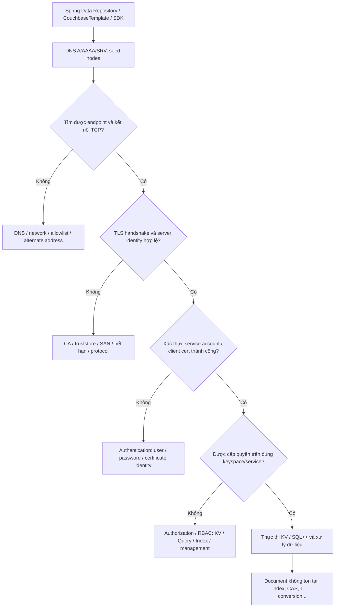
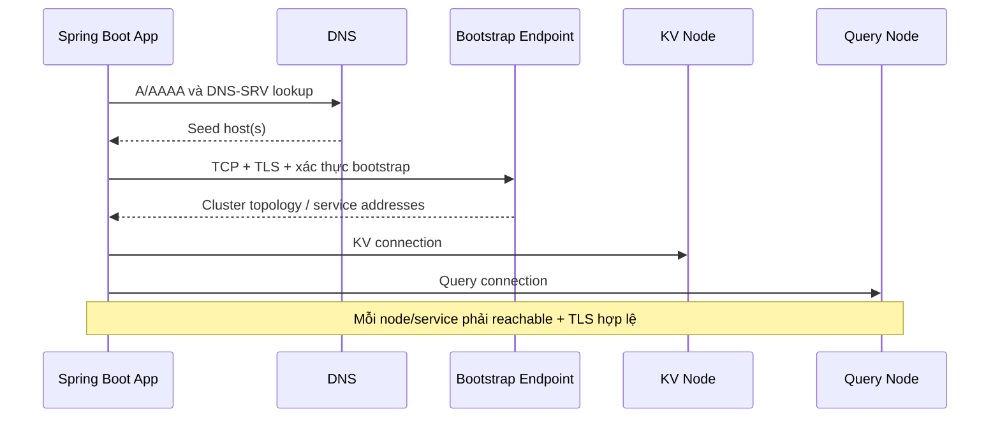
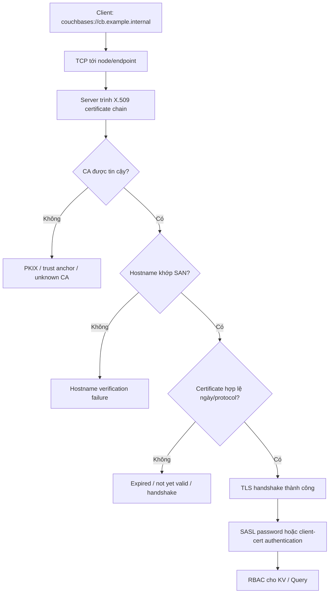
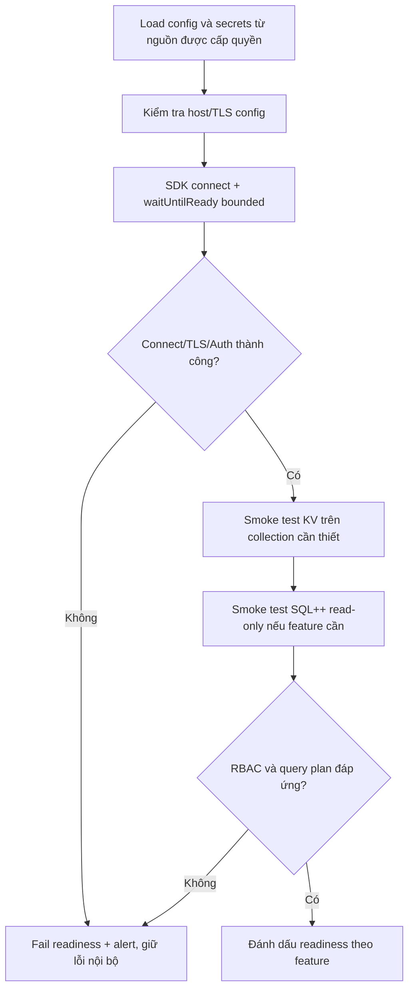

# Lỗi xác thực, phân quyền, DNS và chứng chỉ trong Spring Data Couchbase

> **Mục tiêu:** Nhận diện và xử lý có hệ thống các lỗi **authentication**, **authorization/RBAC**, **DNS và DNS-SRV**, **network bootstrap**, **TLS/CA/hostname/certificate rotation** khi dùng Spring Data Couchbase hoặc Java SDK. Sau bài học, người đọc biết xác minh ranh giới lỗi, cấu hình kết nối an toàn, thiết kế quyền tối thiểu cho Repository, `CouchbaseTemplate` và SQL++, xử lý reactive error, logging an toàn, readiness, retry và kiểm thử fault injection mà **không vô hiệu hóa TLS hoặc cấp quyền admin để che lỗi**.

Trong module **SPRING_DATA_COUCHBASE**, ứng dụng Java sử dụng document mapping, Spring Data Repository, `CouchbaseTemplate` và Couchbase Java SDK để làm việc với bucket/scope/collection. Các truy vấn SQL++ cần Query Service, thường sử dụng chỉ mục (một số phiên bản Server hỗ trợ sequential scan khi đủ điều kiện); hoạt động KV cần Data Service; TTL, CAS, durability, transaction và API reactive đặt thêm yêu cầu lên quyền, kết nối và cách xử lý lỗi. Sự cố xác thực hoặc TLS thường diễn ra **trước khi ứng dụng đọc được một document**, nên không được biến chúng thành “không có Product” hoặc tự tạo collection/index.

**Bối cảnh xuyên suốt:** một ứng dụng thương mại điện tử kết nối Couchbase và lưu Product ở `catalog.commerce.products`. API `GET /products/{id}` có thể đọc theo KV, trong khi `GET /products?category=keyboard` dùng SQL++. Sau khi đổi mật khẩu service account hoặc xoay chứng chỉ, chỉ một nhóm API lỗi. Muốn chữa đúng, phải trả lời lần lượt: **đã tìm đúng endpoint chưa? bắt tay TLS có thành công không? credential có được server chấp nhận không? account có đúng quyền cho thao tác đó không?**

## 1. Bốn ranh giới lỗi không được trộn lẫn



Đây là sơ đồ chẩn đoán, không khẳng định một request SDK luôn đi qua các trạng thái tuần tự quan sát được ở Java. TLS, network và service discovery có thể thực hiện trong giai đoạn bootstrap hoặc tạo kết nối đến từng node/dịch vụ. Một lần `Cluster.connect` trả object **không luôn chứng minh** mọi service socket đã sẵn sàng hay quyền của account đủ cho mọi thao tác.

| Nhóm lỗi | Câu hỏi chính | Ví dụ tín hiệu |
| --- | --- | --- |
| **DNS/service discovery** | Hostname/SRV có resolve đúng danh sách node? | `UnknownHostException`, DNS SRV warning, timeout |
| **Network** | Client có tới được TCP endpoint được cluster quảng bá? | Connection refused, timeout, `RequestCanceledException` |
| **TLS/trust** | Client xác minh được danh tính server và chain certificate? | `SSLHandshakeException`, `PKIX path building failed`, hostname mismatch |
| **Authentication** | Server công nhận credential/client identity? | SDK `AuthenticationFailureException`, SASL/auth error |
| **Authorization** | Identity đó có quyền KV/Query/Index trên resource này? | Access denied, permission error, Query authorization failure |
| **Domain/data** | Hạ tầng an toàn đã truy cập được nhưng dữ liệu có hợp lệ? | `Optional.empty()`, `DocumentNotFoundException`, CAS conflict |

**Cần lưu ý:** lớp exception nhìn thấy ở ứng dụng có thể là **lỗi SDK được bọc** (ví dụ `CouchbaseException` với `ErrorContext`) thay vì `UnknownHostException`/`SSLHandshakeException` nằm ở lớp ngoài cùng. Cần xem **cause chain** và request context, không parse duy nhất phần chữ trong `getMessage()`.

## 2. Bộ dữ liệu và đường truy cập minh họa

Giả sử môi trường test có:

| Thành phần | Giá trị giả định | Vai trò |
| --- | --- | --- |
| Cluster endpoint | `cb.example.internal` hoặc Capella endpoint được cấp | DNS seed / TLS name |
| Bucket | `catalog` | Nơi lưu dữ liệu |
| Scope | `commerce` | Namespace nghiệp vụ |
| Collection | `products` | Document Product |
| Key | `product::KB-101` | Dùng với KV `get` |
| Service account | `svc_catalog_api` | Identity Couchbase của ứng dụng |
| Query index | `idx_products_tenant_category` | Hỗ trợ tìm theo tenant/category |
| Tenant nghiệp vụ | `shop-a` | Authorization tại ứng dụng, **không tự bằng DB user** |

Document mẫu có ID `product::KB-101`:

```json
{
  "_class": "catalog-product",
  "sku": "KB-101",
  "name": "Bàn phím cơ TKL",
  "tenantId": "shop-a",
  "category": "keyboard",
  "priceMinor": 1450000,
  "active": true
}
```

Document key và CAS là metadata của Couchbase, không nhất thiết xuất hiện dưới field `id`/`version`. Trường `_class` là type discriminator giả định của mapping; tên thật có thể khác theo cấu hình Spring Data. **Không dùng `tenantId` hay `_class` như chứng cứ duy nhất rằng HTTP caller có quyền đọc document.**

### Entity và Repository

```java
import org.springframework.data.annotation.Id;
import org.springframework.data.annotation.TypeAlias;
import org.springframework.data.annotation.Version;
import org.springframework.data.couchbase.core.mapping.Document;
import org.springframework.data.couchbase.repository.Scope;
import org.springframework.data.couchbase.repository.Collection;

@Document
@TypeAlias("catalog-product")
@Scope("commerce")
@Collection("products")
public class Product {
    @Id private String id;
    @Version private long version;
    private String sku;
    private String name;
    private String tenantId;
    private String category;
    private Long priceMinor;
    private Boolean active;

    public Product() {}
    public String getId() { return id; }
    public String getTenantId() { return tenantId; }
    public String getSku() { return sku; }
    // Các getter/setter còn lại theo convention của dự án.
}
```

```java
import java.util.List;
import org.springframework.data.couchbase.repository.CouchbaseRepository;
import org.springframework.data.couchbase.repository.Query;
import org.springframework.data.repository.query.Param;

public interface ProductRepository
        extends CouchbaseRepository<Product, String> {

    @Query("#{#n1ql.selectEntity} WHERE #{#n1ql.filter} "
         + "AND tenantId = $tenant AND category = $category")
    List<Product> findForTenant(
        @Param("tenant") String trustedTenantId,
        @Param("category") String category
    );
}
```

`findById(id)` thường đi đường KV; phương thức `findForTenant` dùng SQL++ và có thể cần **Quyền Query Select + plan/index/scan**. Cả hai cùng sử dụng identity kết nối Couchbase, nhưng các quyền cần thiết **không giống nhau**.

### SDK trực tiếp cùng keyspace

```java
import com.couchbase.client.java.Cluster;
import com.couchbase.client.java.Collection;

Collection products = cluster.bucket("catalog")
    .scope("commerce")
    .collection("products");

var result = products.get("product::KB-101");
```

**Không nhầm** `cluster.bucket("catalog").defaultCollection()` với `catalog.commerce.products`: khi đọc sai collection, một document đúng ID có thể cho `DocumentNotFoundException`, không liên quan authentication.

## 3. Authentication, authorization và bảo mật ở tầng người dùng

**Authentication (xác thực)** trả lời: *client kết nối Couchbase là ai?* Thường là username/password của service account hoặc chứng chỉ client X.509 nếu được cấu hình.

**Authorization (phân quyền)** trả lời: *identity đã xác thực được phép làm thao tác nào trên tài nguyên nào?* Couchbase Server dùng RBAC, gồm quyền riêng cho KV, SQL++, quản trị index, quản trị scope/collection...

**User authorization của ứng dụng** trả lời: *HTTP user hoặc tenant này có được xem Product KB-101 không?* Đây là luật nghiệp vụ ở service, không tự có chỉ vì Couchbase đã chấp nhận mật khẩu `svc_catalog_api`.

| Tình huống | Ý nghĩa đúng | HTTP response thường phù hợp |
| --- | --- | --- |
| Người dùng HTTP chưa đăng nhập | Xác thực người dùng ứng dụng thất bại | `401` theo security framework |
| Người dùng HTTP không được sửa Product | Domain authorization thất bại | `403`/`404` theo chính sách tránh lộ tồn tại |
| Couchbase service account sai mật khẩu | Backend authentication/config lỗi | `5xx`/readiness fail, **không** bảo người dùng đăng nhập lại |
| Couchbase service account thiếu Query Select | Backend RBAC lỗi với SQL++ | `5xx` nội bộ/degraded search, không coi category không có |
| CA/hostname TLS sai | Không xác minh được server identity | Không phát dữ liệu; sửa trust/DNS/cert |
| KV key không tồn tại sau kết nối hợp lệ | Dữ liệu vắng mặt | `404` nếu contract yêu cầu |

**Không “chữa” lỗi database bằng cấp Full Administrator cho application user.** Cách đó che thiếu role nhưng mở khả năng đọc/ghi/quản trị trên phạm vi quá lớn. Hãy điều chỉnh role nhỏ nhất sau khi xác minh thao tác/keyspace thực tế.

## 4. Xác thực bằng username/password và cấu hình Spring Boot

Ví dụ `application.yml` cho Spring Boot 3.x (đối chiếu property theo version dự án):

```yaml
spring:
  couchbase:
    connection-string: ${COUCHBASE_CONNECTION_STRING}
    username: ${COUCHBASE_USERNAME}
    password: ${COUCHBASE_PASSWORD}
  data:
    couchbase:
      bucket-name: catalog
```

Ba biểu thức trong YAML là **Spring property placeholders** lấy từ biến môi trường của tiến trình. Không nhập mật khẩu vào Git, sample hay log; dùng Secret Manager/Kubernetes Secret với phương án rotation, kiểm soát quyền đọc và audit.

**Cảnh báo:** Nếu ứng dụng kế thừa `AbstractCouchbaseConfiguration` hoặc tự tạo `Cluster`/`CouchbaseClientFactory`, đường cấu hình Java có thể override hoặc thay thế auto-configuration. Khi debug, phải biết **bean/runtime configuration đang hoạt động** chứ không chỉ xem file `application.yml`.

### Kết nối Java SDK trực tiếp

```java
import com.couchbase.client.java.Cluster;
import com.couchbase.client.java.ClusterOptions;
import java.time.Duration;

String connectionString =
    System.getenv("COUCHBASE_CONNECTION_STRING");
String username = System.getenv("COUCHBASE_USERNAME");
String password = System.getenv("COUCHBASE_PASSWORD");

Cluster cluster = Cluster.connect(
    connectionString,
    ClusterOptions.clusterOptions(username, password)
);
cluster.waitUntilReady(Duration.ofSeconds(10));
```

Đoạn trên giả định environment variables đã tồn tại và hợp lệ, cluster đã provision, và ứng dụng chịu trách nhiệm `cluster.disconnect()` khi kết thúc. Chỉ chờ readiness không xác nhận **tài khoản có đủ role trên mọi collection**: cần thực hiện phép KV/SQL++ có kiểm soát với đúng application principal.

### Tài khoản dịch vụ không phải tài khoản quản trị

Tài liệu SDK dùng `Administrator` trong nhiều ví dụ vì dễ chạy lab, nhưng production nên:

- Dùng account riêng cho **mỗi workload/cấp quyền** khi khả thi.
- Cấp RBAC trên bucket/scope/collection **đúng phạm vi** thay vì wildcard.
- Tách **runtime app account** với **migration/DDL account**.
- Lưu secret qua kho chuyên dụng, không log giá trị secret, không đưa vào URI query string.
- Có lịch xoay credential, rollback và kiểm tra readiness sau thay đổi.
- Không dùng một credential chung cho mọi môi trường dev/staging/prod.

### Sai username/password khác thiếu quyền

| Tình huống | Dấu hiệu thường thấy | Cách giải quyết |
| --- | --- | --- |
| Username không tồn tại hoặc password sai | `AuthenticationFailureException`/SASL auth failure | Xác minh secret, identity source, mật khẩu |
| Secret cũ sau rotation | Pod mới OK, pod cũ auth fail | Kiểm tra rollout/secret refresh và reconnect |
| Account bị disable/delete | Auth fail sau deploy hoặc thay đổi RBAC | Audit user management |
| Account được xác thực nhưng thiếu role | KV/Query báo permission denied | Cấp **quyền đúng operation/keyspace**, không đổi password mù |
| LDAP authentication thay đổi | SASL mechanism/LDAP connectivity | Kiểm tra cấu hình LDAP, TLS và cơ chế auth SDK |
| Client certificate không ánh xạ user | Client-cert authentication failure | Xem certificate identity mapping và RBAC server |

**Đừng phân biệt authentication và authorization chỉ bằng HTTP status của Query Service** mà không xem đầy đủ SDK error category. Một lỗi quyền có thể bị bọc dưới exception khác tùy SDK/query code và server version. Log loại lỗi, operation, service và trace ID — không parse thông điệp chứa secret.

## 5. `AuthenticationFailureException` và source của credential

SDK Java có ngoại lệ `com.couchbase.client.core.error.AuthenticationFailureException`; một số lỗi về xác thực từ các service có thể đi tới lớp này hoặc dạng `CouchbaseException` với error context khác nhau.

### Mẫu adapter phân loại lỗi khởi tạo/KV

```java
import com.couchbase.client.core.error.AuthenticationFailureException;
import com.couchbase.client.core.error.CouchbaseException;
import com.couchbase.client.java.Collection;
import com.couchbase.client.java.json.JsonObject;

public final class ProductKvAdapter {
    private final Collection products;

    public ProductKvAdapter(Collection products) {
        this.products = products;
    }

    public JsonObject getRaw(String id) {
        try {
            return products.get(id).contentAsObject();
        } catch (AuthenticationFailureException ex) {
            throw new BackendIdentityException(
                "Couchbase authentication failed", ex
            );
        } catch (CouchbaseException ex) {
            throw new ProductStorageException(
                "Product read unavailable", ex
            );
        }
    }
}
```

`BackendIdentityException` và `ProductStorageException` là **lỗi ứng dụng tự định nghĩa**, không thuộc Java SDK. Ngoại lệ xác thực có thể phát sinh **trong bootstrap trước khi adapter gọi get()**, nên catch ở phương thức này **không đủ để bao trùm toàn vòng đời kết nối**; bổ sung readiness/startup error classification riêng.

### Tại sao sai password không nên retry request liên tục?

Nếu secret sai, mọi lần retry cùng secret thường đều thất bại; retry nhanh nhiều lần có thể:

- gây tải auth service/cluster;
- làm ngập log/cảnh báo;
- che sự cố secret rotation;
- kéo dài thời gian trả lỗi 5xx mà không thêm thông tin chẩn đoán.

Với lỗi auth rõ ràng, nên **fail readiness/fail fast**, điều tra cấu hình/secret, và chỉ thử kết nối lại sau khi identity/config có thay đổi hoặc trong chính sách backoff có kiểm soát. **Không log hoặc gửi lại mật khẩu** để “chứng minh credential đúng”.

### LDAP và SASL là một tình huống riêng

Couchbase SDK có `PasswordAuthenticator` và cơ chế SASL. Với cấu hình LDAP, server có thể yêu cầu SASL PLAIN; tài liệu SDK nêu khả năng bật qua `onlyEnablePlainSaslMechanism()` khi phù hợp. Nhưng **PLAIN không an toàn trên kết nối không mã hóa**, nên cách triển khai được khuyến nghị là bật **TLS `couchbases://`** và cấu hình auth theo tài liệu của hệ thống.

Không dùng “bật PLAIN” như một mẹo chung cho mọi `AuthenticationFailureException`. Trước tiên phải xác minh backend thực sự dùng LDAP, server yêu cầu cơ chế gì và kết nối có TLS bảo mật không.

### Chống lộ secret trong mã lỗi

```java
// Không khuyến nghị:
logger.error("Couchbase login failed for {} with {}", username, password);
```

Thay bằng structured logging chứa **mã instance/service account alias đã kiểm soát** (nếu cần), loại exception, trace ID và môi trường. Không đưa password, private key, full connection string có userinfo hoặc raw token vào log.

## 6. RBAC: một account có thể đọc KV nhưng không chạy SQL++

Couchbase RBAC tách các quyền theo thao tác. Với collection `catalog.commerce.products`:

| Công việc | Role Couchbase thường cần | Phạm vi nên giới hạn |
| --- | --- | --- |
| `collection.get(id)` | `data_reader` | `catalog.commerce.products` |
| `collection.insert/replace/remove` | `data_writer` | `catalog.commerce.products` |
| SQL++ `SELECT ... FROM products` | `query_select` | `catalog.commerce.products` |
| SQL++ `INSERT/UPDATE/DELETE` | `query_insert`/`query_update`/`query_delete` phù hợp | Đúng collection |
| Tạo/drop/build index | `query_manage_index` và quyền liên quan | Migration/provisioner |
| Quản lý bucket/scope/collection | Role quản trị tài nguyên phù hợp | Chỉ automation quản trị |
| Query fallback không index | `query_use_sequential_scans` khi điều kiện hỗ trợ | Đúng keyspace, kiểm soát tải |

Tên/role thực tế cần đối chiếu **Couchbase Server/Capella edition và phiên bản**. `data_reader` chỉ cho phép KV read, **không tự bao gồm SQL++ Query Select**; `data_writer` không tự cho phép SQL++ `UPDATE`. Đừng suy đoán quyền Query từ việc `Repository.findById` đọc được.

### Ví dụ chẩn đoán đường KV và SQL++ khác quyền

```java
// KV: Data Reader đủ cho GET theo ID.
var product = cluster.bucket("catalog")
    .scope("commerce")
    .collection("products")
    .get("product::KB-101");
```

```sql
-- SQL++: cần Query Select cho named collection.
SELECT p.sku, p.category
FROM `catalog`.`commerce`.`products` AS p
WHERE p.tenantId = "shop-a";
```

KV có thể thành công trong khi SQL++ bị từ chối nếu account thiếu `query_select`. Ngược lại, một tài khoản có quyền Query Select nhưng không được cấp KV Data Reader có thể chạy query nhưng `get(id)` fail. **Đừng chữa bằng đổi SQL++ sang KV nếu chức năng thực sự cần lọc nhiều document theo thuộc tính**; hãy cấp đúng quyền theo nhu cầu.

### Role của application và role của migration

| Tài khoản | Chức năng | Cấp quyền nên tránh |
| --- | --- | --- |
| `svc_catalog_api` | KV đọc/ghi Product, SELECT theo category | Full Administrator, index DDL |
| `svc_catalog_reporting` | SQL++ SELECT báo cáo | KV writer, DELETE, cluster admin |
| `svc_catalog_migration` | Provision/index/schema migration theo CI/CD | Credential tồn tại trong API runtime |
| `svc_catalog_ops` | Chẩn đoán trạng thái, đọc metadata có kiểm soát | Dùng làm user cho mọi microservice |

**Least privilege** vừa hạn chế thiệt hại khi lộ credential, vừa giúp phân biệt bug security với bug truy vấn. Khi phải cấp quyền tạm thời để kiểm tra, thực hiện trong quy trình thay đổi có audit và **thu hồi đúng hạn**, không để lại quyền wildcard vô thời hạn.

## 7. DNS: hostname không resolve được không phải sai mật khẩu

Trước khi xác thực, client phải tìm địa chỉ mạng của cluster. DNS có một số loại record liên quan:

| Record | Chức năng | Chú ý |
| --- | --- | --- |
| `A` | Hostname → IPv4 | SDK có thể dùng khi bootstrap trực tiếp |
| `AAAA` | Hostname → IPv6 | Cần mạng/route hỗ trợ IPv6 nếu được trả về |
| `SRV` | Tên dịch vụ → danh sách bootstrap nodes/ports | Hữu ích với Capella và self-managed |
| `CNAME` | Alias trỏ hostname khác | DNS-SRV targets theo tài liệu Couchbase nên trỏ A, không trỏ CNAME |
| `TXT` | Metadata DNS tùy hệ thống | Không tự thay thế record SRV cho SDK |

Khi DNS không resolve được seed hostname, có thể gặp `UnknownHostException` trong cause, warning bootstrap hoặc request timeout/cancellation phía ngoài. **Không đổi credential hoặc bật quyền admin chỉ để chữa DNS**.

### Ví dụ chẩn đoán từ máy chạy ứng dụng

Trên môi trường được cấp quyền:

```powershell
Resolve-DnsName cb.example.internal -Type A
Resolve-DnsName cb.example.internal -Type AAAA
Resolve-DnsName _couchbases._tcp.cb.example.internal -Type SRV
```

Trên Linux dùng `dig`/`nslookup` tương ứng:

```bash
dig A cb.example.internal
dig AAAA cb.example.internal
dig SRV _couchbases._tcp.cb.example.internal
```

Đây là **lệnh chẩn đoán gợi ý**, không phải kết quả đã chạy trong bài. Phải chạy từ **chính container/pod/VPC** nơi ứng dụng chạy, vì máy dev và pod có thể dùng resolver/network khác nhau. Trong container tối giản không có `dig`, dùng công cụ chẩn đoán được phê duyệt thay vì cài package ngẫu nhiên vào production.

### Câu hỏi điều tra DNS

1. Tên trong connection string có chính xác, không chứa khoảng trắng, ký tự lạ hoặc host nhầm region không?
2. Resolver của pod có nhận được response A/AAAA/SRV không?
3. Có private DNS zone, split-horizon DNS, VPN, conditional forwarding hoặc search-domain làm thay đổi kết quả không?
4. TTL cache và số node được trả về có tương ứng với cluster hiện tại không?
5. A/AAAA target có định tuyến được không? Một DNS resolve thành công **không bảo đảm TCP connect thành công**.
6. TLS certificate có SAN khớp **hostname client thực sự dùng** không? Dùng IP thay FQDN có thể phá xác minh TLS.

### DNS lỗi có thể chỉ xảy ra khi scale

Một pod chạy ở node A có DNS resolver và network tốt, pod ở node B dùng DNS config sai. Load balancer phân phối traffic giữa các pod khiến API lúc được, lúc lỗi. Cần nhóm lỗi theo **pod/host/zone/region**, không chỉ tổng số timeout toàn hệ thống.

## 8. DNS-SRV cho Couchbase Java SDK

Java SDK hỗ trợ **DNS-SRV bootstrap**, đặc biệt hữu ích khi Couchbase Capella cung cấp một endpoint. Với TLS, ví dụ tên record:

```text
_couchbases._tcp.cb.example.internal.
  SRV 0 0 11207 node1.example.internal.
  SRV 0 0 11207 node2.example.internal.
  SRV 0 0 11207 node3.example.internal.
```

Đây là minh họa zone file/record view, không phải cú pháp đầy đủ của mọi DNS provider. Với kết nối không TLS, tiền tố SRV có thể là `_couchbase._tcp` và KV port mặc định `11210`; **production nên dùng TLS nếu môi trường hỗ trợ**, đặc biệt kết nối cloud.

### Điều kiện để SDK dùng SRV

Theo tài liệu Java SDK:

- Connection string phải có **một seed hostname**, không chỉ định port tường minh, ví dụ `couchbases://cb.example.internal`.
- `io.enableDnsSrv` phải bật; Java SDK hiện đại mặc định bật tính năng này.
- DNS server trả đúng record `_couchbases._tcp...` với targets hợp lệ.
- Có nhiều seed hosts hoặc hostname + explicit port có thể khiến SDK **không thực hiện SRV bootstrap**.

```java
import com.couchbase.client.java.Cluster;
import com.couchbase.client.java.ClusterOptions;

Cluster cluster = Cluster.connect(
    "couchbases://cb.example.internal",
    ClusterOptions.clusterOptions(username, password)
        .environment(env -> env
            .ioConfig(io -> io.enableDnsSrv(true))
        )
);
```

`username`/`password` là biến secret lấy từ Secret Manager hoặc cấu hình an toàn; ví dụ không có literal credential. Với Capella, hãy dùng connection string **được cluster cung cấp**, không thay bằng hostname/IP suy đoán.

### SRV thất bại nhưng bootstrap vẫn có thể tiếp tục

SDK có thể log kiểu:

```text
DNS SRV lookup failed, proceeding with normal bootstrap.
```

Khi SRV lookup không dùng được, SDK có thể thử **A-record bootstrap** trên seed hostname. Vì vậy một warning SRV không luôn là nguyên nhân trực tiếp khiến mọi request thất bại; có hệ thống vẫn kết nối được. Nhưng nếu cluster/Capella đòi thông tin node qua SRV hoặc chỉ A-record trả endpoint không phù hợp, fallback sẽ không cứu được.

**Chẩn đoán đúng:** xem SRV record, A/AAAA fallback, bootstrap logs, topology returned và đường network tới các target, không chỉ tìm một chuỗi “DNS SRV failed” rồi kết luận 100%.

### SRV record cho self-managed cluster

Tài liệu Couchbase khuyến nghị target của SRV là hostname có A record, không dùng CNAME target. SRV priority/weight thường không điều khiển thứ tự node SDK dùng như một bộ cân bằng tải HTTP. Không tự thêm SRV của dịch vụ khác, hay trỏ tới load balancer không hỗ trợ các kết nối node mà SDK cần.

### Private networking và Capella

Capella có thể yêu cầu network allowlist hoặc private endpoint/VPC peering tùy topology. Nếu DNS resolve được nhưng firewall/allowlist chặn, dấu hiệu có thể là timeout kết nối — **không phải AuthenticationFailureException**. Kiểm tra allowed IP/NAT egress và TLS endpoint đúng vùng; không công khai IP/port cluster vào kênh không cần thiết.

## 9. Bootstrap nhiều node và alternate addresses

Couchbase SDK không hoạt động giống một HTTP client gọi mãi một hostname. Sau bootstrap, SDK có thể nhận **cluster topology** và kết nối tới nhiều node có các service/ports tương ứng.



**Một port TCP mở trên seed node không chứng minh tất cả node/Query Service reachable.** Có thể:

- Startup/readiness ban đầu thành công, nhưng query đến một node khác timeout.
- App chạy bên ngoài VPC nhận internal IP từ cluster, không route được.
- Chuyển từ private endpoint sang public endpoint nhưng vẫn dùng network resolution cũ.
- TLS cert hợp lệ cho hostname A nhưng cluster topology quảng bá hostname/IP B không có trong SAN/cert chain.

### Network resolution trong SDK

SDK có `io.networkResolution` với các chế độ như `AUTO`, `DEFAULT` và `EXTERNAL`. Cấu hình đúng phụ thuộc **alternate address mapping** của cluster:

```java
import com.couchbase.client.core.env.NetworkResolution;

Cluster cluster = Cluster.connect(
    connectionString,
    ClusterOptions.clusterOptions(username, password)
        .environment(env -> env
            .ioConfig(io -> io.networkResolution(
                NetworkResolution.EXTERNAL
            ))
        )
);
```

Chỉ đặt `EXTERNAL` nếu cluster đã cấu hình alternate addresses phù hợp cho client bên ngoài. Không copy cố định tùy chọn này vào mọi ứng dụng; `AUTO` thường là điểm khởi đầu hợp lý. Khi network topology thay đổi, cần xem toàn bộ đường kết nối và chứng chỉ cho các hostname được quảng bá.

### Kiểm tra TCP socket theo nhiệm vụ

Các port điển hình tùy deployment:

| Dịch vụ/đường | Port thường thấy khi self-managed | Vai trò |
| --- | --- | --- |
| KV không TLS | `11210` | Data Service |
| KV TLS | `11207` | Data Service bảo mật |
| Cluster management không TLS | `8091` | Bootstrap/admin |
| Cluster management TLS | `18091` | Bootstrap/admin bảo mật |
| Query không TLS | `8093` | Query Service |
| Query TLS | `18093` | Query Service bảo mật |

Đây là **các port thông thường**, không phải danh sách firewall đầy đủ cho mọi deployment. Capella/private endpoints, alternate ports, proxy và cấu hình cluster có thể khác. Không mở các port công khai theo bảng khi chưa có network policy chính thức.

Ví dụ PowerShell chẩn đoán kết nối TCP:

```powershell
Test-NetConnection node1.example.internal -Port 11207
Test-NetConnection node1.example.internal -Port 18093
```

Kiểm tra TCP thành công **không kiểm chứng TLS handshake, quyền Query hay dữ liệu được trả**. Đường từ nơi chạy Java ứng dụng mới là điều cần đo, không phải chỉ laptop của developer.

## 10. Định vị lỗi network, DNS, TLS và auth theo thứ tự

Một lỗi `RequestCanceledException` hoặc timeout có thể xuất hiện khi bootstrap thất bại do nguyên nhân thấp hơn:

| Tín hiệu | Hướng điều tra trước | Không nên làm |
| --- | --- | --- |
| `UnknownHostException`, NXDOMAIN | Hostname, DNS resolver, SRV/A/AAAA | Thay password |
| `Connection refused` | Port/service không lắng nghe, firewall reject | Cấp Full Administrator |
| TCP timeout | Route/allowlist/NAT/firewall, advertised node | Tắt TLS |
| `SSLHandshakeException` | Trust chain, SAN, hết hạn, protocol, client cert | Bỏ xác minh CA |
| `AuthenticationFailureException` | Account/password/client identity | Tăng Query timeout |
| KV read OK, SQL++ auth error | Query Select RBAC | Tạo index chỉ để né RBAC |
| SDK handle có nhưng operation fail | Bootstrap/lazy connection | Tin handle chứng minh readiness |
| Một pod lỗi sau rotation | Secret/truststore được mount/refresh khác nhau | Retry vô hạn toàn cluster |

### Chẩn đoán bắt đầu từ môi trường thật

1. Lấy **service name/trace ID/pod ID/deployment version**, không cần xem password.
2. Xác minh connection string **được diễn giải ở runtime** (mask thông tin nhạy cảm).
3. Kiểm tra A/AAAA/SRV trong pod và cluster topology sau bootstrap.
4. Kiểm tra route/allowlist tới đúng node/port.
5. Kiểm tra TLS chain, trust, SAN, hạn chứng chỉ.
6. Kiểm tra account auth, rồi RBAC **với thao tác thật**.
7. Chỉ sau khi vượt qua các lớp đó mới phân tích query plan/index/document mapping.

**Đừng tăng timeout lên 60 giây khi một hostname viết sai**: điều đó chỉ tăng độ trễ và số request chờ. Timeout là triệu chứng quan sát, không tự chỉ ra DNS, TLS hay auth là nguyên nhân gốc.

## 11. TLS: mã hóa kết nối khác xác minh danh tính

`TLS (Transport Layer Security)` cung cấp kênh mã hóa và giúp client kiểm tra danh tính server. Trên Couchbase Java SDK, `couchbases://` là connection string scheme được khuyến nghị để bật TLS (ký tự **s** cuối). `couchbase://` là scheme không tự bật TLS.

Đối với Couchbase Server self-managed, phải xác minh edition/cấu hình có hỗ trợ TLS; Couchbase Capella hỗ trợ TLS. Không dùng `couchbase://` không mã hóa để chữa lỗi certificate trong production.

### Ba điều cần đúng khi client xác minh server

1. **Chứng chỉ server có chuỗi tin cậy** (chain) dẫn tới CA mà SDK/JVM trust.
2. **Hostname mà client dùng khớp Subject Alternative Name (SAN)** của server certificate theo quy tắc xác minh; dùng IP khi cert cấp cho DNS name có thể fail.
3. **Chứng chỉ còn hiệu lực** về ngày bắt đầu/kết thúc, signature/protocol phù hợp và server cung cấp chain đúng.



Một TLS handshake thành công **không tự chứng minh** username/password đúng; tương tự một account có role Query Select không giúp client bỏ qua lỗi trust CA.

### Phân biệt các lỗi TLS phổ biến

| Dấu hiệu trong cause chain | Nguyên nhân thường gặp | Cách xử lý |
| --- | --- | --- |
| `PKIX path building failed` | CA chain không thuộc trust anchors của JVM/SDK | Cài đúng CA của cluster qua trusted channel |
| `unable to find valid certification path` | Thiếu root/intermediate CA | Kiểm tra truststore và chain server |
| `CertificateExpiredException` | Cert hết hạn | Xoay certificate đúng chính sách |
| `CertificateNotYetValidException` | Cert chưa tới `notBefore` hoặc clock sai | Kiểm tra certificate validity và thời gian máy |
| Hostname/IP mismatch | SAN không chứa tên được kết nối | Dùng đúng FQDN hoặc cấp cert hợp lệ |
| `SSLHandshakeException` | Lỗi bắt tay chung | Xem cause: CA, protocol, cipher, client-auth |
| `bad_certificate` / client cert rejected | mTLS identity/chain/client key lỗi | Kiểm tra client certificate và mapping |
| `handshake_failure` | Không chung TLS protocol/cipher hoặc mTLS config | Xem policies và server/client versions |

**Không dựa vào một chuỗi exception message làm logic nghiệp vụ.** Bảng là công cụ chẩn đoán; một lỗi trust có thể xuất hiện trong `CouchbaseException`/`RequestCanceledException` với cause chain chứa lỗi TLS phía dưới.

## 12. Cấu hình Java SDK TLS và trust CA

### Trường hợp 1: Capella hoặc CA đã được SDK/JVM tin cậy

Tài liệu Java SDK nêu rằng các SDK hiện đại **đóng gói certificate root tiêu chuẩn của Capella**; khi kết nối Capella thông thường, chỉ cần dùng connection string được cung cấp với `couchbases://` và credential hợp lệ.

Với Couchbase Server và CA nằm trong **JVM truststore**, SDK 3.4+ có thể sử dụng CA được trust mà không cần cài thêm `trustCertificate` cụ thể. Nhưng các bản SDK cũ hơn hoặc private CA có thể cần cấu hình tường minh.

```java
import com.couchbase.client.java.Cluster;
import com.couchbase.client.java.ClusterOptions;

Cluster cluster = Cluster.connect(
    "couchbases://cb.example.internal",
    ClusterOptions.clusterOptions(username, password)
);
```

Đây là mẫu connection; hostname và certificate hợp lệ phải thuộc hệ thống được cấp quyền. Không thay bằng `127.0.0.1`/IP nếu cert không chứa IP đó trong SAN.

### Trường hợp 2: Private CA được cấp qua file đáng tin cậy

Nếu cluster dùng private CA không được JVM trust, cấu hình CA của server:

```java
import com.couchbase.client.java.Cluster;
import com.couchbase.client.java.ClusterOptions;
import com.couchbase.client.core.env.SecurityConfig;
import java.nio.file.Path;

Path caCert = Path.of("/etc/couchbase/tls/cluster-ca.pem");

Cluster cluster = Cluster.connect(
    "couchbases://cb.example.internal",
    ClusterOptions.clusterOptions(username, password)
        .environment(env -> env
            .securityConfig(SecurityConfig.trustCertificate(caCert))
        )
);
```

Ví dụ theo cách dùng `SecurityConfig.trustCertificate(Path)` trong tài liệu Java SDK. Một số phiên bản cho phép cấu hình bằng lambda:

```java
.environment(env -> env.securityConfig(
    sec -> sec.trustCertificate(caCert)
))
```

**CA file không phải private key của client.** Nó chứa certificate mà client dùng để xác minh server; dữ liệu vẫn cần được phân phối từ nguồn tin cậy qua kênh bảo mật. Đừng tải một certificate tùy ý từ endpoint đang bị nghi ngờ rồi tự đánh dấu trust, vì có thể hợp thức hóa máy chủ giả.

### Có nhiều CA

SDK có lựa chọn `trustCertificates(List<X509Certificate>)` hoặc `trustManagerFactory(TrustManagerFactory)` để cấu hình trust roots theo nhu cầu. Chọn **một** cơ chế tin cậy phù hợp và kiểm soát rõ truststore; không gom mọi certificate không xác minh được vào truststore chỉ để connection thành công.

### Truststore của JVM trong container

Java có cơ chế truststore JDK (ví dụ `cacerts`). Một chứng chỉ có thể được trust trên laptop nhưng không được trust trong image Docker/Kubernetes vì:

- bản JDK khác;
- image dùng truststore khác hoặc thiếu corporate root CA;
- secret CA mount sai path/permissions;
- CA mới đã được mount nhưng JVM/SDK connection pool vẫn dùng trust context cũ;
- CA chain của proxy khác với chain ở môi trường production.

Vì vậy kiểm tra **runtime truststore của đúng pod/image**. Không coi lệnh `keytool` chạy thành công trên máy dev là bằng chứng production đã trust CA.

## 13. Hostname verification và vấn đề dùng IP

Giả sử chứng chỉ server có SAN `DNS:cb.example.internal`. Ứng dụng dùng:

```text
couchbases://cb.example.internal
```

có thể hợp lệ nếu DNS/CA/connection đúng. Nhưng đổi thành:

```text
couchbases://10.0.2.15
```

không mặc nhiên hợp lệ; certificate cần có SAN kiểu IP tương ứng (hoặc hostname được dùng phải có trong SAN và routing đúng). **Dùng IP để “bỏ qua DNS” có thể tạo lỗi TLS identity hoặc khiến client kết nối sai node.**

### Các sai sót khác

- Cert chỉ có SAN cho seed FQDN nhưng không bao phủ advertised node names được SDK mở kết nối.
- Load balancer/proxy terminate TLS bằng certificate cho tên khác.
- Đổi private/public endpoint nhưng chưa đổi certificate/domain.
- Cập nhật DNS đến cluster mới trước khi TLS certificate mới sẵn sàng.
- Certificate wildcard không bao phủ các cấp hostname sâu hơn theo quy tắc TLS.

### Không tắt xác minh chứng chỉ

Không đặt `trustAll`, insecure trust manager, bỏ hostname verification hoặc downgrade sang plaintext `couchbase://` trong production. Các cách đó có thể cho phép một endpoint giả mạo đọc credential hoặc thay đổi kết quả query. Nếu cần chẩn đoán riêng, sử dụng công cụ kiểm tra chain/hostname trên môi trường lab mà **không thay cấu hình bảo mật của ứng dụng vận hành**.

Để sửa hostname mismatch: xác định endpoint được phép, DNS/topology thật và SAN; sau đó dùng FQDN đúng hoặc cấp certificate hợp lệ thông qua quy trình PKI, thay vì vô hiệu hóa kiểm tra danh tính.

## 14. Client certificate authentication (mTLS)

**Server certificate trust** và **client certificate authentication** là hai chức năng khác nhau:

- Server certificate: giúp **client xác minh server** mà nó đang kết nối.
- Client certificate: giúp **Couchbase Server xác minh identity của client**, khi cluster cấu hình certificate authentication.

Couchbase Server Enterprise hỗ trợ client X.509 certificate authentication. SDK Java có `CertificateAuthenticator`. Một deployment mTLS có thể cần cả server CA và client certificate/private key, cùng cơ chế ánh xạ identity → Couchbase user/role ở phía server.

### Ví dụ SDK dùng keystore client

```java
import com.couchbase.client.core.env.CertificateAuthenticator;
import com.couchbase.client.java.Cluster;
import com.couchbase.client.java.ClusterOptions;
import java.security.KeyStore;
import java.nio.file.Path;

// Hàm này do dự án triển khai, tải KeyStore từ secret volume.
KeyStore clientKeyStore = loadClientKeyStoreSecurely();

CertificateAuthenticator auth =
    CertificateAuthenticator.fromKeyStore(
        clientKeyStore,
        keyStorePassword
    );

Cluster cluster = Cluster.connect(
    "couchbases://cb.example.internal",
    ClusterOptions.clusterOptions(auth)
        .environment(env -> env
            .securityConfig(sec -> sec
                .trustCertificate(Path.of("/etc/couchbase/tls/cluster-ca.pem"))
            )
        )
);
```

`loadClientKeyStoreSecurely()` và `keyStorePassword` là **hàm/biến minh họa**, không phải API có sẵn. Tài liệu SDK còn hỗ trợ tạo `CertificateAuthenticator` từ đường dẫn keystore, private key/certificate chain hoặc key manager factory theo version.

### Các lỗi mTLS đặc thù

| Vấn đề | Dấu hiệu | Khắc phục |
| --- | --- | --- |
| Client cert hết hạn | TLS handshake/client authentication fail | Rotate cert/client identity đúng lịch |
| Client private key không khớp cert | Không tạo TLS client-auth context hoặc handshake fail | Provision keystore đúng cặp |
| Keystore password sai | Lỗi load keystore/key | Kiểm tra secret/format đúng loại |
| Cluster không trust CA cấp client cert | Server từ chối client certificate | Cài client-auth CA đúng |
| Identity mapping sai | TLS có thể OK nhưng auth/RBAC fail | Kiểm tra mapping subject/username, role |
| Client cert có quyền quá rộng | Tăng blast radius khi key bị lộ | Least privilege, key rotation, audit |

**Không đặt private key trong source code, logs, exception response hoặc image public.** Secret volume cần permissions hạn chế, rotation và kiểm toán. Client certificate auth không có nghĩa mọi user HTTP đều được phân quyền giống nhau.

## 15. Xoay CA, certificate và password an toàn

Một rollout certificate rotation kém có thể làm toàn bộ microservice mất kết nối, đặc biệt khi có pod đang giữ CA cũ trong memory hoặc nhiều node dùng certificate khác nhau.

### Quy trình overlap trust root (khung tham khảo)

1. **Inventory:** ghi nhận CA hiện tại, node/service names, SAN, thời hạn hiệu lực, SDK/JVM versions và nơi phân phối truststore.
2. **Chuẩn bị CA mới:** phân phối CA mới song song CA cũ tới các ứng dụng có trust policy phù hợp, nếu PKI và SDK cho phép.
3. **Xác minh ở staging:** DNS, TLS handshake, certificate chain, node topology và KV/SQL++ bằng account quyền tối thiểu.
4. **Thay server certificate** theo kế hoạch cluster/proxy, đảm bảo certificate SAN đầy đủ và chain đúng.
5. **Roll/reconnect các pod:** bảo đảm instance mới đọc truststore/secret đúng; theo dõi handshake failures.
6. **Kiểm tra bằng cả đường KV và Query**, kể cả node/zone khác nhau; giám sát error rate và latency.
7. **Thu hồi CA cũ** sau thời gian overlap được phê duyệt, theo dõi các client chưa cập nhật.

### Password rotation cũng cần tránh cắt ngang

Nếu database chỉ chấp nhận một password tại một thời điểm, cập nhật secret và restart pod **không bảo đảm zero downtime** nếu chưa có phương án rollover. Có thể dùng hai service accounts quyền tương đương trong cửa sổ xoay có kiểm soát, chuyển từng nhóm instance sang identity mới rồi thu hồi account cũ khi đã kiểm chứng.

**Không dùng một account Admin phụ làm fallback** nếu tài khoản runtime sai credential. Cần rollback/rotation rõ ràng và audit, không làm biến đổi quyền trong im lặng.

## 16. Spring Data exception translation và cause chain

Spring Data Couchbase cung cấp `CouchbaseExceptionTranslator` để chuyển **một số lỗi data access phù hợp** của Couchbase SDK vào họ `org.springframework.dao.DataAccessException`. Việc dịch phụ thuộc loại lỗi, điểm gọi và phiên bản thư viện; không có hợp đồng nói **mọi** lỗi TLS/DNS đều được dịch thành một subclass Spring duy nhất.

| Đường gọi | Exception/application behavior cần xét |
| --- | --- |
| `Cluster.connect(...)`/`waitUntilReady(...)` | SDK/bootstrap exception, timeout, TLS/cause chain |
| `collection.get(id)` SDK trực tiếp | `CouchbaseException`/authentication/KV error, không tự đi qua Repository translator |
| `ProductRepository.findById` | Spring Data data access exception hoặc exception gốc được bọc/truyền tùy tình huống |
| `CouchbaseTemplate` | Spring Data mapping và exception handling theo API Template |
| `ProductRepository.findForTenant` | Query Service, permission/query error, có thể được translator xử lý |
| `ReactiveCouchbaseRepository` | Publisher error signal, có thể là Spring class/SDK cause |
| SDK `ReactiveCollection` | SDK error signal, không mặc định dịch qua Spring |

### Không bỏ qua root cause

Giả sử ở production stack trace có:

```text
DataAccessResourceFailureException
  caused by CouchbaseException
    caused by SSLHandshakeException
      caused by ValidatorException: PKIX path building failed
```

Đây là **chuỗi minh họa**, không phải guarantee một stack trace cố định. Nếu chỉ đọc tên lớp ngoài cùng `DataAccessResourceFailureException`, developer có thể nghĩ “cluster quá tải”, tăng timeout rồi không giải quyết thiếu CA.

Một exception khác có `AuthenticationFailureException` và context cho biết user bị từ chối. Khi đó sửa CA không có ích nếu TLS đã thành công; cần kiểm tra credential/identity source.

### Helper đọc chuỗi cause cho chẩn đoán nội bộ

```java
import java.util.ArrayList;
import java.util.List;

public final class ExceptionClassifier {
    private ExceptionClassifier() {}

    public static List<String> causeTypes(Throwable error) {
        List<String> types = new ArrayList<>();
        Throwable current = error;
        int maxDepth = 12;

        while (current != null && maxDepth-- > 0) {
            types.add(current.getClass().getSimpleName());
            Throwable next = current.getCause();
            if (next == current) {
                break;
            }
            current = next;
        }
        return types;
    }
}
```

Đoạn này **chỉ liệt kê class name**, không in thông điệp có thể chứa credential/endpoint hoặc body. Nó không phải classifier đầy đủ: một số lỗi SDK còn có `ErrorContext`, suppressed exceptions, nhiều request con; luôn kết hợp với operation, service và dấu hiệu network/TLS thật.

### Hành động theo tầng

| Kết luận đã xác minh | Hành động |
| --- | --- |
| Sai DNS/SRV hoặc advertised node unreachable | Sửa resolver/routing/allowlist/topology |
| TLS không tin CA hoặc SAN sai | Sửa trust/cert/hostname qua PKI |
| Credential từ secret sai | Rotate/cập nhật đúng identity |
| RBAC thiếu cho Query/collection | Cấp role nhỏ nhất qua quy trình quyền |
| Bucket/collection không có | Provision/migration hoặc incident recovery |
| SQL++ không có hàng | Xem predicate/type filter/index consistency |
| Document ID thiếu | Domain not found theo hợp đồng |

**Không dùng một `catch (RuntimeException)` chung để trả HTTP 404**; điều đó che lỗi hạ tầng thành “không có Product”, làm giảm khả năng phát hiện sự cố bảo mật.

## 17. Reactive: lỗi DNS/TLS/Auth thường là onError, không phải empty

Trong mô hình Reactor, `ReactiveCouchbaseRepository`/`ReactiveCouchbaseTemplate` và SDK reactive phát lỗi qua **error signal**. Không tìm thấy document ID là trường hợp khác:

```java
import reactor.core.publisher.Mono;
import org.springframework.data.couchbase.repository.ReactiveCouchbaseRepository;

public interface ReactiveProductRepository
        extends ReactiveCouchbaseRepository<Product, String> {
}
```

```java
public Mono<Product> requireProduct(String id) {
    return reactiveProductRepository.findById(id)
        .switchIfEmpty(Mono.error(
            new ProductNotFoundException(id)
        ));
}
```

`ProductNotFoundException` là class ứng dụng tự định nghĩa. `findById` không thấy document thường trả `Mono.empty()`. Nếu lỗi TLS, DNS, credential, Query permission, cluster unavailable, publisher cần giữ **error signal**, không biến thành empty.

### Phản diện: bọc mọi lỗi thành không tìm thấy

```java
// KHÔNG làm: mọi lỗi hạ tầng thành dữ liệu vắng mặt.
return reactiveProductRepository.findById(id)
    .onErrorResume(ex -> Mono.empty());
```

### Phân loại một lỗi xác thực rõ ràng

```java
import com.couchbase.client.core.error.AuthenticationFailureException;

return reactiveProductRepository.findById(id)
    .onErrorMap(
        AuthenticationFailureException.class,
        ex -> new BackendIdentityException(
            "Database credentials rejected", ex
        )
    )
    .switchIfEmpty(Mono.error(
        new ProductNotFoundException(id)
    ));
```

Code giả định SDK exception gốc được truyền tới điểm này. **Nếu Spring Data đã bọc nó trong `DataAccessException`**, `onErrorMap(AuthenticationFailureException.class, ...)` không match trực tiếp; cần phân loại ở adapter/cause chain được kiểm chứng. Không viết logic dựa duy nhất vào `ex.getMessage().contains("auth")`.

### `doOnError` cho observability

```java
return reactiveProductRepository.findById(id)
    .doOnError(ex -> logger.warn(
        "product_read_failed causeTypes={}",
        ExceptionClassifier.causeTypes(ex)
    ))
    .switchIfEmpty(Mono.error(new ProductNotFoundException(id)));
```

`logger` là logger ứng dụng. `doOnError` quan sát **không chữa lỗi**. Khi publisher có retry, cần kiểm soát để một lỗi tạo ra hàng nghìn log lặp; dùng sampling/metrics theo loại operation và trace ID.

### SDK reactive vs Repository reactive

```java
import com.couchbase.client.java.ReactiveCollection;
import reactor.core.publisher.Mono;

public Mono<String> rawSku(ReactiveCollection collection, String id) {
    return collection.get(id)
        .map(result -> result.contentAsObject().getString("sku"));
}
```

Đây là SDK reactive; nó không áp dụng Spring Data `MappingCouchbaseConverter`/`CouchbaseExceptionTranslator` chỉ vì caller có Spring Boot. Bất kỳ `CouchbaseException` nào (kể cả auth, timeout) đều là candidate để phân loại riêng tại gateway.

### Retry reactive phải có điều kiện

```java
import java.time.Duration;
import reactor.util.retry.Retry;

return reactiveProductRepository.findById(id)
    .retryWhen(
        Retry.backoff(2, Duration.ofMillis(150))
            .filter(ex -> isRetryableReadFault(ex))
    );
```

`isRetryableReadFault` do ứng dụng triển khai dựa trên exception classes, request context và hoạt động đọc idempotent. **Không retry lỗi credential sai, TLS không trust, DNS NXDOMAIN cố định hoặc RBAC bị từ chối**. Nếu SDK đã retry nội bộ, hãy tính cả budget của SDK và deadline HTTP, tránh retry storm. Với mutation có ambiguous timeout, không dùng `retry()` vô điều kiện.

## 18. API error handling: lỗi Couchbase không phải lỗi đăng nhập HTTP

Thiết kế error boundary nên chuyển thông tin kỹ thuật thành mã lỗi ổn định cho client:

| Vấn đề | Mã ứng dụng gợi ý | HTTP status thường phù hợp |
| --- | --- | --- |
| HTTP user chưa xác thực | `USER_NOT_AUTHENTICATED` | `401` |
| HTTP user bị từ chối xem Product | `PRODUCT_FORBIDDEN` | `403` hoặc `404` theo policy |
| SDK service account sai password | `BACKEND_IDENTITY_INVALID` | `500`/`503` theo mức độ và API contract |
| RBAC thiếu trên collection/SQL++ | `BACKEND_PERMISSION_DENIED` | `500`/`503` nội bộ |
| DNS/TLS/trust không ổn | `BACKEND_CONNECTION_UNAVAILABLE` | `503` hoặc `500` tùy nguyên nhân |
| Product ID không tồn tại trong keyspace hợp lệ | `PRODUCT_NOT_FOUND` | `404` |
| SDK mutation ambiguous timeout | `WRITE_OUTCOME_UNKNOWN` | Trạng thái đối soát/response riêng |

**HTTP 401** có nghĩa caller của HTTP request phải xác thực đúng với **ứng dụng**; **SDK AuthenticationFailure** lại nói backend của ứng dụng bị Couchbase từ chối. Không gửi `WWW-Authenticate` cho HTTP user chỉ vì database password bị rotate.

### Domain exception ví dụ

```java
// Trong project, mỗi public class ở file Java riêng.
public class BackendIdentityException extends RuntimeException {
    public BackendIdentityException(String message, Throwable cause) {
        super(message, cause);
    }
}

public class ProductStorageException extends RuntimeException {
    public ProductStorageException(String message, Throwable cause) {
        super(message, cause);
    }
}

public class ProductNotFoundException extends RuntimeException {
    public ProductNotFoundException(String id) {
        super("Product was not found");
    }
}
```

Các exception trên **do ứng dụng tạo**, không phải class Spring/SDK. `cause` được giữ để điều tra nội bộ; thông điệp public do API handler quyết định.

### `ProblemDetail` an toàn

```java
import org.springframework.http.HttpStatus;
import org.springframework.http.ProblemDetail;
import org.springframework.web.bind.annotation.ExceptionHandler;
import org.springframework.web.bind.annotation.RestControllerAdvice;

@RestControllerAdvice
public class ProductErrorAdvice {
    @ExceptionHandler(BackendIdentityException.class)
    public ProblemDetail backendAuth(BackendIdentityException ex) {
        ProblemDetail pd =
            ProblemDetail.forStatus(HttpStatus.SERVICE_UNAVAILABLE);
        pd.setTitle("Product service unavailable");
        pd.setDetail("Please try again later.");
        return pd;
    }

    @ExceptionHandler(ProductNotFoundException.class)
    public ProblemDetail missing(ProductNotFoundException ex) {
        ProblemDetail pd =
            ProblemDetail.forStatus(HttpStatus.NOT_FOUND);
        pd.setTitle("Product not found");
        pd.setDetail("The requested product was not found.");
        return pd;
    }
}
```

Đây là **mẫu tối giản**, không xử lý mọi exception; thực tế cần thêm DNS/TLS/RBAC classification, trace ID, validation và error fallback theo security policy. Không trả `ex.getMessage()` hoặc `ErrorContext` nguyên văn cho HTTP caller; chúng có thể chứa hostname, keyspace, document ID hoặc thông tin hạ tầng.

### Trả 503 hay 500?

Một mất kết nối tạm thời có thể phù hợp `503 Service Unavailable`. Một cấu hình cố định sai từ deploy (CA/credential/hostname) có thể được xem là **server misconfiguration** và trả `500`, tùy contract API. Quan trọng hơn mã HTTP cụ thể là **không nhầm** lỗi backend security với 401/403 user và có mã/trace giúp vận hành tìm đúng nguyên nhân.

## 19. Readiness: kiểm tra kết nối đúng với feature cần phục vụ

Ứng dụng khởi động thành công không có nghĩa Couchbase đã sẵn sàng cho toàn bộ nghiệp vụ. `Cluster.connect(...)` có thể khởi tạo client trước khi tất cả service được khám phá. Java SDK cung cấp `waitUntilReady(Duration)` để chờ trạng thái bootstrap/readiness trong deadline hữu hạn.

```java
import com.couchbase.client.java.Cluster;
import com.couchbase.client.java.Bucket;
import java.time.Duration;

Cluster cluster = /* bean hoặc SDK instance cấu hình an toàn */;
cluster.waitUntilReady(Duration.ofSeconds(15));

Bucket bucket = cluster.bucket("catalog");
bucket.waitUntilReady(Duration.ofSeconds(15));
```

`waitUntilReady` chỉ xác minh trạng thái các dịch vụ phù hợp theo SDK; nó **không tự chạy mọi thao tác KV/SQL++ trên toàn bộ collection** và cũng không thay authorization test. Một app có thể:

- Chờ cluster/bucket ready nhưng account thiếu `Query Select` → search fail.
- Có KV ready nhưng Query node/endpoint chưa reachable → read-by-ID OK, search fail.
- Kết nối Capella được từ pod A nhưng pod B thiếu IP allowlist → readiness không đồng đều.
- Chạy với CA trust cũ trong một số pod sau rotate → TLS fail không đồng loạt.
- Đã đổi password trong Secret Manager nhưng app không reload/reconnect → auth fail đến khi lifecycle được xử lý.

### Readiness khác liveness

| Signal | Câu hỏi | Phản ứng thông thường |
| --- | --- | --- |
| **Liveness** | JVM/process còn hoạt động đúng hay bị deadlock? | Restart khi thật sự cần |
| **Readiness** | Pod có nên nhận traffic cho feature phụ thuộc Couchbase? | Không phân phối traffic tới pod chưa sẵn sàng |
| **Startup** | Đã provision config, TLS, identity và keyspace chưa? | Gate rollout/migration |
| **Feature health** | KV checkout còn tốt, nhưng search SQL++ có lỗi RBAC? | Degrade tính năng thích hợp |

Không gộp mọi lỗi backend transient thành liveness failure để Kubernetes liên tục restart pod và gây reconnect storm. Với lỗi auth/cert **cố định** sau deploy, restart không khắc phục nếu secret/CA/config chưa được sửa.

### Quy trình startup gợi ý



Smoke test phải **an toàn và ít tốn tài nguyên**: không tự tạo Product giả trên production mỗi lần probe, không gọi full collection scan, không in dữ liệu thực ra log. Quyền metadata/index management nên thuộc migration/provisioner, không cấp cho readiness identity chỉ để kiểm tra.

## 20. Logging và metrics cho sự cố security/connectivity

Một incident “Không kết nối được Couchbase” cần được phân tách theo **lớp lỗi**. Chỉ có metric `couchbase_error_total` sẽ không cho biết nên gọi đội DNS, IAM, PKI hay database operator.

### Metric đề xuất

| Tên metric ví dụ | Nội dung đo | Điều cần tránh |
| --- | --- | --- |
| `couchbase_dns_failure_total` | A/AAAA/SRV resolution failures | Không label bằng user input hostname tùy ý |
| `couchbase_bootstrap_failure_total` | Khởi tạo cluster không thành công | Không quy luôn về auth |
| `couchbase_tls_handshake_failure_total` | TLS failures | Không log certificate private data |
| `couchbase_certificate_expiry_days` | Số ngày còn lại của certificate đang triển khai | Theo dõi đủ từng endpoint/CA |
| `couchbase_backend_auth_failure_total` | Backend credential/client identity failures | Không label bằng password |
| `couchbase_rbac_denied_total` | Permission denied theo operation/service | Không lộ key/data |
| `couchbase_kv_latency` | KV latency histogram | Không label document ID |
| `couchbase_sqlpp_latency` | SQL++ latency histogram | Không label nguyên query text |
| `couchbase_retry_total` | Retry count/reasons theo lớp SDK | Tránh label cardinality cao |
| `couchbase_readiness_failure_total` | Probe không đạt theo feature | Không tạo sự cố alert storm |

Đây là **tên metric đề xuất**, không phải metric mặc định của Couchbase Java SDK, Spring Data hay Micrometer. Cần kiểm tra integration Micrometer/OpenTelemetry của dự án để quyết định tên/labels thực.

### Log nên có gì?

```text
traceId        = <correlation-id>
service        = catalog-api
operation      = product.findForTenant
backendService = QUERY
failureLayer   = RBAC
errorCategory  = QUERY_PERMISSION_DENIED
clusterAlias   = catalog-prod   # Không phải full URL chứa secret
deployment     = release-2026-11-25
actionRequired = verify_query_select
```

Đây là dữ liệu **minh họa cho cấu trúc log**; `failureLayer` cần được phân loại dựa trên bằng chứng thật, không tự gán “RBAC” chỉ vì exception mang chữ `Authentication`. `QUERY_PERMISSION_DENIED` là **mã phân loại do ứng dụng đặt**, không phải tên exception Java do SDK bảo đảm. Không log cả username lẫn dữ liệu người dùng nếu không có nhu cầu vận hành được phép.

### `ErrorContext` có hữu ích gì?

SDK `CouchbaseException` thường có `context()` để hỗ trợ phân tích operation, dịch vụ, retry reasons và endpoint. Context **có thể `null`** và schema thay đổi theo loại request. Ví dụ ghi log loại context mà không in raw:

```java
import com.couchbase.client.core.error.CouchbaseException;
import com.couchbase.client.core.error.context.ErrorContext;
import org.slf4j.Logger;
import org.slf4j.LoggerFactory;

public final class CouchbaseErrorLogger {
    private static final Logger log =
        LoggerFactory.getLogger(CouchbaseErrorLogger.class);

    public static void record(
            String operation, CouchbaseException ex) {
        ErrorContext ctx = ex.context();
        log.warn("db_error operation={} exception={} contextType={}",
            operation,
            ex.getClass().getSimpleName(),
            ctx == null ? "none" : ctx.getClass().getSimpleName()
        );
    }
}
```

Khi cần debug sâu, trích xuất các field đã được phê duyệt, mask thông tin nhạy cảm, giới hạn retention và quyền truy cập; không đưa `ctx.toString()` trực tiếp vào API response.

### Không dùng string matching để quyết định auth

```java
// Phản diện: message SDK/Server có thể thay đổi theo version.
if (ex.getMessage().contains("certificate")) {
    return Mono.empty();
}
```

Lỗi TLS không phải “document rỗng”. Dựa trên exception class/cause chain, TLS handshake events, SDK error context, operation và cấu hình. Mọi lần thay đổi mã phân loại nên có unit test với lỗi được bọc nhiều tầng.

## 21. Bảng chẩn đoán nhanh theo triệu chứng

| Triệu chứng | Khả năng ưu tiên | Bước xác minh |
| --- | --- | --- |
| Mọi pod lỗi ngay sau secret rotation | Password/CA mới không đồng bộ | Secret mounts, config version, reconnect |
| Chỉ pod ở zone B timeout | DNS resolver/routing/allowlist của zone | Test từ pod, egress NAT và topology |
| `UnknownHostException` khi startup | DNS A/AAAA không resolve | Tên endpoint, private zone, resolver |
| SRV warning nhưng KV vẫn chạy | SRV fallback sang A bootstrap | Kiểm tra seed/topology, không vội tuyên bố outage |
| SRV có host nhưng target không kết nối | Route/firewall/allowlist/alternate address | TCP tới node và service ports |
| `PKIX path building failed` | Root/intermediate CA không được trust | Truststore/CA bundle đúng runtime |
| Hostname mismatch | SAN không khớp hostname/IP | Cert SAN và connection string |
| `CertificateExpiredException` | Cert hết hạn/rotation bị bỏ lỡ | Hạn cert, PKI change records |
| Mỗi pod TLS lỗi sau base image update | Truststore JDK đổi | JDK version/cacerts image |
| TLS OK, auth fail | Username/password/client identity sai | Service account và secret config |
| KV get OK, SQL++ SELECT bị từ chối | Thiếu Query Select trên collection | RBAC theo đúng scope/collection |
| SQL++ SELECT OK, KV get bị từ chối | Thiếu Data Reader | RBAC KV |
| Insert fail, get OK | Thiếu Data Writer hoặc CAS/domain error khác | Class SDK, permission, operation |
| DDL CREATE INDEX bị từ chối | Thiếu quyền quản trị index | Dùng migration principal |
| TLS tới seed OK, query node timeout | Advertised topology/network/TLS trên node khác | Alternate addresses, node SAN |
| Capella connection timeout | IP allowlist/private endpoint, egress, DNS-SRV | VPC/allowed IP/SSL route |
| `findById` empty, không có exception | Document ID không có | Đúng keyspace/TTL; không đổi CA |
| `@Query` trả empty dù KV thấy document | Discriminator/predicate/index consistency | `#n1ql.filter`, tenant filter, Query context |
| Reactive API trả 404 khi TLS fail | `onErrorResume(...Mono.empty())` quá rộng | Sửa error signal handling |
| Sau retry liên tục vẫn auth fail | Lỗi cấu hình cố định | Fail readiness, sửa identity/trust |

**Thứ tự chẩn đoán khuyến nghị:** DNS → TCP/routing → TLS/CA/SAN → Backend authentication → RBAC của operation/keyspace → bucket/scope/collection → Query/index → dữ liệu/mapping. Một lỗi ở tầng trước có thể tạo timeout ở tầng sau; **phải tìm nguyên nhân gốc**, không chỉ thay thông số timeout.

## 22. Lỗi tạm thời và retry: khi nào được phép?

| Nhóm lỗi | Retry ngay trong request? | Lý do |
| --- | --- | --- |
| DNS NXDOMAIN do hostname sai cố định | Không | Retry không sửa cấu hình |
| DNS resolver tạm unavailable | Có thể retry bounded trong bootstrap/read | Chỉ khi có dấu hiệu tạm thời |
| TCP connect timeout khi rebalance | Có thể retry có backoff tùy operation | Tránh retry storm |
| TLS CA không được trust | Không | Cần sửa trust policy/cert |
| TLS handshake lỗi do cert hết hạn | Không | Cần rotation |
| Sai DB username/password | Không | Cần identity/config change |
| RBAC permission denied | Không | Cần cấp đúng role qua quy trình |
| KV read timeout tạm thời | Có thể bounded retry | Read idempotent, deadline hợp lý |
| KV write ambiguous timeout | **Không retry mù** | Write có thể đã áp dụng |
| `@Query` không có rows | Không coi là lỗi | 0 rows là kết quả hợp lệ |

SDK có retry strategy nội bộ và một số error may be ambiguous. Khi application thêm retry, phải xét **idempotency, side effect, deadline tổng, số lần tối đa, backoff/jitter**. Với transaction/order/payment, còn phải bảo đảm idempotency ở cấp nghiệp vụ; không suy diễn “retry an toàn” chỉ vì exception là subclass của `RuntimeException`.

## 23. Bộ công cụ kiểm tra từ môi trường chạy ứng dụng

Một bài học về DNS/TLS không thể chỉ có `try/catch` trong Java. Vấn đề có thể nằm ở hệ điều hành, container image, DNS resolver, firewall, mạng private endpoint hoặc certificate trust chain.

### Kiểm tra DNS bằng command line

```bash
# Từ đúng pod/máy có vấn đề, trong môi trường được cấp quyền:
getent hosts cb.example.internal
dig A cb.example.internal
dig SRV _couchbases._tcp.cb.example.internal
```

Các lệnh là ví dụ cho môi trường Linux. `getent` theo resolver NSS của container có thể cho kết quả khác `dig` nếu có `/etc/hosts`/search path/lookup configuration; điều này hữu ích khi điều tra.

Với container thiếu công cụ CLI, dùng image debug được phê duyệt và network namespace có phạm vi tương đương; **không chạy thay đổi DNS trực tiếp trên cluster production để thử may rủi**.

### Kiểm tra TLS chain và hostname

```bash
# Chẩn đoán TLS tới endpoint được cấp quyền.
openssl s_client \
  -connect cb.example.internal:11207 \
  -servername cb.example.internal \
  -verify_hostname cb.example.internal \
  -showcerts < /dev/null
```

Kết quả có thể giúp xác định chain, thời hạn và hostname mismatch. `openssl s_client` chỉ thử handshake tới **một endpoint**; SDK vẫn có thể kết nối các node/service khác mà phép thử này không bao phủ. Không nhập password Couchbase, private key hoặc thông tin nhạy cảm vào command line chẩn đoán vô tình bị ghi history/log.

### Kiểm tra certificate dates/SAN từ file được cấp quyền

```bash
openssl x509 -in /etc/couchbase/tls/cluster-ca.pem \
  -noout -subject -issuer -dates
```

Lệnh trên kiểm tra **CA certificate file** đang mount, không tự chứng minh server đang trình đúng leaf certificate hoặc JVM đang trust CA ấy. Để xem server leaf certificate, cần kiểm tra handshake/SAN của endpoint tương ứng.

### Kiểm tra JVM truststore

```bash
keytool -list -keystore /path/to/truststore.p12 \
  -storetype PKCS12
```

Ví dụ yêu cầu password hoặc secret access đã được cấp quyền; không ghi password tường minh trong lệnh như `-storepass actualSecret` vì có thể lộ qua shell history/process inspection. Đừng chỉnh sửa truststore của base image production tại chỗ: cập nhật image/secret cấu hình và rollout có kiểm chứng.

### Kiểm tra quyền với application principal

Một lệnh SQL++ read-only an toàn nếu account có Query Select:

```sql
SELECT META(p).id AS documentId, p.sku
FROM `catalog`.`commerce`.`products` AS p
WHERE p.tenantId = "shop-a"
LIMIT 1;
```

Trong bài lab có thể dùng bind parameters cho tenant. Với production, dùng tenant context tin cậy, không truy vấn hoặc in dữ liệu khách hàng ra màn hình debug thiếu kiểm soát. **Một Query admin chạy thành công không chứng minh application principal có cùng quyền.**

### Các phép thử phải độc lập theo tầng

| Kiểm tra | Chứng minh được | Không chứng minh được |
| --- | --- | --- |
| DNS A/SRV lookup | Resolver trả record | TCP/TLS/auth thành công |
| TCP port check | Socket có thể connect | Cert/credential/SQL++ role đúng |
| OpenSSL handshake | TLS với một endpoint cụ thể | SDK topology/Query RBAC mọi node |
| SDK `waitUntilReady` | SDK báo readiness theo mức yêu cầu | Mọi collection và role đều đúng |
| KV `get` với account thật | KV đọc được key trong collection | `query_select` hoặc quyền DDL |
| SQL++ `SELECT` với account thật | Query read được keyspace | KV Data Writer hoặc index create |
| Integration test client cert | mTLS identity hoạt động ở test | Cert production chưa hết hạn |

## 24. Kế hoạch kiểm thử tích hợp an toàn

**Không thực hiện các thao tác phá kết nối hoặc thu hồi quyền trong production chỉ để test.** Dựng environment test có cluster/keyspace/service account/CA riêng, và mock phân loại exception ở unit test.

### Ma trận kiểm thử theo lớp

| Test | Thiết lập môi trường cách ly | Kết quả phải quan sát |
| --- | --- | --- |
| Mật khẩu sai | Test user + secret giả | Auth fail, không bị 404 |
| User không tồn tại | Test user name không được provision | Auth fail, không retry vô hạn |
| User không có Data Reader | Bỏ role KV trên test collection | KV get bị từ chối |
| Có Data Reader nhưng thiếu Query Select | Chỉ cấp KV read | KV OK, SQL++ SELECT fail |
| Có Query Select nhưng thiếu Data Reader | Chỉ cấp query role | SQL++ SELECT OK, KV GET bị từ chối |
| Không có Data Writer | Cấp read-only trên test collection | KV insert/replace bị từ chối |
| Không có Query Manage Index | Tài khoản ứng dụng quyền tối thiểu | Index DDL bị từ chối |
| DNS hostname sai | Test endpoint không có record | DNS/bootstrap fail, không auth fail giả |
| SRV record sai | Test private DNS zone | Warning/fallback hoặc bootstrap lỗi |
| TCP firewall chặn | Test namespace/network policy | Timeout, không tự nâng quyền |
| Trust thiếu CA | Test cluster private CA | TLS handshake fail, không kết nối plaintext |
| SAN không khớp FQDN | Test certificate hợp lệ nhưng khác hostname | Hostname verification fail |
| Certificate hết hạn | Test certificate đã hết hạn trong lab | TLS fail, alert expiry |
| Client keystore sai | Test mTLS với private key không khớp | Client-auth/handshake failure |
| Rotation CA có overlap | Old/new CA cùng được trust trong cửa sổ chuyển | Pod cũ/mới còn hoạt động |
| Rotation password có rollout | Hai test identities theo plan | Không outage nếu plan được thiết kế |
| Reactive TLS error | Stub Publisher phát error | Không biến thành `Mono.empty()` |
| HTTP backend auth failure | Stub gateway ném domain backend error | Response 5xx public không lộ secret |
| DNS một zone lỗi | Hai nhóm test pods | Error được gắn pod/zone |

### Unit test: backend identity không phải Product not found

Một test cho `ProductErrorAdvice` có thể gọi handler trực tiếp mà không khởi động Couchbase:

```java
import static org.junit.jupiter.api.Assertions.assertEquals;
import static org.junit.jupiter.api.Assertions.assertFalse;
import org.junit.jupiter.api.Test;
import org.springframework.http.HttpStatus;
import org.springframework.http.ProblemDetail;

class ProductErrorAdviceTest {
    @Test
    void backendAuthFailureDoesNotBecomeHttp401() {
        ProductErrorAdvice advice = new ProductErrorAdvice();
        BackendIdentityException ex =
            new BackendIdentityException(
                "DB authentication failed",
                new RuntimeException("internal")
            );

        ProblemDetail problem = advice.backendAuth(ex);

        assertEquals(
            HttpStatus.SERVICE_UNAVAILABLE.value(),
            problem.getStatus()
        );
        assertFalse(
            problem.getDetail().contains("internal")
        );
    }
}
```

Test này xác minh **policy của handler** chứ không chứng minh SDK thực tế luôn phát một class exception. Với Spring MVC/WebFlux, bổ sung controller/web test để kiểm tra đúng response headers/content type/trace ID.

### Unit test: reactive error không bị nuốt

```java
import static org.junit.jupiter.api.Assertions.assertTrue;
import org.junit.jupiter.api.Test;
import reactor.core.publisher.Mono;
import reactor.test.StepVerifier;

class ReactiveAuthErrorTest {
    @Test
    void preservesBackendFailure() {
        RuntimeException failure =
            new BackendIdentityException(
                "DB identity invalid",
                new IllegalStateException("test")
            );

        Mono<String> result = Mono.<String>error(failure)
            .switchIfEmpty(Mono.just("NOT_FOUND"));

        StepVerifier.create(result)
            .expectErrorMatches(
                ex -> ex instanceof BackendIdentityException
            )
            .verify();
    }
}
```

Đoạn test cần dependency `reactor-test`. Nó chứng minh `switchIfEmpty` không che error signal; không chứng minh đường mạng TLS/SDK. Không viết test “để luôn pass” bằng `onErrorResume(ex -> Mono.empty())`.

### Kịch bản integration với hai API

1. Ghi một Product mẫu vào **collection test** bằng account có quyền quản trị test, sau đó đóng kết nối test admin.
2. Kết nối bằng `svc_catalog_api_test` có `data_reader` trên collection.
3. Kiểm chứng KV `get(id)` chạy được; `@Query` SQL++ bị từ chối nếu chưa có `query_select`.
4. Cấp thêm `query_select` **chỉ trên test collection**, mở connection/session mới theo plan, kiểm chứng SQL++ SELECT chạy được.
5. Đọc bằng Spring Data Repository và SDK trực tiếp; xác minh lỗi map đúng domain và HTTP policy.
6. Thu hồi vai trò test sau khi hoàn thành; kiểm tra audit.

Để không làm hỏng môi trường test dùng chung, chọn account và collection riêng theo test suite, có cleanup/teardown chắc chắn và lock các bài test cùng thay đổi roles.

### Test certificate rotation

- Dùng CA test và một server certificate có SAN khớp hostname test.
- Chạy một pod/client chỉ trust CA cũ, một client trust cả CA cũ và mới.
- Đổi server certificate được ký bởi CA mới theo quy trình được phê duyệt trong lab.
- Xác minh client đã trust CA mới tiếp tục kết nối; client chỉ trust CA cũ bị từ chối như kỳ vọng.
- Kết thúc bằng rollout truststore đúng, không bỏ hostname verification để làm test “đạt”.

**Đây là kế hoạch kiểm thử được đề xuất**, chưa phải các test đã thực thi trong quá trình soạn bài.

## 25. Bài thực hành có đáp án

Các bài tập dùng môi trường giả định `catalog.commerce.products`, account `svc_catalog_api` và endpoint `cb.example.internal`. Nếu thao tác thật với cluster, chỉ dùng **lab cách ly**. Mọi mật khẩu, certificate path và hostname trong code đều là ví dụ; **không đưa secret thật vào bài nộp/log**.

### Bài 1 — Sai mật khẩu hay không có document?

**Đầu bài:** `repository.findById("product::KB-101")` ném lỗi SDK authentication sau khi service account đổi mật khẩu. Frontend muốn hiển thị “Product không tồn tại”.

**Đáp án:** Sai. Chưa đọc được document thì không thể kết luận ID vắng mặt. Phải kiểm tra secret nguồn, rotation, user status và kết nối. Backend nên fail readiness hoặc trả `5xx` theo API policy; không trả 404 Product.

### Bài 2 — Backend authentication có phải HTTP 401?

**Đầu bài:** Account `svc_catalog_api` bị Couchbase từ chối, nhưng HTTP caller vẫn có access token ứng dụng hợp lệ.

**Đáp án:** Không tự trả HTTP 401 cho caller. `AuthenticationFailureException` nói về **identity kết nối database**, khác authentication của HTTP user. Xử lý như backend availability/configuration incident và giữ thông điệp public.

### Bài 3 — KV đọc được, `@Query` bị từ chối

**Đầu bài:** Account có `data_reader` cho `commerce.products`. `findById` OK, `findForTenant` bằng SQL++ báo permission denied.

**Đáp án:** `data_reader` cho KV không cấp `query_select`. Yêu cầu quản trị cấp đúng role Query Select trên **collection cụ thể**, không nâng lên Full Administrator. Sau đó kiểm tra query plan/index và tenant filter riêng.

### Bài 4 — SQL++ đọc được, KV update lỗi

**Đầu bài:** Reporting account có `query_select` nhưng một tác vụ dùng `collection.replace` bị từ chối.

**Đáp án:** Query Select không có nghĩa KV Data Writer. Hỏi trước liệu reporting account **có nên ghi dữ liệu hay không**. Nếu không, loại bỏ thao tác ghi; nếu cần, tách identity và cấp `data_writer` đúng keyspace qua quy trình phê duyệt.

### Bài 5 — Có cần cấp `query_manage_index` cho API?

**Đầu bài:** `@Query` chậm vì thiếu index, developer muốn cấp quyền quản trị index cho `svc_catalog_api` để tự chạy `CREATE INDEX`.

**Đáp án:** Không. Chuyển DDL sang migration/provisioner có tài khoản riêng. Chọn index theo `EXPLAIN`, chờ `online` rồi mới mở traffic. API runtime không tự thay đổi index schema khi request thất bại.

### Bài 6 — Không resolve DNS nhưng đổi password

**Đầu bài:** Cause chain chứa `UnknownHostException` với hostname `cb.example.internal`. Developer đề xuất reset password Couchbase.

**Đáp án:** Sai lớp lỗi. Kiểm tra `A/AAAA/SRV` bằng resolver từ pod, private DNS, split horizon, network namespace, tên endpoint. Password chỉ có ý nghĩa **sau khi client tới được server** và vào bước xác thực.

### Bài 7 — DNS-SRV warning nhưng service vẫn chạy

**Đầu bài:** SDK log `DNS SRV lookup failed, proceeding with normal bootstrap`; KV get vẫn thành công.

**Đáp án:** SDK có thể fallback sang A-record bootstrap. Chưa thể kết luận incident dừng dịch vụ. Tuy nhiên phải kiểm tra vì sao SRV fail, seed fallback có đúng/topology đầy đủ không và liệu khi node đổi/scale có gây outage không.

### Bài 8 — SRV không hoạt động khi dùng nhiều seed hosts

**Đầu bài:** Connection string `couchbases://node1.example.com,node2.example.com`, nhưng nhóm mong SDK hỏi một DNS-SRV record.

**Đáp án:** Theo tài liệu Java SDK, DNS-SRV bootstrap cần **một seed hostname** và không có port tường minh. Nhiều seed hosts khiến SDK đi đường bootstrap thông thường. Nếu dùng Capella/SRV, lấy đúng endpoint có record được cung cấp.

### Bài 9 — Dùng IP để né DNS

**Đầu bài:** Cert SAN chỉ có `DNS:cb.example.internal`, developer đổi connection string thành `couchbases://10.0.2.15`.

**Đáp án:** TLS hostname verification có thể fail vì certificate không có `IP:10.0.2.15` trong SAN. Sửa DNS/FQDN hoặc certificate được cấp phù hợp; **không tắt xác minh danh tính**.

### Bài 10 — `PKIX path building failed`

**Đầu bài:** Sau cập nhật base image, tất cả pod trên image mới báo lỗi PKIX; pod image cũ còn hoạt động.

**Đáp án:** So sánh JDK/truststore, CA bundles và mount path trong **image thật**. Có thể root/intermediate CA của cluster không còn được trust. Cài CA được tổ chức cấp qua kênh tin cậy rồi rollout; không bật insecure trust manager.

### Bài 11 — Certificate hết hạn khác password hết hạn

**Đầu bài:** `SSLHandshakeException` có cause `CertificateExpiredException`, service account vẫn có password đúng.

**Đáp án:** Vấn đề ở **TLS certificate validity**, không phải password. Xoay certificate ở endpoint/client theo PKI, kiểm tra chain/SAN và thời gian hệ thống. Không reset password như biện pháp duy nhất.

### Bài 12 — Cert hợp lệ nhưng hostname mismatch

**Đầu bài:** Certificate còn hạn và ký bởi CA đúng, nhưng client vẫn gặp hostname mismatch sau khi thay load balancer.

**Đáp án:** “Cert còn hạn” chỉ giải quyết một điều kiện. Kiểm tra SAN, hostname trong connection string, proxy TLS termination, SRV targets và alternate addresses. Dùng tên được cấp trong SAN hoặc cấp certificate mới đúng tên.

### Bài 13 — mTLS có cần trust server CA không?

**Đầu bài:** SDK dùng `CertificateAuthenticator` từ client keystore chứa cert/private key, nhưng server dùng private CA.

**Đáp án:** Có thể vẫn cần **server CA trust** để client xác minh server. Client cert phục vụ chiều server xác minh client; nó không thay thế CA trust ở chiều ngược lại. Khi server không trust client CA/identity mapping sai, handshake/auth cũng có thể fail.

### Bài 14 — Client keystore password sai

**Đầu bài:** Mã Java không tạo được `KeyStore` trước khi gọi `Cluster.connect`.

**Đáp án:** Kiểm tra keystore format, mount file, password và quyền đọc file. Đây có thể là lỗi **load private key/cert cục bộ** trước khi SDK gửi request, không phải `DocumentNotFoundException` hoặc lỗi index. Không log keystore password.

### Bài 15 — Capella DNS OK nhưng connection timeout

**Đầu bài:** `dig SRV` trả targets, nhưng SDK không kết nối được từ Kubernetes.

**Đáp án:** DNS chỉ là một bước. Kiểm tra Capella allowed IP, egress NAT, private endpoint/VPC routing, firewall/proxy, advertised node ports và TLS. Test từ đúng pod và account; không giả định DNS OK nghĩa là authentication fail.

### Bài 16 — Một Query node lỗi, KV vẫn OK

**Đầu bài:** `get(id)` chạy được, `findForTenant` timeout. Cluster có nhiều node và deployment sử dụng alternate addresses.

**Đáp án:** Ngoài RBAC/Query index, cần kiểm tra route tới **Query Service node**, network resolution `AUTO/EXTERNAL/DEFAULT`, endpoint được topology quảng bá và TLS certificate trên node đó. Một seed node reachable không chứng minh mọi service node reachable.

### Bài 17 — Reactive đang nuốt lỗi TLS

**Đầu bài:**

```java
return reactiveProductRepository.findById(id)
    .onErrorResume(ex -> Mono.empty());
```

**Đáp án:** Mọi lỗi, kể cả TLS handshake/auth/RBAC, bị biến thành Publisher empty và có thể thành HTTP 404. Đúng hơn:

```java
return reactiveProductRepository.findById(id)
    .switchIfEmpty(Mono.error(
        new ProductNotFoundException(id)
    ));
```

Đối với các lỗi cụ thể, dùng `onErrorMap`/adapter phân loại và giữ cause/tracing. Không catch rộng để giả kết quả dữ liệu rỗng.

### Bài 18 — Secret rotation giữa các pod

**Đầu bài:** Ba pod đọc secret mới và kết nối được, hai pod còn giữ password cũ; hệ thống lỗi ngẫu nhiên theo load balancer.

**Đáp án:** Gắn metric/log theo pod/deployment/config secret version (không log giá trị secret), xác minh lifecycle reload/reconnect, triển khai rotation có overlap hoặc hai identities và rollout có kiểm soát. Không tăng SDK timeout cho mọi pod.

### Bài 19 — Backend auth fail có nên retry mãi?

**Đầu bài:** SDK ném `AuthenticationFailureException` và ứng dụng thêm `Retry.backoff(1000, ...)` cho mọi request.

**Đáp án:** Không. Sai credential là lỗi cố định cho tới khi secret/user được sửa. Fail readiness, cảnh báo, tránh retry storm; nếu có workflow rotate, retry ở startup/reconnect phải có budget rõ và theo dõi thay đổi cấu hình.

### Bài 20 — Bảo vệ log

**Đầu bài:** Developer đề xuất ghi `connectionString` đầy đủ, username/password và toàn `ErrorContext` vào log production.

**Đáp án:** Không. Credential/private key và các trường context nhạy cảm có thể bị lộ. Log **mã lỗi, service, operation, trace ID, node alias đã mask, lớp exception và retry reason được phê duyệt**, giới hạn quyền truy cập và retention. Không đưa raw secret vào metric labels.

### Bài 21 — Chọn phương án sửa RBAC đúng phạm vi

**Đầu bài:** App chỉ cần đọc KV Product và SELECT category trong `catalog.commerce.products`; admin đề nghị role wildcard trên toàn cluster.

**Đáp án:** Cấp `data_reader` và `query_select` cho **named collection đúng phạm vi**, cùng các quyền khác chỉ khi có use case cụ thể. Không cấp Data Writer/Query Manage Index/Full Administrator nếu app không cần.

### Bài 22 — Quy trình debug sau xoay CA

**Đầu bài:** Vừa thay CA của Couchbase self-managed. SDK version hiện đại, `couchbases://` vẫn đúng nhưng một phần pod báo TLS lỗi.

**Đáp án:** Kiểm tra CA cũ/mới có overlap chưa, leaf chain và SAN của từng node, secret mount/truststore phiên bản pod, JDK/SDK version, reconnect behavior, network topology. Nếu thiếu CA, phân phối CA được xác minh và rollout; không downgrade sang plaintext hoặc tắt hostname verification.

## 26. Ca sự cố tổng hợp: sau khi rotate certificate, chỉ trang tìm kiếm bị lỗi

### Hiện tượng

Hệ thống `catalog-api` có hai endpoint:

- `GET /products/{id}` dùng Spring Data Repository đọc KV.
- `GET /products?category=keyboard` dùng `@Query`/Query Service.

Sau một đợt xoay chứng chỉ và chuyển private endpoint, KV theo ID vẫn hoạt động ở phần lớn pod nhưng API search báo `503`/timeout. Một nhóm developer nhận thấy SQL++ chạy tốt ở Query Workbench bằng tài khoản Administrator nên kết luận “lỗi index” và đề xuất tạo primary index mới.

### Ba thay đổi xảy ra cùng lúc

1. PKI phát certificate mới cho các hostname `cb-node*.example.internal` nhưng certificate mới chưa được triển khai đồng đều trên mọi node.
2. Private DNS/alternate address đổi target của Query node; một nhóm pod dùng resolver/cache cũ.
3. `svc_catalog_api` được thay role, mất `query_select` trên `catalog.commerce.products` trong lúc giữ `data_reader` cho KV.

**Kết luận:** Có thể có **nhiều lỗi đồng thời**, không phải một exception duy nhất. KV hoạt động không phủ nhận lỗi TLS/route riêng của Query node, còn Workbench Admin chạy được không chứng minh `svc_catalog_api` được cấp đúng RBAC.

### Ma trận bằng chứng

| Quan sát | Bằng chứng cung cấp | Không chứng minh |
| --- | --- | --- |
| KV `get(id)` OK ở pod A | KV connection/auth/role tới node liên quan OK | Query role hoặc Query node TLS OK |
| Workbench Admin SELECT OK | Keyspace/index/query chạy được cho Admin | Application user có quyền |
| SRV trả node mới | DNS SRV service discovery có record | A/AAAA target, TCP và TLS hợp lệ |
| Một số pod `PKIX failed` | Có vấn đề chain/trust ở các kết nối đó | Password sai |
| App account Query permission denied | RBAC thiếu hoặc role sai phạm vi | Certificate đã hết hạn |
| Index online | Query planner có index khả dụng | Network/credential đến Query Service OK |

### Runbook khắc phục theo thứ tự

1. **Giữ nguyên an toàn:** không mở Full Administrator cho runtime, không tắt TLS, không tự xóa/tạo index ở production.
2. **Phân nhóm pod/zone:** so sánh config, secret version, image/JDK, resolver response và trace ID.
3. **DNS/network:** từ pod bị lỗi, kiểm tra A/AAAA/SRV, private endpoint routing, alternate address và TCP tới advertised Query nodes.
4. **TLS:** xác minh CA trust trong từng pod, certificate chain/SAN/expiry của seed và Query nodes, thực hiện rollback/roll-forward PKI theo plan.
5. **Identity:** xác minh `svc_catalog_api` auth với secret đang chạy, không yêu cầu client gửi password cho support.
6. **RBAC:** thử SQL++ SELECT **bằng application principal** trên named collection; phục hồi `query_select` đúng phạm vi khi thiếu.
7. **Query/index:** chỉ sau khi lớp trên đã đạt mới xem `EXPLAIN`/index state nếu search còn chậm hoặc fail.
8. **Readiness:** giữ pod chưa đạt readiness ra khỏi traffic, triển khai lại truststore/secret/SDK config và kiểm chứng ở mọi zone.
9. **Quan sát:** đối chiếu TLS/auth/RBAC error counts, latency, search success rate và số request pending/timeout.
10. **Hậu kiểm:** cập nhật rotation checklist, service account role manifest, DNS/PKI smoke tests và alert trước ngày certificate hết hạn.

### Điều không được làm

```text
Wrong fixes:
  - disable TLS / hostname verification
  - give service account Full Administrator
  - retry every request forever
  - catch all exceptions and return []
  - create a primary index without EXPLAIN
  - replace couchbases:// with couchbase:// in production
```

Những biện pháp đó có thể làm triệu chứng tạm biến mất nhưng tăng rủi ro đánh cắp credential, truy cập trái phép, mất dữ liệu hoặc che một incident đang diễn ra.

## 27. Câu hỏi tự kiểm tra

1. **Authentication trả lời câu hỏi gì?** Identity Couchbase mà client dùng có được server công nhận không?
2. **Authorization/RBAC trả lời câu hỏi gì?** Identity đã xác thực có quyền thao tác trên keyspace/service nào?
3. **HTTP 401 có luôn phù hợp khi SDK `AuthenticationFailureException` không?** Không; backend auth khác HTTP user auth.
4. **`data_reader` có quyền SQL++ SELECT không?** Không mặc định; cần `query_select`.
5. **`data_writer` có tự cấp SQL++ UPDATE không?** Không; SQL++ DML có role riêng.
6. **`query_select` có nghĩa KV `get(id)` được phép không?** Không tự suy ra.
7. **Ứng dụng runtime nên có quyền `query_manage_index` không?** Không nếu chỉ cần truy vấn; tách DDL principal.
8. **DNS resolve thành công có chứng minh TLS thành công không?** Không.
9. **TCP connect được có chứng minh password đúng không?** Không.
10. **`UnknownHostException` gợi ý lớp nào?** DNS/service discovery.
11. **`PKIX path building failed` gợi ý lớp nào?** Certificate chain/trust CA.
12. **`SSLHandshakeException` luôn do CA không được trust?** Không; có thể SAN, cert expiry, protocol/mTLS.
13. **Dùng IP thay hostname có thể ảnh hưởng TLS không?** Có, nếu SAN không khớp IP.
14. **`couchbases://` khác `couchbase://` ở đâu?** Scheme trước yêu cầu TLS secure connection.
15. **Capella thường cần cấu hình CA riêng ở SDK mới không?** Thường không với root chuẩn Capella đã bundled; ngoại lệ có thể do custom proxy/CA/SDK version.
16. **Private CA tự cấp có nên trust mà không xác minh nguồn không?** Không.
17. **Server CA certificate có thay client private key trong mTLS không?** Không.
18. **mTLS client cert có thay RBAC không?** Không; identity vẫn cần role.
19. **Vì sao SRV warning chưa chắc làm outage?** SDK có thể fallback sang A-record bootstrap.
20. **SRV với hai seed hosts có chắc được dùng không?** Không; Java SDK SRV yêu cầu một seed hostname không port.
21. **Một seed TCP reachable có chứng minh Query node reachable không?** Không.
22. **`io.networkResolution` giải quyết nhóm vấn đề nào?** Chọn alternate addresses trong topology; không sửa RBAC/cert sai.
23. **`Cluster.connect` thành công có đồng nghĩa mọi Query đã được cấp quyền không?** Không.
24. **`waitUntilReady` có thay smoke test RBAC không?** Không.
25. **`Mono.empty()` có nghĩa backend auth lỗi không?** Không; Repository empty thường biểu diễn vắng mặt dữ liệu.
26. **Có nên dùng `onErrorResume(ex -> Mono.empty())` cho mọi lỗi không?** Không.
27. **Retry authentication failure có chữa password sai không?** Không nếu config không đổi.
28. **Có thể log raw `ErrorContext`/password không?** Không nên; kiểm soát dữ liệu nhạy cảm.
29. **DB credential lỗi do rotation nên ai xử lý?** Đội vận hành ứng dụng/DB/secret/PKI theo runbook, không đẩy gánh nặng sang HTTP user.
30. **Bước đầu khi KV OK nhưng SQL++ bị từ chối là gì?** Xác minh Query permission, Query endpoint và error class bằng application identity trước khi sửa index.

## 28. Checklist review bảo mật và xử lý lỗi

- [ ] Connection string dùng đúng endpoint chính thức, `couchbases://` trong môi trường yêu cầu TLS.
- [ ] Không hardcode credential hoặc để password/client private key trong log/source.
- [ ] Spring Boot runtime/Java config dùng đúng secret và bucket theo environment.
- [ ] Service account tách khỏi tài khoản admin và được cấp role nhỏ nhất.
- [ ] KV `data_reader/data_writer` và SQL++ `query_select/query_update` được kiểm tra riêng.
- [ ] Quyền DDL/index management thuộc migration principal, không thuộc API runtime.
- [ ] Tenant authorization được kiểm tra ở service, không chỉ dựa vào RBAC chung của database.
- [ ] DNS A/AAAA/SRV được kiểm tra từ pod/container thực, không chỉ máy developer.
- [ ] DNS-SRV seed hostname dùng đúng định dạng và target, không nhầm fallback.
- [ ] Endpoint/advertised nodes có routing và firewall/allowlist phù hợp.
- [ ] Alternate address/`io.networkResolution` được kiểm chứng theo topology thực.
- [ ] TLS certificate chain được trust qua CA đáng tin cậy; không có `trustAll`/TLS downgrade.
- [ ] SAN certificate khớp FQDN/endpoint được SDK sử dụng.
- [ ] Certificate validity/expiry được theo dõi và cảnh báo trước khi hết hạn.
- [ ] Client cert/mTLS (nếu có) lưu private key trong secret store, role mapping đúng.
- [ ] Rotation CA/credential có quy trình overlap/rollback và xác minh lại pod/JDK truststore.
- [ ] SDK `waitUntilReady` có deadline hữu hạn; feature smoke tests kiểm tra đúng KV/SQL++ quyền.
- [ ] Readiness và liveness không bị gộp gây restart storm.
- [ ] Spring Data exception translation không làm mất cause/context; SDK direct được phân loại riêng.
- [ ] Reactive giữ error signal, không nuốt TLS/auth/RBAC thành `Mono.empty()`.
- [ ] Retry có backoff, deadline và idempotency; không retry mãi lỗi cấu hình cố định.
- [ ] HTTP 401/403 của user được phân biệt backend 5xx và Product not found 404.
- [ ] ProblemDetail không lộ stack trace, credential, IP nội bộ hoặc raw `ErrorContext`.
- [ ] Metrics/log gắn lớp lỗi DNS/TLS/auth/RBAC, trace ID/pod/zone mà không chứa PII.
- [ ] Các kiểm thử certificate/RBAC/DNS được thực hiện trên lab cách ly, có rollback.

## Tài liệu tham khảo chính thức

- [Couchbase Java SDK — Managing Connections](https://docs.couchbase.com/java-sdk/current/howtos/managing-connections.html): `couchbases://`, trust CA, DNS-SRV, alternate addresses, bootstrap/readiness.
- [Couchbase Java SDK — Client Settings](https://docs.couchbase.com/java-sdk/current/ref/client-settings.html): `security.enableTls`, `trustCertificate`, `trustCertificates`, `trustManagerFactory`, `io.enableDnsSrv`, `io.networkResolution`.
- [Couchbase Java SDK — Authentication](https://docs.couchbase.com/java-sdk/current/howtos/sdk-authentication.html): password/SASL, `PasswordAuthenticator`, LDAP, client certificate, `CertificateAuthenticator` và RBAC.
- [Couchbase Java SDK — Error Messages](https://docs.couchbase.com/java-sdk/current/ref/error-codes.html): SDK error categories như AuthenticationFailure, timeout và request cancellation.
- [Couchbase Java SDK — Troubleshooting Cloud Connections](https://docs.couchbase.com/java-sdk/current/howtos/troubleshooting-cloud-connections.html): Capella DNS-SRV, allowlist, TLS và proxy.
- [Couchbase Java SDK — Handling Errors](https://docs.couchbase.com/java-sdk/current/howtos/error-handling.html): `ErrorContext`, retry strategy, timeout semantics.
- [Couchbase Server — Roles](https://docs.couchbase.com/server/current/learn/security/roles.html): Data Reader, Data Writer, Query Select/Update, query index roles và RBAC.
- [Couchbase Server — Manage Users, Groups, and Roles](https://docs.couchbase.com/server/current/manage/manage-security/manage-users-and-roles.html): cấp quyền đúng bucket/scope/collection.
- [Couchbase Server — GRANT Statement](https://docs.couchbase.com/server/current/n1ql/n1ql-language-reference/grant.html): cấp role keyspace theo quy trình quản trị.
- [Couchbase Server — Query without Indexes](https://docs.couchbase.com/server/current/indexes/query-without-index.html): sequential scan và quyền Query Use Sequential Scans.
- [Spring Data Couchbase — Entity Mapping](https://docs.spring.io/spring-data/couchbase/reference/couchbase/entity.html): entity, scope/collection, metadata ID/CAS.
- [Spring Data Couchbase — Repositories](https://docs.spring.io/spring-data/couchbase/reference/couchbase/repository.html): Repository, `@Query`, type filter và SQL++.
- [Spring Data Couchbase — CouchbaseExceptionTranslator API](https://docs.spring.io/spring-data/couchbase/docs/current/api/org/springframework/data/couchbase/core/CouchbaseExceptionTranslator.html): boundary dịch ngoại lệ.
- [Spring Framework — Data Access Exception Hierarchy](https://docs.spring.io/spring-framework/reference/data-access/dao.html): ý nghĩa `DataAccessException`.
- [Spring Framework — REST Error Responses](https://docs.spring.io/spring-framework/reference/web/webmvc/mvc-ann-rest-exceptions.html): `ProblemDetail` và xử lý ngoại lệ HTTP.
- [Project Reactor — Error Handling](https://projectreactor.io/docs/core/release/reference/coreFeatures/error-handling.html): `Mono.empty`/`onErrorMap`/`onErrorResume`/`doOnError`.

**Ghi nhớ:** Để chẩn đoán lỗi **xác thực, phân quyền, DNS và chứng chỉ** trong Spring Data Couchbase, hãy đi từ **DNS → TCP/network → TLS/CA/SAN → service account authentication → RBAC của KV/SQL++ → tài nguyên dữ liệu**. `AuthenticationFailureException` của backend không phải HTTP 401 của người dùng; `data_reader` không tự cấp `query_select`; DNS-SRV warning chưa chắc là outage; cert được trust vẫn phải khớp hostname; mTLS client cert không thay role; `Cluster.connect` có handle không chứng minh mọi service đã sẵn sàng. **Không disable TLS, không cấp Full Administrator để né lỗi và không nuốt reactive error thành empty**. Dùng CA đáng tin cậy, credential/role tối thiểu, readiness có deadline, retries có giới hạn và observability phân lớp để phục hồi an toàn.
