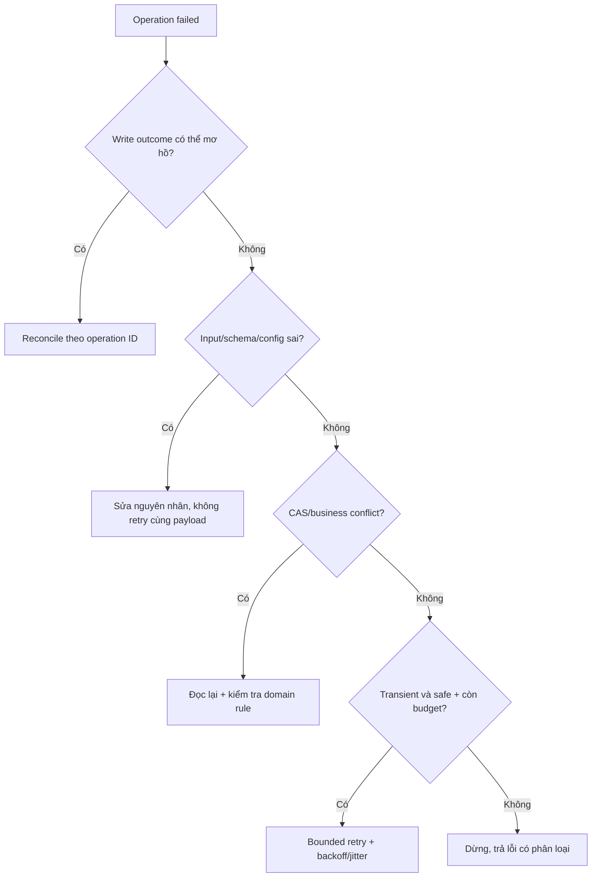

# Phân biệt lỗi có thể thử lại với lỗi cần thay đổi đầu vào hoặc cấu hình

## 1. Vấn đề: lỗi xảy ra không có nghĩa phải retry

Trong module **SPRING_DATA_COUCHBASE**, tầng truy cập Couchbase được xây dựng bằng Spring Data document mapping, repository, `CouchbaseTemplate`, truy vấn SQL++, thiết kế bucket/scope/collection, chỉ mục, TTL, CAS, giao dịch và API reactive.

Một operation lỗi có thể do network tạm gián đoạn, nhưng cũng có thể do request sai JSON path, document key không tồn tại, CAS stale, thiếu chỉ mục hoặc RBAC không đủ. Đặt `retry(3)` cho tất cả trường hợp thường gây thêm tải, trì hoãn phản hồi và trong trường hợp mutation **có thể ghi dữ liệu hai lần**.

Các trường hợp tiêu biểu:

- `get` tạm không có endpoint: có cơ hội hồi phục và là read-only.
- `DocumentNotFoundException`: có thể là domain 404, không phải sự cố transient.
- `PathMismatchException`: server không thể biến một JSON string thành object chỉ nhờ chờ đợi.
- `CasMismatchException`: phải **đọc lại dữ liệu và đánh giá lại nghiệp vụ**, không gửi lại payload cũ.
- `AmbiguousTimeoutException` sau `increment`/`arrayAppend`: server có thể đã commit; retry mù tạo tác dụng kép.
- `IndexNotFoundException`: index đang được tạo có thể cần chờ có điều kiện, còn index name sai cần sửa deploy.
- `AuthenticationFailureException`: password/RBAC/TLS cần được chỉnh, không thể chữa bằng vòng lặp.

**Nguyên tắc:** Quyết định retry phụ thuộc **nguyên nhân, giai đoạn request, tính idempotent, trạng thái nghiệp vụ và deadline**. “Lỗi tạm thời” không tự đồng nghĩa “lặp lại thao tác này an toàn”.

### Mục tiêu học tập

Sau bài này, bạn có thể:

1. Phân biệt lỗi transient, lỗi đầu vào/schema, lỗi cấu hình/vận hành, CAS conflict và kết quả ghi chưa xác định.
2. Hiểu SDK RetryStrategy/RetryReason và lý do không chồng thêm retry vô hạn.
3. Phân biệt `AmbiguousTimeoutException`, `UnambiguousTimeoutException` và `RequestCanceledException`.
4. Đánh giá idempotency cho KV reads, SQL++ SELECT, `upsert`, `insert`, `increment`, `arrayAppend` và transaction.
5. Xây policy có max attempts, end-to-end deadline, backoff, jitter, circuit breaker và quan sát được.
6. Xử lý đúng CAS/`@Version` và lỗi Sub-document trong Spring Data.
7. Viết Java blocking/reactive với lọc exception và kiểm thử failure modes.
8. Quyết định khi nào sửa RBAC, index, bucket/scope/collection, converter, durability/topology thay vì retry.

## 2. Document minh họa xuyên suốt

Giả sử bucket `shop`, scope `sales`, collection `orders` chứa key `order::1001`:

```json
{
  "_class": "order-document",
  "schema_version": 2,
  "state": "READY",
  "stock_reserved": true,
  "shipping": {
    "tracking_code": null
  },
  "stats": {
    "status_changes": 4
  },
  "last_operation_id": "",
  "history": [
    {"event_id": "evt::1001::ready", "state": "READY"}
  ]
}
```

Ba use cases:

- `loadOrder(id)` đọc theo key, không có side effect server.
- `markShipped(id, trackingCode, operationId)` đọc status/CAS, cập nhật state, tracking, counter và history bằng một `mutateIn`.
- `findOrdersByState("READY")` dùng SQL++ query và GSI.

Cùng một network timeout nhưng hậu quả khác: đọc lại GET thường an toàn; gửi lại một mutation có increment/append có thể tăng counter hoặc thêm event hai lần; SQL++ SELECT cần biết Query service/index và `readonly`.

## 3. Năm loại hành động phục hồi

| Nhóm | Khi dùng | Ví dụ |
| --- | --- | --- |
| **RETRY_SAFE** | Nguyên nhân có thể hồi phục; thao tác lặp an toàn; còn deadline | KV GET mất endpoint trong thời gian ngắn. |
| **RELOAD_AND_REVALIDATE** | Snapshot dùng để quyết định đã stale | CAS mismatch khi chuyển trạng thái. |
| **RECONCILE_BEFORE_RETRY** | Không biết mutation đã commit chưa | Ambiguous write timeout, durability ambiguity. |
| **CORRECT_INPUT_OR_DATA** | Path/value/JSON schema/query không hợp lệ | PathMismatch, Query parsing, encoding failure. |
| **CORRECT_CONFIGURATION** | Bucket/scope/index/RBAC/topology/durability sai | Index thiếu, auth fail, replica không đáp ứng. |

Thêm lựa chọn **STOP_AND_ESCALATE** khi không đủ bằng chứng để retry an toàn. Không cần ép mọi exception vào một nhánh “có thể thử lại”.



### 3.1. Transient khác retryable

**Transient** nói về khả năng sự cố thay đổi trong tương lai (node phục hồi, circuit đóng, queue bớt tải). **Retryable** còn đòi đáp ứng các điều kiện: request lặp không phá dữ liệu, còn thời gian, không gây overload và domain invariant chưa thay đổi.

Một lỗi permanent vẫn có thể *recoverable sau remediation*: sửa index/credential/JSON schema rồi chạy lại. Đó là **thay đổi điều kiện**, không phải retry cùng một operation ngay lập tức.

## 4. Couchbase SDK đã retry ở tầng transport

Tài liệu **Handling Errors** của Java SDK 3.x mô tả `BestEffortRetryStrategy` là cơ chế mặc định: SDK thử lại những lỗi được `RetryReason` xem là an toàn cho tới khi thành công hoặc hết timeout. Khi ứng dụng nhận exception:

- SDK có thể đã gửi nhiều attempts/dispatches.
- Exception terminal không đồng nghĩa chỉ có một lần gọi xuống server.
- Retry bổ sung ở service có thể nhân bội tải.
- SDK không hiểu transaction/ledger/operation ID của domain, vì vậy application vẫn phải quyết định side effect.

### 4.1. Ba giai đoạn request

1. **Pre-dispatch:** client đang tìm endpoint/socket.
2. **Dispatch:** đã gửi request và chờ phản hồi; với writes, kết quả có thể mơ hồ nếu response mất.
3. **Response arrived:** server trả success hoặc mã lỗi cụ thể.

Khi chưa dispatch, SDK có thể thử lại cả một số non-idempotent request nếu biết chắc chưa gửi. Khi đã dispatch, **idempotency** đặc biệt quan trọng. Không tự kết luận mọi lỗi socket là pre-dispatch chỉ từ message của exception.

### 4.2. SDK retry khác application retry

| Tầng | Biết gì? | Quyết định |
| --- | --- | --- |
| SDK RetryStrategy | Dispatch stage, request idempotence mặc định, RetryReason | Retry protocol/transport khi hợp lệ. |
| Persistence adapter | Operation kind, CAS, query readonly, JSON paths, deadline | Bounded retry và error translation. |
| Domain service | Trạng thái order, operation ID, quyền, ledger | Có được gửi lại command hay phải reconcile. |
| SRE/Operations | Node/replica/index/RBAC và cấu hình cluster | Fix topology/config và bảo đảm SLA. |

Chỉ thêm application retry khi có use case rõ, tránh lặp `for(;;)` trên tất cả `CouchbaseException`.

## 5. Idempotency: bảo vệ dữ liệu trước khi lặp lại

Một operation là **idempotent** khi lặp lại cùng ý định không tạo thêm hiệu ứng ngoài một lần, dưới các giả định concurrency phù hợp.

| API | Đánh giá | Lưu ý |
| --- | --- | --- |
| `Collection.get`, `exists`, `lookupIn` | Read-only, SDK nhận diện idempotent | Hai lần đọc có thể thấy hai version nếu writer khác cập nhật. |
| `getAnyReplica`/`getAllReplicas` | Read-only | Còn cân nhắc replica stale. |
| `cluster.query("SELECT ...", readonly(true))` | Server bảo đảm không sửa dữ liệu; SDK được retry dễ hơn | Chỉ bật trên query thật sự read-only. |
| `upsert(id, sameBody)` | Có thể idempotent theo **contract domain** | Writers khác, CAS, expiry/auditing có thể làm repeat không an toàn. |
| `insert(id, body)` | Lần lặp có thể báo exists | Không chứng minh command trước của chính bạn đã tạo key. |
| `replace` / `remove` | Có thể phá thay đổi người khác | Dùng CAS và idempotency khi thích hợp. |
| `MutateInSpec.increment` | Non-idempotent | Lặp hai lần có thể tăng hai lần. |
| `MutateInSpec.arrayAppend` | Non-idempotent | Lặp hai lần có thể thêm hai event. |
| `arrayAddUnique` | Dedupe một primitive theo semantics hỗ trợ | Không bảo đảm exactly-once của các specs khác. |
| SQL++ `UPDATE`/`INSERT`/`DELETE` | Không mặc định idempotent | SDK không tự parse SQL++ để quyết định read/write. |

### 5.1. Vì sao upsert không luôn an toàn?

Dù hai lần `upsert` gửi cùng JSON, một writer khác có thể ghi giữa hai lần; retry sẽ ghi đè họ. CAS thay đổi, TTL bị đặt lại, timestamp/audit khác nhau hoặc external event được gửi lặp. Chỉ cho retry sau khi chứng minh contract, chẳng hạn key thuộc một writer duy nhất, payload deterministic và không có side effects ngoài.

## 6. Ambiguous timeout: outcome chưa biết

`AmbiguousTimeoutException` thường xuất hiện khi client **không biết** mutation đã được server áp dụng thành công hay chưa, nhất là request đã dispatch nhưng response thất lạc.

```java
orders.mutateIn(
    orderId,
    List.of(
        MutateInSpec.increment("stats.status_changes", 1),
        MutateInSpec.arrayAppend("history", List.of(event))
    )
);
```

Nếu server commit rồi response mất, retry làm counter tăng hai lần và history chứa duplicate. `mutateIn` nhiều specs atomic **trong một attempt** không đồng nghĩa command là exactly-once qua retries.

**Quy trình:** tạo operation ID trước mutation → dùng marker trong cùng atomic write → sau ambiguous timeout đọc lại marker/state → phân biệt `ALREADY_APPLIED`, `NOT_APPLIED`, `INCONCLUSIVE` → chỉ retry với bằng chứng/thiết kế idempotency → nếu không rõ thì reconciliation, không tự tuyên bố thất bại.

Marker `last_operation_id` chỉ giữ lần cuối có thể bị ghi đè; ledger với operation ID ổn định hoặc transaction/outbox có thể cần cho yêu cầu mạnh hơn.

## 7. Unambiguous timeout và request cancellation

`UnambiguousTimeoutException` nghĩa là SDK xác định request không thể tạo side effect theo ngữ cảnh. Điều đó **hỗ trợ** retry, nhưng vẫn cần bounded budget, đảm bảo input/config đúng và không có external effects trước operation.

| Loại | Điều biết được | Ứng xử |
| --- | --- | --- |
| `AmbiguousTimeoutException` trên write | Có thể đã commit | Reconcile trước retry. |
| `UnambiguousTimeoutException` | SDK xác định không có side effect từ request | Có thể retry nếu policy, deadline và business cho phép. |
| Base `TimeoutException`/wrapper | Cần xem subtype/cause | Không mặc định retry. |
| `RequestCanceledException` | SDK dừng vì RetryStrategy, backpressure, shutdown hoặc lifecycle | Tìm nguyên nhân; không retry mù. |

Timeout là **triệu chứng**. Không có Query node, sai TLS config hoặc query full scan sẽ không được chữa bằng nhiều vòng đợi.

### 7.1. Khi SDK đã cancel, đừng ép retry

`RequestCanceledException` có thể xảy ra khi `RetryStrategy` không cho retry, quá nhiều requests chờ, hoặc SDK shutdown. Bọc `catch(RequestCanceledException) { mutateAgain(); }` có thể phá chính sách chống quá tải, thậm chí gây tác dụng kép với write đã dispatch.

## 8. RetryReason: tín hiệu kỹ thuật, không phải luật nghiệp vụ

Một số `RetryReason` trong tài liệu SDK:

| RetryReason | Gợi ý | Cần xác minh |
| --- | --- | --- |
| `NODE_NOT_AVAILABLE` | Không có node tại dispatch | Topology, failover. |
| `SERVICE_NOT_AVAILABLE` | Service chưa sẵn | Query/KV node readiness. |
| `ENDPOINT_NOT_AVAILABLE` | Không có endpoint khả dụng | Network, connection/TLS. |
| `ENDPOINT_CIRCUIT_OPEN` | Circuit breaker mở | Failure nền và load. |
| `ENDPOINT_NOT_WRITABLE` | Socket endpoint không thể ghi | Network/overload. |
| `KV_ERROR_MAP_INDICATED` | KV error map khuyên retry | Server response và backoff. |
| `QUERY_PREPARED_STATEMENT_FAILURE` | Prepared plan cần làm mới | Index/schema changes. |
| `QUERY_INDEX_NOT_FOUND` | Index thiếu | Index đang build hay DDL sai? |
| `ANALYTICS_TEMPORARY_FAILURE` | Analytics service tạm lỗi | Availability/queue. |

**Lưu ý:** `RetryReason` được SDK mô tả là **volatile**, có thể đổi giữa phiên bản; `ErrorContext` cũng có thể chứa document ID, SQL statement, endpoint. Không log nguyên context hoặc phụ thuộc vào chuỗi message.

### 8.1. `QUERY_INDEX_NOT_FOUND` không tự sửa được index sai tên

Nếu index đang được triển khai, một bounded wait/readiness gate có thể hợp lý. Nếu index name/DDL/RBAC sai, retry vô hạn chỉ kéo dài outage. Chẩn đoán theo deployment status và index metadata thay vì dựa vào exception name.

## 9. BestEffortRetryStrategy và tùy chỉnh

SDK 3 mặc định có `BestEffortRetryStrategy`; docs khuyên giữ default cho đa số trường hợp và chỉ custom khi có yêu cầu cụ thể. Một ví dụ minh họa fail-fast khi circuit mở:

```java
import java.util.concurrent.CompletableFuture;
import com.couchbase.client.core.retry.BestEffortRetryStrategy;
import com.couchbase.client.core.retry.RetryAction;
import com.couchbase.client.core.retry.RetryReason;
import com.couchbase.client.core.msg.Request;
import com.couchbase.client.core.msg.Response;

final class CircuitAwareRetryStrategy
        extends BestEffortRetryStrategy {

    @Override
    public CompletableFuture<RetryAction> shouldRetry(
            Request<? extends Response> request,
            RetryReason reason) {

        if (reason == RetryReason.ENDPOINT_CIRCUIT_OPEN) {
            return CompletableFuture.completedFuture(
                RetryAction.noRetry());
        }
        return super.shouldRetry(request, reason);
    }
}
```

Đây là ví dụ **ý định kỹ thuật**; xác minh API/Javadoc theo SDK version và không áp fail-fast cho mọi workload khi chưa đánh giá availability SLA. `FailFastRetryStrategy` của SDK 3 có thể đánh dấu `@Internal`; không coi nó là API application ổn định.

**Không block trong `shouldRetry`**: không SQL query, HTTP call, file I/O, `Thread.sleep` trên hot path. Khi cần custom, có thể cấu hình `ClusterEnvironment.builder().retryStrategy(...)` hoặc per-request theo options; tái sử dụng instance.

## 10. Ma trận lỗi KV cơ bản

| Exception | Có retry nguyên call không? | Hướng xử lý |
| --- | --- | --- |
| `DocumentNotFoundException` | Không mặc định | Kiểm key, TTL, routing, domain 404/optional. |
| `DocumentExistsException` | Không | Conflict/idempotency verification, không overwrite mù. |
| `CasMismatchException` | Không với CAS cũ | Reload + revalidate, bounded attempts. |
| `TemporaryFailureException` | Có điều kiện, ưu tiên read | Backoff, kiểm tải. |
| `ServiceNotAvailableException` | Chỉ khi service sắp phục hồi | SRE/cluster readiness, không chờ vô hạn. |
| `AmbiguousTimeoutException` | Không với non-idempotent write | Reconciliation. |
| `UnambiguousTimeoutException` | Có điều kiện | Bounded retry/deadline. |
| `RequestCanceledException` | Không mặc định | SDK policy, shutdown, backpressure. |
| `AuthenticationFailureException` | Không | Sửa credential, cert, RBAC. |
| `BucketNotFoundException` / `CollectionNotFoundException` | Không khi route sai | Sửa config/IaC. |
| `EncodingFailureException` / `DecodingFailureException` | Không | Sửa mapping/serializer/value. |
| `ValueTooLargeException` | Không | Đổi data model/split document. |
| `DurabilityImpossibleException` | Không auto downgrade | Kiểm topology, replica, SLA. |

Class/cause thật có thể thay đổi theo SDK/server và Spring translation. Bảng là **quyết định khởi đầu**, không phải reason để bắt một exception chung rồi retry.

### 10.1. NotFound đôi khi bình thường

Repository `findById` trả `Optional.empty()` có thể là trạng thái domain. Nếu dữ liệu đang được tạo qua event eventual consistency, **poll có deadline riêng cho nghiệp vụ** có thể thích hợp; đó không phải generic network retry.

## 11. CAS conflict phải đọc lại và kiểm tra rule

Ví dụ hai clients thay cùng order:

```text
A đọc order READY, CAS = C1
B đổi state thành CANCELLED, CAS = C2
A gửi SHIPPED với CAS = C1
Server từ chối A vì CAS mismatch
```

Nếu A lấy CAS mới nhưng **không đọc lại state**, có thể ship order đã bị hủy. Cách đúng:

1. `lookupIn` đọc `state`, `last_operation_id` và CAS **cùng snapshot**.
2. Nếu operation ID đã xử lý, xác minh final state.
3. Kiểm tra `state=READY`, actor và tracking.
4. Dựng `MutateInSpec` với `MutateInOptions.cas(snapshot.cas())`.
5. Nếu `CasMismatchException`: đọc lại, đánh giá lại, có giới hạn số lần thử.
6. Nếu trạng thái đã khác READY: trả business conflict.
7. Nếu ambiguous timeout: chuyển **reconciliation**, không coi là CAS retry.

CAS bảo vệ phiên bản **toàn document**, không chỉ `state`. Một writer cập nhật `stats.views` cũng có thể làm CAS thay đổi, dẫn đến conflict dù state chưa đổi.

### 11.1. Ví dụ một attempt với Java SDK

```java
import java.util.List;
import com.couchbase.client.java.kv.LookupInResult;
import com.couchbase.client.java.kv.LookupInSpec;
import com.couchbase.client.java.kv.MutateInSpec;
import com.couchbase.client.java.kv.MutateInOptions;

LookupInResult snapshot = orders.lookupIn(
    orderId,
    List.of(
        LookupInSpec.get("state"),
        LookupInSpec.get("last_operation_id")
    )
);

String state = snapshot.contentAs(0, String.class);
if (!"READY".equals(state)) {
    throw new IllegalStateException(
        "Order state does not allow shipping");
}

orders.mutateIn(
    orderId,
    List.of(
        MutateInSpec.replace("state", "SHIPPED"),
        MutateInSpec.upsert(
            "last_operation_id", operationId)
    ),
    MutateInOptions.mutateInOptions()
        .cas(snapshot.cas())
);
```

Code trên chỉ minh họa **một attempt**; production còn cần domain validation, xử lý marker, tracking/history, timeout và retry loop có giới hạn. Không gửi retry với **cùng CAS cũ** sau mismatch.

### 11.2. Spring `@Version`

Spring Data Couchbase ánh xạ `@Version` vào CAS. Nếu repository đọc entity với CAS cũ rồi raw SDK mutate document, `repository.save(staleEntity)` có thể báo optimistic locking failure. Hành động đúng là đọc lại entity, đánh giá nghiệp vụ và save với version mới, không tự tăng CAS hoặc overwrite raw JSON cũ.

## 12. Atomic multi-spec và timeout: hai khái niệm độc lập

Một Sub-document `mutateIn` có thể cập nhật nhiều paths **nguyên tử trên một document**:

```java
orders.mutateIn(
    orderId,
    List.of(
        MutateInSpec.replace("state", "SHIPPED"),
        MutateInSpec.increment("stats.status_changes", 1),
        MutateInSpec.arrayAppend(
            "history", List.of(event)),
        MutateInSpec.upsert(
            "last_operation_id", operationId)
    ),
    MutateInOptions.mutateInOptions()
        .cas(expectedCas)
);
```

Nếu một spec bị server từ chối vì path/type error, **không có partial commit**. Nhưng nếu response bị mất sau khi server có thể commit, application không biết toàn mutation đã xảy ra hay chưa.

**Không đồng nhất:**

- Atomicity = không commit một nửa danh sách specs trong **một request**.
- CAS = tránh ghi dựa trên stale snapshot.
- Durability = đợi replication/persistence đến mức yêu cầu.
- Idempotency = retry một **business command** không tạo side effect lặp.
- Transaction = khi cần nhiều document keys cùng commit/rollback theo invariant.

Một timeout không tự chứng minh atomic rollback.

## 13. Sub-document path errors: sửa path/schema thay vì retry

| Lỗi | Ví dụ | Hành động |
| --- | --- | --- |
| `PathNotFoundException` | `replace("shipping.carrier",...)` nhưng field thiếu | Kiểm schema/required vs optional/`@Field`. |
| `PathExistsException` | `insert("profile.email",...)` nhưng đã có, dù value null | Kiểm conflict/command ID. |
| `PathMismatchException` | `arrayAppend("profile",...)` trong khi profile là object | Sửa JSON type/operation. |
| `PathInvalidException` | `arrayInsert("tags",...)` thiếu array index cuối | Sửa path grammar. |
| `DocumentNotJsonException` | Subdoc trên binary document | Chuyển storage model hoặc API. |
| `PathTooDeepException` | JSON path quá sâu | Thiết kế lại nesting/path. |

`createPath()` chỉ hỗ trợ một số specs và tạo parent khi phù hợp; **không** chuyển string đã tồn tại thành JSON object. Một typo như `proifle.email` kèm `createPath()` có thể khiến mutation thành công nhưng tạo nhánh **sai schema**.

### 13.1. `lookupIn` và `mutateIn` khác về failure

- Với nhiều lookup specs, path missing ở một spec không nhất thiết phá kết quả spec khác; chúng đọc cùng một document version.
- Với nhiều mutate specs, lỗi một spec làm toàn mutation không commit.
- Giới hạn Sub-document thông thường là **16 specs/request**; nếu tách hai mutate requests, chúng không atomic chung.

SDK có thể báo lỗi mutation tổng hợp kiểu `MultiMutationException`; phân tích spec failure status/error context theo version. Không parse exception message rồi quyết định `createPath()` đại trà.

## 14. Spring Data mapping và validation: retry không chữa sai dữ liệu

Repository/Template đọc entity bằng `MappingCouchbaseConverter`, `CouchbaseCustomConversions`, `@Field` và type hint `_class`/`@TypeAlias`. Raw SDK đi trực tiếp JSON path nên có thể ghi sai representation:

```java
// Java property: shipping.trackingCode,
// storage field có @Field("tracking_code").
MutateInSpec.upsert(
    "shipping.trackingCode", "VN1234"); // Sai JSON path
```

SDK có thể tạo một JSON field lạ `trackingCode`, trong khi repository đọc `tracking_code` cũ. Retry operation này chỉ tạo hoặc ghi đè sai field lần nữa.

Tương tự:

- `Instant` được converter mong ISO string nhưng SDK ghi epoch number.
- `Money` mong object `amount_minor/currency`, nhưng SDK ghi string.
- Enum mới không được reading converter nhận diện.
- `_class` bị xóa/sai alias.
- Required field MISSING/NULL hoặc parent sai type.

`EncodingFailureException`/`DecodingFailureException` và Spring mapping errors **cần sửa converter/data/schema**, không lặp cùng bytes. Tạo migration V1/V2 có CAS, raw JSON test, repository readback và rollback plan.

### 14.1. Bean Validation và auditing

Raw SDK `mutateIn` không tự chạy Spring auditing/callbacks/Bean Validation. Nếu service chỉ sửa state nhưng quên `modified_at_ms`/`modified_by`, log kiểm toán không đúng. Retry không tự thêm các field ấy; phải thiết kế adapter và gộp fields liên quan trong cùng mutation.

## 15. SQL++ lỗi index, planning, syntax và service

Các nhóm Query errors có nguyên nhân khác nhau:

| Nhóm | Ví dụ | Policy |
| --- | --- | --- |
| `ParsingFailureException` | SQL++ syntax sai | Fix statement. |
| `PlanningFailureException` | Query plan không hợp lệ | Xem DDL/index/EXPLAIN. |
| `IndexNotFoundException` | Index hint/index chưa tồn tại | Xác định đang build hay tên index sai. |
| `PreparedStatementFailureException` | Prepared plan cũ | SDK có thể refresh/retry phù hợp. |
| `ServiceNotAvailableException` | Không có Query node hoặc node unavailable | Topology/readiness, không chờ vô hạn. |
| Read-only timeout | Query/Index service quá tải, scan chậm | Budget, backoff; kiểm plan/tracing. |

### 15.1. SELECT thực sự read-only

```java
import com.couchbase.client.java.json.JsonObject;
import com.couchbase.client.java.query.QueryOptions;
import com.couchbase.client.java.query.QueryResult;

String sql = """
    SELECT META(o).id AS orderId, o.state
    FROM `shop`.`sales`.`orders` AS o
    WHERE o.state = $state
    """;

QueryResult result = cluster.query(
    sql,
    QueryOptions.queryOptions()
        .parameters(
            JsonObject.create().put("state", "READY"))
        .readonly(true)
);
```

`readonly(true)` giúp server bảo đảm statement không mutation và SDK được tự tin retry hơn. SDK không tự parse mọi SQL++ string để nhận diện SELECT; không đặt `readonly(true)` trên `UPDATE/INSERT/DELETE/MERGE` để “ép an toàn”.

### 15.2. Query mutation không dùng policy SELECT

SQL++ `UPDATE` có thể sửa nhiều documents; nếu timeout, kết quả có thể mơ hồ. Bounded retry chỉ hợp lệ khi có operation ID/transaction/idempotency contract phù hợp, không đơn giản dùng `retryWhen` cho tất cả query.

### 15.3. Index readiness khác retry trong request path

Nếu index đang được dựng trong deployment, nên có **readiness gate** với deadline; không biến mỗi HTTP request thành hàng trăm lần thử query. Nếu index name sai hoặc DDL không deploy, chỉ sửa cấu hình mới khắc phục được.

### 15.4. Không thấy row ngay sau KV mutation

GSI cập nhật bất đồng bộ. SQL++ SELECT không thấy row mới có thể là **query consistency**, không phải database lỗi cần retry liên tục. Khi cần read-after-write, dùng `REQUEST_PLUS` hoặc mutation-state consistency với đánh đổi latency.

## 16. Bucket, scope, collection và connection configuration

Các lỗi cần khắc phục thay vì retry mù:

- `BucketNotFoundException`.
- `CollectionNotFoundException`.
- `ScopeNotFoundException` ở các API liên quan.
- `ServiceNotAvailableException` vì deployment không có loại service cần gọi.
- Host/DNS, port, TLS truststore/certificate, seed nodes sai.
- Spring Data repository dùng collection khác với raw SDK `Collection`.

**Kiểm tra:** tên bucket/scope/collection chính xác, môi trường staging/prod, key prefix/tenant routing, connection config, version server và quyền RBAC.

Nếu infrastructure controller đang tạo collection có chủ đích, có thể chờ readiness với deadline. Nhưng **business request không được tự tạo collection** chỉ vì lỗi routing; keyspace lifecycle thuộc IaC/deployment.

## 17. Authentication, authorization và TLS

`AuthenticationFailureException` hoặc permission error thường do password/secret sai, user không có RBAC, certificate invalid hoặc client trỏ sai cluster. Không retry với cùng credential vô hạn và không log connection string chứa secret.

Khi secret rotation đang triển khai, phép sửa là **refresh identity/config**, sau đó xác minh; khác retry cùng request trong khi cấu hình không đổi. Alert khi lỗi auth tăng; đừng chuyển sang tài khoản admin để chữa nhanh.

Các lỗi resource không có quyền **không** được biến thành “document not found” ở tầng persistence rồi tự tạo dữ liệu.

## 18. Durability: không silently downgrade

Couchbase hỗ trợ `DurabilityLevel.MAJORITY`, `MAJORITY_AND_PERSIST_TO_ACTIVE`, `PERSIST_TO_MAJORITY`. Các lỗi:

| Lỗi | Ý nghĩa | Hướng xử lý |
| --- | --- | --- |
| `DurabilityLevelNotAvailableException` | Level/feature không được server hoặc bucket hỗ trợ | Sửa compatibility/config. |
| `DurabilityImpossibleException` | Replica/topology không đạt yêu cầu | SRE xem node, vBucket, replica count, disk/bucket. |
| `DurabilityAmbiguousException` | Outcome durable write không chắc | Reconcile trước retry. |
| `DurableWriteInProgressException` | SyncWrite pending cùng key | Backoff có giới hạn, kiểm contention/cluster health. |

Không làm:

```java
// Sai: hạ độ bền trong catch, đổi SLA mà không ai biết.
try {
    orders.mutateIn(id, specs,
        MutateInOptions.mutateInOptions()
            .durability(DurabilityLevel.MAJORITY));
} catch (DurabilityImpossibleException ex) {
    orders.mutateIn(id, specs);
}
```

Một write cho order/payment phải giữ durability policy đã cam kết. Retry với `NONE` sẽ đổi ý nghĩa dữ liệu và có thể tạo duplicate nếu request đầu có outcome ambiguous. Ephemeral bucket không thể có disk-persistence semantics như disk-backed bucket; tăng attempts không làm yêu cầu không hỗ trợ trở thành hỗ trợ.

## 19. Lỗi tải, giới hạn size và thiết kế dữ liệu

- `TemporaryFailureException` do KV bận: có thể backoff cho read và giảm concurrency.
- `ValueTooLargeException`: phải giảm payload/tách document.
- JSON path quá sâu: sửa data model.
- Query không có index và quét toàn collection: sửa index/query plan.
- CAS conflicts trên hot key: tách counters/batching/sharding.
- Queue/backpressure/circuit open: giảm tải và bảo vệ server.

Retries cũng tiêu tốn socket, CPU, network và disk. Nếu nguyên nhân là overload, **retry storm** làm hệ thống tệ hơn. Dùng rate limiting, bulkhead, circuit breaker và ưu tiên sửa capacity/traffic.

## 20. Retry budget và deadline

Một policy production cần:

- **Max attempts**, không vô hạn.
- **End-to-end deadline**, bao gồm thời gian của mọi attempt.
- **Per-attempt timeout** phù hợp phần ngân sách còn lại.
- **Exponential backoff + jitter** tránh thundering herd.
- **Circuit breaker/bulkhead** khi hệ thống quá tải.
- **Cancellation propagation** và resource cleanup.
- **Idempotency/reconciliation** cho writes.
- **Metrics** theo operation/error category/attempt/outcome.

```text
Total budget: 2,000 ms
Attempt 1: 400 ms
Backoff 1: 100 ms
Attempt 2: 400 ms
Backoff 2: 250 ms
Attempt 3: tối đa phần budget còn lại
```

Không đặt timeout 2 giây **cho mỗi** attempt rồi để request kéo dài 6–8 giây. Timeout cũng không phải phép chữa query full scan hoặc hot key: cần sửa cấu trúc/plan tương ứng.

## 21. Enum cho recovery action và operation kind

```java
public enum RecoveryAction {
    RETRY_READ_WITH_BUDGET,
    RELOAD_AND_REVALIDATE,
    RECONCILE_BEFORE_RETRY,
    CORRECT_INPUT_OR_SCHEMA,
    CORRECT_CONFIGURATION,
    STOP_AND_ESCALATE
}

public enum OperationKind {
    KV_READ_ONLY,
    SQLPP_READ_ONLY,
    CONDITIONAL_MUTATION,
    NON_IDEMPOTENT_MUTATION,
    SQLPP_MUTATION
}
```

Một boolean `isRetryable` không đủ biểu diễn CAS reload, ambiguous reconciliation, schema migration và config fix. Cùng một exception class có thể cần hành động khác tùy loại operation.

## 22. Java classifier bảo thủ theo type

Ví dụ sử dụng SDK Java 3.x; hoàn thiện mapping dựa trên resolved dependencies/integration tests:

```java
import com.couchbase.client.core.error.*;
import org.springframework.dao.DataAccessException;

public final class CouchbaseRecoveryPolicy {

    private CouchbaseRecoveryPolicy() {}

    public static RecoveryAction decide(
            Throwable failure,
            OperationKind kind) {

        Throwable current = failure;

        // Duyệt cause do Spring / CompletableFuture / SDK bọc.
        for (int depth = 0;
             current != null && depth < 12;
             depth++, current = current.getCause()) {

            if (current instanceof AmbiguousTimeoutException
                    || current instanceof DurabilityAmbiguousException) {
                return RecoveryAction.RECONCILE_BEFORE_RETRY;
            }

            if (current instanceof CasMismatchException) {
                return RecoveryAction.RELOAD_AND_REVALIDATE;
            }

            if (current instanceof UnambiguousTimeoutException
                    || current instanceof TemporaryFailureException) {
                return readOnly(kind)
                    ? RecoveryAction.RETRY_READ_WITH_BUDGET
                    : RecoveryAction.STOP_AND_ESCALATE;
            }

            if (current instanceof AuthenticationFailureException
                    || current instanceof BucketNotFoundException
                    || current instanceof CollectionNotFoundException
                    || current instanceof DurabilityImpossibleException
                    || current instanceof
                        DurabilityLevelNotAvailableException) {
                return RecoveryAction.CORRECT_CONFIGURATION;
            }

            if (current instanceof DocumentNotFoundException
                    || current instanceof DocumentExistsException
                    || current instanceof InvalidArgumentException
                    || current instanceof ParsingFailureException
                    || current instanceof EncodingFailureException
                    || current instanceof DecodingFailureException
                    || current instanceof PathNotFoundException
                    || current instanceof PathMismatchException
                    || current instanceof PathInvalidException) {
                return RecoveryAction.CORRECT_INPUT_OR_SCHEMA;
            }

            if (current instanceof RequestCanceledException) {
                return RecoveryAction.STOP_AND_ESCALATE;
            }
        }

        // Spring translator có thể bọc SDK cause hoặc thay type.
        // Fallback bảo thủ nếu không có evidence đủ.
        if (failure instanceof DataAccessException) {
            return RecoveryAction.STOP_AND_ESCALATE;
        }
        return RecoveryAction.STOP_AND_ESCALATE;
    }

    private static boolean readOnly(OperationKind kind) {
        return kind == OperationKind.KV_READ_ONLY
            || kind == OperationKind.SQLPP_READ_ONLY;
    }
}
```

### 22.1. Giới hạn cố ý của classifier

- `UnambiguousTimeout` trên write **có thể** retry nếu policy chứng minh side effect chưa xảy ra và tổng workflow an toàn, nhưng ví dụ chọn bảo thủ.
- `TemporaryFailure` trên write không mặc định resend khi chưa biết outcome.
- `DocumentNotFound` có thể là optional domain read; không nhất thiết “data corruption”.
- `PathExists`/`MultiMutationException`, `IndexNotFound`, `ServiceNotAvailable` và các Query exceptions cần mapping riêng theo context.
- Cause chain có thể chứa nhiều loại và wrapper; production nên bảo vệ vòng lặp cycle/depth.
- Không dùng `exception.getMessage()`/`toString()` để phân loại hoặc log vì `ErrorContext` có thể chứa document ID, statement và endpoint.
- Spring `TransientDataAccessException` chỉ là gợi ý về recoverability; **không chứng nhận write idempotent**.

### 22.2. Không lạm dụng `CouchbaseException` catch-all

```java
// Không dùng:
catch (CouchbaseException ex) {
    return retrySameMutation();
}
```

Một catch-all chỉ thích hợp để dịch lỗi/giữ cause, không quyết định gửi lại mọi operation. SDK có default retries; tầng service cần operation kind và outcome.

## 23. Java blocking GET retry với tổng deadline

Ví dụ chỉ dành cho **read-only get**, không sao chép cho `mutateIn`:

```java
import java.time.Duration;
import java.util.concurrent.TimeUnit;
import java.util.concurrent.locks.LockSupport;

import com.couchbase.client.core.error.TemporaryFailureException;
import com.couchbase.client.core.error.UnambiguousTimeoutException;
import com.couchbase.client.java.Collection;
import com.couchbase.client.java.kv.GetOptions;
import com.couchbase.client.java.kv.GetResult;

public final class BoundedKvReader {

    private final Collection collection;

    public BoundedKvReader(Collection collection) {
        this.collection = collection;
    }

    public GetResult get(String id) {
        final int maxAttempts = 3;
        final long deadline = System.nanoTime()
            + TimeUnit.SECONDS.toNanos(2);

        for (int attempt = 1; attempt <= maxAttempts; attempt++) {
            long remaining = deadline - System.nanoTime();
            if (remaining <= 0) {
                throw new IllegalStateException(
                    "Read deadline exhausted");
            }

            try {
                return collection.get(
                    id,
                    GetOptions.getOptions()
                        .timeout(Duration.ofNanos(remaining))
                );
            } catch (TemporaryFailureException
                    | UnambiguousTimeoutException transientError) {

                long left = deadline - System.nanoTime();
                if (attempt == maxAttempts || left <= 0) {
                    throw transientError;
                }

                long delay = Math.min(
                    TimeUnit.MILLISECONDS.toNanos(40L * attempt),
                    left);
                LockSupport.parkNanos(delay);

                if (Thread.currentThread().isInterrupted()) {
                    Thread.currentThread().interrupt();
                    throw transientError;
                }
            }
        }
        throw new IllegalStateException("Unreachable");
    }
}
```

**Giới hạn:** ví dụ minh họa max attempts, deadline và phân loại lỗi; backoff chưa có jitter. SDK đã retry nội bộ, nên ứng dụng phải đo request amplification trước khi thêm lớp này. Nếu deadline hết sớm, ví dụ ném `IllegalStateException`; production cần giữ/căn chỉnh cause và domain deadline error. `parkNanos` là blocking, **không gọi trên WebFlux event loop**.

## 24. Reactive GET: `Retry.backoff` có filter và jitter

Reactor cung cấp `reactor.util.retry.Retry` cho các operation thực sự an toàn để retry. Ví dụ GET:

```java
import java.time.Duration;
import reactor.core.publisher.Mono;
import reactor.util.retry.Retry;

import com.couchbase.client.core.error.TemporaryFailureException;
import com.couchbase.client.core.error.UnambiguousTimeoutException;
import com.couchbase.client.java.kv.GetResult;

Mono<GetResult> read = Mono.defer(() ->
    orders.reactive().get(orderId)
).retryWhen(
    Retry.backoff(2, Duration.ofMillis(100))
        .maxBackoff(Duration.ofMillis(500))
        .jitter(0.5)
        .filter(error ->
            error instanceof TemporaryFailureException
            || error instanceof UnambiguousTimeoutException)
        .onRetryExhaustedThrow(
            (spec, signal) -> signal.failure())
).timeout(Duration.ofSeconds(2));
```

- `Retry.backoff(2,...)` cho phép **2 lần retry** sau lần đầu, tức tối đa **3 attempts**.
- `filter` giữ lỗi input/schema/auth/index name sai không bị retry.
- `jitter(0.5)` tránh đồng thời gửi lại khi nhiều instances cùng lỗi.
- `timeout(2s)` đặt giới hạn toàn reactive pipeline. Cancellation không chứng minh một **write** chưa xảy ra, nhưng GET ở đây là read-only.
- `Mono.defer` tạo publisher lại cho subscription/attempt; không đưa external side effects vào source có retry.
- Đừng nhầm `reactor.util.retry.Retry` với retry helper cũ trong `com.couchbase.client.core.retry.reactor` (tài liệu SDK ghi deprecated).

### 24.1. `onErrorResume` không phải `doOnError`

`doOnError` chỉ quan sát để metric/log safe; `onErrorResume` thay đổi flow và trả fallback. Không viết `onErrorResume(e -> Mono.empty())` cho mọi `DataAccessException` vì sẽ che lỗi authentication/query/data corruption thành “không có dữ liệu”.

### 24.2. Không nhân đôi retry trên publisher ghi

```java
// Anti-pattern: KHÔNG áp retry vô điều kiện lên mutation.
orders.reactive()
    .mutateIn(orderId, specs)
    .retryWhen(Retry.backoff(
        10, Duration.ofMillis(100)));
```

Nếu mutation có `increment`/`arrayAppend`, retry sau ambiguous timeout có thể gửi lại và gây tác dụng kép. Cần recovery policy theo business operation, không copy config của GET.

## 25. Reactive CAS retry phải **đọc lại** trên từng attempt

Mỗi lần CAS mismatch cần thực hiện lại `lookupIn`, domain validation rồi mutate:

```java
import java.time.Duration;
import java.util.List;
import reactor.core.publisher.Mono;
import reactor.util.retry.Retry;

import com.couchbase.client.core.error.CasMismatchException;
import com.couchbase.client.java.kv.LookupInSpec;
import com.couchbase.client.java.kv.MutateInSpec;
import com.couchbase.client.java.kv.MutateInOptions;

Mono<?> shipAttempt = Mono.defer(() ->
    orders.reactive()
        .lookupIn(orderId, List.of(
            LookupInSpec.get("state"),
            LookupInSpec.get("last_operation_id")
        ))
        .flatMap(snapshot -> {
            String state =
                snapshot.contentAs(0, String.class);
            String lastId =
                snapshot.contentAs(1, String.class);

            if (operationId.equals(lastId)) {
                // Production: verify final state before return.
                return Mono.empty();
            }

            if (!"READY".equals(state)) {
                return Mono.error(
                    new IllegalStateException(
                        "Invalid order transition"));
            }

            return orders.reactive().mutateIn(
                orderId,
                List.of(
                    MutateInSpec.replace(
                        "state", "SHIPPED"),
                    MutateInSpec.upsert(
                        "last_operation_id", operationId)
                ),
                MutateInOptions.mutateInOptions()
                    .cas(snapshot.cas())
            );
        })
);

Mono<?> withCasRetry = shipAttempt.retryWhen(
    Retry.backoff(2, Duration.ofMillis(50))
        .filter(error ->
            error instanceof CasMismatchException)
);
```

Giải thích:

- `Mono.defer` đảm bảo mỗi lần retry đi qua **lookup** mới.
- Chỉ CAS mismatch rõ ràng được retry; các errors khác đi tiếp lên service.
- Không retry `mutateIn` riêng với CAS cũ.
- Không dùng `Mono.empty()` như kết luận “đã xử lý” nếu chưa xác minh status/tracking/event theo operation ID.
- Nếu mất response sau write, **ambiguous outcome không thuộc nhánh CAS retry**; phải reconcile.

### 25.1. Đừng đặt external side effects trong đoạn có thể chạy lại

Nếu `flatMap` gọi payment gateway, gửi email hoặc publish message chưa có idempotency, retry CAS có thể gọi side effect lại. Dùng outbox/transaction/idempotency ở ranh giới thích hợp.

## 26. Async `CompletableFuture`: wrapper exception không phải nguyên nhân

Couchbase SDK `orders.async().get(...)` trả `CompletableFuture`. `CompletionException` khi `join` hoặc `ExecutionException` khi `get` có thể bọc lỗi gốc.

```java
import java.util.concurrent.CompletableFuture;

CompletableFuture<?> request =
    orders.async().get(orderId);

request.whenComplete((value, failure) -> {
    if (failure == null) {
        return;
    }

    RecoveryAction action =
        CouchbaseRecoveryPolicy.decide(
            failure, OperationKind.KV_READ_ONLY);

    // Metric/log chỉ action + operation enum + duration;
    // không dump raw failure, ErrorContext, document ID.
    recoveryMetrics.record("LOAD_ORDER", action);
});
```

`recoveryMetrics` là collaborator minh họa do ứng dụng triển khai, không phải API Couchbase. Nếu muốn đo latency, capture `System.nanoTime()` trước khi gọi async, tính elapsed trong callback, không đo lúc tạo future rồi coi đó là I/O latency.

### 26.1. Async và reactive không tự làm operation idempotent

`CompletableFuture` hoặc `Mono` chỉ thay đổi cách quan sát completion/error. CAS, durability, ambiguous timeout và side effects vẫn giữ semantics giống blocking SDK.

## 27. Multi-document transactions có retry và failure policy riêng

Khi order và inventory cần cập nhật cùng nhau, một `mutateIn` không đủ vì nó chỉ atomic trên **một document**. Couchbase distributed transactions có SDK callback/commit/rollback riêng và một số attempt có thể được chạy lại.

### 27.1. Không đưa side effect không idempotent vào transaction lambda

Nếu callback transaction chứa `sendEmail()`/`chargeCard()` hoặc HTTP call không idempotent, một retry transaction có thể gửi lại tác động bên ngoài. Dùng outbox hoặc external operation ID.

### 27.2. Không lồng retry loop KV vào transaction framework

Không lấy retry loop GET/CAS thông thường rồi bọc một transaction callback mà không hiểu transaction SDK lifecycle. Bản thân transaction manager có cơ chế retry/commit outcomes; timeout/unknown commit cần được xử lý theo tài liệu transaction của version đang dùng.

### 27.3. Tách các mức bảo đảm

- CAS: optimistic concurrency trên một document.
- Multi-spec `mutateIn`: atomic paths trong một document.
- Durability: replication/persistence policy.
- Transaction: phối hợp nhiều keys.
- Idempotency: cùng business command không gây tác dụng lặp qua retries.

Một kỹ thuật không tự thay thế các kỹ thuật còn lại.

## 28. Operation ID và reconciliation cho mutation

Tạo `operationId` trước request (đừng sinh ID mới cho mỗi retry cùng command). Ghi marker **trong cùng mutation** với business changes:

```java
orders.mutateIn(
    orderId,
    List.of(
        MutateInSpec.replace(
            "state", "SHIPPED"),
        MutateInSpec.increment(
            "stats.status_changes", 1),
        MutateInSpec.arrayAppend(
            "history", List.of(event)),
        MutateInSpec.upsert(
            "last_operation_id", operationId)
    ),
    MutateInOptions.mutateInOptions()
        .cas(expectedCas)
);
```

Sau `AmbiguousTimeoutException`, `lookupIn` đọc `last_operation_id`, `state` và các tín hiệu cần thiết để quyết định:

| Readback | Kết luận có thể | Hành động |
| --- | --- | --- |
| Marker trùng, state đúng, contract chứng minh atomically ghi event/counter | Đã áp dụng | Không resend. |
| Marker không trùng nhưng có writer khác sau đó | Không đủ chứng cứ chưa áp dụng | Reconcile sâu theo event/ledger. |
| Document không tồn tại | Có thể TTL/xóa/routing | Điều tra, không tự tạo mới. |
| Query SQL++ chưa thấy state | Có thể GSI lag | Ưu tiên KV readback, query consistency phù hợp. |
| Không thể phân biệt | `INCONCLUSIVE` | Đưa vào reconciliation; không tạo double effect. |

Marker `last_operation_id` dễ bị ghi đè. Với exactly-once dài hạn, dùng idempotency ledger có key theo operation ID hoặc transaction/outbox, dựa vào requirements. Không coi SDK request ID là operation ID của business.

## 29. Thay đổi đầu vào, dữ liệu và cấu hình theo từng loại lỗi

Có ít nhất bốn hình thức “sửa rồi thử lại” khác nhau:

1. **Input validation:** sửa field/path/value, giới hạn độ dài, business transition.
2. **Data remediation:** migrate schema V1/V2, sửa type, reindex, kiểm CAS.
3. **Infrastructure/config:** IAM/RBAC, bucket/scope/collection, TLS, Query node, replica và durability.
4. **Deployment readiness:** đợi index online, dịch vụ bootstrap hoặc seed config đã được áp.

**Đừng tạo sửa đổi cơ sở dữ liệu ngầm trong catch** chỉ để request thành công. Ví dụ catch `PathNotFound` rồi bật `createPath` có thể biến typo thành field mới; catch `DurabilityImpossible` rồi bỏ yêu cầu Majority làm giảm SLA.

### 29.1. Một retry sau remediation thực sự khác retry nguyên request

Sau khi đã triển khai index đúng, việc thử lại SELECT là hợp lý. Nhưng trước khi index có mặt, retry vô hạn không giúp. Tương tự, sau khi secret rotation hoàn tất, dùng client có credential mới là hành động khôi phục, không phải tiếp tục gửi với password cũ.

## 30. Bảng quyết định thực hành cho các tình huống phổ biến

| Triệu chứng | Nguyên nhân cần xác minh | Lặp an toàn không? | Hành động |
| --- | --- | --- | --- |
| GET timeout, node đang failover | Endpoint/cluster health | Có thể, read-only và còn budget | SDK retry + bounded policy. |
| GET key không tồn tại | Key/TTL/domain | Không mặc định | Trả Optional/404; kiểm routing. |
| Insert duplicate | Key đã có | Không ngay | Conflict/idempotency check. |
| CAS stale | Concurrent writer | Không với snapshot cũ | Reload + revalidate. |
| Subdoc path sai | Schema/typo/JSON type | Không | Sửa path/migration. |
| Mutation ambiguous timeout | Server có thể đã commit | Không trực tiếp | Operation ID/readback. |
| SELECT timeout readonly | Query service/tải/index | Có điều kiện | Budget + query plan, scan consistency. |
| Query parsing failure | SQL++ syntax | Không | Sửa statement. |
| Index đang được build | Index chưa online | Có thể chờ deployment | Readiness gate/deadline. |
| Index name sai | DDL/hint sai | Không | Fix query/index. |
| Authentication failure | Credential/RBAC/cert | Không | Rotate/sửa quyền. |
| Collection missing | Config/IaC/routing | Không | Fix keyspace. |
| Durability impossible | Replica/topology | Không silently downgrade | SRE remediation. |
| Temporary failure/server busy | Capacity/transient | Có điều kiện | Backoff, jitter, bulkhead. |
| Value too large | Data model | Không | Split/restructure. |
| Hot key CAS conflict | Concurrent writes | Có điều kiện nhưng contention cao | Đổi modeling/batch/partition. |
| Reactor subscription cancelled | Caller bỏ request | Không kết luận write rollback | Xem operation/outcome. |

## 31. Observability: biết retry có ích hay đang làm hại

Không cần log body, document ID hoặc SQL++ parameters. Một diagnostic event an toàn:

```json
{
  "event": "couchbase.operation.failed",
  "operation": "SHIP_ORDER",
  "db_service": "kv",
  "logical_collection": "orders",
  "failure_category": "CAS_CONFLICT",
  "recovery_action": "RELOAD_AND_REVALIDATE",
  "outcome": "KNOWN_REJECTED",
  "attempt": 2,
  "duration_ms": 39
}
```

Nên theo dõi:

- `db_operation_errors_total{operation,category}`.
- `db_operation_retries_total{operation,action}`.
- `db_operation_duration_seconds{operation}`.
- `db_operation_outcome_unknown_total{operation}`.
- `cas_conflicts_total{operation}`.
- `reconciliation_pending{operation}`.

Tránh high-cardinality metric labels như email, document ID, trace ID hoặc raw exception message. `CouchbaseException.context()` có thể null và chứa `documentId`, SQL statement hoặc endpoint; không serialize raw context vào log phổ thông.

### 31.1. Dấu hiệu retry storm

- Request rate/attempts tăng trong khi throughput thành công không tăng.
- p95/p99 tăng, queue depth/backpressure tăng.
- `RequestCanceledException`/SDK retried count tăng.
- Circuit breaker liên tục mở.
- KV/Query nodes quá tải, connection churn tăng.

Khắc phục bằng rate limits/bulkhead, circuit breaker, giảm concurrent requests và sửa nguyên nhân; không tăng retry max vì tưởng vậy sẽ tốt hơn.

## 32. HTTP/API error mapping theo domain

| Tình huống | HTTP gợi ý | Cẩn trọng |
| --- | --- | --- |
| Resource không tồn tại, được phép biết | `404` | Tránh enumeration nếu sự tồn tại là bí mật. |
| State/CAS conflict | `409` | Không lộ nội dung document/version. |
| Input không hợp lệ | `400`/`422` | Chỉ trả rule công khai, không echo secret. |
| Service tạm không sẵn | `503` | Retry guidance chỉ khi phù hợp. |
| Mutation outcome chưa xác định | `202`/`503` hoặc trạng thái workflow | Không khẳng định write đã rollback nếu chưa verify. |
| DB auth/config failure | `500`/`503` tùy service | Không lộ credential/host/bucket internals. |

Tầng Spring `@RestControllerAdvice`/WebFlux handler không được trả `ex.getMessage()` hoặc raw `ErrorContext`. Dùng error code ổn định, correlation ID tin cậy và thông điệp công khai.

## 33. Kiểm thử tích hợp: tạo fixture cô lập

Dùng test bucket/scope/collection, không tạo lỗi có chủ đích trên production:

```java
import com.couchbase.client.java.json.JsonArray;
import com.couchbase.client.java.json.JsonObject;

String testId = "order::retry::test-006";

JsonObject fixture = JsonObject.create()
    .put("_class", "order-document")
    .put("schema_version", 2)
    .put("state", "READY")
    .put("last_operation_id", "")
    .put("stats", JsonObject.create()
        .put("status_changes", 4))
    .put("history", JsonArray.create());

orders.insert(testId, fixture);
```

Tạo ID riêng/cleanup mỗi test để không gây interference. Tài khoản test phải có quyền vừa đủ; khi kiểm failure injection, dùng cluster test đã được cho phép.

### 33.1. Test document missing

GET key không tồn tại: expect `DocumentNotFoundException`; repository có thể trả `Optional.empty()`. Classifier không retry network mù. Test workflow eventual creation riêng nếu business yêu cầu.

### 33.2. Test CAS stale

A đọc READY/CAS, B sửa thành CANCELLED, A gửi SHIPPED với CAS A. Expect conflict. Retry handler đọc lại và **không** ship khi state đã bị hủy.

### 33.3. Test PathMismatch

Dùng fixture riêng có `stats` là string rồi gửi `increment("stats.status_changes",1)`. Expect path/type failure, không retry. Raw JSON sau lỗi phải không đổi.

### 33.4. Test multi-spec atomic failure

Gửi `replace("state","SHIPPED")` rồi `insert("state","DUPLICATE")` trong một `mutateIn`. Request fail; đọc lại state vẫn READY. Nếu chỉ assert exception mà không readback, chưa chứng minh atomicity.

### 33.5. Test ambiguous commit

Giả lập server **đã commit** nhưng response bị mất, bằng failure injection/test double có contract. Handler không tăng counter/append event lần hai; đọc operation marker và chọn reconciliation đúng.

### 33.6. Test index/config error

Trong test environment, dùng query có index hint bị sai hoặc thiếu index; không retry vô hạn. Đối chứng deploy index đúng rồi chờ readiness, query thành công. Không tạo/xóa index trên production để test.

### 33.7. Test durability failure

Trên test cluster, cấu hình mức durability không thể đạt hoặc bucket type không phù hợp; assert adapter không silently downgrade. Không phá replica production để kiểm thử.

## 34. Test Reactor retry với virtual time

Dùng `reactor-test` để không phải chờ đồng hồ thực khi test backoff:

```java
import java.time.Duration;
import java.util.concurrent.atomic.AtomicInteger;

import reactor.core.publisher.Mono;
import reactor.test.StepVerifier;
import reactor.util.retry.Retry;

AtomicInteger attempts = new AtomicInteger();
RuntimeException transientFailure =
    new RuntimeException("synthetic transient");

Mono<String> source = Mono.defer(() ->
    attempts.incrementAndGet() <= 2
        ? Mono.error(transientFailure)
        : Mono.just("ok")
);

StepVerifier.withVirtualTime(() ->
    source.retryWhen(
        Retry.backoff(2, Duration.ofSeconds(1))
            .jitter(0)
            .filter(error -> error == transientFailure)
    )
)
    .expectSubscription()
    .thenAwait(Duration.ofSeconds(4))
    .expectNext("ok")
    .verifyComplete();

assert attempts.get() == 3;
```

Ví dụ này kiểm **cơ chế Reactor** với synthetic exception, không phải bản thân Couchbase error classifier. Test thêm các categories thật/mock tương thích SDK để chứng minh `PathMismatch`/auth/config không được retry, và viết test khác cho ambiguous mutation **không được gửi lại**.

### 34.1. Không tự tạo SDK exception bằng constructor đoán

Một số `CouchbaseException` constructor cần `ErrorContext` hoặc cause. Trong test, dùng mocks/test doubles hoặc integration fixture hợp lệ, thay vì viết `new AmbiguousTimeoutException()` khi Javadoc không có constructor rỗng.

## 35. Bảng kiểm thử đầy đủ

| Nhóm | Input/test | Kỳ vọng |
| --- | --- | --- |
| SDK retry | Endpoint pre-dispatch tạm thiếu | SDK bounded retry; application không nhân bội vô hạn. |
| Read-only | GET unambiguous timeout | Retry có filter, budget. |
| Read-only | GET missing | Trả 404/Optional, không retry. |
| KV write | INSERT duplicate | Domain conflict/idempotency check. |
| CAS | Snapshot stale | Reload + revalidate, bounded. |
| CAS | Hot key conflict liên tục | Stop theo budget, alert/đổi data model. |
| Write | Ambiguous increment | Reconcile, không double count. |
| Write | Ambiguous append | Reconcile, không duplicate event. |
| Subdoc | PathNotFound/PathMismatch | Fix path/schema, không retry. |
| Subdoc | Multi-spec lỗi | Không partial commit. |
| Converter | JSON representation sai | Fix mapping/data. |
| SQL++ | SELECT readonly | Retry điều kiện phù hợp, deadline. |
| SQL++ | UPDATE readonly(true) | Server từ chối mutation; không ép retry. |
| SQL++ | Syntax failure | Fix statement. |
| SQL++ | Index name sai | Fix DDL/config. |
| SQL++ | Index đang build | Deployment readiness có deadline. |
| SQL++ | GSI lag | Chọn query consistency. |
| Security | Credential/RBAC sai | Fix config; không log secret. |
| Infra | Service node tạm unavailable | Backoff + circuit breaker. |
| Infra | Collection name sai | Fix routing/IaC. |
| Durability | Level impossible | Fix topology; không downgrade. |
| Durability | Outcome ambiguous | Reconciliation. |
| Async | CompletionException wrapper | Unwrap theo type. |
| Reactive | Retry.filter | Chỉ retry transient read. |
| Reactive | Cancellation | Không coi write rollback. |
| Transaction | Callback retry | Không double external side effects. |
| Observability | ErrorContext có PII | Log allowlist, no raw context. |
| Load | Concurrent retry storm | Circuit breaker và bounded attempts. |

## 36. Runbook vận hành

Khi error rate tăng, theo thứ tự:

1. **Operation nào?** KV GET, SQL++ SELECT, `mutateIn`, repository `save` hay transaction?
2. **Đã gây side effect chưa?** Read, write xác định bị từ chối hay ambiguous?
3. **Exception category?** CAS, path, auth, config, timeout, durability, query?
4. **SDK đã retry?** Kiểm logs/metrics đã tẩy bí mật và tracing.
5. **Có thay đổi sau deploy?** JSON `@Field`, converters, SQL++ index DDL, RBAC, connection, replica?
6. **Cluster health?** Query/KV availability, disk, circuit, queue, failover?
7. **Retry có an toàn?** Idempotency, operation ID, deadline, concurrency limits?
8. **Chọn action:** bounded retry, reload CAS, reconcile, fix data/config hay rollback.
9. **Bảo đảm không retry storm** khi node quá tải.
10. **Regression test:** thêm testcase đúng category đã gặp.

### 36.1. Ví dụ phải sửa code

```text
14:00 deploy order-service v3
14:02 PATH_ERROR tăng mạnh
14:03 KV latency bình thường, Query healthy
14:05 xác nhận JSON field shipping.status đã đổi tên
```

Không retry; sửa mapping/path/migration và rollback nếu cần.

### 36.2. Ví dụ retry hữu ích

```text
15:00 mất endpoint trong failover khoảng 300 ms
15:00 read-only GET được SDK retry trong timeout budget
15:01 node phục hồi, success rate về bình thường
```

Cơ chế SDK/bounded backoff phù hợp; không vì thế áp policy tương tự lên thanh toán hoặc stock decrement.

## 37. Bài thực hành

### Bài 1 — Taxonomy lỗi

Lập bảng quyết định với `DocumentNotFound`, `PathMismatch`, `CasMismatch`, `AmbiguousTimeout`, `TemporaryFailure`, `AuthenticationFailure`, `IndexNotFound`. Mỗi dòng phải có hành động và điều kiện retry.

### Bài 2 — SDK RetryStrategy

Dùng test SDK version hiện hành, xem default `BestEffortRetryStrategy` và `RetryReason`. Giải thích vì sao không chồng `retryWhen(Retry.indefinitely())`.

### Bài 3 — Bounded GET

Triển khai `get` với max attempts/deadline; test network temporary và NotFound. Đo tổng I/O duration, không chỉ thời gian tạo publisher.

### Bài 4 — CAS loop

A đọc READY, B đổi CANCELLED, A CAS mismatch. Viết retry đọc lại và từ chối ship thay vì dùng CAS mới trên quyết định cũ.

### Bài 5 — Ambiguous mutation

Giả lập server đã increment và append event trước khi response mất. Viết reconciliation theo operation ID để không làm tác dụng kép.

### Bài 6 — Multi-spec path error

Fixture có `stats` là string; gọi mutation chứa increment cùng status update. Xác minh lỗi và không partial commit, classifier không retry.

### Bài 7 — SQL++ readonly

Thực hiện SELECT parameter binding với `readonly(true)`. So sánh với UPDATE và giải thích tại sao UPDATE không thể dùng policy retry SELECT.

### Bài 8 — Index readiness

Trong staging, đo index chưa online ngay sau tạo; thiết kế readiness gate. Thử index name sai để chứng minh đợi thêm không sửa được DDL.

### Bài 9 — RBAC/collection config

Tạo user test thiếu quyền, đổi sai scope/collection. Classifier trả config remediation, không retry vô hạn và không log secret.

### Bài 10 — Durability

Yêu cầu level không thể đạt trên test topology, kiểm tra ứng dụng không tự đổi thành NONE và gửi alert hợp lệ.

### Bài 11 — Reactor virtual time

Kiểm tra `Retry.backoff` retry hai lần cho synthetic transient, không retry trên nontransient. Không áp source này lên mutation non-idempotent.

### Bài 12 — Async wrapper

Bọc SDK failure trong `CompletionException` rồi kiểm tra classifier duyệt cause theo type; không parse message chứa PII.

### Bài 13 — Transaction

Viết transaction cập nhật order/inventory, đưa external notification vào outbox; giải thích vì sao side effect trong callback bị retry có thể lặp.

### Bài 14 — Retry storm

Giả lập 100 concurrent reads tới endpoint unavailable; thêm circuit breaker, jitter và bulkhead, đo request amplification trước/sau.

### Bài 15 — Full order state machine

Thiết kế `markShipped` có operation ID, CAS, validation, atomic status/history/counter và các nhánh success, CAS conflict, ambiguous timeout, schema error.

### Bài 16 — Runbook

Viết các playbook cho PATH_ERROR sau deploy, INDEX_NOT_FOUND khi migration, TEMPORARY_FAILURE lúc failover và DURABILITY_AMBIGUOUS sau ghi order; xác định người chịu trách nhiệm và tiêu chí kết thúc.

## 38. Câu hỏi tự kiểm tra

1. Lỗi transient và thao tác retryable có đồng nghĩa không?
2. Vì sao giai đoạn pre-dispatch khác dispatch về side effects?
3. SDK `BestEffortRetryStrategy` làm gì?
4. Vì sao nhiều tầng retry tạo retry storm?
5. Những KV requests nào là read-only/idempotent?
6. SDK có tự parse SQL++ để đoán SELECT không?
7. `readonly(true)` giúp gì cho query?
8. Vì sao `AmbiguousTimeoutException` không chứng minh write rollback?
9. `UnambiguousTimeoutException` vẫn cần budget vì sao?
10. `RequestCanceledException` có phải lời mời retry ngay không?
11. `ENDPOINT_NOT_AVAILABLE` khác `CollectionNotFound` ra sao?
12. Khi nào `IndexNotFound` là trạng thái tạm thời?
13. Khi nào index missing là lỗi cần sửa DDL?
14. `ParsingFailure` có tự hết khi retry không?
15. `DocumentExists` có chứng minh cùng một command trước đó thành công không?
16. `DocumentNotFound` có thể là domain state bình thường không?
17. Khi nào chờ document xuất hiện là business polling hợp lệ?
18. CAS mismatch cần đọc lại những gì?
19. Vì sao không lấy CAS mới rồi áp quyết định cũ?
20. CAS gắn với một field hay toàn document?
21. `PathMismatch` khác `PathInvalid` ở đâu?
22. `createPath()` có thể tạo field sai do typo không?
23. Multi-spec mutation thất bại có commit một phần không?
24. Atomicity và exactly-once qua retries khác nhau thế nào?
25. Vì sao increment/arrayAppend non-idempotent?
26. Operation ID cần ổn định qua retries vì sao?
27. Marker last-operation có hạn chế gì?
28. Authentication failure cần gì ngoài retry?
29. Vì sao business service không tự tạo collection?
30. Durability impossible cần kiểm tra gì?
31. Có thể âm thầm hạ durability để tăng availability không?
32. `TemporaryFailure` nên đi với backoff và giới hạn nào?
33. `ValueTooLarge` cần sửa data model thế nào?
34. Spring `TransientDataAccessException` có bảo đảm write safe không?
35. `OptimisticLockingFailureException` nên xử lý thế nào?
36. Vì sao cần inspect exception cause chain?
37. Vì sao không parse `getMessage()` để quyết định retry?
38. `Retry.backoff(2,...)` tạo tối đa bao nhiêu attempts?
39. Retry filter phải kiểm tra những điều kiện nào?
40. `Mono.defer` quan trọng thế nào khi retry lookup + CAS?
41. Vì sao không retry toàn payment flow?
42. `onErrorResume` khác `doOnError` ra sao?
43. Vì sao blocking sleep nguy hiểm với WebFlux event loop?
44. End-to-end retry budget gồm những thời gian nào?
45. Jitter tránh thundering herd ra sao?
46. Circuit breaker có tác dụng gì?
47. Khi nào nên STOP_AND_ESCALATE?
48. GSI lag khác exception KV như thế nào?
49. Những metrics nào phát hiện retry amplification?
50. Transaction callback retry gây rủi ro gì với side effect?
51. Cancellation của reactive publisher có chứng minh write chưa xảy ra không?
52. Vì sao test ambiguous phải mô phỏng response mất **sau** khả năng commit?
53. Vì sao không trả raw `ErrorContext` cho client?
54. Một recovery policy tốt cần loại kiểm thử nào?

## 39. Tài liệu tham khảo

1. [Couchbase Java SDK — Handling Errors](https://docs.couchbase.com/java-sdk/current/howtos/error-handling.html): request lifecycle, idempotency, `AmbiguousTimeout`/`UnambiguousTimeout`, `RequestCanceled`, `BestEffortRetryStrategy`, `RetryReason` và Reactor retry.
2. [Couchbase Java SDK — Error Messages](https://docs.couchbase.com/java-sdk/current/ref/error-codes.html): nhóm lỗi KV/Query/Auth/Durability, encoding và decoding.
3. [Couchbase Java SDK — KV Data Operations](https://docs.couchbase.com/java-sdk/current/howtos/kv-operations.html): GET/INSERT/REPLACE/CAS và retry.
4. [Couchbase Java SDK — Sub-Document Operations](https://docs.couchbase.com/java-sdk/current/howtos/subdocument-operations.html): JSON path errors, lookup/mutation multi-spec atomicity.
5. [Couchbase Java SDK — SQL++ Queries](https://docs.couchbase.com/java-sdk/current/howtos/sqlpp-queries-with-sdk.html): `QueryOptions.readonly`, query parameterization và consistency.
6. [Couchbase Java SDK — Failure Considerations](https://docs.couchbase.com/java-sdk/3.12/concept-docs/durability-replication-failure-considerations.html): durability SyncWrites, replica và timeout ambiguity.
7. [Couchbase Java SDK — Distributed Transactions](https://docs.couchbase.com/java-sdk/current/howtos/distributed-acid-transactions-from-the-sdk.html): transaction retries/commit outcomes và nhiều document keys.
8. [Spring Data Couchbase — Template and Exception Translation](https://docs.spring.io/spring-data/couchbase/reference/couchbase/template.html): Template, SDK direct operations, DataAccessException translation.
9. [Spring Data Couchbase — Entity Mapping](https://docs.spring.io/spring-data/couchbase/reference/couchbase/entity.html): `@Version`, `@Field`, type hints và storage contract.
10. [Spring Framework — DataAccessException](https://docs.spring.io/spring-framework/docs/current/javadoc-api/org/springframework/dao/DataAccessException.html): hierarchy transient, non-transient và recoverable data access errors.
11. [Project Reactor — Error Handling](https://projectreactor.io/docs/core/release/reference/coreFeatures/error-handling.html): `retryWhen`, retry exhaustion và transient bursts.
12. [Project Reactor — RetryBackoffSpec](https://projectreactor.io/docs/core/release/api/reactor/util/retry/RetryBackoffSpec.html): jitter, max attempts, filter và backoff settings.

> **Kết luận:** Với Spring Data Couchbase và Java SDK, **không retry mọi exception**. Phân biệt lỗi transient có thể retry an toàn, CAS conflict phải đọc lại và xác minh trạng thái, ambiguous write cần reconciliation, lỗi path/schema/SQL++ cần sửa input, còn RBAC/index/bucket/durability cần sửa cấu hình hoặc topology. SDK đã có retry nội bộ; retry ở application chỉ hữu ích khi thao tác idempotent hoặc được bảo vệ bằng operation ID, còn deadline, backoff, jitter và giới hạn concurrency. **Tính đúng dữ liệu và khả năng khôi phục có kiểm soát quan trọng hơn một tỷ lệ thành công đạt được nhờ gửi lại vô điều kiện.**


