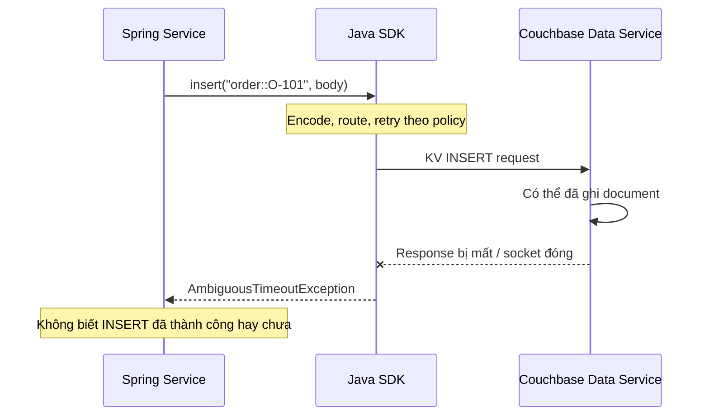
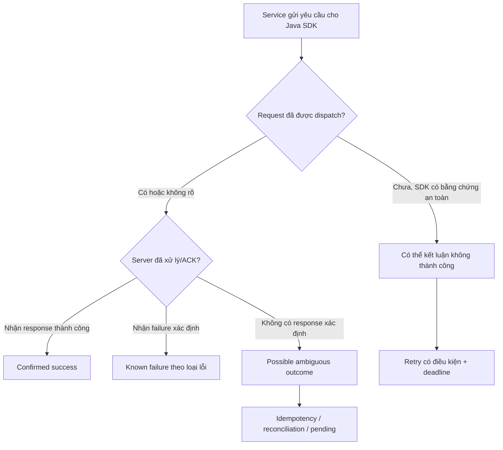
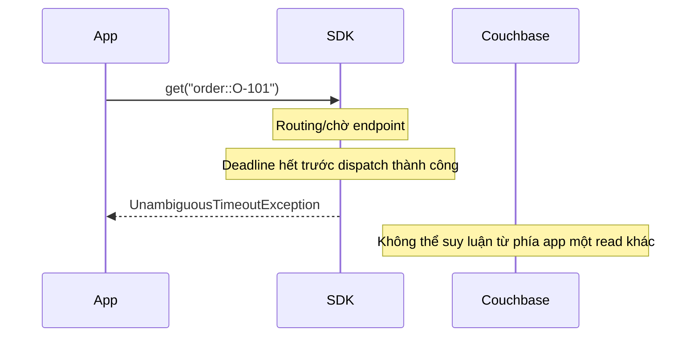
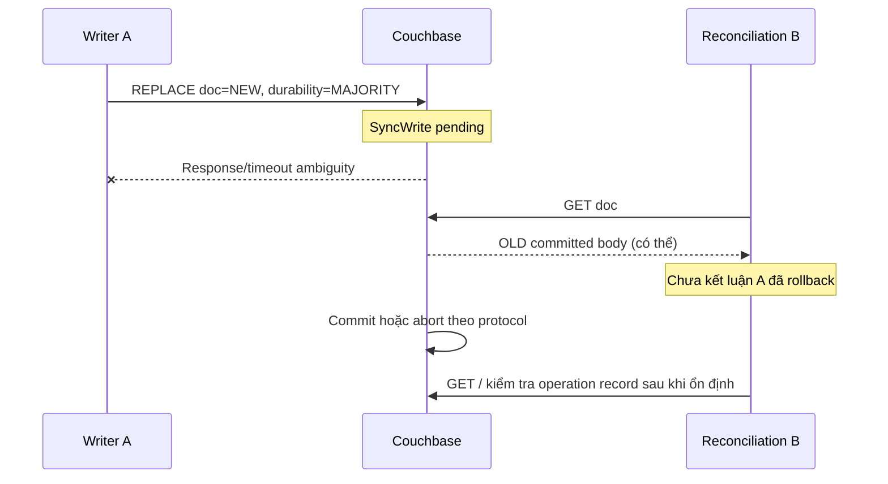
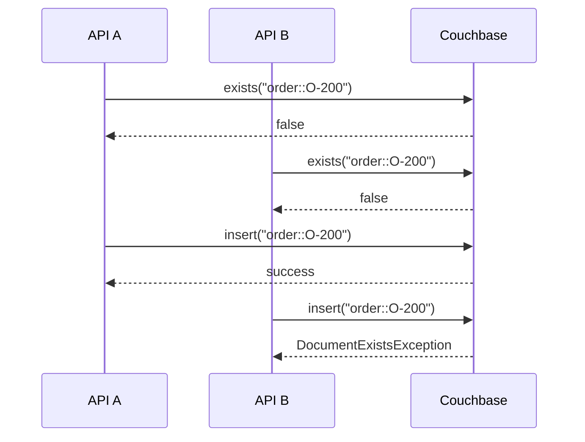
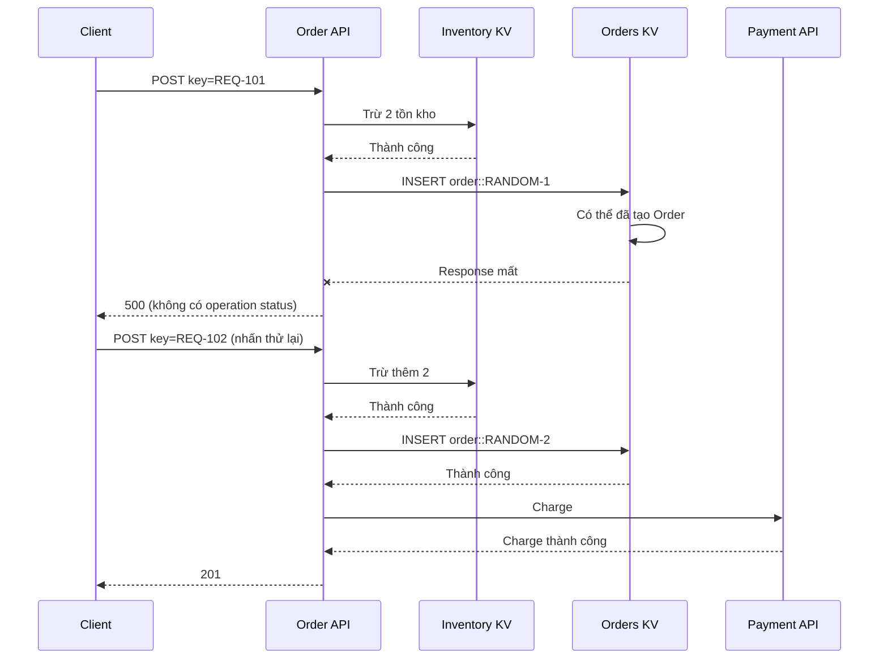

# Thời gian chờ có kết quả xác định và chưa xác định trong Spring Data Couchbase

> **Mục tiêu:** Phân biệt `UnambiguousTimeoutException` và `AmbiguousTimeoutException` của Couchbase Java SDK; hiểu ranh giới “đã gửi request”, “server có thể đã thực hiện”, “đã nhận ACK” và “đạt durability”; xử lý timeout đúng khi dùng Spring Data Repository, `CouchbaseTemplate`, KV SDK, truy vấn SQL++, transaction và API reactive; thiết kế retry, idempotency, CAS, đối soát kết quả và metrics mà **không làm lặp tác dụng phụ**.

Trong module **SPRING_DATA_COUCHBASE**, tầng truy cập dữ liệu dựa trên document mapping, Repository, `CouchbaseTemplate` và SQL++ để thao tác với bucket/scope/collection; CAS, TTL, chỉ mục, durability, transaction và reactive API giúp xây dựng hệ thống nhất quán và vận hành được. Trong những hệ thống đó, **timeout là một triệu chứng quan sát từ phía client, không tự chứng minh thao tác đã thất bại trên Couchbase Server**.

Ví dụ: API tạo Order gửi `insert("order::O-101", body)`. Couchbase có thể lưu document, nhưng gói phản hồi bị mất trước khi Java nhận được. Nếu service trả “chưa tạo đơn” rồi gọi lại bằng document ID khác, hệ thống có thể tạo **hai đơn hàng cho cùng một lần nhấn nút**. Ngược lại, nếu request chưa từng được gửi tới server vì DNS/endpoint chưa sẵn sàng, SDK có thể biết chắc nó không thành công — nhưng việc retry toàn bộ quy trình nghiệp vụ vẫn phải xem có side effect ngoài Couchbase không.

**Đây là trọng tâm của bài:** phân biệt **kết quả xác định không thành công**, **kết quả chưa xác định**, và **kết quả xác định thành công**. Không gom mọi timeout thành một lỗi chung có cùng chính sách retry.

## 1. Ba trạng thái kết quả mà application phải hiểu

| Trạng thái | Ý nghĩa trong phạm vi một request | Ví dụ | Hành động mặc định |
| --- | --- | --- | --- |
| **Confirmed success** | SDK nhận được phản hồi thành công theo hợp đồng API/durability | `insert` trả `MutationResult` | Ghi nhận kết quả; không thực hiện lại |
| **Confirmed not successful** | SDK có đủ bằng chứng request **không thể thành công** | `UnambiguousTimeoutException` | Có thể xem xét retry request có điều kiện, trong deadline tổng |
| **Outcome unknown** | Không đủ bằng chứng biết mutation đã áp dụng hay chưa | `AmbiguousTimeoutException` hoặc durability/transaction ambiguity | **Đối soát và kiểm tra idempotency**, không retry mù |

Hai trạng thái cuối đều có thể được người dùng cảm nhận là “server không trả lời”. Nhưng chúng **không tương đương** về tính đúng đắn.

### Phân biệt “không thành công” với “chưa biết”

`UnambiguousTimeoutException` là tín hiệu SDK **tự tin thao tác đã không thành công** trong phạm vi request đó; ví dụ không thể dispatch request hoặc biết chắc lỗi trước khi có side effect. Điều này **không xác nhận** một nghiệp vụ lớn gồm nhiều bước chưa xảy ra tác dụng phụ ở hệ thống khác.

`AmbiguousTimeoutException` nói rằng request **có thể đã tới server và có thể đã gây tác dụng phụ**, nhưng SDK không có kết luận cuối cùng; chẳng hạn kết nối đóng sau khi mutation được gửi, trước khi response được nhận.

Không được hiểu “ambiguous” là “thành công một nửa” hoặc “chắc chắn thất bại”. Nó là một **giới hạn thông tin** của client trong hệ thống phân tán.

## 2. Sơ đồ request, response và điểm mất kết nối



Trong tình huống này, server **có thể** đã lưu document. Request sau đó đọc thấy document tồn tại cũng chưa đủ để kết luận nó do chính `order::O-101` của request ban đầu tạo, nếu ID hoặc owner/payload có thể bị tái sử dụng.

### Cùng một timeout nhưng thời điểm khác nhau



Sơ đồ đơn giản hóa. SDK có thể tự retry các lỗi được xem là an toàn, và một số lỗi không phải timeout vẫn mang tính không chắc chắn (ví dụ `RequestCanceledException` do kết nối đóng giữa chừng). **Không suy luận trạng thái chỉ từ thời gian request chạy**; phải xem loại exception, request type, dispatch/retry context và hợp đồng nghiệp vụ.

## 3. Các class ngoại lệ Java SDK cần biết

Java SDK 3 dùng nhóm lỗi thuộc `com.couchbase.client.core.error`:

```java
import com.couchbase.client.core.error.TimeoutException;
import com.couchbase.client.core.error.UnambiguousTimeoutException;
import com.couchbase.client.core.error.AmbiguousTimeoutException;
import com.couchbase.client.core.error.CouchbaseException;
```

`TimeoutException` là lớp cha liên quan timeout; hai subclass nêu rõ **độ chắc chắn về outcome**. Ứng dụng có thể bắt `TimeoutException` nếu chỉ muốn thống kê, nhưng **đường xử lý mutation thường cần tách hai subclass** trước khi quyết định retry.

| Lỗi | Khả năng biết outcome | Không được suy ra |
| --- | --- | --- |
| `UnambiguousTimeoutException` | SDK biết thao tác không thành công | Mọi side effect **của cả workflow** chưa xảy ra |
| `AmbiguousTimeoutException` | SDK không biết mutation đã thành công chưa | “Chắc chắn chưa ghi” hoặc “chắc chắn đã ghi” |
| `RequestCanceledException` | Request bị hủy; nguyên nhân/khả năng side effect phải đọc context | Tất cả cancellation đều an toàn để retry |
| `DurabilityAmbiguousException` | SyncWrite có kết quả durability/commit chưa xác định | Đơn giản là retry insert bằng ID khác |
| `TransactionCommitAmbiguousException` | Transaction có thể đã qua commit point | Toàn bộ transaction chắc chắn rollback |
| `CasMismatchException` | Expected CAS không còn đúng | Timeout hoặc failure chưa biết outcome |

Một số exception không thuộc cùng cây thừa kế với `TimeoutException` (ví dụ durability/transaction errors). Vì vậy, catch mỗi `TimeoutException` **không bao trùm toàn bộ kết quả chưa rõ**.

### SDK exception khác exception tầng Spring Data

Đường SDK trực tiếp:

```java
Collection orders = cluster.bucket("commerce")
    .scope("sales")
    .collection("orders");
orders.insert("order::O-101", orderBody);
```

Đường Spring Data:

```java
Order persisted = orderRepository.save(order);
```

Spring Data có thể bọc/dịch một số exception vào nhóm `org.springframework.dao.DataAccessException`. Loại exception lớp ngoài và `cause` tùy API/phiên bản; **không giả định Repository luôn ném nguyên `AmbiguousTimeoutException` hoặc mọi timeout được dịch cùng một class**. Với code bắt lỗi cần giữ nguyên cause chain và phân loại tại adapter boundary.

## 4. Dataset và API mẫu trong một hệ thống đặt hàng

Giả sử bucket `commerce`, scope `sales`, các collection `orders`, `inventory`, `idempotency` và `outbox`. Đường truy cập giả định:

| Keyspace | Document ID | Mục đích |
| --- | --- | --- |
| `commerce.sales.orders` | `order::O-101` | Đơn đặt hàng |
| `commerce.sales.inventory` | `stock::SKU-101` | Tồn kho |
| `commerce.sales.idempotency` | `idem::shop-a::REQ-101` | Theo dõi một ý định tạo đơn |
| `commerce.sales.outbox` | `event::ORDER-101` | Event cần publish không trùng |

JSON Order:

```json
{
  "_class": "sales-order",
  "schemaVersion": 1,
  "orderId": "O-101",
  "tenantId": "shop-a",
  "requestId": "REQ-101",
  "sku": "SKU-101",
  "quantity": 2,
  "status": "CREATED",
  "createdAt": "2026-11-25T03:00:00Z"
}
```

JSON stock:

```json
{
  "sku": "SKU-101",
  "available": 12,
  "reserved": 0
}
```

Các giá trị là dữ liệu giả, không phải thao tác production đã chạy. Trong những đoạn SDK tiếp theo, giả định:

```java
import com.couchbase.client.java.Collection;

Collection orders = cluster.bucket("commerce")
    .scope("sales").collection("orders");
Collection inventory = cluster.bucket("commerce")
    .scope("sales").collection("inventory");
Collection idempotency = cluster.bucket("commerce")
    .scope("sales").collection("idempotency");
```

**Phạm vi key rất quan trọng:** document ID chỉ unique **trong collection**. Hai tenant có thể dùng cùng request ID nếu key đã có tenant namespace phù hợp và server kiểm tra tenant/owner/payload. Không dùng ID do client cung cấp mà không xác minh quyền.

## 5. Idempotent request của SDK khác idempotent nghiệp vụ

Một thao tác được gọi là **idempotent** khi lặp lại cùng yêu cầu không làm kết quả bị áp dụng hơn một lần theo ý nghĩa của thao tác đó. Nhưng có **hai tầng** phải phân biệt:

1. **SDK request idempotency:** SDK biết loại request có thể được tự retry sau sự cố transport hay không.
2. **Business idempotency:** cùng một ý định nghiệp vụ (đặt hàng/giảm tồn kho/thanh toán) không được thực hiện lặp dù client, proxy hoặc application retry.

SDK cố tình **bảo thủ** khi đánh giá mutation: `get` và `exists` được coi là idempotent; những request mutating như `insert`, `replace`, `upsert` có thể không được SDK tự động retry sau khi *đã gửi* mà mất response vì nguy cơ ghi đè thay đổi đồng thời. Không suy từ tên “upsert” rằng SDK sẽ luôn retry an toàn.

### Bảng thao tác và chính sách mặc định

| API | Tác dụng | SDK có thường xem là idempotent? | Hành vi ứng dụng khi timeout |
| --- | --- | --- | --- |
| KV `get(id)` | Đọc document | Có | Có thể retry read hữu hạn nếu là lỗi tạm thời |
| KV `exists(id)` | Kiểm tra key | Có | Retry read hữu hạn; không thay thế kiểm tra quyền |
| KV `lookupIn(...)` | Đọc field con | Có | Retry read hữu hạn; không kết luận về mutation khác |
| KV `insert(id, body)` | Tạo key mới | Không mặc định sau dispatch | Ambiguous → đối soát key/operation ID |
| KV `upsert(id, body)` | Tạo hoặc thay thế body | Không mặc định sau dispatch | Dễ ghi đè writer khác khi replay |
| KV `replace(id, body, cas)` | Ghi dựa trên CAS | Không coi là retry mù | CAS conflict khác ambiguous timeout |
| KV `remove(id)` | Xóa key | Không mặc định | Replay có thể trả not found, phải xem contract |
| KV `mutateIn(...)` | Sửa subdocument | Phụ thuộc mutation | Mất response có thể khiến thao tác đã áp dụng |
| Counter increment/decrement | Thay đổi giá trị theo delta | Không an toàn để replay mù | Nguy cơ tăng/trừ hai lần |
| SQL++ `SELECT` | Đọc các row | Có thể thông báo `readonly(true)` | Retry có budget và consistency phù hợp |
| SQL++ `UPDATE/INSERT/DELETE` | Mutation theo query | Không coi là read-only | Không lặp DML sau timeout nếu chưa đối soát |
| Transaction gồm nhiều write | Nhiều thao tác có commit point | Theo transaction protocol | Xử lý lỗi commit ambiguous riêng |

Không coi bảng này là một API contract bất biến cho mọi SDK version/operation option. Trong Java SDK, `ErrorContext.idempotent` giúp biết SDK **đã phân loại request thực tế ra sao**; đọc JavaDoc của API và kiểm chứng tại runtime.

### “Cùng giá trị” vẫn có thể gây mất cập nhật

Hai request cùng sửa Product:

```text
T0: A đọc price=100, stock=10
T1: A gửi upsert Product(price=120, stock=10); mất response
T2: B sửa stock=9 và lưu
T3: A retry upsert với body cũ (price=120, stock=10)
T4: Stock quay lại 10, mất thay đổi của B
```

Ngay cả khi cùng payload A được gửi lần hai, **business state không còn như lúc gửi lần đầu**. Do đó upsert “cùng body” không hoàn toàn tương đương idempotent khi có writer khác.

### Một read-only Query phải được khai báo đúng

Với Java SDK:

```java
import com.couchbase.client.java.query.QueryResult;
import com.couchbase.client.java.query.QueryOptions;
import com.couchbase.client.java.json.JsonObject;
import java.time.Duration;

String statement =
    "SELECT META(o).id AS documentId, o.status " +
    "FROM `commerce`.`sales`.`orders` AS o " +
    "WHERE o.tenantId = $tenant AND o.requestId = $requestId";

QueryResult result = cluster.query(
    statement,
    QueryOptions.queryOptions()
        .readonly(true)
        .parameters(JsonObject.create()
            .put("tenant", "shop-a")
            .put("requestId", "REQ-101"))
        .timeout(Duration.ofSeconds(5))
);
```

`readonly(true)` vừa cho SDK biết query có thể được retry linh hoạt hơn, vừa yêu cầu Query Service **không thực hiện mutation**. Đừng gắn `readonly(true)` lên `UPDATE` để “retry được”; query engine sẽ từ chối mutation trong read-only mode.

Khi dùng Spring Data `@Query`, không tự giả định rằng một SQL++ `SELECT` đã được SDK đánh dấu `readonly(true)`; hãy kiểm tra cách framework/phiên bản thực tế cấu hình QueryOptions. Nếu cần timeout/scan consistency riêng, dùng API Spring Data cho phép hoặc một gateway SDK chuyên biệt có hợp đồng rõ.

## 6. Thế nào là một “kết quả xác định không thành công”?

SDK có thể ném `UnambiguousTimeoutException` khi nó biết **request không thể thành công**. Một ví dụ là không có node/endpoint khả dụng để dispatch request và deadline hết trước lúc request được gửi thành công.



Với read-only operation, timeout thường là unambiguous vì **không có side effect mutation từ request đó**, ngay cả khi read đã tới server nhưng response bị mất.

### Unambiguous không phải là “được retry bất kỳ lúc nào”

Ví dụ service:

```text
1. Gọi payment provider và được xác nhận đã thu tiền.
2. Gọi Couchbase insert Order; request trả UnambiguousTimeoutException.
3. Service retry toàn bộ workflow từ bước 1.
```

Kết quả Couchbase insert chưa thành công được SDK xác định, **nhưng lần thanh toán ở bước 1 đã thành công**. Retry cả workflow có thể thu tiền **hai lần** nếu payment provider không hỗ trợ idempotency. Vì vậy cần thiết kế command-level idempotency xuyên suốt, không chỉ dựa vào exception ở thao tác DB cuối cùng.

### Không đồng nhất với `DocumentNotFoundException`

`UnambiguousTimeoutException` vẫn là **timeout/availability problem**, không phải bằng chứng document ID không có. `DocumentNotFoundException` (SDK KV) hay `Optional.empty()` (Repository) là một kết quả **truy cập có kết luận dữ liệu vắng mặt**. Gộp chúng thành HTTP `404` là sai.

## 7. Thế nào là “kết quả chưa xác định”?

Hãy xét một request:

```java
import com.couchbase.client.java.json.JsonObject;

JsonObject body = JsonObject.create()
    .put("orderId", "O-101")
    .put("requestId", "REQ-101")
    .put("tenantId", "shop-a")
    .put("status", "CREATED");

orders.insert("order::O-101", body);
```

Nếu client gửi mutation nhưng mất response, SDK có thể ném `AmbiguousTimeoutException`. Có hai trạng thái server đều phù hợp với tín hiệu đó:

- **Khả năng A — mutation đã được áp dụng:** document `order::O-101` tồn tại. Retry với **cùng ID** có thể thấy `DocumentExistsException`; retry với ID khác có thể tạo trùng nghiệp vụ.

- **Khả năng B — mutation chưa được áp dụng:** document không tồn tại. Có thể cân nhắc retry **sau khi đối soát**, trong giới hạn đã quy định.

### Một lần `get` ngay sau timeout có kết luận cuối cùng không?

Không phải lúc nào cũng đủ. Nếu server đang hoàn tất một **durable write** hoặc topology đang thay đổi, một lần read có thể thấy **giá trị trước mutation** dù quá trình commit/rollback chưa ngã ngũ. Ngoài ra TTL, concurrent writer, failover, replica lag và quyền/keyspace có thể làm việc quan sát trở nên phức tạp.

Để kết luận nghiệp vụ, cần **operation ID**, bằng chứng từ record bền vững, trạng thái commit/transaction và thời hạn đối soát phù hợp. Nếu chưa có bằng chứng, giữ trạng thái `UNKNOWN/PENDING_RECONCILIATION` thay vì tạo Order thứ hai.

### Cùng ID nhưng payload/owner khác

Giả sử `order::O-101` tồn tại sau timeout. Điều đó chưa chứng minh nó được tạo bởi `REQ-101`:

- ID có thể được client chọn và trùng với một request khác.
- Tenant có thể khác nhưng key không namespace tenant đúng.
- Body có thể khác request fingerprint hoặc ID reuse.
- Document có thể bị một writer khác thay thế sau mutation.

Vì vậy, phải đối chiếu **tenantId, requestId, payload hash/operation identity** và quyền, không chỉ kiểm tra `exists(id) == true`.

## 8. Phân loại timeout SDK trong mã Java

```java
import com.couchbase.client.core.error.AmbiguousTimeoutException;
import com.couchbase.client.core.error.UnambiguousTimeoutException;
import com.couchbase.client.core.error.CouchbaseException;
import com.couchbase.client.java.Collection;
import com.couchbase.client.java.json.JsonObject;

public final class OrderKvGateway {
    private final Collection orders;

    public OrderKvGateway(Collection orders) {
        this.orders = orders;
    }

    public void insertOnce(String key, JsonObject body) {
        try {
            orders.insert(key, body);
        } catch (AmbiguousTimeoutException ex) {
            throw new OutcomeUnknownException(
                "Order write outcome requires reconciliation", ex
            );
        } catch (UnambiguousTimeoutException ex) {
            throw new KnownWriteTimeoutException(
                "Order write did not complete", ex
            );
        } catch (CouchbaseException ex) {
            throw new OrderStorageException(
                "Order write failed", ex
            );
        }
    }
}
```

`OutcomeUnknownException`, `KnownWriteTimeoutException` và `OrderStorageException` là **domain/application exceptions cần tự định nghĩa**, không thuộc SDK. Ví dụ chỉ minh họa **cách phân luồng**; một implementation hoàn chỉnh còn phải xử lý `DurabilityAmbiguousException`, `RequestCanceledException` và những lỗi nghiệp vụ như `DocumentExistsException` trước lớp catch chung nếu muốn phân biệt.

**Thứ tự catch quan trọng:** catch subclass cụ thể trước `CouchbaseException`. Không viết `catch (TimeoutException ex) { insertAgain(); }` vì sẽ trộn ambiguous và unambiguous.

## 9. Durability: đã nhận mutation chưa có nghĩa đã đạt mức bền vững yêu cầu

Couchbase KV mutation có thể sử dụng **durability level** để yêu cầu server đợi dữ liệu được nhân bản/persist đạt mức cần thiết trước khi báo thành công. Các mức phổ biến:

| Durability level | Yêu cầu chính | Đánh đổi |
| --- | --- | --- |
| `NONE`/không yêu cầu durability bổ sung | ACK sau khi active node ghi nhận mutation theo hợp đồng regular write | Nhanh hơn, độ bền thấp hơn khi node lỗi |
| `MAJORITY` | Mutation đạt đa số bản sao được yêu cầu trong memory | Độ trễ/khả dụng phụ thuộc đa số |
| `MAJORITY_AND_PERSIST_TO_ACTIVE` | Đạt majority trong memory và active persist | Chờ IO bổ sung |
| `PERSIST_TO_MAJORITY` | Đạt persistence trên majority | Độ bền cao hơn, chi phí thời gian lớn hơn |

Tên enum SDK Java thực tế dùng `DurabilityLevel.MAJORITY`, `DurabilityLevel.MAJORITY_AND_PERSIST_TO_ACTIVE` và `DurabilityLevel.PERSIST_TO_MAJORITY`; tên mức `NONE` dùng khi không yêu cầu durability. Hỗ trợ phụ thuộc cấu hình bucket/replica và phiên bản Server; một số cấu hình không thể đáp ứng durability yêu cầu.

### Ví dụ durable insert

```java
import com.couchbase.client.java.durability.DurabilityLevel;
import com.couchbase.client.java.kv.InsertOptions;
import com.couchbase.client.java.kv.MutationResult;
import com.couchbase.client.java.json.JsonObject;
import java.time.Duration;

JsonObject body = JsonObject.create()
    .put("orderId", "O-102")
    .put("requestId", "REQ-102")
    .put("tenantId", "shop-a")
    .put("status", "CREATED");

MutationResult result = orders.insert(
    "order::O-102",
    body,
    InsertOptions.insertOptions()
        .durability(DurabilityLevel.MAJORITY)
        .timeout(Duration.ofSeconds(8))
);
```

Khi SDK nhận ACK thành công, ứng dụng có bằng chứng server đã đạt **mức durability yêu cầu** theo cấu hình thực tế. Nếu không nhận ACK do client timeout hoặc server durability result ambiguous, **không được suy ra write chưa commit**.

### `DurabilityAmbiguousException`

Java SDK có:

```java
import com.couchbase.client.core.error.DurabilityAmbiguousException;
```

Khi SyncWrite không thể kết luận thành công/thất bại trong thời hạn hoặc gặp điều kiện chuyển topology, SDK có thể phát `DurabilityAmbiguousException`. Đây là tín hiệu **outcome chưa xác định** riêng về durability, không nên bắt nó như một `UnambiguousTimeoutException` chỉ vì có chữ “timeout” trong bối cảnh.

### Read trong lúc durable write đang pending

Trên Couchbase Server, một durable write có giai đoạn **pending** trước commit. Trong lúc pending, một client khác có thể đọc **giá trị đã commit trước đó**, còn mutation cạnh tranh có thể nhận lỗi SyncWrite in progress.



**Không dùng `get` một lần trả body cũ để “chứng minh” durable write trước đã không xảy ra**. Khi còn trạng thái pending hoặc có failover/rebalance, cần quy trình reconciliation có giới hạn thời gian và bằng chứng phù hợp. Nếu hết hạn đối soát nhưng vẫn chưa chắc, giữ `UNKNOWN` và cảnh báo, thay vì tự tạo một mutation thứ hai.

### Timeout budget của durable write khác KV thường

Java SDK dùng `kvTimeout` mặc định cho KV operations thông thường, và `kvDurableTimeout` cho KV mutations yêu cầu enhanced durability. Server có **SyncWrite timeout riêng**. Tăng `kvTimeout` thường không tác động tới một durable write sử dụng `kvDurableTimeout`.

Nhớ rằng “đã gửi lên server” và “đã đạt majority/persist” là hai mốc khác nhau. Không dùng cấu hình timeout để thay quyết định business cần durability level nào.

## 10. CAS conflict khác timeout có kết quả chưa xác định

CAS (Compare And Swap) là token version opaque của document. Spring Data `@Version` có thể sử dụng CAS để chống lost update; Java SDK `replace` hỗ trợ expected CAS.

```java
import com.couchbase.client.java.kv.GetResult;
import com.couchbase.client.java.kv.ReplaceOptions;
import com.couchbase.client.core.error.CasMismatchException;

GetResult old = inventory.get("stock::SKU-101");
var body = old.contentAsObject();
body.put("available", 10);

try {
    inventory.replace(
        "stock::SKU-101",
        body,
        ReplaceOptions.replaceOptions().cas(old.cas())
    );
} catch (CasMismatchException ex) {
    // Writer khác đã sửa document trước thao tác replace.
}
```

`CasMismatchException` là lỗi **có kết luận xung đột phiên bản**. Cần đọc lại, kiểm tra stock, quyền, invariant rồi quyết định có retry read-modify-write hay trả conflict; không làm cùng một vòng catch với timeout ambiguity.

### CAS không phải deduplication key

CAS trả lời: “document này có còn **đúng phiên bản đã đọc** không?” Nó **không trả lời**:

- “Request `REQ-101` đã từng thực hiện chưa?”
- “Đơn đã được gửi event/email chưa?”
- “Payment đã thu tiền chưa?”
- “Mutation đang pending có commit sau `get` không?”

Để xử lý các câu hỏi trên, cần **request ID / idempotency record / transaction state / outbox / reconciliation**. CAS một mình không làm mutation non-idempotent thành idempotent ở cấp nghiệp vụ.

### Ghi stock bằng delta sau timeout

Nếu server đã nhận `available = available - 2` rồi response bị mất, một lần retry áp dụng **delta -2** nữa có thể khiến tồn kho giảm 4 thay vì 2. Kể cả có CAS, nếu request thứ hai tải lại stock mới rồi áp dụng ý định cũ mà không kiểm tra `requestId` đã hoàn tất, **vẫn trừ hai lần hợp lệ về CAS nhưng sai nghiệp vụ**.

### Transaction nhiều document

Giảm tồn kho và tạo Order ở **hai collection** không nguyên tử nếu chỉ gọi hai thao tác KV tách rời:

```text
1. inventory.replace() thành công
2. orders.insert() timeout ambiguous
3. Service không biết toàn bộ workflow đã xong hay chưa
```

Cần đánh giá Couchbase distributed transactions hoặc thiết kế state machine/outbox/compensation, nhưng **ngay cả transaction cũng có thể gặp commit ambiguous**. Transaction tăng tính nguyên tử của các thay đổi database trong protocol; không tự làm hành động bên ngoài (gửi email, gọi payment API) thành một phần ACID.

## 11. Transaction timeout và commit ambiguity

Couchbase Java SDK Transactions có thể retry **transaction lambda** khi gặp một số tình huống xung đột/tạm thời. Vì lambda có thể được chạy lại, không đặt các side effect không-idempotent vào trong lambda nếu không có cơ chế riêng.

```java
import com.couchbase.client.java.transactions.error.TransactionFailedException;
import com.couchbase.client.java.transactions.error.TransactionCommitAmbiguousException;
import com.couchbase.client.java.transactions.TransactionResult;

try {
    TransactionResult result = cluster.transactions().run(ctx -> {
        ctx.insert(orders, "order::O-103",
            JsonObject.create()
                .put("orderId", "O-103")
                .put("requestId", "REQ-103")
                .put("status", "CREATED"));
    });

    if (!result.unstagingComplete()) {
        // Commit point đã đạt; cleanup/unstaging còn tiếp tục.
    }
} catch (TransactionCommitAmbiguousException ex) {
    // Có thể transaction đã qua commit point.
    // Đối soát bằng requestId/transaction state, KHÔNG chạy lại mù.
} catch (TransactionFailedException ex) {
    // Transaction không đạt commit point theo contract SDK.
    // Kiểm tra cause và quyết định retry nghiệp vụ có an toàn hay không.
}
```

`TransactionCommitAmbiguousException` có nghĩa SDK **không thể xác định transaction đã đạt commit point chưa** khi hết thời hạn; cleanup có thể hoàn tất commit hoặc rollback về sau. `TransactionFailedException`/`TransactionExpiredException` có ngữ nghĩa khác khi chưa đạt commit point (có thể cần xem root cause). **Không catch tất cả thành “đã rollback”**.

### `unstagingComplete() == false` không phải transaction failed

Nếu `transactions().run(...)` trả `TransactionResult` thành công nhưng `unstagingComplete()` là `false`, transaction đã đạt **commit point**, trong khi công việc unstaging các document có thể tiếp tục bất đồng bộ. Transaction-aware readers có ngữ nghĩa nhất quán theo protocol; non-transactional readers có thể chưa thấy đầy đủ dữ liệu mới ngay lập tức.

Không thực hiện lại transaction chỉ vì flag này `false`. Nếu workflow yêu cầu mọi non-transactional reader đã nhìn thấy toàn bộ thay đổi, phải thiết kế kiểm tra trạng thái/consistency riêng theo tài liệu Transactions.

### Side effect bên ngoài transaction lambda

```java
// Không đưa vào lambda có thể được SDK chạy lại:
paymentProvider.charge(card, amount);
emailSender.sendOrderConfirmation(order);
messageBroker.publish(orderCreated);
```

Dùng operation ID/idempotency key được payment provider hỗ trợ và **outbox** ghi trong database transaction khi phù hợp, sau đó publisher riêng phát event với deduplication. Chỉ dùng outbox khi cùng transaction có thể atomically tạo record event và business data; nếu outbox được viết ở bước khác không có transaction, vẫn có cửa sổ mất đồng bộ.

## 12. Thiết kế idempotency key cho một lệnh tạo Order

Một request ID ổn định cần đại diện cho **một ý định logic** của client, không phải từng lần HTTP retry:

```text
POST /orders
Idempotency-Key: REQ-101
Authenticated tenant: shop-a

Payload:
  sku      = SKU-101
  quantity = 2
  address  = ADDRESS-7
```

Client gọi lại với **cùng key** khi response bị mất. Server có thể tra record dựa trên `shop-a` + `REQ-101` và quyết định trả lại kết quả đã ghi, báo đang chờ hoặc từ chối nếu payload khác.

### Idempotency record minh họa

Document key `idem::shop-a::REQ-101` trong collection `idempotency`:

```json
{
  "tenantId": "shop-a",
  "requestId": "REQ-101",
  "operation": "CREATE_ORDER",
  "payloadFingerprint": "sha256:example-hash-of-canonical-request",
  "orderId": "O-101",
  "state": "PENDING",
  "startedAt": "2026-11-25T03:00:00Z",
  "updatedAt": "2026-11-25T03:00:00Z"
}
```

Các state gợi ý:

| State | Nghĩa | API response thường phù hợp |
| --- | --- | --- |
| `PENDING` | Request được ghi nhận, business mutation chưa được xác nhận hoàn tất | `202 Accepted` + operation ID/status link |
| `COMPLETED` | Đã xác nhận kết quả nghiệp vụ | Trả cùng order ID/result theo contract |
| `REJECTED` | Input/domain failure xác định, không thực hiện | Trả lỗi ổn định đã ghi |
| `NEEDS_RECONCILIATION` | Mutation outcome chưa rõ | `202`/trạng thái chưa chắc, không lặp |
| `EXPIRED` | Record hết thời gian giữ hoặc bị archive | Xử lý theo retention và retry window; không tự coi request mới |

`202 Accepted` **không phải tuyên bố database đã commit**. Nó nói hệ thống nhận xử lý và caller có thể tra cứu trạng thái; endpoint/status record phải được thiết kế có quyền, không để khách hàng xem request của tenant khác.

### Bước 1 — Khóa ý định theo key ổn định

```java
import com.couchbase.client.core.error.DocumentExistsException;
import com.couchbase.client.core.error.AmbiguousTimeoutException;
import com.couchbase.client.java.json.JsonObject;

public void reserveRequest(
        Collection idemCollection,
        String key,
        JsonObject operationRecord) {
    try {
        idemCollection.insert(key, operationRecord);
    } catch (DocumentExistsException duplicate) {
        // Đọc record hiện hữu, kiểm tra owner + operation + fingerprint.
        // Nếu đã COMPLETED -> trả kết quả cũ, nếu PENDING -> chờ/đối soát.
        throw new ExistingOperationException(key, duplicate);
    } catch (AmbiguousTimeoutException ambiguous) {
        // Không biết insert reservation đã xảy ra hay chưa!
        throw new OutcomeUnknownException(
            "Reservation outcome unknown", ambiguous
        );
    }
}
```

`ExistingOperationException` và `OutcomeUnknownException` là exception domain **do ứng dụng tạo**. Đoạn code chỉ minh họa phân luồng; **chưa phải toàn bộ idempotency workflow**. Nó không nên xóa record hiện hữu rồi thử `insert` lại khi chưa xác định owner/payload/trạng thái.

### Bước 2 — So sánh request fingerprint

```java
import com.couchbase.client.java.json.JsonObject;

public boolean sameLogicalRequest(
        JsonObject stored,
        String tenant,
        String requestId,
        String expectedFingerprint) {
    return tenant.equals(stored.getString("tenantId"))
        && requestId.equals(stored.getString("requestId"))
        && "CREATE_ORDER".equals(stored.getString("operation"))
        && expectedFingerprint.equals(
            stored.getString("payloadFingerprint")
        );
}
```

`expectedFingerprint` cần tính từ **canonical request schema** đã định nghĩa: normalize type, thứ tự field, số tiền/quantity, whitespace, encoding và loại bỏ field không có ý nghĩa. Không hash raw JSON string tùy tiện nếu client có thể đổi thứ tự field nhưng ý định giống nhau. Trong môi trường yêu cầu an toàn cao, cân nhắc chữ ký/HMAC và bảo vệ quyền truy cập; fingerprint không thay authorization.

### Bước 3 — Hoàn thành business mutation và record một cách nhất quán

Sai nếu chỉ:

```text
1. INSERT idempotency PENDING
2. INSERT order
3. UPDATE idempotency COMPLETED
```

mà không nhận ra **bước 2 có thể commit nhưng bước 3 timeout**. Một lần retry gặp `PENDING` và tưởng “order chưa tạo” sẽ tạo trùng.

Nếu cần atomicity giữa `orders` và `idempotency` (và `outbox`), cân nhắc **Couchbase transaction** chứa các mutation liên quan, với operation ID đã ổn định. Nếu dùng workflow không có transaction, phải có **state machine/saga**, khả năng khôi phục từng bước, và kiểm tra record Order bằng requestId trước khi thực hiện lại. Không giả sử hai KV operations tách biệt là nguyên tử.

### Bước 4 — Đối soát khi kết quả chưa rõ

Một quy trình đối soát có thể:

1. Xác thực tenant, quyền và operation ID.
2. Đọc `idempotency` record theo **KV key chính xác**, phân loại `COMPLETED/PENDING/UNKNOWN`.
3. Đọc Order ở ID ổn định; kiểm tra `requestId` và fingerprint/owner trong body.
4. Nếu sử dụng transaction, cho phép cleanup/commit reconciliation của SDK hoàn tất theo deadline.
5. Nếu đủ bằng chứng Order đã commit, chuyển record sang `COMPLETED` bằng CAS/transaction.
6. Nếu có bằng chứng **chắc chắn chưa thực hiện** và vẫn trong business deadline, mới cho retry idempotent.
7. Nếu thiếu bằng chứng, giữ `NEEDS_RECONCILIATION`, cảnh báo, không tạo tài nguyên mới.

**Đọc một lần không thấy record không luôn đủ kết luận không commit**, nhất là khi có pending durable write, transaction cleanup, TTL/race hoặc migration. Cần phù hợp với loại mutation và cơ chế consistency thật.

### Giữ idempotency record bao lâu?

Chọn TTL/retention theo **cửa sổ retry thực tế** và nghĩa vụ đối soát. Nếu record hết TTL quá sớm, request cũ được gửi lại sau một ngày có thể không còn marker ngăn tạo đơn thứ hai. Dùng expiry/archival và quy định client retry policy; không để idempotency record sống vô hạn nếu chứa thông tin nhạy cảm mà không có retention policy.

## 13. Tại sao `exists` rồi `insert` vẫn sai?

Hai request đồng thời có thể cùng thấy key chưa có:



`insert` mới là thao tác create-only theo document key có tính nguyên tử. `exists` chỉ cho biết trạng thái tại thời điểm đọc, **không khóa** tương lai. Nếu request A nhận timeout ambiguous, B nhận duplicate, cả hai chưa có đủ bằng chứng để nói **ai** đã ghi trước nếu không kèm operation metadata.

### `DocumentExistsException` sau timeout mang hai ý nghĩa

- Key vốn tồn tại từ một request khác → **conflict thật**, cần xử lý 409/ownership.
- Key được tạo bởi **chính request đã timeout** → có thể là replay hợp lệ; cần xác minh fingerprint/owner trước khi trả kết quả cũ.

Đừng luôn map `DocumentExistsException` thành `409` hoặc luôn map thành success trong cơ chế idempotency; phải biết ngữ cảnh của thao tác và bằng chứng có trong record.

### `upsert` không phải “cách tránh duplicate”

`upsert` sẽ tạo mới nếu key thiếu, **thay body** nếu key đã tồn tại. Với Order, việc biến `insert` thành `upsert` để “retry không bị DocumentExistsException” có thể làm mất trường `paymentStatus`, `fulfillmentStatus` hoặc cập nhật của worker khác.

Nếu nghiệp vụ là **create exactly once**, dùng ID ổn định, `insert`/transaction/idempotency record. Nếu nghiệp vụ là **replace snapshot có chủ đích**, cân nhắc CAS và xử lý writer concurrency; hai use case khác nhau.

## 14. Tách ba mức retry rõ ràng

| Mức retry | Ai thực hiện? | Ví dụ | Rủi ro |
| --- | --- | --- | --- |
| **SDK retry** | Java SDK, theo `RetryStrategy`/`RetryReason` | Endpoint chưa sẵn sàng trước dispatch, đọc KV idempotent | Deadline có thể đã hết, không nên cố ép SDK retry mutation sau dispatch |
| **Repository/service retry** | Java service, Spring Retry/Reactor | Re-fetch sau CAS mismatch, retry read timeout tạm thời | Nhiều lần SDK timeout cộng dồn vượt HTTP deadline |
| **HTTP/client retry** | Browser/app/API gateway/job | Client không nhận response và gửi lại POST | Tạo trùng Order/Payment nếu thiếu idempotency key |

**Cộng ba tầng retry có thể nhân số lần request lên rất nhanh.** Ví dụ gateway retry 3 lần, service retry 3 lần, SDK retry nhiều lần mỗi operation; hệ thống có thể làm tăng tải ngay khi cluster đang chậm, tạo “retry storm”.

### Backoff và jitter

Retry cho read-only/tạm thời nên có:

- **Số lần tối đa** (ví dụ 2–3 lần bổ sung ở application nếu thật sự cần);
- **Deadline tổng**, không chỉ timeout riêng cho mỗi attempt;
- **Exponential backoff + jitter** để không tạo đỉnh lưu lượng đồng thời;
- **Điều kiện lọc lỗi** chỉ cho loại transient được xác định;
- **Circuit breaker/bulkhead** khi backend đang quá tải;
- **Metrics** cho retry count, reason, latency và final outcome.

Đừng retry authentication failure, missing collection do cấu hình sai, error chuyển đổi dữ liệu cố định hoặc permission denied như lỗi tạm thời.

## 15. Cấu hình timeout Java SDK: KV, durable KV và SQL++ khác nhau

Java SDK có nhiều loại timeout. Tăng một cấu hình không đồng nghĩa tăng deadline của **mọi** operation.

| Setting `timeout.*` | Phạm vi chính | Giá trị mặc định được tài liệu Java SDK hiện hành nêu* |
| --- | --- | --- |
| `kvTimeout` | KV get/insert/upsert/replace/remove thông thường | `2.5s` |
| `kvDurableTimeout` | KV mutation có enhanced durability | `10s` |
| `queryTimeout` | SQL++ Query Service | `75s` |
| `searchTimeout` | Full-Text Search | `75s` |
| `analyticsTimeout` | Analytics Service | `75s` |
| `managementTimeout` | Bucket/collection/index management APIs | `75s` |
| `connectTimeout` | Bucket/connection startup theo SDK | `10s` |

\*Giá trị mặc định có thể khác do **SDK version, connection string, system properties, configuration profile hoặc builder config**. Đối chiếu runtime thay vì giả định các số trên áp dụng mọi môi trường. `kvDurableTimeout` được đánh dấu API biến động trong tài liệu và không nên cấu hình cao hơn giới hạn SyncWrite server (tài liệu SDK nêu `65s`).

### Cấu hình toàn SDK

```java
import com.couchbase.client.java.Cluster;
import com.couchbase.client.java.ClusterOptions;
import java.time.Duration;

Cluster cluster = Cluster.connect(
    connectionString,
    ClusterOptions.clusterOptions(username, password)
        .environment(env -> env.timeoutConfig(timeout -> timeout
            .kvTimeout(Duration.ofSeconds(3))
            .kvDurableTimeout(Duration.ofSeconds(12))
            .queryTimeout(Duration.ofSeconds(8))
        ))
);
```

`connectionString`/`username`/`password` là biến được load an toàn từ config/Secret Manager, không chứa mật khẩu hardcoded trong bài. Đây là **số cấu hình minh họa**; production chọn bằng đo P95/P99, network characteristics, durability/SLA và deadline tầng HTTP.

### Cấu hình từng request

```java
import com.couchbase.client.java.kv.GetOptions;
import java.time.Duration;

var found = orders.get(
    "order::O-101",
    GetOptions.getOptions().timeout(Duration.ofSeconds(2))
);
```

```java
import com.couchbase.client.java.query.QueryOptions;
import java.time.Duration;

var query = cluster.query(
    "SELECT META(o).id AS id FROM `commerce`.`sales`.`orders` AS o "
        + "WHERE o.status = $status LIMIT 10",
    QueryOptions.queryOptions()
        .readonly(true)
        .parameters(
            JsonObject.create().put("status", "CREATED")
        )
        .timeout(Duration.ofSeconds(5))
);
```

Per-operation timeout giúp feature khác nhau có SLA riêng nhưng **không làm timeout đồng nghĩa failure/no-side-effect**. Một write timeout 2 giây vẫn có thể ambiguous nếu đã dispatch.

### Cấu hình ưu tiên

Theo tài liệu Java SDK, setting có thể đến từ builder, connection string parameters và JVM system properties. **JVM system property** thường có ưu tiên cao hơn connection string parameter, và connection string parameter cao hơn builder. Ví dụ runtime có `com.couchbase.env.timeout.kvTimeout` sẽ có thể override giá trị Java builder mà developer đang đọc.

**Đừng dựa vào một dòng cấu hình trong source để kết luận timeout thật.** Khi debug, kiểm tra cả environment/profile, JVM flags và connection string sau khi **mask secret**.

## 16. Deadline tổng: ba lần retry có thể vượt HTTP SLA

Giả sử API `POST /orders` có budget tổng `5s`. Nếu mỗi lần SDK mutation timeout `3s` và service retry 3 lần:

```text
Attempt 1: 3s
Backoff  : 0.2s
Attempt 2: 3s
Backoff  : 0.4s
Attempt 3: 3s
----------------
Total    : 9.6s > API budget 5s
```

Những con số này chỉ minh họa phép cộng thời gian. Trên thực tế, SDK còn encode/routing, connection scheduling, CAS re-read và ứng dụng còn có timeouts khác.

### Quy tắc cấp budget

1. Đặt **deadline tổng** ở request/command (ví dụ 5 giây).
2. Dành ngân sách cho auth/validation, DB, serialization và response.
3. Mỗi attempt lấy `remaining = deadline - now`; không luôn dùng timeout tối đa cố định.
4. Nếu remaining không đủ cho một attempt an toàn, **dừng và trả trạng thái**.
5. Với ambiguous mutation, **không sử dụng số thời gian còn lại như lý do để retry mù**.

### Ví dụ loop bounded cho một KV read

```java
import com.couchbase.client.java.Collection;
import com.couchbase.client.java.kv.GetResult;
import com.couchbase.client.java.kv.GetOptions;
import com.couchbase.client.core.error.UnambiguousTimeoutException;
import java.time.Duration;

public GetResult readWithBudget(Collection collection, String id) {
    long deadline = System.nanoTime()
        + Duration.ofSeconds(4).toNanos();

    for (int attempt = 1; attempt <= 3; attempt++) {
        long remainingNanos = deadline - System.nanoTime();
        if (remainingNanos <= Duration.ofMillis(100).toNanos()) {
            throw new ReadBudgetExceededException(id);
        }

        Duration thisTimeout = Duration.ofNanos(
            Math.min(remainingNanos,
                Duration.ofSeconds(2).toNanos())
        );
        try {
            return collection.get(
                id,
                GetOptions.getOptions().timeout(thisTimeout)
            );
        } catch (UnambiguousTimeoutException ex) {
            if (attempt == 3) {
                throw ex;
            }
            // Mỗi vòng đọc là một request mới trong cùng deadline.
            // Production cân nhắc backoff/jitter và các transient errors khác.
        }
    }
    throw new IllegalStateException("Unreachable");
}
```

`ReadBudgetExceededException` là class ứng dụng tự định nghĩa. Mã minh họa cơ chế deadline bằng `System.nanoTime()` (thích hợp đo khoảng thời gian), không phải thuật toán retry production hoàn chỉnh: còn cần backoff/jitter, cancellation, accounting cho SDK retries và metrics. Chỉ dùng vòng này cho **KV read**; không áp dụng nguyên xi cho mutation.

### Cancellation từ HTTP không thu hồi mutation đã gửi

Khi client đóng kết nối hoặc gateway timeout, Reactor cancellation/interrupt ở tầng service **không bảo đảm** server đã dừng mutation đang chạy. Một client retry từ đầu có thể thực thi trùng nếu server đã commit. Do đó idempotency key phải đi xuyên HTTP → service → DB/outbox, và operation status phải có vòng đời dài hơn kết nối HTTP ban đầu.

## 17. SDK `ErrorContext`: biết lý do SDK đã đợi/retry

Mỗi exception SDK có thể kèm `ErrorContext`. Với `TimeoutException`, context thường cho biết request type, timeout duration, số lần retry, retry reasons và các timing. Ví dụ cấu trúc **minh họa**:

```json
{
  "requestType": "GetRequest",
  "idempotent": true,
  "retried": 14,
  "retryReasons": ["ENDPOINT_NOT_AVAILABLE"],
  "timeoutMs": 2500,
  "service": {
    "bucket": "commerce",
    "scope": "sales",
    "collection": "orders",
    "type": "kv"
  },
  "timings": {
    "totalMicros": 2509049
  }
}
```

**Không coi các key JSON này là schema ổn định để parser tự động dựa vào.** Tài liệu SDK đánh dấu ErrorContext có thể thay đổi. Với các loại request khác nhau, context có thể `null` hoặc field khác nhau; `service` có thể chứa query text hoặc ID nhạy cảm.

### Đọc ErrorContext nhưng không làm lộ dữ liệu

```java
import com.couchbase.client.core.error.CouchbaseException;
import com.couchbase.client.core.error.context.ErrorContext;
import org.slf4j.Logger;
import org.slf4j.LoggerFactory;

public final class CouchbaseTimeoutDiagnostics {
    private static final Logger log =
        LoggerFactory.getLogger(CouchbaseTimeoutDiagnostics.class);

    public static void record(String operation, CouchbaseException ex) {
        ErrorContext context = ex.context();
        String ctxType = context == null
            ? "none"
            : context.getClass().getSimpleName();

        log.warn(
            "db_request_failed operation={} exception={} contextType={}",
            operation, ex.getClass().getSimpleName(), ctxType
        );
    }
}
```

Ở hệ thống có log/trace an toàn, có thể trích thêm một số field được phê duyệt như retry count, request type, elapsed time và last-dispatched node alias **đã mask**. Không đưa raw `context.toString()`, document ID, SQL++ query literal, password, token hay nội dung Order vào HTTP response hoặc metric label cardinality cao.

### `RetryReason` cho biết điều gì?

Java SDK có `RetryStrategy` (mặc định thường là `BestEffortRetryStrategy`) và `RetryReason` mô tả lý do thử lại:

| RetryReason ví dụ | Dấu hiệu |
| --- | --- |
| `ENDPOINT_NOT_AVAILABLE` | Chưa có endpoint khả dụng ở thời điểm dispatch |
| `NODE_NOT_AVAILABLE` | Không có node để gửi request |
| `CHANNEL_CLOSED_WHILE_IN_FLIGHT` | Socket đóng khi request đang in-flight |
| `KV_TEMPORARY_FAILURE` | Server trả lỗi KV tạm thời |
| `COLLECTION_MAP_REFRESH_IN_PROGRESS` | SDK đang refresh collection manifest |
| `QUERY_INDEX_NOT_FOUND` | Query Service/index plan có trạng thái cần retry theo SDK |

**Không lập trình dựa vào tên các reason như một hợp đồng bất biến**: tài liệu SDK coi `RetryReason`/`ErrorContext` là volatile. Một reason có thể cho phép retry trước dispatch mà không cho phép retry sau khi non-idempotent mutation đã gửi; SDK xem cả **request idempotency và vị trí trong lifecycle**.

### Không sửa `RetryStrategy` một cách mù quáng

SDK đã có cơ chế retry tích hợp. Tự viết strategy ép mọi non-idempotent mutation retry sau `CHANNEL_CLOSED_WHILE_IN_FLIGHT` có thể gây lost update/trùng order. Thông thường giữ SDK defaults, chỉ tùy chỉnh khi có yêu cầu cụ thể, đã kiểm chứng và có fault-injection tests.

## 18. Phân biệt timeout với lỗi xác định khác

| Lỗi/kết quả | Ý nghĩa | Retry như timeout? |
| --- | --- | --- |
| `DocumentNotFoundException` | KV key không tồn tại ở thời điểm đọc | Không tự retry trừ khi đang chờ tài nguyên dự kiến xuất hiện |
| `DocumentExistsException` | Insert thấy key đã tồn tại | Kiểm tra idempotency/owner; không auto-overwrite |
| `CasMismatchException` | CAS đã stale | Re-read + kiểm tra invariant, không retry body cũ |
| `CollectionNotFoundException` | Scope/collection đích không có | Sửa keyspace/provision, không retry vô hạn |
| `AuthenticationFailureException` | Backend credential bị từ chối | Sửa secret/identity |
| `UnambiguousTimeoutException` | Request không thành công theo kết luận SDK | Retry có điều kiện với budget |
| `AmbiguousTimeoutException` | Không biết mutation đã áp dụng chưa | Đối soát/idempotency |
| `DurabilityAmbiguousException` | Kết quả SyncWrite chưa rõ | Đối soát durability/commit |
| `TransactionCommitAmbiguousException` | Commit point chưa xác định | Transaction reconciliation/cleanup |

**Không bắt `CouchbaseException` rồi tự biến mọi lỗi thành HTTP `504`**. Timeout, authentication, schema, resource missing và domain conflict cần được phân loại theo nguyên nhân và khả năng khôi phục; HTTP gateway timeout cũng không thay thế phân loại outcome trong database.

## 19. Spring Data Repository: `findById` và `save` khác nhau

Spring Data Couchbase có Repository tích hợp document mapping và exception translation. Một entity mẫu:

```java
import org.springframework.data.annotation.Id;
import org.springframework.data.annotation.Version;
import org.springframework.data.annotation.TypeAlias;
import org.springframework.data.couchbase.core.mapping.Document;
import org.springframework.data.couchbase.repository.Scope;
import org.springframework.data.couchbase.repository.Collection;

@Document
@TypeAlias("sales-order")
@Scope("sales")
@Collection("orders")
public class Order {
    @Id
    private String id;

    @Version
    private long version;

    private String tenantId;
    private String requestId;
    private String status;

    public Order() {}
    public String getId() { return id; }
    public long getVersion() { return version; }
    public String getRequestId() { return requestId; }
    public void setStatus(String status) { this.status = status; }
    // Bổ sung getter/setter và constructor khác theo mô hình dự án.
}
```

`@Id` map document key, `@Version` map CAS để optimistic locking. Bucket `commerce` do cấu hình Spring Data cung cấp; scope/collection lấy từ mapping entity ở ví dụ.

```java
import org.springframework.data.couchbase.repository.CouchbaseRepository;

public interface OrderRepository
        extends CouchbaseRepository<Order, String> {
}
```

### `findById`: vắng mặt không phải timeout

```java
import java.util.Optional;

Optional<Order> result =
    orderRepository.findById("order::UNKNOWN");
```

Khi key không có, `Optional.empty()` là kết quả **vắng mặt bình thường**; không cần đổi nó thành `UnambiguousTimeoutException`. Nếu Query Service hoặc KV cluster timeout, Repository có thể phát lỗi truy cập (đôi khi được Spring Data dịch sang `DataAccessException`); không được catch rồi trả empty.

```java
// Phản diện: làm mất ranh giới vắng mặt và lỗi hạ tầng.
try {
    return orderRepository.findById(id);
} catch (RuntimeException ex) {
    return Optional.empty();
}
```

Đoạn này có thể khiến HTTP trả 404 trong một outage Couchbase. **Không sử dụng trong production.**

### `save`: kết quả timeout không chứng minh chưa ghi

```java
try {
    Order stored = orderRepository.save(order);
} catch (RuntimeException ex) {
    // Chưa thể quyết định retry chỉ dựa vào RuntimeException.
}
```

Trong Spring Data, `save` sử dụng mapping/new-entity detection, có thể tương tác với `@Version` và CAS. **Không mặc định `save` tương đương KV `insert` create-only** hoặc mặc định rằng nó trả nguyên SDK exception loại nào. Khi `save` thất bại:

1. Xác định operation đã được mapper/Repository thực hiện thực tế.
2. Ghi nhận class bên ngoài và `cause`/SDK context trong log nội bộ.
3. Nếu root cause là mutation ambiguous, không tự gọi `save` lần nữa.
4. Nếu `OptimisticLockingFailureException`, xử lý conflict riêng bằng tải lại state.
5. Nếu error mapping/validation trước dispatch, phải sửa dữ liệu/schema, không retry network.

### `@Version` không thay idempotency key

Một Order đã tạo có `@Version` giúp tránh lost update trong đường ghi phù hợp, nhưng không ngăn hai Order **khác document ID** cho cùng một request logic. Idempotency và optimistic locking giải quyết hai bài toán khác nhau.

## 20. `CouchbaseTemplate`: API tiện lợi không xóa ambiguity

`CouchbaseTemplate` là API Spring Data Couchbase để thao tác entity/document với converter và mapping context; các đường `insert`/`update`/`findById` của Template có thể khác Repository `save` trong điều kiện mới/cũ, nhưng phía dưới vẫn gửi KV/Query requests.

**Hai vấn đề riêng:**

- **Mapping:** entity `@Id`, `@Version`, `@Scope`, `@Collection`, custom conversions và callbacks phải đúng.
- **Request result:** timeout sau mutation vẫn có thể là **ambiguous outcome** bất kể caller dùng Template hay SDK trực tiếp.

Một anti-pattern:

```java
// Pseudocode minh họa sai logic; không phụ thuộc API cụ thể:
try {
    templateInsert(order);
} catch (Exception ex) {
    templateInsert(order);   // Không an toàn khi kết quả lần đầu chưa rõ.
}
```

Không dùng “Template tự map entity” làm lý do retry. Quy trình idempotency/transaction và reconciliation phải nằm ở **application contract**, không chỉ ở lớp chuyển đổi document.

### Khi dùng custom SDK gateway bên cạnh Template

Nếu một service dùng `CouchbaseTemplate` để lưu Order nhưng raw SDK để kiểm tra state, cả hai phải dùng **cùng bucket/scope/collection/ID convention/type metadata**. Đọc nhầm `_default._default` có thể trả not found và khiến service retry dù Order thực sự tồn tại trong `sales.orders`.

## 21. SQL++: SELECT được retry khác DML

Một SQL++ `SELECT` qua SDK có thể khai báo `readonly(true)` để SDK/server biết nó không mutation. Nhưng `UPDATE`, `DELETE`, `INSERT` hoặc `MERGE` có thể đã thay đổi nhiều document trước khi request bị timeout.

### Read-only Query và scan consistency

```java
var rows = cluster.query(
    "SELECT META(o).id AS id, o.status " +
    "FROM `commerce`.`sales`.`orders` AS o " +
    "WHERE o.tenantId = $tenant AND o.requestId = $req",
    QueryOptions.queryOptions()
        .readonly(true)
        .parameters(
            JsonObject.create()
                .put("tenant", "shop-a")
                .put("req", "REQ-101")
        )
        .timeout(Duration.ofSeconds(5))
);
```

Đây là **read-only** nhưng vẫn có thể trả danh sách rỗng do filter, index freshness hoặc query context. Với use case “read your own writes” qua SQL++, cần xem `QueryScanConsistency.REQUEST_PLUS` hoặc `consistentWith(MutationState)` theo phiên bản/contract; đánh đổi bằng latency. **Ngay cả REQUEST_PLUS không thay idempotency record và không khẳng định một durable write pending sẽ không commit sau này.**

### DML timeout: partial effect không rõ

```sql
UPDATE `commerce`.`sales`.`inventory` AS s
SET s.available = s.available - 2
WHERE s.sku = "SKU-101";
```

Một timeout sau lệnh này không cho phép service **tự chạy lại cùng statement**. Lệnh thứ hai có thể trừ thêm 2 nếu lần đầu đã áp dụng. `WHERE` chỉ lọc SKU, không có request ID dedup, nên không bảo vệ exactly-once semantics.

Đối với DML cập nhật nhiều hàng, việc server/SDK đã xử lý bao nhiêu và atomicity ở mức nào phụ thuộc transaction/statement semantics. Không suy “tất cả hoặc không có gì” chỉ từ việc kết quả query là timeout; cần xác định một statement có transaction rõ hay không.

### `RETURNING` và clientContextId không phải đảm bảo idempotency

```sql
UPDATE `commerce`.`sales`.`orders` AS o
USE KEYS "order::O-101"
SET o.status = "CONFIRMED"
WHERE o.tenantId = "shop-a"
RETURNING META(o).id AS id, o.status AS status;
```

`RETURNING` giúp trả kết quả **nếu response về tới client**, nhưng response mất thì ambiguity vẫn tồn tại. `clientContextId` giúp trace query qua SDK/Server nhưng **không tự tạo deduplication record**. Chỉ đặt một client context ID không làm câu `UPDATE` thành idempotent.

### Query theo ID nên cân nhắc KV

Nếu biết document key, `collection.get(id)` là đường KV đơn giản và thường cho phép quan sát state nhanh hơn so với SQL++ tìm theo field. Khi đối soát sau timeout, ưu tiên **đúng KV key** và metadata request ID nếu thiết kế cho phép; không dùng một câu Query `NOT_BOUNDED` chưa nhìn thấy record làm bằng chứng duy nhất không có mutation.

## 22. Reactive API: `onError` khác `Mono.empty()`

Trong Spring Data Couchbase reactive, lỗi thường được phát qua **Publisher error signal** khi subscribe, thay vì bị ném đồng bộ ở nơi tạo Publisher. Cùng nguyên tắc về ambiguity vẫn áp dụng.

### Repository reactive cho đọc Order

```java
import reactor.core.publisher.Mono;
import org.springframework.data.couchbase.repository.ReactiveCouchbaseRepository;

public interface ReactiveOrderRepository
        extends ReactiveCouchbaseRepository<Order, String> {
}
```

```java
public Mono<Order> requireOrder(String id) {
    return reactiveOrderRepository.findById(id)
        .switchIfEmpty(Mono.error(
            new OrderNotFoundException(id)
        ));
}
```

`Mono.empty()` biểu diễn document không có theo hợp đồng Repository; `Mono.error(...)` là lỗi truy cập/mapping/timeout. `OrderNotFoundException` là class domain tự định nghĩa.

### Phản diện nuốt timeout thành 404

```java
// KHÔNG: network timeout sẽ biến thành absent.
return reactiveOrderRepository.findById(id)
    .onErrorResume(ex -> Mono.empty());
```

### SDK ReactiveCollection phân loại timeout

```java
import com.couchbase.client.java.ReactiveCollection;
import com.couchbase.client.core.error.AmbiguousTimeoutException;
import com.couchbase.client.core.error.UnambiguousTimeoutException;
import reactor.core.publisher.Mono;

public Mono<Void> insertOrderReactive(
        ReactiveCollection orders, String key, JsonObject body) {

    return orders.insert(key, body)
        .then()
        .onErrorMap(
            AmbiguousTimeoutException.class,
            ex -> new OutcomeUnknownException(
                "Order write needs reconciliation", ex)
        )
        .onErrorMap(
            UnambiguousTimeoutException.class,
            ex -> new KnownWriteTimeoutException(
                "Order write not completed", ex)
        );
}
```

Nếu SDK hoạt động với durability, thêm phân loại `DurabilityAmbiguousException` trước khi dùng một fallback/catch-all chung. `.then()` chuyển kết quả `MutationResult` thành `Mono<Void>` khi service không cần CAS; nếu cần CAS để cập nhật state, giữ `MutationResult`.

### Không `retry()` vô hạn cho mutation

```java
// Phản diện: mutation có thể đã commit ở lần trước.
return orders.insert(key, body).retry();
```

Phương thức `retry()` của Reactor sẽ resubscribe source khi error, nghĩa là **có thể tạo request mới**. Một mutation có unknown outcome không an toàn để lặp theo cách này. Dùng idempotency, reconciliation, và retry riêng cho read-only/transient hoặc các thao tác đã chứng minh an toàn.

### Retry có lọc cho KV read

```java
import reactor.util.retry.Retry;
import java.time.Duration;

return orders.get("order::O-101")
    .retryWhen(
        Retry.backoff(2, Duration.ofMillis(100))
            .filter(ex -> ex instanceof UnambiguousTimeoutException)
    );
```

Đoạn code giả định `orders` trong phạm vi là **`ReactiveCollection`**. Đây là ví dụ kỹ thuật cho read-only, không phải chiến lược production hoàn chỉnh; SDK có retry nội bộ và outer HTTP deadline. Cần xét cancellation, time budget, circuit breaker và log sampling.

### Scheduler và `block()`

Không dùng `block()` trên event loop WebFlux để thực hiện reconciliation hoặc sleep-backoff. Reconciliation nên là workflow bất đồng bộ có operation ID/queue và trạng thái bền vững; một request HTTP timeout không nên giữ một thread vô hạn để đợi cluster hồi phục.

## 23. Thiết kế HTTP API khi kết quả mutation chưa xác định

Một API tạo Order có thể trả **ba kiểu kết quả**:

| Tình huống | HTTP response gợi ý | Ý nghĩa cho client |
| --- | --- | --- |
| Đã xác nhận Order tạo thành công | `201 Created` + `Location` | Có thể dùng Order ID |
| Server đã nhận yêu cầu nhưng còn đang xác minh outcome | `202 Accepted` + operation ID/status endpoint | **Chưa có kết luận cuối**; không tự tạo request ID mới |
| Request key trùng với payload khác | `409 Conflict` | Không dùng lại idempotency key cho ý định khác |
| Validation không đạt trước mutation | `400 Bad Request` | Client cần sửa input |
| Hết deadline và xác nhận DB request chưa thành công | `503`/`504` theo contract và nơi timeout | Chỉ retry với cùng operation identity |
| DB bị auth/config lỗi | `500`/`503` theo policy | Không coi là Order not found |
| Tra cứu Order ID không tồn tại | `404 Not Found` trong đúng phạm vi | Không tự suy một pending write chắc chắn không commit |

Không có HTTP status đơn lẻ nào tự diễn đạt chính xác mọi loại “unknown outcome”. `202` hợp lý khi ứng dụng **có cơ chế theo dõi operation tiếp tục sau response**. Nếu không có trạng thái bền vững hoặc reconciliation workflow, đừng trả `202` như thể hệ thống sẽ tự hoàn tất; báo lỗi công khai có operation ID và hướng dẫn caller tra cứu/xử lý theo chính sách.

### Một contract có thể triển khai

Request:

```http
POST /orders
Idempotency-Key: REQ-101
Content-Type: application/json

{"sku":"SKU-101","quantity":2}
```

Khi chưa xác nhận:

```http
HTTP/1.1 202 Accepted
Location: /operations/REQ-101
Content-Type: application/json

{
  "operationId": "REQ-101",
  "state": "NEEDS_RECONCILIATION",
  "retryAfterSeconds": 3
}
```

Khi đã hoàn tất, endpoint tra cứu có thể trả:

```json
{
  "operationId": "REQ-101",
  "state": "COMPLETED",
  "orderId": "O-101"
}
```

Với API thật, phải bảo đảm **operation ID không cho phép đọc chéo tenant**, response không tiết lộ request hash/payload của khách khác; nếu dùng `Retry-After`, đặt đúng header/protocol khi cần thay vì chỉ field body.

### `503` khác `504`

`503 Service Unavailable` thường diễn đạt backend chưa sẵn sàng/tạm không phục vụ. `504 Gateway Timeout` thường dành cho gateway/proxy không nhận phản hồi upstream đúng hạn. Một ứng dụng có thể chọn policy khác theo kiến trúc; **HTTP code không thay cho bằng chứng về mutation outcome**. Bất kể 503/504, client muốn retry POST vẫn cần cùng idempotency key.

### `@RestControllerAdvice`

```java
import org.springframework.http.HttpStatus;
import org.springframework.http.ProblemDetail;
import org.springframework.web.bind.annotation.ExceptionHandler;
import org.springframework.web.bind.annotation.RestControllerAdvice;

@RestControllerAdvice
public class OrderErrorHandler {

    @ExceptionHandler(KnownWriteTimeoutException.class)
    public ProblemDetail known(KnownWriteTimeoutException ex) {
        ProblemDetail pd =
            ProblemDetail.forStatus(HttpStatus.SERVICE_UNAVAILABLE);
        pd.setTitle("Order storage temporarily unavailable");
        pd.setDetail("Retry using the same idempotency key.");
        return pd;
    }

    @ExceptionHandler(OutcomeUnknownException.class)
    public ProblemDetail unknown(OutcomeUnknownException ex) {
        ProblemDetail pd =
            ProblemDetail.forStatus(HttpStatus.SERVICE_UNAVAILABLE);
        pd.setTitle("Order result is not yet confirmed");
        pd.setDetail(
            "Do not submit a new order identifier. Check operation status."
        );
        return pd;
    }
}
```

Đây là handler **tối giản** khi chưa có trạng thái operation bền vững để trả `202`. Các exception là class ứng dụng cần tự định nghĩa. Không trả `ex.getMessage()`/`ErrorContext` nguyên văn ra API; document key, node address, query text hoặc internal correlation data có thể bị lộ. Khi có operation tracker bền vững, chọn response 202/Location phù hợp và thêm operation ID đã kiểm soát quyền.

### Đừng mở side effect ngoài DB trước khi biết outcome

Một API không nên gửi email “Đơn đã tạo thành công” ngay sau khi gọi `orders.insert` nếu vừa nhận `AmbiguousTimeoutException`. Chỉ publish event/email theo **confirmed business state** hoặc outbox đã commit, với deduplication ở consumer; trong trường hợp unknown, thông báo “đang xác minh” đúng hơn.

## 24. Một “status endpoint” chưa đủ nếu dữ liệu theo dõi dễ mất

Giả sử application lưu trạng thái operation chỉ trong `ConcurrentHashMap` ở một pod:

```java
// Không đủ cho production multi-pod:
Map<String, String> inMemoryOperationState =
    new ConcurrentHashMap<>();
```

Nếu pod restart hoặc request tiếp theo tới pod khác, client không tra được trạng thái. Reconciliation nên có **record bền vững** trong Couchbase/queue hoặc một service chuyên trách, với retention, quyền, monitoring và recovery.

### Các trường trạng thái nên giữ

| Field | Mục đích |
| --- | --- |
| `operationId` | Khóa ổn định của một ý định nghiệp vụ |
| `tenantId`/owner | Ngăn lộ/chạy thao tác chéo tenant |
| `requestFingerprint` | Phát hiện cùng key nhưng payload khác |
| `state` | `PENDING`/`COMPLETED`/`REJECTED`/`UNKNOWN` |
| `resultRef` | Order ID hoặc kết quả đã kiểm chứng |
| `attemptCount` | Giới hạn retry/reconciliation |
| `lastErrorCategory` | Ambiguous/unambiguous/validation/conflict |
| `createdAt`/`updatedAt` | Theo dõi SLA và aging |
| `expireAt` | Kiểm soát TTL/retention |
| `revision`/CAS | Chống hai reconciler cập nhật đè state |

Không lưu raw password/payment card/token, hoặc payload chứa PII mà không có mã hóa/quyền/retention rõ. Fingerprint là công cụ so khớp ý định, không thay authorization.

### Hai reconciler cùng xử lý một operation

Ví dụ worker A và worker B cùng thấy `NEEDS_RECONCILIATION`. Nếu cả hai tự chạy lại `insert Order` hoặc gửi event, có thể nhân đôi side effect. Cần:

- optimistic locking bằng CAS trên operation record;
- state transition có điều kiện;
- idempotent outbound calls theo operation ID;
- transaction/outbox khi nhiều record phải được cập nhật nhất quán;
- retry bounded và một cơ chế “lease” với expiry/fencing nếu cần (lease cũng phải xử lý clock/race).

**Chỉ có trạng thái `PENDING` trong JSON không bảo đảm exactly-once** nếu hai worker không phối hợp qua atomic state transition.

## 25. Quan sát production: chia metric theo outcome, không chỉ timeout rate

Một dashboard chỉ hiển thị “Couchbase timeout 1.5%” **không giúp quyết định được retry hay đối soát**. Nên quan sát theo thao tác và **độ chắc chắn của outcome**:

| Metric gợi ý | Ý nghĩa |
| --- | --- |
| `couchbase_unambiguous_timeout_total` | Request timeout mà SDK xác định không thành công |
| `couchbase_ambiguous_timeout_total` | Request timeout có outcome chưa rõ |
| `couchbase_durability_ambiguous_total` | SyncWrite durability chưa xác định |
| `couchbase_transaction_commit_ambiguous_total` | Transaction commit chưa xác định |
| `couchbase_retry_total` | Retry count theo layer và reason |
| `couchbase_kv_latency` | KV p50/p95/p99 |
| `couchbase_query_latency` | SQL++ p50/p95/p99 |
| `couchbase_durable_kv_latency` | Durable mutation p50/p95/p99 |
| `operation_reconciliation_pending` | Số operation đang chờ xử lý |
| `operation_reconciliation_age_seconds` | Tuổi của các operation chưa rõ |
| `operation_reconciliation_success_total` | Đã xác minh success bằng bằng chứng |
| `operation_reconciliation_failed_total` | Không giải quyết được trong deadline |
| `idempotency_duplicate_request_total` | Số request lặp cùng operation ID |
| `idempotency_payload_conflict_total` | Key bị dùng lại với payload khác |
| `cas_conflict_total` | CAS stale/optimistic locking conflict |

Đây là **tên metric đề xuất**, không phải metric mặc định được SDK/Spring Boot cung cấp. Không dùng raw order ID, tenant ID, request payload, ErrorContext hoặc query literal làm metric label (rủi ro lộ dữ liệu và cardinality cao).

### Log tối thiểu gắn trace/operation identity

```text
traceId       = <correlation-id>
operationId   = <masked-stable-identifier>
operation     = orders.insert
backend       = COUCHBASE_KV
outcome       = UNKNOWN
exceptionType = AmbiguousTimeoutException
retryCount    = 2
retryReason   = CHANNEL_CLOSED_WHILE_IN_FLIGHT
durationMs    = 2504
reconcile     = QUEUED
```

`CHANNEL_CLOSED_WHILE_IN_FLIGHT` là một retry reason có trong SDK, nhưng các field trên là **schema log minh họa của ứng dụng**. Trong production, class/field có thể khác; không ghi raw hostname/IP hoặc requestId nếu chúng có thể là PII/identifier nhạy cảm.

### Trace theo câu hỏi nghiệp vụ

Với mỗi ambiguous write, observability phải trả lời:

1. Command ID nào bị ảnh hưởng? Thuộc owner/tenant nào **qua kênh được cấp quyền**?
2. Operation nào: insert, replace, remove, durable write hay transaction?
3. Đã dispatch tới server hay chỉ chờ endpoint?
4. Có idempotency record nào đã ghi không?
5. Reconciliation đang `PENDING/COMPLETED/REJECTED/UNKNOWN`?
6. Có downstream payment/event/email nào đã phát sinh không?
7. Cần cảnh báo/quy trình thủ công nào khi quá SLA?

Nếu không trả lời được các câu hỏi này, hệ thống mới chỉ “bắt timeout exception” chứ chưa xử lý tính đúng đắn của nghiệp vụ.

## 26. Một vài nguyên nhân thường làm timeout tăng

| Nguyên nhân | Bằng chứng cần xem | Không phải giải pháp |
| --- | --- | --- |
| Endpoint/node không khả dụng | SDK retryReasons, DNS/network, cluster health | Retry vô hạn |
| Rebalance/failover | Cluster events, vBucket movement, SDK config | Giả định mọi mutation chưa commit |
| Query/index chậm | `EXPLAIN`, scanned docs, index state, Query latency | Tăng timeout KV |
| Durable write chờ majority | Replica health, durability latency, SyncWrite state | Giảm durability tùy tiện |
| SDK connection pool/socket queue | Queue depth, endpoint errors, CPU, threads | Tăng mọi timeout mà không đo |
| GC pause/CPU saturation | JVM GC metrics, thread dumps, host CPU | Tạo thêm request retry |
| Network latency/loss | RTT, packet loss, firewalls, LB idle timeout | Tắt TLS |
| DNS-SRV/alternate addresses sai | Resolver trong pod, topology, TLS | Đổi service account |
| SDK không đủ quyền hoặc cert sai | Auth/RBAC/TLS cause | Xem như data not found |
| Lạm dụng `REQUEST_PLUS` | Index catch-up latency, Query metrics | Drop index ngẫu nhiên |
| Hot document CAS contention | CAS conflict rate, key distribution | Ghi đè không CAS |

**Timeout là symptom, không tự là root cause**. Chính sách retry chỉ giúp giảm lỗi thoáng qua; cần xử lý nguyên nhân network, indexing, concurrency, durability hoặc deployment khi error rate tăng lâu dài.

## 27. Kiểm thử timeout: unit, integration và fault injection

Một bài test chỉ xác nhận controller trả 503 khi mock ném `AmbiguousTimeoutException` **không chứng minh** hệ thống sẽ không tạo hai Order. Cần kiểm tra **state cuối cùng**, idempotency record, outbox, payment/external calls và khả năng phục hồi sau restart.

### Ma trận test tối thiểu

| Kịch bản | Thiết lập | Kết quả cần chứng minh |
| --- | --- | --- |
| KV read timeout unambiguous | Test gateway phát exception đọc | Không đổi thành document missing |
| KV insert ambiguous nhưng server **đã ghi** | Fake adapter lưu document rồi ném ambiguity | Reconciliation thấy cùng operation, không tạo Order thứ hai |
| KV insert ambiguous nhưng **chưa ghi** | Fake adapter ném trước write | Workflow không tuyên bố success giả, retry chỉ khi đủ điều kiện |
| Retry cùng idempotency key/payload | Gửi `REQ-101` hai lần | Một kết quả logic, không hai đơn hàng |
| Cùng key nhưng payload khác | Đổi quantity ở lần hai | `409`/conflict; không ghi đè Order cũ |
| Two callers concurrent cùng key | Đồng bộ bằng barrier | Chỉ một reservation/transition được chấp nhận |
| Unknown state lâu hơn deadline | Reconciliation không đủ bằng chứng | Pending/alert; không retry mù |
| Server pending durable write | Mock/protocol test đúng phase | Không kết luận từ một lần read thấy OLD |
| CAS mismatch khác ambiguous | Hai bản đọc stale | Trả/retry conflict riêng, không đánh dấu unknown |
| Transaction commit ambiguous | Stub transaction error tại commit | Không chạy lại payment/outbox không-idempotent |
| `unstagingComplete()==false` | Transaction trả result thành công | Không coi là rollback |
| Reactor mutation ambiguous | Publisher phát error | Không dùng retry() vô hạn |
| Request HTTP bị client cancel | Side effect có thể đã dispatch | Operation ID còn tra cứu được |
| Application restart sau ambiguous | Reconciliation state lưu bền | Worker mới tiếp tục được |
| SQL++ SELECT timeout | Readonly query với budget | Retry read hữu hạn, không DML |
| SQL++ UPDATE response mất | Simulate apply then timeout | Không trừ stock hai lần |

### Test đại diện bằng mock gateway

Để tạo ambiguity có kiểm soát, test double có thể **ghi state trước rồi ném lỗi**:

```java
public interface OrderInsertPort {
    void insert(String orderId, String requestId);
}

public final class AppliedThenTimedOutPort implements OrderInsertPort {
    private final Map<String, String> stored = new HashMap<>();

    @Override
    public void insert(String orderId, String requestId) {
        stored.put(orderId, requestId); // Mô phỏng server đã ghi.
        throw new SimulatedAmbiguousOutcomeException();
    }

    public String storedRequestId(String orderId) {
        return stored.get(orderId);
    }
}

public class SimulatedAmbiguousOutcomeException
        extends RuntimeException {}
```

Các import Java cần thiết: `java.util.Map` và `java.util.HashMap`; class `SimulatedAmbiguousOutcomeException` nên ở file riêng nếu `public`. **Đây là test double**, không giả mạo một instance `AmbiguousTimeoutException` của SDK mà constructor/internal implementation có thể thay đổi. Service adapter phải ánh xạ fake result vào nhóm domain `UNKNOWN` để test đúng chính sách.

Một kiểm thử trọng yếu:

```java
import static org.junit.jupiter.api.Assertions.*;
import org.junit.jupiter.api.Test;

class AppliedThenTimedOutTest {
    @Test
    void writeMayHaveSucceededBeforeException() {
        AppliedThenTimedOutPort fake = new AppliedThenTimedOutPort();

        assertThrows(
            SimulatedAmbiguousOutcomeException.class,
            () -> fake.insert("O-101", "REQ-101")
        );

        assertEquals(
            "REQ-101",
            fake.storedRequestId("O-101")
        );
        // Một adapter/service thực phải phát hiện unknown và đối soát.
    }
}
```

**Mục đích:** chứng minh exception không đồng nghĩa rollback. Test đầy đủ còn kiểm tra service **không gọi insert thêm lần nữa**, operation state được lưu an toàn và cùng request ID trả lại kết quả đã xác nhận.

### Test fail trước dispatch

Một test double thứ hai **không ghi** rồi ném `SimulatedUnambiguousOutcomeException`. Service có thể cho retry hợp lệ của **riêng DB request**, nhưng không replay payment/event trước đó. So sánh số lần external calls để chứng minh toàn workflow idempotent.

### Integration test với Couchbase thật

Trên cluster/bucket/scope/collection **lab riêng**:

1. Tạo `orders`, `idempotency` và `inventory` test, gắn TTL/cleanup hợp lý.
2. Dùng `insert` cùng một document key hai lần; xác nhận lần hai là `DocumentExistsException`.
3. Đọc cùng document hai lần, replace lần đầu với CAS đúng, lần hai với CAS cũ; xác nhận `CasMismatchException`.
4. Tạo durable mutation theo mức `MAJORITY` trên topology đủ replica; xác nhận success và metadata trong điều kiện bình thường.
5. Ghi `requestId` trong body, dùng KV get để xác minh operation owner/fingerprint.
6. Thử SQL++ SELECT với `readonly(true)`; xác nhận Query/Index Service, parameters và timeout.
7. Khi mô phỏng network lỗi, chấp nhận rằng kết quả **không deterministic**; kiểm tra state cuối cùng chứ không assert một lần cắt mạng luôn phát đúng exception.
8. Đảm bảo test chỉ dọn tài nguyên do chính suite tạo, không drop tài nguyên production/shared.

### Fault injection không bảo đảm ném đúng exception mỗi lần

Ngắt socket sau dispatch có thể tạo `AmbiguousTimeoutException`, `RequestCanceledException` hoặc một phản hồi thành công nếu server đã gửi sớm; phụ thuộc timing/OS/SDK. **Không dùng cách cắt mạng thủ công trên production rồi kỳ vọng luôn có AmbiguousTimeout**. Dùng test doubles để kiểm tra mọi nhánh logic và môi trường test cô lập để xác minh hành vi transport thật.

### Test end-to-end của HTTP API

Một suite ứng dụng hoàn chỉnh nên kiểm tra:

- `POST /orders` thành công trả `201` cùng Order ID ổn định.
- Khi adapter báo UNKNOWN, API trả trạng thái phù hợp (ví dụ `202` nếu có status tracking bền vững), không báo thất bại chắc chắn.
- Hai `POST` cùng `Idempotency-Key` và payload tương đương trả một Order logic.
- Cùng key nhưng payload khác trả `409`; không lộ nội dung Order cũ.
- `GET /operations/{id}` chỉ truy cập được qua đúng tenant/owner.
- Hết deadline đối soát không tự tạo một Order mới.
- Restart pod không làm mất record và không gọi payment hai lần.
- Trả thông điệp public, không lộ SDK ErrorContext/document ID nội bộ.

## 28. Kiểm thử Reactive với `StepVerifier`

Reactor có `reactor-test` để xác minh error signal, và fake Publisher có thể dựng những ca lỗi đã được phân loại mà không cần cắt mạng.

### Giữ lỗi unknown qua pipeline

```java
import static org.junit.jupiter.api.Assertions.*;
import org.junit.jupiter.api.Test;
import reactor.core.publisher.Mono;
import reactor.test.StepVerifier;

class OutcomeUnknownReactiveTest {
    @Test
    void unknownWriteMustRemainAnErrorSignal() {
        Mono<Void> result = Mono.error(
            new OutcomeUnknownException(
                "write may have committed",
                new RuntimeException("simulated transport loss")
            )
        );

        StepVerifier.create(result)
            .expectError(OutcomeUnknownException.class)
            .verify();
    }
}
```

Đoạn test giả định `OutcomeUnknownException` là một class domain có constructor nhận `String, Throwable`; test cần `reactor-test`. Nó chưa chứng minh API sản xuất không retry mutation mù; cần kiểm tra số lần subscribe/side effect ở service.

### Không biến unknown thành empty

```java
// Phản diện: mất tín hiệu cần reconciliation.
Mono<Void> wrong = source
    .onErrorResume(ex -> Mono.empty());
```

Nếu `source` là mutation Publisher báo unknown, kết quả empty khiến client tưởng đã hoàn tất mà không có Order ID hoặc operation tracker. Giữ lỗi để domain adapter xử lý, hoặc chuyển sang một **operation status result** được lưu bền vững chứ không trả empty giả.

### Test retry read-only có giới hạn

```java
import java.util.concurrent.atomic.AtomicInteger;
import reactor.util.retry.Retry;

AtomicInteger attempts = new AtomicInteger();

Mono<String> read = Mono.defer(() -> {
    if (attempts.incrementAndGet() < 3) {
        return Mono.error(new TemporaryReadFailure());
    }
    return Mono.just("OK");
});

StepVerifier.create(
    read.retryWhen(Retry.max(2)
        .filter(ex -> ex instanceof TemporaryReadFailure))
)
    .expectNext("OK")
    .verifyComplete();

assertEquals(3, attempts.get());
```

`TemporaryReadFailure` là exception test tự định nghĩa. Đây là **cơ chế Reactor**, không phải bằng chứng SDK sẽ ném exact class đó. Với Couchbase read, cần lọc exception SDK/translated root cause và tính đến SDK retry sẵn có.

## 29. Bài thực hành có đáp án

Các bài tập giả định một Order của tenant `shop-a` với `requestId = REQ-101`, document key `order::O-101`. Thực hành ghi dữ liệu chỉ làm trong **collection lab riêng**, không dùng production. Những đáp án có trạng thái “có thể” là chủ ý — bởi **outcome unknown không đủ bằng chứng để khẳng định success/failure**.

### Bài 1 — Unambiguous nghĩa là gì?

**Đề bài:** SDK ném `UnambiguousTimeoutException` cho một lệnh KV `get(id)` khi endpoint không khả dụng trong suốt deadline. Có được trả 404 không?

**Đáp án:** Không. SDK xác định request không thành công trong thời gian chờ, **không biết document có tồn tại không**. Với GET read-only, có thể retry hữu hạn khi backend phục hồi; hết budget thì trả lỗi hạ tầng phù hợp, không thay thành Product/Order not found.

### Bài 2 — Ambiguous có nghĩa là server chắc chắn ghi rồi?

**Đề bài:** Sau `orders.insert(id, body)` nhận `AmbiguousTimeoutException`. Người dùng yêu cầu “trả 201 vì server chắc đã tạo đơn”.

**Đáp án:** Không. Server có thể đã commit nhưng cũng có thể chưa. Chỉ trả confirmed success khi có bằng chứng; nếu chưa rõ, trả trạng thái đang xác minh với operation ID/idempotency key. Không tự gọi `insert` bằng ID khác.

### Bài 3 — Làm thế nào tránh hai Order?

**Đề bài:** Hai `POST /orders` cùng `Idempotency-Key: REQ-101` đến hai pod khác nhau.

**Đáp án:** Key phải ánh xạ tới một **record bền vững dùng chung**, có owner/tenant, fingerprint và state transitions có CAS/transaction. Chỉ một logical operation được hoàn tất; request lặp đọc trạng thái và trả cùng kết quả hoặc pending. Một `ConcurrentHashMap` cục bộ ở pod không đủ.

### Bài 4 — `upsert` cùng body là idempotent tuyệt đối?

**Đề bài:** A upsert Order body cũ rồi timeout; B cập nhật trạng thái `PAID`; A upsert lại body cũ `CREATED`.

**Đáp án:** Upsert lần hai có thể **ghi đè trạng thái PAID thành CREATED**. SDK bảo thủ với mutation là có lý do. Cần CAS, state transition hợp lệ, idempotency/transaction. Không coi upsert replay luôn an toàn.

### Bài 5 — `DocumentExistsException` sau timeout

**Đề bài:** Lần đầu insert timeout ambiguous; lần hai cùng key báo `DocumentExistsException`. Có thể trả success không?

**Đáp án:** Chỉ khi xác minh document hiện hữu thuộc **cùng tenant, requestId, operation và fingerprint**; với pending durable write/transaction còn phải kiểm tra commit ổn định. Nếu khác owner/payload → conflict; nếu chưa biết → tiếp tục đối soát, không khẳng định success.

### Bài 6 — `exists(id)==false` có nghĩa insert trước chắc thất bại?

**Đề bài:** Ngay sau `DurabilityAmbiguousException`, `exists(id)` trả false.

**Đáp án:** Chưa chắc. Durable write có thể đang pending, hoặc transaction cleanup chưa xong; một lần đọc không thấy committed value không luôn đủ kết luận write sẽ không commit. Cần quy trình đối soát đã thiết kế cho durability/transaction protocol, trong deadline thích hợp.

### Bài 7 — CAS stale so với ambiguous timeout

**Đề bài:** A/B đọc cùng CAS. A cập nhật trước; B replace với CAS cũ nhận `CasMismatchException`.

**Đáp án:** Đây là conflict **có kết luận**, khác unknown timeout. B phải đọc lại, kiểm tra quyền/invariant và tính lại thay đổi hoặc trả 409; không xóa CAS để “thành công”.

### Bài 8 — Sai ở retry stock delta

**Đề bài:** `available = 12`. App gửi `available = available - 2`, bị timeout, rồi chạy lại cùng DML.

**Đáp án:** Nếu lần đầu đã áp dụng thì tồn kho có thể thành 8 thay vì 10. Cần request ID ở domain boundary, transaction/idempotency guard, reconciliation; không tự chạy lại SQL++ `UPDATE` có side effect.

### Bài 9 — Tại sao `QueryOptions.readonly(true)` hữu ích?

**Đề bài:** Một `SELECT` read-only thường timeout khi socket mất. SDK mặc định không phân tích toàn bộ SQL++ statement để biết có mutation hay không.

**Đáp án:** Đánh dấu `readonly(true)` cho **SELECT thực sự chỉ đọc**, giúp SDK biết có thể retry an toàn hơn và Query Service từ chối mutation. Không đánh dấu `UPDATE` là read-only rồi mong nó chạy.

### Bài 10 — `REQUEST_PLUS` có đối soát được mọi ambiguous write không?

**Đề bài:** Developer chạy `SELECT` `REQUEST_PLUS` ngay sau timeout rồi không thấy Order.

**Đáp án:** `REQUEST_PLUS` phục vụ độ mới index so với thay đổi đã commit theo cơ chế Query; không thay được pending durable write/transaction state/operation metadata. Nếu kết quả chưa đủ bằng chứng, giữ `UNKNOWN`. Đối soát bằng đúng KV key và protocol đã dùng.

### Bài 11 — Default KV timeout và durable KV timeout

**Đề bài:** App tăng `kvTimeout` từ 2.5 giây lên 5 giây, nhưng mutations `DurabilityLevel.MAJORITY` vẫn timeout.

**Đáp án:** Enhanced durability KV sử dụng `kvDurableTimeout` riêng. Cần xem metrics replication/majority, timeout hiệu lực, cluster topology, SyncWrite constraints và budget; không chỉ tăng `kvTimeout`.

### Bài 12 — Tại sao timeout mỗi attempt không đủ?

**Đề bài:** HTTP budget 5 giây, service retry `insert` ba lần với per-attempt timeout 3 giây.

**Đáp án:** Tổng thời gian có thể vượt 9 giây chưa kể backoff. Nguy hiểm hơn: mutation có thể ambiguous sau attempt đầu, khiến các attempt sau tạo trùng/ghi đè. Phải có deadline tổng và phân loại outcome trước retry.

### Bài 13 — `RequestCanceledException` có phải unambiguous?

**Đề bài:** Socket đóng khi mutation đang in-flight, SDK trả `RequestCanceledException`.

**Đáp án:** Không được tự suy rằng không có side effect. Kiểm tra `RetryReason`/`ErrorContext`, request lifecycle và ngữ cảnh; nếu kết quả không đủ chắc, xử lý như cần đối soát. Một cancellation vì client đóng HTTP socket cũng không bảo đảm DB mutation được rollback.

### Bài 14 — Lỗi transaction commit

**Đề bài:** Java SDK ném `TransactionCommitAmbiguousException` sau transaction tạo Order và trừ stock.

**Đáp án:** Transaction **có thể** đã đạt commit point. Không chạy lại toàn workflow, đặc biệt không charge payment lại. Dùng operation ID, theo dõi transaction cleanup, đối soát order/stock/outbox và chỉ làm hành động mới khi có kết luận an toàn.

### Bài 15 — `unstagingComplete()==false` nghĩa gì?

**Đề bài:** `cluster.transactions().run(...)` trả `TransactionResult` thành công nhưng `unstagingComplete()` là `false`.

**Đáp án:** Transaction đã đạt commit point nhưng việc unstaging các document còn đang được cleanup. Không coi là rollback hoặc retry. Nếu ứng dụng cần non-transactional readers thấy toàn bộ dữ liệu, phải đợi/truy vấn theo hợp đồng cho phù hợp.

### Bài 16 — Side effect trong lambda transaction

**Đề bài:** Code `cluster.transactions().run(ctx -> { ctx.insert(...); paymentProvider.charge(...); });`.

**Đáp án:** Không an toàn nếu lambda được retry bởi transaction SDK. Payment có thể chạy nhiều lần. Dùng provider idempotency key, outbox/transaction và worker bên ngoài với deduplication; không đưa side effect không-idempotent vào đoạn SDK có thể chạy lại.

### Bài 17 — API nên trả gì khi chưa biết?

**Đề bài:** `POST /orders` nhận ambiguous timeout; hệ thống có operation tracker bền vững và status endpoint.

**Đáp án:** Có thể trả `202 Accepted` với operation ID/Location và trạng thái `NEEDS_RECONCILIATION`, không tuyên bố success/failure. Nếu chưa có tracking/continuation thật, không giả `202`; cần trả lỗi công khai và hướng dẫn retry **cùng idempotency key** theo policy.

### Bài 18 — HTTP 504 có chứng minh mutation đã rollback?

**Đề bài:** API gateway timeout sau 10 giây nhưng backend đã nhận request Couchbase.

**Đáp án:** Không. `504` chỉ nói gateway không có response upstream đúng hạn. Backend có thể đã tạo Order rồi response mất. Client phải dùng cùng idempotency key/status lookup, không tự tạo một Order ID mới.

### Bài 19 — Reactive `retry()` nguy hiểm thế nào?

**Đề bài:**

```java
return orders.insert(key, body).retry();
```

**Đáp án:** Nếu `orders` là ReactiveCollection, Reactor có thể gửi lại mutation sau error signal; khi lần đầu đã commit nhưng response mất, retry có thể tạo conflict/tác dụng phụ. Không dùng cho unknown write; phân loại lỗi và đối soát.

### Bài 20 — Reactive empty khác timeout

**Đề bài:** `ReactiveOrderRepository.findById` trả `Mono.empty()` khi key thiếu và `Mono.error(...)` khi network timeout.

**Đáp án:** Dùng `switchIfEmpty(Mono.error(new OrderNotFoundException(id)))` cho missing; dùng `doOnError`/`onErrorMap` cho lỗi cụ thể. Không dùng `onErrorResume(ex -> Mono.empty())` bao trùm mọi lỗi.

### Bài 21 — Đọc `ErrorContext` thế nào?

**Đề bài:** Context hiển thị `idempotent:true`, `retried:14`, `retryReasons:[ENDPOINT_NOT_AVAILABLE]` cho GetRequest.

**Đáp án:** SDK đã coi read request là idempotent, thử lại nhiều lần nhưng không có endpoint. Điều tra topology/network/cluster health; không tự kết luận “document không có”. Dùng context có masking và nhớ schema có thể thay đổi.

### Bài 22 — TTL làm mất marker idempotency

**Đề bài:** Idempotency record hết hạn sau 10 phút nhưng HTTP client có thể retry sau 24 giờ.

**Đáp án:** Cửa sổ lưu marker không đủ dài. Request lặp có thể được xem là request mới và tạo trùng. Chọn retention theo contract retry và compliance, lưu trạng thái hoàn tất/archival thích hợp, không mặc định TTL bằng 0 hoặc quá ngắn.

### Bài 23 — Hai worker cùng đối soát

**Đề bài:** Hai reconciler pods cùng thấy state `UNKNOWN` và đều muốn publish `OrderCreated`.

**Đáp án:** Cần state transition atomic bằng CAS/transaction, outbox và consumer dedup. Một field `status = UNKNOWN` không là mutex. Lease có expiry/fencing nếu sử dụng phải xử lý race/failover; không chỉ dựa vào cron.

### Bài 24 — Có nên tăng Query timeout từ 5 giây lên 2 phút?

**Đề bài:** SQL++ SELECT chậm sau khi index bị drop.

**Đáp án:** Không phải sửa gốc. Kiểm tra `EXPLAIN`, index state, Query Service capacity, index consistency và plan; đặt timeout theo SLA/latency measured. Tăng timeout có thể làm request queue lớn hơn mà không cải thiện correctness.

### Bài 25 — Cùng requestId nhưng payload đổi

**Đề bài:** Client gửi `REQ-101` với quantity 2, sau timeout retry `REQ-101` nhưng quantity 3.

**Đáp án:** Không thể coi là cùng logical operation. Fingerprint phải phát hiện khác biệt và trả conflict; nếu người dùng muốn đặt quantity 3, dùng một operation mới theo API contract. Không dùng requestId để cho ghi đè tự động.

### Bài 26 — Kiểm thử “đã ghi rồi mới timeout”

**Đề bài:** Viết test sao cho DB fake lưu Order rồi mới ném simulated ambiguity.

**Đáp án:** Fake port lưu ID/requestId trước khi ném; assert rằng service giữ unknown outcome, reconciliation nhìn thấy same operation, **không tạo Order thứ hai** và không chạy payment lại. Không phụ thuộc vào thời điểm cắt mạng thật để ép SDK luôn ném cùng exception.

## 30. Câu hỏi tự kiểm tra

1. **`UnambiguousTimeoutException` bảo đảm điều gì?** SDK chắc chắn request không hoàn tất thành công trong phạm vi xử lý đó.
2. **`AmbiguousTimeoutException` bảo đảm điều gì?** Không bảo đảm success/failure; kết quả mutation chưa xác định.
3. **Timeout luôn do server không xử lý request?** Không, response có thể bị mất sau khi server xử lý.
4. **SDK `get` là thao tác idempotent không?** Được SDK coi là idempotent.
5. **SDK tự phân tích SQL++ text để phân biệt SELECT/UPDATE không?** Không mặc định; có `QueryOptions.readonly(true)` cho truy vấn chỉ đọc.
6. **`readonly(true)` có thể dùng để hợp thức hóa UPDATE không?** Không, server từ chối mutation theo read-only mode.
7. **`upsert` cùng body có luôn idempotent khi writer khác sửa document không?** Không, có thể ghi đè state mới.
8. **Sau insert ambiguous, vì sao không tạo document ID mới?** Có thể tạo trùng logical operation.
9. **Một lần `exists(id)==false` chứng minh durable write không thể commit?** Không trong mọi trường hợp pending/transaction ambiguity.
10. **`DocumentExistsException` sau retry có luôn do request khác không?** Không, có thể chính request đã timeout tạo document.
11. **Làm sao phân biệt hai request dùng cùng key?** Kiểm tra tenant, operation, requestId và canonical payload fingerprint.
12. **CAS trả lời câu hỏi nào?** Document còn đúng phiên bản đã đọc không?
13. **CAS có thay idempotency record không?** Không.
14. **`CasMismatchException` có phải timeout ambiguous không?** Không, đó là conflict phiên bản có kết luận.
15. **Mutation trừ stock theo delta có an toàn khi retry mù không?** Không, có thể trừ hai lần.
16. **`kvTimeout` có áp dụng cho mọi durable write không?** Không, `kvDurableTimeout` là setting riêng.
17. **Java SDK hiện hành nêu default `kvTimeout` bao nhiêu?** `2.5s` trong tài liệu; kiểm tra runtime.
18. **Java SDK hiện hành nêu default `kvDurableTimeout` bao nhiêu?** `10s` trong tài liệu; kiểm tra runtime.
19. **Java SDK hiện hành nêu default `queryTimeout` bao nhiêu?** `75s` trong tài liệu; kiểm tra runtime.
20. **Nên kiểm soát budget bằng per-attempt timeout hay deadline tổng?** Cả hai, ưu tiên deadline tổng để tránh cộng dồn vượt SLA.
21. **`ErrorContext` cho biết gì?** Request/retry/timing/service context có sẵn và có thể thay đổi theo SDK.
22. **Có được parse `ErrorContext` như schema ổn định không?** Không; tài liệu coi là volatile.
23. **`RetryReason.CHANNEL_CLOSED_WHILE_IN_FLIGHT` gợi ý điều gì?** Socket đóng khi request đang in-flight; phải xét mutation/idempotency.
24. **`RequestCanceledException` luôn bảo đảm không có side effect?** Không.
25. **Transaction SDK có thể retry lambda không?** Có, với một số lỗi/transient conflicts.
26. **`TransactionCommitAmbiguousException` nghĩa là gì?** Transaction có thể đã qua commit point, chưa chắc chắn.
27. **`TransactionFailedException` và commit ambiguous có giống nhau không?** Không; failed không đạt commit point theo contract.
28. **`unstagingComplete()==false` có phải rollback?** Không, transaction đã commit point nhưng cleanup còn tiếp tục.
29. **Có nên gọi payment API bên trong transaction lambda không?** Không nếu chưa có idempotency an toàn cho retry/side effect.
30. **Một HTTP 504 có chứng minh DB write chưa xảy ra?** Không.
31. **Khi nào `202 Accepted` có ý nghĩa?** Có operation ID/tracking và workflow continuation thực.
32. **Operation state trong bộ nhớ pod có đủ không?** Không cho multi-pod/restart.
33. **`Mono.empty()` có cùng nghĩa `Mono.error(AmbiguousTimeoutException)` không?** Không.
34. **`retry()` của Reactor trên mutation có nguy hiểm không?** Có, vì resubscribe có thể gửi mutation lần nữa.
35. **`REQUEST_PLUS` có thay idempotency hoặc transaction reconciliation không?** Không.
36. **Metríc nào cần ngoài timeout rate?** Ambiguous vs unambiguous, reconciliation backlog/age, duplicate keys, retry counts.
37. **Cách nào kiểm thử ambiguous branch chắc chắn?** Fake adapter áp dụng write rồi ném lỗi mô phỏng, assert state cuối và idempotency.
38. **Có nên tăng timeout trước khi kiểm tra root cause không?** Không; timeout là triệu chứng, cần metrics/plan/network.

## 31. Ca lỗi tổng hợp: hai đơn hàng và hai lần trừ tồn kho sau một timeout

### Bối cảnh nghiệp vụ

Một người dùng mua 2 đơn vị `SKU-101`. Client gửi:

```text
POST /orders
Idempotency-Key: REQ-101
tenant=shop-a, sku=SKU-101, quantity=2
```

Ứng dụng phiên bản đầu làm như sau:

```text
1. inventory.available -= 2
2. orders.insert(randomOrderId, body)
3. payment.charge(amount)
4. return HTTP 201
```

Khi một `insert` bị timeout, service catch mọi `RuntimeException` và trả HTTP 500; client tự sinh `REQ-102` và gửi lại. Hệ thống không có idempotency record, nên hai request chạy hai lần, trừ tồn kho 4 và có thể thu tiền hai lần.

### Timeline lỗi



Nếu payment ở lần đầu đã thực hiện trước khi response bị mất, còn có nguy cơ charge hai lần; timeline trên chỉ cho thấy một trong nhiều kết quả có thể. Cách tạo random order ID mới chính là lỗ hổng lớn: database không có điều kiện nào biết hai Order cùng một ý định.

### Phân tích nguyên nhân

| Lỗi thiết kế | Hậu quả |
| --- | --- |
| Trừ stock trước khi xác nhận toàn workflow | Partial success khi Order fail |
| Không có idempotency key ổn định giữa retry | Client tạo hai ý định dù thực tế là một |
| Catch mọi `RuntimeException` như failure chắc chắn | Che ambiguous result |
| Order ID ngẫu nhiên mới ở mỗi attempt | `insert` không thể ngăn logical duplicate |
| Không kiểm tra request fingerprint/tenant | Trùng key có thể thành conflict bảo mật |
| Không có operation status/reconciliation | Không thể trả lời khách “đơn đã tạo chưa?” |
| Email/payment không có dedup | Side effect bên ngoài lặp |
| Không có metrics ambiguity | Incident chỉ xuất hiện qua tồn kho/doanh thu sai |

### Thiết kế sửa an toàn hơn

1. Client tạo **một idempotency key cho một lần đặt hàng** và gửi lại cùng key khi mạng lỗi.
2. Service xác minh tenant/identity và canonical fingerprint; dùng deterministic operation record/key.
3. Khi cần atomicity giữa Order, inventory và outbox, dùng **Couchbase transaction** theo đúng SDK API; không dùng các KV SDK calls độc lập bên trong transaction lambda để tưởng chúng cùng transaction.
4. Không gọi payment/email non-idempotent trong transaction lambda; dùng provider idempotency hoặc outbox + worker với dedup.
5. Khi write timeout/commit ambiguous, trả operation state `NEEDS_RECONCILIATION`, không tuyên bố rollback hoặc phát động Order mới.
6. Reconciler dùng đúng key/tenant/fingerprint, chờ transaction cleanup/durability settle và quan sát state; cập nhật bằng CAS/transaction.
7. Sau confirmed commit, publish side effects bằng operation ID ổn định; consumer phải chịu được at-least-once delivery.
8. Giám sát pending-age, ambiguous error rate, retry count, stock/order invariants và số payment charge theo operation.

### Những bất biến cần test

- Mỗi `(tenantId, idempotencyKey, operationType)` ánh xạ tối đa **một** logical Order trong cửa sổ retention.
- Một `REQ-101` không trừ stock hai lần, kể cả khi HTTP client retry nhiều lần.
- Một Order chưa xác nhận commit không được trả kết quả thành công giả.
- Một payment idempotency key không bị dùng cho payload trái ngược.
- Request của tenant khác không đọc được operation status.
- Khi service hoặc reconciler crash giữa các bước, hệ thống có thể tiếp tục mà không tạo trùng.

**Điểm mấu chốt:** “Retry cho tới khi không timeout nữa” là chiến lược **khả dụng**, không phải chiến lược **đúng dữ liệu**. Trong hệ phân tán, phải biết khi nào một request có side effect không được xác định và thiết kế hợp đồng để tiếp tục an toàn.

## 32. Runbook xử lý timeout khi có incident

### Phút đầu tiên: phân loại thay vì tăng timeout

1. **Xác định operation và backend:** KV `get/insert/replace/remove`, SQL++ `SELECT/UPDATE`, durability write hay transaction.
2. **Nhận diện result category:** success, unambiguous timeout, ambiguous timeout, durability ambiguity, transaction commit ambiguity, CAS conflict hoặc lỗi khác.
3. **Giữ operation identity:** request ID, tenant, fingerprint, order ID và trace ID đã mask.
4. **Ngăn retry mù:** bảo đảm API gateway, client và application không tự phát thêm non-idempotent mutation.
5. **Kiểm tra trạng thái idempotency/reconciliation:** những operation đang `PENDING/UNKNOWN` có được ghi bền không?
6. **Xem ErrorContext/SDK metrics:** request type, retry reasons, elapsed time, endpoint health; không in raw thông tin nhạy cảm.
7. **Xem cluster:** mạng, vBucket topology, rebalance/failover, replicas, Query/Index Service và durable-write contention.
8. **Đối soát có chứng cứ:** chính xác keyspace/key, owner/fingerprint, transaction/durability state; không kết luận quá sớm.
9. **Giới hạn hoạt động:** khi backlog reconciliation tăng, bật backpressure/rate limits/circuit breaker và cảnh báo.
10. **Xác nhận phục hồi:** số Order logic, stock invariants, outbox/payment, retry count và SLA trước khi tuyên bố hết incident.

### Bảng chọn hành động

| Bằng chứng quan sát | Phân loại | Hành động |
| --- | --- | --- |
| SDK read timeout unambiguous, endpoint mới hồi phục | Read failure tạm thời | Retry read bounded trong tổng deadline |
| SDK insert timeout ambiguous, key có cùng request ID đã commit | Outcome đã đối soát success | Trả lại kết quả đã lưu, không insert lại |
| SDK insert timeout ambiguous, không thấy key nhưng có pending durable write | Outcome vẫn unknown | Chờ settle và kiểm tra lại |
| SDK insert timeout ambiguous, proven not applied, vẫn còn business budget | Có thể retry riêng mutation | Retry cùng operation identity với guard, không replay external side effects |
| KV `CasMismatchException` | Conflict version | Re-read/re-evaluate nghiệp vụ, không ghi CAS cũ |
| Query `SELECT` timeout, index đang building | Availability/index | Chờ readiness/optimizer plan, không retry vô hạn |
| Transaction commit ambiguous | Outcome chưa rõ của commit point | Reconcile qua transaction state/cleanup và operation ID |
| Backend TLS/RBAC lỗi | Cấu hình/security | Sửa cert/role, không coi là timeout do tải |
| Reconciliation quá SLA, bằng chứng thiếu | Chưa xác định | Giữ UNKNOWN, cảnh báo và quy trình thủ công |

### Khi nào kết thúc đối soát?

Đặt điều kiện dừng rõ:

- Đã có bằng chứng **success** và result identity khớp.
- Đã có bằng chứng **failure xác định**, và policy cho phép retry an toàn.
- Hết thời hạn tự động đối soát nhưng vẫn **UNKNOWN** → escalated/manual workflow, **không tự suy failure**.
- Operation đã được hủy theo nghiệp vụ nhưng DB có thể đã commit → phải xử lý compensation/recovery, không chỉ xóa status record.

Một task reconciliation không được “thành công” chỉ vì nó đã gọi `get` hoặc đếm đủ số attempt; kết luận phải dựa vào **bằng chứng outcome**.

## 33. Checklist áp dụng trong dự án

- [ ] Phân biệt `UnambiguousTimeoutException` với `AmbiguousTimeoutException` ở đúng API boundary.
- [ ] Không coi `TimeoutException` là lỗi “chắc chắn chưa ghi”.
- [ ] Có đường xử lý riêng cho `DurabilityAmbiguousException` và `TransactionCommitAmbiguousException`.
- [ ] Không coi `RequestCanceledException` là rollback mặc định.
- [ ] Hiểu SDK idempotency cho `get/exists/lookupIn` và Query `readonly(true)`.
- [ ] Không retry mù `insert/upsert/replace/remove` sau kết quả chưa rõ.
- [ ] Không lặp SQL++ `UPDATE/DELETE/INSERT` có side effect sau timeout nếu chưa đối soát.
- [ ] Có operation ID/idempotency key ổn định xuyên HTTP client → service → DB/external calls.
- [ ] Canonical request fingerprint phát hiện cùng key nhưng payload khác.
- [ ] Tenant/owner được xác minh cho cả write, status lookup và reconciliation.
- [ ] Có record state bền vững, không chỉ `ConcurrentHashMap` ở một pod.
- [ ] Dùng atomic transition/CAS hoặc transaction khi nhiều reconciler cùng xử lý.
- [ ] Quy trình reconciliation không kết luận từ một lần đọc `exists=false` trong durable/transaction ambiguity.
- [ ] Có retention/TTL đủ cho cửa sổ retry và điều tra.
- [ ] Có transaction hoặc state machine rõ khi business mutation chạm nhiều collection.
- [ ] Không đưa payment/email/event bất idempotent vào transaction lambda có thể retry.
- [ ] Dùng outbox + consumer dedup khi cần phát event sau confirmed state.
- [ ] CAS stale được xử lý khác timeout ambiguity.
- [ ] Đã xác định `kvTimeout`, `kvDurableTimeout` và `queryTimeout` thực tế ở runtime.
- [ ] Có deadline **tổng** và retry budget giữa gateway, service và SDK.
- [ ] Retry read-only có backoff/jitter, lọc transient lỗi, tránh retry storm.
- [ ] Reactive không dùng `onErrorResume(ex -> Mono.empty())` cho mọi lỗi.
- [ ] Reactive mutation không dùng `retry()` không giới hạn.
- [ ] HTTP response phân biệt confirmed success, failure và unknown outcome.
- [ ] `202 Accepted` chỉ được dùng khi có status tracking/continuation thật.
- [ ] Logs/metrics tách ambiguous, unambiguous, durability/transaction, reconciliation backlog và age.
- [ ] ErrorContext được mask, không lộ raw request/document/query/token.
- [ ] Có unit tests “server đã ghi rồi mới timeout” và “timeout trước dispatch”.
- [ ] Có integration tests trên keyspace lab riêng cho CAS, duplicate key, durability và SQL++.
- [ ] Có runbook manual reconciliation và escalation khi trạng thái UNKNOWN quá SLA.

## Tài liệu tham khảo chính thức

- [Couchbase Java SDK — Handling Errors](https://docs.couchbase.com/java-sdk/current/howtos/error-handling.html): `AmbiguousTimeoutException`, `UnambiguousTimeoutException`, `RetryStrategy`, idempotency, `ErrorContext` và reactive retry.
- [Couchbase Java SDK — Error Messages](https://docs.couchbase.com/java-sdk/current/ref/error-codes.html): phân loại ambiguous/unambiguous timeout, `DurabilityAmbiguous` và các exception KV/Query khác.
- [Couchbase Java SDK — Client Settings](https://docs.couchbase.com/java-sdk/current/ref/client-settings.html): `kvTimeout`, `kvDurableTimeout`, `queryTimeout`, timeout defaults và thứ tự ưu tiên cấu hình.
- [Couchbase Java SDK — Data Operations](https://docs.couchbase.com/java-sdk/current/howtos/kv-operations.html): `get`, `insert`, `upsert`, `replace`, `remove`, durability và CAS.
- [Couchbase Java SDK — SQL++ Queries](https://docs.couchbase.com/java-sdk/current/howtos/sqlpp-queries-with-sdk.html): `QueryOptions.readonly(true)`, per-query timeout, parameter binding và scan consistency.
- [Couchbase Java SDK — Transactions Error Handling](https://docs.couchbase.com/java-sdk/current/concept-docs/transactions-error-handling.html): `TransactionCommitAmbiguousException`, `TransactionFailedException` và `unstagingComplete()`.
- [Couchbase Java SDK — Transactions API](https://docs.couchbase.com/java-sdk/current/howtos/distributed-acid-transactions-from-the-sdk.html): transaction lambda, KV operations trong transaction, durability và commit.
- [Couchbase Server — Durability](https://docs.couchbase.com/server/current/learn/data/durability.html): lifecycle SyncWrite, majority/persistence và handling ambiguous results.
- [Couchbase Java SDK — Data Durability and Consistency](https://docs.couchbase.com/java-sdk/current/concept-docs/data-durability-acid-transactions.html): CAS opaque token, durability và concurrency.
- [Spring Data Couchbase — Repositories](https://docs.spring.io/spring-data/couchbase/reference/couchbase/repository.html): Repository, mapping và truy vấn.
- [Spring Data Couchbase — Entity Mapping](https://docs.spring.io/spring-data/couchbase/reference/couchbase/entity.html): `@Id`, `@Version`, CAS, scope và collection mapping.
- [Spring Data Couchbase — Template Operations](https://docs.spring.io/spring-data/couchbase/reference/couchbase/template.html): `CouchbaseTemplate` và entity operations.
- [Project Reactor — Error Handling](https://projectreactor.io/docs/core/release/reference/coreFeatures/error-handling.html): `onErrorMap`, `onErrorResume`, `doOnError` và `retryWhen`.
- [Spring Framework — REST Error Responses](https://docs.spring.io/spring-framework/reference/web/webmvc/mvc-ann-rest-exceptions.html): `ProblemDetail` và HTTP error handling.

**Ghi nhớ:** `UnambiguousTimeoutException` báo SDK có bằng chứng request **không thành công**, còn `AmbiguousTimeoutException` báo **không biết mutation đã áp dụng hay chưa**. `DurabilityAmbiguousException` và `TransactionCommitAmbiguousException` cần đối soát theo các protocol riêng. Một client timeout/HTTP 504 không tự rollback write đã gửi; CAS không thay idempotency key; `upsert` lặp có thể ghi đè writer khác. Hãy chọn **ID ổn định + fingerprint + state record bền vững + CAS/transaction/outbox + reconciliation**, dùng deadline tổng, phân loại `ErrorContext`/retry reasons và chỉ retry khi có bằng chứng an toàn. Mục tiêu không chỉ là hết timeout, mà là **không tạo đơn trùng, không trừ tồn kho hai lần và vẫn biết xử lý khi kết quả chưa xác định**.
