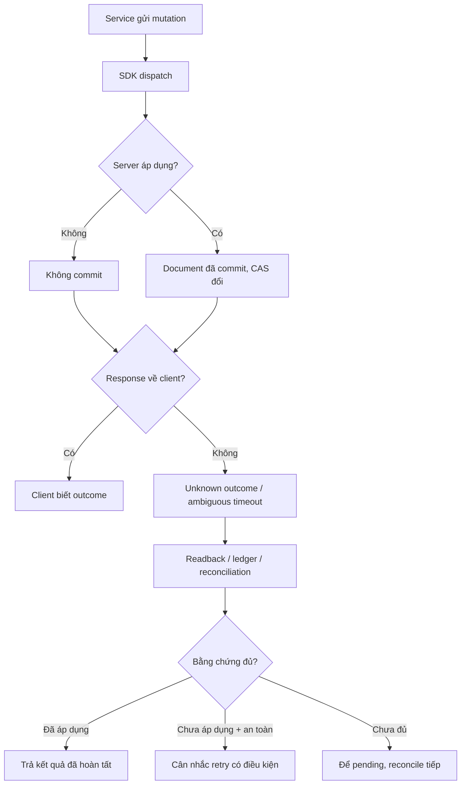
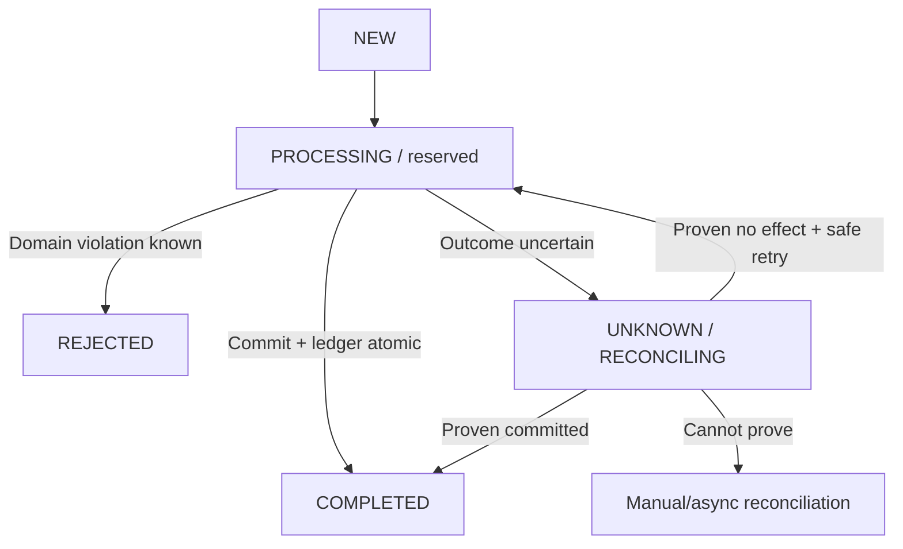

# Tính lũy đẳng trước khi thử lại thao tác ghi

## 1. Một lần gửi request không đồng nghĩa một lần thực thi

Trong module **SPRING_DATA_COUCHBASE**, ứng dụng xây dựng tầng truy cập Couchbase bằng Spring Data document mapping, repository, `CouchbaseTemplate`, truy vấn SQL++, thiết kế bucket/scope/collection, chỉ mục, TTL, CAS, giao dịch và lựa chọn API reactive để bảo đảm hiệu năng, nhất quán và khả năng vận hành. Ở chương **Xử lý lỗi**, câu hỏi quan trọng nhất trước khi thử lại một lệnh ghi không phải “exception này có retryable không?” mà là:

> **Nếu server đã áp dụng lệnh ghi lần đầu nhưng client chưa nhận được phản hồi, gửi lại cùng ý định có gây thêm tác dụng hoặc ghi đè dữ liệu mới không?**

Ví dụ ứng dụng gọi:

```java
orders.mutateIn(orderId, List.of(
    MutateInSpec.increment("stats.ship_attempts", 1),
    MutateInSpec.arrayAppend(
        "history", List.of(shippingEvent))
));
```

Couchbase có thể đã lưu counter và event, rồi đường truyền mất trước khi kết quả đến client. Một retry vô điều kiện có thể tăng counter lần hai và append event trùng. Ngược lại, dừng ngay cũng không đủ: ứng dụng chưa biết lệnh đã thực hiện hay chưa.

Bài học này thiết kế **tính lũy đẳng (idempotency)** từ góc nhìn **business command**, kết nối với cơ chế SDK retry, CAS/`@Version`, Sub-document atomicity, SQL++, transaction, auditing và API reactive.

### Mục tiêu học tập

Sau bài này, bạn có thể:

1. Phân biệt **request gửi lại**, **mutation server-side**, **idempotent effect**, **at-most-once**, **at-least-once** và **exactly-once effect**.
2. Xác định thao tác nào an toàn khi lặp và thao tác nào không; nhận diện giả định đồng thời, TTL và external side effects.
3. Đặt **operation ID/idempotency key** ổn định cho một business command, phát hiện reuse key với payload khác.
4. Dùng `lookupIn`/`get` cùng CAS để quyết định lại trước khi ghi và đối chiếu sau timeout mơ hồ.
5. Gộp state, audit, operation marker và history trong một `mutateIn` atomic trên một document.
6. Hiểu giới hạn của `last_operation_id`, duplicate key và read-before-write.
7. Thiết kế **dedup ledger** với transaction khi phải ghi nhiều documents và outbox khi có hệ thống ngoài Couchbase.
8. Viết bounded retry cho read/conditional workflow nhưng không retry mù `increment`/`arrayAppend`.
9. Kiểm thử crash, response loss, concurrent requests, key conflict, transaction ambiguity và reactive re-subscription.
10. Chọn TTL, retention, security, metrics và reconciliation policy phù hợp.

## 2. Ví dụ nghiệp vụ xuyên suốt: chuyển đơn hàng sang SHIPPED

Giả sử bucket `shop`, scope `sales`, collection `orders` có key `order::1001`:

```json
{
  "_class": "order-document",
  "schema_version": 2,
  "state": "READY",
  "customer_id": "customer::42",
  "shipping": {
    "tracking_code": null
  },
  "stats": {
    "status_changes": 4
  },
  "modified_at_ms": 1795104000000,
  "modified_by": "checkout-service",
  "last_operation_id": "",
  "history": [
    {"event_id": "evt::1001::ready", "state": "READY"}
  ]
}
```

Client gửi command:

```json
{
  "orderId": "order::1001",
  "operationId": "ship-order::01JABCXYZ",
  "trackingCode": "VN123456",
  "requestedBy": "shipping-service"
}
```

*Bản production phải lấy actor từ danh tính đã xác thực; trường `requestedBy` trong payload minh họa không được tin trực tiếp.*

Hệ thống muốn bảo đảm:

- Nếu command này được nhận nhiều lần vì retry hoặc duplicate message, order chỉ chuyển trạng thái **một lần theo cùng ý định**.
- Counter `stats.status_changes` chỉ tăng một lần.
- History có một event cho command.
- Audit timestamp/actor được ghi cùng trạng thái.
- Một command khác với operation ID khác phải được xử lý theo **state machine**, không phải được coi là duplicate.
- Nếu response không tới client, có cách truy vấn trạng thái và **không tuyên bố thành công/thất bại khi chưa có bằng chứng**.

### 2.1. Hai cuộc đua cần xử lý

**Đua cùng ý định:** hai retries cùng `operationId` đến hai pods khác nhau.

**Đua khác ý định:** pod A muốn ship, pod B muốn cancel, hoặc pod C cập nhật một field liên quan.

Chỉ một marker hoặc `if (state == READY)` ở memory là chưa đủ; cần kiểm soát atomicity và concurrency tại Couchbase.

## 3. Định nghĩa chính xác: lũy đẳng ở tầng nào?

Trong toán học, một phép biến đổi `f` là lũy đẳng nếu:

\[
f(f(x)) = f(x).
\]

Ví dụ “đặt trạng thái thành `SHIPPED`” có vẻ lũy đẳng nếu chỉ xét **một giá trị state**. Nhưng một business operation thường là phép biến đổi trên **nhiều thành phần**:

```text
T = (order.state,
     order.history,
     order.stats.status_changes,
     order.modified_at_ms,
     inventory.available,
     payment.charge,
     emittedEvents)
```

Nếu cùng command thay `state` thành SHIPPED nhưng còn increment counter, append event, gửi email hay trừ tiền, **hiệu ứng tổng thể** không còn lũy đẳng.

### 3.1. Một bản ghi cuối giống nhau không đủ

```java
orders.upsert(id, sameBody);
```

Hai lần có thể cho cùng JSON body, nhưng:

- CAS của document thay đổi.
- TTL có thể thay đổi theo options/bucket policy.
- Một writer khác có thể sửa document giữa hai attempts và bị overwrite.
- Spring auditing/callbacks có thể tạo timestamp mới.
- Event/message hoặc external payment có thể được gửi lại.
- Một trigger/event consumer có thể coi đây là hai mutations.

**Lũy đẳng phải được định nghĩa trên toàn bộ tác dụng có ý nghĩa đối với nghiệp vụ**, trong phạm vi các hệ thống liên quan, không chỉ phép gán cuối cùng.

### 3.2. Năm thuật ngữ cần phân biệt

| Thuật ngữ | Ý nghĩa | Không đồng nghĩa |
| --- | --- | --- |
| At-most-once delivery | Hệ thống cố không gửi command quá một lần | Không bảo đảm command đã được thực hiện. |
| At-least-once delivery | Có thể gửi lặp để tăng xác suất được thực hiện | Không bảo đảm không tạo tác dụng kép. |
| Idempotent effect | Lặp cùng command không làm tăng tác dụng ngoài kết quả mong muốn | Không tự ngăn mọi concurrent business conflicts. |
| Atomic mutation | Một request commit tất cả specs cùng document hoặc không spec nào | Không tự bảo đảm exactly-once qua hai requests. |
| Exactly-once business effect | Cùng ý định có tối đa một hiệu ứng được công nhận và có cơ chế xác nhận/kết thúc | Không đồng nghĩa transport chỉ gửi một lần. |

Trong hệ phân tán, người phát triển thường phối hợp **at-least-once delivery + idempotent consumer + deduplication + reconciliation** để đạt hiệu ứng gần yêu cầu exactly-once trong **một phạm vi đã định nghĩa**.

## 4. Vì sao timeout làm nảy sinh vấn đề lũy đẳng?

Vòng đời request Couchbase Java SDK có các giai đoạn:

1. **Pre-dispatch:** chưa gửi tới endpoint.
2. **Dispatch:** request đã đưa lên mạng, server có thể nhận.
3. **Response:** client nhận kết luận thành công hoặc lỗi rõ.



### 4.1. `AmbiguousTimeoutException`

Theo Java SDK, lỗi này báo client **không chắc** request đã có side effect. Cơ chế có thể là server đã commit và phản hồi thất lạc. Với mutation chứa increment/append, **không retry giống hệt** chỉ dựa vào exception.

### 4.2. `UnambiguousTimeoutException`

SDK xác định request không thể đã có side effect theo ngữ cảnh. Nó làm retry an toàn hơn ở tầng KV, nhưng còn phải xét:

- Toàn business workflow có external side effects trước đó không?
- Retry có còn trong deadline, quota và concurrency budget không?
- Input hoặc cấu hình có được sửa không?
- Có biến đổi domain state nằm ngoài KV request không?

### 4.3. `RequestCanceledException`

Không đồng nhất cancellation với “không hề có thao tác ghi”. SDK có thể cancel vì RetryStrategy, backpressure, shutdown hoặc lifecycle; khi dữ liệu có thể đã được gửi, policy vẫn phải xét request/outcome cụ thể.

### 4.4. SDK đã có retry mặc định

Java SDK 3 có `BestEffortRetryStrategy` mặc định và phân loại `RetryReason`/idempotence bảo thủ. Sau khi SDK đã retry/timeout, việc thêm `retryWhen(Retry.indefinitely())` ở ứng dụng có thể khuếch đại tải. Domain idempotency **bổ sung**, không thay thế bảo vệ ở SDK.

## 5. Ma trận thao tác: hiệu ứng khi lặp lại

| API / intent | Lặp lại có thể xảy ra điều gì? | Quyết định mặc định |
| --- | --- | --- |
| `get` / `lookupIn` / `exists` | Không gây side effect, nhưng snapshot lần sau có thể khác | Retry có budget. |
| `insert(key, value)` | Lần đầu tạo key; lần sau `DocumentExists` | Dùng key để claim khi phù hợp, xác minh payload/owner. |
| `upsert(key, value)` | Ghi đè value, CAS/TTL có thể đổi; mất thay đổi writer khác | Không xem là domain-idempotent nếu chưa chứng minh. |
| `replace(key, value)` không CAS | Lặp có thể ghi đè state mới | Dùng CAS/điều kiện. |
| `replace` có CAS cũ | Lần sau thường conflict; phải đọc lại | Không đổi CAS mù để ép success. |
| `remove(key)` | Lần sau có thể `DocumentNotFound` | Không đồng nhất NotFound với command trước đã thành công. |
| `MutateInSpec.upsert("state", "SHIPPED")` | Field value giống nhau, nhưng metadata/events có thể thay đổi | Xét toàn business effect. |
| `MutateInSpec.insert(path, value)` | Chỉ thêm khi path thiếu; lần sau `PathExists` | Có thể dùng guard server-side theo invariant rõ. |
| `MutateInSpec.increment(path, 1)` | Tăng thêm một lần mỗi lần server áp dụng | Non-idempotent. |
| `MutateInSpec.arrayAppend` | Thêm phần tử mới mỗi lần | Non-idempotent. |
| `MutateInSpec.arrayAddUnique` | Chặn primitive duplicate theo semantics SDK | Không phải dedup cho JSON objects hoặc toàn multi-spec request. |
| SQL++ `SELECT` với `readonly(true)` | Read-only, retry có thể trả snapshot khác | Retry budget/consistency. |
| SQL++ `UPDATE`/`INSERT`/`MERGE` | Có thể tác động nhiều documents | Cần guard/transaction/ledger; không copy policy SELECT. |
| Transaction callback | Có thể được SDK chạy lại | Không đặt external side effects trong callback. |

### 5.1. “Ghi đè cùng giá trị” khác “lặp đúng ý định”

Giả sử command A đặt email mới, command B đặt email khác, rồi retry A chạy sau B:

```text
A: set email = a@example.test  (server commit; response mất)
B: set email = b@example.test  (server commit)
A: retry set email = a@example.test
```

Kết quả cuối là A, phá thay đổi B. **Upsert cùng value không đảm bảo an toàn trước concurrency**, dù hàm gán riêng lẻ lũy đẳng theo toán học.

## 6. Thế nào là một idempotency key đúng?

**Idempotency key** là mã nhận diện **một ý định nghiệp vụ cụ thể**, được giữ nguyên khi cùng ý định được gửi lại. Nó không phải SDK request ID, trace ID hay CAS.

Ví dụ:

```text
tenant=shop-a
command_type=SHIP_ORDER
aggregate_id=order::1001
operation_id=ship-01JABCXYZ
```

### 6.1. Phạm vi khóa

Không dùng `operationId` đơn lẻ nếu nhiều tenants/command types có thể trùng. Một khóa dedup thường có phạm vi:

```text
(namespace, tenantId, operationType, operationId)
```

Đôi khi ràng buộc thêm account/order tùy business. Khi dùng key trong Couchbase, chuẩn hóa thành chuỗi có format tường minh, tránh collision do nối chuỗi không có delimiter/length. Kiểm tra giới hạn key và không lộ PII trong key/log.

### 6.2. Sinh một lần và giữ qua mọi retry

```java
import java.util.UUID;

// Tạo khi business command mới được khởi tạo.
String operationId = UUID.randomUUID().toString();

// Cùng command: giữ operationId ổn định qua retries,
// message redelivery, timeout và process restart.
```

Không tạo UUID **bên trong `retryWhen`/`flatMap` được subscribe lại**, vì mỗi lần sẽ có key mới, vô hiệu hóa deduplication.

### 6.3. Mã không phải quyền truy cập

Một caller không được phép gửi `operationId` của người khác để đọc/chiếm kết quả. Tầng API phải xác minh actor, tenant và quyền trên order **trước** khi quyết định “duplicate thành công”. Idempotency key không thay authorization.

### 6.4. Không trộn với correlation/trace ID

| Mã | Vòng đời | Mục đích |
| --- | --- | --- |
| Idempotency/operation ID | Giữ qua retries của cùng business command | Dedup effect. |
| HTTP request ID | Có thể mới mỗi HTTP retry | Correlation của một request attempt. |
| SDK request ID | SDK nội bộ, có thể thay mỗi dispatch | Chẩn đoán transport. |
| Trace/span ID | Mỗi tracing context | Observability, không phải unique business event. |
| CAS | Version của document | Optimistic concurrency, không phải dedup key. |

## 7. Khóa giống nhau nhưng payload khác: phải báo conflict

Một client có thể vô tình dùng lại `operationId` cho một tracking code khác:

```json
{"operationId":"ship-01JABCXYZ","trackingCode":"VN123"}
```

và sau đó:

```json
{"operationId":"ship-01JABCXYZ","trackingCode":"VN999"}
```

Không được trả kết quả thành công cũ cho lệnh thứ hai như thể đây là cùng ý định. Thiết kế phải so sánh **request identity/fingerprint** đã lưu:

```text
same scope + same operationId + same normalized payload
    => duplicate of same intent

same scope + same operationId + different normalized payload
    => IDEMPOTENCY_KEY_REUSED_WITH_DIFFERENT_REQUEST
```

### 7.1. Canonicalization trước khi fingerprint

Cần quyết định các trường thuộc “cùng ý định”:

- Trường nghiệp vụ: `orderId`, `trackingCode`, shipping carrier/desired transition.
- Không đưa dynamic timestamp do server tạo, trace ID hoặc retry attempt vào fingerprint nếu chúng **không** phải ý định.
- Chuẩn hóa whitespace, Unicode, case và JSON object key order theo contract.
- Phân biệt omitted field với explicit JSON null nếu chúng mang nghĩa khác.
- Bảo vệ key-space theo tenant, actor và command type.
- Version schema fingerprint để xử lý contract evolution.

### 7.2. Hash nào đủ an toàn?

Nếu fingerprint chứa email/PII dễ đoán, plain SHA-256 có thể bị dictionary attack từ log. Trong kho nội bộ cần chọn HMAC hoặc một dạng canonical payload **không lộ PII**, giới hạn quyền/retention. Không đưa raw payload hoặc HMAC secret vào log.

Fingerprint giúp phát hiện payload reuse **trong ledger**, nhưng không thay input validation, authorization hay concurrency control.

## 8. Idempotency record: mô hình tối thiểu

Một ledger entry ví dụ (nếu cần lưu riêng):

```json
{
  "operation_type": "SHIP_ORDER",
  "tenant": "shop-a",
  "aggregate_key_token": "opaque-id",
  "operation_id": "ship-01JABCXYZ",
  "request_fingerprint": "hmac-v1:...",
  "status": "COMPLETED",
  "result": {
    "public_code": "ORDER_SHIPPED"
  },
  "created_at_ms": 1795104000000,
  "completed_at_ms": 1795104000380
}
```

Đây là **record do application quản lý**, không phải hệ thống transaction log nội bộ của Couchbase.

### 8.1. State machine của operation



`PROCESSING` **không đồng nghĩa đã xử lý**. Một process có thể chết sau khi ghi claim nhưng trước khi ghi business effect. Cần lease/expiry/fencing/recovery để không giữ lệnh vĩnh viễn ở trạng thái đó.

### 8.2. Lưu gì để trả lại duplicate response?

Thông thường lưu:

- Status cuối: completed/rejected.
- Stable public result hoặc resource pointer có authorization.
- Fingerprint của request.
- Timestamp/TTL theo retention.
- Technical version/state của ledger.

Không lưu raw JWT, secrets, cả HTTP request, document body hay thông tin vượt yêu cầu. Khi response có dữ liệu biến động, chính sách có thể trả “đã xử lý” + truy vấn resource hiện tại thay vì snapshot cũ.

## 9. Vì sao check-then-write đơn giản có race?

Anti-pattern:

```java
if (!alreadyProcessed(operationId)) {
    applyShipment(orderId, trackingCode);
    markProcessed(operationId);
}
```

Hai pods A và B có thể cùng thấy `false` rồi cùng update. Hoặc A update thành công và crash trước `markProcessed`, B retry tạo effect lần hai.

```text
Pod A: lookup marker -> absent
Pod B: lookup marker -> absent
Pod A: increment counter + append event
Pod B: increment counter + append event
Pod A: write marker
Pod B: write marker
```

**Read-before-write không khóa gì cả.** Muốn đúng, cần một primitive atomic ở server:

- Một `mutateIn` gồm business fields + marker, có CAS/kiểm state trước.
- `insert` vào key duy nhất để claim, **kèm cơ chế commit atomic với business effect** nếu nằm khác document.
- Couchbase transaction ghi ledger và business state cùng commit.
- Hoặc workflow reconciliation/outbox có semantics được định nghĩa rõ.

## 10. CAS và operation ID giải quyết hai bài toán khác nhau

CAS ngăn hai writers áp cùng quyết định lên **một phiên bản document**. Operation ID xác định hai requests có cùng **business intent** hay không.

| Công cụ | Bảo vệ | Không tự bảo vệ |
| --- | --- | --- |
| CAS | Stale snapshot trên một document | Duplicates sau process crash nếu không có marker. |
| `insert` field/key | Chỉ tạo khi field/key chưa có tại thời điểm server xử lý | Domain equality, tác động ở document khác. |
| Operation marker | Dấu hiệu command đã được áp dụng trên state đang lưu | Marker bị overwrite, expiry hoặc crash giữa hai writes. |
| Atomic multi-spec `mutateIn` | Các fields cùng document commit/từ chối cùng nhau | Two requests không atomic chung, external effects. |
| Transaction + ledger | Atomicity giữa ledger và business documents (khi tất cả dùng transactional operations) | Email/payment API ngoài DB; response vẫn có thể ambiguous. |

### 10.1. CAS mismatch là cơ hội đọc lại, không là tín hiệu đã xử lý

Hai commands khác nhau có thể cùng CAS. Nếu mất CAS, cần đọc trạng thái mới rồi xác định lệnh có còn hợp lệ. Không suy rằng mọi `CasMismatchException` có nghĩa **một retry của chính bạn** đã thành công.

### 10.2. CAS là opaque token

Spring Data Couchbase ánh xạ CAS vào `@Version`. Không tăng CAS bằng `+1`, không so sánh như timestamp hoặc sequence kinh doanh; đọc lại qua SDK/repository.

## 11. Một mutation nguyên tử: state + marker + history + audit

Giả sử đã đọc document, xác minh:

- `state` đang `READY`.
- Marker chưa bằng `operationId`.
- `trackingCode` và actor được validate.
- Các JSON paths cần thiết tồn tại đúng kiểu.
- `expectedCas` từ cùng snapshot.
- `history` là JSON array.

Tạo **một** mutation:

```java
import java.util.List;

import com.couchbase.client.java.json.JsonObject;
import com.couchbase.client.java.kv.MutateInSpec;
import com.couchbase.client.java.kv.MutateInOptions;
import com.couchbase.client.java.kv.MutateInResult;
import com.couchbase.client.core.msg.kv.DurabilityLevel;

JsonObject event = JsonObject.create()
    .put("event_id", operationId)
    .put("state", "SHIPPED")
    .put("at_ms", nowMs)
    .put("actor", trustedActor);

MutateInResult updated = orders.mutateIn(
    orderId,
    List.of(
        MutateInSpec.replace("state", "SHIPPED"),
        MutateInSpec.upsert(
            "shipping.tracking_code", trackingCode),
        MutateInSpec.increment(
            "stats.status_changes", 1),
        MutateInSpec.arrayAppend(
            "history", List.of(event)),
        MutateInSpec.replace(
            "modified_at_ms", nowMs),
        MutateInSpec.replace(
            "modified_by", trustedActor),
        MutateInSpec.upsert(
            "last_operation_id", operationId)
    ),
    MutateInOptions.mutateInOptions()
        .cas(expectedCas)
        .durability(DurabilityLevel.MAJORITY)
        .preserveExpiry(true)
);

long newCas = updated.cas();
```

### 11.1. Những gì request này bảo đảm

- Multi-spec `mutateIn` atomic **trên một document**: nếu một spec lỗi, toàn mutation không commit một phần.
- CAS yêu cầu server chỉ áp dụng trên snapshot chưa đổi.
- Marker và event/counter nằm trong **cùng commit với state**.
- Durability level định nghĩa replication/persistence policy theo cấu hình.
- `preserveExpiry(true)` bảo toàn expiry khi SDK/server hỗ trợ.

### 11.2. Những gì request này **không** tự bảo đảm

- Không ngăn một command mới hợp lệ ghi đè `last_operation_id` sau đó.
- Không dedup các event khác trước/sau bằng ledger toàn cục.
- Không atomic với stock document, payment service hoặc message broker.
- Không bảo đảm client nhận response.
- Không tự gọi Spring Data auditing/callbacks khi dùng raw SDK.
- Không tự phát hiện một request khác dùng cùng operation ID nhưng payload khác, trừ khi adapter kiểm fingerprint.

**Hạn chế quan trọng:** Sau `AmbiguousTimeoutException`, không được resend nguyên specs chỉ vì application chưa thấy response; cần đọc lại marker/domain state.

## 12. Đọc lại sau timeout: ba kết luận, không phải hai

Giả sử client vừa nhận `AmbiguousTimeoutException` khi gửi shipment. Một KV readback có thể phân loại:

| Readback | Bằng chứng | Quyết định |
| --- | --- | --- |
| Marker trùng operation ID, state/tracking đúng | Nếu marker và business effect được ghi trong một mutation atomic, command có dấu hiệu đã commit | Trả hoàn tất; kiểm quyền/fingerprint. |
| Marker khác, state vẫn READY | Chưa đủ chứng minh original command **chắc chắn không commit**, nhất là có writer mới, TTL hoặc failover | Xem causal history/ledger và CAS. |
| Marker khác, state SHIPPED | Có thể do command khác, marker bị thay hoặc command trước | Conflict hoặc kiểm ledger; không tự nhận success. |
| Document missing | TTL/xóa/routing hoặc dữ liệu chưa tồn tại | Không tự tạo order để retry shipment. |
| KV read cũng timeout | Chưa có bằng chứng về outcome | Giữ trạng thái UNKNOWN, reconcile sau. |

### 12.1. Vì sao chỉ một `lookupIn` chưa luôn đủ?

Marker `last_operation_id` là **một ô duy nhất**. Writer khác có thể ghi đè sau đó; một document có TTL có thể biến mất; event history có thể bị cắt theo retention. Một read phản ánh **trạng thái hiện tại**, không luôn chứng minh toàn bộ lịch sử.

Nếu yêu cầu tài chính/kiểm toán hoặc exactly-once trong thời gian dài, dùng **ledger append-only theo operation ID, retention đủ dài và transaction khi cần**.

### 12.2. Không dùng SQL++ query chưa thấy row để kết luận chưa commit

GSI indexes có thể cập nhật bất đồng bộ. Nếu cần đối chiếu ngay sau KV mutation, đọc theo key bằng KV `get`/`lookupIn`. Khi dùng SQL++, chọn scan consistency hoặc mutation-state phù hợp, nhưng query không thấy row **không phải bằng chứng chắc chắn** lệnh chưa commit.

## 13. Marker trong document: phạm vi đúng và những trường hợp thất bại

Mẫu `last_operation_id` trong cùng order đơn giản và hiệu quả khi:

- Một aggregate được xử lý chủ yếu bằng **một document key**.
- Tập operations hợp lệ là **state transitions có thứ tự**, ví dụ READY → SHIPPED, không có tác vụ “quay lại READY” tùy tiện.
- Marker được ghi cùng state/history/counter trong **một mutateIn có CAS**.
- Cùng một command được lưu với fingerprint/identity đủ để nhận diện.
- Chính sách retention không xóa bằng chứng trước retry horizon.

Tuy nhiên, marker đơn không phải giải pháp “exactly-once vĩnh viễn”.

### 13.1. Một command mới có thể ghi đè marker

```text
Operation A: SHIP_ORDER => last_operation_id = A
Operation B: ADD_TRACKING_NOTE => last_operation_id = B
Retry A: thấy marker B, tưởng A chưa xảy ra
```

Retry A lúc này **không được suy** rằng A chưa commit. Nó phải kiểm tra state/history/ledger và domain rule. Nếu hệ thống có nhiều commands cùng aggregate, xem xét lưu **bounded applied_operation_ids** hoặc ledger riêng theo operation ID.

### 13.2. Array history cũng không tự là ledger

- Array có thể bị cắt theo retention.
- Event object có thể bị append hai lần nếu command retry không guard.
- `arrayAddUnique` chỉ có semantics nhất định cho primitive values, không enforce unique theo `event_id` của JSON objects.
- Mảng lớn gây document growth, network/serialization cost và giới hạn kích thước.
- Một `history` trong document có thể bị overwrite/xóa bởi writer khác.

Nếu nghiệp vụ cần truy vết lâu dài và tra cứu theo operation ID, ledger/document-per-event thường là mô hình phù hợp hơn.

### 13.3. TTL làm mất bằng chứng

Một document hoặc ledger hết hạn có thể khiến retry cũ được coi như command mới. Chọn **idempotency retention window** ít nhất bằng giới hạn resend của client, broker redelivery, job recovery và yêu cầu pháp lý/nghiệp vụ.

## 14. Một gateway Java mẫu cho **một document** có CAS và marker

Ví dụ sau thể hiện các nhánh **APPLIED**, **ALREADY_APPLIED**, **STATE_CONFLICT**, **RETRY_EXHAUSTED** và **UNKNOWN_COMMIT**. Đây là mẫu để tích hợp thêm validation, auth, logging và tests; không phải thư viện exactly-once hoàn chỉnh.

```java
import java.time.Clock;
import java.util.List;
import java.util.Objects;

import com.couchbase.client.core.error.AmbiguousTimeoutException;
import com.couchbase.client.core.error.CasMismatchException;
import com.couchbase.client.core.msg.kv.DurabilityLevel;
import com.couchbase.client.java.Collection;
import com.couchbase.client.java.json.JsonObject;
import com.couchbase.client.java.kv.GetResult;
import com.couchbase.client.java.kv.MutateInOptions;
import com.couchbase.client.java.kv.MutateInSpec;

enum ShipOutcome {
    APPLIED,
    ALREADY_APPLIED,
    STATE_CONFLICT,
    REUSED_KEY_WITH_DIFFERENT_PAYLOAD,
    RETRY_EXHAUSTED,
    UNKNOWN_COMMIT
}

public final class OrderShippingGateway {
    private final Collection orders;
    private final Clock clock;

    public OrderShippingGateway(
            Collection orders, Clock clock) {
        this.orders = Objects.requireNonNull(orders);
        this.clock = Objects.requireNonNull(clock);
    }

    public ShipOutcome ship(
            String orderId,
            String operationId,
            String requestFingerprint,
            String trackingCode,
            String trustedActor) {

        // Production: tenant authorization, input validation,
        // request fingerprint and rate limits before this method.
        if (orderId == null || operationId == null ||
            requestFingerprint == null ||
            trackingCode == null || trustedActor == null) {
            throw new IllegalArgumentException(
                "Required argument is null");
        }

        // Time của command attempt ổn định qua CAS retries;
        // policy có thể chọn thời điểm nhận command ban đầu.
        long nowMs = clock.millis();

        for (int attempt = 1; attempt <= 3; attempt++) {
            GetResult snapshot = orders.get(orderId);
            JsonObject body = snapshot.contentAsObject();

            String state = body.getString("state");
            String lastId =
                body.getString("last_operation_id");
            String lastFingerprint =
                body.getString("last_request_fingerprint");

            if (operationId.equals(lastId)) {
                if (!requestFingerprint.equals(
                        lastFingerprint)) {
                    return ShipOutcome
                        .REUSED_KEY_WITH_DIFFERENT_PAYLOAD;
                }

                if ("SHIPPED".equals(state) &&
                    trackingCode.equals(
                        body.getObject("shipping")
                            .getString("tracking_code"))) {
                    return ShipOutcome.ALREADY_APPLIED;
                }

                // Cùng marker nhưng final state bất nhất:
                // không tự coi là success.
                return ShipOutcome.UNKNOWN_COMMIT;
            }

            if (!"READY".equals(state)) {
                return ShipOutcome.STATE_CONFLICT;
            }

            JsonObject event = JsonObject.create()
                .put("event_id", operationId)
                .put("state", "SHIPPED")
                .put("at_ms", nowMs);

            try {
                orders.mutateIn(
                    orderId,
                    List.of(
                        MutateInSpec.replace(
                            "state", "SHIPPED"),
                        MutateInSpec.upsert(
                            "shipping.tracking_code",
                            trackingCode),
                        MutateInSpec.increment(
                            "stats.status_changes", 1),
                        MutateInSpec.arrayAppend(
                            "history", List.of(event)),
                        MutateInSpec.replace(
                            "modified_at_ms", nowMs),
                        MutateInSpec.replace(
                            "modified_by", trustedActor),
                        MutateInSpec.upsert(
                            "last_operation_id", operationId),
                        MutateInSpec.upsert(
                            "last_request_fingerprint",
                            requestFingerprint)
                    ),
                    MutateInOptions.mutateInOptions()
                        .cas(snapshot.cas())
                        .durability(
                            DurabilityLevel.MAJORITY)
                        .preserveExpiry(true)
                );

                return ShipOutcome.APPLIED;

            } catch (CasMismatchException conflict) {
                // Không dùng CAS cũ. Vòng sau đọc lại,
                // kiểm marker, fingerprint và state.
                continue;

            } catch (AmbiguousTimeoutException uncertain) {
                // KHÔNG gửi lại mutation ngay:
                // workflow riêng sẽ reconcile.
                return ShipOutcome.UNKNOWN_COMMIT;
            }
        }

        return ShipOutcome.RETRY_EXHAUSTED;
    }
}
```

### 14.1. Điều kiện tiên quyết của code

Fixture phải có:

- JSON body kiểu object đúng schema.
- `state`, `shipping` object, `stats.status_changes` number, `history` array.
- `modified_at_ms` và `modified_by` tồn tại.
- `last_operation_id` / `last_request_fingerprint` có thể MISSING hoặc string theo schema; nếu MISSING, `getString` cần được test theo SDK version.
- `trackingCode`/`trustedActor` đã được xác thực và chuẩn hóa.
- Server/SDK hỗ trợ `preserveExpiry`; replica topology phù hợp `MAJORITY`.

Nếu converter của Spring Data đổi representation, adapter phải dùng **đúng JSON paths** và storage type. Raw SDK không tự chạy auditing hay mapping.

### 14.2. Giới hạn quan trọng

- Khi marker bị command khác ghi đè, gateway trả `STATE_CONFLICT`/`UNKNOWN_COMMIT` chứ không có bằng chứng exactly-once lịch sử.
- `requestFingerprint` phải được xây từ một canonical command và được kiểm chứng bên ngoài; không lấy input raw untrusted rồi coi đã an toàn.
- `UNKNOWN_COMMIT` là **trạng thái phải được xử lý tiếp**, không được biến thành response “chưa ship” hoặc success chắc chắn.
- Vòng CAS retry tối đa ba lần. Trong hệ thống thật cần thêm overall deadline/backoff/jitter và circuit breaker.
- Hàm `orders.get` cũng có thể timeout/mất collection/quyền; không phân loại chúng như CAS conflict.
- Dùng `get` full JSON cho dễ hiểu. Khi tối ưu, dùng `lookupIn` các fields và CAS trên cùng snapshot, nhưng tests phải xác nhận required fields.
- Một writer bỏ qua CAS và ghi đè state vẫn có thể phá domain contract. **Mọi entry point** phải tuân thủ quy tắc tương thích.
- Không gọi external payment/email/message broker trong vòng lặp có thể chạy lại.

## 15. Một phiên bản `lookupIn` gọn hơn

Nếu chỉ cần state/marker/fingerprint/tracking, Sub-document lookup giảm dữ liệu truyền:

```java
import com.couchbase.client.java.kv.LookupInSpec;
import com.couchbase.client.java.kv.LookupInResult;

LookupInResult snapshot = orders.lookupIn(
    orderId,
    List.of(
        LookupInSpec.get("state"),
        LookupInSpec.get("last_operation_id"),
        LookupInSpec.get("last_request_fingerprint"),
        LookupInSpec.get("shipping.tracking_code")
    )
);

String state = snapshot.contentAs(0, String.class);
String lastId = snapshot.contentAs(1, String.class);
String fingerprint = snapshot.contentAs(2, String.class);
String tracking = snapshot.contentAs(3, String.class);
long cas = snapshot.cas();
```

**Chú ý:**

- Những fields này được giả định đã tồn tại trong fixture; JSON null khác MISSING.
- Với optional path, dùng `LookupInSpec.exists`/per-spec handling phù hợp.
- Lookup nhiều specs lấy cùng snapshot, CAS tương ứng snapshot đó.
- Sau read, writers khác có thể đổi document; gửi CAS khi mutation phụ thuộc snapshot.
- Không chạy `exists` request rồi `get` request khác và giả định cả hai là cùng version nếu không có CAS/revalidation.
- `lookupIn` là read-only, nhưng không tự tạo business idempotency.

## 16. Retry sau `CasMismatchException` có thể thành công nhưng phải xét lại state

Hai retry scenarios:

### Scenario A — Retry của chính operation

```text
A gửi SHIP_ORDER operationId=O1, server commit
A mất response (ambiguous)
A đọc lại order, thấy marker O1 + SHIPPED + tracking đúng
=> ALREADY_APPLIED, không tăng counter/append nữa
```

### Scenario B — Writer khác thắng

```text
A đọc READY CAS=C1
B gửi CANCEL_ORDER, server commit CAS=C2
A gửi SHIP_ORDER CAS=C1 -> CasMismatch
A đọc lại CANCELLED
=> STATE_CONFLICT, không tạo Shipment mới
```

Lấy CAS=C2 rồi gửi nguyên lệnh SHIPPED **không phải** retry an toàn: nó phá state machine.

### 16.1. Đừng nhầm `CasMismatch` với `PathNotFound`

- CAS mismatch = phiên bản document khác snapshot.
- PathNotFound/PathMismatch = JSON structure/operation contract.
- Có thể một request lỗi do nhiều nguyên nhân đồng thời; ứng dụng dựa vào exception/server result và state sau readback để quyết định, không đoán thứ tự kiểm tra của server.

## 17. Dùng `insert` làm claim idempotency key: hữu ích nhưng chưa đủ

Một collection `idempotency` có key:

```text
idem::shop-a::SHIP_ORDER::ship-01JABCXYZ
```

Thao tác:

```java
idempotency.insert(
    ledgerKey,
    JsonObject.create()
        .put("operation_id", operationId)
        .put("status", "PROCESSING")
);
```

`insert` là điều kiện **document chưa tồn tại**. Hai pods cùng insert một key, chỉ một pod có thể thành công tại một thời điểm.

Tuy nhiên:

```text
A: insert ledger PROCESSING (thành công)
A: crash trước khi ship order
B: retry thấy DocumentExists
B: trả "đã ship" vì tưởng duplicate  <-- SAI
```

Lệnh claim **không** chứng minh business effect đã commit.

### 17.1. Lỗ hổng crash giữa hai requests

```text
Request 1: ledger.insert(PROCESSING)
Request 2: orders.mutateIn(SHIPPED, history++)
Request 3: ledger.replace(COMPLETED)
```

Ba requests **không** atomic chung. Crash ở ba khoảng có trạng thái khác nhau:

| Crash ở đâu? | Ledger | Order | Hướng xử lý |
| --- | --- | --- | --- |
| Sau request 1 | PROCESSING | READY | Lease/recovery, không trả success. |
| Sau request 2 | PROCESSING | SHIPPED | Reconcile theo marker/operation ID. |
| Sau request 3 | COMPLETED | SHIPPED | Có thể trả result nếu ledger/payload khớp. |

Nếu hai documents thuộc cùng Couchbase transaction thì có thể thiết kế atomic commit; nếu không, phải chấp nhận và xử lý **saga/reconciliation** với trạng thái trung gian.

### 17.2. Claim lease và fencing token

Khi dùng `PROCESSING`, cần xác định:

- Owner/lease deadline là ai?
- Worker cũ thức dậy sau khi lease hết có được ghi nữa không?
- Dùng CAS/fencing token để ngăn stale worker hoàn tất command sau khi worker mới nhận lease.
- Có cho claim takeover sau deadline không, và có cần kiểm order state trước?
- TTL ledger có thể làm key biến mất rồi cho phép **reclaim command cũ** không?
- Nếu claim được ghi nhưng write outcome mơ hồ, phải đối chiếu trước takeover.

Không dùng một trường `processing=true` không có expiry/recovery protocol.

## 18. Transaction khi ledger và business document phải commit cùng nhau

Couchbase Java SDK có distributed ACID transactions qua `cluster.transactions().run(...)`. Khi ledger và order nằm ở **hai document keys**, transaction có thể đưa hai thay đổi vào cùng một logical atomic commit.

### 18.1. Mẫu commit ledger và order trong transaction

Đây là Java skeleton dùng API đồng bộ của Couchbase SDK 3.x; các biến `orders`, `ledger`, `orderId`, `ledgerKey`, `operationId`, `fingerprint` và `trackingCode` đã được service chuẩn bị:

```java
import com.couchbase.client.java.json.JsonObject;

// Transaction SDK có thể chạy lại lambda nội bộ.
cluster.transactions().run(ctx -> {
    var orderResult = ctx.get(orders, orderId);
    JsonObject body =
        orderResult.contentAs(JsonObject.class);

    if (!"READY".equals(body.getString("state"))) {
        throw new IllegalStateException(
            "Shipping transition not allowed");
    }

    // Key ledger duy nhất trong scope operation.
    // Duplicate insert khiến attempt fail; ngoài transaction
    // cần đọc ledger, đối chiếu fingerprint/result.
    JsonObject receipt = JsonObject.create()
        .put("operation_id", operationId)
        .put("request_fingerprint", fingerprint)
        .put("status", "COMPLETED")
        .put("order_id", orderId);

    ctx.insert(ledger, ledgerKey, receipt);

    // Mọi thay đổi body cùng nằm trong transaction.
    body.put("state", "SHIPPED");
    body.getObject("shipping").put(
        "tracking_code", trackingCode);
    body.put("last_operation_id", operationId);

    ctx.replace(orderResult, body);
});
```

**Đây không phải một endpoint hoàn chỉnh.** Bản production phải thêm:

- Actor/tenant authorization trước và trong transaction theo contract.
- Cập nhật audit fields, history/counter **trong body transaction**, tránh không nhất quán.
- Xử lý ledger key đã tồn tại: chỉ trả duplicate success sau khi đọc đúng receipt, xác minh fingerprint/actor và trạng thái commit.
- Cơ chế xử lý `TransactionCommitAmbiguousException` thay vì tự kết luận failure.
- Transaction timeout/durability/topology/permissions phù hợp.
- Không thêm raw `orders.mutateIn` ngoài `ctx` bên trong transaction.
- Tests về duplicate/concurrent same-key, CAS contention và transactional visibility.

### 18.2. Duplicate key không chứng minh cùng payload

Nếu `ctx.insert(ledger, ledgerKey, receipt)` thất bại vì key tồn tại, ứng dụng phải **đọc receipt** và so sánh command scope, fingerprint và final status. Có thể một client khác dùng cùng key nhưng tracking code khác. Trả success ngay sẽ che conflict.

### 18.3. Lambda transaction có thể được chạy lại

Tài liệu SDK nêu transaction sẽ tự retry một số errors và **chạy lại lambda**. Do đó:

- Sinh operation ID, lấy actor, quyết định business intent **ngoài** lambda.
- Không gọi charge card, gửi email, HTTP API, xuất file hoặc Kafka publish bên trong lambda.
- Xây `JsonObject` mới **trong** lambda để tránh chia sẻ object mutable giữa attempts.
- Chỉ dùng transactional `ctx.get/insert/replace/remove` với documents tham gia transaction.
- Không tự bọc transaction bằng một vòng retry rộng khi chưa hiểu ambiguity và deadline.

### 18.4. Transaction commit ambiguous

`TransactionCommitAmbiguousException` báo không xác định chắc commit point đã đạt chưa. Client cần query ledger theo key và/hoặc chạy reconciliation, không giả định transaction thất bại hoàn toàn.

Có thể có giai đoạn commit đã đạt nhưng documents chưa hoàn tất **unstaging**; tài liệu SDK mô tả `TransactionResult.unstagingComplete()`. Việc non-transactional KV reads nhìn thấy dữ liệu khi nào phải được kiểm tra theo transaction protocol; không chỉ dựa vào một `get` ngay lúc hệ thống đang khôi phục.

### 18.5. Vì sao ledger vẫn có giá trị khi dùng transaction?

Transaction giúp atomic commit business state + receipt. **Ledger** giúp:

- Nhận diện operation ID sau client timeout.
- Trả cùng logical result cho retries.
- Phát hiện key dùng lại với payload khác.
- Lưu lịch sử dedup và phục vụ reconciliation.
- Tham chiếu sang outbox hoặc external processing.

Không nên kết luận “đã có transaction thì không cần idempotency key”. Client có thể gửi **hai transactions riêng** cho cùng business command; ledger/unique key ngăn hai effects.

## 19. Sau transaction: email, payment, Kafka vẫn không atomic theo Couchbase

Couchbase transaction chỉ bao phủ các operations **được thực hiện trong transaction** theo semantics SDK. Không có atomic commit chung với:

- Email/SMTP.
- Payment gateway.
- REST API bên ngoài.
- Kafka/RabbitMQ publish ngoài transaction.
- Object storage, webhook.
- Ghi file/side effect trên host.

### 19.1. Transactional outbox

Một mẫu phổ biến:

```text
Couchbase transaction:
    update Order state
    insert idempotency receipt
    insert OutboxEvent keyed by operationId
COMMIT

Independent dispatcher:
    read pending OutboxEvent
    publish to downstream
    mark delivered (with retry/CAS)
```

Transaction bảo đảm **order, receipt và outbox event cùng được commit**. Dispatcher có thể publish lặp nếu response từ broker mất; vì vậy **consumer downstream cũng cần idempotency key**, thường chính `event_id`.

### 19.2. Outbox không mặc định bảo đảm exactly-once đến mọi consumer

Trường hợp dispatcher publish thành công rồi crash trước khi mark delivered → lần sau publish lại. Consumer phải dedup.

**Bảo đảm mong muốn** là “một business effect có một event ID ổn định”, không phải tin rằng mạng chỉ chuyển event một lần.

### 19.3. Payment gateway phải nhận idempotency key riêng

Nếu PSP/payment service hỗ trợ idempotency key, gửi operation ID ổn định theo API của họ. Không gọi payment trong Couchbase transaction lambda rồi để lambda retry. Khi PSP timeout, cần tra cứu transaction reference hoặc reconcile provider outcome; một Couchbase ledger **không tự chứng minh** charge ở PSP đã được thực hiện.

## 20. Ledger retention: TTL là hợp đồng về thời gian được dedup

Giả sử client có thể retry trong 24 giờ, broker có thể redeliver trong 7 ngày và reconciliation job chạy trong 14 ngày. Nếu ledger TTL chỉ 5 phút, command cũ sau 6 phút có thể được coi như mới.

### 20.1. Chọn retention window

Xem xét:

- HTTP/client retry horizon.
- Message queue retention/redelivery và DLQ replay.
- Job recovery/reprocessing.
- Business settlement period.
- Compliance/audit needs.
- Khả năng operator replay event sau vài tuần.
- Chi phí storage/index và xóa dữ liệu cá nhân.

Không có con số TTL mặc định đúng cho mọi hệ thống.

### 20.2. Expiry của ledger và expiry của order khác nhau

Ledger có thể cần 30 ngày, order có thể cần lâu hơn hoặc không expiry; đó là **hai document policies khác nhau**.

```java
import java.time.Duration;
import com.couchbase.client.java.kv.InsertOptions;

ledger.insert(
    ledgerKey,
    receipt,
    InsertOptions.insertOptions()
        .expiry(Duration.ofDays(30))
);
```

Đây là ví dụ API cho một ledger không dùng transaction. Khi **transactional insert**, phải xem transaction SDK/version hỗ trợ expiry thế nào; đừng copy `InsertOptions` trực tiếp vào `ctx.insert` nếu chữ ký không nhận.

### 20.3. Tuyệt đối không dựa vào TTL như lock tuyệt đối

Expiry là chính sách vòng đời, **không phải fencing token**. Một worker cũ có thể tiếp tục chạy sau thời điểm lease/TTL của ledger hết; phải kiểm CAS/lease owner/fencing trên write hoặc dùng transaction đúng thiết kế.

### 20.4. Xóa ledger có thể tạo replay window

Khi ledger hết hạn, cùng operation ID có thể trở lại thành “chưa từng thấy”. Nếu business bắt buộc chống replay vĩnh viễn, cần giữ receipt/tombstone/historical constraint đủ dài hoặc xác định rằng nghiệp vụ không cho xử lý lại khi order ở terminal state.

## 21. Bảo vệ chống collision và tái sử dụng idempotency key

Một khóa tốt cần:

- Scope tenant + command type rõ ràng.
- Unique ID đủ entropy hoặc sinh từ nguồn đã cấp phát duy nhất.
- So sánh fingerprint của **normalized payload**.
- Thực hiện authorization trên resource trước khi đọc/trả stored response.
- Không lộ key raw chứa PII qua log/metrics.
- Được truyền theo giới hạn độ dài và charset; chống newline/log injection.
- Không để client chọn bất kỳ Couchbase keyspace/key path nào.
- Có version và policy rotation/migration.

### 21.1. Cùng key, khác tenant

```text
tenant A: operationId=abc
tenant B: operationId=abc
```

Hai commands phải được phân biệt nhờ namespace/tenant. Nếu chỉ dùng `idem::abc`, tenant B có thể collide với A và bị trả nhầm receipt. Tenant isolation phải có cả **key derivation, RBAC và API authorization**.

### 21.2. Không log raw request fingerprint chứa bí mật

Nếu fingerprint dựa trên email, account ID hoặc payment token, xem nó như dữ liệu có khả năng liên kết. Chỉ log category, operation type và trace/correlation ID theo allowlist; cần per-document correlation thì có thể dùng HMAC do security policy quản lý.

## 22. SQL++ mutations và idempotency

SQL++ cho phép `UPDATE`, `INSERT`, `DELETE`, `MERGE`, đôi khi ảnh hưởng nhiều documents. Retry cùng statement có thể tạo tác dụng lặp hoặc thay đổi kết quả nếu tập rows thỏa điều kiện đã đổi.

### 22.1. Một UPDATE có thể idempotent trên field nhưng không trên toàn request

```sql
UPDATE `shop`.`sales`.`orders` AS o
SET o.state = "SHIPPED"
WHERE META(o).id = $orderId;
```

Nếu chỉ xét state final, hai lần cùng value giống nhau. Nhưng:

- CAS thay đổi.
- Trigger/auditing có thể ghi nhận nhiều lần.
- Một command khác có thể sửa state giữa hai attempts.
- Query consistency/response ambiguity vẫn tồn tại.

### 22.2. Increment là ví dụ chắc chắn non-idempotent

```sql
UPDATE `shop`.`sales`.`orders` AS o
SET o.stats.status_changes =
    o.stats.status_changes + 1
WHERE META(o).id = $orderId;
```

Gửi hai lần có thể tăng hai lần. Nếu logic ở nhiều documents hoặc cần dedup, ưu tiên transaction/ledger hoặc conditional state machine; không gắn `retryWhen` vào query mutation một cách tổng quát.

### 22.3. Condition trong WHERE chưa phải idempotency ledger

Thêm `WHERE o.state = "READY"` có thể giúp **ngăn cập nhật lặp khi state đã đổi**, nhưng:

- Nếu command thực hiện các side effects ở nơi khác, WHERE không điều phối chúng.
- Khi một writer khác chuyển READY lần nữa, command cũ có thể thực hiện lại.
- Query response bị mất vẫn cần xác minh outcome.
- Condition trên nhiều docs có semantics khác một CAS mutation trên một key.

**Xác định invariants** trước khi chọn SQL++ mutation, không chỉ thêm WHERE để che rủi ro.

## 23. Spring Data Couchbase: repository save không tự cho exactly-once

Một entity:

```java
import org.springframework.data.annotation.Id;
import org.springframework.data.annotation.Version;
import org.springframework.data.couchbase.core.mapping.Document;
import org.springframework.data.couchbase.core.mapping.Field;

@Document
class OrderDocument {
    @Id
    private String id;

    @Version
    private Long version;

    @Field("state")
    private String state;

    @Field("last_operation_id")
    private String lastOperationId;

    // Constructors / getters / setters.
}
```

Spring Data `@Version` giúp optimistic locking. Khi `repository.save(entity)` gặp `OptimisticLockingFailureException`, service cần **load lại, kiểm marker và state rồi mới quyết định ghi**.

### 23.1. Không retry riêng `repository.save(staleEntity)`

```java
// Sai nếu entity/version vẫn stale:
repository.save(staleEntity);
repository.save(staleEntity); // Retry không reload/revalidate.
```

Nếu tự set CAS mới rồi save body cũ, bạn có thể ghi đè thay đổi của actor khác. Retry đúng là **load → validate → modify → save**, bounded, với operation ID.

### 23.2. Auditing có thể gây side effect không lũy đẳng

`@LastModifiedDate`, `@LastModifiedBy`, callbacks và custom converters có thể tạo value khác giữa attempts. Nếu cùng business command được replay, quyết định audit nên phản ánh **lần xử lý đã được chấp nhận**, không mặc định thay timestamp mỗi khi có HTTP retry.

Raw Java SDK `mutateIn` không tự đi qua Spring Data auditing/converters: phải cập nhật các audit fields trong cùng atomic mutation hoặc chọn Spring Data entity path có behavior đã được integration-test.

### 23.3. `CouchbaseTemplate` Sub-document khác repository save

`CouchbaseTemplate.mutateInById` có các fluent path mutations được tài liệu hóa theo version, nhưng không nên giả định nó tự chạy mọi lifecycle callbacks của `save` hoặc hỗ trợ counter/array/XATTR APIs của SDK. Khi cần marker+counter+history trong một mutation, raw SDK adapter có thể phù hợp, với trách nhiệm mapping/audit rõ ràng.

## 24. Không dùng API response status để đoán write outcome

Một HTTP client nhận:

- `200/201`: thường là ứng dụng đã kết luận thành công.
- `409`: có thể là duplicate key với khác payload, CAS/business conflict.
- `503`: service tạm không sẵn sàng.
- Timeout/no response: **không có bằng chứng chắc chắn** business effect đã hoặc chưa xảy ra.

Thiết kế endpoint có `Idempotency-Key` nên cung cấp cách:

1. Gửi command với một key ổn định.
2. Gửi lại cùng key/payload nếu client chưa nhận response.
3. Server tra ledger/snapshot, xác minh fingerprint và quyền.
4. Nếu COMPLETED, trả stable logical result.
5. Nếu PROCESSING/UNKNOWN, trả trạng thái đang xử lý + cách tra cứu; không tự làm lại effect.
6. Nếu cùng key/payload khác, trả conflict.

### 24.1. HTTP retries và SDK retries không cùng phạm vi

SDK có thể retry **một request KV** trong một HTTP attempt; client gateway có thể retry **toàn HTTP request** tạo ra nhiều operations KV/SQL++ khác nhau. Vì vậy idempotency key phải bao phủ **business command end-to-end**, không chỉ một Java SDK call.

## 25. Reactive publisher có thể bị subscribe nhiều lần

`Mono`/`Flux` là mô hình thực thi theo subscription; `retryWhen` sẽ subscribe lại upstream. Nếu upstream chứa write:

```java
// Không an toàn khi không có dedup/reconciliation:
Mono<?> wrong = orders.reactive()
    .mutateIn(orderId, specs)
    .retryWhen(
        reactor.util.retry.Retry.backoff(
            3, java.time.Duration.ofMillis(100))
    );
```

Một timeout mơ hồ có thể khiến source viết lần hai. Không để operation ID được tạo lại trong `Mono.defer` của retrying pipeline.

### 25.1. Retry CAS chỉ trên **toàn bộ read-validate-write cycle**

```java
import java.time.Duration;
import reactor.core.publisher.Mono;
import reactor.util.retry.Retry;

Mono<ShipOutcome> operation = Mono.defer(() ->
    loadValidateAndConditionalMutate(orderId,
        operationId, requestFingerprint)
);

Mono<ShipOutcome> withBoundedCasRetry =
    operation.retryWhen(
        Retry.backoff(2, Duration.ofMillis(50))
            .maxBackoff(Duration.ofMillis(250))
            .jitter(0.5)
            .filter(error ->
                error instanceof
                    com.couchbase.client.core.error
                        .CasMismatchException)
    )
    .timeout(Duration.ofSeconds(2));
```

`loadValidateAndConditionalMutate` là service method giả định:

- Lookup/get snapshot và CAS **bên trong** mỗi subscription.
- Phân biệt duplicate same key/payload với key reuse conflict.
- Validate state trước mutation.
- Dùng CAS cho write.
- Trả `Mono.error(CasMismatchException)` chỉ khi CAS conflict rõ ràng.
- Không biến ambiguous timeout thành CAS exception để “cho phép retry”.
- Không gửi email/charge card/publish event bên trong pipeline được lặp.

**Không gọi `Mono.block()` trong WebFlux event loop.** `timeout` chỉ giới hạn thời gian client chờ; cancellation của write không chứng minh server đã rollback.

### 25.2. `onErrorResume` cho ambiguous timeout

```java
Mono<ShipOutcome> safeResult =
    operation.onErrorResume(
        com.couchbase.client.core.error
            .AmbiguousTimeoutException.class,
        error -> reconcileOperation(operationId)
    );
```

`reconcileOperation` là service method trả `Mono<ShipOutcome>` theo ledger/readback, có giới hạn thời gian, retry/circuit policy riêng. Nó **không** đồng nghĩa “thử lại mutate ngay”. Nếu không thể xác định outcome, trả một trạng thái `UNKNOWN_COMMIT`/đưa vào async reconciliation; không tự tuyên bố success.

## 26. Async `CompletableFuture` và retry orchestration

Với `orders.async().mutateIn(...)`, error có thể được bọc trong `CompletionException`/`ExecutionException`. Classifier phải duyệt cause chain theo type; không parse exception message hoặc log nguyên `ErrorContext` vì có thể chứa document ID/statement.

```java
CompletableFuture<?> future =
    orders.async().mutateIn(orderId, specs);

future.whenComplete((result, failure) -> {
    if (failure == null) {
        // Đã nhận success: ghi nhận APPLIED.
        return;
    }

    // Phân loại theo typed cause chain.
    // Với ambiguous, schedule reconciliation, không
    // gọi lại orders.async().mutateIn ngay.
    enqueueReconciliation(operationId);
});
```

`enqueueReconciliation` là method giả định; production phải phân biệt lỗi schema/config chắc chắn với outcome mơ hồ. Callback không được block event loop bằng network call; dùng work queue/bounded executor phù hợp.

## 27. Retrying transactions là một câu chuyện khác

Couchbase transaction SDK tự retry nhiều trường hợp transient/concurrency bằng cách chạy lại lambda. Bên trong transaction không được:

- Sinh một idempotency key mới mỗi attempt.
- Gọi payment gateway, SMTP, webhook, Kafka publish.
- Ghi file, mở transaction KV riêng ngoài `ctx` hoặc lưu side effect ở static state.
- Dựa vào một counter trong memory tăng mỗi time lambda chạy làm nghiệp vụ.

Hãy sinh operation ID trước transaction, dùng `ctx` operations, ledger/outbox trong cùng transaction và xử lý `TransactionCommitAmbiguousException` bằng reconciliation.

## 28. Concurrency, tần suất ghi và hot keys

Một aggregate có nhiều writers có thể liên tục gặp CAS mismatch. Một key nóng sẽ làm retries tranh nhau:

- Mỗi lần retry đọc lại JSON và tạo thêm I/O.
- Writers không thay state nhưng sửa counter vẫn làm CAS đổi.
- Infinite retry làm quá tải, tăng latency và có thể hạ throughput.
- Một operation ID giúp dedup nhưng không làm biến mất tranh chấp giữa **hai commands khác nhau**.

Giải pháp:

- Giới hạn retries và tổng deadline.
- Backoff + jitter nếu CAS conflicts có khả năng tự giải quyết.
- Đặt domain state transition có order/priority rõ ràng.
- Tách hot counters sang document khác khi invariants cho phép.
- Khi nhiều keys cần bảo đảm chung, cân nhắc transaction.
- Dùng queue/partitioning theo aggregate key để giảm concurrency, nhưng vẫn phải có idempotency nếu broker redeliver.

## 29. Chính sách xử lý lỗi phải xét **outcome**, không chỉ exception name

| Lỗi hoặc tình huống | Điều biết được | Có thể gửi lại write ngay không? |
| --- | --- | --- |
| `AmbiguousTimeoutException` | Có thể server đã commit | **Không** với non-idempotent write; reconcile. |
| `DurabilityAmbiguousException` | Outcome của durable write chưa xác định | **Không**; reconcile theo operation ID. |
| `UnambiguousTimeoutException` | SDK xác định request không tạo side effect | Có điều kiện: business workflow an toàn, còn budget. |
| `CasMismatchException` | Snapshot/version cũ | Không retry cùng CAS; reload + revalidate + marker. |
| `DocumentExistsException` sau insert ledger | Key đã tồn tại | Đọc receipt, so fingerprint/status; không mặc định success. |
| `DocumentNotFoundException` | Outer document không có | Domain 404/TTL/routing; không tự upsert. |
| `PathNotFoundException` | Path/parent thiếu | Sửa schema, optional policy; không retry mù. |
| `PathExistsException` | Leaf đã tồn tại hoặc unique duplicate | Phân biệt guard thành công với conflict theo business. |
| `PathMismatchException` | JSON type không tương thích | Sửa converter/migration. |
| `RequestCanceledException` | SDK dừng request, có thể do backpressure/lifecycle | Đánh giá request stage/idempotency; không ép retry. |
| `TemporaryFailureException` | Hạ tầng tạm unavailable/bận | Retry nếu write an toàn hoặc trước side effect; không storm. |
| `TransactionCommitAmbiguousException` | Commit point của transaction chưa chắc | Đối chiếu ledger/transaction state. |
| `AuthenticationFailureException` | Credential/RBAC lỗi | Sửa cấu hình; retry same credentials không giúp. |
| `CollectionNotFoundException` | Keyspace không tồn tại/sai route | Sửa deployment/routing; không tạo collection tùy tiện. |
| `DurabilityImpossibleException` | Topology không đáp ứng durability level | Sửa replica/bucket, không hạ mức bền âm thầm. |

### 29.1. Vì sao `DocumentExists` chưa đủ để khẳng định idempotent success?

Nếu ledger key đã tồn tại:

- Có thể **chính command trước** đã hoàn thành.
- Có thể process khác đang `PROCESSING`, chưa ghi order.
- Có thể cùng key nhưng **payload khác**.
- Có thể ledger bị hỏng/migration chưa xong.
- Có thể tồn tại receipt đã `REJECTED`, không phải success.

Vì vậy phải **đọc nội dung ledger có phân quyền** và xác nhận contract, không convert mọi duplicate key thành HTTP 200.

### 29.2. Retry sau `UnambiguousTimeout` vẫn cần kiểm external effects

Ngay cả khi KV request được chứng minh chưa tạo side effect, toàn workflow có thể đã gửi email hoặc gọi PSP **trước** KV request đó. Retry toàn service method không an toàn nếu các external effects ấy chưa được dedup.

## 30. Lỗi cấu hình và dữ liệu không phải lý do tăng retry count

Đôi khi ứng dụng thấy lỗi rồi thử lại vì tưởng “đáng tin hơn”. Nhưng các lỗi sau cần hành động khác:

- `@Field` đổi tên JSON mà raw SDK đang ghi sai path.
- `@TypeAlias` hoặc custom converter không đọc được subtype/value.
- SQL++ index/hint sai; query planning failure.
- Collection bị trỏ nhầm scope, tenant hoặc environment.
- JWT/service credentials hết hạn, RBAC thiếu.
- Bucket replica không đủ cho `MAJORITY`/`PERSIST_TO_MAJORITY`.
- JSON body lớn/vượt giới hạn; nested depth quá sâu.
- TTL làm document mất trước khi retry.
- Audit fields bị raw SDK bỏ qua, history không đúng.

**Không** tự sửa schema, hạ durability hay tạo ledger mới từ catch block chỉ để một lần retry thành công. Cần migration/rollout/config review, rồi mới chạy command theo idempotency policy.

## 31. Đồng hồ, TTL và việc báo trạng thái `PROCESSING`

Một hệ thống dedup cần biết command đang ở trạng thái nào, nhưng mọi thời điểm đều có race.

### 31.1. Phân biệt lease, TTL và deadline

| Khái niệm | Công dụng | Không bảo đảm |
| --- | --- | --- |
| Request timeout | Giới hạn thời gian client chờ một call | Không rollback write đã commit. |
| Retry deadline | Tổng thời gian cho toàn business request | Không giải quyết unknown commit. |
| Processing lease | Quyền worker xử lý trong một khoảng, có owner/fencing | Không tự ngăn worker cũ sau lease nếu không enforce fencing. |
| Ledger TTL | Thời gian tồn tại receipt | Không thay idempotency constraint vĩnh viễn. |
| Order expiry | Vòng đời aggregate | Không gắn trực tiếp với retry hoặc ledger. |
| Event retention | Thời gian giữ bằng chứng outcome | Không nhất thiết cùng thời gian ledger tồn tại. |

### 31.2. Khi nào trả `PROCESSING`/`UNKNOWN`?

Nếu hai requests cùng key đến đồng thời và một request chưa hoàn tất, server có thể trả:

```json
{
  "code": "OPERATION_IN_PROGRESS",
  "operationId": "ship-01JABCXYZ",
  "status": "PROCESSING"
}
```

hoặc khi chưa biết commit outcome:

```json
{
  "code": "OPERATION_OUTCOME_UNKNOWN",
  "operationId": "ship-01JABCXYZ",
  "status": "RECONCILING"
}
```

Thông điệp không được tuyên bố “thất bại chắc chắn” hay “thành công chắc chắn”. Public API phải xác minh quyền trước khi trả state hoặc receipt, và không expose raw database error context.

### 31.3. Đồng hồ đáng tin cho record

Dùng UTC epoch millis hoặc ISO-8601 có offset được chuẩn hóa; không nhầm seconds với millis. Khi so sánh lease giữa nhiều nodes, phải tính skew và thiết kế fencing/version. `System.nanoTime()` thích hợp đo **duration trong một process**, không phải timestamp chia sẻ giữa services.

## 32. Lưu dấu vết nhưng không rò rỉ dữ liệu

Idempotency ledger có thể chứa identifiers nhạy cảm. Một ứng dụng nên log metrics an toàn:

```json
{
  "event": "idempotency.check",
  "operation": "SHIP_ORDER",
  "decision": "ALREADY_APPLIED",
  "source": "LEDGER",
  "duration_ms": 28,
  "retries": 1,
  "logical_collection": "orders"
}
```

Không log:

- Raw document key `customer::email`, full order body, tracking code.
- JWT/password/Couchbase connection string.
- SQL++ statement có literal email/PII hoặc bind parameter values.
- Raw `CouchbaseException`/`ErrorContext` khi có key/endpoint nhạy cảm.
- HMAC secret dùng tạo request fingerprint.
- Idempotency key có PII nếu key derivation sử dụng domain identifier.

### 32.1. Metrics có nhãn thấp cardinality

Theo dõi:

- `idempotency_attempt_total{operation,outcome}`.
- `idempotency_duplicate_total{operation}`.
- `idempotency_payload_conflict_total{operation}`.
- `idempotency_reconciliation_total{operation,result}`.
- `idempotency_processing_age_seconds{operation}`.
- `db_write_ambiguous_total{operation}`.
- `db_cas_conflict_total{operation}`.
- p95/p99 latency và retry amplification.

Không dùng `operationId`, `orderId`, `tenantId` hoặc raw fingerprint làm metric labels; cardinality cao và lộ business identity.

### 32.2. Dấu hiệu hệ thống đang lặp writes không kiểm soát

- Một operation ID có nhiều business events trùng.
- Counter tăng lớn hơn số unique commands.
- `UNKNOWN_COMMIT` tăng nhưng không có reconciliation worker.
- Ledger `PROCESSING` bị treo quá lease.
- Duplicate key conflicts tăng sau deployment nhưng fingerprint mismatch cũng tăng.
- Transaction retries nhiều hơn số business commands.
- Replay DLQ sau khi ledger TTL đã hết.

Đặt alert theo nhóm này thay vì chỉ đo “HTTP success rate sau retry”.

## 33. Giảm tải trong outage: retry budget và jitter

Một idempotent operation vẫn có thể tạo retry storm nếu toàn bộ clients gửi lại cùng lúc.

Thiết kế:

1. Max attempts và tổng end-to-end deadline.
2. Exponential backoff + jitter.
3. Circuit breaker/bulkhead/rate limit.
4. Cancellation propagation.
5. Operation ID giữ nguyên qua retries.
6. Không retry lỗi path/schema, auth, config và state conflict.
7. Reconciliation queue tách khỏi critical HTTP path nếu outcome chưa thể xác định.
8. Thời gian backoff không vượt phần deadline còn lại.

### 33.1. Bảo đảm deadline cho toàn business command

```text
Deadline: 2,000 ms
Attempt 1: 400 ms
Backoff: 100 ms
Attempt 2: 400 ms
Backoff: 200 ms
Attempt 3: phần budget còn lại
```

Không đặt 2s timeout cho **mỗi** attempt rồi để request kéo dài 6–8s. SDK đã có retries nội bộ; application retries cần quan sát được tổng số dispatches.

### 33.2. Retry một read vs retry một write

Một `get` read-only có thể dùng `Retry.backoff` với filter transient error. Một write đã dispatch nhưng response unknown phải chuyển sang **reconcile**, không để generic Retry operator resubscribe.

## 34. Test fixture cho một-document marker pattern

Dùng test collection riêng, key mới cho mỗi test. Ví dụ fixture:

```java
import com.couchbase.client.java.json.JsonArray;
import com.couchbase.client.java.json.JsonObject;

String testId = "order::idem::test-008";

JsonObject fixture = JsonObject.create()
    .put("_class", "order-document")
    .put("schema_version", 2)
    .put("state", "READY")
    .put("shipping", JsonObject.create()
        .put("tracking_code", null))
    .put("stats", JsonObject.create()
        .put("status_changes", 4))
    .put("modified_at_ms", 1795104000000L)
    .put("modified_by", "checkout-service")
    .put("last_operation_id", "")
    .put("last_request_fingerprint", "")
    .put("history", JsonArray.create());

orders.insert(testId, fixture);
```

Không dùng cùng một key cho các tests song song nếu không reset/cô lập. Không chạy fault injection cố ý trên production. Nếu `_class`/`@TypeAlias` có ý nghĩa với Spring Data, tạo một fixture riêng qua repository để kiểm tương thích mapping.

## 35. Test 1: cùng operation ID hai lần không tạo tác dụng kép

Quy trình:

1. Insert fixture READY, counter=4, history có 0 event.
2. Gọi `ship(testId, O1, F1, tracking, actor)`.
3. Kỳ vọng `APPLIED`, state SHIPPED, counter=5, history có 1 event.
4. Gọi **lại cùng `O1/F1`**.
5. Kỳ vọng `ALREADY_APPLIED`.
6. Đọc raw JSON, counter vẫn 5, history vẫn 1 event, audit fields không bị thay đổi vì lần duplicate.
7. Kiểm server CAS có thể vẫn giữ nguyên qua lần duplicate (nếu chỉ read); không assert CAS tăng.

### 35.1. Test trùng key nhưng khác payload

Gọi `ship(testId, O1, F2, anotherTracking, actor)` sau khi O1/F1 đã hoàn thành. Kỳ vọng `REUSED_KEY_WITH_DIFFERENT_PAYLOAD`, không thay counter/tracking/history.

**Không** coi cùng `operationId` là giấy phép để ghi tracking code khác và trả success.

## 36. Test 2: hai pods đồng thời cùng idempotency key

Dùng barrier cho hai threads/requests cùng lấy READY/CAS trước khi mutate:

```text
A đọc READY/CAS C1
B đọc READY/CAS C1
A gửi mutate CAS C1 -> success
B gửi mutate CAS C1 -> CasMismatch
B đọc lại, thấy marker O1/F1, trả ALREADY_APPLIED
```

Assert:

- Chỉ **một** commit increment+append.
- Cả hai callers nhận kết quả semantically consistent.
- Không có duplicate event.
- Không mất audit fields hoặc sửa tracking ngoài ý định.

Với hai pods cùng key nhưng **khác fingerprint**, một thắng, một phải trả conflict. Không được báo duplicate success cho request khác ý định.

## 37. Test 3: server commit rồi response bị mất

Một mock chỉ ném exception *trước khi gửi write* không đủ để chứng minh idempotency. Phải mô phỏng:

1. Mutation thực sự được áp vào fixture/test double state.
2. Response bị chặn hoặc biến thành `AmbiguousTimeoutException` đối với client.
3. Handler **không gửi mutation ngay lần hai**.
4. Reconciliation đọc marker/fingerprint/state.
5. Nếu đã commit đúng, trả `ALREADY_APPLIED`/logical success.
6. Counter và history vẫn đúng một lần.

Không cần phá mạng production. Dùng fault-injection proxy/test harness hoặc service test double mô phỏng “commit then fail response” theo contract. Những lỗi timeout ngẫu nhiên không đảm bảo test thực sự đi vào trường hợp này.

### 37.1. Đối chứng: chưa commit và response cũng mất

Mô phỏng request chưa tới server. Readback không thấy marker; tùy domain/ledger/fencing, service có thể quyết định retry có điều kiện. Không khẳng định mọi absence nghĩa chắc chắn operation chưa từng commit.

## 38. Test 4: process crash giữa claim và business update

Nếu dùng ledger riêng mà không transaction:

```text
write ledger PROCESSING -> crash -> order vẫn READY
```

Assert:

- Duplicate request không trả success.
- Có lease/recovery/fencing policy.
- Worker mới kiểm state và takeover theo protocol, không tạo duplicate effect.
- Worker cũ thức dậy sau lease **không** được commit do fencing/CAS.

Thử thêm crash **sau** business write nhưng **trước** ledger COMPLETED; handler phải reconcile, không gửi lại non-idempotent mutation.

### 38.1. Đối chứng với transaction

Khi ledger và order được ghi trong transaction, kiểm tra:

- Crash trước commit → không có visible logical partial commit.
- Commit completed → ledger và order cùng có trạng thái hợp lệ.
- `TransactionCommitAmbiguousException` → handler giữ unknown và đối chiếu theo protocol.
- Lambda bị retry → không có email/payment external side effect.
- Non-transactional visibility/unstaging được đánh giá theo SDK, không giả định mọi read ngay lập tức thấy hai documents cùng lúc trong giai đoạn recovery.

## 39. Test 5: marker bị overwrite và TTL hết hạn

### 39.1. Marker overwritten

Sau O1 ship, cho một command O2 cập nhật metadata và thay `last_operation_id`. Gửi lại O1. Handler không được coi “marker khác” là bằng chứng O1 chưa xử lý; kiểm ledger/history/state và bảo vệ state machine.

### 39.2. TTL expired

Tạo ledger có TTL rất ngắn trong test. Sau expiry, gửi lại cùng operation ID. Quan sát nguy cơ command cũ được xem là mới; cải thiện bằng retention phù hợp hoặc stable terminal-state invariant.

### 39.3. Fingerprint normalization

Hai JSON bodies cùng ý định nhưng khác thứ tự properties phải có cùng fingerprint **nếu schema canonicalization quy định như vậy**. Hai yêu cầu với tracking code khác phải tạo conflict. Test cả Unicode, whitespace, omitted vs explicit null và command schema version.

## 40. Test 6: API reactive và backoff

Bài test Reactor cần chứng minh không resubscribe write ambiguous:

```java
import java.time.Duration;
import java.util.concurrent.atomic.AtomicInteger;

import reactor.core.publisher.Mono;
import reactor.test.StepVerifier;
import reactor.util.retry.Retry;

AtomicInteger attempts = new AtomicInteger();
RuntimeException transientError =
    new RuntimeException("synthetic transient");

Mono<String> readOnlySource = Mono.defer(() ->
    attempts.incrementAndGet() <= 2
        ? Mono.error(transientError)
        : Mono.just("ok")
);

StepVerifier.withVirtualTime(() ->
    readOnlySource.retryWhen(
        Retry.backoff(2, Duration.ofSeconds(1))
            .jitter(0)
            .filter(error -> error == transientError)
    )
)
    .expectSubscription()
    .thenAwait(Duration.ofSeconds(4))
    .expectNext("ok")
    .verifyComplete();

assert attempts.get() == 3;
```

Đây là test **cơ chế retry** với exception synthetic; không mô phỏng SDK timeout. Test riêng source mutation với một `AmbiguousTimeoutException`/test double để xác nhận policy **không retry** và chuyển sang reconciliation.

### 40.1. Không instantiate SDK exception bằng constructor đoán

Một số Couchbase exceptions yêu cầu `ErrorContext`/cause trong constructor. Dùng test double hoặc fault injection tương thích version, thay vì viết `new AmbiguousTimeoutException()` khi API không có constructor rỗng.

### 40.2. Test reactive cancellation

Một client cancel `Mono` không chứng minh server rollback write đã dispatch. Test cancellation sau khi write gửi đi, kiểm state/ledger bằng KV. Không trả `NOT_APPLIED` chỉ từ một cancellation signal.

## 41. Ma trận kiểm thử production-readiness

| Case | Kỳ vọng |
| --- | --- |
| Cùng key + cùng fingerprint sau success | Trả cùng logical outcome, không mutation lần hai. |
| Cùng key + khác fingerprint | Conflict, không overwrite. |
| Khác key + cùng aggregate | Áp state machine/CAS, không tự coi là duplicate. |
| Hai pods cùng key/snapshot | Một effect; pod còn lại re-read và dedup. |
| CAS stale do cancel command | Reload thấy CANCELLED, không ship. |
| GET hoặc lookup timeout | Retry bounded read, không mutate. |
| Ambiguous timeout **sau commit** | Reconcile; không double increment/append. |
| Ambiguous timeout **trước commit** | Không tự khẳng định đã áp dụng. |
| Durability ambiguous | Không downgrade/retry mù. |
| Multi-spec path error | Atomic failure, không có partial state/audit. |
| Ledger claim crash | PROCESSING được recovery, không trả success giả. |
| Ledger business write crash | Reconcile theo marker; không repeat effect. |
| Ledger + order transactional | Không logical partial commit; duplicate conflicts được kiểm. |
| Transaction lambda rerun | Không external side effects trong lambda. |
| Transaction commit ambiguous | Kiểm outcome qua ledger/transaction protocol. |
| Outbox dispatcher publish then crash | Consumer dedup theo event ID. |
| Last marker overwritten | Không kết luận operation cũ chưa thực hiện. |
| Ledger TTL hết | Replay risk được xử lý theo retention. |
| SQL++ SELECT chưa thấy mutation | Không dùng GSI lag làm proof of noncommit. |
| SQL++ UPDATE retried | Không double effect. |
| Spring entity `@Version` stale | Reload + revalidate; không save body cũ. |
| SDK raw audit fields | Cập nhật business+audit trong một atomic mutation. |
| Security/tenant | Key scope/authorization, không cross-tenant receipt. |
| Privacy/metrics | Không log payload/key/PII; labels bounded. |
| Retry storm | Max attempts, jitter, circuit breaker. |
| Reactor `retryWhen` | Filter lỗi, không lặp ambiguous write. |
| Fault injection | Mô phỏng commit-then-response-loss, không chỉ throw trước commit. |

## 42. Runbook xử lý timeout mơ hồ sau một lệnh ghi

1. **Xác định business command**: operation type, idempotency key, tenant/resource scope (truy cập qua kênh phân quyền).
2. **Tìm category**: `AmbiguousTimeout`, `DurabilityAmbiguous`, `TransactionCommitAmbiguous` hay CAS conflict?
3. **Dừng blind retry** đối với non-idempotent write.
4. **Kiểm SDK đã retry gì**, tổng deadline và tình trạng node/service.
5. **Tra ledger/marker bằng KV theo key**, không chỉ SQL++ query có thể lag.
6. **Đối chiếu fingerprint và quyền**, không dùng receipt của command khác.
7. **Đọc state/counter/history** theo storage contract, kiểm xem marker có bị overwrite.
8. **Phân loại** `ALREADY_APPLIED`, `NOT_PROVEN_APPLIED`, `INCONCLUSIVE`/`CONFLICT`.
9. **Nếu chưa đủ bằng chứng**, chuyển reconciliation queue hoặc manual workflow, không tuyên bố failed chắc chắn.
10. **Nếu có external effects**, tra PSP/broker/downstream receipts với operation/event ID ổn định.
11. **Giới hạn attempts, backoff, jitter, concurrency** để không tạo retry storm.
12. **Không log raw secrets/JSON**; xuất metric/category và correlation ID.
13. **Đối chiếu ledger retention**, xem sự cố có vượt thời gian dedup không.
14. **Thêm regression test** cho đúng failure timeline và document schema.

### 42.1. Anti-pattern tổng hợp

```java
// Không dùng:
try {
    chargeCustomer();
    orders.mutateIn(orderId, specs);
    publishShippingEvent();
} catch (Exception ex) {
    chargeCustomer();             // Double charge?
    orders.mutateIn(orderId, specs); // Double counter/append?
    publishShippingEvent();       // Duplicate event?
}
```

Có thể không chắc bước nào đã thành công trước exception. Không được thử lại **toàn workflow** nếu từng effect không có idempotency/transaction protocol độc lập.

## 43. Bài thực hành

### Bài 1 — Phân loại lũy đẳng

Với `get`, `insert`, `upsert`, `replace(CAS)`, `increment`, `arrayAppend`, `arrayAddUnique`, `remove` và SQL++ `UPDATE`, giải thích mỗi operation an toàn dưới giả định nào, và vì sao không thể chỉ gắn nhãn true/false cố định ở tầng domain.

### Bài 2 — Command ID ổn định

Thiết kế `Idempotency-Key` cho API ship order. Cùng một business command có hai HTTP retries và một message redelivery; chứng minh cả ba sử dụng **một** operation ID, khác request/trace IDs.

### Bài 3 — Fingerprint payload

Chuẩn hóa JSON payload có thứ tự keys khác nhau; tạo fingerprint ổn định và test conflict khi tracking code khác, tenant khác hoặc command type khác. Không ghi raw PII vào logs.

### Bài 4 — CAS + marker

Viết `lookupIn` đọc state, marker, fingerprint và CAS; một `mutateIn` ghi state + marker + counter + event. Kiểm atomicity khi một spec sai path.

### Bài 5 — Duplicate thành công

Gửi cùng operation ID hai lần; kiểm second call không đổi counter, history, audit timestamp hoặc CAS nếu không mutation.

### Bài 6 — Reused key với payload khác

Đưa `O1` tới server với tracking A, rồi cùng `O1` tracking B. API phải trả conflict, không trả cached success hoặc silently overwrite.

### Bài 7 — Race hai pods

Dùng barrier cho hai requests cùng đọc READY/CAS, cùng operation ID. Assert một mutation commit và request còn lại đọc marker rồi trả duplicate success.

### Bài 8 — CAS do business conflict

A đọc READY, B cancel order, A ship với CAS cũ. Khi reload, A phải trả conflict; không dùng CAS mới để ép ship.

### Bài 9 — Ambiguous commit

Mô phỏng mutation đã commit nhưng response không đến. Reconciliation phải nhận ra marker, không double append/counter. Test đối chứng với request chưa được dispatch.

### Bài 10 — Ledger claim không transaction

Thử crash sau `ledger.insert(PROCESSING)` trước `orders.mutateIn`. Chứng minh vì sao duplicate `DocumentExists` không nghĩa order đã ship.

### Bài 11 — Transactional ledger

Dùng Couchbase transaction ghi order và receipt trong cùng transaction. Test duplicate key, payload fingerprint mismatch và `TransactionCommitAmbiguousException` qua fault injection/test harness.

### Bài 12 — Transaction lambda retry

Cố ý tạo conflict khiến lambda rerun. Chứng minh không có email/PSP side effect trong lambda, và mọi mutable state được tạo mới theo attempt.

### Bài 13 — Outbox dispatcher

Ghi order + outbox event trong transaction, mô phỏng dispatcher publish thành công rồi crash trước mark sent. Consumer phải dedup theo event ID.

### Bài 14 — TTL và replay horizon

Cho ledger TTL ngắn hơn broker replay horizon. Quan sát duplicate command có thể được coi là mới; thiết kế retention/terminal state để phòng replay.

### Bài 15 — Reactive retry

Viết `Mono.defer` bao lookup + CAS mutation; filter chỉ `CasMismatchException`. Test không retry `AmbiguousTimeoutException` và sử dụng `StepVerifier.withVirtualTime` cho backoff.

### Bài 16 — SQL++ và index consistency

Tạo `UPDATE` tăng counter, mô phỏng timeout; giải thích vì sao retry query nguy hiểm. So sánh với `SELECT` có `readonly(true)` và KV readback sau write.

### Bài 17 — Spring Data interoperability

Entity có `@Version`, `@Field` và audit. Repository save rồi raw SDK patch; test CAS stale, đúng JSON path, audit fields trong cùng atomic mutation và duplicate command.

### Bài 18 — Security/tenant

Hai tenants dùng chung operation ID. Thiết kế key derivation và authorization để không đọc receipt chéo, không cho client dùng key làm proof of identity.

### Bài 19 — Retry storm

Giả lập nhiều pods và message redeliver đồng loạt. Áp max attempts/deadline/backoff/jitter/circuit breaker, đo request amplification và reconciliation queue.

### Bài 20 — Sổ tay sự cố

Viết runbook cho: response loss sau commit, marker overwritten, ledger TTL expired, transaction commit ambiguous, PSP charge timeout và duplicate event từ outbox.

## 44. Câu hỏi tự kiểm tra

1. Vì sao “gán cùng giá trị hai lần” chưa đủ chứng minh business idempotency?
2. `f(f(x))=f(x)` diễn tả điều gì và giới hạn nào trong hệ phân tán?
3. At-least-once delivery khác exactly-once effect ra sao?
4. Vì sao timeout là triệu chứng thay vì nguyên nhân gốc?
5. Pre-dispatch khác dispatched request ở điểm nào?
6. `AmbiguousTimeoutException` xác nhận điều gì và không xác nhận điều gì?
7. `UnambiguousTimeoutException` có cho phép retry cả business workflow không điều kiện không?
8. `RequestCanceledException` có chứng minh mutation rollback không?
9. `BestEffortRetryStrategy` của SDK có tự hiểu payment/order state machine không?
10. Vì sao thêm `retryWhen` trên mọi `CouchbaseException` có thể gây hại?
11. Các KV APIs nào read-only mặc định?
12. `upsert` cùng JSON có thể ghi đè writer khác như thế nào?
13. Vì sao `insert` lần hai trả exists chưa đủ chứng minh command đầu thành công?
14. Vì sao `increment` và `arrayAppend` không lũy đẳng?
15. `arrayAddUnique` có đảm bảo unique `event_id` trong JSON objects không?
16. Operation ID nên sinh ở thời điểm nào?
17. Vì sao không sinh operation ID lại trong retry lambda?
18. Operation ID khác HTTP request ID, SDK request ID và trace ID thế nào?
19. Idempotency key có cần namespace theo tenant/command type không?
20. Vì sao cùng key nhưng payload khác phải báo conflict?
21. Canonical payload fingerprint cần quyết định những điều gì?
22. Plain SHA-256 có nguy cơ nào khi hash input PII dễ đoán?
23. Ledger `PROCESSING` có đủ chứng minh business effect đã áp dụng không?
24. Race xảy ra thế nào với check-then-write?
25. CAS giúp bảo vệ điều gì và không bảo vệ điều gì?
26. Vì sao không được tăng CAS thủ công?
27. Một `mutateIn` nhiều specs atomic có bảo đảm exactly-once qua retry không?
28. Vì sao marker cần ở cùng mutation với state/counter/history?
29. Sau ambiguous timeout, marker trùng + fingerprint khớp có thể hỗ trợ kết luận gì?
30. Marker khác có chứng minh command chưa từng chạy không?
31. Vì sao `last_operation_id` không thay ledger dài hạn?
32. Ledger key `insert` và order `mutateIn` riêng có crash gap nào?
33. Khi nào cần transaction cho ledger và business document?
34. Transaction lambda có thể được SDK chạy lại không?
35. Vì sao không đặt call PSP/email bên trong transaction lambda?
36. `TransactionCommitAmbiguousException` nên được xử lý thế nào?
37. `TransactionResult.unstagingComplete()` nói lên điều gì?
38. Outbox giải quyết atomic commit của những thành phần nào?
39. Vì sao consumer vẫn cần idempotency sau outbox?
40. TTL ledger ngắn hơn replay horizon gây lỗi gì?
41. Processing lease khác TTL và retry deadline ra sao?
42. Vì sao worker cũ cần fencing token sau khi lease hết?
43. Raw SDK mutation có tự chạy Spring auditing và custom converter không?
44. Spring `@Version` giúp gì khi retry repository save?
45. Vì sao SQL++ `UPDATE` không dùng retry policy của `SELECT`?
46. Vì sao query chưa thấy row không chứng minh KV write chưa commit?
47. `Mono.defer` giúp gì trong CAS retry pipeline?
48. Vì sao cancellation reactive publisher không bảo đảm write rollback?
49. Diagnostic logs nên có gì và không có gì?
50. Những failure timelines nào bắt buộc phải kiểm bằng fault injection?
51. Vì sao phải test **commit rồi mất response** thay vì chỉ mock exception trước write?
52. Khi nào nên trả `UNKNOWN_COMMIT` thay vì thành công hoặc thất bại?
53. Làm sao giảm retry storm mà không mất khả năng khôi phục?
54. Vì sao authentication/schema/config errors cần remediation thay vì retry?
55. Tính lũy đẳng của command có tự cho phép bỏ qua authorization không?
56. Điều gì cần thay đổi khi số commands/aggregate tăng khiến marker đơn bị overwrite?
57. Điều kiện nào khiến nghiệp vụ phải lưu receipt vĩnh viễn hoặc trong thời gian dài?
58. Nếu một duplicate key trỏ tới receipt `REJECTED`, có được trả success không?
59. Khi nào reconciliation phải chuyển sang manual review?
60. Một API business muốn “exactly-once” cần định nghĩa rõ phạm vi hiệu ứng nào?

## 45. Tài liệu tham khảo

1. [Couchbase Java SDK — Handling Errors](https://docs.couchbase.com/java-sdk/current/howtos/error-handling.html): request pre-dispatch/dispatch/response, idempotency, `AmbiguousTimeout`, `UnambiguousTimeout` và `BestEffortRetryStrategy`.
2. [Couchbase Java SDK — Error Messages](https://docs.couchbase.com/java-sdk/current/ref/error-codes.html): phân loại timeout, CAS, document/keyspace, durability và SDK exceptions.
3. [Couchbase Java SDK — KV Data Operations](https://docs.couchbase.com/java-sdk/current/howtos/kv-operations.html): `insert`, `upsert`, `replace`, `get`, CAS và expiry.
4. [Couchbase Java SDK — Sub-Document Operations](https://docs.couchbase.com/java-sdk/current/howtos/subdocument-operations.html): atomic multi-spec mutation, `increment`, `arrayAppend`, CAS và lookup.
5. [Couchbase Java SDK — MutateInOptions Javadoc](https://docs.couchbase.com/sdk-api/couchbase-java-client/com/couchbase/client/java/kv/MutateInOptions.html): CAS, durability, expiry và preserve expiry.
6. [Couchbase Java SDK — Distributed ACID Transactions](https://docs.couchbase.com/java-sdk/current/howtos/distributed-acid-transactions-from-the-sdk.html): `cluster.transactions().run`, transactional `ctx` operations và callback retries.
7. [Couchbase Java SDK — Transaction Error Handling](https://docs.couchbase.com/java-sdk/current/concept-docs/transactions-error-handling.html): `TransactionCommitAmbiguousException`, commit status và `unstagingComplete`.
8. [Couchbase Java SDK — Durability Failure Considerations](https://docs.couchbase.com/java-sdk/current/concept-docs/durability-replication-failure-considerations.html): durable write ambiguity, replica/persistence.
9. [Couchbase Java SDK — SQL++ Queries](https://docs.couchbase.com/java-sdk/current/howtos/sqlpp-queries-with-sdk.html): read-only flag, named parameters, index/query consistency.
10. [Spring Data Couchbase — Entity Mapping](https://docs.spring.io/spring-data/couchbase/reference/couchbase/entity.html): `@Version`/CAS, `@Field` và custom mapping.
11. [Spring Data Couchbase — Template](https://docs.spring.io/spring-data/couchbase/reference/couchbase/template.html): entity operations, sub-document paths và SDK direct access.
12. [Spring Data Commons — Auditing](https://docs.spring.io/spring-data/commons/reference/auditing.html): creation/last-modified metadata và context.
13. [Project Reactor — Error Handling](https://projectreactor.io/docs/core/release/reference/coreFeatures/error-handling.html): `retryWhen`, resubscription và error signals.
14. [Project Reactor — RetryBackoffSpec](https://projectreactor.io/docs/core/release/api/reactor/util/retry/RetryBackoffSpec.html): filter, jitter, backoff và retry limits.

> **Kết luận:** Trước khi retry một thao tác ghi Couchbase, hãy hỏi **“lặp lại có giữ nguyên tác dụng nghiệp vụ không?”** chứ không chỉ hỏi lỗi có transient không. `mutateIn` nhiều specs và CAS cho atomicity/concurrency trên **một document**, nhưng không tự mang đến exactly-once qua timeout/retry. Dùng operation ID và fingerprint ổn định, ghi marker cùng effect, đọc lại sau ambiguous outcome; khi ledger và dữ liệu nằm ở nhiều keys, dùng transaction hoặc reconciliation được thiết kế rõ, và dùng outbox + downstream dedup cho external effects. Không retry mù `increment`, `arrayAppend`, SQL++ mutations hay transaction callback chứa side effects. **Lũy đẳng là hợp đồng end-to-end của business command, không phải một switch của SDK.**
