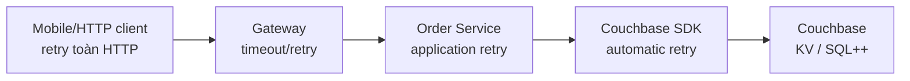
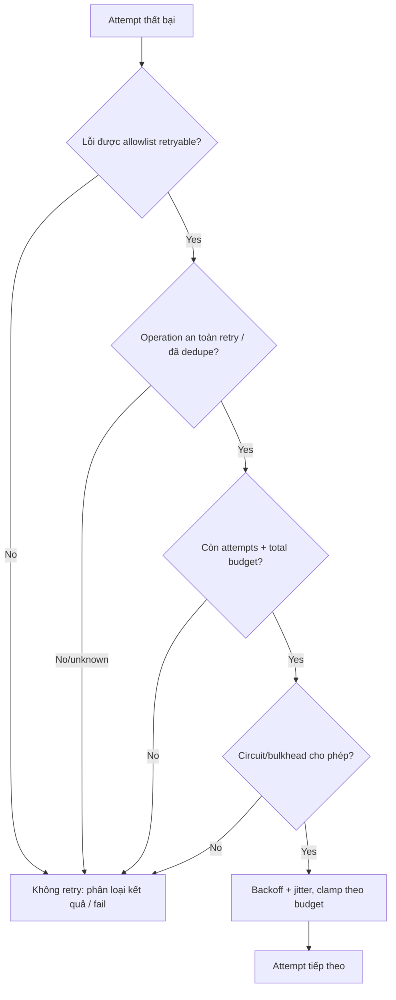
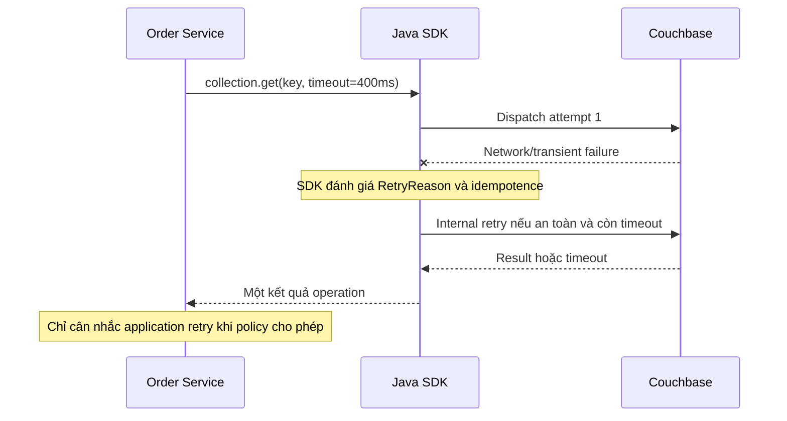
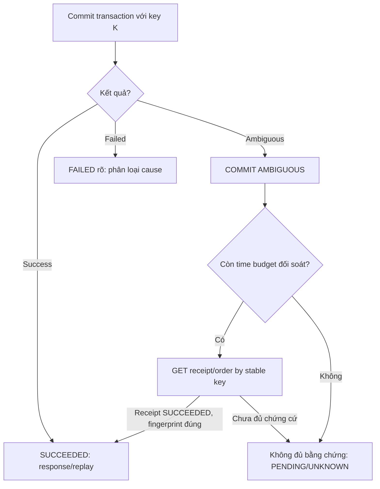

# Giới hạn số lần thử, thời gian chờ tăng dần và ngân sách tổng

## 1. Khi một retry “vô hại” làm request kéo dài hàng chục giây

Một API trả thông tin đơn hàng bằng Spring Data Couchbase gặp sự cố mạng trong thời gian ngắn. Lập trình viên thêm retry:

```java
// KHÔNG NÊN: retry vô hạn và không có deadline tổng.
while (true) {
    try {
        return repository.findById(orderId).orElseThrow();
    } catch (RuntimeException anyError) {
        Thread.sleep(100);
    }
}
```

Điều gì có thể xảy ra?

- Mỗi lần truy cập KV có **timeout riêng**; năm lần chờ 2 giây không còn là một HTTP request 2 giây.
- Couchbase Java SDK có thể **đã retry nội bộ**, rồi Service lại retry, rồi gateway/HTTP client tiếp tục retry toàn bộ request.
- Khi cluster đang quá tải, hàng trăm request đồng loạt retry ngay lập tức tạo **retry storm**, khiến lỗi kéo dài thêm.
- `catch (RuntimeException)` nuốt cả lỗi phân quyền, document không tồn tại, `@Version` conflict, cú pháp SQL++ sai; các lỗi này không tự biến mất vì ngủ thêm.
- Với lệnh tạo đơn/thu tiền, request có thể **đã được server ghi thành công** nhưng client nhận timeout. Retry với một ID mới sẽ tạo hiệu ứng nghiệp vụ lần hai.
- Câu SQL++ dùng secondary index chưa kịp cập nhật; retry thật nhanh không phải cách thay thế scan consistency phù hợp.

Trong chương **Xử lý lỗi** của module **SPRING_DATA_COUCHBASE**, chúng ta học thiết kế **giới hạn số lần thử, thời gian chờ tăng dần và ngân sách tổng** (*retry limit, exponential backoff, end-to-end budget*). Ngữ cảnh xuyên suốt là tầng truy cập document bằng Spring Data repository, `CouchbaseTemplate`, Java SDK KV/SQL++, CAS, transaction, TTL và reactive.

### Mục tiêu học tập

Sau bài học, bạn có thể:

1. Phân biệt `attempt` và `retry`, timeout cho **mỗi thao tác** với deadline **toàn yêu cầu**.
2. Chọn số lần thử hữu hạn, exponential backoff có jitter và giới hạn độ trễ.
3. Tính ngân sách tổng gồm thời gian xử lý, queue, timeout, retry delay và hoạt động downstream.
4. Hiểu Java SDK `BestEffortRetryStrategy`, `RetryReason`, `ErrorContext`, timeout ambiguity và ranh giới retry bổ sung của ứng dụng.
5. Phân loại lỗi tạm thời với lỗi không thể retry, đặc biệt `DocumentExists`, `DocumentNotFound`, CAS mismatch, transaction commit ambiguous.
6. Viết retry ở Spring MVC/Java blocking và Reactor `retryWhen` mà không nhân đôi side effect.
7. Đo retry amplification, deadline exhaustion và kiểm thử failure injection/circuit-breaker/load.

> **Phạm vi:** Java 17+, Spring Data Couchbase với Spring Boot BOM tương thích, Couchbase Java SDK 3.x và Reactor hiện hành. Ví dụ dùng giá trị timeout mang tính minh họa, **không phải cấu hình tối ưu cho mọi cluster**. Tùy SDK, Spring Data có thể translate/wrap exception; cần xác minh dependency version và hành vi thực tế. Các khối mã minh họa từng thành phần, không phải một project hoàn chỉnh có thể dán tất cả vào một file.

## 2. Ba vòng retry có thể nằm chồng nhau



| Vòng | Quyết định retry dựa trên gì? | Biết gì về nghiệp vụ? | Rủi ro |
| --- | --- | --- | --- |
| **SDK** | Request phase, `RetryReason`, idempotence của operation, timeout | Không biết “tạo đơn một lần” | Có thể đã dùng gần hết timeout trước khi trả lỗi |
| **Service/application** | Domain command, lỗi được dịch nghĩa, idempotency, deadline | Biết action và state machine | Tạo mới deadline cho mỗi attempt hoặc retry mutation ambiguous |
| **Gateway/client** | HTTP status, network timeout, `Retry-After`, user action | Có thể không biết commit trong DB | Gửi lại toàn workflow, nhân đôi tác dụng phụ |

Nếu mỗi tầng tự cho tối đa 3 lần thử, số lần gọi backend trong tình huống xấu **có thể nhân lên**; không cộng đơn giản `3+3+3`. Số thực còn phụ thuộc SDK internal retry và cancellation. Thiết kế tốt phải có **retry ownership** và deadline được truyền từ cấp trên xuống thay vì mỗi tầng tự khởi động bộ đếm riêng.

### 2.1. Từ vựng nhất quán

| Thuật ngữ | Nghĩa chính xác |
| --- | --- |
| `attempt` | Một lần ứng dụng thực thi operation/publisher; attempt đầu tiên cũng được đếm |
| `retry` | Lần thử **sau** thất bại đầu tiên |
| `maxAttempts = 3` | Tối đa **3 attempts = 1 lần đầu + 2 retries** |
| `maxRetries = 2` | Tối đa **2 lần lặp lại**, thường là 3 attempts |
| Per-attempt timeout | Thời gian tối đa một lần SDK operation được chờ |
| Total request budget | Giới hạn toàn đường đi, gồm tất cả attempts, delays và xử lý |
| Deadline | Mốc thời gian thực hiện phải chấm dứt, ưu tiên monotonic duration |
| Backoff | Khoảng chờ giữa hai attempts |
| Jitter | Thành phần ngẫu nhiên để request không đồng loạt retry |
| Idempotency | Cùng lệnh được gửi lại không nhân đôi **hiệu ứng nghiệp vụ** |
| Retryability | Điều kiện một lỗi/operation có thể được gửi lại an toàn và có cơ hội thành công |

**Cảnh báo Reactor:** `Retry.backoff(2,...)` cho phép **hai retries**, không phải tổng cộng hai attempts. Trong code theo `for (attempt=1;attempt<=maxAttempts;...)`, `maxAttempts` lại là tổng số attempts. Trộn hai cách đếm làm tăng tải vô tình.

### 2.2. Một retry an toàn không chỉ dựa vào exception

Quyết định retry phải thỏa cả bốn câu hỏi:

1. **Lỗi có thể khắc phục trong thời gian ngắn không?** Ví dụ một transient network issue khác với validation error.
2. **Gửi lại có an toàn không?** GET/read-only query thường dễ hơn `counter += 1` hay thu tiền.
3. **Còn số lần thử và thời gian không?** Nếu còn 20 ms nhưng backoff dự kiến 100 ms, không thử.
4. **Hạ tầng có khả năng phục hồi nếu thử thêm không?** Nếu circuit breaker đang open hoặc hệ thống đang shedding load, retry có thể làm nặng thêm sự cố.



## 3. Giới hạn số lần thử: đủ để hấp thụ transient, không che lỗi

Một policy khởi đầu cho API đọc theo ID:

```text
operation: GET Order by document key (read-only)
maxAttempts: 3 (1 original + 2 retries)
retryable: lỗi transient đã phân loại, không retry NOT_FOUND
baseBackoff: 40 ms
maxBackoff: 200 ms
jitter: full jitter
totalBudget: 900 ms
perAttemptSdkTimeout: min(remainingBudget, 350 ms)
```

Những con số **chỉ để minh họa cách phối hợp**, không phải khuyến nghị cố định. Có thể một SDK operation tự chờ/retry đến gần 350 ms; khi Service nhận lỗi, budget không đủ cho vòng thứ hai thì **dừng**. Muốn điều chỉnh cần đo p95/p99, latency SLO, số replica/index, mạng, durability và số hop.

### 3.1. Vì sao không “retry mọi lỗi ba lần”?

| Nhóm lỗi | Retry cùng operation? | Cách xử lý |
| --- | --- | --- |
| Request validation sai, field thiếu | **Không** | Trả 400/422 theo API contract |
| Không có quyền tenant/role | **Không** | Trả 403/404 theo policy |
| `DocumentNotFoundException` của GET | **Không mặc định** | 404 hoặc fallback khi business muốn chờ tài nguyên xuất hiện |
| `DocumentExistsException` của insert | **Không tự retry** | Kiểm tra key/fingerprint để phân biệt duplicate/command replay |
| CAS/optimistic-lock conflict | **Có điều kiện** | Đọc lại, kiểm tra invariant và CAS mới; không lặp cùng `save(entity)` stale |
| SQL++ cú pháp sai/index không tồn tại | **Không theo retry mặc định** | Sửa query/index; không làm delay che lỗi |
| `UnambiguousTimeoutException` | Có thể nếu **operation an toàn + budget còn** | Xem điều kiện, SDK context và policy |
| `AmbiguousTimeoutException` trên mutation | **Không retry mù quáng** | Reconcile theo stable document/command ID, CAS/receipt |
| `TransactionCommitAmbiguousException` | **Không kết luận thất bại** | Tra outcome theo key/receipt, có thể trả PENDING |
| Rate limit/throttling hoặc overload | Có điều kiện, thận trọng | Tôn trọng `Retry-After`, backoff/jitter, retry budget |
| Network transient/circuit/open | Tùy request phase, SDK đã xử lý gì | Hạn chế tải và quan sát, không catch-all |

Không tạo một danh sách global `retryFor={Exception.class}` cho mọi repository method. Đường `GET`, `INSERT`, `UPDATE with CAS`, `SQL++ SELECT`, `SQL++ UPDATE` và distributed transaction có **ngữ nghĩa retry khác nhau**.

### 3.2. Số lần thử nhỏ vẫn cần deadline

```text
Attempt 1: 2.5 s (SDK KV timeout)
Backoff 1: 0.2 s
Attempt 2: 2.5 s
Backoff 2: 0.4 s
Attempt 3: 2.5 s
-----------------
Total:     8.1 s
```

Một API định trả trong 1 giây đã vi phạm budget dù `maxAttempts=3` là hữu hạn. **Giới hạn số lần thử không phải giới hạn thời gian**.

## 4. Exponential backoff và jitter

Với retry thứ `k` (bắt đầu tại 0 cho lần retry thứ nhất), exponential backoff chưa jitter:

\[
D_k = \min(D_{max}, D_{base} \times 2^k)
\]

Ví dụ `D_base=100ms`, `D_max=800ms`:

| Retry thứ | k | Backoff tối đa trước jitter |
| --- | ---: | ---: |
| 1 | 0 | 100 ms |
| 2 | 1 | 200 ms |
| 3 | 2 | 400 ms |
| 4 | 3 | 800 ms |
| 5 | 4 | 800 ms (đã cap) |

**Không tăng vô hạn**: nếu tính `base * 2^attempt` trên integer mà không cap có thể overflow, tạo delay âm hoặc rất lớn. Giới hạn `maxBackoff` và `maxAttempts` trước khi tính.

### 4.1. Vì sao cần jitter?

Khi một node/cluster bị lỗi:

```text
1000 requests lỗi cùng lúc
retry sau 100 ms  -> 1000 requests cùng lúc
retry sau 200 ms  -> 1000 requests cùng lúc
retry sau 400 ms  -> 1000 requests cùng lúc
```

Không có jitter, tất cả client tiến hành theo một nhịp, gây **thundering herd**. Với *full jitter*:

\[
W_k \sim U(0, D_k)
\]

Mỗi request rút ngẫu nhiên delay trong khoảng từ 0 đến mức tối đa của lần retry. Các biến thể khác gồm *equal jitter* và *decorrelated jitter*, mỗi loại có phân bố/tính chất khác nhau. Chọn một biến thể có kiểm thử và không trộn nhiều loại không được giám sát.

### 4.2. Backoff là một phần ngân sách

Giả sử còn 120 ms trong deadline, backoff rút ra 150 ms. **Không ngủ 150 ms** rồi mới kiểm tra hết giờ. Dừng trước retry, hoặc cap delay và chỉ thực hiện attempt mới nếu còn đủ thời gian hữu ích theo policy.

Một phương án đơn giản:

```text
remaining = deadline - now
if remaining <= minimumUsefulAttemptTime: stop
delay = min(jitteredBackoff, remaining - minimumUsefulAttemptTime)
if delay < 0: stop
wait(delay)
then recheck remaining and call SDK with timeout <= remaining
```

Nếu nhiều worker cùng lỗi do backend quá tải, `minBackoff` không nên bằng 0 trong mọi policy; *full jitter* có thể rút rất gần 0, nên cần cân nhắc tải và một mức tối thiểu hợp lý theo dịch vụ.

## 5. Ngân sách tổng: một deadline cho toàn bộ workflow

Một request có thể đi qua xác thực, Couchbase KV, SQL++ và một HTTP call khác. Tổng chi phí:

\[
T_{total} =
T_{queue} + T_{auth} + \sum_{i=1}^{N}T_{attempt,i}
+ \sum_{j=1}^{N-1}T_{backoff,j}
+ T_{other} + T_{response}
\]

Yêu cầu:

\[
T_{total} \leq B_{request}
\]

Trong đó `B_request` là ngân sách **end-to-end** được chọn từ SLO/hợp đồng của caller, không phải tổng timeout mặc định của từng SDK operation.

### 5.1. Ba giới hạn cần phối hợp

| Ranh giới | Ví dụ | Quan hệ |
| --- | --- | --- |
| HTTP/gateway deadline | 1500 ms | Giới hạn ngoài cùng, nên cho chút thời gian trả lỗi |
| Application request budget | 1200 ms | Nhỏ hơn hạn HTTP, dành chỗ serialization/response |
| Per-operation SDK timeout | tối đa 450 ms, nhưng **giảm theo thời gian còn lại** | Không vượt budget còn lại |
| Transaction expiry | theo transaction config/use case | Phải được phối hợp với budget của application |
| Retry delays | cộng dồn trong 1200 ms | Không có ngân sách riêng vô hạn |

Đặt một deadline tại **entrypoint** hoặc nhận deadline được xác thực từ upstream, rồi truyền **remaining time** qua các tầng. Không tạo lại 1200 ms trong mỗi Service/Repository method; làm vậy có thể khiến chuỗi ba downstream calls kéo dài tới 3600 ms.

### 5.2. Dùng đồng hồ đơn điệu cho khoảng thời gian

`Instant.now()` hữu ích cho logging/expiration nghiệp vụ; đo budget ngắn nên dùng **monotonic elapsed time**, ví dụ `System.nanoTime()`, vì wall clock có thể được điều chỉnh bởi NTP/OS.

```java
import java.time.Duration;

public final class RequestBudget {
    private final long startNanos = System.nanoTime();
    private final long totalNanos;

    public RequestBudget(Duration total) {
        if (total.isZero() || total.isNegative()
                || total.compareTo(Duration.ofDays(1)) > 0) {
            throw new IllegalArgumentException("Budget không hợp lệ");
        }
        totalNanos = total.toNanos();
    }

    public Duration remaining() {
        long elapsed = System.nanoTime() - startNanos;
        long left = Math.max(0L, totalNanos - elapsed);
        return Duration.ofNanos(left);
    }

    public boolean expired() {
        return remaining().isZero();
    }

    public Duration forAttempt(Duration attemptLimit) {
        Duration left = remaining();
        if (left.isZero()) {
            throw new RetryBudgetExceededException();
        }
        return left.compareTo(attemptLimit) < 0
                ? left : attemptLimit;
    }
}
```

`RetryBudgetExceededException` là exception ứng dụng do dự án định nghĩa. Ví dụ giới hạn budget dưới một ngày để phép trừ trên `System.nanoTime` không gặp những trường hợp kỳ lạ ngoài phạm vi request thông thường; production có thể tạo `Ticker`/monotonic-clock abstraction để test không phụ thuộc thời gian thật.

**Điểm tinh tế:** một `RequestBudget` phải được tạo **một lần tại request entrypoint**, rồi truyền cùng instance/remaining deadline xuống những downstream calls. Nếu tạo mới trong `retryWhen` hoặc callback retry, deadline sẽ được reset liên tục.

### 5.3. Số cụ thể: phân phối budget cho một GET Order

```text
Budget toàn request: 1000 ms
Authorization/validation: 100 ms
Remaining: 900 ms

KV GET attempt #1: 300 ms (timeout)
Backoff random #1: 40 ms
Remaining: 560 ms
KV GET attempt #2: 350 ms (timeout)
Remaining: 210 ms
Backoff random #2: 80 ms
Remaining: 130 ms
KV GET attempt #3: 100 ms (success)
Response serialization: 30 ms
Total: 1000 ms
```

Đây là một kịch bản tính toán minh họa các thành phần, không phải điều chỉnh timeout thực. Nếu response cần ít nhất 30 ms, **đừng sử dụng hết 1000 ms** cho thao tác dữ liệu. Mỗi attempt mới phải dùng timeout `min(perAttemptCap, remaining-reserve)` nếu SDK hỗ trợ per-operation timeout.

### 5.4. Một deadline, nhiều nhánh downstream song song

Nếu Service chạy `Mono.zip(profileCall, orderCall)` thì tổng thời gian không bằng tổng hai latency song song, nhưng **cả hai vẫn chịu cùng deadline**. Khi một nhánh thất bại khiến workflow vô ích, cancel phần còn lại nếu contract cho phép; với mutation đã dispatch, **cancellation không có nghĩa server rollback**. Chỉ dựa trên cancellation cho read-only hoặc đã có idempotency/reconciliation.

## 6. Java SDK đã có retry: đừng dựng thêm một vòng không cần thiết

Couchbase Java SDK 3.x có cơ chế retry nội bộ. Trong cấu hình thông thường, SDK dùng `BestEffortRetryStrategy` để retry **những request và nguyên nhân được xem là có thể retry** cho đến khi thành công hoặc timeout. SDK theo dõi `RetryReason` và trạng thái vòng đời request, thay vì cứ nhận exception là gửi lại vô điều kiện.



### 6.1. RetryStrategy không phải là “retry mọi thứ”

SDK phân biệt các giai đoạn:

1. **Pre-dispatch:** chưa thể gửi request tới server; một số lỗi có thể được retry mà không có side effect.
2. **Dispatched:** request đã được gửi; nếu mất phản hồi, server có thể đã thực thi mutation.
3. **Response arrived:** server đã trả thông tin lỗi/thành công; SDK xử lý theo code và retry reason.

Idempotence đặc biệt quan trọng ở giai đoạn **sau dispatch nhưng chưa biết kết quả**. SDK không có đủ domain context để biết một `POST /orders` có dùng cùng command ID, hay một `upsert` có ghi đè thay đổi người khác. Vì vậy **không thay đổi `RetryStrategy` mặc định để retry non-idempotent operations vô điều kiện**.

### 6.2. Cấu hình timeout ở SDK theo vai trò

Ví dụ Java SDK:

```java
import com.couchbase.client.java.Cluster;
import com.couchbase.client.java.ClusterOptions;
import java.time.Duration;

Cluster cluster = Cluster.connect(
        connectionString,
        ClusterOptions.clusterOptions(username, password)
            .environment(env -> env
                .timeoutConfig(timeout -> timeout
                    .kvTimeout(Duration.ofMillis(500))
                    .queryTimeout(Duration.ofSeconds(3))
                )
            )
);
```

Đây là **cấu hình minh họa**. Trong Java SDK, `kvTimeout` mặc định thường là **2,5 giây**, `queryTimeout` mặc định **75 giây** theo tài liệu client settings hiện hành; các cấu hình profile, system properties hoặc ứng dụng có thể ghi đè. KV với durability nâng cao có timeout khác (`kvDurableTimeout`), các feature/mode mới cũng có timeout riêng. **Không đổi các timeout mặc định bừa bãi** chỉ vì thấy một `TimeoutException` trong log; cần tìm nguyên nhân mạng, overload, index, topology và SLO.

Per-operation timeout cho đường GET:

```java
import static com.couchbase.client.java.kv.GetOptions.getOptions;

Duration attemptTimeout =
        requestBudget.forAttempt(Duration.ofMillis(350));
var result = collection.get(
        documentId, getOptions().timeout(attemptTimeout));
```

Per-operation timeout cho SQL++ SELECT:

```java
import static com.couchbase.client.java.query.QueryOptions.queryOptions;

Duration queryAttemptTimeout =
        requestBudget.forAttempt(Duration.ofMillis(600));
var result = cluster.query(
        "SELECT META(o).id AS id, o.status " +
        "FROM `shop`.`sales`.`orders` AS o " +
        "WHERE o.tenant_id = $tenantId AND META(o).id = $id",
        queryOptions()
            .parameters(com.couchbase.client.java.json.JsonObject.create()
                    .put("tenantId", trustedTenantId)
                    .put("id", documentId))
            .readonly(true)
            .timeout(queryAttemptTimeout));
```

`requestBudget`, `collection`, `cluster` và `documentId` là dependencies của adapter; `trustedTenantId` từ authorization, không lấy tùy ý từ request. `readonly(true)` giúp SDK biết câu SQL++ chỉ đọc và có thể áp dụng xử lý retry idempotent theo khả năng của phiên bản SDK; **không bật `readonly(true)` cho câu `UPDATE`/`DELETE`**. Cần xác minh SQL++ query param, consistency, index và loại ngoại lệ thực tế.

### 6.3. Phân biệt lỗi timeout ambiguous và unambiguous

Trong SDK có hai loại quan trọng:

```java
import com.couchbase.client.core.error.AmbiguousTimeoutException;
import com.couchbase.client.core.error.UnambiguousTimeoutException;
```

| Loại | Điều SDK có thể kết luận | Ứng dụng nên làm |
| --- | --- | --- |
| `UnambiguousTimeoutException` | SDK có cơ sở cho rằng operation **không tạo side effect** | Có thể retry operation an toàn nếu budget/attempt còn |
| `AmbiguousTimeoutException` | Có thể đã tạo side effect, nhưng không nhận xác nhận | **Không retry mutation mù quáng**; đọc lại/reconcile theo key/command |
| `RequestCanceledException` | SDK đã hủy request theo lý do điều phối | Phân tích reason và request phase; không mặc định transient |
| `DocumentExistsException` | Insert-only gặp key đã tồn tại | Kiểm tra chủ sở hữu/fingerprint, không coi là network transient |
| `DocumentNotFoundException` | Key không tồn tại theo operation | Thường không retry như lỗi hạ tầng |

**Ngay cả unambiguous timeout cũng không phải lý do tự động retry mọi việc.** Nó chỉ giúp phân biệt hiệu ứng của **operation cụ thể**; request API có thể gồm nhiều bước khác đã tạo side effect. Ví dụ Order đã được ghi ở bước 1, bước 2 query timeout unambiguous; retry **toàn bộ** workflow tạo đơn với UUID mới vẫn sai.

### 6.4. `ErrorContext` dùng để chẩn đoán, không thay policy

SDK gắn `ErrorContext` vào nhiều `CouchbaseException`; các thông tin như `requestType`, `retryReasons`, `retried`, `timeoutMs`, `lastDispatchedTo`, `service` và timings giúp phân biệt timeout do queue, endpoint, query/Index Service hay mạng.

```java
import com.couchbase.client.core.error.CouchbaseException;

try {
    return collection.get(documentId);
} catch (CouchbaseException error) {
    // SDK có thể cung cấp error.context() để chẩn đoán.
    // Chỉ log requestId, operation, retry count/timing đã được
    // sanitize. Tránh log full document ID/email/SQL++ parameters.
    throw error;
}
```

`error.context()` có thể không có ở một số exception. **Không parse string exception** để quyết định retry theo `retryReasons` chưa ổn định; dùng API và exception type đã được version hóa, thêm thông tin context cho observability. `RetryReason` cụ thể có thể là API volatile theo tài liệu SDK.

### 6.5. Tùy biến RetryStrategy là một quyết định hạ tầng nâng cao

SDK cho phép đặt custom `RetryStrategy` ở environment hoặc per request:

```java
import static com.couchbase.client.java.kv.GetOptions.getOptions;

var result = collection.get(
        documentId, getOptions().retryStrategy(customStrategy));
```

Tài liệu SDK khuyên phần lớn use case **giữ cấu hình mặc định**, nếu cần tùy chỉnh thì mở rộng `BestEffortRetryStrategy` theo `RetryReason`, không tự triển khai lại toàn bộ logic và **không block** trong `shouldRetry` (đường xử lý nóng). Custom strategy không được cho retry một non-idempotent mutation đã dispatch chỉ vì muốn tăng availability.

Đặt application retry lên trên `BestEffortRetryStrategy` đồng nghĩa **mỗi application attempt có thể đã chứa nhiều lần dispatch**. Khi đo `retry_attempts`, phân biệt **SDK internal retries** với **Service attempts** và HTTP retries, tránh diễn giải một con số như toàn bộ tải.

## 7. Bản đồ quyết định cho KV, SQL++ và Spring Data

### 7.1. GET/lookup và SELECT readonly

- `collection.get`, `exists`, `lookupIn`: operation đọc, thường dễ retry nếu lỗi thực sự transient, **nhưng chỉ trong deadline**.
- `repository.findById`: dùng KV path theo mapping; khi không có document thường là kết quả vắng mặt, **không phải lỗi cần backoff**.
- SQL++ `SELECT`: bật `readonly(true)` khi câu lệnh thật sự chỉ đọc. Query timeout cao không có nghĩa app nên chờ từng attempt tới timeout mặc định nếu caller có budget ngắn.
- Khi SQL++ tìm không thấy order ngay sau KV write, có thể do index chưa bắt kịp; chọn scan consistency thích hợp (`REQUEST_PLUS` hoặc mutation-state theo API), **không loop 100 SELECT liên tiếp**.
- Với consistency `REQUEST_PLUS`, đợi index catch-up có chi phí latency và phải nằm trong request budget. Có thể trả `202/PENDING` hoặc đọc KV theo key khi cần kết quả mới tạo.

### 7.2. INSERT: create-only và retry của cùng command

```text
Order create with command K:
  stable document key = order::<tenant>::<K>
  first insert -> success (maybe response lost)
  retry with SAME key -> DocumentExistsException
```

`DocumentExistsException` không phải tín hiệu `retry after 100ms`; nó có thể là **bằng chứng một attempt khác đã tạo resource**, hoặc key bị dùng cho command khác. Đọc receipt/entity theo key đáng tin, kiểm tra tenant/actor/payload fingerprint, rồi replay hoặc trả conflict.

Nếu SDK trả `AmbiguousTimeoutException` cho mutation, **không sinh ID mới** và gọi `insert` lại mù quáng. Cần đối soát theo stable key và áp dụng chính sách thời hạn dedupe; khi chưa đủ bằng chứng, trả trạng thái `UNKNOWN/PENDING`.

### 7.3. UPDATE với CAS/`@Version`

```java
// Đây là mô hình một vòng read-update-write.
OrderDocument current = repository.findById(orderKey)
        .orElseThrow(OrderNotFoundException::new);

domainPolicy.assertCanEdit(current, authorizedScope);
current.setShippingNote(newNote);
repository.save(current); // @Version bảo vệ CAS.
```

Trong Spring Data Couchbase, optimistic locking dùng CAS metadata qua `@Version`; khi write conflict, `OptimisticLockingFailureException` có thể xuất hiện.

**Retry đúng** là **đọc lại** document mới, xét quyền và state machine rồi tính lại phép biến đổi:

```text
CAS conflict:
  load fresh entity
  -> check tenant + authorization
  -> check lifecycle/current state
  -> recompute intended mutation
  -> save with new CAS
```

**Retry sai** là gọi `repository.save(oldEntity)` nhiều lần với cùng CAS cũ, hoặc bỏ CAS để upsert đè lên thay đổi của người khác. Nếu client dùng `If-Match`, tùy contract có thể trả `412` thay vì tự retry cập nhật stale; không coi CAS conflict là transient trong mọi use case.

### 7.4. Sub-document `counter += 1` và thao tác không lũy đẳng

Một phép tăng counter nguyên tử trên document vẫn có thể tăng **hai lần** nếu client retry cùng command sau timeout. `mutateIn`/counter atomicity ngăn race cho một lần thực thi, **không** bảo đảm “chỉ một lần cho cùng command”.

Khi phép tăng có ý nghĩa nghiệp vụ, sử dụng:

- `commandId` ổn định và một receipt/inbox để dedupe.
- Thao tác tăng và dấu đã áp dụng **trong một transaction** hoặc một document CAS khi quy mô cho phép.
- Outcome reconciliation khi timeout ambiguous; không retry `+1` chỉ dựa trên HTTP 5xx.

Tương tự cho append array, gửi email hoặc charge payment.

### 7.5. SQL++ mutation và transactions

`UPDATE`/`DELETE` SQL++ không mặc định là thao tác đọc. Một query có thể sửa nhiều document; retry toàn bộ câu lệnh sau timeout có thể nhân đôi effect của `counter += 1` hoặc xóa thêm document mới.

- Dùng **predicate precondition** rõ ràng, business command ID và mutation token/version khi cần.
- Với tác động multi-document đòi atomicity, dùng Couchbase transaction nếu khả thi, và phân biệt **retry bên trong SDK transaction** với retry application.
- Không bật `readonly(true)` cho query sửa.
- Không tự đổi timeout query 75 giây thành timeout 75 giây **trên mỗi retry** khi tổng budget chỉ vài giây.
- Kiểm tra index/Query Service availability và query plan khi lỗi do scan/sort quá nặng: retry không chữa được thiết kế index sai.

### 7.6. TTL/expiry và retry

Một mutation `upsert`/replace lại cùng body có thể tạo CAS mới hoặc thay đổi expiry nếu không chỉ định giữ TTL; retry vì timeout có thể **kéo dài tuổi thọ session** ngoài ý muốn.

Ví dụ receipt `PROCESSING` có TTL và worker chờ backoff; khi TTL hết, retry claim cùng key có thể trở thành **một command mới** nếu không có stable ID/retention policy. TTL của receipt phải dài hơn retry/delivery window đã cam kết. `preserveExpiry` và CAS cần được dùng theo version server và lifecycle policy, không tự quyết định chỉ từ exception.

Không cố “retry GET cho đến khi TTL xuất hiện”; expiry là metadata storage và kết quả đọc khi hết hạn thường là document không còn tồn tại.

## 8. Mẫu Java blocking: bounded attempts + monotonic budget + full jitter

Với một Service đồng bộ (Spring MVC, command-line batch worker), đôi khi ứng dụng có ngữ cảnh để retry sau khi SDK không thể tự hoàn thành. Ta viết **một vòng nhỏ, phân loại lỗi cụ thể và không reset deadline**.

### 8.1. Adapter đọc KV với ba attempts tối đa

```java
package com.example.shop.orders.persistence;

import com.couchbase.client.core.error.UnambiguousTimeoutException;
import com.couchbase.client.java.Collection;
import com.couchbase.client.java.kv.GetResult;
import java.time.Duration;
import java.util.concurrent.ThreadLocalRandom;
import static com.couchbase.client.java.kv.GetOptions.getOptions;

public final class BoundedOrderKvReader {
    private static final int MAX_ATTEMPTS = 3;
    private static final Duration MAX_ATTEMPT_TIMEOUT =
            Duration.ofMillis(250);
    private static final Duration RESERVED_FOR_RESPONSE =
            Duration.ofMillis(30);

    private final Collection orders;

    public BoundedOrderKvReader(Collection orders) {
        this.orders = orders;
    }

    public GetResult get(String trustedDocumentId, RequestBudget budget) {
        for (int attempt = 1; attempt <= MAX_ATTEMPTS; attempt++) {
            Duration left = budget.remaining();
            if (left.compareTo(RESERVED_FOR_RESPONSE) <= 0) {
                throw new RetryBudgetExceededException();
            }

            Duration forSdk = min(
                    MAX_ATTEMPT_TIMEOUT,
                    left.minus(RESERVED_FOR_RESPONSE));

            try {
                return orders.get(
                        trustedDocumentId,
                        getOptions().timeout(forSdk));
            } catch (UnambiguousTimeoutException transientReadTimeout) {
                if (attempt == MAX_ATTEMPTS) {
                    throw transientReadTimeout;
                }

                // attempt=1: cap 40 ms; attempt=2: cap 80 ms.
                long capMillis = Math.min(
                        200L, 40L * (1L << (attempt - 1)));
                long jitterMillis = ThreadLocalRandom.current()
                        .nextLong(capMillis + 1);

                long budgetAfterReserveMillis =
                        budget.remaining().minus(RESERVED_FOR_RESPONSE)
                                .toMillis();
                if (budgetAfterReserveMillis <= jitterMillis) {
                    throw new RetryBudgetExceededException(
                            transientReadTimeout);
                }

                try {
                    Thread.sleep(jitterMillis);
                } catch (InterruptedException interrupted) {
                    Thread.currentThread().interrupt();
                    throw new RetryInterruptedException(interrupted);
                }
            }
        }
        throw new IllegalStateException("Không tới được nhánh này");
    }

    private static Duration min(Duration a, Duration b) {
        return a.compareTo(b) <= 0 ? a : b;
    }
}
```

`RequestBudget` đã được định nghĩa ở mục 5; `RetryBudgetExceededException` và `RetryInterruptedException` là **exception ứng dụng cần khai báo**. Ví dụ cố ý chỉ retry `UnambiguousTimeoutException` của **KV GET** để không nhầm với mutation; không bắt generic `CouchbaseException`. Nếu không có bất kỳ application-specific recovery nào, **giữ retry mặc định của SDK rồi trả lỗi** có thể đơn giản và tốt hơn vòng này.

**Giới hạn của ví dụ:**

- Backoff dùng full jitter và cap 200 ms; phép nhân được giới hạn bởi `MAX_ATTEMPTS=3`, không overflow. Trong policy tổng quát, phải cap trước khi shift/multiply.
- `Thread.sleep` chỉ phù hợp đường **blocking** hoặc worker thread được quản lý; không dùng trong Reactor/event-loop.
- Nếu ngủ và mất gần hết budget, lần lặp lại kiểm tra `remaining` trước khi gọi SDK.
- `left.minus(RESERVED_FOR_RESPONSE)` chỉ được gọi sau khi kiểm tra `left > reserve`.
- Khi Service cần trả lỗi do quá budget, giữ **cause gần nhất** để hỗ trợ diagnostics, nhưng không lộ Couchbase context/raw ID cho HTTP client.
- Nếu SDK đã retry nội bộ 250 ms, vòng này có thể vẫn nhân tải lên tới ba operations mới. Cần quan sát `ErrorContext` và cân nhắc bỏ vòng Service khi không cải thiện availability.

### 8.2. Lệnh đọc Service phải truyền cùng budget xuống adapter

```java
public OrderResponse getOrder(
        AuthenticatedActor actor,
        String requestedTenant,
        String publicOrderId,
        RequestBudget requestBudget) {

    AuthorizedTenantScope scope = membership.authorize(
            actor, requestedTenant, "ORDER_READ");
    String key = OrderKeys.documentId(
            scope.tenantId(), publicOrderId);

    var kvResult = boundedReader.get(key, requestBudget);
    var body = kvResult.contentAsObject();

    if (!scope.tenantId().equals(body.getString("tenant_id"))) {
        throw new OrderNotFoundException();
    }
    resourcePolicy.assertCanRead(scope, body);
    return responseMapper.map(body);
}
```

Ví dụ trên giả định các kiểu `AuthenticatedActor`, `AuthorizedTenantScope`, `membership`, `OrderKeys` và `resourcePolicy` do project định nghĩa. Không để retry tạo được quyền mới: authorization phải dựa trên identity đáng tin và được revalidate khi business yêu cầu. Đường đọc theo KV vẫn phải so `tenant_id` **trong document**, không chỉ tính key theo tenant.

### 8.3. Đừng làm chậm caller với retry không hữu ích

Nếu SDK đã dùng hết budget do endpoint không có sẵn, **trả lỗi nhanh** có thể tốt hơn cố ngủ và retry. Khi thuộc batch/backfill không phụ thuộc latency tương tác, có thể đặt budget dài hơn, nhưng phải có concurrency limit, queue, checkpoint và cancellation. **Không dùng cùng retry policy cho HTTP GET 1 giây và import 2 giờ**.

## 9. Reactive `retryWhen`: giới hạn, backoff, jitter và total timeout

Trong WebFlux, Reactor cung cấp `Retry.backoff`, `maxBackoff`, `jitter`, `filter`, `doBeforeRetry` và `onRetryExhaustedThrow`. Các operator trả publisher mới, không cần chặn thread để ngủ.

### 9.1. Ví dụ GET với hai retries, ngân sách request

```java
package com.example.shop.orders.persistence;

import com.couchbase.client.core.error.UnambiguousTimeoutException;
import com.couchbase.client.java.ReactiveCollection;
import com.couchbase.client.java.kv.GetResult;
import java.time.Duration;
import reactor.core.publisher.Mono;
import reactor.util.retry.Retry;
import static com.couchbase.client.java.kv.GetOptions.getOptions;

public final class ReactiveBoundedOrderReader {
    private final ReactiveCollection orders;

    public ReactiveBoundedOrderReader(ReactiveCollection orders) {
        this.orders = orders;
    }

    public Mono<GetResult> get(
            String trustedDocumentId, RequestBudget budget) {
        return Mono.defer(() -> {
            Duration totalLeft = budget.remaining();
            if (totalLeft.compareTo(Duration.ofMillis(30)) <= 0) {
                return Mono.error(new RetryBudgetExceededException());
            }

            Mono<GetResult> eachAttempt = Mono.defer(() -> {
                Duration left = budget.remaining();
                if (left.compareTo(Duration.ofMillis(30)) <= 0) {
                    return Mono.error(new RetryBudgetExceededException());
                }

                Duration maximum = Duration.ofMillis(250);
                Duration forSdk = left.minusMillis(30);
                if (forSdk.compareTo(maximum) > 0) {
                    forSdk = maximum;
                }

                return orders.get(
                        trustedDocumentId, getOptions().timeout(forSdk));
            });

            return eachAttempt
                .retryWhen(Retry.backoff(
                        2, Duration.ofMillis(40))
                    .maxBackoff(Duration.ofMillis(200))
                    .jitter(0.5)
                    .filter(error ->
                        error instanceof UnambiguousTimeoutException)
                    .onRetryExhaustedThrow((spec, signal) ->
                        signal.failure()))
                // Operator ngoài cùng bao gồm attempts + backoffs.
                .timeout(totalLeft);
        });
    }
}
```

`ReactiveCollection` được lấy qua `collection.reactive()`; `getOptions().timeout` là per SDK operation. **`Retry.backoff(2,...)` nghĩa là hai retries, tối đa ba subscriptions**. `timeout(totalLeft)` nằm **sau `retryWhen`**, nên đo thời gian của toàn pipeline gồm delays; đặt timeout chỉ bên trong `eachAttempt` thì không có giới hạn tổng.

**Các lưu ý quan trọng:**

- `RequestBudget` được tạo tại entrypoint và truyền xuống; method `get` dùng cùng budget qua mọi retries.
- Sau mỗi backoff, `Mono.defer` đọc **remaining budget mới** trước SDK call.
- Khi operator `timeout` hết giờ, Reactor có thể phát `java.util.concurrent.TimeoutException`; đây là timeout của **publisher tổng**, không tự đồng nghĩa SDK `AmbiguousTimeoutException`.
- Với GET/read-only, cancel sau timeout thường không có side effect. **Không copy pipeline này sang mutation không idempotent**; cancel subscriber không chứng minh server chưa commit.
- `.jitter(0.5)` là jitter theo cách Reactor `RetryBackoffSpec` định nghĩa, **không hoàn toàn giống full jitter U(0,D)** của mục 4. Chọn mức jitter có kiểm thử và đo tải.
- `onRetryExhaustedThrow` dùng lỗi cuối thay vì wrapper retry-exhausted; thay đổi này có lợi cho error mapping nhưng **mất marker retry-exhausted**. Hệ thống cần metrics/structured outcome riêng để phân biệt hết số lần thử với exception gốc.
- `maxBackoff`/random delay vẫn tiêu tốn budget; nếu còn rất ít thời gian, `Mono.timeout` có thể thắng trước lần retry tiếp theo.

### 9.2. Đặt operator sai thứ tự sẽ reset budget

```java
// Sai nếu dự định giới hạn cả ba attempts:
source.timeout(Duration.ofMillis(300))
      .retryWhen(Retry.backoff(2, Duration.ofMillis(50)));
```

Mỗi resubscription có **timeout 300 ms mới**, cộng backoff có thể vượt xa 300 ms. Nếu muốn cả per-attempt và total:

```java
source.timeout(Duration.ofMillis(300)) // mỗi attempt
      .retryWhen(retryPolicy)            // attempts và delays
      .timeout(Duration.ofMillis(800));  // toàn pipeline
```

Khi dùng cách này, `retryPolicy.filter` phải xét chính xác exception phát từ **per-attempt timeout** (có thể là `java.util.concurrent.TimeoutException`) và operation safety; không tự mở retry cho mutation ambiguous chỉ vì Java timeout là một exception khác.

### 9.3. Đừng retry sau một `onErrorResume` đổi mọi lỗi thành empty

```java
// Sai: che mất exception và làm caller tin document không tồn tại.
return reactiveCollection.get(documentId)
        .onErrorResume(error -> Mono.empty())
        .retryWhen(Retry.max(2));
```

Lúc đã chuyển lỗi thành completion, `retryWhen` không có error để quan sát. Một timeout bị biến thành “not found” là sai semantics và gây dữ liệu thiếu giả. Chỉ dùng `onErrorResume(DocumentNotFoundException.class, ...)` khi có fallback nghiệp vụ rõ ràng, và để lỗi transient/unknown đi đúng đường xử lý.

### 9.4. Coi `RetryBackoffSpec` là immutable template

`RetryBackoffSpec` của Reactor dùng **copy-on-write**, có thể định nghĩa một template cấu hình rồi thêm `filter`/tag khác cho từng operation. Tuy nhiên **không reuse mutable request payload/query parameters** giữa các subscriptions:

```text
Reusable: RetryBackoffSpec template, immutable SQL++ string
Per request: AuthorizedTenantScope, commandId, RequestBudget
Per subscription: Query/params mutable, current remaining deadline
```

Đặc biệt tránh `ThreadLocal<tenantId>` ở WebFlux; Reactor Context chỉ truyền ngữ cảnh, quyền vẫn phải được cấp sau khi xác thực principal/membership.

## 10. Spring Data, Spring Retry và `@Retryable`

Một annotation retry ở Service có thể tiện, nhưng dễ che lỗi:

```java
// Không nên chép vào production một cách mặc định.
@Retryable(maxAttempts = 5, retryFor = Exception.class)
public OrderDocument createOrder(...) {
    // Không phân biệt validation, CAS, ambiguous commit hay
    // duplicate document.
}
```

`@Retryable` của Spring Retry (nếu project có dependency và AOP configuration tương ứng) diễn giải `maxAttempts` là **tổng attempts**, khác Reactor `Retry.backoff(maxRetries,...)`. Việc intercept cũng tùy proxy/self-invocation; không nên dựa vào annotation mà bỏ qua tests.

### 10.1. Đặt retry ở cấp “operation có ngữ nghĩa” thay vì mọi repository

Một đường đọc có thể được retry trong adapter với budget. Một command `ChangeOrderAddress` có CAS conflict cần retry **toàn read-check-change-save cycle**, không retry riêng `repository.save(staleEntity)`. Một `CreateOrder` nhiều bước cần stable key/idempotency receipt/transaction/outbox và reconciliation, **không retry toàn Controller method** vì catch timeout.

**Quy tắc:** nếu retry đòi re-fetch state, revalidate authorization, idempotency hoặc recompute domain command, hãy đặt nó ở **application service** hoặc một **domain-aware operation** thay vì annotation chung quanh repository method.

### 10.2. Exception translation cần được xác minh

Spring Data repository có thể translate SDK exception thành Spring `DataAccessException` hoặc ngoại lệ domain cụ thể tùy đường gọi/version. Nếu code filter chỉ nhận `UnambiguousTimeoutException` của SDK nhưng method `repository.save` bọc nó thành exception khác, policy sẽ không hoạt động như mong đợi.

Không giải bằng `catch (DataAccessException) retry` cho tất cả: nhóm này bao gồm lỗi không retryable. Viết một **adapter classifier** tách theo source:

```text
SDK KV adapter       -> inspect SDK exception + ErrorContext
Spring Data adapter  -> inspect supported translation/cause
SQL++ query adapter  -> inspect query error type/status
Transaction adapter  -> inspect transaction outcome
Domain service       -> decide retryability & reconciliation
```

Viết unit tests trên classifier và integration tests trên release chính xác, đặc biệt quanh `OptimisticLockingFailureException`, timeout, `DocumentExists`, query syntax/index errors.

### 10.3. `@Transactional` không cho phép retry workflow tùy ý

Khi SDK transaction có thể retry **lambda nội bộ**, một annotation retry bên ngoài gọi lại nguyên workflow có thể nhân thêm side effects nếu callback tạo UUID mới hoặc gửi email. Với Spring transaction manager, phải kiểm tra transaction propagation/context và lỗi được translate theo phiên bản. Không tin `@Transactional` tạo đúng deadline và retry limit của HTTP request trừ khi đã cấu hình/test rõ ràng.

## 11. Transaction: giới hạn thời gian vẫn phải bảo toàn kết quả commit

Couchbase distributed transactions có cơ chế **retry nội bộ cho một số lỗi tạm thời, xung đột và callback**. SDK transaction cũng có expiry riêng. Khi transaction đang commit, một timeout mạng có thể làm ứng dụng **không biết** giao dịch đã tới commit point hay chưa.

### 11.1. Phân loại kết quả transaction

| Kết quả SDK transaction | Ý nghĩa chính | Application action |
| --- | --- | --- |
| Hoàn thành thành công | Đã nhận kết quả commit theo contract | Trả success/receipt |
| `TransactionFailedException` | Giao dịch không tới commit point theo contract SDK | Kiểm tra cause, business failure, chỉ cân nhắc retry workflow an toàn khi budget còn |
| `TransactionExpiredException` | SDK không hoàn thành trong expiry và chưa commit point theo contract | Kiểm tra pressure/timeout, không tạo retry vô hạn; giữ deadline tổng |
| `TransactionCommitAmbiguousException` | Có thể **đã commit**, chưa có xác nhận | **Reconcile bằng stable key**, không kết luận rollback |

Đọc [Transaction Error Handling](https://docs.couchbase.com/java-sdk/current/concept-docs/transactions-error-handling.html) đúng phiên bản: `TransactionFailedException`/expired và ambiguous có ngữ nghĩa khác nhau. Không dùng một `catch (RuntimeException)` để “retry transaction 3 lần” mà không biết loại kết quả.

### 11.2. Ví dụ Order + Receipt + Outbox

```text
HTTP POST /orders (Idempotency-Key K)
  -> authorize tenant+actor
  -> fingerprint canonical request
  -> derive stable orderId, receiptId, outboxEventId
  -> SDK transaction:
       INSERT Order(orderId)
       INSERT Receipt(K, SUCCEEDED, original result)
       INSERT Outbox(eventId, OrderCreated)
  -> respond 201; if response lost, retry same K
```

Mẫu Java SDK:

```java
import com.couchbase.client.java.Cluster;
import com.couchbase.client.java.Collection;
import com.couchbase.client.java.json.JsonObject;
import com.couchbase.client.java.transactions.error.TransactionCommitAmbiguousException;
import com.couchbase.client.java.transactions.error.TransactionFailedException;

public void createOrderAtomically(
        Cluster cluster,
        Collection orders,
        Collection receipts,
        Collection outbox,
        String orderId,
        String receiptId,
        String eventId,
        JsonObject preparedOrder,
        JsonObject preparedReceipt,
        JsonObject preparedEvent) {

    // Các ID và body phải ổn định qua các transaction attempts.
    // Đã authorize/validate tenant, actor và fingerprint trước đây.
    try {
        cluster.transactions().run(ctx -> {
            ctx.insert(orders, orderId, preparedOrder);
            ctx.insert(receipts, receiptId, preparedReceipt);
            ctx.insert(outbox, eventId, preparedEvent);
        });
    } catch (TransactionCommitAmbiguousException unknown) {
        // KHÔNG giả định rollback và không gửi lại với orderId mới.
        throw new OutcomeUnknownException(receiptId, unknown);
    } catch (TransactionFailedException failed) {
        // Xem cause: duplicate key, business error, hạ tầng, ...
        // Không tự retry toàn workflow.
        throw new CreateAttemptFailedException(failed);
    }
}
```

`OutcomeUnknownException` và `CreateAttemptFailedException` là exception ứng dụng cần tạo. Ví dụ chỉ trình bày transaction boundary; handler thật phải đối chiếu receipt/Order/outbox bằng key phù hợp khi nhận duplicate/ambiguous/timeout, so fingerprint và authorization trước khi replay. Một số thao tác dùng `JsonObject` mutable; không sửa chúng qua các attempt/callback, có thể tạo snapshot bất biến và clone trong callback khi cần.

### 11.3. Callback transaction có thể bị chạy lại

```java
cluster.transactions().run(ctx -> {
    // SAI: ID mới sau mỗi transaction retry.
    // var orderId = UUID.randomUUID().toString();

    // SAI: payment/email không nằm trong Couchbase transaction.
    // paymentGateway.charge(...);
    // mailer.send(...);

    // NÊN: ghi DB qua ctx, với IDs/payloads đã chuẩn bị ổn định.
    ctx.insert(orders, stableOrderId, preparedOrder);
});
```

Không gọi một `collection.upsert` **ngoài `ctx`** ngay trong callback rồi tin operation đó rollback nếu transaction thất bại. Nếu nghiệp vụ có side effect bên ngoài, ghi **outbox** trong transaction; worker publish sau commit, consumer dedupe bằng event ID. Application retry hết budget không được **xóa** receipt hoặc tự đổi key nhằm “thử lại sạch”.

### 11.4. Hết budget trong khi commit ambiguous



Nếu deadline đã hết, Service có thể trả **trạng thái chưa xác định** (ví dụ `202 Accepted` kèm operation status URL hoặc một lỗi có hướng reconciliation), theo hợp đồng API. **Không hứa “đã rollback”** nếu transaction ambiguous. Kết quả không rõ phải được giữ và giải quyết bằng một worker/operation ledger có retention, backoff và retry budget **riêng** cho reconciliation. Budget HTTP hết chỉ là deadline phản hồi cho caller, không làm server undo mutation.

### 11.5. Transaction expiry khác HTTP budget

Nếu transaction có expiry 15 giây nhưng HTTP deadline còn 700 ms, endpoint khó trả kết quả transaction đã chắc chắn kịp thời. Ngược lại, đặt transaction expiry 100 ms cho một workflow multi-document có durability cao có thể khiến hầu hết attempts thất bại.

Chọn một trong các phương án:

- Thiết kế đồng bộ với transaction expiry/timeout được hiệu chỉnh để **phù hợp** với deadline của API.
- Trả `202` và xử lý operation bất đồng bộ với operation ID/receipt nếu việc ghi có thể kéo dài hơn HTTP SLA.
- Thu hẹp transaction (giảm số document, loại bỏ external calls, tối ưu lookup) nhưng vẫn giữ invariant.

Không nhất thiết đặt mọi timeout bằng nhau, nhưng phải có **một mô hình budget end-to-end rõ ràng** và xử lý outcome ambiguous.

## 12. Retry budgets dưới tải và tránh retry storm

Một giới hạn `maxAttempts=3` trên từng request **không đủ** nếu có 20.000 requests đồng thời. Khi database chậm, tất cả retries đổ thêm tải trong khi backend chưa phục hồi.

### 12.1. Phóng đại số yêu cầu

Giả sử 1.000 requests/giây, mỗi request cho tối đa ba **application attempts** (không tính SDK internal retries):

```text
Healthy:     ~1,000 logical requests/s
Full retry:  ~3,000 application operations/s
Internal SDK: còn có thể có retries trong mỗi operation
```

Nếu **ba tầng** HTTP client, Service A và Service B mỗi tầng cho ba attempts, một logical request trong tình huống tệ có thể gây tới `3 × 3 × 3 = 27` calls tới tầng cuối **trước khi tính SDK retries**. Đây là lý do không thiết kế retry ở mọi tầng như thể chúng độc lập.

### 12.2. Retry token budget

Một kỹ thuật là cấp **retry token** trên một vùng tải (per service instance/pool, đôi khi theo tenant/tier). Ý tưởng:

```text
Mỗi request mới:
  Attempt đầu luôn qua bộ admission control nếu còn capacity.

Khi muốn retry:
  Kiểm tra lỗi + idempotency + remaining time.
  Nếu retry token còn và circuit cho phép -> tiêu token.
  Nếu không -> trả lỗi hoặc xếp hàng theo contract.

Khi backend khỏe:
  Cho phép refill token có giới hạn.
```

Token bucket cho retry **không thay** maxAttempts/deadline, và cũng không thay rate limit cho request đầu. Mục đích là hạn chế tổng lượng retry bổ sung dưới tải. Không dùng bucket một tenant quyền thấp để cạn sạch token của tenant có SLA cao nếu isolation policy yêu cầu phân nhóm riêng.

### 12.3. Circuit breaker, concurrency limit và backpressure

| Cơ chế | Tác dụng | Quan hệ với retry |
| --- | --- | --- |
| **Circuit breaker** | Ngừng gọi backend trong giai đoạn lỗi liên tục | Không retry khi circuit open; có thời gian probe |
| **Bulkhead/concurrency cap** | Giới hạn số operations chờ cùng backend | Không tăng số thread hoặc Mono subscriptions vô hạn |
| **Rate limiting/admission control** | Chặn tải đầu vào vượt capacity | Retry không được bypass quota |
| **Retry budget/token bucket** | Giới hạn lượng retry phụ thêm | Phụ thuộc error/idempotence/deadline |
| **Timeout/deadline** | Cắt request không còn hữu ích | Bao gồm queue + backoff + operation |
| **Load shedding** | Từ chối sớm thay vì timeout hàng loạt | Có thể trả 429/503 + Retry-After phù hợp |

Với Spring WebFlux, `flatMap` có tham số concurrency; không tạo `flatMap` không giới hạn cho một danh sách hàng triệu document rồi bật retry ở từng item. Với batch job, dùng queue, bounded concurrency, checkpoint và recovery; với HTTP GET, giữ đường đáp ứng gọn.

### 12.4. Retry-After của upstream

Khi HTTP upstream trả `429 Too Many Requests` hoặc `503 Service Unavailable` có `Retry-After`, client có thể trì hoãn theo giá trị đó, miễn request an toàn retry và **deadline cho phép**.

`Retry-After` có thể là **delta seconds** hoặc HTTP-date. Nếu upstream yêu cầu chờ 30 giây nhưng caller chỉ còn 200 ms, **không ngủ 30 giây** trong HTTP request. Trả trạng thái lỗi rõ/đẩy sang queue theo contract, để caller quyết định retry sau. Không áp dụng `Retry-After` như giấy phép bỏ qua local rate limit/circuit breaker.

### 12.5. Jitter và fairness nhiều tenant

Nếu một tenant lớn gửi hàng triệu command, token budget toàn service có thể bị tiêu hết, ảnh hưởng tenant nhỏ. Tùy SLA, chia retry budget theo:

- Tenant tier/region/priority được xác minh.
- Operation class (interactive read vs bulk import).
- Backend service pool/keyspace nếu có isolation vật lý.
- Worker group và concurrency limit.

**Không dùng raw tenant ID làm metric label không giới hạn**; có thể dùng tier/hash/sampling cho telemetry, lưu tenant correlation an toàn theo log policy.

## 13. HTTP contract: lỗi nào nên để client retry?

| Trạng thái | Khi phù hợp | Hướng cho client |
| --- | --- | --- |
| `400/422` | Validation sai | Sửa request, không retry như cũ |
| `401/403` | Authentication/authorization | Xác thực/đổi quyền, không retry tức thì |
| `404` | Document không tồn tại/không được phép tiết lộ | Không retry mặc định, trừ contract eventual workflow |
| `409` | Business conflict/duplicate key/CAS policy | Đọc lại/resolution, không tự retry y nguyên |
| `412` | `If-Match` precondition không thỏa | Làm mới version, không bỏ precondition |
| `429` | Rate limit | Có thể retry sau `Retry-After` nếu còn SLA |
| `503` | Service tạm không sẵn sàng/overloaded | Retry có điều kiện, backoff và idempotency |
| `504` | Gateway/proxy không nhận kịp response upstream | Kết quả mutation **có thể chưa rõ**, cần reconciliation |
| `202` + status URL | Operation được chấp nhận nhưng chưa có kết quả cuối | Poll có giới hạn/thông báo kết quả sau |
| `500` | Internal bug/unknown | Không mặc định retry mọi 500; cần classifier |

Không tự map mọi `TimeoutException` thành `404` hoặc `409`; đây là thông tin kết quả không chắc chắn. HTTP gateway timeout `504` cũng không tự khẳng định operation đã rollback. Với POST tạo đơn hoặc payment, client phải giữ **cùng Idempotency-Key** qua retries và có endpoint tra trạng thái.

### 13.1. Một ProblemDetail có correlation ID, không lộ Couchbase internals

```java
import org.springframework.http.HttpStatus;
import org.springframework.http.ProblemDetail;

public ProblemDetail budgetExceeded(String correlationId) {
    ProblemDetail problem = ProblemDetail.forStatus(
            HttpStatus.SERVICE_UNAVAILABLE);
    problem.setTitle("Tạm thời không thể hoàn tất yêu cầu");
    problem.setDetail("Vui lòng thử lại theo chính sách của API.");
    problem.setProperty("code", "OPERATION_BUDGET_EXCEEDED");
    problem.setProperty("correlationId", correlationId);
    return problem;
}
```

Method này là mẫu error mapper trong `@RestControllerAdvice` hoặc component tương ứng; `correlationId` phải được lấy/tạo từ request-tracing layer đáng tin, kiểm tra độ dài/ký tự, không đưa raw client token. **503** chỉ là một lựa chọn cho operation chưa hoàn tất do hạ tầng; với commit ambiguous, cần response semantics **PENDING/UNKNOWN** có operation ID để tránh client tạo lệnh mới. Không gửi stack trace, bucket credentials, full document ID hoặc raw SQL++ statement trong error body.

### 13.2. Deadline propagation qua HTTP

Nếu caller gửi header deadline, gateway cần xác thực/chuẩn hóa nguồn trước khi tin bất kỳ thời gian cực dài hoặc âm nào. Một design thường dùng:

```text
effectiveBudget =
  min(serverMaxBudget, callerTrustedDeadline - now, operationSloBudget)
```

Client không được tự gửi `X-Timeout: 24h` rồi buộc Service giữ thread 24 giờ. Khi cần background workflow, trả operation ID và xử lý trong queue với quota/lease riêng. Đừng copy wall-clock timestamp giữa các máy rồi coi nó là monotonic; tính `remaining` cẩn thận khi trao đổi qua mạng.

## 14. Observability: thấy được “retry ở đâu” và “vì sao hết budget”

Một API có tỉ lệ success cao nhưng p99 tăng 10 lần có thể đang được SDK cứu bằng rất nhiều retries. Nếu chỉ đo HTTP status, đội vận hành sẽ **không thấy** hệ thống sắp quá tải.

### 14.1. Metrics tối thiểu cho mỗi operation class

| Metric/log field | Giải thích | Cách dùng |
| --- | --- | --- |
| `operation.attempts` | Số application attempts gồm lần đầu | Cảnh báo tăng bất thường |
| `operation.retries` | Số application retries thực tế | Tách khỏi SDK internal retries |
| `sdk.retry_count` | Số internal retries từ SDK context/telemetry nếu có | Nhìn retry amplification |
| `retry.allowed`/`retry.denied` | Quyết định classifier | Phân biệt nonretryable, exhausted, circuit open |
| `retry.backoff_ms` | Delay được chọn | Phát hiện thiếu jitter, delay lớn |
| `budget.remaining_ms` | Thời gian còn lúc bắt đầu attempt | Phát hiện retry quá muộn |
| `budget.exhausted` | Số request hết deadline | SLO và capacity alert |
| `operation.timeout_type` | `sdk_ambiguous`, `sdk_unambiguous`, `reactor_total` | Không trộn các timeout |
| `transaction.commit_ambiguous` | Kết quả commit chưa rõ | Cần reconciliation queue/alert |
| `reconciliation.pending_age` | Tuổi của operation UNKNOWN | SLA phục hồi sau lỗi |
| `circuit.open` | Backend hiện không nhận thêm retries | Điều chỉnh load shedding |
| `retry.tokens_available` | Retry token budget còn lại | Ngăn bùng nổ tải |
| `kv/query.latency_p95/p99` | Latency từng loại truy cập | Tìm đúng backend bottleneck |
| `api.latency_p95/p99` | Latency toàn request | Xác minh SLO thực tế |
| `sdk.timeout_vs_response_budget` | Chênh lệch timeout và thời gian caller còn | Phát hiện cấu hình timeout lệch nhau |

Không gắn raw `documentId`, email, SQL++ parameters, idempotency key hoặc `tenantId` tùy ý vào **metric label** vì cardinality và rủi ro privacy. Phân nhóm theo `operationType`, `errorClass`, `tenantTier`/region (nếu phù hợp), `result=success/failed/unknown`. Trace có thể có correlation ID đã sanitize, tenantRef ẩn danh và span từng attempt.

### 14.2. Tracing nhiều tầng

```text
trace HTTP request K          total budget 1000ms
  span auth                   60ms
  span order.read             600ms
    attempt 1                 250ms
      Couchbase SDK retries   2 internal, endpoint not available
    backoff                   50ms
    attempt 2                 300ms
  span map+serialize          20ms
  unused budget              320ms
```

Nếu `sdk.retry_count` cao nhưng application attempts = 1, không có nghĩa retry policy của Service hoạt động tốt; SDK có thể đang che cluster instability. Ngược lại, application attempts tăng mà SDK retries luôn 0 có thể do lỗi được dịch nghĩa/operation boundary khác.

Với Couchbase `ErrorContext`, log structured information có **redaction**: request type, service, timeouts, retry reasons/timings phù hợp; không tự in cả `error.context().toString()` vào log công khai khi nó có thể chứa document IDs hoặc query statements.

### 14.3. Các SLO nên theo outcome

Không chỉ đo `success`:

```text
SUCCESS: client đã nhận kết quả được xác nhận
FAILED:  lỗi đã phân loại, không có kết quả thành công
UNKNOWN: mutation có thể đã commit, chờ đối soát
EXHAUSTED: hết attempts/budget, có thể là read-only failure
```

`UNKNOWN` không được bị tính như `FAILED` chắc chắn. Báo cáo riêng tỉ lệ unknown, thời gian reconciliation và số operation vẫn pending sau SLA. Đặc biệt với thanh toán/đơn hàng, “client thấy timeout” không cho phép suy rằng order chưa được tạo.

## 15. Kiểm thử retry limit, backoff và total budget

Chạy test trên một cluster khỏe chỉ chứng minh đường success. Retry cần **fake clock, scripted failures, controlled concurrency và fault injection**, rồi integration test trên Couchbase để xác minh mapping và timing.

### 15.1. Test matrix

| Tình huống | Script đầu vào | Kỳ vọng |
| --- | --- | --- |
| Thành công ngay | Attempt #1 success | 1 attempt, 0 backoff |
| Transient rồi success | 2 unambiguous failures, #3 success | 3 attempts, 2 delays, không vượt budget |
| Luôn transient | Tất cả attempt thất bại | Không vượt maxAttempts, trả lỗi cuối/exhausted |
| Hết budget sớm | Attempt #1 dùng gần hết thời gian | **Không** gọi attempt #2 |
| Backoff vượt budget | Remaining 20ms, jitter 100ms | Dừng hoặc cap theo minUsefulAttemptTime |
| Validation error | Ngay attempt #1 | 1 attempt, không retry |
| `DocumentNotFound` | GET key vắng | 1 attempt (trừ hợp đồng chờ tài nguyên) |
| `DocumentExists` | INSERT stable key trùng | Reconcile, không retry insert với ID mới |
| CAS conflict | Thay đổi document giữa load/save | Reload+authorize+recompute hoặc trả 409/412 |
| Mutating SDK ambiguous | Timeout sau dispatch | Không tự replay mutation, chuyển UNKNOWN |
| Transaction commit ambiguous | Commit có thể đã xảy ra | Tra receipt/key, không tạo Order thứ hai |
| Client HTTP timeout | Server có thể commit trước disconnect | Client retry cùng Idempotency-Key |
| Circuit breaker open | Backend đang bị cô lập | Không ngủ/retry liên tục |
| 429/503 Retry-After lớn | Delay lớn hơn total budget | Không chờ vượt deadline |
| Concurrent 1.000 callers | Cùng thất bại | Jitter phân tán, token budget hạn chế retries |
| Downstream A và B | Cùng request deadline | Không reset full budget ở B |
| Reactive cancel | `Mono.timeout(total)` hết giờ | Subscription bị cancel; mutation phải reconcile |
| Queue worker sau restart | Cùng command ID và checkpoint | Không phát event/charge lặp |
| Multi-tenant | Retry operation với authorized scope | Không dùng lại result/receipt của tenant khác |

Không chỉ assert `error instanceof TimeoutException`. Cần assert **số calls thực tế**, tập document còn tồn tại, mutation count, outcome type, latency nằm trong budget và idempotency.

### 15.2. Unit test Reactor với virtual time

Để test `Retry.backoff` mà không chờ thật, dùng `StepVerifier.withVirtualTime`:

```java
import static org.assertj.core.api.Assertions.assertThat;
import java.time.Duration;
import java.util.concurrent.atomic.AtomicInteger;
import org.junit.jupiter.api.Test;
import reactor.core.publisher.Mono;
import reactor.test.StepVerifier;
import reactor.util.retry.Retry;

final class TransientReadFailure extends RuntimeException {}

@Test
void twoRetriesThenSuccessWithoutRealSleep() {
    AtomicInteger attempts = new AtomicInteger();

    Mono<String> source = Mono.defer(() -> {
        int n = attempts.incrementAndGet();
        if (n < 3) {
            return Mono.error(new TransientReadFailure());
        }
        return Mono.just("ok");
    });

    StepVerifier.withVirtualTime(() ->
            source.retryWhen(
                    Retry.backoff(2, Duration.ofMillis(100))
                        .jitter(0)
                        .filter(e -> e instanceof TransientReadFailure)))
        .thenAwait(Duration.ofMillis(300))
        .expectNext("ok")
        .verifyComplete();

    assertThat(attempts.get()).isEqualTo(3);
}
```

Đây là mảnh bên trong một JUnit test class; `TransientReadFailure` là exception test nội bộ, không phải SDK exception. `jitter(0)` chỉ dùng trong test để deterministic; production cần jitter khác 0 theo policy. **Hai retries có backoff 100 và 200 ms**, tổng virtual time 300 ms; không dùng `Thread.sleep`.

### 15.3. Test hết số lần retry

```java
@Test
void neverRetriesNonRetryableFailure() {
    AtomicInteger attempts = new AtomicInteger();
    Mono<String> source = Mono.defer(() -> {
        attempts.incrementAndGet();
        return Mono.error(new IllegalArgumentException("bad input"));
    });

    StepVerifier.create(
            source.retryWhen(
                Retry.backoff(2, Duration.ofMillis(50))
                    .filter(e -> e instanceof TransientReadFailure)))
        .expectError(IllegalArgumentException.class)
        .verify();

    assertThat(attempts.get()).isEqualTo(1);
}
```

Unit test này chứng minh classifier không retry validation error. Với SDK exception, có thể dùng stub/fake adapter phát đúng loại exception hoặc integration test gây fault thực; constructor của một số SDK exception không tiện tự new, không cần ép dùng reflection.

### 15.4. Test total budget với fake monotonic clock

`RequestBudget` mục 5 dùng `System.nanoTime` nên **không thể test hết deadline bằng virtual Reactor clock một cách trực tiếp**. Để test logic budget thuần:

1. Refactor `RequestBudget` nhận `LongSupplier nanoTicker` hoặc interface `Ticker`.
2. Inject một fake ticker tăng theo nanoseconds trong test.
3. Inject `Sleeper`/backoff scheduler fake cho Java blocking.
4. Script `attempt 1` tiêu 600 ms, backoff tiêu 250 ms, rồi hỏi budget 800 ms.
5. Assert **không có attempt 2**, không reset budget.

```text
Given totalBudget = 800ms
When attempt1 consumes 600ms
 And backoff would be 250ms
Then no attempt2 is scheduled
 And outcome = BUDGET_EXHAUSTED
```

Việc test `Retry.backoff` bằng `VirtualTimeScheduler` và test `System.nanoTime` bằng ticker fake là **hai lớp test khác nhau**. Không cho virtual time giả định điều khiển đồng hồ hệ điều hành thật.

### 15.5. Integration test Couchbase: SDK timeout và error translation

Test cần khởi tạo cluster/test environment phù hợp (Testcontainers hay Couchbase test cluster), seed dữ liệu riêng:

- `GET` có key tồn tại: đo latency, số application attempts; có thể dùng fault proxy/toxiproxy để tạo delay mạng.
- `getOptions().timeout(...)` rất ngắn: xác minh loại exception thực tế, **không assert tuyệt đối** rằng mỗi lần đều timeout nếu môi trường local nhanh.
- `repository.save` với hai entity cùng CAS: kiểm tra `OptimisticLockingFailureException`.
- `insert` với ID trùng: kiểm tra duplicate path, không chèn bản thứ hai.
- SQL++ `SELECT` readonly: kiểm tra `readonly(true)`, parameters và query timeout.
- Multi-document transaction: tạo lỗi trước commit và mô phỏng ambiguous ở ranh giới có kiểm soát; kiểm tra Order+Receipt+Outbox chứ không chỉ exception.
- Với KV read sau SQL++ index lag, phân biệt consistency/invariant thay vì tăng `retry` mù quáng.

Một môi trường test container không nhất thiết có cùng topology/network jitter/durability với production; cần thêm staging chaos test được kiểm soát, không tiêm lỗi tải cao vào cluster chứa dữ liệu người dùng.

### 15.6. Test crash và ambiguous outcome

```text
T0: transaction tạo Order(K), Receipt(K), Outbox(eventId)
T1: commit có thể đã xảy ra
T2: proxy cắt response
T3: HTTP caller nhận timeout / UNKNOWN
T4: caller retry cùng key K

Assertions:
  Order count theo K = 1
  Receipt K gắn đúng fingerprint/actor/tenant
  Outbox eventId = 1 record
  Không charge payment hai lần
  Retry trả replay hoặc PENDING, không tạo orderId mới
```

Nếu giả lập được một `TransactionCommitAmbiguousException` ở adapter, test rằng Service chuyển sang reconciliation thay vì gọi `createOrderAtomically` lần hai với ID khác. Không assert “không thấy ngay” là chắc chắn rollback; visibility/cleanup có thể trễ.

### 15.7. Load test kiểm tra retry amplification và fairness

Chạy ở staging với load được cấp phép:

1. Tăng request concurrency ở mức kiểm soát.
2. Dùng fault proxy tạo một số endpoint failures/transient timeouts.
3. Bật/tắt application retry để so p95/p99, throughput, CPU, số SDK retries và tỉ lệ 503.
4. Xác minh circuit breaker/bulkhead và retry tokens hoạt động khi lỗi dồn.
5. Kiểm tra tenant A tải nặng không khiến tenant B mất hết retry quota nếu SLA yêu cầu.
6. Đặt kill-switch/rollout guard cho policy mới và phương án rollback.

Tiêu chí thành công là **availability tăng mà không phá SLO hoặc side-effect correctness**, không phải chỉ “số lần retry tăng”.

## 16. Troubleshooting: nhìn đúng loại timeout trước khi tăng thời gian chờ

| Triệu chứng | Nguyên nhân khả dĩ | Cách điều tra/khắc phục |
| --- | --- | --- |
| HTTP GET mất 10 s dù `kvTimeout=2.5s` | Application/gateway retry tạo nhiều SDK operations riêng | Truy trace, đếm các vòng và deadline tổng |
| Retry rate cao nhưng success vẫn tốt | SDK đang che cluster/network instability | Đọc SDK retry reasons, endpoint/connectivity, p95/p99 |
| Tăng timeout không giảm lỗi | Overload/index scan/query plan/connection pool | Xem ErrorContext, `EXPLAIN`, metrics hạ tầng |
| Mọi request cùng retry ở mốc 100/200/400 ms | Backoff không jitter | Thêm jitter, kiểm tra load spike và retry quota |
| Reactor timeout nhưng document vẫn được tạo | Cancel subscriber sau khi mutation dispatch | Reconcile bằng stable key/receipt; không coi cancel là rollback |
| `DocumentExists` liên tục sau retry create | Client tạo lại cùng key đã được ghi | So command fingerprint, trả replay/conflict |
| Tạo trùng sau timeout | Client/Service sinh UUID mới mỗi retry | Giữ command ID/Idempotency-Key, insert-only/transaction |
| CAS conflict bị retry mãi | Retry `save` trên entity stale | Reload, revalidate domain, thử lại hữu hạn hoặc trả conflict |
| `TransactionCommitAmbiguous` bị trả 500 và tạo lại đơn | Không có reconciliation state | Thêm receipt/outbox, UNKNOWN/PENDING, stable IDs |
| Server 429 nhưng caller vẫn đổ tải ngay | Bỏ `Retry-After`, không rate-limit retries | Respect delay trong deadline, quota/circuit |
| Query `SELECT` timeout nhưng KV GET nhanh | Index scan/sort/consistency chậm | `EXPLAIN`, index, `readonly`, query timeout |
| Query thấy dữ liệu cũ nên retry liên tục | Index chưa bắt kịp và `NOT_BOUNDED` | Đọc KV hoặc chọn scan consistency phù hợp |
| Batch worker retry suốt đêm | Infinite retry, thiếu checkpoint/circuit | Per-item attempts, overall job budget, dead-letter/quarantine |
| API fail nhanh khi cluster có tải nhẹ | Per-attempt timeout nhỏ hơn latency thường | Đo SLO và server performance, điều chỉnh hợp lý |
| API fail chậm sau khi gateway đã đóng | Application không nhận/truyền deadline | Propagate remaining, chừa response reserve |
| `@Retryable` không chạy | Self-invocation, missing AOP hoặc exception type không match | Kiểm tra proxy/annotation setup và integration test |
| WebFlux bị nghẽn event loop | `Thread.sleep`, `.block()` trong reactive pipeline | Dùng non-blocking retry/backoff và reactive SDK |
| `onErrorResume` trả empty rồi caller thấy 404 | Catch-all che timeout/unknown outcome | Chỉ fallback theo loại lỗi và contract |
| Lỗi timeout tăng sau khi bật durability | KV durable timeout/replica/majority latency | Kiểm tra durability policy, topology, budget và SDK config |
| Retry ở tenant A làm tenant B chậm | Shared retry tokens/concurrency không chia theo SLA | Quota/tier isolation, observability, load shedding |
| Thay đổi `@Version` hoặc TTL trong retry | Upsert/replace thiếu CAS/expiry policy | Re-evaluate mutation, test metadata và domain state |

### 16.1. Runbook khi p99 tăng do retry

1. Xác định **operation class**: KV GET, SQL++ SELECT, insert, CAS update hay transaction.
2. Kiểm tra số **HTTP attempts → application attempts → SDK internal retries**.
3. So deadline/timeout thực của từng tầng với p95/p99 và thời gian **queue/backoff**.
4. Đọc `ErrorContext`/traces đã sanitize để biết retry reason và endpoint; không suy đoán chỉ từ exception type.
5. Phân loại retry an toàn: read/idempotent vs mutation ambiguous; tạm dừng retry nguy hiểm.
6. Nếu overload, giảm concurrency, circuit open/load shed và retry tokens; không tăng timeout đồng loạt.
7. Kiểm tra query plan/index nếu lỗi tập trung ở SQL++; kiểm tra durability/replica/capacity nếu lỗi tập trung ở KV durable mutations.
8. Với `UNKNOWN` trong mutation, chạy reconciliation và báo cáo pending age; **không tự chạy lại command với ID khác**.
9. Tối ưu policy trong staging, đo SLO và bảo đảm không có duplicate side effects.
10. Rollout có kiểm soát, theo dõi metrics và rollback nếu retry amplification tăng.

### 16.2. Tình huống có lỗi phi transient nhưng biểu hiện giống timeout

Một query dùng chỉ mục sai, trả chậm >75 giây mỗi lần, hoặc một transaction bị conflict liên tục do write hot key. **Retry/backoff không sửa được nguyên nhân gốc**. Cần thay data model/index, giảm scope query, cân nhắc KV access thay SQL++, điều chỉnh transaction boundary hoặc giảm contention.

Một `DocumentNotFound` do TTL đã hết hạn cũng không được “chữa” bằng retry nhanh: bản ghi đã kết thúc vòng đời lưu trữ. Cần kiểm tra expiry và business policy, không tăng retry count.

## 17. Checklist trước khi đưa retry policy lên production

### 17.1. Contract của thao tác

1. Đã phân loại **read-only**, set/idempotent write, delta/non-idempotent mutation, multi-document transaction và external side effect?
2. Retry cùng command có **stable ID, fingerprint, receipt** nếu có side effect không thể lặp?
3. Có phân biệt `AmbiguousTimeout`, `UnambiguousTimeout`, `TransactionCommitAmbiguous` và duplicate/CAS conflict?
4. Có state `UNKNOWN/PENDING` và đường reconciliation cho kết quả chưa chắc chắn?
5. Có kiểm tra tenant/actor/resource quyền trước replay receipt và trước retry update?
6. Lệnh không thể phục hồi lỗi bằng retry (validation, authorization, schema, syntax, missing index) được loại khỏi allowlist?

### 17.2. Retry policy

1. `maxAttempts` được diễn giải là tổng số attempts; `maxRetries` là số lần lặp thêm?
2. Có giới hạn **cả số lần, backoff cap và total deadline**?
3. Có jitter được cấu hình và đo dưới concurrent load?
4. Backoff được tính trong remaining budget, không ngủ quá deadline?
5. Retry sau CAS conflict có **reload state + reauthorize + recompute**?
6. Có chừa `reserve` cho response serialization, logging cần thiết và cleanup?
7. SDK đã tự retry những operation nào? Application có thực sự cần vòng ngoài?
8. Với Reactor, thứ tự `source.timeout(perAttempt).retryWhen(...).timeout(total)` có đúng mục tiêu?
9. Có token budget/circuit/bulkhead tránh retry storm, không chỉ `maxAttempts`?
10. Có policy tôn trọng `Retry-After` nhưng không bỏ qua local deadline?

### 17.3. Cấu hình Couchbase

1. `kvTimeout`, `kvDurableTimeout`, `queryTimeout` và transaction expiry có được ghi rõ theo environment/profile?
2. Per-operation SDK timeout được clamp theo remaining budget khi cần?
3. `readonly(true)` chỉ dùng cho SQL++ read-only queries?
4. SQL++ index/scan consistency phù hợp với read-your-writes và latency?
5. `@Version`/CAS, expiry/TTL và transaction behavior được integration test đúng version?
6. `RetryStrategy` tùy biến (nếu có) không block `shouldRetry` và không retry non-idempotent unsafely?
7. Khi SDK translate exception qua Spring Data, classifier vẫn đúng loại lỗi?

### 17.4. Quan sát và vận hành

1. Có metrics phân biệt HTTP, application và SDK retries?
2. Có metrics `budget_exhausted`, `commit_ambiguous`, `reconciliation_pending_age`, `retry_tokens`, p95/p99?
3. Logs/traces được redact, không lộ document ID/PII/SQL++ parameters/credentials?
4. Có fault injection cho timeout sau dispatch, commit ambiguous, CAS conflict và no response?
5. Có load test với concurrent clients/circuit breaker/retry token bucket?
6. Có kill-switch/feature flag để giảm retry khi sự cố lan rộng?
7. Có SLO xác định khi nào bỏ retry để trả lỗi hoặc chuyển bất đồng bộ?

## 18. Bài tập thực hành

### Bài 1 — Attempts và retries

`maxAttempts=4` nghĩa là tối đa bao nhiêu retries? `Retry.backoff(4,...)` của Reactor cho tối đa bao nhiêu attempts? Nếu một SDK operation tự retry nội bộ 3 lần dispatch, có thể kết luận tổng dispatch chỉ là 4 không?

**Đáp án gợi ý:** `maxAttempts=4` tương đương tối đa 3 retries; `Retry.backoff(4,...)` cho tối đa 5 subscriptions/attempts; SDK có thể có internal retries nên không thể suy số dispatch thực từ mỗi policy của Service.

### Bài 2 — Tính ngân sách

Một HTTP request có deadline 1200 ms. Auth dùng 150 ms, mỗi KV attempt cap 300 ms, backoff dự kiến 100 và 200 ms, response reserve 50 ms. Có tối đa bao nhiêu attempts nếu tất cả attempts đều dùng trọn cap? Nếu attempt thứ ba chỉ được phép dùng thời gian còn lại, timeout của nó tối đa bao nhiêu?

**Gợi ý:** tổng sau hai attempts và hai backoffs là `150+300+100+300+200=1050ms`; còn `150ms`, trừ response 50 ms còn **100ms** cho attempt thứ ba. Không giữ cap 300 ms nếu chỉ còn 100 ms hữu ích.

### Bài 3 — Exponential backoff và jitter

Với `base=75ms`, `maxBackoff=600ms`, tính `D_k` cho `k=0..5`. Mô tả cách full jitter thay delay cố định và vì sao không đảm bảo mỗi retry chờ ít nhất `D_k/2`.

**Đáp án:** cap trước jitter lần lượt là 75, 150, 300, 600, 600, 600 ms. Full jitter chọn ngẫu nhiên `[0,D_k]`; mỗi request có thể chờ gần 0 nên cần cân nhắc floor và concurrency under load.

### Bài 4 — GET vs INSERT

Một `collection.get` timeout unambiguous, còn `collection.insert` timeout ambiguous. Cả hai đều xảy ra khi còn 200 ms budget. Lệnh nào có thể cân nhắc retry trực tiếp? Lệnh nào phải đối soát theo stable key?

### Bài 5 — CAS conflict

Hai writer cùng đọc Order CAS V1. Writer A soft-delete và ghi V2. Writer B sửa note dùng entity V1 và nhận `OptimisticLockingFailureException`. Hãy thiết kế bước tiếp theo an toàn. Có nên gọi `save(oldEntity)` thêm ba lần hoặc bỏ CAS?

**Đáp án:** không. B phải đọc lại Order, kiểm tra quyền/state, và thường trả conflict vì đã DELETED; retry chỉ có nghĩa khi domain state vẫn cho phép phép sửa.

### Bài 6 — SQL++ query readonly

Một API dùng SQL++ `SELECT` có `queryTimeout=75s`, còn HTTP budget chỉ 900 ms. Hãy đề xuất per-operation timeout, `readonly(true)`, index/scan consistency và maxAttempts. Vì sao retry một query không có index 3 lần là vô ích?

### Bài 7 — HTTP client và Service cùng retry

Client cho 3 attempts, Service A cho 3 attempts, Service B cho 3 attempts. Tính giới hạn số lời gọi sâu nhất **nếu mọi tầng thực sự retry toàn bộ và không giới hạn chung**, rồi đề xuất nơi sở hữu retry/deadline.

**Đáp án:** tới 27 downstream calls trước SDK internal retries. Nên giới hạn retry tại một/tối thiểu các tầng có context, truyền deadline và dùng retry token budget để chống nhân tải.

### Bài 8 — Commit ambiguous

Transaction ghi Order, Receipt và Outbox trả `TransactionCommitAmbiguousException`. Caller muốn bắt lỗi rồi chạy lại toàn use case với UUID mới. Hãy giải thích sai ở đâu và thiết kế state `PENDING`/reconciliation.

**Gợi ý:** giao dịch có thể đã commit. Dùng cùng command ID/order ID/receipt ID, đọc kiểm chứng và chờ với deadline; nếu chưa có bằng chứng, trả pending và worker tiếp tục đối soát.

### Bài 9 — Reactive timeout operator order

So sánh:

```java
source.timeout(Duration.ofMillis(300))
      .retryWhen(Retry.backoff(2, Duration.ofMillis(50)));
```

với:

```java
source.timeout(Duration.ofMillis(300))
      .retryWhen(Retry.backoff(2, Duration.ofMillis(50)))
      .timeout(Duration.ofMillis(900));
```

Operator nào giới hạn tổng end-to-end? Nếu source là mutation không lũy đẳng, nên thay đổi classifier/idempotency ra sao?

### Bài 10 — Virtual time và monotonic budget

Viết `StepVerifier.withVirtualTime` cho hai retries 100/200 ms. Vì sao điều này **không** test trực tiếp `RequestBudget.remaining()` dựa trên `System.nanoTime`? Hãy đề xuất ticker fake.

### Bài 11 — Retry-After lớn hơn deadline

Upstream trả `503 Retry-After: 30` (30 giây), nhưng request còn 150 ms. Nên `Thread.sleep(30000)`, retry ngay hay trả kết quả có kiểm soát/đẩy sang queue? Lựa chọn phụ thuộc vào gì?

**Đáp án gợi ý:** không ngủ quá deadline, không bỏ qua Retry-After để retry ngay. Với API tương tác thường trả lỗi phù hợp; workflow dài có thể enqueue operation an toàn với ID ổn định.

### Bài 12 — Tạo đơn có TTL receipt

Client giữ Idempotency-Key 24 giờ nhưng receipt TTL chỉ 15 phút. Sau 4 giờ client retry một POST trước đó đã commit; chuyện gì có thể xảy ra? Hãy thiết kế retention hoặc stable order key để tránh tạo trùng.

### Bài 13 — Java blocking và interruption

Một retry loop dùng `Thread.sleep(backoff)` trong worker pool. Khi thread bị interrupt, phải làm gì? Vì sao `catch (InterruptedException) { /* ignore */ }` là nguy hiểm?

**Gợi ý:** khôi phục interrupt flag bằng `Thread.currentThread().interrupt()` và thoát operation; không tiếp tục retries khi worker đã được yêu cầu dừng/cancel.

### Bài 14 — Giới hạn tải qua retry tokens

Một tenant lớn gây 80% traffic và liên tục lỗi. Retry quota chia sẻ toàn service khiến tenant nhỏ bị 503. Hãy thiết kế rate admission, retry budget theo tier và circuit/bulkhead để giữ fairness mà vẫn tránh làm backend quá tải.

### Bài 15 — Count lỗi và query index lag

POST tạo Order commit qua KV thành công, ngay sau đó SQL++ query `COUNT` `NOT_BOUNDED` không thấy Order. Client coi như tạo thất bại rồi POST lại với UUID mới. Phân tích lỗi: có phải timeout/retry problem, index consistency problem hay idempotency problem?

**Đáp án:** có cả quyết định sai dựa trên index lag và thiếu stable command ID. Dùng KV/receipt để xác nhận create, query consistency phù hợp, không retry bằng UUID mới.

### Bài 16 — Fault injection end-to-end

Thiết kế một test với fault proxy cắt response ngay sau Couchbase transaction commit. Bắt buộc assert:

- Chỉ một Order/Receipt/Outbox cho command ID.
- Retry của client dùng đúng Idempotency-Key.
- Không gửi payment/email hai lần.
- Outcome không bị nhầm `FAILED` khi chưa chắc chắn.
- Số attempts và tổng elapsed không vượt policy, ngoại trừ background reconciliation có budget riêng.

## 19. Tổng kết

**Một retry policy đúng không phải “thử đến khi thành công” mà là “chỉ thử lại khi vừa an toàn, vừa có ích, và vẫn nằm trong ngân sách”.** Với Spring Data Couchbase:

- Để SDK thực hiện retries nội bộ được phép theo `RetryReason` và request lifecycle; không mặc định thêm vòng Service cho mọi operation.
- Phân biệt **maxAttempts** với **maxRetries**, giới hạn cả per-attempt timeout, capped backoff/jitter và **end-to-end deadline**.
- Với đọc KV/SQL++ `readonly`, retry có thể giúp hấp thụ lỗi transient; vẫn phải kiểm soát scan consistency, index và budget.
- Với `insert`, CAS, counter, transaction và external side effects, phải xét **idempotency, outcome ambiguity và reconciliation**, không retry chỉ dựa trên timeout.
- Với Reactor, `retryWhen` resubscribe; đặt `timeout(total)` **bên ngoài retries**, tránh blocking sleep và giữ cùng budget qua subscription.
- Dưới tải lớn, kết hợp retry với circuit breaker, concurrency limit, admission control, Retry-After và retry-token budget.
- Quan sát SDK retries, Service attempts, remaining budget, p95/p99 và số operation `UNKNOWN`, rồi kiểm thử bằng virtual time, fault injection và staging load.

Lựa chọn **không retry** khi đã hết ngân sách hoặc chưa rõ mutation đã commit **là một phần của thiết kế đúng**, không phải thất bại của cơ chế resiliency.

## 20. Tài liệu tham khảo

- [Couchbase Java SDK — Handling Errors](https://docs.couchbase.com/java-sdk/current/howtos/error-handling.html): lifecycle, idempotent/non-idempotent request, RetryStrategy/RetryReason, ambiguous/unambiguous timeout.
- [Couchbase Java SDK — Client Settings](https://docs.couchbase.com/java-sdk/current/ref/client-settings.html): `kvTimeout`, `queryTimeout`, timeout per operation và SDK environment.
- [Couchbase Java SDK — Error Codes](https://docs.couchbase.com/java-sdk/current/ref/error-codes.html): ý nghĩa các loại exception, timeout và retry.
- [Couchbase Java SDK — Transaction Error Handling](https://docs.couchbase.com/java-sdk/current/concept-docs/transactions-error-handling.html): failed/expired/commit ambiguous và retry của transaction.
- [Couchbase Java SDK — Distributed ACID Transactions](https://docs.couchbase.com/java-sdk/current/howtos/distributed-acid-transactions-from-the-sdk.html): transaction callback, consistency, retry và không chạy side effect ngoài ctx.
- [Spring Data Couchbase — Modeling Entities](https://docs.spring.io/spring-data/couchbase/reference/couchbase/entity.html): CAS/`@Version` và optimistic locking.
- [Spring Data Couchbase — Template Operations](https://docs.spring.io/spring-data/couchbase/reference/couchbase/template.html): KV/SQL++ thông qua Template và các abstraction.
- [Project Reactor — RetryBackoffSpec API](https://projectreactor.io/docs/core/release/api/reactor/util/retry/RetryBackoffSpec.html): `Retry.backoff`, jitter, maxBackoff, filter, exhausted retry.
- [Project Reactor — Testing with StepVerifier](https://projectreactor.io/docs/core/release/reference/testing.html): virtual time và kiểm thử non-blocking retry.
- [Spring Security — Method Security](https://docs.spring.io/spring-security/reference/servlet/authorization/method-security.html): quyền theo action/resource khi retry service.
- [RFC 9110 — Retry-After](https://www.rfc-editor.org/rfc/rfc9110.html#field.retry-after): retry directive ở HTTP.
- [RFC 9110 — Idempotent Methods](https://www.rfc-editor.org/rfc/rfc9110.html#name-idempotent-methods): retry HTTP với GET, PUT, DELETE và giới hạn của ngữ nghĩa method.
