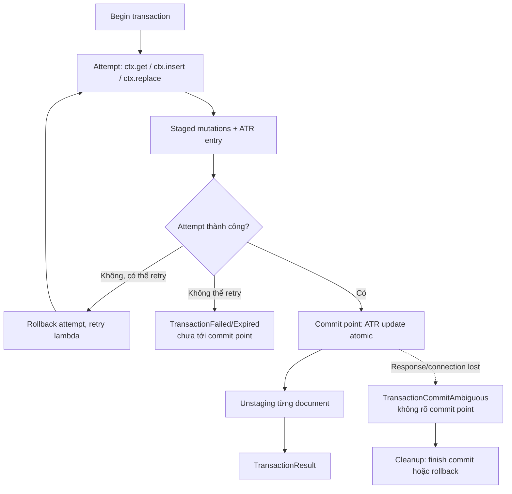
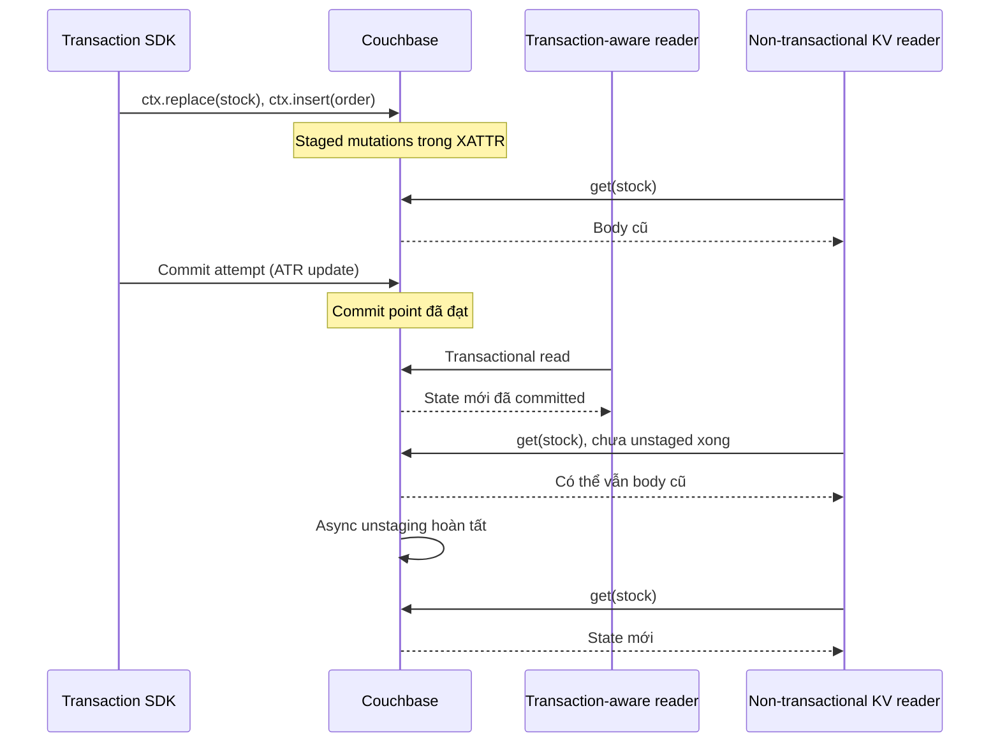
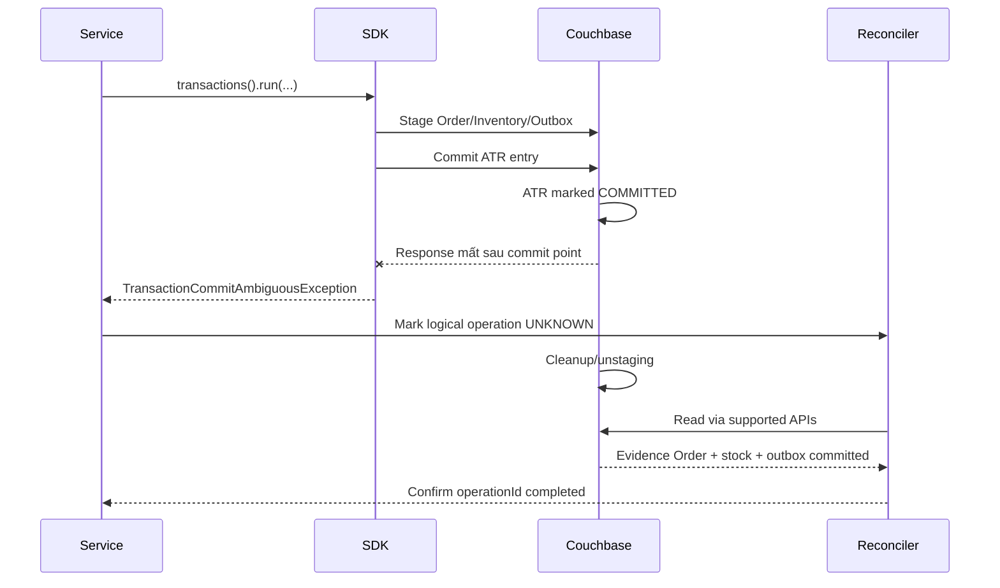
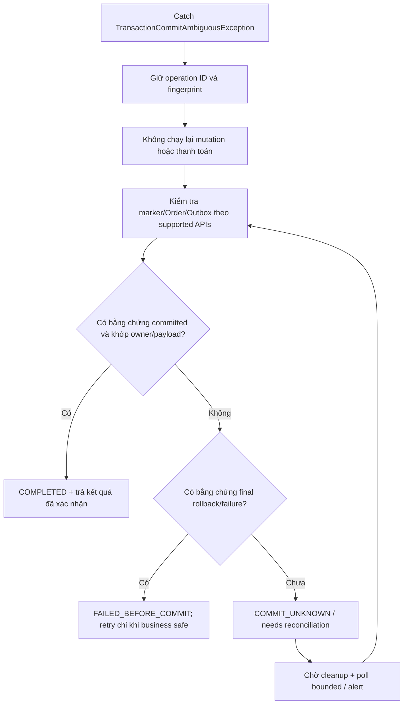
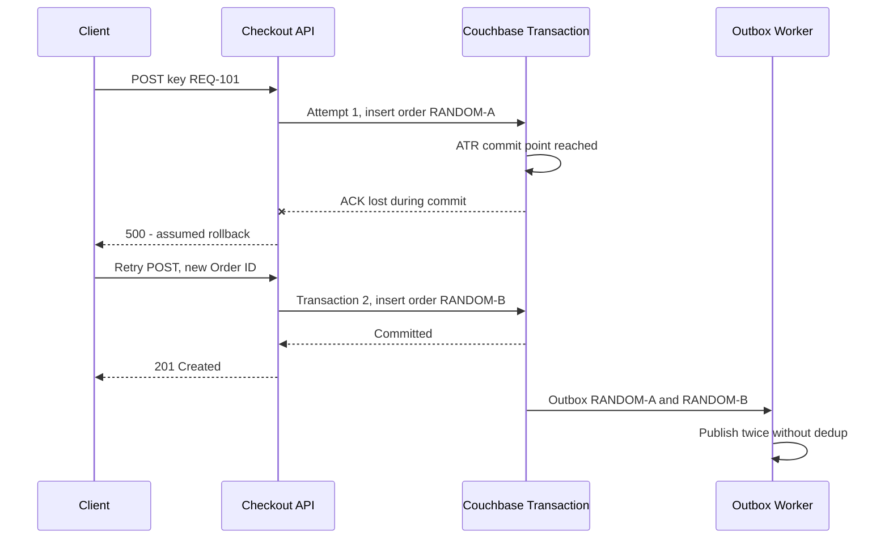

# Xử lý lỗi giao dịch và kiểm tra khả năng đã commit trong Spring Data Couchbase

> **Mục tiêu:** Hiểu Couchbase Distributed ACID Transactions, transaction attempt, ATR (Active Transaction Record), staged mutation, commit point và unstaging; phân biệt `TransactionFailedException`, `TransactionExpiredException` và `TransactionCommitAmbiguousException`; đọc đúng `TransactionResult.unstagingComplete()`; xử lý lỗi Java SDK và Spring Data Couchbase (`@Transactional`, Repository, `CouchbaseTemplate`, reactive); kiểm tra khả năng đã commit bằng bằng chứng nghiệp vụ, idempotency key, outbox và reconciliation thay vì retry mù.

Trong module **SPRING_DATA_COUCHBASE**, chúng ta xây dựng tầng truy cập Couchbase bằng document mapping, Repository, `CouchbaseTemplate` và SQL++, sử dụng bucket/scope/collection và chỉ mục, đồng thời kiểm soát TTL, CAS, durability, giao dịch và reactive API để đạt tính đúng đắn cùng khả năng vận hành. Chương **Xử lý lỗi** tập trung vào cách một ứng dụng Java phản ứng khi một thao tác không đi đến kết quả chắc chắn. Đối với giao dịch, vấn đề khó nhất thường là **liệu các thay đổi đã đi qua điểm commit nguyên tử hay chưa**, chứ không đơn thuần là “đã thấy exception hay chưa”.

**Tình huống thực tế:** Người dùng đặt 2 sản phẩm. Service muốn thực hiện cùng lúc ba thay đổi: tạo Order, trừ tồn kho và ghi một outbox event. Khi mất kết nối đúng lúc commit, SDK trả lỗi. Nếu service cho rằng “có exception tức là rollback” rồi đặt hàng lại với mã khác, tồn kho hoặc thanh toán có thể bị áp dụng hai lần. Nếu service cho rằng “đã commit chắc rồi” thì có thể trả thành công cho một Order thực tế chưa tạo. Cần có cách **giữ trạng thái chưa rõ và đối soát an toàn**.

## 1. Bản đồ kết quả của một giao dịch

| Kết quả ở ranh giới Java | Ý nghĩa về commit point | Có thể tuyên bố Order đã commit? | Hành động hợp lý |
| --- | --- | --- | --- |
| `TransactionResult` trả thành công | **Đã đạt commit point** | Có, theo giao dịch DB | Kiểm tra `unstagingComplete()` nếu cần non-transactional visibility |
| `TransactionFailedException` | **Chắc chắn chưa đạt commit point** | Không | Đọc `cause`, phân loại lỗi nghiệp vụ/hạ tầng; SDK đã cố rollback |
| `TransactionExpiredException` | **Chắc chắn chưa đạt commit point** | Không | Kiểm tra deadline, contention và retries; tránh retry nghiệp vụ mù |
| `TransactionCommitAmbiguousException` | **Không biết đã đạt commit point hay chưa** | Chưa thể kết luận | Giữ trạng thái UNKNOWN; đối soát bằng operation identity và protocol |
| Transaction chưa chạy | Chưa có transaction commit | Không | Sửa bootstrap/auth/config, sau đó thực hiện khi an toàn |

**Điểm quan trọng:** `TransactionFailedException`/`TransactionExpiredException` xác định giao dịch **không đạt commit point**. SDK có thể chưa hoàn tất cleanup mọi dấu vết staged mutation ngay tại thời điểm ném lỗi, nhưng protocol bảo đảm thay đổi của attempt đó **không được coi là committed** với các actor. Trường hợp commit ambiguous thì ngược lại: **không thể loại trừ một commit thành công**.

### Giao dịch không phải toàn bộ workflow phân tán

Couchbase transaction bảo vệ **những thay đổi database được thực hiện qua transaction context**, không tự bao gồm:

- lệnh gọi cổng thanh toán hoặc gửi email;
- HTTP request tới dịch vụ khác;
- publish message trực tiếp ra broker ngoài Couchbase;
- lệnh KV thông thường được gọi bằng `collection.insert(...)` thay vì `ctx.insert(...)` bên trong transaction lambda;
- logic chạy trước hoặc sau transaction.

Vì vậy “giao dịch thất bại chắc chắn” **không đồng nghĩa mọi tác dụng phụ trong toàn bộ business workflow đã rollback**. Tránh side effect không-idempotent bên trong lambda mà SDK có thể chạy lại.

## 2. Kiến trúc dữ liệu của ví dụ

Ứng dụng cửa hàng dùng ba collection trong bucket `commerce`:

```text
Couchbase Cluster
└── Bucket: commerce
    └── Scope: sales
        ├── Collection: orders
        │   └── order::shop-a::ORD-101
        ├── Collection: inventory
        │   └── stock::shop-a::SKU-101
        └── Collection: outbox
            └── evt::shop-a::REQ-101
```

Giao dịch `PlaceOrder` phải tạo Order, trừ stock và ghi outbox trong **một transaction**. Document key cố định theo tenant và operation ID hỗ trợ đối soát.

**Order** — key `order::shop-a::ORD-101`:

```json
{
  "_class": "sales-order",
  "schemaVersion": 1,
  "orderId": "ORD-101",
  "tenantId": "shop-a",
  "requestId": "REQ-101",
  "sku": "SKU-101",
  "quantity": 2,
  "state": "CREATED",
  "createdAt": "2026-11-25T03:00:00Z"
}
```

**Inventory** — key `stock::shop-a::SKU-101`:

```json
{
  "tenantId": "shop-a",
  "sku": "SKU-101",
  "available": 12,
  "reserved": 0,
  "lastReservationId": null
}
```

**Outbox** — key `evt::shop-a::REQ-101`:

```json
{
  "eventId": "REQ-101",
  "eventType": "OrderCreated",
  "tenantId": "shop-a",
  "orderId": "ORD-101",
  "publishState": "PENDING",
  "schemaVersion": 1
}
```

Các JSON trên chỉ là dữ liệu lab. `_class` là type discriminator minh họa của Spring Data (tên/alias có thể đổi theo converter). Document ID, CAS và TTL thuộc Couchbase metadata, không bắt buộc là trường JSON. **Một request ID thuộc tenant khác không được cấp quyền tra cứu/ghi đè chỉ vì đoán được document key.**

## 3. Transaction attempt, ATR và staged mutation

Mỗi lần thực thi transaction lambda tạo một **attempt**. SDK có thể thực hiện lại lambda khi phát hiện xung đột hoặc lỗi tạm thời mà nó có thể retry. Một **transaction** vì thế có thể gồm nhiều attempts trước khi trả kết quả cuối.

Ba cấu phần cốt lõi:

| Thành phần | Nhiệm vụ | Có nên ứng dụng tự sửa? |
| --- | --- | --- |
| **ATR (Active Transaction Record)** | Lưu metadata attempts và trạng thái commit | **Không**; SDK/cleanup quản lý |
| **Staged mutation** | Phiên bản sau ghi được lưu tạm trong XATTR, chưa áp dụng ngay vào JSON body thường | **Không** sửa hoặc xóa `txn` XATTR |
| **Commit point** | Thao tác nguyên tử cập nhật trạng thái attempt trong ATR | Chỉ giao thức transaction/SDK thực hiện |
| **Unstaging** | Đưa staged changes vào body document đã commit cho non-transactional readers | SDK cleanup quản lý, có thể xảy ra sau commit |

ATR documents thường có tiền tố `_txn:atr-`, được tạo tự động trong metadata collection; **không phải** hệ thống audit hay transaction journal cho business logic tự chỉnh sửa. Tài liệu Server/SDK coi ATR là **single point of truth** của transaction protocol.

### Mô hình tổng quát



Các node trong sơ đồ mô tả **logical lifecycle**, không bảo đảm SDK ném một exception ngay đúng tại một node hay cleanup hoàn tất đồng bộ. Dấu mốc quan trọng vẫn là **ATR commit point** và việc client có biết chắc nó đã xảy ra hay không.

### Vị trí metadata collection

Theo mặc định, ATR thường nằm ở `_default._default` của bucket chứa document được mutation đầu tiên trong transaction. Dự án cũng có thể cấu hình metadata collection riêng. **Không xóa default collection hoặc metadata collection khi còn transaction dùng ATR ở đó**; việc đó có thể ảnh hưởng cleanup, khả năng commit và khả năng khôi phục.

## 4. Commit point và khả năng nhìn thấy dữ liệu

Trước commit point, staged changes được giữ trong metadata/XATTR. Sau commit point, các **transaction-aware readers** dùng ATR để xem trạng thái committed; các **non-transactional readers** có thể còn thấy body cũ cho tới khi các document được unstaged.



**Không dùng một lần `collection.get(id)` thấy body cũ để kết luận transaction vừa timeout chắc chắn chưa commit.** Nó có thể đã commit ở ATR nhưng chưa hoàn tất unstaging. Ngược lại, không được coi JSON có key Order mới là đủ chứng minh mọi downstream side effects (payment, notification) cũng đã hoàn tất.

### Đọc chính xác bằng góc nhìn nào?

- **Trong cùng attempt:** `ctx.get` thấy staged writes của chính transaction (*read your own writes*).
- **Transaction-aware reader khác:** sau commit point có thể đọc state committed theo transaction protocol.
- **KV thường/SQL++ ngoài transaction:** cần đánh giá thời gian unstaging và index consistency; có thể chưa quan sát tất cả cập nhật tại cùng một thời điểm.
- **System management/ATR inspection:** dành cho SDK và runbook vận hành có kiểm soát, không làm business app tự đọc/sửa `_txn:atr-*` để thay API transaction.

Tính nguyên tử và khả năng nhìn thấy tức thời qua **mọi** API ngoài transaction không đồng nghĩa nhau. Dự án cần thiết kế API/status/read model phù hợp với nhu cầu nghiệp vụ.

## 5. Ba ngoại lệ kết quả giao dịch trong Java SDK

Các exception thuộc package `com.couchbase.client.java.transactions.error`:

```java
import com.couchbase.client.java.transactions.error.TransactionFailedException;
import com.couchbase.client.java.transactions.error.TransactionExpiredException;
import com.couchbase.client.java.transactions.error.TransactionCommitAmbiguousException;
```

| Loại | SDK biết chắc điều gì? | Rollback/cleanup | Quy tắc API/side effect |
| --- | --- | --- | --- |
| `TransactionFailedException` | Không đi qua commit point; thường fail sớm | SDK cố rollback, cleanup có thể tiếp tục | Không báo Order đã commit; giữ cause |
| `TransactionExpiredException` | Không đi qua commit point; retries/timeout hết hạn | Rollback attempt, staged metadata được cleanup | Không báo commit; xem timeout và contention |
| `TransactionCommitAmbiguousException` | Không biết đã đến commit point hay chưa | Cleanup cuối cùng hoàn tất commit hoặc rollback | **Không tự chạy lại** tạo Order/giữ stock/gửi thanh toán |

Tài liệu Couchbase tách rõ `TransactionFailedException` (fast failure), `TransactionExpiredException` (hết transaction timeout) và `TransactionCommitAmbiguousException`. SDK có thể tự thử lại những lỗi tạm thời **trước khi** một trong ba exception tới application. Đừng tự suy từ một exception SQL++/KV bên trong rằng toàn bộ giao dịch có cùng trạng thái.

### `TransactionFailedException`

Ví dụ: trong attempt, business logic phát hiện stock không đủ:

```java
public class InsufficientStockException extends RuntimeException {
    public InsufficientStockException(String message) {
        super(message);
    }
}
```

```java
try {
    cluster.transactions().run(ctx -> {
        var stock = ctx.get(inventory, "stock::shop-a::SKU-101");
        int available =
            stock.contentAsObject().getInt("available");
        if (available < 2) {
            throw new InsufficientStockException("Not enough stock");
        }
        // Các thao tác transaction khác...
    });
} catch (TransactionCommitAmbiguousException ambiguous) {
    // Outcome chưa xác định; không coi là hết stock.
    throw new OrderCommitUnknownException(ambiguous);
} catch (TransactionFailedException failed) {
    if (failed.getCause() instanceof InsufficientStockException) {
        throw (InsufficientStockException) failed.getCause();
    }
    throw new OrderTransactionFailureException(failed);
}
```

`OrderCommitUnknownException` và `OrderTransactionFailureException` là các exception do ứng dụng định nghĩa. SDK có thể bọc business exception trong `getCause()`, nhưng **không phải mọi cause đều là business validation**: có thể là `DocumentExistsException`, `DocumentNotFoundException`, contention, mapping/serialization hoặc network.

### `TransactionExpiredException`

Đây là trường hợp đã hết budget của transaction sau retries/đợi, **nhưng chưa đạt commit point**. Nó khác với client HTTP timeout nói chung. Nếu gateway trả HTTP 504 khi một transaction đang commit thì gateway timeout không xác định transaction outcome; chỉ khi SDK thực sự trả `TransactionExpiredException` theo contract mới có bằng chứng transaction attempt **không commit**.

Một timeout có thể vượt quá khoảng cấu hình chính xác do một operation bên trong lambda đang blocking hoặc một KV operation bắt đầu gần deadline. Không thiết kế business như thể timer sẽ dừng mọi instruction đúng ở mili-giây đã cấu hình.

### `TransactionCommitAmbiguousException`

Lỗi xuất hiện gần thao tác **atomic commit** khi client không thể biết cập nhật ATR có thành công hay không. Nếu commit đã đạt, cleanup sẽ hoàn thành unstaging; nếu chưa đạt, cleanup xử lý rollback. Đó là hai hướng protocol hợp lệ và application **không thể tự chọn một hướng theo cảm tính**.

Không được:

```java
// Phản diện: tạo logical Order mới sau một commit ambiguous.
catch (TransactionCommitAmbiguousException ex) {
    return placeOrderWithNewRandomId(request);
}
```

Cách đúng là giữ **một operation identity ổn định**, ghi nhận trạng thái `COMMIT_UNKNOWN` (trong hệ thống tracking được thiết kế bền vững), và đối soát. Việc có thể retry **về sau** mà tài liệu SDK đề cập không phải cho phép retry một workflow không-idempotent ngay lập tức.

## 6. `TransactionResult`: thành công nhưng chưa hoàn tất unstaging

Java SDK trả `TransactionResult` khi `transactions().run(...)` thành công:

```java
import com.couchbase.client.java.transactions.TransactionResult;

TransactionResult result = cluster.transactions().run(ctx -> {
    ctx.insert(orders, "order::shop-a::ORD-102",
        JsonObject.create()
            .put("orderId", "ORD-102")
            .put("requestId", "REQ-102")
            .put("tenantId", "shop-a"));
});

if (result.unstagingComplete()) {
    // Mọi document đã được unstaged.
} else {
    // Commit point đã đạt, nhưng unstaging còn tiếp tục.
}
```

Hai nhánh **đều đã commit** theo transaction protocol. `unstagingComplete() == false` không phải rollback và không nên khiến service gửi lại `ctx.insert`. Nếu API dùng transactional reads, nó có thể xem trạng thái mới trước khi unstaging xong; nếu API phụ thuộc non-transactional KV/SQL++ reads ngay tức thì, phải có chính sách chờ/kiểm tra phù hợp.

### Ba trạng thái không được đồng nhất

| Tín hiệu | Commit point | Unstaging | Thông điệp chính xác |
| --- | --- | --- | --- |
| `run()` success + `unstagingComplete()==true` | Đã đạt | Hoàn tất | “Transaction committed, unstaged” |
| `run()` success + `unstagingComplete()==false` | Đã đạt | Có thể còn pending | “Transaction committed; cleanup continuing” |
| `TransactionCommitAmbiguousException` | **Chưa biết** | Phụ thuộc outcome/cleanup | “Transaction outcome unknown” |

### Nếu bắt buộc phải thấy toàn bộ kết quả ở reader thường

Ví dụ một hệ thống fulfillment dùng KV reader thường để đọc Order và Stock. Nếu ngay sau commit cần các reader này quan sát state mới, có thể:

1. Sử dụng transaction-aware reads theo API thích hợp;
2. Dùng event/outbox với điều kiện publish chỉ khi state đã đủ sẵn sàng;
3. Poll có giới hạn các document liên quan sau `unstagingComplete()==false` (không dùng một lần đọc để kết luận rollback);
4. Nếu quá deadline thì báo “committed but not yet fully visible” cho service nội bộ, không tự retry transaction.

Không nên tự sửa `txn` XATTR hoặc ATR để làm “unstaging nhanh hơn”.

## 7. Viết một transaction KV đúng qua `ctx`

Ví dụ đầy đủ về luồng tạo Order và trừ inventory, chưa gọi payment provider:

```java
import com.couchbase.client.java.Cluster;
import com.couchbase.client.java.Collection;
import com.couchbase.client.java.json.JsonObject;
import com.couchbase.client.java.transactions.TransactionResult;
import com.couchbase.client.java.transactions.TransactionGetResult;

public TransactionResult reserveAndCreateOrder(
        Cluster cluster,
        Collection orders,
        Collection inventory,
        Collection outbox,
        String orderKey,
        String stockKey,
        String eventKey,
        String tenantId,
        String requestId,
        int quantity) {

    if (quantity <= 0) {
        throw new IllegalArgumentException("quantity must be positive");
    }

    return cluster.transactions().run(ctx -> {
        TransactionGetResult current = ctx.get(inventory, stockKey);
        JsonObject stock = current.contentAsObject();
        int available = stock.getInt("available");
        if (available < quantity) {
            throw new InsufficientStockException("Not enough stock");
        }

        stock.put("available", available - quantity);
        stock.put("reserved",
            stock.getInt("reserved") + quantity);
        ctx.replace(current, stock);

        JsonObject order = JsonObject.create()
            .put("tenantId", tenantId)
            .put("requestId", requestId)
            .put("quantity", quantity)
            .put("state", "CREATED");
        ctx.insert(orders, orderKey, order);

        JsonObject event = JsonObject.create()
            .put("tenantId", tenantId)
            .put("eventId", requestId)
            .put("orderKey", orderKey)
            .put("publishState", "PENDING");
        ctx.insert(outbox, eventKey, event);
    });
}
```

**Giả định:** `stock.available`/`reserved` là number hợp lệ; `stockKey`, `orderKey`, `eventKey` được **tạo/kiểm tra từ trusted tenant context**, không tin trực tiếp query parameter. Code mẫu bỏ bớt lớp service, imports của domain exception và cấu hình cluster; nó mô tả chính xác **cách dùng transaction context**, không phải dự án hoàn chỉnh để chạy trong production.

**Quan trọng:** nếu lambda được retry, `ctx.get` đọc lại inventory và tính toán lại quantity dựa trên state mới. Điều này giúp xử lý xung đột giữa attempts. Ba `ctx` mutations thuộc cùng transaction. Nếu một lệnh `ctx.insert` gặp ID đã tồn tại, attempt sẽ thất bại và cần phân loại `getCause()`/idempotency record bên ngoài.

### Mẫu sai: gọi SDK KV thường trong lambda

```java
cluster.transactions().run(ctx -> {
    // SAI: không thuộc giao dịch đang chạy!
    orders.insert("order::shop-a::ORD-103",
        JsonObject.create().put("state", "CREATED"));

    // Dùng transaction API mới đúng cho nghiệp vụ atomic.
    var stock = ctx.get(inventory, "stock::shop-a::SKU-101");
    // ...
});
```

`orders.insert(...)` ở đây là regular KV mutation, **không rollback cùng transaction** và có thể chạy nhiều lần khi lambda được retry. Cần dùng `ctx.insert(orders, key, body)`; cùng nguyên tắc cho `get`/`replace`/`remove` nếu muốn tham gia transaction.

## 8. Lỗi trong lambda: bắt exception hay dừng attempt?

Tài liệu Java SDK cảnh báo: khi một **transactional KV mutation** bên trong attempt đã thất bại, attempt thường **không thể tiếp tục**; mọi operation và commit tiếp theo sẽ thất bại. SDK có thể quyết định rollback rồi chạy lại một attempt mới. **Ngoại lệ đáng chú ý:** `ctx.get` báo document không tồn tại có thể được bắt để xử lý lựa chọn nghiệp vụ; theo JavaDoc, một số lỗi `ctx.query` cũng có thể được ứng dụng bắt/bỏ qua mà attempt vẫn tiếp tục. Không mở rộng ngoại lệ này sang mọi transactional KV mutation.

### Ví dụ `ctx.get` thiếu document

```java
import com.couchbase.client.core.error.DocumentNotFoundException;

cluster.transactions().run(ctx -> {
    try {
        var maybeVoucher =
            ctx.get(vouchers, "voucher::shop-a::NEWUSER");
        // Nếu có voucher, dùng trong chính attempt.
    } catch (DocumentNotFoundException notFound) {
        // Một lựa chọn nghiệp vụ có thể chấp nhận:
        // không áp voucher, vẫn tiếp tục transaction.
    }

    // Những bước giao dịch tiếp theo chỉ khi contract cho phép.
});
```

`vouchers` là `Collection` giả định đã khai báo. Đừng mở rộng mẫu này thành:

```java
// Phản diện: catch mọi lỗi rồi tiếp tục dù attempt đã failed.
try {
    ctx.insert(orders, orderKey, orderBody);
} catch (Exception ex) {
    logger.warn("ignored transaction insert failure");
}
ctx.insert(outbox, eventKey, eventBody);
```

Nếu `ctx.insert` đã thất bại, trạng thái attempt thường đã bị SDK đánh dấu rollback; các call tiếp theo không thể “đi tiếp như bình thường”. Bỏ qua exception có thể che nguyên nhân thật và tạo event không tương ứng Order. Nếu không chấp nhận lỗi, hãy để SDK xử lý rollback/retry hoặc chuyển lỗi nghiệp vụ có tên rõ.

### Ngoại lệ cho `ctx.query` không phải một giấy phép nuốt lỗi

JavaDoc `TransactionAttemptContext.query(...)` cho phép caller **chọn bắt và bỏ qua một số query error**, khác với KV mutation error vốn làm attempt fail. Tuy nhiên, chỉ được tiếp tục khi error thực sự có ý nghĩa nghiệp vụ optional và transaction state vẫn hợp lệ. Ví dụ một query SELECT optional không tìm được keyspace là **lỗi cấu hình** chứ không phải “không có record”; phải xử lý root cause và không che nó bằng `catch (Exception) { }`.

### Lỗi lập trình cũng làm transaction fail

`NullPointerException`, conversion error hoặc validation exception ném trong lambda cũng là **lỗi của attempt**, không tự động được sửa bằng retry. Ghi nhận class/cause và bảo đảm không log raw document chứa dữ liệu nhạy cảm; sửa nguồn schema hoặc code.

### Domain rejection khác database outage

Ví dụ `InsufficientStockException` phát sinh sau khi đọc tồn kho hợp lệ và kiểm tra invariant; đó không phải lỗi hạ tầng tạm thời. Có thể mapping ra HTTP `409 Conflict` hoặc `422 Unprocessable Entity` tùy hợp đồng API. Còn `TransactionFailedException` có cause `AuthenticationFailureException` hay thiếu index cần điều tra vận hành, không được map tất cả thành “hết hàng”.

## 9. Retry của transaction SDK và sự khác nhau giữa attempt/workflow

SDK có thể retry **một operation**, rồi retry **toàn bộ lambda** khi phát hiện xung đột mà nó tin có thể giải quyết được (ví dụ hai transaction cùng cập nhật một document). Số lần lambda chạy có thể lớn hơn một, trong khi application chỉ gọi `transactions().run(...)` một lần.

```text
One application call:
  transactions().run(lambda)

  Attempt A
    read stock=12
    stage reserved=2
    conflict -> rollback/retry

  Attempt B
    read stock=10
    stage reserved=2
    insert order + outbox
    commit point -> success
```

### Hệ quả đối với side effect

Không đặt các tác vụ bên ngoài DB trực tiếp trong lambda:

```java
cluster.transactions().run(ctx -> {
    var stock = ctx.get(inventory, stockKey);
    ctx.replace(stock, updatedStock);

    paymentProvider.charge(card, amount);  // SAI nếu không idempotent.
    emailSender.send(receipt);              // SAI.
    messageBroker.publish(orderEvent);      // SAI.
});
```

Trong trường hợp lambda retry, payment/email/event có thể chạy nhiều lần; trong trường hợp transaction failed, tác dụng phụ ngoài Couchbase **không rollback**. Thay bằng outbox record được `ctx.insert` cùng Order/Stock và một publisher riêng có deduplication, cộng thêm idempotency key do payment provider hỗ trợ.

### Không tự retry cả service method khi commit ambiguous

```java
// Phản diện: @Retryable hoặc RetryTemplate áp dụng mọi RuntimeException
// sẽ có thể chạy lại transaction sau TransactionCommitAmbiguousException.
public OrderResponse placeOrder(CreateOrderRequest request) {
    cluster.transactions().run(ctx -> {
        // ...
    });
    return new OrderResponse(...);
}
```

Nếu service có framework retry bao quanh mọi lỗi và không phân loại commit ambiguity, một transaction **đã commit nhưng response mất** có thể bị chạy lại thành business command thứ hai. Cần exclude commit ambiguous khỏi retry “blind”, giữ idempotency key/fingerprint và đối soát trước.

## 10. Trường hợp commit đã xảy ra nhưng client chưa biết



**Trường hợp đối xứng** cũng có thể xảy ra: commit ATR không diễn ra trước khi timeout; cleanup sẽ rollback staged changes. Vì SDK không thể biết hướng nào trong khoảng thời gian ấy, application phải cho phép **hai kết luận** thay vì cố đoán từ việc response mất.

### Không tự đọc XATTR `txn` rồi đổi trạng thái

ATR/XATTR là **protocol metadata**, không phải API hỗ trợ end user kiểm tra đơn hàng. Chỉ SDK/cleanup và công cụ vận hành được cấp quyền nên dùng metadata này theo tài liệu. Mã nghiệp vụ không được:

- tự gọi SQL++ `UPDATE` vào ATR để đánh dấu `COMMITTED`;
- xóa `_txn:atr-*` để “giải phóng lock”;
- sửa hoặc làm sạch field `txn` trên document;
- tạo lại metadata collection khi có conflict mà chưa xác minh backup/recovery;
- suy transaction status từ một attribute nội bộ không được bảo đảm ổn định qua SDK version.

Để kiểm tra **khả năng đã commit**, ưu tiên **dấu vết nghiệp vụ nằm trong cùng transaction** (Order + outbox + request ID), dùng transactional reads và kiểm tra sau cleanup khi cần. Nếu bằng chứng chưa đủ, trạng thái đúng là **UNKNOWN**, không phải SUCCESS/FAILED.

## 11. Timeout và cấu hình transaction

Tài liệu Java SDK cho biết **transaction timeout mặc định 15 giây** trong cấu hình thông thường. Có thể chỉnh toàn cục hoặc từng transaction, nhưng tăng timeout **không loại bỏ hoàn toàn ambiguity**.

### Cấu hình toàn SDK

```java
import com.couchbase.client.java.Cluster;
import com.couchbase.client.java.ClusterOptions;
import java.time.Duration;

Cluster cluster = Cluster.connect(
    connectionString,
    ClusterOptions.clusterOptions(username, password)
        .environment(env -> env.transactionsConfig(
            tx -> tx.timeout(Duration.ofSeconds(30))
        ))
);
```

`connectionString`, `username` và `password` là biến cấu hình/secret an toàn, không nên có literal credential trong code. Các bản SDK cũ còn có factory `TransactionsConfig.timeout(...)`, nhưng Java SDK 3.13 khuyến nghị callback builder ở ví dụ để tránh static factory deprecated. Kiểm tra version/runtime configuration của dự án.

### Cấu hình theo transaction

```java
import static com.couchbase.client.java.transactions.TransactionOptions.transactionOptions;

TransactionResult result = cluster.transactions().run(ctx -> {
    // Transactional KV/query operations
}, transactionOptions().timeout(Duration.ofSeconds(25)));
```

### Trade-off khi tăng timeout

- **Có lợi:** SDK có thêm thời gian xử lý xung đột/rebalance/temporary failures.
- **Có hại:** staged documents có thể bị giữ trong transaction lâu hơn, tăng contention cho writers khác.
- **Không đủ:** nếu connection mất ngay khi commit ATR, vẫn có thể ambiguous.
- **Không chính xác tuyệt đối:** một blocking call hoặc KV timeout bên trong lambda có thể làm tổng elapsed vượt time budget đã đặt.
- **Không thay business deadline:** HTTP gateway có thể đã timeout trước transaction, client đã retry bằng request mới.

Chọn timeout dựa trên P95/P99 transaction duration, số document và cross-node operations, network/replica health, mức độ tranh chấp và SLA nghiệp vụ. Không tăng lên vài phút chỉ vì “giao dịch đôi khi lỗi” khi chưa phân loại root cause.

## 12. Durability, replica và môi trường một node

Couchbase Distributed Transactions sử dụng durable writes trong protocol. Với self-managed **single-node** và bucket được cấu hình replica=1, durability cần majority/replica có thể không đáp ứng, dẫn tới `DurabilityImpossibleException` và transaction failure; tài liệu SDK có hướng dẫn điều chỉnh replica count của môi trường phát triển phù hợp.

| Triệu chứng | Hướng điều tra | Không nên làm |
| --- | --- | --- |
| Lab một node transactions luôn fail | Bucket replica count, Server version | Bỏ transaction validation và kết luận code sai |
| Durable writes timeout | Replica availability, node health, SyncWrite | Giảm durability tùy tiện trong production |
| `TransactionExpiredException` | Timeout, contention, rebalance, network | Retry không giới hạn trong HTTP |
| `TransactionCommitAmbiguousException` | Lỗi ngay commit point/response mất | Đánh dấu rollback rồi chạy lại |
| Unstaging chậm | Cleanup threads, cluster load, active transaction count | Xóa thủ công ATR hoặc `txn` XATTR |

Với Couchbase Capella single-node, replica defaults có thể khác self-managed; cần kiểm tra cấu hình thực của cluster thay vì áp dụng quy tắc một node chung. Đồng bộ giờ các node bằng NTP cũng giúp metadata cleanup/expiry hoạt động dự đoán được; đồng hồ lệch không tự đồng nghĩa ACID bị phá.

## 13. Spring Data Couchbase `@Transactional` tham gia giao dịch thế nào?

Spring Data Couchbase hỗ trợ tích hợp Couchbase Transactions qua các hoạt động Repository/Template phù hợp. Có thể dùng `@Transactional` trên service Spring-managed, `CouchbaseTransactionalOperator` hoặc SDK transaction lambda. **Cấu hình transaction manager và khả năng tham gia của từng API tùy Spring Data Couchbase version**; không thể gắn `@Transactional` lên một class bất kỳ rồi coi mọi call đều atomic.

### Entity với CAS version

Tài liệu Spring Data Couchbase Transactions yêu cầu entity có `@Version Long` để chứa CAS (wrapper `Long`, không suy default primitive `long` cho mọi phiên bản):

```java
import org.springframework.data.annotation.Id;
import org.springframework.data.annotation.TypeAlias;
import org.springframework.data.annotation.Version;
import org.springframework.data.couchbase.core.mapping.Document;
import org.springframework.data.couchbase.repository.Collection;
import org.springframework.data.couchbase.repository.Scope;

@Document
@Scope("sales")
@Collection("orders")
@TypeAlias("sales-order")
public class SalesOrder {
    @Id
    private String id;

    @Version
    private Long version;

    private String tenantId;
    private String requestId;
    private String state;

    public SalesOrder() {}
    // Constructor/getter/setter cần thiết theo mapping.
}
```

Bucket `commerce` lấy từ Spring Data configuration. Entity/Repository phải trỏ **đúng scope/collection** theo chủ trương thiết kế; nếu raw SDK/outbox dùng collection khác, phải khai báo rõ.

### Service được Spring quản lý

```java
import org.springframework.stereotype.Service;
import org.springframework.transaction.annotation.Transactional;

@Service
public class OrderApplicationService {
    private final SalesOrderRepository orderRepository;
    private final OutboxRepository outboxRepository;

    public OrderApplicationService(
            SalesOrderRepository orders,
            OutboxRepository outbox) {
        this.orderRepository = orders;
        this.outboxRepository = outbox;
    }

    @Transactional
    public void recordOrderAndEvent(
            SalesOrder order,
            OutboxEvent event) {
        orderRepository.save(order);
        outboxRepository.save(event);
    }
}
```

`SalesOrderRepository`, `OutboxRepository` và `OutboxEvent` là các type phải được định nghĩa trong dự án (entities có mapping/CAS hợp lệ); ví dụ minh họa **cách đặt transaction boundary**. Cần có Couchbase transaction manager và Spring transaction infrastructure đúng version/configuration; không coi đoạn này là chứng minh integration đã hoạt động trong một project bất kỳ.

### Điều kiện quan trọng

| Điều kiện | Vì sao? |
| --- | --- |
| Bean `@Service` được Spring tạo và gọi qua proxy | Interceptor transaction mới chạy |
| `@EnableTransactionManagement`/transaction integration phù hợp | Kích hoạt transaction advice theo setup |
| Transaction manager Couchbase được cấu hình | Tránh chạy dưới manager của SQL database khác |
| Entity `@Id`, `@Version` mapping đúng | CAS và entity lifecycle tham gia transaction |
| Repository/Template operation được hỗ trợ | Không phải mọi method SDK/Query custom đều mặc nhiên tham gia |
| Lambda/method body không có side effect ngoài DB không-idempotent | SDK/framework có thể thực thi lại phần thân |

Đặc biệt, **self-invocation** như `this.recordOrderAndEvent(...)` từ một method khác cùng bean có thể **bỏ qua Spring proxy**, nên `@Transactional` không chạy như mong muốn. Kiểm thử integration cần xác nhận transaction thật, không chỉ thấy annotation trong source.

### `@Transactional` không nhất thiết theo semantics của RDBMS

Tài liệu Spring Data Couchbase có những giới hạn riêng; ở một số phiên bản, **rollback attributes** như `rollbackFor/noRollbackFor` bị bỏ qua và isolation thực tế là **read committed**. Không sao chép giả định isolation `SERIALIZABLE` hoặc nested transaction savepoint từ JDBC/JPA. Xem đúng Spring Data Couchbase release được triển khai và kiểm thử hành vi.

Nếu dùng đồng thời nhiều transaction managers trong Spring Boot (Couchbase + JPA), cần chỉ định manager/boundary đúng. Một `@Transactional` dùng transaction manager không phải Couchbase **không bảo đảm** hai Repository Couchbase calls sẽ tự thành một Couchbase transaction.

## 14. Spring Data Repository và `CouchbaseTemplate` trong SDK transaction lambda

Tài liệu Spring Data Couchbase cho phép các operations phù hợp của Spring Data được thực hiện trong callback của `cluster.transactions().run(ctx -> ...)`, theo integration đã cấu hình; chúng có thể tự tham gia context của SDK transaction:

```java
import com.couchbase.client.java.Cluster;
import com.couchbase.client.java.transactions.TransactionResult;
import org.springframework.data.couchbase.core.CouchbaseTemplate;

// Trong một Spring-managed service được cấu hình đúng:
TransactionResult result = cluster.transactions().run(ctx -> {
    SalesOrder current = couchbaseTemplate.findById(SalesOrder.class)
        .one("order::shop-a::ORD-101");

    // Tạo bản copy/updated entity có @Id và @Version hợp lệ.
    SalesOrder updated = changeOrderState(current, "CONFIRMED");
    couchbaseTemplate.replaceById(SalesOrder.class).one(updated);
});
```

`changeOrderState` là hàm domain do dự án định nghĩa; code chỉ minh họa **transaction-aware Spring operations** và phải xác nhận API signature với Spring Data version thực tế. Đừng tự chạy một `CouchbaseTemplate` khác với client factory/cluster khác rồi tin nó đã gia nhập transaction.

### Những đường không tự gia nhập transaction

Trong lambda SDK, đoạn sau **không phải transaction call**:

```java
cluster.transactions().run(ctx -> {
    // Regular SDK call: KHÔNG thuộc transaction context.
    orders.upsert("order::shop-a::ORD-101", JsonObject.create());
});
```

Với SDK trực tiếp phải dùng `ctx.insert`/`ctx.get`/`ctx.replace`/`ctx.remove` hoặc `ctx.query`. Với Spring Data phải bảo đảm framework API được hỗ trợ trong transaction integration cùng client factory. Nếu không chắc, ưu tiên code thuần SDK ctx rõ ràng cho business-critical multi-document transaction.

### Repository `save` có side effect callback

Spring Data entity callbacks/custom converters có thể chạy khi save trong transaction; do lambda/method có thể được retry, callback không nên gửi email/gọi payment/HTTP không-idempotent. Callback có thể validate/chuẩn hóa domain object, nhưng phải có hành vi deterministic và không phụ thuộc external mutable state.

## 15. Reactive transaction: phải trả Publisher đúng chuỗi

Java SDK hỗ trợ `cluster.reactive().transactions().run(...)` và `ReactiveCollection`. Lambda reactive phải trả Publisher chứa **tất cả transactional operations**, để SDK đợi và quyết định commit.

### Ví dụ reactive transaction đơn giản

```java
import com.couchbase.client.java.ReactiveCollection;
import com.couchbase.client.java.json.JsonObject;
import com.couchbase.client.java.transactions.TransactionResult;
import reactor.core.publisher.Mono;

ReactiveCollection rxOrders = orders.reactive();
ReactiveCollection rxInventory = inventory.reactive();

Mono<TransactionResult> saved =
    cluster.reactive().transactions().run(ctx ->
        ctx.get(rxInventory, "stock::shop-a::SKU-101")
            .flatMap(stock -> {
                JsonObject body = stock.contentAsObject();
                int count = body.getInt("available");
                if (count < 2) {
                    return Mono.error(
                        new InsufficientStockException("Not enough stock")
                    );
                }
                body.put("available", count - 2);
                return ctx.replace(stock, body);
            })
            .then(ctx.insert(rxOrders,
                "order::shop-a::ORD-201",
                JsonObject.create()
                    .put("requestId", "REQ-201")
                    .put("tenantId", "shop-a")
            ))
            .then()
    );
```

Ví dụ minh họa cú pháp reactive SDK: `saved` chỉ thực sự thực thi khi có subscriber. Khi SDK phát `TransactionCommitAmbiguousException`, nó đi theo **error signal** và phải xử lý tại adapter/application boundary. Không dùng `block()` bên trong WebFlux event loop.

### `Mono<Void>` và operator `then`

Một số transaction operations (đặc biệt `ctx.remove`) trả `Mono<Void>`, chỉ báo completion chứ không phát `onNext`. Dùng:

```java
return ctx.remove(doc).then(ctx.insert(other, key, body));
```

thay vì:

```java
// Không chạy insert vì Mono<Void> không phát onNext.
return ctx.remove(doc)
    .flatMap(ignored -> ctx.insert(other, key, body));
```

Việc dùng sai operator có thể khiến một bước của transaction **không được chạy**, dù không có exception timeout. Đây là lỗi reactive composition chứ không phải thiếu role hoặc durability.

### Không retry toàn bộ reactive transaction mù

```java
// Phản diện: resubscribe sau commit ambiguous có thể chạy transaction mới.
return cluster.reactive().transactions()
    .run(ctx -> createOrderPublisher(ctx))
    .retry();
```

SDK transaction đã quản lý retry attempts cho nhiều lỗi transient. Reactor `retry()` trên publisher bên ngoài có thể **gọi transaction logic mới sau một outcome unknown**. Đặc biệt, nếu phương thức còn charge payment/publish event bên ngoài, nguy cơ lặp tăng. Lọc loại lỗi, dùng idempotency record/reconciliation và giữ budget; **commit ambiguous không phải lỗi để retry tự động không điều kiện**.

### Spring Data reactive `@Transactional`

Spring Data Couchbase có tích hợp reactive transaction với `@Transactional` và `CouchbaseTransactionalOperator` trong phiên bản hỗ trợ. Với reactive Spring Data, phải bảo đảm **Reactor context** được giữ trong pipeline thay vì tự `subscribe()` bên trong service; một subscription phụ có thể chạy ngoài transaction scope.

Tài liệu API `CouchbaseTransactionalOperator` cũng khuyến nghị cân nhắc **SDK reactive transaction lambda** trực tiếp với các Spring Data operations phù hợp, vì dễ thấy rõ lifecycle và xử lý commit error. Không dùng `TransactionalOperator.create(manager)` chung khi tài liệu version yêu cầu `CouchbaseTransactionalOperator.create(manager)`.

## 16. SQL++ trong giao dịch: dùng `ctx.query`, không `cluster.query`

SDK transaction cho phép kết hợp KV với SQL++ `SELECT`, `INSERT`, `UPSERT`, `UPDATE`, `DELETE` và `MERGE`, nhưng **không cho phép DDL như `CREATE INDEX` trong transaction**.

```java
import com.couchbase.client.java.Scope;
import com.couchbase.client.java.json.JsonArray;
import com.couchbase.client.java.transactions.TransactionQueryOptions;

Scope sales = cluster.bucket("commerce").scope("sales");

TransactionResult result = cluster.transactions().run(ctx -> {
    var rows = ctx.query(
        sales,
        "SELECT META(o).id AS id, o.state " +
            "FROM `orders` AS o " +
            "WHERE o.tenantId = $1 AND o.requestId = $2",
        TransactionQueryOptions.queryOptions()
            .parameters(JsonArray.from("shop-a", "REQ-101"))
    );

    // rows.rowsAs(JsonObject.class) là dữ liệu trong transaction.
});
```

`ctx.query(sales, ...)` dùng query context của scope `sales` trong bucket `commerce`. Các tham số `$1`/`$2` là giá trị bound; **không nối tenant ID/SQL++ identifiers từ input HTTP vào statement**. Cần index/query privileges phù hợp cho scope/collection.

### Vì sao `cluster.query` bên trong lambda là nguy hiểm?

```java
cluster.transactions().run(ctx -> {
    // SAI nếu kỳ vọng câu SQL++ này là một phần transaction.
    cluster.query(
        "UPDATE `commerce`.`sales`.`inventory` " +
        "SET available = available - 2 " +
        "WHERE sku = 'SKU-101'"
    );
});
```

Câu `cluster.query(...)` thường là Query Service request **độc lập**, không thuộc transaction `ctx`, nên không cùng rollback/commit với những `ctx.insert`/`ctx.replace` khác. Để tham gia giao dịch phải dùng `ctx.query(...)` với options đúng.

### Query mode và permission surprise

Theo tài liệu SDK, sau **câu query đầu tiên** trong transaction, những KV operations về sau có thể được thực thi qua Query Service (*query mode*). Do đó:

- `ctx.get/replace` trước query thường đi đường transactional KV và cần quyền thích hợp.
- Sau khi vào query mode, những thao tác KV được chuyển thành SQL++ nội bộ, có thể đòi **Query Select/Update/Insert/Delete permissions** khác KV Data Reader/Writer.
- Có thể có latency khác nhau; nếu tối ưu hiệu năng, sắp xếp KV operations **trước query đầu tiên** khi semantics cho phép.
- Truy vấn transaction sử dụng index/Query Service và scan consistency riêng; không giả định một SQL++ hint có thể thay transaction protocol.

Một giao dịch “KV-only chạy được” nhưng “thêm SELECT thì permission denied” có thể là RBAC/Query Service, không phải hỏng ATR hoặc CAS. Cần kiểm tra role chính xác ở `commerce.sales.orders`/`inventory`.

### `@Query` của Spring Data trong transaction

Trong `@Transactional`/SDK lambda mà framework hỗ trợ, một Repository `@Query` có thể tham gia transaction thông qua integration; cần **kiểm chứng từng loại thao tác** và mapping query context/parameters ở đúng phiên bản. Những câu Query ngoài transaction hoặc SDK raw calls không mặc nhiên được kéo vào một giao dịch chỉ vì nằm ở cùng method.

### DDL/index không được tự tạo lúc transaction fail

Nếu transaction query báo thiếu index, không catch rồi chạy `CREATE INDEX` trong lambda; DDL không được hỗ trợ trong transaction. Provision index trong migration/IaC, chờ online, test query plan và RBAC trước khi mở traffic.

## 17. ATR metadata collection: thiếu quyền hoặc xóa nhầm là lỗi nghiêm trọng

Transactions cần metadata/ATR để ghi trạng thái attempt. Theo mặc định metadata có thể ở `bucket._default._default` của bucket chứa document mutated đầu tiên, nhưng dự án có thể chọn một collection riêng.

### Cấu hình metadata collection riêng

Tài liệu SDK hỗ trợ `TransactionKeyspace` để chỉ định metadata collection:

```java
import com.couchbase.client.java.transactions.TransactionKeyspace;

var keyspace = TransactionKeyspace.create(
    "commerce", "sales", "transaction_metadata"
);

var cluster = Cluster.connect(
    connectionString,
    ClusterOptions.clusterOptions(username, password)
        .environment(env -> env.transactionsConfig(
            tx -> tx.metadataCollection(keyspace)
        ))
);
```

Ví dụ giả định `commerce.sales.transaction_metadata` **đã tồn tại** và app có quyền KV cần thiết trên collection này. Không tự tạo/delete metadata collection trong request hoặc chuyển vị trí metadata khi còn transaction cũ chưa cleanup. SDK cũ có `TransactionsConfig.metadataCollection(keyspace)` nhưng static factory đã deprecated trong SDK mới; callback builder ở ví dụ phù hợp hướng dẫn JavaDoc. Kiểm tra API của đúng version khi triển khai.

### Tác động vận hành

| Thao tác/sự cố | Rủi ro |
| --- | --- |
| Drop metadata collection đang được dùng | Mất thông tin transaction attempt, cleanup/commit có thể bị ảnh hưởng |
| Thiếu RBAC Data Reader/Writer trên metadata collection | Transaction không truy cập được ATR |
| Xóa hết `_txn:atr-*` bằng script | Phá transaction protocol và khả năng recovery |
| Dùng collection metadata chứa dữ liệu nhạy cảm không kiểm soát | ATR có thể tham chiếu keyspace/document IDs |
| Các app dùng nhiều metadata collections không thống nhất | Recovery/monitoring phức tạp và khó điều tra |
| Không chạy cleanup khi app dừng | Staged changes có thể tồn tại lâu hơn dự kiến |

ATRs có thể mang thông tin ID/scope/bucket của các document liên quan, nên cần **phân quyền và retention/audit** phù hợp. Không dump trực tiếp metadata XATTR/ATR vào HTTP response hoặc log công khai.

### Cleanup hoạt động thế nào?

SDK có asynchronous cleanup process theo dõi các attempts bị bỏ lại/expired. Nếu commit point đã đạt, cleanup hoàn tất unstaging; nếu chưa, cleanup rollback. Việc cleanup phụ thuộc các client/cluster có hoạt động thích hợp. **Không mặc định cleanup sẽ hoàn tất trong đúng 60 giây ở mọi outage**; tài liệu nói thường trong khoảng đó với cấu hình mặc định, nhưng sự cố underlying có thể kéo dài hơn.

## 18. Phân biệt lỗi dữ liệu, môi trường và giao dịch

Một transaction có thể không commit vì **nhiều nguyên nhân gốc**:

| Lớp lỗi | Ví dụ | Kết quả quan sát | Hành động |
| --- | --- | --- | --- |
| Domain validation | Stock không đủ, amount âm | `TransactionFailedException` bọc cause domain | Trả domain error, không retry |
| Document key conflict | `ctx.insert` vào key tồn tại | Attempt fail hoặc SDK retry tùy lỗi | Kiểm tra operation ID/fingerprint |
| Document không tồn tại | `ctx.get` vào stock key thiếu | Transaction fail nếu không xử lý | Sửa provisioning/data, không coi commit ambiguous |
| Write-write contention | Hai transaction sửa cùng inventory | SDK có thể rollback/retry lambda | Quan sát retries/latency, tránh external side effects |
| Durability impossible | Self-managed one-node + replica không đáp ứng | Failed/expired, cause durability | Sửa bucket/replica topology |
| KV timeout/endpoint fail | Rebalance, mất node, network | SDK retries, có thể expired | Giới hạn budget, xem SDK context |
| Query Service/index/RBAC | `ctx.query` không thực thi được | Transaction failure | Sửa index/role/query context |
| ATR metadata inaccessible | Collection thiếu/permission denied | Failed/expired | Khôi phục metadata/provision/permission |
| TLS/auth/credential | Cluster không thể xác thực | Failed/startup error | Sửa secret/cert/role |
| Mất response tại commit point | ATR có thể đã cập nhật | `TransactionCommitAmbiguousException` | **Reconcile, không tự rollback** |
| Commit xong, unstaging chưa hết | Cleanup đang tiếp tục | `TransactionResult` success, flag false | Không retry transaction |

Lớp exception ở service có thể là `DataAccessException` khi đi qua Spring Data. **Không map tất cả các `RuntimeException` trong transaction thành 503 rồi tự retry.** Cần xem context thao tác, class transaction outer, `getCause()` và logs có kiểm soát.

### Đừng nuốt lỗi operation và cố commit

```java
cluster.transactions().run(ctx -> {
    try {
        ctx.insert(orders, "order::shop-a::ORD-101", body);
    } catch (Exception ignored) {
        // SAI: attempt đã có thể bị đánh dấu failed.
    }
    // Một commit sau đó không thể “sửa” một attempt đã fail.
});
```

Nếu muốn chấp nhận trường hợp key đã có (vì retry cùng idempotency key), hãy **kiểm tra logical operation state bằng API phù hợp ở thời điểm thích hợp**, không “catch rồi đi tiếp” khi SDK đã đánh dấu attempt lỗi.

## 19. Catch exceptions ở ranh giới transaction

Một adapter tốt chỉ quyết định trạng thái sau khi `transactions().run` trả hoặc ném exception:

```java
import com.couchbase.client.java.transactions.TransactionResult;
import com.couchbase.client.java.transactions.error.TransactionCommitAmbiguousException;
import com.couchbase.client.java.transactions.error.TransactionFailedException;

public enum CommitKnowledge {
    COMMITTED,
    FAILED_BEFORE_COMMIT,
    COMMIT_UNKNOWN
}

public CommitKnowledge runAndClassify(
        Cluster cluster,
        java.util.function.Consumer<
            com.couchbase.client.java.transactions.TransactionAttemptContext
        > transactionalWork) {

    try {
        TransactionResult result =
            cluster.transactions().run(ctx -> transactionalWork.accept(ctx));
        // result.unstagingComplete() được theo dõi riêng.
        return CommitKnowledge.COMMITTED;
    } catch (TransactionCommitAmbiguousException unknown) {
        // Log cause/trace và schedule reconciliation ở application layer.
        return CommitKnowledge.COMMIT_UNKNOWN;
    } catch (TransactionFailedException failed) {
        // Không đi qua commit point theo contract SDK.
        return CommitKnowledge.FAILED_BEFORE_COMMIT;
    }
}
```

Đây là **khung phân loại ranh giới**, không phải logic sản xuất trọn vẹn: làm mất nguyên nhân nếu trả enum mà không giữ exception; chỉ dùng khi caller đã có cách log/correlate và xử lý domain causes. Một SDK version có thể có type/factory khác; đối chiếu JavaDoc. **Không lập tức ghi trạng thái `COMMIT_UNKNOWN` bằng một mutation không có idempotency/retry policy** mà bỏ qua khả năng chính mutation ghi trạng thái cũng timeout; operation tracker cũng cần thiết kế fail-safe.

### Bảng quyết định sau catch

| Outer result | Quyết định state | Được retry ngay? | Cần đối soát? |
| --- | --- | --- | --- |
| `TransactionResult` | `COMMITTED` | Không | Nếu cần verify visibility/external side effects |
| `TransactionFailedException` | `FAILED_BEFORE_COMMIT` | Chỉ khi root cause transient và business safe | Kiểm tra side effects ngoài DB nếu có |
| `TransactionExpiredException` | `FAILED_BEFORE_COMMIT` | Cân nhắc retry *command* theo idempotency + budget | Xem vì sao timeout |
| `TransactionCommitAmbiguousException` | `COMMIT_UNKNOWN` | **Không retry mù** | **Bắt buộc** cho business critical writes |

Nếu framework retry ở outer service (Spring Retry, Reactor retryWhen, HTTP gateway, client), phải bảo đảm **commit ambiguous được loại khỏi retry không điều kiện**. Cùng request ID vẫn cần idempotency/transaction marker để khôi phục an toàn nếu caller thử lại.

## 20. Thiết kế operation ID và idempotency để biết transaction nào đã commit

Giao dịch có thể không cho caller biết commit point, nhưng ứng dụng có thể tạo **bằng chứng nghiệp vụ kiểm tra được** từ trước khi bắt đầu:

- `tenantId` lấy từ authentication context, không nhận mù từ client;
- `requestId` hoặc `idempotencyKey` ổn định qua HTTP retries;
- `operationType`, ví dụ `PLACE_ORDER`;
- `payloadFingerprint` được tính từ request canonical;
- Order ID có thể suy từ operation ID hoặc gắn một mapping bền vững;
- outbox event ID cố định, tránh publish hai event khác ID cho cùng Order.

Một key:

```text
idem::shop-a::PLACE_ORDER::REQ-101
```

chỉ nhận diện một ý định của tenant `shop-a`. Client không được dùng lại `REQ-101` cho một payload khác; server phải phát hiện và báo conflict.

### Transaction marker phải cùng commit với business writes

Một thiết kế hữu ích là chèn **idempotency record với state COMPLETED** trong cùng transaction có Order, Inventory và Outbox:

```java
import com.couchbase.client.java.json.JsonObject;

String idemKey = "idem::shop-a::PLACE_ORDER::REQ-101";

cluster.transactions().run(ctx -> {
    // ctx.get/ctx.replace inventory và ctx.insert Order/Outbox...
    JsonObject marker = JsonObject.create()
        .put("tenantId", "shop-a")
        .put("operationType", "PLACE_ORDER")
        .put("requestId", "REQ-101")
        .put("payloadFingerprint", expectedFingerprint)
        .put("orderKey", "order::shop-a::ORD-101")
        .put("state", "COMPLETED");

    ctx.insert(idempotencyCollection, idemKey, marker);
});
```

`idempotencyCollection`, `expectedFingerprint` và những business mutations là biến/operation do ứng dụng cấu hình; đoạn này không phải code copy-run độc lập. **Nếu transaction thực sự commit, marker và business changes thuộc cùng commit point.** Nếu transaction rollback, marker không được coi là committed. Khi commit ambiguous, marker là một bằng chứng có thể kiểm tra **sau khi protocol cleanup/visibility được xác nhận**.

### Khác biệt giữa “reservation” và “committed marker”

Nếu cần một `PENDING` record được tạo **trước giao dịch**, nó là một mutation khác, không nằm trong cùng transaction:

```text
1. Insert reservation PENDING ngoài transaction.
2. Transaction: Order + Stock + Outbox + commit marker.
3. Update reservation -> COMPLETED.
```

Khi bước 2 commit nhưng bước 3 timeout, reservation vẫn là `PENDING`. **Không** coi `PENDING` là bằng chứng transaction không commit. Reconciler phải kiểm tra marker/Order/outbox và trạng thái cleanup, sau đó cập nhật reservation bằng CAS/transition có kiểm soát.

Một phương án khác là cho operation marker **tự nằm trong transaction** mà không reservation trước; khi đó cần giải quyết concurrent requests cùng idempotency key, tránh hai transactions tranh nhau cho cùng key, và vẫn có status lookup/recovery. Không có một công thức duy nhất đáp ứng mọi SLA; thiết kế phải đảm bảo một operation ID **không tạo hai logical Orders**.

### Request fingerprint

Nếu client gửi cùng `REQ-101` với quantity=2 lần đầu, quantity=3 lần sau:

| Request | Idempotency key | Fingerprint | Phản ứng |
| --- | --- | --- | --- |
| Lần 1 | `REQ-101` | `hash(qty=2,sku=SKU-101,...)` | Xử lý |
| Lần 2 do network retry | `REQ-101` | Cùng fingerprint | Trả state/result cũ hoặc UNKNOWN |
| Lần 3 nhưng sửa quantity | `REQ-101` | Khác fingerprint | Conflict; không ghi đè |

Fingerprints cần canonical encoding/schema, loại bỏ field không liên quan, xử lý số tiền/timezone nhất quán. Không hash raw JSON tùy ý nếu thứ tự field khác nhau cũng là request logic giống nhau. Fingerprint không thay security authorization.

## 21. Quy trình kiểm tra khả năng đã commit sau ambiguous error

Không có câu lệnh “`didCommit(transactionId)`” đơn giản, công khai và ổn định cho mọi phiên bản SDK. `TransactionResult.transactionId()` có ích cho log/trace của transaction **đã có result**, nhưng sau `TransactionCommitAmbiguousException` ứng dụng phải dùng bằng chứng từ state/metadata do giao thức xử lý và record nghiệp vụ có chủ đích.

### Sơ đồ ra quyết định



### Bước 1 — Giữ identity bất biến

Lưu `requestId`, `tenantId`, `orderId`, `operationType`, `payloadFingerprint` và correlation ID trước khi bắt đầu transaction, sử dụng state tracker bền vững nếu cần. Mỗi request retry phải mang **cùng** operation ID; đừng tự tạo một Order ID mới cho cùng ý định.

### Bước 2 — Không tự sửa ATR/XATTR

Đừng xây logic `SELECT ... FROM _txn:atr-*` để tự phân loại và thay đổi commit state. ATR là metadata nội bộ và có thể thay đổi format/lifecycle; SDK cleanup chịu trách nhiệm phục hồi staged changes.

### Bước 3 — Dùng transactional-aware read khi phù hợp

Một transaction mới có thể đọc đúng record nghiệp vụ theo transaction protocol. Nếu Order/marker đã committed và matching owner/request/payload, có thể xác nhận logical operation hoàn tất. Nhưng nếu chưa thấy, **không kết luận ngay** rollback: transaction cũ có thể đang pending/cleanup, hoặc read đang dùng KV thường trước unstaging.

### Bước 4 — Đối chiếu invariant liên quan

Nếu marker `COMPLETED` nằm trong cùng transaction với Order/Inventory/Outbox, nó là bằng chứng mạnh hơn việc chỉ thấy một body Order. Kiểm tra:

- đúng `tenantId` và request fingerprint;
- đúng Order ID/mapping;
- stock reservation/available theo operation, không chỉ tổng số;
- outbox event ID và publish state;
- không có một record `COMPLETED` trái ngược cùng key.

**Một stock count bằng 10 không chứng minh riêng REQ-101 đã trừ 2**, vì nhiều đơn khác cũng có thể thay đổi stock. Cần operation metadata/dedup thiết kế từ trước.

### Bước 5 — Kiểm tra độ ổn định sau cleanup

Transaction cleanup có thể chạy sau commit point hoặc rollback; phản ánh trên non-transactional KV/Query readers có thể trễ. Đặt deadline polling hữu hạn, backoff và điều kiện dừng dựa vào **bằng chứng**. Nếu quá thời hạn nhưng không có bằng chứng final, giữ `COMMIT_UNKNOWN` và escalated/manual reconciliation.

### Bước 6 — Chỉ retry sau khi outcome đủ rõ

Nếu đã có bằng chứng Order commit → trả lại Order cũ, không tạo mới. Nếu đã có bằng chứng transaction chắc chắn không commit và không còn pending state → có thể xét retry **cùng idempotency key** dựa trên business SLA, stock hiện tại và quyền/validation. Nếu vẫn unknown → **không retry một side effect mới**.

### Thời gian đối soát không phải thời gian đợi HTTP

HTTP request có thể timeout 5–10 giây nhưng cleanup/reconciliation kéo dài hơn. Tách một background worker/queue **đã được triển khai và được phép** khỏi lifecycle của HTTP response. Không giữ một web thread vô hạn hoặc gọi `Thread.sleep` trong event loop.

## 22. Reconciliation state machine

Một trạng thái operation điển hình:

```text
RECEIVED
   |
   v
IN_PROGRESS
   |                  \\
   |                   \\ commit response lost
   |                    v
   |                COMMIT_UNKNOWN
   |                 /        \\
   v                v          v
COMPLETED     CONFIRMED_COMMIT  CONFIRMED_ABORT
   ^                |                 |
   |                v                 v
   +------------ COMPLETED          REJECTED or RETRY_ELIGIBLE
```

Một số state chi tiết:

| State | Ý nghĩa | Ai được chuyển? |
| --- | --- | --- |
| `RECEIVED` | Đã xác thực/ghi nhận ý định | Ingress service |
| `IN_PROGRESS` | Transaction được thử | Command worker |
| `COMMIT_UNKNOWN` | Transaction commit outcome chưa rõ | Adapter sau ambiguous |
| `COMPLETED` | Confirmed commit + resultRef | Reconciler/transaction completion |
| `REJECTED` | Không được phép/validation failure chắc chắn | Service validation |
| `RETRY_ELIGIBLE` | Đã xác nhận không commit và policy cho phép retry | Reconciler sau đối soát |
| `NEEDS_MANUAL_REVIEW` | Quá SLA, thiếu bằng chứng an toàn | Reconciliation controller |

Không dùng `REJECTED` chỉ vì `TransactionCommitAmbiguousException`. Trạng thái `COMMIT_UNKNOWN` có thể kéo dài tới khi cleanup/incident được khôi phục. Việc cập nhật state tracker cũng là một mutation có thể bị timeout; cần **CAS/idempotent transition** và quan sát để không làm trạng thái tracker tự mâu thuẫn.

### CAS transition ví dụ

```java
import com.couchbase.client.java.Collection;
import com.couchbase.client.java.kv.GetResult;
import com.couchbase.client.java.kv.ReplaceOptions;

public void markComplete(
        Collection operationStore, String key, String orderKey) {
    GetResult old = operationStore.get(key);
    var marker = old.contentAsObject();
    String state = marker.getString("state");

    if ("COMPLETED".equals(state)) {
        if (!orderKey.equals(marker.getString("orderKey"))) {
            throw new IllegalStateException("Conflicting result identity");
        }
        return;
    }
    if (!"COMMIT_UNKNOWN".equals(state)
            && !"IN_PROGRESS".equals(state)) {
        throw new IllegalStateException("Invalid state transition");
    }

    marker.put("state", "COMPLETED");
    marker.put("orderKey", orderKey);
    operationStore.replace(
        key, marker,
        ReplaceOptions.replaceOptions().cas(old.cas())
    );
}
```

**Ví dụ chỉ minh họa thao tác CAS sau khi đã có bằng chứng commit**, không gọi `markComplete` ngay sau khi catch ambiguous. Nếu `CasMismatchException`, đọc lại state và so sánh result identity, không retry thay body cũ. Một `replace` state marker cũng có thể ambiguous timeout, nên production cần idempotent logic/reconciliation của chính tracker.

## 23. Outbox và external side effects

Không nên gửi email, gọi payment hay publish Kafka trực tiếp trong transaction lambda. Thay vào đó, ghi **outbox document** trong cùng giao dịch với Order/Inventory:

```text
Transaction:
  - decrement stock
  - create Order
  - create outbox event(PENDING)
  - create idempotency completion marker

After confirmed transaction commit:
  Outbox publisher -> Kafka/email/payment integration
  Consumer de-duplicates eventId = operationId
```

Outbox publisher có thể bị crash **sau khi publish nhưng trước khi đánh dấu SENT**, nên delivery thường có thể at-least-once. Consumer hoặc payment provider cần deduplication/idempotency key để tránh side effect lặp. Outbox **không bảo đảm** event đúng một lần ở broker nếu không có cơ chế bổ sung.

### Lưu ý với thanh toán

Nếu payment phải đi trước commit (ví dụ authorize trước), dùng provider transaction/idempotency key để đảm bảo cùng logical order không charge hai lần, và có **compensation** nếu Order cuối cùng không được xác nhận. Nếu payment chỉ được capture sau commit, lưu intent/outbox trong transaction rồi worker xử lý với dedup.

Couchbase transaction chỉ bảo đảm ACID cho **các mutation được thực hiện trong transaction đó**, không tự rollback việc charge thẻ hoặc gửi email.

## 24. HTTP contract khi transaction commit chưa xác định

Khi một user `POST /orders` nhận lỗi mạng/gateway timeout, việc API trả mã status nào **không tự quyết định** transaction có commit hay không. Client phải gửi lại **cùng Idempotency-Key** hoặc tra cứu trạng thái operation thay vì tự tạo ID mới.

### Kết quả API nên phân biệt

| Trường hợp | Response gợi ý | Contract |
| --- | --- | --- |
| Transaction đã commit và kết quả sẵn sàng | `201 Created` + Order ID | Confirmed success |
| Đã commit, unstaging chưa hoàn tất, API không cần KV visibility tức thời | `201` hoặc trạng thái processed phù hợp | Đã qua commit point, không retry |
| Commit ambiguous, có tracker/worker bền vững | `202 Accepted` + `Location` tới operation status | **Đang xác minh**, chưa kết luận |
| Commit ambiguous nhưng **không có tracker thực** | `503`/`500` có operation ID theo API policy | Không nói đã rollback; client không tạo request mới |
| Domain validation chắc chắn fail trước commit | `400`/`409`/`422` theo business contract | Không tạo Order |
| Conflict cùng idempotency key nhưng payload khác | `409 Conflict` | Không ghi đè operation cũ |
| Backend auth/RBAC/missing ATR collection | `5xx`/readiness fail | Lỗi hạ tầng/cấu hình |
| GET Order ID không tồn tại sau một request bình thường | `404` khi đã có quyền và keyspace chính xác | Không áp dụng cho ambiguous commit chưa đối soát |

`202` chỉ nên dùng nếu hệ thống **thực sự theo dõi và tiếp tục giải quyết operation** sau khi HTTP response đã kết thúc. Nếu code chỉ catch `TransactionCommitAmbiguousException` rồi trả `202` nhưng không có outbox/tracker/reconciler, response đang hứa hẹn khả năng xử lý mà ứng dụng không có.

### API minh họa

Request:

```http
POST /orders HTTP/1.1
Content-Type: application/json
Idempotency-Key: REQ-101

{"sku":"SKU-101","quantity":2}
```

Kết quả chưa rõ có tracker:

```http
HTTP/1.1 202 Accepted
Location: /operations/REQ-101
Retry-After: 3
Content-Type: application/json

{
  "operationId": "REQ-101",
  "state": "COMMIT_UNKNOWN",
  "message": "The order outcome is being verified."
}
```

Endpoint `GET /operations/REQ-101` phải xác thực caller và giới hạn đúng tenant; không trả raw transaction logs, ATR ID, bucket names hay thông tin thẻ thanh toán. Operation ID có thể được đoán, nên **không** coi “biết ID” là bằng chứng được phép đọc.

### Java `ProblemDetail` cho trường hợp không có tracker

```java
import org.springframework.http.HttpStatus;
import org.springframework.http.ProblemDetail;
import org.springframework.web.bind.annotation.ExceptionHandler;
import org.springframework.web.bind.annotation.RestControllerAdvice;

@RestControllerAdvice
public class OrderTransactionErrorAdvice {

    @ExceptionHandler(OrderCommitUnknownException.class)
    public ProblemDetail commitUnknown(
            OrderCommitUnknownException ex) {
        ProblemDetail problem =
            ProblemDetail.forStatus(HttpStatus.SERVICE_UNAVAILABLE);
        problem.setTitle("Order result not confirmed");
        problem.setDetail(
            "Use the same idempotency key to check or retry safely."
        );
        return problem;
    }
}
```

Ví dụ handler là fallback **không có operation tracker**. Khi có tracking bền vững, controller có thể trả `202` + `Location` và cấu trúc trạng thái. Không trả `ex.getMessage()`, `getCause()` hoặc transaction debug logs nguyên văn cho client; chỉ cung cấp mã lỗi/trace ID đã kiểm soát.

## 25. Observability: log, metrics và transaction trace

Một dashboard chỉ đo “transaction error rate” chưa đủ: cần phân biệt **failed trước commit**, **commit ambiguous** và **success nhưng unstaging chưa hoàn tất**.

### Metric đề xuất

| Metric | Ý nghĩa |
| --- | --- |
| `couchbase_transaction_committed_total` | Transactions đã qua commit point |
| `couchbase_transaction_failed_before_commit_total` | Failed/expired mà SDK biết không commit |
| `couchbase_transaction_commit_ambiguous_total` | Commit point chưa xác định |
| `couchbase_transaction_expired_total` | Hết transaction timeout |
| `couchbase_transaction_unstaging_pending_total` | Result success với flag false |
| `couchbase_transaction_attempts_per_run` | Số attempts (nếu đo được có kiểm chứng) |
| `couchbase_transaction_duration_seconds` | Phân bố latency p50/p95/p99 |
| `couchbase_transaction_conflict_total` | Write-write conflicts |
| `couchbase_transaction_durability_failure_total` | DurabilityImpossible/ambiguous theo ngữ cảnh |
| `couchbase_transaction_atr_access_failure_total` | Lỗi metadata collection/RBAC |
| `business_commit_unknown_backlog` | Số operation đang chờ đối soát |
| `business_commit_unknown_age_seconds` | Tuổi operation không rõ outcome |
| `business_reconciliation_confirmed_total` | Đã xác minh thành công/thất bại |
| `idempotency_duplicate_request_total` | HTTP retries cùng key |
| `outbox_publish_duplicate_total` | Event publish lặp cần consumer dedup |

Đây là **tên metric gợi ý của ứng dụng**, không phải tên SDK mặc định. Không dùng raw Order ID, tenant ID, document key, transaction logs hoặc request body làm **metric label** vì cardinality và nguy cơ lộ dữ liệu.

### TransactionResult hữu ích cho vận hành

Khi transaction thành công:

```java
TransactionResult result = cluster.transactions().run(ctx -> {
    // ...
});

boolean unstagingFinished = result.unstagingComplete();
var duration = result.timeTaken();
String transactionId = result.transactionId();
```

`transactionId`/`timeTaken` phục vụ tracing/diagnostics, không phải business idempotency key. Không hiển thị transactionId nội bộ cho user nếu không cần, và không dùng nó làm lối tắt thay `requestId`.

### Transaction exception logs

Tài liệu SDK hỗ trợ việc lấy logs qua transaction result/exception; cần đọc API của phiên bản đang dùng và **mask** dữ liệu. Một log an toàn có thể gồm:

```text
traceId          = <correlation-id>
operationRef     = <hashed-idempotency-key>
workload         = placeOrder
backend          = COUCHBASE_TRANSACTION
resultCategory   = COMMIT_UNKNOWN
exceptionType    = TransactionCommitAmbiguousException
sdkVersion       = 3.x
cleanupStatus    = PENDING
reconcileQueue   = ACCEPTED
deployment       = release-2026-11-25
```

Không log cả `ErrorContext`, query text có literal, raw ATR/XATTR hoặc `TransactionLogEvent` một cách vô điều kiện. Những nội dung đó có thể chứa document keys, endpoint, data và metadata nhạy cảm; chỉ trích xuất field được phê duyệt theo security logging policy.

### Không đồng nhất retry attempts với logical orders

Một transaction có thể chạy lambda nhiều lần do xung đột, nhưng ứng dụng chỉ nên ghi **một logical Order**. Metrics cần đo cả transaction attempt và business operation count (nếu SDK/tracing cung cấp số attempt an toàn), tránh báo “đã tạo 3 đơn” chỉ vì lambda chạy 3 lần.

## 26. Troubleshooting theo triệu chứng

| Triệu chứng | Nguyên nhân có thể | Bước xác minh ưu tiên |
| --- | --- | --- |
| `TransactionFailedException` bọc `InsufficientStockException` | Domain invariant không đạt | Stock mới, quantity, cause chain |
| `TransactionExpiredException` tăng khi concurrent orders | Hot stock key contention, timeout thấp | Attempts, p99 duration, lock/staging |
| `TransactionCommitAmbiguousException` | Mất response ngay commit point, network | SDK logs, operation ID, cleanup/reconciliation |
| `unstagingComplete()==false` thường xuyên | Commit xong nhưng cleanup chậm | Cluster health, timeout, cleanup load |
| Transaction thấy `ctx.get` không có key | ID sai/TTL/document chưa provision | Keyspace, domain status; có được bỏ qua? |
| `ctx.insert` báo existing document | Duplicate key, idempotency replay | Owner, request fingerprint, committed state |
| Query thêm vào transaction làm lỗi RBAC | Query Select/Update role thiếu | Query mode permissions |
| Query không tìm được index | Index chưa tạo/online | `system:indexes`/`EXPLAIN`, migration |
| Transaction trong lab một node không chạy | Replica/durability incompatible | Replica count, SyncWrite requirements |
| Spring `@Transactional` không rollback | Proxy không chạy, manager sai | Self-invocation, config, integration test |
| Spring Data entity CAS mapping lỗi | `@Version` thiếu/sai type | Mapping config, entity contract |
| Raw `collection.upsert` trong lambda vẫn ghi dù transaction fail | SDK call ngoài transaction | Dùng `ctx.insert/replace` |
| Payment bị charge hai lần | External side effect trong lambda hoặc retry HTTP | Provider idempotency, outbox |
| Order có nhưng stock chưa thấy qua KV thường | Commit đạt nhưng unstaging pending | `unstagingComplete`, cleanup, transactional reads |
| Reconciler không thấy Order ngay sau commit ambiguous | Commit pending/rollback chưa final | Poll/backoff/bằng chứng, không kết luận |
| ATR metadata collection bị xóa | Metadata/cleanup protocol hỏng | Incident recovery, backup; không tự sửa XATTR |
| Reactive `flatMap` sau `Mono<Void>` không chạy | Composition bug | Dùng `then(...)` |
| Một lỗi SQL++ trong ctx.query được catch rồi tiếp tục | Có thể hợp lệ tùy logic, nhưng dễ che lỗi | Kiểm tra optional semantics và cause |
| Liveness liên tục restart pod khi cluster chậm | Health policy sai, retry storm | Tách readiness/liveness và deadline |

### Thứ tự điều tra hiệu quả

1. Xác định **logical operation ID/tenant** và thao tác nào đã bắt đầu.
2. Xem **outer transaction result/exception** trước khi nhìn sâu KV/SQL++ cause.
3. Phân loại **COMMITTED / FAILED_BEFORE_COMMIT / COMMIT_UNKNOWN**.
4. Kiểm tra SDK transaction logs/SDK version/timeout/cleanup status có kiểm soát.
5. Kiểm tra bucket/scope/collection của data và ATR, quyền KV/Query, mạng/replica.
6. Xem contention/index/Query mode nếu có `ctx.query`.
7. Đối soát bằng marker nghiệp vụ, transactional reads và operation fingerprint.
8. Xem external side effects và outbox; xác minh không double charge/trừ stock.
9. Chỉ sửa policy retry/timeouts sau khi biết nguyên nhân gốc.
10. Xác nhận recovery bằng invariants, monitoring và tests.

Không đảo thứ tự bằng cách tăng transaction timeout tới vài phút, xóa ATR, cấp Full Administrator hoặc retry lại Order với ID mới ngay khi thấy một exception.

## 27. Kiểm thử nghiệp vụ: lỗi trước commit, sau commit và lúc chưa rõ

Test quan trọng nhất của transaction không phải “có ném exception như mong đợi không?”, mà là **sau retry/cleanup có đúng số lượng Order, stock reservation và outbox events không**.

### Ma trận kiểm thử

| Kịch bản | Tác động giả lập | Cần assert |
| --- | --- | --- |
| Normal success | `transactions().run` trả `TransactionResult` | Order/Stock/Outbox commit cùng logical operation |
| Failed before commit | Domain validation ném exception | Không có Order/Stock/Outbox mới |
| Transaction expired | Conflict/retries kéo dài quá timeout | Không được báo Order committed |
| Commit ambiguous nhưng thật sự **đã commit** | Fake port lưu marker rồi ném UNKNOWN | Không tạo Order thứ hai; reconcile trả original Order |
| Commit ambiguous nhưng thật sự **chưa commit** | Fake port không ghi marker rồi ném UNKNOWN | Chờ/đối soát; chỉ retry khi đủ điều kiện |
| `unstagingComplete()==false` | SDK result committed, cleanup pending | Không gửi lại transaction |
| Lambda chạy 2 attempts | Simulate conflict lần đầu | Payment/email không chạy hai lần |
| Same key, same fingerprint | Hai clients cùng retry | Một Order logic, trả cùng result/status |
| Same key, different fingerprint | Client đổi quantity | Conflict, không ghi đè |
| Two reconcilers race | Cùng đọc `COMMIT_UNKNOWN` | Một transition có CAS/transaction thành công |
| Metadata collection thiếu RBAC | Test account bị hạn chế | Transaction fail có nguyên nhân auth rõ |
| SQL++ query-mode permission | KV quyền đủ, Query thiếu | Failure không bị đổi thành “không có data” |
| Reactive transaction error signal | Publisher phát commit unknown | `onError` được giữ, không `Mono.empty()` |
| Spring proxy self-invocation | Gọi nội bộ cùng class | Test phát hiện method không được transactional |
| Cross-pod restart | Reconciler pod bị restart | Operation state vẫn còn và xử lý tiếp |
| Outbox publish rồi crash | Worker không kịp mark SENT | Consumer dedup, không double side effect |
| Cleanup chạy chậm | Transaction body mới chưa visible KV | Không conclude abort từ một lần get |

### Unit test: fake đã commit rồi mới báo ambiguous

Để kiểm tra logic chắc chắn, sử dụng **test double** điều khiển được cả state và outcome:

```java
import java.util.HashMap;
import java.util.Map;

public interface TransactionCommandPort {
    void placeOrder(String requestId, String orderKey);
    String storedOrderFor(String requestId);
}

public final class CommittedThenUnknownPort
        implements TransactionCommandPort {

    private final Map<String, String> committed = new HashMap<>();
    private int calls;

    @Override
    public void placeOrder(String requestId, String orderKey) {
        calls++;
        committed.put(requestId, orderKey);
        throw new SimulatedCommitUnknown();
    }

    @Override
    public String storedOrderFor(String requestId) {
        return committed.get(requestId);
    }

    public int calls() {
        return calls;
    }
}

public class SimulatedCommitUnknown extends RuntimeException {}
```

Trong project, các `public` types phải đặt ở **file Java riêng**. Đây là fake với `HashMap` chỉ phục vụ unit test, không phải operation tracker production. `SimulatedCommitUnknown` là exception test, không tạo giả một instance `TransactionCommitAmbiguousException` từ SDK nội bộ (constructor có thể thay đổi theo version).

### JUnit 5: exception không có nghĩa rollback

```java
import static org.junit.jupiter.api.Assertions.*;
import org.junit.jupiter.api.Test;

class TransactionOutcomeTest {
    @Test
    void commitCanHappenBeforeUnknownResponse() {
        CommittedThenUnknownPort fake = new CommittedThenUnknownPort();

        assertThrows(
            SimulatedCommitUnknown.class,
            () -> fake.placeOrder("REQ-101", "order::ORD-101")
        );

        assertEquals(
            "order::ORD-101", fake.storedOrderFor("REQ-101")
        );
        assertEquals(1, fake.calls());

        // Unit test service đầy đủ còn phải assert:
        // - không tự gọi fake lần nữa
        // - trả COMMIT_UNKNOWN
        // - reconciler về sau xác minh same order ID
    }
}
```

Test kiểm tra được nguyên tắc một exception **có thể đến sau khi state đã ghi**, không tự kiểm chứng Couchbase transaction protocol. Đối với protocol thật, kết hợp integration test trong cluster cách ly.

### Test đối xứng: failed before commit

Một fake khác **không ghi** và báo `FAILED_BEFORE_COMMIT`, test rằng workflow không tuyên bố Order đã tạo, nhưng cũng không retry **payment đã charge trước đó**. Nếu business command có external side effects, test trạng thái của provider mock/fake bên cạnh DB fake.

### Test reactive error signal

```java
import org.junit.jupiter.api.Test;
import reactor.core.publisher.Mono;
import reactor.test.StepVerifier;

class ReactiveCommitUnknownTest {
    @Test
    void mustNotConvertCommitUnknownIntoEmpty() {
        Mono<String> operation = Mono.error(
            new OrderCommitUnknownException(
                new IllegalStateException("simulated")
            )
        );

        StepVerifier.create(operation)
            .expectError(OrderCommitUnknownException.class)
            .verify();
    }
}
```

Đoạn này giả định class domain `OrderCommitUnknownException` có constructor nhận `Throwable`; test cần dependency `reactor-test`. Nó không đủ để chứng minh flow không có outer `retry()` — cần spy/count số lần gọi transaction port.

### Transaction integration test trên Couchbase thật

1. Provision riêng `commerce_test.sales.orders`, `inventory`, `outbox`, metadata collection nếu dùng, cùng RBAC tương ứng.
2. Seed stock với số lượng hợp lệ.
3. Chạy transaction success; đọc Order/Stock/Outbox sau khi cleanup/visibility ổn định và kiểm tra invariant.
4. Cố `ctx.insert` vào key trùng, xác minh failure classification/cause; không để ứng dụng tiếp tục commit bị lỗi.
5. Thử `ctx.get` document thiếu theo nhánh optional đã định nghĩa; không che mất lỗi provisioning.
6. Gây contention giữa hai transactions cùng stock key; quan sát SDK có thể chạy lại lambda và cuối cùng chỉ commit những attempt hợp lệ.
7. Cấu hình transaction timeout ngắn trong **lab** để quan sát expiry; không assert nó xảy ra chính xác sau 15.000ms.
8. Thử query mode trên test role KV-only vs Query Select; xác định lỗi đúng tầng.
9. Kiểm tra một service Spring Data `@Transactional` qua Spring proxy; cùng business operations không partial commit.
10. Test reactive transaction giữ error signal và không blocking event loop.
11. Không cố drop ATR metadata collection của production/shared environment. Dùng fault injection có kiểm soát hoặc fake để test nhánh unknown.
12. Cleanup test resources do suite sở hữu, không xóa keyspace khác.

### Fault injection không tạo cùng exception mọi lần

Cắt mạng ngay gần commit point có thể dẫn đến `TransactionCommitAmbiguousException`, `TransactionFailedException`, timeout ở KV trước commit, hoặc success, tùy timing. **Không có cách cắt socket thủ công nào đảm bảo outcome cùng class mỗi lần.** Unit tests phải chủ động dựng cả hai thế giới “commit rồi nhưng mất response” và “chưa commit”, còn integration tests kiểm tra giao thức thật khi có tài nguyên lab.

## 28. Kiểm thử Spring `@Transactional` và callback retry

Một test chỉ assert method có annotation không chứng minh transaction đã hoạt động. Cần test thông qua **Spring-managed bean**, bởi lời gọi nội bộ self-invocation có thể bypass transaction interceptor.

### Trường hợp fail giữa hai Repository writes

Giả sử service lưu Order rồi phát exception business **trước khi** lưu Outbox. Với transaction đúng, Order không được commit. Nếu test thấy Order vẫn tồn tại sau failure, phải điều tra:

- thiếu `@EnableTransactionManagement`/transaction manager đúng;
- service method không được gọi qua Spring proxy;
- code sử dụng raw SDK `collection.insert` ngoài transaction;
- repository operations không tham gia transaction context;
- transaction annotation áp dụng nhầm method/private method hoặc class;
- app có nhiều transaction managers và chọn sai.

**Không vội kết luận Couchbase “không hỗ trợ rollback”**. Điều tra boundary trước.

### Callback không được phát side effect

Spring Data `BeforeConvertCallback`/`AfterSaveCallback` hoặc event listeners có thể được gọi trong một đường save được retry. Một callback gửi webhook/email trực tiếp có thể phát nhiều lần hoặc phát dù attempt rollback. Giữ callback deterministic và sử dụng outbox cho side effects nếu nghiệp vụ cần.

## 29. Những thử nghiệm **không** nên thực hiện trên production

- Drop/recreate ATR hoặc transaction metadata collection để “xem SDK có tự hồi phục không”.
- Đặt transaction timeout cực thấp trên order/payment live traffic.
- Chặn network/kill node production để ép commit ambiguous.
- Chạy `DELETE FROM` lên outbox/marker thật nhằm thử idempotency.
- Cho hai payment charges thật bằng cùng request để xem provider xử lý thế nào.
- Dùng Full Administrator để lách lỗi RBAC rồi quên thu hồi.
- Truy xuất raw transaction logs chứa document keys và gửi qua ticket/public chat.
- Disable durability hoặc dùng `DurabilityLevel.NONE` trong transaction production.

Các nhánh lỗi khó tái tạo nên dùng **fake port, integration cluster lab và quy trình chaos testing được phê duyệt**, có giới hạn ảnh hưởng và rollback rõ.

## 30. Bài thực hành có đáp án

Các bài sử dụng `commerce.sales.orders`, `inventory`, `outbox`, operation `REQ-101` và Order `ORD-101`. Không chạy các thao tác phá hủy trên production. Đáp án được suy từ Couchbase transaction protocol và API contract minh họa, **không phải kết quả test đã thực thi trong bước viết bài**.

### Bài 1 — Phân biệt ba kết quả

**Đề bài:** Phân loại ba kết quả: `TransactionResult` success, `TransactionFailedException` và `TransactionCommitAmbiguousException` theo commit point.

**Đáp án:** Result success → chắc chắn đã đạt commit point. `TransactionFailedException` → chắc chắn **chưa** đạt commit point. `TransactionCommitAmbiguousException` → **chưa biết** đã đạt commit point hay chưa. Không dùng cùng một retry policy cho ba nhóm.

### Bài 2 — Expired có giống commit ambiguous?

**Đề bài:** `TransactionExpiredException` xảy ra sau nhiều lần SDK retry xung đột.

**Đáp án:** Tài liệu SDK nói expired transaction **không đạt commit point**. Đây không phải commit ambiguous. Tuy nhiên service không nên retry cả workflow một cách mù quáng nếu đã gọi payment/email **ngoài transaction** trước đó.

### Bài 3 — `unstagingComplete()==false`

**Đề bài:** `cluster.transactions().run(...)` trả `TransactionResult`, nhưng flag `unstagingComplete()` là `false`. Có được retry transaction?

**Đáp án:** Không. Transaction **đã commit point**, cleanup tiếp tục unstaging. Có thể chờ/poll nếu non-transactional readers bắt buộc thấy state mới, nhưng không lặp Order/Stock/Outbox.

### Bài 4 — KV thường thấy Order cũ ngay sau commit

**Đề bài:** Transaction trả success, nhưng một `collection.get(id)` bên ngoài transaction ngay sau đó còn thấy body cũ.

**Đáp án:** Có thể do chưa unstaged xong. Transaction-aware reader có thể thấy committed staged changes qua ATR. Kiểm tra `unstagingComplete()`, cleanup và consistency; không kết luận transaction rollback chỉ bằng read đó.

### Bài 5 — Transaction lambda có thể chạy bao nhiêu lần?

**Đề bài:** Service gọi `transactions().run(ctx -> {...})` đúng một lần. Trong lambda có log “attempt”. Có thể log xuất hiện nhiều lần không?

**Đáp án:** Có. SDK retry transient conflicts bằng cách chạy lại lambda/attempt. Vì thế mọi code bên trong phải an toàn khi chạy lặp; không charge payment hoặc publish event không-idempotent trong lambda.

### Bài 6 — Raw SDK insert trong lambda

**Đề bài:**

```java
cluster.transactions().run(ctx -> {
    orders.insert(key, body);
    ctx.replace(stock, updatedStock);
});
```

**Đáp án:** `orders.insert` là KV thường **ngoài transaction**. Nếu transaction rollback, Order vẫn có thể đã được ghi, tạo partial success. Phải dùng `ctx.insert(orders,key,body)` và kiểm chứng cả hai mutation dùng cùng ctx.

### Bài 7 — `ctx.get` không có document

**Đề bài:** Transaction đọc một voucher optional, `ctx.get` ném `DocumentNotFoundException`. Có được bắt và tiếp tục không?

**Đáp án:** Có thể, đây là ngoại lệ được tài liệu SDK cho phép khi business không bắt buộc voucher. Không được suy rộng sang lỗi `ctx.insert`/`ctx.replace`, vì KV mutation failure thường làm attempt không thể tiếp tục.

### Bài 8 — `ctx.query` thất bại

**Đề bài:** Một `ctx.query` SELECT optional lỗi và code muốn catch rồi tiếp tục.

**Đáp án:** JavaDoc cho biết một số query error có thể bị bắt/bỏ qua mà attempt vẫn hoạt động, **khác với KV mutation failure**. Tuy nhiên phải xác minh lỗi là optional thật, không phải permission denied, thiếu keyspace/index hay dữ liệu bắt buộc. Không dùng `catch (Exception ignored)` để che lỗi infrastructure.

### Bài 9 — Bắt `InsufficientStockException` ở đâu?

**Đề bài:** Lambda đọc stock=1 khi quantity=2 rồi ném business exception; outer nhận `TransactionFailedException`.

**Đáp án:** Xem `failed.getCause()`. Nếu chính là `InsufficientStockException`, map sang lỗi domain hợp đồng (ví dụ `409`/`422`). Nếu là SDK infrastructure error, không trả “hết hàng” vô căn cứ.

### Bài 10 — Có thể đọc trực tiếp ATR để đánh dấu committed không?

**Đề bài:** SDK trả commit ambiguous, developer đề xuất SQL++ `UPDATE` field `state` của `_txn:atr-*` thành `COMMITTED`.

**Đáp án:** Không. ATR/XATTR là metadata nội bộ và single point of truth của giao thức; sửa thủ công có thể phá atomicity/cleanup. Dùng SDK cleanup, transactional reads, business marker và recovery runbook có quyền.

### Bài 11 — Commit ambiguous nhưng Order đã tồn tại

**Đề bài:** Reconciler thấy `order::shop-a::ORD-101` sau timeout.

**Đáp án:** Chưa đủ nếu chỉ kiểm tra ID; cần đối chiếu `tenantId`, `requestId`, fingerprint/order payload, committed marker và dấu vết outbox/stock. Nếu là record cùng operation đã commit, đánh dấu COMPLETED và trả Order cũ; nếu khác owner/payload, xử lý conflict/security.

### Bài 12 — Commit ambiguous và Order chưa xuất hiện

**Đề bài:** Một KV `get` thường ngay sau exception trả `DocumentNotFoundException`.

**Đáp án:** Chưa chứng minh final abort. Transaction có thể đang commit/unstaging, hoặc reader không quan sát staged changes. Chờ cleanup/poll theo deadline, dùng transactional-aware view và marker trước khi kết luận.

### Bài 13 — Marker `PENDING` vẫn còn

**Đề bài:** Service tạo reservation `PENDING` trước transaction, transaction commit nhưng update reservation thành COMPLETED bị timeout.

**Đáp án:** `PENDING` không chứng minh Order chưa commit. Reconciler phải kiểm tra committed marker/Order/Outbox từ **cùng transaction**, xác nhận fingerprint rồi CAS-update reservation thành COMPLETED.

### Bài 14 — Retry tạo Order với ID mới

**Đề bài:** Sau commit ambiguous, HTTP client retry với cùng payload nhưng tự sinh `ORD-102`.

**Đáp án:** Nguy cơ tạo hai logical Orders. Client phải giữ cùng `Idempotency-Key` và server dùng operation ID ổn định để lookup/dedup. Có thể cần trả `202`/status endpoint tới khi commit outcome rõ.

### Bài 15 — Same key nhưng payload khác

**Đề bài:** Request `REQ-101` lần đầu quantity=2; lần sau quantity=3.

**Đáp án:** Đây là **ý định khác**, không thể coi retry an toàn. So sánh canonical fingerprint; trả conflict và yêu cầu operation ID mới nếu người dùng muốn sửa đơn. Không viết đè marker đã committed.

### Bài 16 — Outbox trùng

**Đề bài:** Worker publish `OrderCreated` thành công nhưng crash trước khi mark outbox SENT; restart publish lại.

**Đáp án:** Outbox thường có at-least-once delivery. Consumer cần dedup theo `eventId` hoặc provider idempotency key. Không chỉ dựa vào transaction ACID để bảo đảm broker/email chạy đúng một lần.

### Bài 17 — Payment trong transaction lambda

**Đề bài:** `ctx.replace(stock,...)` rồi gọi `paymentProvider.charge(...)` trong lambda.

**Đáp án:** Sai nếu charge không-idempotent; SDK có thể retry lambda, hoặc transaction rollback trong khi charge đã xảy ra. Dùng outbox + payment idempotency/compensation phù hợp; không gọi external service mù trong lambda.

### Bài 18 — Spring self-invocation

**Đề bài:** Trong class service, `public process() { this.saveOrderWithTransaction(); }`, còn `saveOrderWithTransaction` có `@Transactional`.

**Đáp án:** Lời gọi nội bộ có thể bypass Spring transaction proxy; annotation không được áp dụng. Dùng Spring-managed bean boundary đúng, cấu hình manager và kiểm tra integration test có rollback thực.

### Bài 19 — `@Version Long` trong Spring Data

**Đề bài:** Entity Couchbase dùng Spring Data transactions nhưng không có `@Version`.

**Đáp án:** Tài liệu Spring Data Couchbase yêu cầu property `@Version Long` để giữ CAS trong integration được hỗ trợ. Bổ sung mapping/constructor getter-setter phù hợp và test; không trộn nhầm JSON `version` với CAS opaque metadata.

### Bài 20 — SQL++ UPDATE trong transaction

**Đề bài:** Code gọi `cluster.query("UPDATE inventory ...")` bên trong `transactions().run(ctx -> ...)`.

**Đáp án:** `cluster.query` không phải `ctx.query`, không tự tham gia transaction. Dùng `ctx.query(scope, statement, options)` với bound parameters và query permissions. Không thực hiện DDL trong transaction.

### Bài 21 — Query mode thiếu quyền

**Đề bài:** Transaction KV-only hoạt động; sau khi thêm `ctx.query("SELECT ...")`, `ctx.replace` phía sau báo RBAC.

**Đáp án:** SDK có query mode: KV operations sau query có thể được chuyển thành SQL++ và yêu cầu Query privileges. Kiểm tra `Query Select/Update` trên named collection; không cấp Full Administrator cho app runtime.

### Bài 22 — Self-managed single node

**Đề bài:** Transaction nào cũng fail với durability impossible trên self-managed một node, bucket replica=1.

**Đáp án:** Topology không đáp ứng replica/durability yêu cầu. Cấu hình bucket replicas phù hợp lab hoặc bổ sung node theo kiến trúc; không hạ durability production để làm test pass.

### Bài 23 — Transaction timeout 15 giây

**Đề bài:** Nhóm nghĩ SDK sẽ chắc chắn hủy mọi operation đúng ở `15.000ms`.

**Đáp án:** Không. Timeout mặc định khoảng 15 giây trong tài liệu; blocking call/KV operation gần deadline có thể làm elapsed lâu hơn. Hơn nữa HTTP gateway timeout không đồng nghĩa SDK transaction expired/rollback; cần phân biệt outer result.

### Bài 24 — `202 Accepted` có thể dùng khi nào?

**Đề bài:** Service catch commit ambiguous nhưng không lưu operation status.

**Đáp án:** Không nên trả 202 như thể có continuation. Cần tracker bền vững và reconciler thực; nếu chưa có, trả response lỗi public có operation ID/hướng dẫn theo contract, tuyệt đối không khẳng định rollback.

### Bài 25 — Hai reconcilers cùng mark COMPLETE

**Đề bài:** Hai pods cùng đọc state `COMMIT_UNKNOWN` và cập nhật `COMPLETED`.

**Đáp án:** Dùng CAS/transaction, kiểm tra resultRef/payload/owner; CAS mismatch phải đọc lại state. Không upsert mù làm mất status hoặc phát event hai lần.

### Bài 26 — Phân loại log

**Đề bài:** Dashboard có 100 transaction errors, nhưng không biết có bao nhiêu commit ambiguous.

**Đáp án:** Tách metrics **FAILED_BEFORE_COMMIT / COMMIT_UNKNOWN / COMMITTED_UNSTAGING_PENDING**, thêm root cause, duration, attempt/retry và reconciliation backlog. Không dùng raw request ID/tenant làm metric label.

### Bài 27 — Reactive `Mono<Void>`

**Đề bài:** `ctx.remove(doc).flatMap(ignore -> ctx.insert(...))` không thực thi insert.

**Đáp án:** `ctx.remove` trả `Mono<Void>` không phát `onNext` nên `flatMap` không chạy. Dùng `ctx.remove(doc).then(ctx.insert(...))` để nối theo completion.

### Bài 28 — Reactive `retry()` ngoài transaction

**Đề bài:** `cluster.reactive().transactions().run(...).retry()`.

**Đáp án:** Reactor resubscribe có thể khởi tạo một transaction mới sau commit ambiguous. Không retry toàn bộ Publisher không điều kiện; SDK đã retry attempts nội bộ, ứng dụng cần idempotency/reconciliation trước khi retry business command.

## 31. Câu hỏi tự kiểm tra

1. **Couchbase Transaction atomic commit dựa trên metadata nào?** ATR entry của attempt.
2. **ATR là gì?** Active Transaction Record, chứa thông tin trạng thái attempts.
3. **Staged mutation nằm ở đâu?** Thay đổi dự kiến được ghi dưới dạng XATTR trước khi unstaging.
4. **Trước commit point, người đọc ngoài transaction có thấy staged body mới không?** Không theo transaction protocol.
5. **Điểm commit là một event trên từng document?** Không; ATR cập nhật nguyên tử quyết định trạng thái của attempt.
6. **`TransactionResult` thành công có chứng minh commit point?** Có.
7. **`unstagingComplete()==false` có nghĩa rollback?** Không.
8. **Non-transactional KV reader có thể còn thấy body cũ sau commit?** Có, tới khi unstaging hoàn tất.
9. **`TransactionFailedException` có thể đã đạt commit point?** Không theo contract SDK.
10. **`TransactionExpiredException` khác gì failed?** Hết transaction timeout/retries trước commit; cũng không đạt commit point.
11. **`TransactionCommitAmbiguousException` nghĩa là gì?** Có thể đã commit hoặc chưa, client chưa có kết luận.
12. **Tại sao response mất sau ATR commit gây ambiguity?** Server đã có thể commit, nhưng client không nhận ACK.
13. **Có nên sửa `_txn:atr-*` bằng SQL++ để chữa lỗi?** Không.
14. **Cleanup làm gì khi attempt thật sự commit?** Hoàn tất unstaging.
15. **Cleanup làm gì khi attempt không commit?** Hoàn tất rollback/loại bỏ staged changes.
16. **Cleanup luôn hoàn tất đúng 60 giây không?** Không, còn phụ thuộc sự cố và cấu hình.
17. **Transaction lambda có được SDK chạy lại không?** Có, khi lỗi transient/xung đột phù hợp.
18. **External payment/email trong lambda an toàn không?** Không nếu chưa có idempotency.
19. **Regular `collection.insert` trong transaction lambda có join transaction không?** Không.
20. **Phải dùng API nào cho KV mutation trong lambda?** `ctx.insert/get/replace/remove`.
21. **`ctx.replace` cần gì trước?** `ctx.get` để có transactional document state.
22. **`ctx.get` missing document có thể được catch rồi tiếp tục không?** Có trong trường hợp nghiệp vụ cho phép.
23. **`ctx.insert` thất bại có thể catch rồi tiếp tục attempt như thường không?** Thường không.
24. **Lỗi `ctx.query` có thể được catch và tiếp tục không?** JavaDoc có ngoại lệ cho một số query errors; chỉ khi semantics an toàn.
25. **`ctx.query` có hỗ trợ DDL `CREATE INDEX` không?** Không.
26. **SQL++ trong transaction có thể chuyển các KV call sau đó sang Query mode?** Có.
27. **Query mode có thay yêu cầu RBAC không?** Có thể dùng Query roles thay vì KV permissions.
28. **Dùng `@Transactional` trong Spring Data đã đủ nếu gọi cùng class bằng `this.method()`?** Không, có thể bypass proxy.
29. **Tài liệu Spring Data Couchbase yêu cầu annotation CAS nào?** `@Version Long` trong entity được hỗ trợ.
30. **Spring Data transaction tự bao gồm JDBC/JPA transaction khác không?** Không nếu không có coordinator/thiết kế tương ứng.
31. **Một operation ID nên tồn tại qua những lần HTTP retry không?** Có, ổn định cho một logical operation.
32. **Fingerprint giải quyết gì?** Phát hiện cùng key với payload trái ngược.
33. **Marker `PENDING` ngoài transaction chứng minh Order chưa commit không?** Không.
34. **Marker `COMPLETED` trong cùng transaction có giá trị gì?** Bằng chứng nghiệp vụ cùng commit point, khi đã đọc được trạng thái committed.
35. **Có thể kết luận chưa commit từ một lần KV get không thấy Order sau ambiguity không?** Không.
36. **CAS giúp hai reconcilers làm gì?** Chuyển state có điều kiện, tránh ghi đè/race.
37. **`202 Accepted` có nghĩa transaction đã commit không?** Không; chỉ xác nhận xử lý/tiếp tục theo contract.
38. **Outbox bảo đảm broker publish đúng một lần không?** Không tự động; cần consumer dedup.
39. **Reactive `ctx.remove` nên nối bước sau bằng gì?** `then(...)`.
40. **Outer Reactor `retry()` có thể làm gì?** Resubscribe, chạy transaction mới cả sau commit ambiguous.

## 32. Ca lỗi tổng hợp: Retry sau commit ambiguous tạo hai đơn và hai outbox events

### Trạng thái ban đầu

Service `checkout-api` dùng `commerce.sales.orders`, `inventory`, `outbox`. Một request:

```text
POST /orders
Tenant: shop-a
Idempotency-Key: REQ-101
SKU: SKU-101
Quantity: 2
```

Phiên bản đầu dùng transaction để trừ stock và tạo Order nhưng Order ID được sinh ngẫu nhiên **trong lambda**:

```java
// PHẢN DIỆN — minh họa sai thiết kế.
cluster.transactions().run(ctx -> {
    String orderId = UUID.randomUUID().toString();
    var stock = ctx.get(inventory, stockKey);
    // stage stock decrement ...
    ctx.insert(orders, "order::" + orderId, orderBody);
    ctx.insert(outbox, "event::" + orderId, eventBody);
});
```

Vì SDK có thể **retry lambda**, hai attempts có thể dùng hai Order IDs khác nhau. Dù chỉ attempt cuối commit, business logic/trace khó đối soát theo idempotency key. Sau một `TransactionCommitAmbiguousException`, code HTTP lại retry toàn bộ service method với một random Order ID khác.

### Timeline



Nếu transaction đầu tiên đã commit, tồn kho bị trừ **hai lần** (mỗi transaction vẫn atomic riêng!), có hai Order và hai outbox events. ACID **không bảo vệ** việc client phát hai business commands khác ID. Đó là lỗi **idempotency ở application boundary**.

### Root causes

| Sai sót | Hệ quả |
| --- | --- |
| Order ID sinh ngẫu nhiên ở mỗi lambda attempt | Khó nhận diện logical operation |
| Không dùng marker đồng commit cho request ID | Không có bằng chứng nghiệp vụ để reconcile |
| Map commit ambiguous thành rollback | Retry dù write có thể đã committed |
| HTTP client dùng key mới sau timeout | Hai transaction độc lập, không thể tự dedup |
| Outbox event ID theo random Order ID | Hai sự kiện cùng logical order |
| Payment/email không có idempotency | Side effects có thể lặp |
| Không giám sát reconciliation backlog | Chỉ phát hiện sau khi số stock lệch |

### Thiết kế sửa

1. Sinh **một operation ID và Order ID ổn định trước transaction** hoặc bảo tồn mapping request→Order được quản lý đúng, không sinh ID mới trong mỗi attempt.
2. Tính canonical fingerprint của `(tenant,sku,quantity,...)` và kiểm tra cùng idempotency key.
3. Trong transaction, stage Order, Inventory, Outbox và marker `COMPLETED` cùng một commit point.
4. Ở `TransactionCommitAmbiguousException`, không retry mù; đưa operation tới `COMMIT_UNKNOWN` và kích hoạt reconciliation.
5. Reconciler đọc state bằng supported APIs, đợi cleanup, xác nhận marker/order/outbox đúng tenant/request/fingerprint.
6. Nếu đã commit, trả **cùng Order ID**, không tạo mới. Nếu chắc chắn chưa commit, xét retry theo policy; nếu vẫn không chắc, giữ UNKNOWN.
7. Outbox publisher và downstream consumers dùng event ID ổn định/idempotency.
8. Kiểm tra invariants stock: một request đặt 2 chỉ giữ đúng 2, không 4; đo duplicate requests và ambiguous commits.
9. Thêm integration tests/fake-port test cho cả “commit rồi mất ACK” và “không commit”.

### Không được làm để “sửa nhanh”

- Không xóa ATR để giải phóng dữ liệu.
- Không dùng `DurabilityLevel.NONE` để transaction chạy nhanh hơn.
- Không catch mọi `TransactionFailedException`/commit ambiguous rồi trả 200.
- Không chuyển `ctx.insert` sang `collection.upsert` ngoài transaction.
- Không tắt retry SDK vô điều kiện mà bỏ qua xung đột; trước tiên sửa idempotency/side effects.
- Không coi một lần đọc `orders.get(id)` trả not found là chứng cứ abort final.

**Kết luận ca lỗi:** mỗi Couchbase transaction có thể ACID đúng mà **workflow vẫn sai** nếu retry tạo ra **hai logical operations**. Khả năng biết đã commit chỉ đến từ kết quả SDK có kết luận hoặc bằng chứng nghiệp vụ/protocol được đối soát an toàn.

## 33. Runbook xử lý `TransactionCommitAmbiguousException` trong production

Khi có giao dịch Order/Payment quan trọng báo commit ambiguous, mục tiêu đầu tiên là **không tạo thêm side effect khi còn thiếu bằng chứng**, đồng thời giữ đủ thông tin để đối soát.

### Giai đoạn A — Khoanh vùng trong vài phút đầu

1. **Ghi nhận result category:** ngoại lệ có thật là `TransactionCommitAmbiguousException` hay một timeout/`TransactionFailedException` từ nguồn khác?
2. **Giữ operation identity:** tenant, request ID, order ID, fingerprint, trace ID đã mask và release version.
3. **Tạm dừng retry mù:** kiểm tra client, HTTP gateway, Spring Retry/Reactor retry và reconciler; không cho sinh Order ID mới cho cùng ý định.
4. **Không sửa protocol metadata:** không can thiệp `txn` XATTR/ATR, không xóa metadata collection.
5. **Điều tra phạm vi:** bao nhiêu commands đang UNKNOWN, số outbox events, stock reservations, payment attempts có cùng operation ID.

### Giai đoạn B — Kiểm tra cluster và transaction protocol

6. **Sức khỏe cluster:** node failure/rebalance, Data Service, Query Service, network, TLS/RBAC, replica/durability, transaction timeout và SDK version.
7. **Lỗi tại attempt:** xem transaction logs/cause có kiểm soát; phân biệt xung đột, missing document, query permission hoặc lỗi ngay commit point.
8. **Metadata readiness:** xác nhận bucket/scope/collection của dữ liệu và ATR vẫn tồn tại, app có quyền cần thiết; xem tình trạng cleanup.
9. **Hạn chế tải:** dùng backpressure, circuit breaker và giảm traffic nếu reconciliation backlog/latency tăng.
10. **Giữ trạng thái:** operation tracker `COMMIT_UNKNOWN` và audit trail không bị TTL xóa trước khi điều tra xong.

### Giai đoạn C — Đối soát

11. **Đọc marker/Order/Outbox đúng keyspace và quyền**, so sánh tenant, request ID và payload fingerprint.
12. **Tôn trọng unstaging:** nếu chưa đọc thấy committed state, chờ cleanup/retry read bounded; đừng kết luận abort từ một KV get quá sớm.
13. **Kết luận đúng bằng chứng:** `COMPLETED` nếu confirmed committed; `FAILED_BEFORE_COMMIT` nếu confirmed aborted; `COMMIT_UNKNOWN` nếu chưa rõ.
14. **Khi có lỗi bên ngoài DB:** đối soát payment/outbox/email với idempotency key; có thể cần compensation hoặc thủ tục thủ công.
15. **Chỉ mở retry nghiệp vụ sau khi an toàn**, có cùng operation identity/guard và SLA phù hợp.

### Giai đoạn D — Phòng ngừa

16. Cập nhật tests với kịch bản commit rồi mất ACK và chưa commit.
17. Bổ sung stable key + fingerprint + committed marker cùng transaction.
18. Đo `transaction_commit_ambiguous_total`, backlog/age và outbox duplicates.
19. Đánh giá lại transaction timeout, contention, Query mode, durable replica health dựa trên metrics.
20. Chuẩn hóa hướng dẫn HTTP caller: dùng cùng Idempotency-Key và operation status endpoint, không tạo đơn mới vì 504.

### Khi nào được đóng incident?

Không chỉ khi lỗi timeout giảm về 0. Cần kiểm chứng:

- Tất cả business operations quan trọng đã được phân loại `COMPLETED` hoặc `FAILED/REJECTED`, hoặc có backlog `UNKNOWN` được theo dõi/ticket hóa đúng chủ sở hữu.
- Không có stock/order/payment duplicate vượt invariant.
- Outbox/event publisher không còn pending vô hạn và đã dedup chính xác.
- Cluster/metadata cleanup hoạt động bình thường.
- Client/service retry policy được sửa để không tạo sự cố tương tự.

## 34. Checklist code review trước khi phát hành

- [ ] Xác định rõ những collections cần cập nhật **atomic** trong một transaction.
- [ ] Dùng `ctx.get/insert/replace/remove/query`, không lẫn regular `collection.*` khi muốn atomic.
- [ ] Không gọi payment/email/message broker trực tiếp trong retryable transaction lambda.
- [ ] Order ID, operation ID và fingerprint được tạo **trước** lambda và ổn định qua attempts/retries.
- [ ] Có idempotency record/committed marker gắn với cùng transaction hoặc workflow đối soát tương đương.
- [ ] `TransactionResult` success được xem là đã tới commit point.
- [ ] `unstagingComplete()==false` được xử lý như **committed + cleanup pending**, không rollback.
- [ ] Phân biệt `TransactionFailedException`, `TransactionExpiredException` và `TransactionCommitAmbiguousException`.
- [ ] Commit ambiguous không bị wrapper `RetryTemplate`/`RetryWhen` tự chạy lại Order.
- [ ] `getCause()` được phân loại business/SDK/Query/RBAC, không catch rộng rồi trả “hết hàng”.
- [ ] Đã kiểm tra ngoại lệ `ctx.get` missing và `ctx.query` error theo semantics SDK.
- [ ] Lỗi transactional KV mutation không bị nuốt để cố commit attempt lỗi.
- [ ] Có business marker đúng tenant/request ID/fingerprint cho reconciliation.
- [ ] Reconciler không kết luận rollback từ một lần KV get khi unstaging có thể pending.
- [ ] Reconciliation state transition có CAS hoặc transaction để chống nhiều workers.
- [ ] Operation tracker bền vững, retention phù hợp retry window, không chỉ lưu trong RAM.
- [ ] Outbox được ghi đồng commit và consumer/event publisher có deduplication.
- [ ] Dùng `@Version Long` với Spring Data entities theo yêu cầu version.
- [ ] `@Transactional` được cấu hình bằng Couchbase transaction manager, gọi qua Spring proxy.
- [ ] Không giả định nested transactions/isolation/rollback attributes giống JDBC/JPA.
- [ ] Spring Data Repository/Template calls tham gia đúng transaction context; raw SDK calls được phân biệt.
- [ ] Reactive transaction trả **một Publisher** chứa đủ operations, không tự `subscribe()` bên trong.
- [ ] `Mono<Void>` được nối bằng `then` khi cần chạy bước sau.
- [ ] Không dùng `retry()` không điều kiện ngoài reactive transaction.
- [ ] SQL++ trong transaction dùng `ctx.query`; DDL/index không chạy trong transaction.
- [ ] Đã kiểm tra Query mode/Query RBAC cho KV operations sau câu query đầu tiên.
- [ ] Metadata/ATR collection có thật, đúng quyền, không bị drop/migrate mù.
- [ ] Single-node lab/replica/durability đáp ứng transaction requirements.
- [ ] Transaction timeout có budget thực tế, không quá dài gây lock contention.
- [ ] HTTP trả đúng semantics confirmed/unknown; `202` chỉ dùng khi có tracker/worker thật.
- [ ] Không lộ ATR, transaction logs, raw Order document hoặc credentials trong HTTP/logs.
- [ ] Metrics phân biệt FAILED_BEFORE_COMMIT/COMMIT_UNKNOWN/COMMITTED_UNSTAGING_PENDING.
- [ ] Có test “commit rồi mất response” và “không commit”, cộng test contention/retry lambda.
- [ ] Có incident runbook đối soát transaction và external side effects, có escalation khi quá SLA.

## Tài liệu tham khảo chính thức

- [Couchbase Java SDK — Transaction Error Handling](https://docs.couchbase.com/java-sdk/current/concept-docs/transactions-error-handling.html): `TransactionFailedException`/`TransactionExpiredException`, `TransactionCommitAmbiguousException` và `unstagingComplete()`.
- [Couchbase Java SDK — Transaction Concepts](https://docs.couchbase.com/java-sdk/current/concept-docs/transactions.html): ATR, staged XATTRs, atomic commit point, cleanup và query mode.
- [Couchbase Java SDK — Using Transactions](https://docs.couchbase.com/java-sdk/current/howtos/distributed-acid-transactions-from-the-sdk.html): `transactions().run`, `ctx.insert/get/replace/remove/query`, synchronous/reactive SDK và transaction query options.
- [Couchbase Java SDK — TransactionAttemptContext JavaDoc](https://docs.couchbase.com/sdk-api/couchbase-java-client/com/couchbase/client/java/transactions/TransactionAttemptContext.html): method signatures và ngoại lệ khi `ctx.query`/`ctx.get` thất bại.
- [Couchbase Java SDK — TransactionResult JavaDoc](https://docs.couchbase.com/sdk-api/couchbase-java-client/com/couchbase/client/java/transactions/TransactionResult.html): `unstagingComplete()`, `transactionId()`, `timeTaken()` và transaction logs.
- [Couchbase Java SDK — Transaction Exception Package](https://docs.couchbase.com/sdk-api/couchbase-java-client/com/couchbase/client/java/transactions/error/package-summary.html): danh sách transaction exceptions.
- [Couchbase Java SDK — TransactionsConfig JavaDoc](https://docs.couchbase.com/sdk-api/couchbase-java-client/com/couchbase/client/java/transactions/config/TransactionsConfig.html): timeout, durability, cleanup và metadata collection configuration.
- [Couchbase Java SDK — TransactionOptions JavaDoc](https://docs.couchbase.com/sdk-api/couchbase-java-client/com/couchbase/client/java/transactions/config/TransactionOptions.html): per-transaction timeout, durability và metadata options.
- [Couchbase Server — Transactions](https://docs.couchbase.com/server/current/learn/data/transactions.html): commit/cleanup protocol và phần visibility giữa transaction/non-transaction actors.
- [Couchbase Server — Transaction Settings](https://docs.couchbase.com/server/current/settings/query-settings.html): Query/transaction timeout, scan consistency và settings của Server.
- [Spring Data Couchbase — Transactions](https://docs.spring.io/spring-data/couchbase/reference/couchbase/transactions.html): `@Transactional`, Couchbase transaction manager/operator và SDK integration.
- [Spring Data Couchbase — Entity Mapping](https://docs.spring.io/spring-data/couchbase/reference/couchbase/entity.html): `@Id`, `@Version`, scope/collection và CAS mapping.
- [Spring Data Couchbase — Repositories](https://docs.spring.io/spring-data/couchbase/reference/couchbase/repository.html): Repository operations và `@Query`.
- [Spring Data Couchbase — CouchbaseTransactionalOperator API](https://docs.spring.io/spring-data/couchbase/reference/api/java/org/springframework/data/couchbase/transaction/CouchbaseTransactionalOperator.html): reactive Spring transaction integration.
- [Project Reactor — Error Handling](https://projectreactor.io/docs/core/release/reference/coreFeatures/error-handling.html): `Mono.error`, `onErrorMap`, `retryWhen` và Publisher lifecycle.
- [Spring Framework — REST Error Responses](https://docs.spring.io/spring-framework/reference/web/webmvc/mvc-ann-rest-exceptions.html): `ProblemDetail`, HTTP response theo hợp đồng.

**Ghi nhớ:** Với Couchbase Distributed Transactions, **`TransactionResult` thành công là đã đạt commit point**, kể cả khi `unstagingComplete()==false`. **`TransactionFailedException` và `TransactionExpiredException` chắc chắn chưa đạt commit point**, còn **`TransactionCommitAmbiguousException` không cho biết đã commit hay chưa**. Đừng tự sửa ATR/XATTR, đừng chạy raw SDK writes ngoài `ctx` trong lambda, đừng retry nghiệp vụ khi chưa đối soát và đừng coi HTTP 504 là rollback. Hãy dùng **operation ID ổn định, committed marker cùng transaction, fingerprint, outbox, CAS và reconciliation** để bảo vệ dữ liệu, cùng tests cho cả trường hợp commit đã xảy ra nhưng client mất phản hồi. Mục tiêu không chỉ là “hết lỗi transaction”, mà là **không tạo hai đơn hàng, không trừ tồn kho hai lần và biết khi nào kết quả vẫn chưa thể xác định**.
