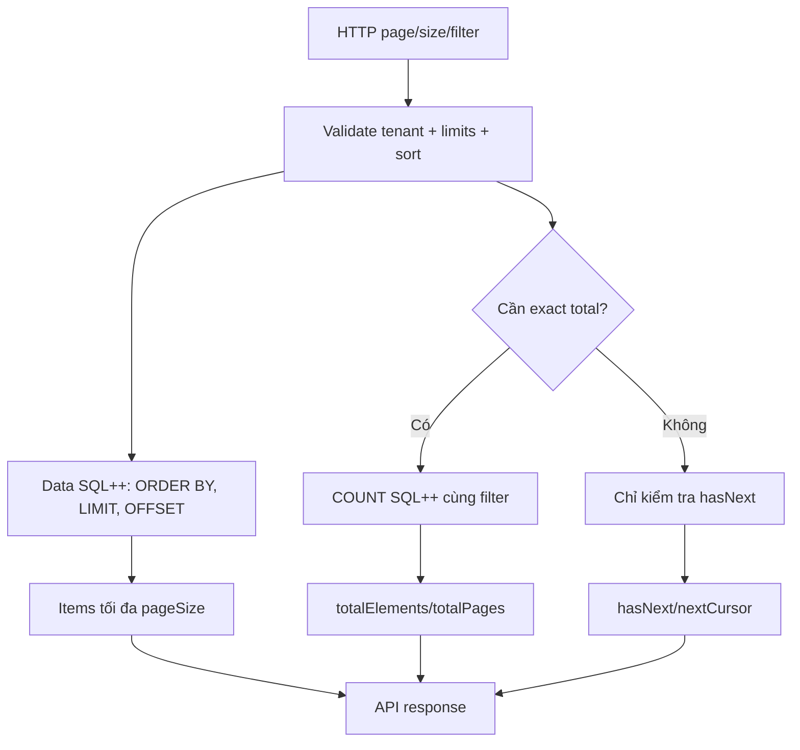
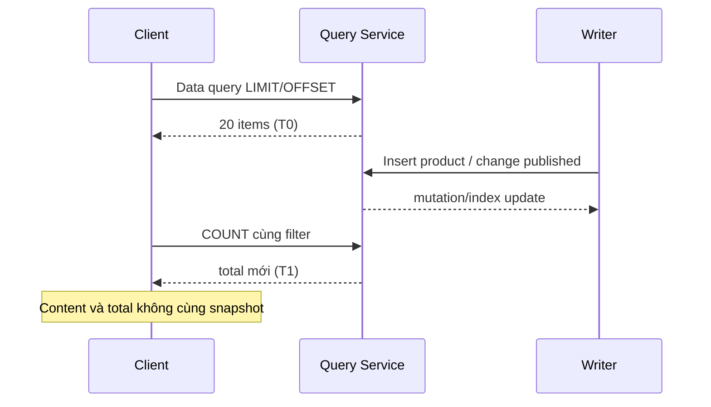

# Kiểm soát kích thước trang và truy vấn đếm tổng

## Mục tiêu học tập

Sau bài học, bạn có thể:

1. Chọn `Page<T>`, `Slice<T>`, `List<T>` với `Pageable` hoặc **cursor/keyset pagination** dựa vào nhu cầu total chính xác, hasNext và điều hướng.
2. Áp dụng giới hạn page size, page depth/offset, sort/filter được phép, tránh cấp quá nhiều memory và làm quá tải SQL++.
3. Hiểu vì sao endpoint trả **20 items** vẫn có thể chậm do `COUNT(*)` hoặc `OFFSET` rất lớn.
4. Sử dụng Spring Data Couchbase repository với `Pageable`, phân biệt query count tự phát sinh và những giới hạn của inline `@Query`.
5. Viết SQL++ có parameter, `LIMIT/OFFSET/ORDER BY`, truy vấn đếm cùng predicate và index phù hợp; dùng `EXPLAIN` kiểm chứng optimizer.
6. Thiết kế sort **ổn định có tie-breaker**, chuyển sang keyset cho trang sâu, xử lý insert/delete khi dữ liệu biến động.
7. Quy định consistency cho page data và count total, bảo vệ tenant/permission trước khi chạy query, không nhầm CAS với pagination snapshot.
8. Đo latency, query count, memory, scan/fetch/sort và viết kiểm thử dữ liệu lớn, biên, phân quyền, concurrency, reactive/backpressure.

**Bối cảnh:** Chương **Hiệu năng** thuộc module `SPRING_DATA_COUCHBASE`: xây dựng tầng truy cập Couchbase bằng document mapping, repository, `CouchbaseTemplate` và truy vấn SQL++; học bucket/scope/collection, index, TTL, CAS, transaction và reactive API. Bài này tập trung vào **chi phí truy xuất tập kết quả** và **metadata phân trang**, không xem một response nhỏ đồng nghĩa query rẻ.

> **Nguyên tắc:** Luôn có giới hạn ở server; chỉ tính **exact total** khi có lý do nghiệp vụ. Nhiều giao diện chỉ cần `hasNext` hoặc `nextCursor`. Tăng page size, count toàn tập và truy cập trang offset rất sâu phải có giới hạn/SLO riêng.

## 1. Tại sao LIMIT nhỏ chưa bảo đảm hiệu năng?

Ví dụ:

```text
GET /api/products?category=keyboards&page=1500&size=20

Data query:
  SELECT ... ORDER BY createdAt DESC LIMIT 20 OFFSET 30000;

Count query:
  SELECT COUNT(1) ... WHERE tenantId=? AND categoryId=?;
```

HTTP response chỉ có tối đa 20 rows nhưng Query Service có thể xử lý rất nhiều index entries để bỏ qua 30.000 rows và/hoặc đếm tất cả document khớp filter. Nếu ORDER BY không khớp index, có thể phát sinh sort/fetch đắt. Nếu giao diện chỉ hiển thị nút **Tải tiếp**, một COUNT toàn bộ có thể là chi phí hoàn toàn không cần.



Ba câu hỏi cần trả lời trước khi chọn contract:

- Người dùng có thật sự cần **tổng số bản ghi** và nhảy đến trang cuối không?
- Có cần nhảy trực tiếp tới trang số 1.500 hay chỉ cần cuộn đến phần kế tiếp?
- Tập dữ liệu có thay đổi giữa các request không? Có chấp nhận item bị trùng hoặc bị bỏ sót sau insert/delete không?

Một yêu cầu “phân trang” không tự động đồng nghĩa “cần `Page<T>` và COUNT”.

## 2. Page, Slice, List và cursor khác nhau ở điều gì?

| Hợp đồng | Metadata | COUNT tổng | Phù hợp |
| --- | --- | --- | --- |
| `Page<T>` + `Pageable` | `items`, `totalElements`, `totalPages`, `hasNext` | **Có thể cần COUNT query bổ sung**; implementation đôi khi suy ra total ở trường hợp đặc biệt | Màn hình quản trị yêu cầu exact total |
| `Slice<T>` + `Pageable` | `items`, `hasNext`, số trang/kích thước | Thường **không cần COUNT**, có thể nạp `size+1` rows | Load-more theo offset |
| `List<T>` + `Pageable` | Chỉ nội dung | Không cần count cho response | Internal listing có paging |
| Cursor/keyset | `items`, `nextCursor`, `hasNext` | Không cần count mặc định | Feed, danh sách lớn, trang sâu |
| Reactive `Flux<T>` giới hạn | Giá trị phát dần | Không tự có total | Pipeline read với backpressure |

Theo tài liệu Spring Data Commons, `Page` thường phải biết tổng bản ghi nên có thể tạo COUNT query; `Slice` chỉ cần biết có trang sau hay không và thường lấy `size + 1` rows. Chi tiết số query phụ thuộc datastore, Spring Data Couchbase version và optimization; **không mặc định mọi Page luôn chạy đúng hai query**.

### 2.1. Hai ví dụ API response

Khi có exact total:

```json
{
  "items": [
    {"sku": "P1001", "title": "Bàn phím cơ", "priceCents": 159900}
  ],
  "page": 0,
  "size": 20,
  "totalElements": 15843,
  "totalPages": 793,
  "hasNext": true
}
```

Khi chỉ cần tải tiếp:

```json
{
  "items": [
    {"sku": "P1001", "title": "Bàn phím cơ", "priceCents": 159900}
  ],
  "hasNext": true,
  "nextCursor": "opaque-token"
}
```

Các giá trị chỉ để minh họa response shape; không phải dữ liệu benchmark. Nếu không tính count, **không** gán `totalElements = items.size()` và xem đó là tổng bản ghi.

### 2.2. Slice không giải quyết deep OFFSET

Cả `Page` và `Slice` dùng `Pageable` có thể vẫn dựa vào `OFFSET`. Slice tiết kiệm chi phí total count, **không** biến offset=30000 thành truy xuất theo cursor. Đối với danh sách dài, cân nhắc keyset sau khi đo.

### 2.3. Cần total chính xác hay “có hơn N kết quả”?

Một giao diện tìm kiếm có thể chấp nhận `1000+ kết quả` thay vì exact count 5.314. Khi đó có thể dùng **bounded lookup** tối đa 1001 rows để xác định vượt ngưỡng, không yêu cầu COUNT toàn bộ. Nhãn phải ghi rõ **xấp xỉ/ngưỡng**, không tạo một đối tượng `Page` chứa fake total.

## 3. Page size và offset: giới hạn tại backend

Tham số do client gửi không đáng tin. `size=500000` hoặc `page=Integer.MAX_VALUE` có thể làm bùng memory, query time, DTO serialization và thời gian phản hồi, ngay cả khi endpoint chỉ là “đọc dữ liệu”.

### 3.1. Một policy minh họa

| Tham số | Giới hạn đề xuất để thử nghiệm | Lý do |
| --- | --- | --- |
| Default size | 20 | Phù hợp UI list |
| Max size | 100 | Giới hạn bytes/DTO và chi phí source |
| Max offset | 10.000 | Ngăn trang sâu bị scan/skip lớn |
| Sort | `newest`, `sku` | Whitelist các query shapes có index |
| Default order | `createdAt DESC, sku ASC` | Có tie-breaker ổn định |
| Count mode | `none` hoặc `exact` | Exact count chỉ khi yêu cầu |
| Timeout | Theo budget request | Không để data + count vượt SLO |
| Export | Endpoint/job riêng có quota | Không dùng `size=100000` thay cơ chế export |

Đây **không phải mặc định** của Spring/Couchbase. Chọn theo QPS, row size, index plan và SLA của dự án.

### 3.2. Code kiểm tra bằng Java

```java
package com.example.catalog.pagination;

import org.springframework.data.domain.PageRequest;
import org.springframework.data.domain.Pageable;
import org.springframework.data.domain.Sort;

public final class PagingPolicy {

    public static final int DEFAULT_SIZE = 20;
    public static final int MAX_SIZE = 100;
    public static final long MAX_OFFSET = 10_000L;

    private static final Sort STABLE_SORT =
            Sort.by(Sort.Order.desc("createdAt"))
                .and(Sort.by(Sort.Order.asc("sku")));

    private PagingPolicy() {}

    public static Pageable validate(int page, int requestedSize) {
        if (page < 0) {
            throw new IllegalArgumentException("page phải >= 0");
        }
        int size = requestedSize <= 0
                ? DEFAULT_SIZE : requestedSize;

        if (size > MAX_SIZE) {
            throw new IllegalArgumentException("size vượt " + MAX_SIZE);
        }

        long offset = Math.multiplyExact((long) page, size);

        if (offset > MAX_OFFSET) {
            throw new IllegalArgumentException(
                    "Trang quá sâu, hãy dùng cursor");
        }

        return PageRequest.of(page, size, STABLE_SORT);
    }
}
```

Code này **mặc định size<=0 về 20**; nếu API contract yêu cầu reject 0/negative, thay điều kiện bằng `IllegalArgumentException` và test. Đừng im lặng clamp một size quá lớn khi SLA cần phản hồi lỗi. Phép nhân được thực hiện với `long` để không overflow theo kiểu `int`; nếu nhận input kiểu `long` từ JSON phải xử lý tràn số/range trước khi convert.

### 3.3. Whitelist sort để tránh SQL++ injection và query plan bất ngờ

Không viết:

```java
// SAI: lấy một SQL expression từ raw request.
String sql = "... ORDER BY " + requestSort;
```

Hãy map code được phê duyệt sang một số sort templates:

```java
public static Sort acceptedSort(String sortBy) {
    return switch (sortBy) {
        case "newest" -> Sort.by(
                Sort.Order.desc("createdAt"),
                Sort.Order.asc("sku"));
        case "sku" -> Sort.by("sku").ascending();
        default -> throw new IllegalArgumentException(
                "Sort không được hỗ trợ");
    };
}
```

Với SQL++ raw, dùng **các string query đã định nghĩa trong code** cho từng ORDER BY. Query parameters thay giá trị `$tenantId`/`$limit` chứ không phải thay identifier, direction hay biểu thức tùy ý.

### 3.4. Quy trình phía server

```text
HTTP input
  ↓
Authentication và tenant từ server security context
  ↓
Validate filter/sort/page/size/maxOffset
  ↓
Authorization, rate limit và query budget
  ↓
Repository / Query Service
  ↓
Mapping DTO, metadata và HTTP status
```

Tenant và permission filter phải xuất hiện **nhất quán** trong data query lẫn count. Không để count lộ số lượng bản ghi của tenant khác, kể cả khi API không trả nội dung.

## 4. Entity nguồn, DTO và sort ổn định

Nguồn ví dụ: `appdata.catalog.products`.

```java
package com.example.catalog;

import org.springframework.data.annotation.Id;
import org.springframework.data.annotation.Version;
import org.springframework.data.couchbase.core.mapping.Collection;
import org.springframework.data.couchbase.core.mapping.Document;
import org.springframework.data.couchbase.core.mapping.Field;
import org.springframework.data.couchbase.core.mapping.Scope;

@Document
@Scope("catalog")
@Collection("products")
public class ProductDocument {

    @Id private String id;
    @Field private String tenantId;
    @Field private String sku;
    @Field private String categoryId;
    @Field private String title;
    @Field private long priceCents;
    @Field private String createdAt;
    @Field private boolean published;
    @Version private Long cas;

    public ProductDocument() {}

    public String getId() { return id; }
    public void setId(String x) { id = x; }

    public String getTenantId() { return tenantId; }
    public void setTenantId(String x) { tenantId = x; }

    public String getSku() { return sku; }
    public void setSku(String x) { sku = x; }

    public String getCategoryId() { return categoryId; }
    public void setCategoryId(String x) { categoryId = x; }

    public String getTitle() { return title; }
    public void setTitle(String x) { title = x; }

    public long getPriceCents() { return priceCents; }
    public void setPriceCents(long x) { priceCents = x; }

    public String getCreatedAt() { return createdAt; }
    public void setCreatedAt(String x) { createdAt = x; }

    public boolean isPublished() { return published; }
    public void setPublished(boolean x) { published = x; }

    public Long getCas() { return cas; }
}
```

DTO chỉ chứa field phục vụ danh sách:

```java
package com.example.catalog;

public record ProductPreview(
        String sku, String title, long priceCents,
        String createdAt) {
}
```

Quy ước:

- `sku` là duy nhất **trong từng tenant** theo business contract. Nếu không, thêm `META(p).id` vào tie-breaker để phân trang có thứ tự duy nhất.
- `createdAt` lưu UTC ISO-8601 cùng định dạng/độ chính xác, ví dụ `2026-11-25T08:30:00.000Z`; không trộn timezone/format. Có thể dùng epoch-millis numeric và index tương ứng nếu phù hợp domain.
- `@Version` sử dụng Couchbase CAS cho optimistic locking nguồn; **CAS không phải** đồng hồ/snapshot cursor tăng đều trên toàn collection.
- `published` phải được filter đúng security/visibility policy; một admin xem draft cần một query riêng nếu khác rule.

Nếu một row có hàng chục trường, hình ảnh hoặc arrays lớn, tránh `SELECT p.*` khi UI chỉ cần SKU/title/price/time. Projection giảm network, decode, memory; cân nhắc covering index dựa trên chi phí thực chứ không index cả payload nhạy cảm.

## 5. Spring Data Couchbase Repository: Page và Slice

```java
package com.example.catalog;

import org.springframework.data.couchbase.repository.CouchbaseRepository;
import org.springframework.data.domain.Page;
import org.springframework.data.domain.Pageable;
import org.springframework.data.domain.Slice;

public interface ProductRepository
        extends CouchbaseRepository<ProductDocument, String> {

    Page<ProductDocument> findPageByTenantIdAndPublishedTrue(
            String tenantId, Pageable pageable);

    Slice<ProductDocument> findSliceByTenantIdAndPublishedTrue(
            String tenantId, Pageable pageable);
}
```

Phần `Page`/`Slice` trong method name nằm giữa `find` và `By`, là phần mô tả; predicate được derive từ `TenantIdAndPublishedTrue`. Cần **integration test với Spring Data Couchbase version được khóa** để xác nhận query và mapping thật.

```java
Pageable request = PagingPolicy.validate(0, 20);

Page<ProductDocument> page =
        repository.findPageByTenantIdAndPublishedTrue(
                authenticatedTenantId, request);

long exactTotal = page.getTotalElements();
int totalPages = page.getTotalPages();

// Đường thay thế nếu chỉ cần "load more":
Slice<ProductDocument> slice =
        repository.findSliceByTenantIdAndPublishedTrue(
                authenticatedTenantId, request);
boolean next = slice.hasNext();
```

**Không gọi cả Page và Slice trong cùng request thật** chỉ để lấy metadata; ví dụ chỉ so sánh API.

### 5.1. Với inline @Query và Pageable, không tự viết ORDER BY/LIMIT/OFFSET

Tài liệu Spring Data Couchbase lưu ý: khi có `Pageable`/`Sort`, inline SQL++ không nên tự chứa `ORDER BY`, `LIMIT`, `OFFSET` vì repository sẽ thêm paging/sorting và câu query có thể bị malformed. Khi cần toàn quyền điều khiển ORDER/LIMIT, dùng SQL++ thủ công không có parameter `Pageable` cùng đường ấy.

### 5.2. Page total không phải một snapshot miễn phí

`Page` có `totalElements/totalPages` nên một COUNT có thể được thực thi thêm nếu không thể suy từ content. Khi data query và count query chạy tại hai thời điểm, writer insert/delete ở giữa có thể làm metadata khác thời điểm với items. `REQUEST_PLUS` giúp query đợi index theo consistency policy, **không tự buộc hai câu SELECT độc lập vào một snapshot atomic**.

### 5.3. Không tạo PageImpl giả total

```java
// SAI khi còn nhiều row khác trong nguồn:
new org.springframework.data.domain.PageImpl<>(
        items, pageable, items.size());
```

`items.size()` chỉ là số phần tử của trang hiện tại. Nếu không tính exact count, trả `SliceImpl<>` hoặc DTO `items+hasNext/cursor`; đừng tự gán total=0 để tránh COUNT rồi gửi như một số chính xác.

### 5.4. Tránh trùng sort giữa Pageable và query

Nếu repository method đã có `Pageable` dùng dynamic sort, không đặt một `ORDER BY` không tương thích trong `@Query`. Nếu chọn derived query có static `OrderByCreatedAtDesc`, cần đảm bảo sort động không phá tie-breaker/semantics. Tốt nhất chỉ có một nguồn quyết định order được kiểm chứng bằng generated SQL++ và EXPLAIN.

## 6. SQL++: tách data query khỏi COUNT

### 6.1. Truy vấn nội dung trang

```sql
SELECT p.sku AS sku,
       p.title AS title,
       p.priceCents AS priceCents,
       p.createdAt AS createdAt
FROM `appdata`.`catalog`.`products` AS p
WHERE p.tenantId = $tenantId
  AND p.published = TRUE
  AND p.categoryId = $categoryId
ORDER BY p.createdAt DESC, p.sku ASC
LIMIT $limit OFFSET $offset;
```

Theo tài liệu SQL++ của Couchbase, OFFSET bỏ qua số rows của kết quả sau sắp xếp, LIMIT quy định số rows tối đa trả. `LIMIT 20` **không** bảo đảm engine chỉ scan 20 index entries; một OFFSET sâu hoặc sort không được index hỗ trợ vẫn có thể đắt.

### 6.2. Truy vấn đếm chính xác phải dùng cùng predicate

```sql
SELECT COUNT(1) AS total
FROM `appdata`.`catalog`.`products` AS p
WHERE p.tenantId = $tenantId
  AND p.published = TRUE
  AND p.categoryId = $categoryId;
```

Tất cả filter của data query phải giữ tương đương ở count: tenant, published, soft-delete, category, search/date range và permission scope. Nếu data chỉ cho xem sản phẩm công khai nhưng count đếm draft hoặc tenant khác, `totalElements` không chỉ sai mà còn có thể lộ metadata.

### 6.3. COUNT có nhiều semantics

| Biểu thức | Ý nghĩa | Nguy cơ |
| --- | --- | --- |
| `COUNT(*)` hoặc `COUNT(1)` | Số rows sau WHERE/JOIN/UNNEST | JOIN có thể nhân một document thành nhiều rows |
| `COUNT(p.someField)` | Đếm rows có biểu thức không NULL/MISSING | Field optional có thể khiến total nhỏ hơn số document |
| `COUNT(DISTINCT p.sku)` | SKU khác nhau | Không nhất thiết là số document nếu SKU trùng |
| `COUNT(DISTINCT META(p).id)` | Document IDs phân biệt | Có thể cần sau JOIN/UNNEST |
| `COUNT(*) GROUP BY categoryId` | Một số đếm **mỗi group** | Không phải một scalar total chung |

COUNT không có GROUP BY thường trả một row `total=0` khi không có sản phẩm. COUNT có GROUP BY có thể trả **không row** khi không có group. API mapping phải xử lý đúng.

### 6.4. Tại sao COUNT vẫn chậm dù kết quả là một số?

Một COUNT phải xử lý tập phù hợp (scan index, aggregate, có thể JOIN/fetch) dù chỉ trả một số. Optimizer có thể pushdown aggregate vào Index Service, nhưng **không mặc nhiên O(1)**. Từng query cần `EXPLAIN` và đo thời gian thật.

```text
Data LIMIT 20: 12 ms
COUNT:         700 ms
Page endpoint: latency bị COUNT chi phối

Các số là ví dụ giả định, không phải số đo production.
```

Nếu giao diện chỉ cần `hasNext`, COUNT đắt như vậy là mục tiêu tối ưu rõ ràng.

## 7. Java SDK: chủ động chạy COUNT khi có yêu cầu

Có thể dùng Spring Data repositories cho CRUD và Couchbase Java SDK Query API để điều khiển SQL++ chi tiết. Lấy `Cluster` từ Spring-managed `CouchbaseClientFactory` thay vì tạo/disconnect cluster ở mỗi request.

### 7.1. Response DTO có total tùy chọn

```java
package com.example.catalog.pagination;

import java.util.List;
import com.example.catalog.ProductPreview;

public record OffsetResult(
        List<ProductPreview> items,
        int page,
        int size,
        boolean hasNext,
        Long totalElements) {
}
```

`totalElements == null` có nghĩa **chưa có total** theo API contract, không phải “0 sản phẩm”. Khi count là bắt buộc, hãy trả lỗi nếu COUNT thất bại, không tự gán `total=items.size()`.

### 7.2. Query adapter trả DTO, hasNext và optional total

```java
package com.example.catalog.pagination;

import java.time.Duration;
import java.util.List;

import com.couchbase.client.java.Cluster;
import com.couchbase.client.java.json.JsonObject;
import com.couchbase.client.java.query.QueryResult;
import com.example.catalog.ProductPreview;
import org.springframework.data.couchbase.core.CouchbaseOperations;
import org.springframework.stereotype.Component;

import static com.couchbase.client.java.query.QueryOptions.queryOptions;

@Component
public class OffsetProductQuery {

    private static final String DATA_SQL = """
        SELECT p.sku AS sku, p.title AS title,
               p.priceCents AS priceCents,
               p.createdAt AS createdAt
        FROM `appdata`.`catalog`.`products` AS p
        WHERE p.tenantId = $tenantId
          AND p.published = TRUE
          AND p.categoryId = $categoryId
        ORDER BY p.createdAt DESC, p.sku ASC
        LIMIT $limit OFFSET $offset
        """;

    private static final String COUNT_SQL = """
        SELECT COUNT(1) AS total
        FROM `appdata`.`catalog`.`products` AS p
        WHERE p.tenantId = $tenantId
          AND p.published = TRUE
          AND p.categoryId = $categoryId
        """;

    private final Cluster cluster;

    public OffsetProductQuery(CouchbaseOperations operations) {
        cluster = operations.getCouchbaseClientFactory()
                .getCluster();
    }

    public OffsetResult fetch(
            String authenticatedTenantId, String categoryId,
            int page, int size, boolean exactCount) {

        var pageable = PagingPolicy.validate(page, size);
        int bound = pageable.getPageSize();

        JsonObject params = JsonObject.create()
                .put("tenantId", authenticatedTenantId)
                .put("categoryId", categoryId)
                .put("limit", bound + 1)
                .put("offset", pageable.getOffset());

        QueryResult data = cluster.query(
                DATA_SQL, queryOptions()
                        .parameters(params)
                        .readonly(true)
                        .timeout(Duration.ofSeconds(2)));

        List<JsonObject> rows = data.rowsAsObject();
        boolean hasNext = rows.size() > bound;

        List<ProductPreview> items = rows.stream()
                .limit(bound)
                .map(row -> new ProductPreview(
                        row.getString("sku"),
                        row.getString("title"),
                        row.getLong("priceCents"),
                        row.getString("createdAt")))
                .toList();

        Long total = null;
        if (exactCount) {
            JsonObject countParams = JsonObject.create()
                    .put("tenantId", authenticatedTenantId)
                    .put("categoryId", categoryId);

            QueryResult count = cluster.query(
                    COUNT_SQL, queryOptions()
                            .parameters(countParams)
                            .readonly(true)
                            .timeout(Duration.ofSeconds(2)));

            List<JsonObject> resultRows = count.rowsAsObject();
            if (resultRows.size() != 1) {
                throw new IllegalStateException(
                        "COUNT không trả đúng một row");
            }
            total = resultRows.get(0).getLong("total");
        }

        return new OffsetResult(
                List.copyOf(items),
                page, bound, hasNext, total);
    }
}
```

Chú ý:

- Mã dùng Java 17+ (text blocks và `Stream.toList()`).
- `authenticatedTenantId` là tenant từ security context đáng tin; caller phải xác thực/authorize **trước** khi gọi adapter. `categoryId` phải được validate theo domain.
- `JsonObject` chứa **named parameter values**; không nối raw tenant/category/sort vào SQL++ string.
- `LIMIT bound+1` dùng để suy `hasNext` rồi trim còn `bound`; không phải COUNT.
- `readonly(true)` không tạo transaction snapshot và không thay thế RBAC/query read permissions.
- `getLong` yêu cầu JSON field phù hợp; với NULL/MISSING, mapper có thể lỗi và cần xử lý theo schema.
- `COUNT` và data query chạy **tách biệt**, có thể thấy source tại hai thời điểm.
- Timeout 2 giây cho từng query không đồng nghĩa toàn endpoint chỉ 2 giây; cần deadline chung và metrics riêng.
- `CouchbaseOperations.getCouchbaseClientFactory().getCluster()` tái sử dụng cluster lifecycle do Spring quản lý.

### 7.3. COUNT timeout có thể degraded không?

| Tình huống | Hành vi |
| --- | --- |
| UI chỉ cần hasNext | Không gọi COUNT |
| Count trả thành công | Trả total theo kết quả query |
| Count optional timeout | Chỉ được trả total=null/countStatus=unavailable nếu contract cho phép |
| Count bắt buộc timeout | Trả lỗi phù hợp, không bịa total |
| Data query timeout | Không trả items=[] như danh sách thực sự rỗng |
| Query thiếu quyền/index lỗi | Không bỏ tenant filter để thử lại một query khác |

Không bắt mọi `RuntimeException` rồi trả 0; nó biến lỗi hạ tầng/bảo mật thành “không có sản phẩm”.

## 8. Index, EXPLAIN và pagination pushdown

Couchbase Query Service có thể áp dụng một số filter/sort/limit/offset sớm ở Index Service khi index và query plan phù hợp. Khi không có pushdown, engine có thể fetch hoặc sort lượng dữ liệu lớn rồi mới phân trang.

### 8.1. Index minh họa cho filter và sort cố định

```sql
CREATE INDEX ix_products_tenant_category_created_sku
ON `appdata`.`catalog`.`products`
    (tenantId, categoryId, createdAt DESC, sku ASC)
WHERE published = TRUE;
```

Đánh giá:

- Equality prefixes `tenantId`, `categoryId` khớp WHERE.
- Partial predicate `published = TRUE` khớp query công khai.
- ORDER BY `createdAt DESC, sku ASC` khớp thứ tự khóa index khi optimizer tận dụng được.
- Projection title/priceCents **chưa nằm trong index**, do đó query có thể phải Fetch.
- Index cho filter/sort khác cần thiết kế riêng; một index không tối ưu mọi query.
- Cần quản lý format/NULL/MISSING của `createdAt` để giữ ordering contract ổn định.

### 8.2. EXPLAIN cả data lẫn COUNT

```sql
EXPLAIN
SELECT p.sku, p.title, p.priceCents, p.createdAt
FROM `appdata`.`catalog`.`products` AS p
WHERE p.tenantId = "tenant-42"
  AND p.categoryId = "keyboards"
  AND p.published = TRUE
ORDER BY p.createdAt DESC, p.sku ASC
LIMIT 21 OFFSET 0;
```

```sql
EXPLAIN
SELECT COUNT(1) AS total
FROM `appdata`.`catalog`.`products` AS p
WHERE p.tenantId = "tenant-42"
  AND p.categoryId = "keyboards"
  AND p.published = TRUE;
```

Literal values ở đây chỉ phục vụ EXPLAIN trong test. Production dùng named parameters.

| Plan/profile | Cần xem |
| --- | --- |
| `IndexScan3`/index name, spans | Index có lọc tenant/category đủ hẹp? |
| `covers` và `Fetch` | Có tránh fetch documents hay không? |
| `Order` | Sort ở Query Service hay tận dụng index order? |
| `Limit/Offset` | Có pushdown/index early pagination? |
| `index_group_aggs` | COUNT có thể được push aggregate xuống index? |
| KV/query scanned/fetched rows | LIMIT nhỏ nhưng scan nhiều? |
| Execution time, CPU, bytes | Bottleneck data hay count? |

JOIN, filter không push đủ, intersect scan hoặc ORDER BY khác index order có thể làm hạn chế pushdown. Đừng khẳng định chỉ cần tạo index là query đã index-only.

### 8.3. COUNT dùng index vẫn không chắc O(1)

Ngay cả khi COUNT được pushdown, Index Service có thể vẫn phải xử lý rất nhiều entries. Không suy từ số bytes trả về thấp mà kết luận query rẻ. So sánh latency COUNT theo cardinality thực, số tenant hot, concurrency và mức scan consistency.

### 8.4. Tập test phải đủ lớn

Test trên 20 documents không thể đại diện cho 1 triệu documents. Cần tối thiểu: tenant lớn/nhỏ, category hot/hiếm, nhiều rows cùng createdAt, soft delete, thay đổi published, missing schema fields, OFFSET gần ngưỡng và concurrency. Đo p95/p99, index scan/fetch và số query, không chỉ elapsed của một lần chạy.

## 9. OFFSET sâu và keyset pagination

### 9.1. OFFSET là vị trí tương đối trong kết quả đang biến động

```sql
SELECT p.sku, p.createdAt
FROM `appdata`.`catalog`.`products` AS p
WHERE p.tenantId = $tenantId
  AND p.categoryId = $categoryId
  AND p.published = TRUE
ORDER BY p.createdAt DESC, p.sku ASC
LIMIT 20 OFFSET 30000;
```

Offset lớn có thể khiến Index/Query Service xử lý nhiều entries rồi mới bỏ qua chúng. Trước khi thêm query hint tối ưu, hãy hỏi **người dùng có thật sự cần nhảy đến trang sâu** hay chỉ “Xem thêm”.

OFFSET còn có rủi ro logic:

```text
Page 1 tại T0:
  A, B, C (LIMIT 3 OFFSET 0)

T1: Một document X mới được insert ở đầu thứ tự.

Page 2 tại T2:
  C, D, E (LIMIT 3 OFFSET 3)

Kết quả: C bị lặp dù ORDER BY xác định.
```

Đây là **dịch vị trí** do tập kết quả thay đổi, không phải lỗi Spring Pageable.

### 9.2. Keyset dùng giá trị cuối cùng làm vị trí tiếp tục

Với sort `createdAt DESC, sku ASC`, giả sử last returned row có:

```text
lastCreatedAt = 2026-11-25T08:30:00.000Z
lastSku       = P1001
```

Trang kế:

```sql
SELECT p.sku AS sku, p.title AS title,
       p.priceCents AS priceCents,
       p.createdAt AS createdAt
FROM `appdata`.`catalog`.`products` AS p
WHERE p.tenantId = $tenantId
  AND p.categoryId = $categoryId
  AND p.published = TRUE
  AND (
      p.createdAt < $lastCreatedAt
      OR (
          p.createdAt = $lastCreatedAt
          AND p.sku > $lastSku
      )
  )
ORDER BY p.createdAt DESC, p.sku ASC
LIMIT $limit;
```

Tại sao so sánh như vậy? Vì createdAt **giảm**, row sau có thời gian **nhỏ hơn**. Khi cùng thời gian, SKU **tăng**, row sau có SKU **lớn hơn**. Nếu đổi sort, phải đổi toán tử/keyset predicate theo. Tất cả sort fields phải có kiểu/format ổn định; NULL/MISSING khiến quy tắc so sánh và thứ tự khó dự đoán.

### 9.3. Trang đầu nên có query template riêng

Trang đầu:

```sql
SELECT p.sku, p.title, p.priceCents, p.createdAt
FROM `appdata`.`catalog`.`products` AS p
WHERE p.tenantId = $tenantId
  AND p.categoryId = $categoryId
  AND p.published = TRUE
ORDER BY p.createdAt DESC, p.sku ASC
LIMIT $limit;
```

Trang sau dùng query có predicate từ cursor như 9.2. Không nhất thiết nhồi hai cases vào một `OR $hasCursor = FALSE` vì có thể khiến index spans khó tối ưu. Luôn `EXPLAIN` cả hai variants trên dataset phù hợp.

### 9.4. Ví dụ tie-breaker

```text
R1: createdAt=10:00:00.000Z, sku=A
R2: createdAt=10:00:00.000Z, sku=B
R3: createdAt=09:59:59.000Z, sku=C
R4: createdAt=09:59:59.000Z, sku=D

Page1 size 2: R1, R2
Cursor: (10:00:00.000Z, B)
Page2: R3, R4
```

Nếu chỉ sort theo createdAt, R1/R2 cùng timestamp có thể bị tráo thứ tự giữa queries; không có điều kiện cursor xác định để loại hai row đã đọc. Nếu `sku` không duy nhất trong tenant, dùng document ID bất biến `META(p).id` làm tie-breaker (và thiết kế index/order tương ứng).

### 9.5. Keyset không phải snapshot bất biến

| Khía cạnh | OFFSET | Keyset |
| --- | --- | --- |
| Truy cập trang số 1500 trực tiếp | Có | Không thuận tiện, thường phải duyệt cursor |
| Chi phí khi trang sâu | Có thể tăng theo offset | Có thể thấp hơn nếu index seek tốt |
| Insert ở đầu | Có thể dịch vị trí và lặp row | Ít ảnh hưởng hơn nếu sort key bất biến |
| Update sort field | Có thể lặp/bỏ item | **Vẫn có thể** lặp/bỏ item nếu item chuyển vị trí |
| Exact total | Tính riêng khi cần | Tính riêng khi cần |
| Index hỗ trợ | Quan trọng | Rất quan trọng cho predicate seek |
| Tenant/filter | Phải áp mọi query | Phải gắn đúng trong cursor và query |

Nếu business cần một snapshot bất biến qua nhiều requests, keyset không tự tạo snapshot. Cần định nghĩa một tập ID/snapshot token/watermark với contract về mutation, retention và consistency; đánh giá chi phí riêng.

## 10. Cursor token: vị trí trong truy vấn, không phải quyền truy cập

### 10.1. Payload logic của cursor

```json
{
  "version": 1,
  "tenant": "tenant-42",
  "category": "keyboards",
  "sort": "createdAt:desc,sku:asc",
  "lastCreatedAt": "2026-11-25T08:30:00.000Z",
  "lastSku": "P1001",
  "pageSize": 20,
  "expiresAt": "2026-11-25T09:00:00.000Z"
}
```

Payload ở trên là ví dụ học tập. **Không** dùng JSON/base64 chưa ký làm token đáng tin. Có thể dùng HMAC signature (với key rotation và constant-time verification) hoặc lưu cursor state phía server với ID ngẫu nhiên có TTL. Nếu token chứa dữ liệu nhạy cảm, ký không che giấu nội dung; cần mã hóa hoặc tối thiểu hóa.

### 10.2. Validator phải kiểm tra gì?

1. Token version đúng, signature hợp lệ, chưa hết hạn, giới hạn độ dài/encoding.
2. `tenant` trùng tenant đã xác thực từ **server security context**.
3. Category/filter/sort/schema version của cursor trùng request đang tiếp tục.
4. `pageSize` trong giới hạn; không cho sửa size tùy ý giữa các trang nếu contract không hỗ trợ.
5. `lastCreatedAt` đúng timezone/precision và `lastSku` theo SKU canonicalization.
6. Sort tie-breaker thỏa uniqueness assumption.
7. Các giá trị cursor chỉ được truyền vào **named parameters**, không ghép thành SQL++ text.
8. Token invalid/expired phải được xử lý theo HTTP 400/401/403 hay yêu cầu bắt đầu lại đúng security policy, không chạy query không filter.

Cursor **không** là chứng nhận quyền: nếu client sửa tenant trong token mà server dùng tenant đó trực tiếp, pagination có thể trở thành đường đọc chéo tenant.

### 10.3. DTO cursor trong Java

```java
package com.example.catalog.pagination;

import java.time.Instant;

public record ProductCursor(
        int version,
        String tenant,
        String category,
        String sort,
        String lastCreatedAt,
        String lastSku,
        int pageSize,
        Instant expiresAt) {
}
```

Đây chỉ là **model nội bộ**. Chưa có HMAC/expiry validation, key rotation, upper bound token bytes hoặc serializer. Đừng cho phép user sửa những trường này không qua kiểm tra chữ ký.

### 10.4. Cách tạo nextCursor không bỏ mất một row

Khi query `LIMIT size+1`:

1. Nhận tối đa `size+1` rows.
2. Nếu số row lớn hơn size → `hasNext=true`.
3. Trả **chỉ size row đầu**.
4. Next cursor lấy từ **row cuối cùng được trả**, không phải row lookahead thứ `size+1`.
5. Nếu `hasNext=false`, trả `nextCursor=null`.
6. Nếu không có row, `hasNext=false` và cursor thường null.
7. Không tạo cursor từ value do caller tự khai báo thay vì row do source thực sự trả.

### 10.5. Khi UI đổi filter/sort

Một cursor cho `category=keyboards`, `sort=newest` không được dùng lại cho `category=mice` hoặc `sort=price-asc`. Nếu người dùng đổi filter, bắt đầu **một pagination session mới** từ đầu, hoặc trả lỗi yêu cầu reset cursor.

## 11. Slice và lookahead: cách biết hasNext mà không COUNT

Có thể xây một `Slice<ProductPreview>` thủ công nếu bạn đã có rows theo `size+1`:

```java
package com.example.catalog.pagination;

import java.util.List;
import org.springframework.data.domain.Slice;
import org.springframework.data.domain.SliceImpl;

import com.example.catalog.ProductPreview;

public final class SliceFactory {

    private SliceFactory() {}

    public static Slice<ProductPreview> fromLookahead(
            List<ProductPreview> loaded,
            int page, int size) {

        if (size <= 0 || size > PagingPolicy.MAX_SIZE) {
            throw new IllegalArgumentException("size không hợp lệ");
        }

        // Gìn giữ giới hạn offset và sort metadata như API boundary.
        var pageable = PagingPolicy.validate(page, size);

        boolean hasNext = loaded.size() > size;

        List<ProductPreview> content = loaded.subList(
                0, Math.min(size, loaded.size()));

        return new SliceImpl<>(
                List.copyOf(content),
                pageable,
                hasNext);
    }
}
```

**Điều kiện:** Caller phải đưa vào `loaded` kết quả **đã giới hạn tối đa size+1** từ nguồn, với sort/filter xác định. Không load toàn bộ tập rồi cắt trong Java vì như vậy đã mất lợi ích phân trang. Helper kiểm tra lại page/offset bằng `PagingPolicy.validate`, nhưng vẫn cần validate filter/tenant và áp `LIMIT` tại query boundary.

### 11.1. Một câu query có thể phục vụ hasNext

```sql
SELECT p.sku, p.title, p.priceCents, p.createdAt
FROM `appdata`.`catalog`.`products` AS p
WHERE p.tenantId = $tenantId
  AND p.categoryId = $categoryId
  AND p.published = TRUE
ORDER BY p.createdAt DESC, p.sku ASC
LIMIT $sizePlusOne OFFSET $offset;
```

Trả tối đa `size` rows, dùng row thêm để suy `hasNext`. Không chạy COUNT chỉ vì API đang phải trả nút Next.

### 11.2. Một test khó dễ bỏ qua: đúng size không nói hết trang

Ví dụ size=20, QueryResult trả đúng **20** rows:

- Nếu bạn chỉ query LIMIT 20, bạn **không biết chắc** có row 21 hay không.
- Nếu query LIMIT 21 nhưng chỉ nhận 20, có thể kết luận không có row thứ 21 trong tập được quan sát của query đó.
- Nếu query LIMIT 21 nhận 21, có next; trim còn 20.

Không dùng công thức `hasNext = (items.size() == size)` khi chỉ tải đúng size: với trang cuối có đúng size items, nó báo next sai.

## 12. Không luôn cần exact COUNT: những chiến lược thay thế

### 12.1. Count on demand

Giao diện chỉ tải 20 rows và nút Next, trong khi người dùng có thể nhấn “Xem tổng chính xác” để kích hoạt COUNT riêng. Khi COUNT quá chậm, API trả trạng thái đang tính/failure phù hợp, không chặn danh sách ban đầu.

Phù hợp cho màn hình quản trị có thỉnh thoảng cần số tổng, không nhất thiết mỗi lần filter/scroll đều chạy count.

### 12.2. Bounded count và nhãn “N+”

Nếu UI chỉ cần hiển thị `1000+`, có thể nạp tối đa 1001 IDs/rows theo cùng filter:

```sql
SELECT RAW META(p).id
FROM `appdata`.`catalog`.`products` AS p
WHERE p.tenantId = $tenantId
  AND p.categoryId = $categoryId
  AND p.published = TRUE
LIMIT 1001;
```

Khi nhận 1001 rows thì có thể trả "1000+"; khi nhận ít hơn thì biết số hiện tại của tập query đó (nếu query đã thực thi đầy đủ và không lỗi). Đây không phải exact COUNT của mọi trường hợp; vẫn cần index/fetch policy và capacity. Không dùng nó để làm giả `Page.totalElements`.

### 12.3. Một counter/summary riêng

Một service có thể duy trì aggregate như `publishedCountByCategory` để đọc nhanh thay vì COUNT toàn bộ. Nhưng counter phải xử lý create/delete/publish/unpublish, chuyển category cũ/mới, retries, duplicates, CAS/transaction hoặc event ordering và reconciliation. Nếu cập nhật eventual, API phải ghi `countStatus=estimated`/timestamp, **không** công bố exact như dữ liệu giao dịch.

### 12.4. Cache COUNT theo filter

Nếu count đắt nhưng tương đối ổn định, cache kết quả theo **tenant + filter + visibility + schema version**, TTL ngắn và invalidation khi mutation liên quan. Rủi ro:

- Cached total có thể stale trong khi data page đã mới.
- Key cardinality bùng nổ với filter tùy ý.
- Cache stampede khi hot count hết TTL.
- Invalidation tất cả query-count keys của một mutation có thể khó.
- Nếu cache và source đều trên Couchbase, một cache hit vẫn tốn KV; đo lợi ích thật.

Không dùng cache COUNT như authority cho quota, thanh toán hay quyền truy cập khi cần số chính xác theo transaction.

### 12.5. Total approximate phải được gắn nhãn rõ

Một response có thể thiết kế:

```json
{
  "items": [],
  "hasNext": false,
  "count": {
    "value": 1000,
    "status": "at_least",
    "label": "1000+"
  }
}
```

Hoặc bỏ hoàn toàn count field khi không yêu cầu. Không đặt `value=1000` và `status=exact` nếu đã chặn count tại 1001 rows.

## 13. Dữ liệu biến động và consistency của hai queries

### 13.1. Data và COUNT có thể phản ánh hai thời điểm



Ngay cả khi cả hai câu query thành công, `totalElements` và content có thể khác thời điểm, nhất là lúc dữ liệu thay đổi hoặc index có độ trễ.

### 13.2. Scan consistency trong Couchbase SQL++

Mặc định Query Service có thể dùng consistency như `NOT_BOUNDED`, ưu tiên độ trễ và có thể chưa thấy mutation mới trong index. `REQUEST_PLUS` yêu cầu query chờ index theo kịp những mutation liên quan đến thời điểm query theo contract SDK. Ví dụ:

```java
import com.couchbase.client.java.query.QueryScanConsistency;

var result = cluster.query(
        sql,
        queryOptions()
                .parameters(params)
                .scanConsistency(
                        QueryScanConsistency.REQUEST_PLUS));
```

**Không kết hợp** `scanConsistency(REQUEST_PLUS)` và `consistentWith(MutationState)` trong cùng QueryOptions; chúng là các chế độ loại trừ nhau theo SDK. Khi chỉ cần read-your-own-write cụ thể, cân nhắc mutation-state/AT_PLUS nếu workflow hỗ trợ.

`REQUEST_PLUS` có thể làm query chậm hơn vì chờ index. Nó **không tạo một snapshot atomic cho hai câu COUNT + DATA** chạy độc lập.

### 13.3. Spring Transaction và CAS cũng có phạm vi riêng

- `@Version`/CAS trên ProductDocument phát hiện update dựa vào phiên bản cũ; **không khóa** kết quả phân trang.
- Couchbase Transactions có context, API và giới hạn theo version; không giả định hai lệnh `cluster.query` raw đứng cạnh nhau tự nằm trong một Spring transaction.
- Nếu một báo cáo bắt buộc là snapshot nhất quán, thiết kế snapshot/report riêng và transaction/query-consistency contract theo tài liệu thực tế, thay vì tin Page tự atomic.
- Với UI danh sách đọc thông thường, có thể chấp nhận total mang tính nhất thời, nhưng cần nêu rõ ở API/SLA.

### 13.4. Sort key thay đổi làm keyset dịch vị trí

Keyset tránh tác động của **insert trước cursor** trong nhiều tình huống, nhưng nếu product đổi `createdAt`/sort key hoặc thay visibility, nó có thể chuyển từ sau cursor lên trước (hoặc ngược lại), tạo skip/duplicate. Cách giảm rủi ro:

- Sắp xếp theo key bất biến nếu product semantics cho phép.
- Có watermark/filter phù hợp khi cần (ví dụ chỉ nhận createdAt <= snapshotTime), nhưng watermark đơn thuần không ngăn update của các row cũ.
- Khi cần full snapshot mạnh, xây snapshot IDs/server-side state với expiry và size budget.
- Test insert/delete/update giữa các page requests; không chỉ duyệt trên dataset tĩnh.

## 14. Reactive/streaming: không dùng backpressure thay cho LIMIT

Module này còn có `ReactiveCouchbaseOperations`, reactive repositories và Couchbase Java SDK Reactive API. Chúng giúp không block thread và xử lý rows theo dòng, **không tự giới hạn số rows mà Query Service được yêu cầu trả**.

### 14.1. Query phải giới hạn ở server trước

Một pattern dùng SDK reactive:

```java
package com.example.catalog.pagination;

import java.time.Duration;

import com.couchbase.client.java.ReactiveCluster;
import com.couchbase.client.java.json.JsonObject;
import com.example.catalog.ProductPreview;
import org.springframework.data.couchbase.core.CouchbaseOperations;
import org.springframework.stereotype.Component;
import reactor.core.publisher.Mono;

import static com.couchbase.client.java.query.QueryOptions.queryOptions;

@Component
public class ReactiveOffsetProductQuery {

    private static final String SQL = """
        SELECT p.sku AS sku, p.title AS title,
               p.priceCents AS priceCents,
               p.createdAt AS createdAt
        FROM `appdata`.`catalog`.`products` AS p
        WHERE p.tenantId = $tenantId
          AND p.categoryId = $categoryId
          AND p.published = TRUE
        ORDER BY p.createdAt DESC, p.sku ASC
        LIMIT $limit OFFSET $offset
        """;

    private final ReactiveCluster reactive;

    public ReactiveOffsetProductQuery(
            CouchbaseOperations operations) {
        this.reactive = operations
                .getCouchbaseClientFactory()
                .getCluster()
                .reactive();
    }

    public Mono<org.springframework.data.domain.Slice<ProductPreview>> fetch(
            String authenticatedTenant,
            String categoryId,
            int page, int size) {

        var pageable = PagingPolicy.validate(page, size);
        int bound = pageable.getPageSize();

        return Mono.defer(() -> {
            JsonObject params = JsonObject.create()
                    .put("tenantId", authenticatedTenant)
                    .put("categoryId", categoryId)
                    .put("limit", bound + 1)
                    .put("offset", pageable.getOffset());

            return reactive.query(SQL,
                    queryOptions()
                            .parameters(params)
                            .readonly(true)
                            .timeout(Duration.ofSeconds(2)));
        })
        .flatMapMany(result -> result.rowsAsObject())
        .map(row -> new ProductPreview(
                row.getString("sku"),
                row.getString("title"),
                row.getLong("priceCents"),
                row.getString("createdAt")))
        .take(bound + 1L)
        .collectList()
        .map(items -> SliceFactory.fromLookahead(
                items, page, bound));
    }
}
```

**Điều kiện:**

- Server query đã có `LIMIT bound+1`; `Flux.take(bound+1)` ở phía client chỉ là lớp bảo vệ phụ, **không** thay thế LIMIT.
- `Mono.defer` tạo `QueryOptions/JsonObject` mới mỗi subscribe; Javadoc SDK nhấn mạnh QueryOptions không thread-safe để chia sẻ mutably giữa concurrent calls.
- `ReactiveQueryResult.rowsAsObject()` phát `Flux<JsonObject>`; method được xác minh trong Java SDK API. Query vẫn phải có timeout/deadline và resource policy.
- Không gọi `block()` hoặc blocking JDBC/SDK từ WebFlux event loop.
- Authentication/authorization và validation category/filter phải ở boundary trước khi gọi fetch; một cursor/tenant không được coi là đã được cấp quyền chỉ vì nó có trong publisher.
- Những result rows đã được ánh xạ theo một query; không gộp count bằng `Flux.count()` trên toàn bộ kết quả **không giới hạn** rồi coi như tối ưu.

### 14.2. Flux.count() không miễn phí

`Flux.count()` đếm số phần tử phát ra từ stream. Nếu nguồn query trả toàn bộ 1 triệu products, nó phải tiêu thụ những rows đó (hoặc lượng công việc tương đương) mới đếm xong. Với exact count, `SELECT COUNT(1) ...` có index optimization thường hợp lý hơn việc stream mọi document qua mạng rồi đếm trong Java.

### 14.3. Bounded concurrency cho nhiều page requests

Ngay cả khi một query chỉ trả 20 rows, 2.000 concurrent requests vẫn có thể tạo QPS lớn. Dùng rate limiting, timeout, connection budget, circuit breaker hoặc bulkhead theo SLO; tránh vô hạn concurrent COUNT queries vì user cuộn nhanh. Backpressure giúp publisher/consumer nhưng không xóa chi phí server scan/order.

## 15. Chi phí memory, network, dữ liệu nguồn và export

### 15.1. Ước lượng áp lực memory theo số row

Một ước tính thô:

\[
M_{\mathrm{raw}}\approx N_{\mathrm{concurrent}} \times
N_{\mathrm{rows}} \times B_{\mathrm{row}}
\]

Trong đó `B_row` là bytes trung bình mỗi row JSON, chưa tính overhead Java object/list, Jackson decoder, query buffers, HTTP serialization.

Ví dụ:

```text
500 requests đồng thời
x 100 rows / request
x 2 KiB JSON / row
≈ 97.7 MiB raw row payload

Thực tế heap có thể lớn hơn đáng kể vì DTO/list/buffer.
```

Vì vậy `MAX_SIZE=100` vẫn phải được đo trên row lớn nhất; nếu chứa image/base64/array thì giới hạn bằng **bytes response** và projection schema cũng quan trọng.

### 15.2. Không đọc tất cả rồi subList trong Java

```java
// SAI: repository.findAll() có thể nạp cả collection lớn.
var all = repository.findAll();
var page = all.subList(from, to);
```

Nếu API cần 20 rows, phải áp dụng paging/limit **ngay tại query**. `LIMIT` sau khi đã kéo một triệu rows lên JVM không còn giúp giảm network/server load.

### 15.3. Export là một workload khác

Nếu user muốn xuất 2 triệu rows, không tăng `size` lên 2 triệu. Thiết kế batch/stream riêng:

- Cursor/keyset hoặc chunked scans phù hợp, có resume token/checkpoint.
- Backpressure và giới hạn bytes/memory/disk, concurrency, timeout.
- Thời hạn dataset snapshot/consistency rõ, xử lý item bị mutate trong lúc export.
- Tách worker/queue và rate limit để không phá SLO API thông thường.
- RBAC, PII filtering và audit cho xuất dữ liệu.

### 15.4. Cảnh báo query fan-out

Một API yêu cầu đồng thời 20 categories với Page/COUNT riêng có thể tạo **40 SQL++ queries**, chưa tính retries. Nếu frontend bắn song song nhiều requests, p99 Query Service có thể suy giảm mạnh. Tối ưu query hợp lệ, precompute aggregates hoặc batch/filter hợp lý thay vì chỉ giảm số rows trả.

## 16. Quan sát chi phí paging/count bằng metrics

Hit ratio của cache không phải trọng tâm bài này; hãy đo **data query và COUNT query riêng**.

### 16.1. Những metric đáng có

| Metric đề xuất | Phạm vi | Lý do |
| --- | --- | --- |
| `catalog_page_request_total{mode,outcome}` | Page/Slice/cursor | Biết traffic mix |
| `catalog_page_size_requested` | Histogram | Xem client hay yêu cầu size tối đa |
| `catalog_page_offset_requested` | Histogram | Phát hiện deep offsets |
| `catalog_sqlpp_query_seconds{kind=data|count}` | p50/p95/p99 | So data vs COUNT |
| `catalog_sqlpp_error_total{kind,reason}` | Errors | Timeout/index/RBAC/decoder |
| `catalog_sqlpp_rows_returned{kind}` | Histogram | Phát hiện unbounded result |
| `catalog_exact_count_requested_total` | Counter | COUNT có thật sự cần không |
| `catalog_cursor_invalid_total{reason}` | Counter | Token sai/hết hạn/tampered |
| `catalog_page_consistency_mode_total` | Counter | NOT_BOUNDED/REQUEST_PLUS |
| `catalog_page_duplicate_observed_total` | Test/sample | Dữ liệu dịch vị trí |
| `catalog_page_response_bytes` | Histogram | Payload thực |
| `catalog_query_index_scan_rows` | Query profile/SDK | Query dùng index có hiệu quả? |

Các tên là **đề xuất custom instrumentation**; Spring Data Couchbase không tự tạo tất cả. Dùng Micrometer, tracing và Couchbase Query Service metrics. Không gắn raw tenant, SKU, SQL parameters, cursor token hay user ID làm metric label vì cardinality và bảo mật.

### 16.2. Ví dụ Timer cho data/count

```java
import io.micrometer.core.instrument.MeterRegistry;
import io.micrometer.core.instrument.Timer;

// Mỗi lần gọi một SQL++ statement:
Timer.Sample sample = Timer.start(meterRegistry);

try {
    // cluster.query(sql, queryOptions().parameters(...))
} finally {
    sample.stop(meterRegistry.timer(
            "catalog.sqlpp.query",
            "kind", "count"));
}
```

Mã là snippet instrument trong service, không phải một method độc lập. Dùng tag `kind=data|count`, không tạo tên timer khác nhau theo raw SQL string. Khi dùng reactive query, timer phải stop lúc publisher **hoàn tất/error**, không phải lúc `Mono` được tạo.

### 16.3. Tách count tail latency khỏi data latency

Nếu data query có p95=30ms nhưng count p95=1.2s, chuyển sang Slice có thể giảm đáng kể latency API. Ngược lại nếu data query deep offset 1.2s còn count 20ms, bỏ count không xử lý bottleneck chính — cần keyset/index.

Không lấy **trung bình các p95 theo pod** làm p95 tổng thể; phải thu histogram/distribution phù hợp và aggregate đúng.

### 16.4. Query Profile và EXPLAIN có trách nhiệm khác nhau

- `EXPLAIN`: mô tả plan optimizer chọn trước khi chạy.
- Query Profile: cung cấp các operator/elapsed/rows thực tế (tùy cấu hình).
- SDK query metrics: thời gian/rows/errors của request theo API hỗ trợ.
- Micrometer: cảm nhận của service và end-to-end latency từ góc caller.

Kết hợp chúng để biết đắt do index scan, fetch, sort, count, network, serialization hay authorization/wait. Không bật verbose profiling cho mọi query production nếu nó tăng overhead/ghi lộ dữ liệu; dùng sampling/diagnostic có kiểm soát.

## 17. Unit tests: kiểm tra giới hạn và hasNext trước khi dùng Couchbase

### 17.1. Kiểm thử policy chặn page nguy hiểm

```java
package com.example.catalog.pagination;

import static org.assertj.core.api.Assertions.*;

import org.junit.jupiter.api.Test;

class PagingPolicyTest {

    @Test
    void appliesDefaultSizeAndStableSort() {
        var p = PagingPolicy.validate(0, 0);

        assertThat(p.getPageSize()).isEqualTo(20);
        assertThat(p.getOffset()).isEqualTo(0L);
        assertThat(p.getSort().isSorted()).isTrue();
    }

    @Test
    void allowsUpperSizeBound() {
        var p = PagingPolicy.validate(0, 100);
        assertThat(p.getPageSize()).isEqualTo(100);
    }

    @Test
    void rejectsInvalidPageAndOversizedRequests() {
        assertThatThrownBy(() -> PagingPolicy.validate(-1, 20))
                .isInstanceOf(IllegalArgumentException.class);

        assertThatThrownBy(() -> PagingPolicy.validate(0, 101))
                .isInstanceOf(IllegalArgumentException.class);

        // OFFSET 501*20 = 10020 > MAX_OFFSET
        assertThatThrownBy(() -> PagingPolicy.validate(501, 20))
                .isInstanceOf(IllegalArgumentException.class);
    }
}
```

Một API khác có policy reject `size=0` thì test phải phản ánh contract đó. Không viết unit test mà giả định Spring tự giới hạn size theo một số cố định: `PageRequest.of(page,size)` không biết business max size của bạn.

### 17.2. Test size+1 để xác định hasNext

```java
package com.example.catalog.pagination;

import static org.assertj.core.api.Assertions.*;

import java.util.ArrayList;
import java.util.List;

import com.example.catalog.ProductPreview;
import org.junit.jupiter.api.Test;

class SliceFactoryTest {

    private ProductPreview row(int i) {
        return new ProductPreview(
                "P" + i, "Product " + i, 1000L, "2026-11-25T00:00:00.000Z");
    }

    @Test
    void extraRowMeansHasNextButDoesNotLeak() {
        List<ProductPreview> loaded = new ArrayList<>();
        for (int i = 0; i < 21; i++) {
            loaded.add(row(i));
        }

        var slice = SliceFactory.fromLookahead(loaded, 0, 20);

        assertThat(slice.hasNext()).isTrue();
        assertThat(slice.getContent()).hasSize(20);
        assertThat(slice.getContent().get(19).sku())
                .isEqualTo("P19");
    }

    @Test
    void exactSizeWithoutLookaheadIsLastPage() {
        List<ProductPreview> loaded = new ArrayList<>();
        for (int i = 0; i < 20; i++) {
            loaded.add(row(i));
        }

        var slice = SliceFactory.fromLookahead(loaded, 0, 20);

        assertThat(slice.hasNext()).isFalse();
    }

    @Test
    void emptyResultIsLastPage() {
        var slice = SliceFactory.fromLookahead(List.of(), 0, 20);

        assertThat(slice.getContent()).isEmpty();
        assertThat(slice.hasNext()).isFalse();
    }
}
```

**Lưu ý test:** `exactSizeWithoutLookaheadIsLastPage` chỉ đúng vì contract của `SliceFactory.fromLookahead` là caller đã **query LIMIT size+1** và nhận đúng 20 rows. Nếu query thực chỉ LIMIT 20, không đủ bằng chứng kết luận hasNext=false. Đây là lý do phải integration test cả SQL++ statement, không chỉ DTO transformation.

### 17.3. Test keyset comparator theo thứ tự hỗn hợp

Với sort `createdAt DESC, sku ASC`, xác minh:

```text
A: 2026-11-25T10:00:00.000Z, sku=A
B: 2026-11-25T10:00:00.000Z, sku=B
C: 2026-11-25T09:59:59.000Z, sku=C

Cursor sau B => chỉ C thuộc trang tiếp.
Cursor sau A => B và C thuộc trang tiếp.
```

Test comparator Java đối chiếu với SQL++ ORDER BY/collation bằng integration test; không tự giả định locale-aware Java Collator và raw byte collation của SQL++ cho chuỗi Unicode phức tạp cho kết quả giống nhau. SKU ASCII canonical thường đơn giản hơn.

### 17.4. Test cursor tampered/expired/khác tenant

Với adapter cursor đã ký:

- Sửa một byte bất kỳ → signature invalid.
- Token tenant A dùng ở caller B → bị từ chối.
- Token category A dùng cho category B → bị từ chối.
- Token đã quá expiresAt → phải reset.
- Token có lastCreatedAt sai format → không tạo query.
- Token được ký bằng key đã rotate → xử lý theo key rotation policy.
- Token không có lastSku/tie-breaker → từ chối.
- Không log raw token vào metrics hoặc exception message.

Đây là unit/security contract tests, không đòi đọc dữ liệu thật để phát hiện token sai.

## 18. Integration tests: Page/COUNT và dữ liệu đang đổi trên Couchbase thật

Unit test không đủ bảo đảm optimizer, index, scan consistency hoặc Spring Data repository thực sự chạy COUNT khi nào. Dùng Couchbase **test cluster**, collection và secondary index giống cấu trúc production; mọi test data phải có tenant riêng và cleanup.

### 18.1. Ma trận trường hợp bắt buộc

| Trường hợp | Kiểm chứng |
| --- | --- |
| Không có document khớp | Content rỗng; Page total=0; Slice hasNext=false |
| Có 1–19 rows, size=20 | Một trang, không có next |
| Có đúng 20 rows, size=20 | Không có next; lookahead chỉ trả 20 |
| Có 21 rows, size=20 | Trang đầu 20 rows, hasNext=true; trang sau 1 row |
| Có 40 rows, size=20 | Trang 0 có next, trang 1 không có next |
| Hai tenant cùng SKU/category | Data lẫn COUNT đều chỉ thấy tenant được cấp quyền |
| Published=false | Không xuất hiện trong data và không tăng total của public query |
| Category khác | Không xuất hiện và không tăng count |
| Query có JOIN/UNNEST | COUNT phải tính số row nghiệp vụ, không bị nhân bản |
| Nhiều createdAt bằng nhau | Sort vẫn xác định nhờ SKU/ID tie-breaker |
| Trang page vượt maxOffset | Bị reject trước khi gọi Query Service |
| size vượt maxSize | Bị reject hoặc clamp theo contract rõ |
| Count mode=none | Không phát SQL++ COUNT; response không gắn exact total |
| Count mode=exact | Có COUNT và total khớp filter trong dataset ổn định |
| Insert/delete trong lúc phân trang | Đo duplicate/skip theo offset, keyset |
| Đổi createdAt/category/published | Hiểu dịch vị trí và count thay đổi |
| Query index chưa cập nhật | So NOT_BOUNDED với REQUEST_PLUS; không nhầm rỗng thành no-document |
| COUNT timeout | Không trả total giả; metrics/error theo contract |
| SQL++ decode lỗi | Không thay bằng items=[] hoặc total=0 |
| Sort/filter không hợp lệ | Chặn trước query, không có SQL injection |
| Cursor bị sửa/khác tenant | Bị từ chối trước query |
| Rollout DTO v1/v2 | Type mapping giữ đúng field, cursor version được kiểm soát |

### 18.2. Một test COUNT/data nhất quán trên dữ liệu đã ổn định

Dùng SDK query trên một fixture đã được seed, đảm bảo đúng index và consistency. Ví dụ JUnit với 3 sản phẩm published cùng category và 1 draft:

```java
package com.example.catalog.pagination;

import static org.assertj.core.api.Assertions.assertThat;
import static com.couchbase.client.java.query.QueryOptions.queryOptions;

import com.couchbase.client.java.Cluster;
import com.couchbase.client.java.json.JsonObject;
import com.couchbase.client.java.query.QueryScanConsistency;
import org.junit.jupiter.api.Test;
import org.springframework.beans.factory.annotation.Autowired;
import org.springframework.boot.test.context.SpringBootTest;
import org.springframework.data.couchbase.core.CouchbaseOperations;

@SpringBootTest
class PagingCountIntegrationTest {

    @Autowired CouchbaseOperations operations;

    @Test
    void countUsesTheSameTenantAndVisibilityFilter() {
        // Fixture trong test collection:
        // tenant=it-tenant, category=keyboards:
        // 3 published products + 1 draft product.
        // Seed trước test, dọn sau test.

        Cluster cluster = operations
                .getCouchbaseClientFactory().getCluster();

        String sql = """
            SELECT COUNT(1) AS total
            FROM `appdata`.`catalog`.`products` AS p
            WHERE p.tenantId = $tenantId
              AND p.categoryId = $categoryId
              AND p.published = TRUE
            """;

        var options = queryOptions()
                .parameters(JsonObject.create()
                    .put("tenantId", "it-tenant")
                    .put("categoryId", "keyboards"))
                .scanConsistency(
                    QueryScanConsistency.REQUEST_PLUS)
                .readonly(true);

        var result = cluster.query(sql, options).rowsAsObject();

        assertThat(result).hasSize(1);
        assertThat(result.get(0).getLong("total"))
                .isEqualTo(3L);
    }
}
```

**Điều kiện để test thực sự có nghĩa:** Fixture phải được tạo/seed bởi setup được ủy quyền, đúng collection/index và tenant dùng riêng. Snippet không tự tạo fixture; nếu chạy trên collection chứa product ngoài test có cùng tenant, expected 3 sẽ không đúng. Không để test tự xóa dữ liệu thật trên production. `REQUEST_PLUS` giúp Query Service chờ index, nhưng không biến một cuộc chạy hai query cách nhau thành snapshot.

### 18.3. Test Page/Slice của repository bằng đo số SQL++ statements

Đừng chỉ assert `page.getTotalElements()==40` rồi mặc định đã chứng minh số query. Cần bật query logging/tracing hoặc instrument Query Service (giới hạn môi trường test), sau đó đo:

1. `repository.findPageBy…(Pageable)` phát bao nhiêu SQL++ queries?
2. `repository.findSliceBy…(Pageable)` phát bao nhiêu?
3. Với page đầu thiếu items, Spring Data có tránh COUNT bằng inference không?
4. Với page đầy items và hasNext, COUNT có bị kích hoạt không?
5. Query generated có thêm ORDER/LIMIT/OFFSET như expected không?
6. Count query do repository tạo có giữ tenant/visibility/predicate không?
7. Có khác biệt sau nâng Spring Data Couchbase version không?

Những hành vi cụ thể này phụ thuộc version và repository implementation. **Đo trên version thật**, không suy từ Spring Data Commons contract rằng số query luôn cố định.

### 18.4. Kiểm thử pagination nhiều trang khi dữ liệu động

Kịch bản:

```text
T0: Seed 50 products, createdAt hợp lệ.
T1: Client lấy page 0 (size 20), ghi lại IDs.
T2: Writer insert một product mới ở đầu sort.
T3: Client lấy page 1 bằng OFFSET.
T4: Kiểm tra có ID nào trùng với page 0.

Lặp kịch bản với keyset cursor.
Sau đó thử update createdAt và delete một item cũ.
```

Không thiết kế test “keyset luôn không duplicate” cho mọi mutation vì update sort key có thể dịch item qua cursor. Test phải có acceptance policy: sort bất biến hay không, snapshot yêu cầu đến đâu và trường hợp nào chấp nhận sự thay đổi.

### 18.5. Kiểm thử nguồn có Index lag

Khi insert một document bằng KV rồi query SQL++ với default consistency, row có thể chưa hiển thị ở index ngay. Một test dùng `REQUEST_PLUS` nên thấy mutation sau khi index theo kịp, đổi lại latency cao hơn. Đừng viết test phụ thuộc `Thread.sleep(100)` rồi khẳng định index phải cập nhật; dùng consistency contract hoặc polling có deadline, trace errors/timeouts.

## 19. Benchmark, tải đồng thời và ngân sách truy vấn

### 19.1. Bảng biến thể cần so sánh

| Biến thể | Cái gì thay đổi | Metric cần so |
| --- | --- | --- |
| Page size 20, exact count | Baseline | Data p95/p99, count p95/p99, API p99 |
| Slice size 20 | Bỏ exact count | Giảm QPS COUNT và latency |
| Size 100 | Payload lớn hơn | Network bytes/response, heap/GC |
| OFFSET 0/100/1000/10000 | Tăng độ sâu | Index entries scanned, elapsed |
| Keyset sau cursor | Seek theo sort tuple | Query plan/latency theo độ sâu |
| Index không cover | Cần Fetch | Data Service KV fetch, Query Service CPU |
| Covering index phù hợp | Ít Fetch hơn | Index memory/write cost, query latency |
| COUNT với/không aggregate pushdown | Thay index/plan | Count latency/index scan |
| REQUEST_PLUS | Tăng scan consistency | Wait/timeout/độ mới |
| 10, 100, 500 concurrent clients | Tăng tải | QPS/query queue/errors/p99 |
| Có mutation trong lúc phân trang | Data không tĩnh | Duplicate/skip/total drift |
| Cache count TTL ngắn | Giảm COUNT reads | Stale count, invalidation complexity |

### 19.2. Quy trình benchmark công bằng

1. Chọn dataset có phân bố giống sản phẩm thật: tenant hot/cold, category lớn/nhỏ, tỷ lệ published, sort key ties, row bytes.
2. Xác minh index đã ở trạng thái online và plan ổn định; ghi lại index DDL và `EXPLAIN`.
3. Benchmark **data query** và **count query** riêng, rồi endpoint tổng.
4. Warmup trước khi đo; ghi nhận cache/index cold start nếu nó là một use case cần thiết.
5. So sánh cùng QPS, cùng query parameters và cùng scan consistency; không so query `NOT_BOUNDED` với `REQUEST_PLUS` rồi kết luận sai về optimizer.
6. Tăng offset và page size theo ma trận; ghi Query Profile/scanned rows/p95/p99.
7. Đo heap/network và số lượng concurrent queries; không chỉ nhìn số rows response.
8. Chạy mutation nhẹ trong lúc phân trang để xác định stale/duplicate semantics.
9. Đưa lỗi/timeout vào workload có kiểm soát để kiểm tra count optional/degraded mode.
10. Ghi lại kết quả và giới hạn chấp nhận; nếu không đạt, thay index/contract, không chỉ tăng timeout.

### 19.3. Đặt ngân sách độ trễ riêng cho COUNT

Nếu endpoint p99 mục tiêu là 300ms, và data p99 đã 220ms, cho count riêng timeout 2 giây là mâu thuẫn với SLO. Cần một trong các quyết định:

- Không chạy COUNT trên đường latency-critical.
- Đếm bất đồng bộ ở endpoint riêng.
- Trả count ước lượng/ngưỡng có nhãn rõ.
- Tối ưu count index/aggregate.
- Chỉ exact count cho truy vấn đã được phê duyệt với query budget khác.

Không trả dữ liệu chậm 3 giây chỉ để hiện “Có 15843 sản phẩm” nếu người dùng thực sự chỉ cần xem 20 sản phẩm và tải tiếp.

### 19.4. Một số mục tiêu chẩn đoán hữu ích

- `pageSize_requested` thường chạm max? Xem lại UI/batch clients.
- `maxOffset_rejected_total` tăng? Có người dùng cố truy cập trang sâu hoặc crawler.
- `count_query_total / data_query_total` quá cao? Endpoint đang count mỗi request.
- `COUNT p99 >> DATA p99`? Bỏ count/đổi index/đếm theo yêu cầu.
- `IndexScan items >> returned items`? Pagination pushdown/predicate/order có vấn đề.
- `SQL++ errors after deploy`? Query inline với Pageable sinh ORDER/LIMIT trùng, hoặc index/type thay đổi.
- `page duplicate ID alerts`? Dataset biến động hoặc thiếu tie-breaker.
- `query plan changed`? Index mới/optimizer stats hoặc dependency upgrade.

## 20. Những lỗi thường gặp và cách sửa

| Sai lầm | Hậu quả | Cách xử lý |
| --- | --- | --- |
| Dùng `Page` cho mọi list | COUNT không cần thiết | Slice/List/cursor khi chỉ cần hasNext |
| Không giới hạn size | Heap/network/SQL++ quá tải | Server-side max page size và bytes budget |
| `page*size` tính bằng int | Overflow, offset âm/sai | Dùng long + range/overflow guard |
| Không giới hạn page depth | Deep OFFSET chậm | Max offset, cursor/keyset |
| ORDER BY thiếu tie-breaker | Không xác định thứ tự với equal sort keys | Thêm unique ID/SKU bất biến |
| Sort field do client nối thẳng vào SQL | Injection/expensive expression | Whitelist query templates |
| COUNT bỏ tenant/visibility filter | Sai total/rò metadata | Shared predicate specification và tests |
| COUNT trong query JOIN bị nhân rows | Total lớn sai | COUNT DISTINCT theo document business |
| Dùng `items.size()` làm total | Metadata sai | Exact count hoặc bỏ total |
| Có 20 rows liền coi hasNext=true | Sai khi trang cuối đúng 20 | Query LIMIT 21 và trim |
| `SELECT p.*` cho list DTO nhỏ | Payload/GC cao | Projection fields cần thiết |
| Không EXPLAIN COUNT | Không biết COUNT là bottleneck | Đo count riêng, index/aggregate |
| Giả định `REQUEST_PLUS` là snapshot cho hai query | Metadata/content lệch thời điểm | Contract consistency/snapshot riêng |
| Keyset không ký cursor | Tampering/tenant leak | HMAC/server-side token + auth |
| Cursor thiếu filter/sort schema | Trộn kết quả các query | Bind cursor với tenant/filter/sort/version |
| Dùng CAS để so thứ tự cursor | CAS không phải sequence toàn collection | Domain sort key và tie-breaker rõ |
| `Flux.count()` sau query không giới hạn | Kéo cả dataset về JVM | COUNT SQL++ hoặc bounded policy |
| Cache count vô hạn | Stale/invalidation/key explosion | TTL/size/correctness policy |
| Benchmark trên vài chục rows | Kết luận index sai quy mô | Dataset và concurrency đại diện |

### 20.1. Checklist production

- [ ] API có size default/max, max offset, rate limiting và query timeout hợp lý.
- [ ] Có whitelist sort/filter, tenant/permission từ security context đáng tin.
- [ ] Sort kết thúc bằng tie-breaker duy nhất và có format/type ổn định.
- [ ] Page chỉ dùng khi exact total cần thật; Slice/cursor được chọn có chủ đích.
- [ ] Data query và COUNT có cùng predicate/visibility và test tenant isolation.
- [ ] Không dùng `PageImpl(items, pageable, items.size())` khi tổng chưa tính.
- [ ] COUNT JOIN/UNNEST áp đúng đơn vị business, dùng DISTINCT khi cần.
- [ ] EXPLAIN/Query Profile cho cả data và count, có index phù hợp.
- [ ] Deep page được reject hoặc chuyển sang cursor với query templates rõ.
- [ ] Cursor được ký/lưu server, hết hạn, gắn tenant/filter/sort/version và validate.
- [ ] Không gắn raw cursor/SKU/tenant làm metric label hoặc log nhạy cảm.
- [ ] Count optional/approximate có contract/status rõ, không giả là exact.
- [ ] Consistency `NOT_BOUNDED`/`REQUEST_PLUS` được chọn theo SLA.
- [ ] Có test insert/delete/update giữa pages, duplicates/skip và total drift.
- [ ] Reactive query cũng có LIMIT tại server, không block event loop.
- [ ] Memory/bytes budget, concurrent query count và p95/p99 đã benchmark.
- [ ] Exact count thất bại không biến thành total=0 hoặc items=[].
- [ ] Có runbook cho COUNT p99 cao, deep OFFSET và query plan regression.

## 21. Bài thực hành và tự kiểm tra

### 21.1. Bài thực hành

Chuẩn bị Couchbase test cluster với `appdata.catalog.products`, index tương ứng và dữ liệu trong nhiều tenant; không chạy fault injection hoặc scan/export tải lớn trên production.

1. **Hợp đồng:** Vẽ sự khác nhau giữa Page, Slice, List và cursor khi UI chỉ có nút Load More.
2. **Size policy:** Dùng `PagingPolicy.validate`; test page -1, size 0, size 101, page có offset vượt 10.000.
3. **Overflow:** Viết test cho phép nhân `page*size` và xử lý input long quá lớn mà không truncation.
4. **Source DTO:** Tạo ProductDocument có tenant/category/published/createdAt; projection ProductPreview chỉ lấy field UI cần.
5. **Repository:** So sánh Page và Slice trên cùng data; đếm số SQL++ queries từ logs/tracing.
6. **Count filter:** Seed sản phẩm published/draft và hai tenant; exact count phải đúng tenant, visibility, category.
7. **Empty edge:** Kiểm tra dataset 0, 1, 20, 21 và 40 rows với size 20.
8. **Slice lookahead:** Trả LIMIT 21 rồi trim về 20, kiểm tra hasNext ở tất cả biên.
9. **Trang cuối đủ size:** Chứng minh `items.size()==size` không đủ để suy ra next khi chỉ query LIMIT size.
10. **Inline query:** Thử một `@Query` có Pageable và ORDER BY tự viết trong test riêng; sửa bằng bỏ clause hoặc chuyển sang raw SQL++.
11. **SQL++:** Viết data query có ORDER BY/LIMIT/OFFSET, named parameters; reject raw sort text.
12. **COUNT:** Viết count query đúng filter, đo p50/p95/p99 riêng so với data query.
13. **JOIN/UNNEST:** Tạo trường hợp một document nhân nhiều rows; so `COUNT(*)` với `COUNT(DISTINCT META(p).id)`.
14. **Index:** Tạo secondary index cho tenant/category/createdAt/sku; EXPLAIN filter/order/pushdown.
15. **Covering:** Thêm projection phù hợp vào index trong test, so Fetch/network với chi phí index.
16. **Deep offset:** Benchmark offset 0/100/1000/10000, ghi scanned rows và latency.
17. **Keyset:** Thực hiện hai trang theo createdAt DESC, sku ASC; dùng tuple cuối làm cursor.
18. **Tie-breaker:** Có 100 products cùng timestamp; xác minh không trùng/bỏ trong dataset tĩnh.
19. **Signed cursor:** Thử tamper, expired, khác tenant, đổi sort/filter; không query khi token invalid.
20. **Insert while paging:** Insert một product đầu sort giữa page 1/2; so duplicate của OFFSET/keyset.
21. **Move sort key:** Update createdAt giữa các trang, mô tả giới hạn keyset và lựa chọn snapshot.
22. **Count optional:** Tắt count khi chỉ dùng Load More; verify không có SQL++ COUNT.
23. **Bounded count:** Trả “1000+” khi sample 1001 rows, không quảng cáo exact total.
24. **Cached count:** Dùng TTL ngắn; update published/category và xem stale count cùng invalidation.
25. **Consistency:** So NOT_BOUNDED và REQUEST_PLUS sau mutation KV, đo wait/error/độ mới.
26. **Reactive:** Dùng ReactiveCluster với LIMIT size+1 và rowsAsObject; không `block()` trong WebFlux.
27. **Fault injection:** Count timeout khi data thành công, kiểm tra degraded mode/error contract.
28. **Concurrency:** 100 clients liên tiếp/đồng thời yêu cầu Page và Slice; so source QPS, memory và p99.
29. **Multi-tenant security:** Cùng SKU ở hai tenant, mọi count/data/cursor phải cô lập đúng.
30. **Performance review:** Lập bảng quyết định Page/Slice/cursor/approx count cho ba use cases thật.

### 21.2. Câu hỏi tự kiểm tra

1. Vì sao LIMIT 20 không đồng nghĩa query chỉ phải scan 20 rows?
2. `Page<T>` và `Slice<T>` khác nhau thế nào về metadata và COUNT?
3. Khi nào `List<T>` với Pageable đủ cho một internal API?
4. Vì sao `PageImpl(items, pageable, items.size())` thường sai khi có nhiều trang?
5. Cần kiểm tra những ràng buộc nào trước khi tạo `PageRequest`?
6. Tại sao `page * size` nên tính bằng long thay vì int?
7. Vì sao cần whitelist sort, không nối tên field raw vào SQL++?
8. Một sort theo createdAt có đủ ổn định không nếu nhiều rows có timestamp bằng nhau?
9. Tại sao COUNT phải giữ tenant/visibility filter y như data query?
10. `COUNT(*)` khác `COUNT(p.field)` và `COUNT(DISTINCT META(p).id)`?
11. Vì sao có index mà COUNT vẫn có thể đắt?
12. Hãy phân biệt covering index, pagination pushdown và early pagination.
13. Deep OFFSET có nhược điểm về performance lẫn logic khi insert/delete ra sao?
14. Với sort createdAt DESC, sku ASC, toán tử keyset sau cursor phải là gì?
15. Vì sao nextCursor phải lấy từ row cuối được trả, không phải lookahead row?
16. Base64-encoded cursor có ngăn client sửa tenant/filter không?
17. Khi nào cần exact total, bounded count hoặc “1000+”?
18. Vì sao count cached có thể sai dù data page đã mới?
19. REQUEST_PLUS bảo đảm điều gì và không bảo đảm điều gì cho hai query riêng?
20. CAS của ProductDocument có tạo snapshot phân trang không?
21. Vì sao Flux.count trên query unbounded không phải tối ưu?
22. Cần đo metric nào để xác định COUNT chậm hơn data query?
23. Nếu data p99=100ms nhưng COUNT p99=1.5s, bạn chọn đổi API ra sao?
24. Một API chỉ hiển thị Load More có cần biết totalPages không?

## Tài liệu tham khảo chính thức

- [Spring Data Couchbase — Query Methods: Paging, Sorting, Slice và Page](https://docs.spring.io/spring-data/couchbase/reference/repositories/query-methods-details.html).
- [Spring Data Couchbase — Couchbase Repositories và các lưu ý inline query/Pageable](https://docs.spring.io/spring-data/couchbase/reference/couchbase/repository.html).
- [Spring Data Couchbase — CouchbaseOperations Javadoc](https://docs.spring.io/spring-data/couchbase/reference/api/java/org/springframework/data/couchbase/core/CouchbaseOperations.html).
- [Spring Data Commons — Defining Query Methods: Page, Slice, List, Limit](https://docs.spring.io/spring-data/commons/reference/repositories/query-methods-details.html).
- [Spring Data Commons — Pageable Javadoc](https://docs.spring.io/spring-data/commons/docs/current/api/org/springframework/data/domain/Pageable.html).
- [Spring Data Commons — SliceImpl Javadoc](https://docs.spring.io/spring-data/commons/docs/current/api/org/springframework/data/domain/SliceImpl.html).
- [Couchbase SQL++ — LIMIT clause](https://docs.couchbase.com/server/current/n1ql/n1ql-language-reference/limit.html).
- [Couchbase SQL++ — OFFSET clause](https://docs.couchbase.com/server/current/n1ql/n1ql-language-reference/offset.html).
- [Couchbase SQL++ — ORDER BY clause](https://docs.couchbase.com/server/current/n1ql/n1ql-language-reference/orderby.html).
- [Couchbase Index Pushdowns — Pagination và Aggregation](https://docs.couchbase.com/server/current/indexes/index_pushdowns.html).
- [Couchbase — Early Filters, Order and Pagination](https://docs.couchbase.com/server/current/indexes/early-filters-and-pagination.html).
- [Couchbase Java SDK — QueryOptions Javadoc](https://docs.couchbase.com/sdk-api/couchbase-java-client/com/couchbase/client/java/query/QueryOptions.html).
- [Couchbase Java SDK — QueryResult Javadoc](https://docs.couchbase.com/sdk-api/couchbase-java-client/com/couchbase/client/java/query/QueryResult.html).
- [Couchbase Java SDK — ReactiveQueryResult Javadoc](https://docs.couchbase.com/sdk-api/couchbase-java-client/com/couchbase/client/java/query/ReactiveQueryResult.html).
- [Couchbase Java SDK — SQL++ Queries and Scan Consistency](https://docs.couchbase.com/java-sdk/current/howtos/n1ql-queries-with-sdk.html).

> **Giới hạn và phạm vi:** Các ví dụ dựa trên Spring Data Couchbase/Spring Data Commons và Couchbase Java SDK hiện đại. Query derivation, Page COUNT optimization, index pushdown, cách decoder đọc number fields, SQL++ scan consistency và reactive APIs có thể khác theo version của dự án. Cần kiểm tra dependency/Javadoc được khóa và chạy integration/benchmark trên cluster đại diện trước production. Đây là bài Knowledge **STEP 4** đã được biên soạn; chưa chạy Gradle, Content QA **STEP 6** hoặc kiểm thử hiệu năng thực tế trong phạm vi worker.
