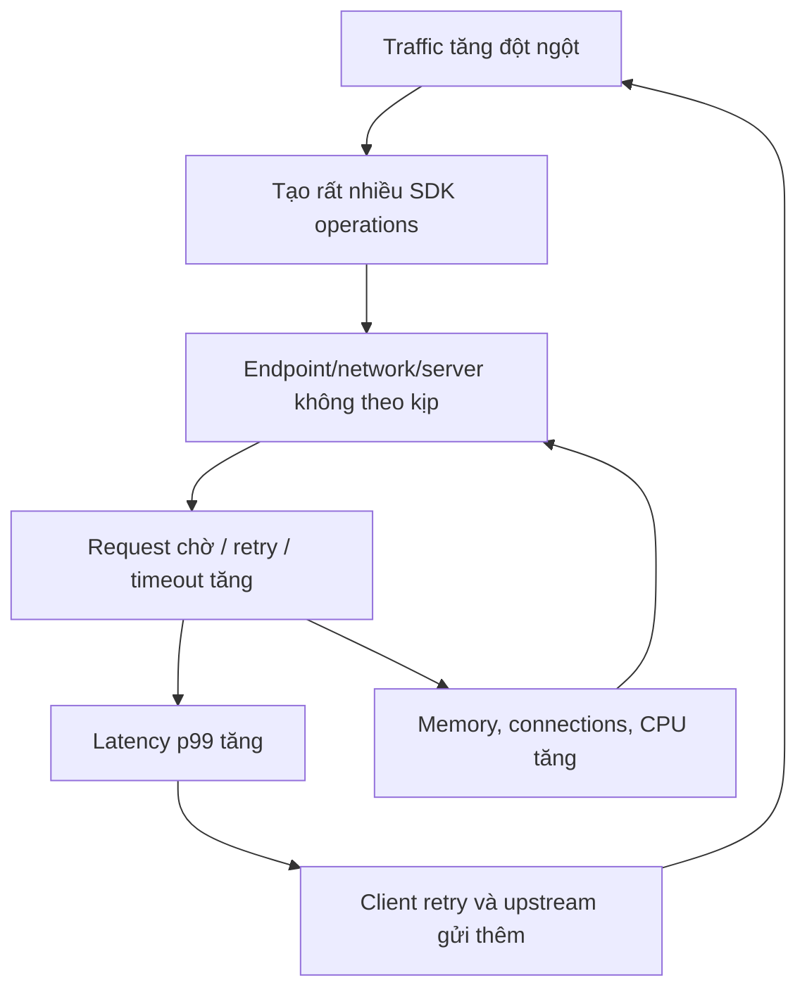

# Giới hạn đồng thời và tránh làm đầy hàng đợi SDK

## Mục tiêu học tập

Hoàn thành bài này, bạn có thể:

1. Phân biệt **số request đến**, **tác vụ đang thực thi**, **request chờ ở ứng dụng**, **request SDK chưa được dispatch**, **request đã dispatch** và **hàng đợi phía Couchbase Server**; không nhầm các tầng hàng đợi.
2. Dùng nguyên lý Little's Law và dữ liệu đo tải để lập **ngân sách concurrency**, deadline, queue capacity và giới hạn theo loại KV/SQL++/transaction, theo instance và toàn cụm.
3. Triển khai **admission control**/bulkhead với `Semaphore`, `ThreadPoolExecutor` và `RejectedExecutionException` ở đường blocking, release permit chắc chắn khi success/error.
4. Giới hạn số SDK operations đang chạy với `CompletableFuture` và API reactive của Spring Data Couchbase/Couchbase Java SDK mà **không block event loop**.
5. Kiểm soát Reactor `flatMap(..., concurrency, prefetch)`, demand/backpressure, batch size, memory, timeout, cancellation và phương án trả kết quả khi quá tải.
6. Không giải quyết backlog bằng retry không giới hạn, tăng connection pool mù hoặc kéo dài timeout; phân biệt `AmbiguousTimeoutException` với `UnambiguousTimeoutException` cho mutation.
7. Theo dõi latency, active permits, rejection, waiter time, retry, SDK threshold/orphan logs, network/Query Service, và chứng minh tính ổn định bằng load/fault tests.
8. Chọn policy phù hợp cho nhiều tenant, nhiều pod, read-after-write, cache stampede, SQL++ count, transaction và khả năng hoạt động sau lỗi.

**Bối cảnh:** Module `SPRING_DATA_COUCHBASE` xây dựng tầng truy cập Couchbase bằng Spring Data với document mapping, repository, `CouchbaseTemplate` và SQL++; học thiết kế bucket/scope/collection, chỉ mục, TTL, CAS, giao dịch, hiệu năng, nhất quán và reactive API. Trong chương **Hiệu năng**, mục tiêu của bài là giới hạn **lượng công việc đang đồng thời tranh tài nguyên** trước khi nó bùng thành backlog SDK/Query Service, chứ không chỉ làm cho một request riêng lẻ nhanh hơn.

> **Nguyên tắc vận hành:** Khi đạt ngưỡng tải, **từ chối sớm hoặc chờ có giới hạn** thường tốt hơn nhận vô hạn request rồi để chúng đồng loạt timeout. Giới hạn nên dựa vào **capacity có đo đạc**, kèm deadline, metrics và cách phục hồi; không có một số permit mặc định dùng tốt cho mọi cluster.

## 1. Một request đi qua những hàng đợi nào?

Giả sử ứng dụng có endpoint lấy thông tin sản phẩm từ Couchbase KV:

```text
HTTP incoming request
  |
  +-- Web server accept/connection queue
  |
  +-- Security + argument validation
  |
  +-- Application admission / bulkhead   <--- Chủ động điều khiển tại đây
  |
  +-- Spring Data repository / CouchbaseTemplate / SDK API
  |
  +-- SDK operation orchestration, retry và pre-dispatch
  |
  +-- SDK KV endpoint / Query HTTP connection
  |
  +-- Network -> Couchbase Data / Query / Index Service
  |
  +-- Response, mapping DTO, trả permit và HTTP response
```

Cùng một request có thể phải chờ **nhiều hàng đợi liên tiếp**. Hàng đợi web server, semaphore của ứng dụng, executor queue, SDK internal pending requests và Query Service server queue **không phải một hàng đợi duy nhất**. Mỗi tầng có giới hạn và metric riêng.

### 1.1. Sơ đồ khi không có giới hạn tải ở ứng dụng



Vòng phản hồi này có thể làm **timeout trở thành hậu quả của overload**, không phải nguyên nhân ban đầu. Nếu chỉ đổi timeout từ 2 giây thành 20 giây, bạn có thể giữ thêm nhiều request trong hệ thống lâu hơn và làm đỉnh memory/queue nghiêm trọng hơn.

### 1.2. Những thuật ngữ cần phân biệt

| Thuật ngữ | Ý nghĩa | Điều không được mặc định |
| --- | --- | --- |
| Admission control | Quyết định nhận/từ chối công việc trước khi chiếm tài nguyên đắt | Không bảo đảm server luôn nhanh |
| In-flight | Operation đang thực thi/chờ kết quả trong một phạm vi đo | Không luôn bằng số TCP connections |
| Queue depth | Số công việc đang chờ ở **một hàng đợi xác định** | Không suy từ CPU hoặc thread count |
| Bulkhead | Tách ngân sách tài nguyên theo workload/phụ thuộc | Không thay idempotency/transaction |
| Rate limit | Giới hạn tốc độ nhận công việc theo thời gian | Không trực tiếp giới hạn số đang chạy |
| Semaphore | Giới hạn đồng thời nhờ permit | Không tự có hàng đợi bền vững hoặc QoS |
| Circuit breaker | Tạm ngừng gọi dependency đang lỗi/quá chậm | Không tự bảo đảm kết quả nghiệp vụ |
| Backpressure | Consumer báo mức demand để upstream không phát vô hạn | Không giới hạn toàn bộ workload nếu có nhiều subscriptions |
| SDK retry | Thử lại request theo các retry reasons phù hợp | Không nên cộng thêm app retry vô hạn |
| Orphaned response | SDK nhận response khi caller không còn chờ (thường timeout/cancel) | Không nhất thiết là request bị server bỏ qua |
| Cache stampede | Nhiều concurrent miss cùng load một key | Không giải quyết chỉ bằng tăng connections |

### 1.3. Tách concurrency khỏi throughput

- **Concurrency**: tại một thời điểm có bao nhiêu request đang làm việc/chờ kết quả.
- **Throughput**: mỗi giây hoàn thành bao nhiêu request.
- **Latency**: mỗi request trải qua bao lâu.

Tăng concurrency có thể tăng throughput lúc còn capacity; sau điểm bão hòa, nó thường làm queue/latency tăng nhưng throughput không tăng đáng kể. Tìm **điểm bão hòa bằng đo tải**, không tăng permits theo cảm giác.

## 2. Lập ngân sách concurrency bằng Little's Law

Trong một hệ thống tương đối ổn định, ước lượng:

\[
L \approx \lambda W
\]

Trong đó:

- \(L\): lượng công việc trung bình đồng thời nằm trong phạm vi hệ thống đang xét.
- \(\lambda\): throughput hoàn tất trung bình (requests/giây).
- \(W\): thời gian trung bình mỗi request nằm trong phạm vi ấy (giây).

Ví dụ một instance đạt 400 KV reads/giây, với latency trung bình của **đoạn SDK load** 0,025 giây:

\[
L \approx 400 \times 0{,}025 = 10
\]

Tức trung bình xấp xỉ 10 operations KV đang thực hiện. **Không** suy ra cứ đặt semaphore=10 là tối ưu: p95/p99, retries, burst, connection health, multi-tenancy và hiệu năng nguồn còn phải được kiểm chứng.

### 2.1. Khi dependency chậm hơn, số in-flight sẽ tăng

Giữ QPS=400 nhưng KV latency tăng từ 25ms lên 250ms:

\[
L \approx 400 \times 0{,}25 = 100
\]

Nếu application tiếp tục nhận tải vô hạn, số request pending tăng nhanh. Một **bounded permit budget** biến vấn đề thành chờ ngắn/từ chối có kiểm soát trước khi SDK và server bị đẩy đến điểm nguy hiểm.

### 2.2. Đừng ghép nhầm trung bình và p99

Little's Law dùng **giá trị trung bình của cùng hệ thống trong trạng thái ổn định**. Không thay \(W\) bằng p99 rồi tuyên bố đây là công thức dự đoán chính xác concurrency. Có thể dùng p95/p99 và load test làm **biên kiểm tra SLO**, nhưng permit count cần được chỉnh theo measured throughput/latency/queueing và failure behavior.

### 2.3. Ngân sách theo instance và toàn deployment

Ví dụ:

```text
App replicas                  = 8 pod
KV read limit per pod         = 32 concurrent operations
SQL++ expensive-query limit   = 4 concurrent operations/pod

Upper bound ứng dụng (giả sử workload thuần):
  KV:    8 x 32 = 256 concurrent
  SQL++: 8 x 4  = 32 concurrent
```

Đây là **upper bound của những đường có dùng limiter**, không phải giới hạn thực của Couchbase cluster. Nếu có job khác, nhiều ứng dụng hoặc SDK raw call không qua limiter, tổng công việc tại cluster có thể cao hơn nhiều. Autoscaling từ 8 lên 40 pod có thể tăng ngân sách toàn cụm gấp 5 lần nếu mỗi pod giữ cùng một số permit.

### 2.4. Đặt budget theo loại thao tác

| Workload | Ví dụ | Vì sao nên tách? |
| --- | --- | --- |
| KV read nhẹ | `repository.findById`, `CouchbaseTemplate.findById` | Latency thấp, QPS cao |
| KV write có durability/CAS | `save`, `replaceById` | Tốn nguồn ghi và cần tránh retry mù |
| SQL++ search/filter | `findByQuery` / raw `cluster.query` | Query Service, Index Service và scan cost |
| SQL++ COUNT/aggregate | `COUNT(1)`, `GROUP BY` | Có thể cần scan lớn, tốn CPU |
| Multi-document transaction | Cập nhật nhiều documents + audit | Lifetime/timeout và xung đột khác KV read |
| Cache miss load | Nạp aggregate sau `@Cacheable` miss | Có stampede; cần single-flight cùng key |
| Batch import | Hàng nghìn upserts | Có thể lấn traffic online nếu chung budget |

Không nên để 200 COUNT requests chiếm hết ngân sách khiến một trang cần 1 KV GET cũng bị chậm tương tự. Dùng **bulkhead per-workload**, timeout/QPS theo priority và đường công việc của từng service.

## 3. Spring Data và Java SDK có các cách gọi khác nhau

Cùng một `ProductRepository` có thể làm việc với Couchbase SDK theo blocking hoặc reactive, nhưng cơ chế tạo công việc khác nhau:

| API | Dạng gọi | Rủi ro nếu không giới hạn |
| --- | --- | --- |
| `CouchbaseRepository.findById(id)` | Blocking caller thread | Nhiều servlet threads kẹt chờ SDK |
| `CouchbaseTemplate.findById(...)` | Blocking | Kết hợp mapper/SDK; request nhiều tạo queue |
| `cluster.query(...)` | Blocking Query API | COUNT/aggregate có thể kéo dài và chiếm Query Service |
| `collection.async().get(id)` | `CompletableFuture<GetResult>` | Tạo hàng nghìn futures/SDK ops rất nhanh |
| `collection.reactive().get(id)` | `Mono<GetResult>` | Nhiều subscriptions có thể bắn rất nhiều ops |
| `Flux.flatMap(...)` | Nhiều async subscriptions | Concurrency mặc định có thể quá cao nếu không đặt rõ |
| `ReactiveCouchbaseRepository` | Nonblocking return | Reactive không có nghĩa không cần concurrency budget |

**Nguyên tắc:** SDK không thể hiểu business priority, tenant fairness, request deadline tổng hoặc mức quan trọng của query COUNT. Ứng dụng phải chủ động giới hạn tại boundary phù hợp, **trước khi khởi tạo/fan-out** các operations tốn kém.

### 3.1. Dùng Cluster/Bucket/Collection được quản lý

Spring Data Couchbase dùng `CouchbaseClientFactory`/`CouchbaseOperations` để quản lý kết nối, scope/collection và mapping. Một `Cluster`/SDK environment nên được tái sử dụng theo lifecycle ứng dụng, không gọi `Cluster.connect()` trong mỗi HTTP request. Tạo nhiều cluster không giới hạn cũng tạo thêm connection pools, thread/event-loop resources và đường queue riêng.

Ví dụ lấy SDK handle từ Spring-managed factory:

```java
package com.example.catalog;

import com.couchbase.client.java.Cluster;
import org.springframework.data.couchbase.core.CouchbaseOperations;
import org.springframework.stereotype.Component;

@Component
public class ManagedSdkHandles {

    private final Cluster cluster;

    public ManagedSdkHandles(CouchbaseOperations operations) {
        this.cluster = operations.getCouchbaseClientFactory()
                .getCluster();
    }

    public Cluster cluster() {
        return cluster;
    }
}
```

Nếu đã dùng Spring Data repository/Template, ưu tiên giữ mapping, auditing, @Version/CAS và lifecycle thuộc Spring Data. SDK raw query/KV chỉ dùng khi cần capability cấp thấp, và phải giữ admission/timeout/metrics nhất quán.

## 4. Phân biệt overload, lỗi quyền, lỗi dữ liệu và timeout

### 4.1. Những tín hiệu thường gặp

| Dấu hiệu | Nguyên nhân có thể | Cần kiểm tra |
| --- | --- | --- |
| p99 KV GET tăng, in-flight tăng | Overload, network, node chậm, endpoint không sẵn | SDK timeout context, node/network metrics |
| SQL++ query p99 tăng, CPU Query Service cao | Count/scan/aggregate, index không phù hợp | `EXPLAIN`, Query Profile, concurrency |
| App thread pool queue tăng | Quá nhiều blocking jobs | Executor capacity và queue wait |
| SDK pre-dispatch kéo dài | Endpoint/connection chưa thể nhận dispatch | SDK error context và threshold logging |
| `UnambiguousTimeoutException` | SDK biết operation chưa gây side effect | Xem `context()`, retry reasons, network |
| `AmbiguousTimeoutException` | Mutation có thể đã xảy ra | Xác minh kết quả/idempotency trước retry |
| `DocumentNotFoundException` | KV document ID không tồn tại | Không báo là SDK queue overload |
| `DocumentExistsException` / CAS mismatch | Xung đột nghiệp vụ | Retry có policy hoặc 409; không tăng pool |
| Thường xuyên có orphaned responses | Caller timeout/cancel trước response | Độ trễ server/network, timeout, overload |
| Cache misses tăng cùng SQL++ load | Hot key expiry/stampede | Single-flight + bulkhead + TTL/invalidation |
| Server trả resource/temporary errors | Nguồn đang stress hoặc unavailable | Query/Data Service, node, cluster health |

**Không** dùng một khối `catch (RuntimeException e) { return Optional.empty(); }` để gom timeout, thiếu quyền và not-found thành “không có dữ liệu”. Một lỗi quota/bulkhead nên trả 429/503/đẩy vào hàng đợi có kiểm soát tùy API contract, không giả một `404`.

### 4.2. Timeout là triệu chứng, không phải cách tăng thông lượng

Couchbase Java SDK phân biệt giai đoạn **pre-dispatch**, **dispatch** và **response**. SDK có retry logic cho những lý do có thể retry. Timeout có thể xuất hiện trước khi request thật sự gửi hoặc sau khi gửi mà caller không nhận được response trong deadline.

Thay timeout từ 2s → 20s có thể khiến các công việc chờ lâu hơn, tạo backlog lớn hơn. Phải đo tại sao thời gian tăng: index scan, nhiều concurrent requests, retry, slow node, socket/endpoint, decode hoặc thread starvation.

### 4.3. Không retry mutation ambiguous vô điều kiện

Ví dụ một `insert`/`increment`/giao dịch nhiều document đã đến server nhưng response timeout: không thể từ một exception kết luận mutation chưa xảy ra. SDK có `AmbiguousTimeoutException` và `UnambiguousTimeoutException` để diễn tả mức độ chắc chắn. Với update có side effect không idempotent, cần **idempotency key**, kiểm tra source/transaction status và policy retry phù hợp.

Một retry app-level trong khi SDK đã retry nội bộ có thể khuếch đại tải. Ngân sách retry phải tính vào tổng deadline và quota nguồn.

### 4.4. Threshold và orphan logs khác queue depth

- **Threshold logging**: SDK ghi nhận operations chậm hơn threshold để giúp thấy service/node/op nào đang chậm.
- **Orphaned requests logging**: SDK ghi nhận response sau khi caller đã thôi chờ (thường timeout/cancel), hỗ trợ điều tra.
- **SDK metrics**: latency/count theo service/node thông qua LoggingMeter, Micrometer hoặc OpenTelemetry integration.
- **Application active permits/queue**: phải tự instrument bulkhead hoặc executor; không suy ra tự động từ orphan log.

Một orphan log nhiều dòng không phải số pending operation trong một hàng đợi **tại một thời điểm**. Phải định nghĩa chính xác metric/nguồn dữ liệu trước khi vẽ dashboard.

## 5. Chọn chính sách admission, queue và overload trước khi viết code

Một concurrency limiter chỉ có ý nghĩa khi chính sách cho **request không được nhận** được xác định trước.

### 5.1. Ba lựa chọn khi hết capacity

| Policy | Hành vi | Khi nào phù hợp |
| --- | --- | --- |
| **Fail fast** | Không tạo operation SDK, trả lỗi quota/service busy ngay | API online latency-sensitive, phần lớn read requests |
| **Bounded wait** | Chờ một thời gian rất ngắn để lấy permit; hết hạn thì reject | Traffic burst vừa phải, đủ request deadline |
| **Bounded queue** | Đưa vào queue có **capacity** và consumer cố định | Job/batch, export hoặc dịch vụ chấp nhận chờ |
| **Durable queue** | Ghi command/event vào broker/outbox, xử lý bất đồng bộ | Công việc phải có retry, không thể bỏ |
| **Degrade** | Trả cached/stale value có giới hạn hoặc bỏ exact count | Chỉ khi SLA/bảo mật cho phép |

Không có lựa chọn **unbounded wait** hoặc **unbounded in-memory queue** cho endpoint chịu tải không kiểm soát.

### 5.2. Mỗi request có deadline tổng, không phải cộng timeout từng chặng

Giả sử SLA endpoint là 400ms:

```text
HTTP deadline                   400ms
  auth + validation              30ms
  admission wait budget          20ms
  SDK/query execution target    250ms
  mapping/serialization          50ms
  remaining safety margin        50ms
```

Đây là ví dụ budget, **không** phải thông số mặc định. Nếu chờ permit hết 20ms, operation còn ít thời gian hơn để hoàn tất. Không dùng một query timeout 5 giây bên trong request deadline 400ms rồi mong SDK queue tự giải phóng ngay khi caller ngắt.

### 5.3. Bảo đảm reject không chạm tới nguồn

Một reject đúng phải xảy ra **trước** `repository.findById`/`cluster.query`/`collection.async().get`. Nếu code đã gửi operation rồi mới quyết định quá tải, bạn chỉ thay đổi cách trả response, **không giảm lượng công việc đang làm SDK bận**.

### 5.4. Giới hạn công việc đủ nhỏ để kiểm soát nhưng không quá nhỏ

- Permits quá cao: overload chuyển xuống SDK/Server.
- Permits quá thấp: reject dù cluster còn capacity.
- Queue quá dài: request nằm chờ lâu, timeout và client retry.
- Queue quá nhỏ: giảm khả năng hấp thụ burst hợp lệ.
- Timeout quá dài: backlog tồn tại lâu hơn.
- Timeout quá ngắn: nhiều orphan/ambiguous operations và retries.

Hãy lựa chọn bằng load test và dữ liệu thực; **một số permit riêng không phải bảo đảm throughput/SLO**.

## 6. Chặn KV read blocking bằng Semaphore

Một `Semaphore` Java là bulkhead cục bộ theo JVM. Mỗi request được nhận lấy một permit trước khi gọi repository, trả permit trong `finally` dù đọc thành công, exception, bị interrupt hay timeout.

### 6.1. Implementation có giới hạn thời gian chờ

```java
package com.example.catalog.limits;

import java.time.Duration;
import java.util.concurrent.Callable;
import java.util.concurrent.RejectedExecutionException;
import java.util.concurrent.Semaphore;
import java.util.concurrent.TimeUnit;
import java.util.concurrent.atomic.AtomicInteger;

public final class BlockingBulkhead {

    private final Semaphore permits;
    private final Duration maxWait;
    private final AtomicInteger active = new AtomicInteger();

    public BlockingBulkhead(int maxConcurrent, Duration maxWait) {
        if (maxConcurrent <= 0 || maxWait.isNegative()) {
            throw new IllegalArgumentException(
                    "Concurrency/wait budget không hợp lệ");
        }
        this.permits = new Semaphore(maxConcurrent);
        this.maxWait = maxWait;
    }

    public <T> T call(Callable<T> operation) {
        boolean acquired = false;
        try {
            acquired = permits.tryAcquire(
                    maxWait.toNanos(), TimeUnit.NANOSECONDS);

            if (!acquired) {
                throw new RejectedExecutionException(
                        "Couchbase bulkhead đã đầy");
            }

            active.incrementAndGet();
            return operation.call();

        } catch (InterruptedException interrupted) {
            Thread.currentThread().interrupt();
            throw new IllegalStateException(
                    "Bị ngắt khi chờ permit", interrupted);

        } catch (RuntimeException runtime) {
            throw runtime;

        } catch (Exception checked) {
            throw new IllegalStateException(
                    "Couchbase operation thất bại", checked);

        } finally {
            if (acquired) {
                active.decrementAndGet();
                permits.release();
            }
        }
    }

    public int active() {
        return active.get();
    }

    public int available() {
        return permits.availablePermits();
    }
}
```

Các điểm cần hiểu:

1. `tryAcquire(wait, unit)` chờ **hữu hạn** trên một blocking thread, không dùng trong WebFlux event loop.
2. `try/finally` giữ invariant: permit được trả sau khi code trong `operation.call()` kết thúc, kể cả khi ném exception.
3. Nếu chưa lấy được permit, `acquired=false` nên không release nhầm (tránh permit count vượt max).
4. `active()` là gauge số lời gọi đã lấy permit nhưng chưa xong; không phải SDK internal queue depth.
5. `Semaphore` trong ví dụ mặc định non-fair; nếu có yêu cầu fairness giữa tenants, semaphore đơn giản chưa đủ.
6. `maxWait.toNanos()` cần giới hạn cấu hình hợp lý để tránh Duration cực lớn/tràn số; ví dụ production dùng vài đến vài chục millisecond.
7. Không gọi nested `call` của **cùng bulkhead** từ một operation đang giữ permit nếu không có ngân sách cấp thêm: khi max=1 có thể tự deadlock hoặc timeout.
8. Không giữ permit trong khi làm việc CPU/HTTP không liên quan sau khi SDK read đã xong, vì nó làm giới hạn đọc nguồn nghiêm ngặt hơn cần thiết.

### 6.2. Bean ngân sách KV và COUNT khác nhau

```java
package com.example.catalog.limits;

import java.time.Duration;

import org.springframework.context.annotation.Bean;
import org.springframework.context.annotation.Configuration;

@Configuration(proxyBeanMethods = false)
public class CouchbaseLimitConfiguration {

    @Bean("kvReadBulkhead")
    BlockingBulkhead kvReadBulkhead() {
        return new BlockingBulkhead(
                32, Duration.ofMillis(20));
    }

    @Bean("sqlppCountBulkhead")
    BlockingBulkhead sqlppCountBulkhead() {
        return new BlockingBulkhead(
                4, Duration.ZERO);
    }
}
```

Các giá trị 32, 4 và 20ms là **giả định để học**. Không tự copy vào production mà chưa đo QPS, cluster size, page/query complexity, p95/p99, retries và số replicas.

### 6.3. Entity + repository theo Spring Data Couchbase

```java
package com.example.catalog;

import org.springframework.data.annotation.Id;
import org.springframework.data.annotation.Version;
import org.springframework.data.couchbase.core.mapping.Collection;
import org.springframework.data.couchbase.core.mapping.Document;
import org.springframework.data.couchbase.core.mapping.Field;
import org.springframework.data.couchbase.core.mapping.Scope;

@Document
@Scope("catalog")
@Collection("products")
public class ProductDocument {

    @Id
    private String id;

    @Field
    private String tenantId;

    @Field
    private String title;

    @Version
    private Long version;

    public ProductDocument() {}

    public String getId() { return id; }
    public void setId(String value) { id = value; }

    public String getTenantId() { return tenantId; }
    public void setTenantId(String value) { tenantId = value; }

    public String getTitle() { return title; }
    public void setTitle(String value) { title = value; }

    public Long getVersion() { return version; }
}
```

```java
package com.example.catalog;

import org.springframework.data.couchbase.repository.CouchbaseRepository;

public interface ProductRepository
        extends CouchbaseRepository<ProductDocument, String> {
}
```

```java
package com.example.catalog;

public interface CatalogAuthorization {
    void requireRead(String authenticatedTenantId);
}
```

### 6.4. Service thực thi admission trước repository

```java
package com.example.catalog;

import java.util.NoSuchElementException;

import com.example.catalog.limits.BlockingBulkhead;
import org.springframework.beans.factory.annotation.Qualifier;
import org.springframework.stereotype.Service;

@Service
public class ProductReadService {

    private final ProductRepository repository;
    private final BlockingBulkhead kv;
    private final CatalogAuthorization auth;

    public ProductReadService(
            ProductRepository repository,
            @Qualifier("kvReadBulkhead") BlockingBulkhead kv,
            CatalogAuthorization auth) {
        this.repository = repository;
        this.kv = kv;
        this.auth = auth;
    }

    public ProductDocument read(
            String authenticatedTenantId, String sku) {

        // Authentication/authorization trước cả admission + cache.
        auth.requireRead(authenticatedTenantId);

        String id = "product::" + authenticatedTenantId
                + "::" + sku;

        return kv.call(() -> {
            ProductDocument doc = repository.findById(id)
                    .orElseThrow(NoSuchElementException::new);

            if (!authenticatedTenantId.equals(doc.getTenantId())) {
                throw new SecurityException("Sai tenant");
            }
            return doc;
        });
    }
}
```

**Giới hạn của demo:** Mã ID nguồn có dấu `::` nên tenant/SKU phải được validate/canonicalize để tránh collision; trong production dùng ID formatter thống nhất. Interface `CatalogAuthorization` cần implementation dựa vào security context thật. Đừng cache raw entity có CAS/fields nội bộ cho public endpoints, nên mapping thành DTO nhỏ.

### 6.5. Reject nên map HTTP thế nào?

Một controller có thể map `RejectedExecutionException` của bulkhead sang **503 Service Unavailable** cùng `Retry-After` hợp lý khi hệ thống đang bão hòa tạm thời. Trong policy khác, **429 Too Many Requests** phù hợp với hạn mức caller/tenant. Không có một status đúng cho mọi tình huống; contract phải phân biệt:

- 429: caller vượt rate/concurrency quota đã công bố.
- 503: dependency/service tạm không thể nhận thêm công việc.
- 400: page/size/filter không hợp lệ.
- 404: document thực sự không tồn tại.
- 409: xung đột CAS/business state.
- 5xx/timeout khác: tình trạng nguồn và outcome chưa rõ.

Client retry phải có backoff/jitter và deadline, **không** retry đồng loạt ngay lập tức khi nhận 503.

## 7. Executor queue hữu hạn cho background/batch work

Semaphore giới hạn concurrent operations nhưng không tự quyết định **thread nào chạy task**. Với background job cần thread pool, hãy dùng **bounded queue** và rejection policy rõ ràng:

```java
package com.example.catalog.limits;

import java.util.concurrent.ArrayBlockingQueue;
import java.util.concurrent.ExecutorService;
import java.util.concurrent.ThreadPoolExecutor;
import java.util.concurrent.TimeUnit;

import org.springframework.context.annotation.Bean;
import org.springframework.context.annotation.Configuration;

@Configuration(proxyBeanMethods = false)
public class ExportExecutorConfiguration {

    @Bean(destroyMethod = "shutdown")
    ExecutorService exportExecutor() {
        return new ThreadPoolExecutor(
                8, 8,
                0L, TimeUnit.MILLISECONDS,
                new ArrayBlockingQueue<>(64),
                new ThreadPoolExecutor.AbortPolicy());
    }
}
```

Với 8 worker threads và queue 64 jobs:

- Khi queue đầy, `AbortPolicy` ném `RejectedExecutionException` cho task mới; task chưa được nhận **không âm thầm tích lũy trong memory**.
- Worker threads chỉ nên gọi SDK blocking API nếu chúng không nằm trong Netty/Reactor event loop.
- `submit` chỉ chấp nhận công việc đưa vào executor; **không** đồng nghĩa KV/query operation đã hoàn tất.
- Một job có thể fan-out 1.000 SDK requests → executor 8 threads **không đủ** để giới hạn 1.000 async operations nếu mỗi job tự tạo futures. Cần limiter ở **ngay trước SDK call**.
- Shutdown/restart cần policy drain/cancel và idempotency của job; ThreadPoolExecutor mặc định không phải durable queue.

### 7.1. Đừng tạo hai hàng đợi dài nối tiếp

```text
HTTP threads chờ
  -> executor queue 10.000
     -> semaphore wait 10s
        -> SDK pending requests
           -> Query Service queue
```

Mỗi tầng giữ memory và time budget. Thiết kế đơn giản hơn:

1. Admission tại API/request boundary.
2. Executor queue nhỏ (nếu thực sự cần).
3. Permit tại operation boundary trước khi SDK tạo request.
4. Không lồng chờ blocking không giới hạn.
5. Monitor thời gian từ **request arrival → permit acquisition → SDK completion**.
6. Deadline chung và bounded retries.

### 7.2. Khi nào không nên chuyển mọi call qua executor?

Với Spring MVC, repository blocking đã dùng request worker thread; thêm executor rồi ngay lập tức `future.get()` ở cùng request chỉ tạo một queue nữa, thậm chí thêm context switching. Đặt semaphore quanh call có thể đủ. Với WebFlux, không được chạy blocking repository trực tiếp trên event loop: cân nhắc **reactive repository/SDK**, hoặc tách blocking work sang bounded scheduler theo kiến trúc được kiểm thử.

## 8. CompletableFuture: giới hạn trước khi gọi SDK async

Async API trả `CompletableFuture` rất nhanh, nên một vòng lặp tạo 20.000 futures có thể gửi 20.000 operations mà không có thread nào bị block tương ứng. Hãy lấy permit **trước khi gọi** `collection.async().get`.

### 8.1. Một AsyncKvGate theo số in-flight operations

```java
package com.example.catalog.limits;

import java.util.Objects;
import java.util.concurrent.CompletableFuture;
import java.util.concurrent.RejectedExecutionException;
import java.util.concurrent.Semaphore;
import java.util.function.Supplier;

public final class AsyncKvGate {

    private final Semaphore permits;

    public AsyncKvGate(int maxConcurrent) {
        if (maxConcurrent <= 0) {
            throw new IllegalArgumentException("maxConcurrent <= 0");
        }
        this.permits = new Semaphore(maxConcurrent);
    }

    public <T> CompletableFuture<T> call(
            Supplier<CompletableFuture<T>> sendSdkRequest) {

        if (!permits.tryAcquire()) {
            return CompletableFuture.failedFuture(
                    new RejectedExecutionException(
                            "Async KV capacity đã đầy"));
        }

        final CompletableFuture<T> actual;
        try {
            // Supplier chỉ chạy SAU KHI permit đã được lấy.
            actual = Objects.requireNonNull(
                    sendSdkRequest.get(),
                    "SDK future không được null");
        } catch (RuntimeException failure) {
            permits.release();
            return CompletableFuture.failedFuture(failure);
        } catch (Error error) {
            permits.release();
            throw error;
        }

        // Permit trả khi actual SDK future hoàn tất.
        return actual.whenComplete(
                (value, failure) -> permits.release());
    }

    public int available() {
        return permits.availablePermits();
    }
}
```

Sử dụng:

```java
import com.couchbase.client.java.Collection;
import com.couchbase.client.java.kv.GetResult;

AsyncKvGate gate = new AsyncKvGate(32);
Collection collection = /* SDK handle đã được Spring quản lý */;

CompletableFuture<GetResult> result = gate.call(
        () -> collection.async().get("product::tenant-42::P1001"));
```

**Đây là snippet tại call site:** cần import `CompletableFuture`, cấu hình SDK handle, bean gate chung và authorization trước call. Trong production không `new AsyncKvGate(32)` ở mỗi request; làm thế mỗi request có 32 permits riêng và không còn giới hạn toàn instance.

### 8.2. Tại sao release trên actual future?

Nếu permit được trả ngay sau khi `collection.async().get(id)` **trả về future**, hàng nghìn operations vẫn đang chờ response nhưng limiter tưởng đã xong. Vì vậy release phải đặt trong callback completion của **future đại diện cho SDK request**.

Cần lưu ý cancellation:

- Hủy future trả về cho caller **không chắc hủy I/O đã dispatch**; đừng tự release permit chỉ vì HTTP caller bỏ đi nếu operation vẫn chạy.
- Ở code trên, callback gắn với `actual`; nếu caller cancel **derived future** thì permit thường vẫn được giữ tới khi actual hoàn tất. Đây là lựa chọn tránh quá cấp phát trong lúc I/O còn hoạt động.
- Nếu SDK future gốc bị cancel và complete sớm trong khi remote work vẫn đang tiến hành, dấu hiệu orphan có thể đến muộn; phải đo thực tế semantics của SDK/version.
- Không dùng callback blocking/CPU nặng trong Netty completion thread; đưa phần nặng sang executor được giới hạn riêng.

### 8.3. Bulk batch cần admission theo từng operation

Không tạo một `List<CompletableFuture<?>>` cho 100.000 IDs rồi `allOf`; ngay cả gate 32 permits sẽ tạo vô số failed futures nếu tất cả submit đồng thời. Nên dùng **bounded producer**:

```text
Lấy tối đa 32 IDs
  -> tạo tối đa 32 async operations qua gate
  -> chờ hoàn tất/batch kết quả (không block event loop)
  -> nạp batch 32 IDs tiếp theo
  -> repeat đến khi hết input
```

Hoặc dùng Reactor `flatMap(concurrency)` như phần sau. Một queue producer giới hạn + per-request fanout budget giúp không giữ hàng trăm nghìn futures trong heap.

## 9. Reactive: dùng backpressure và concurrency bound theo subscription

Một `Mono` mô tả công việc thường **chưa gửi request tới SDK cho đến khi subscribe**. Khi `Flux.flatMap` subscribe nhiều Monos, nhiều operations có thể được gửi cùng lúc. Cần đặt giới hạn rõ ràng.

### 9.1. Bulk KV reads với flatMap concurrency

```java
package com.example.catalog.limits;

import java.util.List;

import com.couchbase.client.java.ReactiveCollection;
import com.couchbase.client.java.kv.GetResult;
import reactor.core.publisher.Flux;
import reactor.core.publisher.Mono;

public final class ReactiveBatchReader {

    private final ReactiveCollection collection;

    public ReactiveBatchReader(ReactiveCollection collection) {
        this.collection = collection;
    }

    public Mono<List<GetResult>> getBatch(List<String> ids) {
        if (ids.size() > 500) {
            return Mono.error(new IllegalArgumentException(
                    "Batch vượt giới hạn 500 IDs"));
        }

        return Flux.fromIterable(ids)
                .flatMap(
                    collection::get,
                    16, // tối đa 16 inner subscriptions trong pipeline
                    1)  // prefetch hint của inner publishers
                .collectList();
    }
}
```

Giải thích:

- `flatMap(mapper, concurrency, prefetch)` đặt **độ song song ở pipeline đó**; nhiều người dùng cùng gọi `getBatch` vẫn có thể tạo tổng hàng nghìn operations.
- `flatMap` có thể **đảo thứ tự result** so với input; nếu business cần giữ vị trí, dùng `flatMapSequential` với giới hạn, gắn index hoặc reassemble theo ID.
- `prefetch=1` không phải “bật một KV request trên toàn ứng dụng”. Nó điều khiển demand cho các inner publishers, còn concurrency=16 quản lý số inner publishers hoạt động.
- `collectList` cần upper bound 500 IDs, nếu không có thể giữ toàn bộ kết quả rất lớn trong memory.
- `Mono.error` khi quá limit là reject trước subscribe nguồn; không tự sửa thành 500 rồi bỏ dữ liệu mà caller không biết.
- Các operations **không có snapshot transaction** chỉ vì nằm trong cùng `Flux`.
- Nếu một `get(id)` ném DocumentNotFound, pipeline có thể lỗi; xử lý not-found per-item nếu policy cho phép, nhưng không biến timeout/permission thành empty.

### 9.2. Global reactive gate không block event loop

Để hạn chế đồng thời **trên cả JVM**, dùng một bean gate chia sẻ giữa mọi HTTP requests:

```java
package com.example.catalog.limits;

import java.util.concurrent.RejectedExecutionException;
import java.util.concurrent.Semaphore;
import java.util.function.Supplier;

import reactor.core.publisher.Mono;

public final class ReactiveSdkGate {

    private final Semaphore permits;

    public ReactiveSdkGate(int maxConcurrent) {
        if (maxConcurrent <= 0) {
            throw new IllegalArgumentException("maxConcurrent <= 0");
        }
        this.permits = new Semaphore(maxConcurrent);
    }

    public <T> Mono<T> guard(Supplier<Mono<T>> source) {
        return Mono.defer(() -> {
            if (!permits.tryAcquire()) {
                return Mono.error(new RejectedExecutionException(
                        "Reactive SDK capacity đã đầy"));
            }

            // Mono.defer tạo source chỉ sau khi đã lấy permit.
            // doFinally release trên complete/error/cancel.
            return Mono.defer(source)
                    .doFinally(signal -> permits.release());
        });
    }

    public int available() {
        return permits.availablePermits();
    }
}
```

Sử dụng ở bên trong `flatMap`:

```java
Flux.fromIterable(ids)
    .flatMap(
        id -> sharedReactiveGate.guard(
            () -> collection.get(id)),
        16, 1);
```

**Chú ý:** `sharedReactiveGate` phải là một singleton/bean dùng chung. Mỗi subscription lấy permit bằng `tryAcquire()` **không block**; khi đầy, nó phát error. Nếu business muốn chờ, phải thiết kế bounded async queue/scheduling có timeout, không thay bằng `tryAcquire(5, SECONDS)` trên Netty event loop.

### 9.3. Cancellation và backpressure không thay thế quota server

`doFinally` release khi downstream cancel. Tuy nhiên, một request đã dispatch có thể vẫn được server xử lý sau cancellation hoặc tạo orphan response, tùy SDK/protocol. Khi load cao, đo riêng **SDK pending/late responses** và đặt SDK timeout phù hợp; không suy từ `permits.availablePermits()` rằng server không còn I/O nào đang chạy.

Thêm giới hạn ở request boundary nếu một request có thể mở nhiều reactive flows. Nhiều Flux có `concurrency=16` vẫn có thể đưa tới 1.600 operations nếu 100 requests cùng subscribe. Gate toàn JVM đảm bảo tổng operations đi qua gate bị chặn bởi max concurrency về mặt pipeline, nhưng không thay được cluster-level budget khi nhiều pod cùng hoạt động.

### 9.4. Không trộn blocking work vào reactive pipeline

Không làm:

```java
// SAI trên event loop: block thread phản ứng.
return Mono.just(repository.findById(id).orElseThrow());
```

Nếu phải gọi API blocking từ WebFlux, chuyển sang `Schedulers.boundedElastic()` (vẫn cần global bulkhead và bounded admission), hoặc tốt hơn dùng ReactiveCouchbaseRepository/ReactiveCouchbaseOperations. `boundedElastic` có giới hạn nhưng không phải một ngân sách riêng cho Couchbase Query Service; không phó mặc toàn bộ capacity cho scheduler.

## 10. SQL++/COUNT cần ngân sách riêng với KV

SQL++ Query Service có profile tải khác KV get: filter, sort, aggregate, index lookup và những HTTP requests có thể đắt. Một hệ thống xử lý hàng nghìn KV reads/giây chưa chắc chịu được vài chục COUNT queries lớn chạy đồng thời.

### 10.1. LIMIT/size không tự bảo vệ COUNT

```sql
SELECT p.sku, p.title
FROM `appdata`.`catalog`.`products` AS p
WHERE p.tenantId = $tenantId
  AND p.published = TRUE
ORDER BY p.createdAt DESC, p.sku ASC
LIMIT 20;
```

Một data query có `LIMIT 20` có thể nhẹ nếu index hỗ trợ filter/sort; nhưng:

```sql
SELECT COUNT(1) AS total
FROM `appdata`.`catalog`.`products` AS p
WHERE p.tenantId = $tenantId
  AND p.published = TRUE;
```

vẫn có thể phải duyệt rất nhiều index entries. Nên dùng `Slice`/cursor khi UI chỉ cần Load More, chỉ COUNT khi thật sự cần và giới hạn **đồng thời riêng** cho COUNT.

### 10.2. ProductCountService dùng bulkhead riêng

```java
package com.example.catalog;

import java.time.Duration;

import com.couchbase.client.java.Cluster;
import com.couchbase.client.java.json.JsonObject;
import com.example.catalog.limits.BlockingBulkhead;
import org.springframework.beans.factory.annotation.Qualifier;
import org.springframework.data.couchbase.core.CouchbaseOperations;
import org.springframework.stereotype.Service;

import static com.couchbase.client.java.query.QueryOptions.queryOptions;

@Service
public class ProductCountService {

    private static final String COUNT_SQL = """
        SELECT COUNT(1) AS total
        FROM `appdata`.`catalog`.`products` AS p
        WHERE p.tenantId = $tenantId
          AND p.published = TRUE
        """;

    private final Cluster cluster;
    private final BlockingBulkhead countGate;
    private final CatalogAuthorization auth;

    public ProductCountService(
            CouchbaseOperations operations,
            @Qualifier("sqlppCountBulkhead") BlockingBulkhead countGate,
            CatalogAuthorization auth) {
        cluster = operations.getCouchbaseClientFactory()
                .getCluster();
        this.countGate = countGate;
        this.auth = auth;
    }

    public long countPublished(String authenticatedTenantId) {
        auth.requireRead(authenticatedTenantId);

        return countGate.call(() -> {
            var result = cluster.query(
                COUNT_SQL,
                queryOptions()
                    .parameters(JsonObject.create()
                        .put("tenantId", authenticatedTenantId))
                    .readonly(true)
                    .timeout(Duration.ofMillis(800)));

            var rows = result.rowsAsObject();
            if (rows.size() != 1) {
                throw new IllegalStateException(
                    "COUNT phải trả đúng một row");
            }
            return rows.get(0).getLong("total");
        });
    }
}
```

Lưu ý:

- 800ms là giá trị minh họa; phải chọn theo deadline/SLO và data có thực.
- Filter tenant từ security context, dùng named parameter và RBAC đúng; không nối raw SQL.
- Query cần secondary index và EXPLAIN phù hợp; limiter không sửa query plan kém.
- `getLong` yêu cầu JSON numeric mapping phù hợp với SDK version.
- Khi countGate đầy, không tạo SQL++ request; caller nhận rejection theo API policy.
- Không lồng gọi lại cùng countGate khi đã giữ permit; dễ tạo self-deadlock.
- Nếu count optional thất bại, chỉ có thể trả countStatus=unavailable khi contract cho phép, không tự đưa total=0.

### 10.3. Phải kết hợp concurrency với query design

1. Dùng `EXPLAIN`/Query Profile cho query shape thường gặp.
2. Secondary index theo tenant, filter, sort; tránh scan toàn scope.
3. Projection nhỏ, không lấy entity payload lớn khi chỉ cần list.
4. Giới hạn page size, maxOffset và dùng keyset ở trang sâu.
5. Thử `REQUEST_PLUS` khi freshness cần và đo chi phí chờ index.
6. COUNT on-demand/async thay vì mỗi request đều đếm toàn bộ.
7. Đặt timeout/request budget và đo p95/p99 tách data vs count.

### 10.4. Hai query trong một HTTP request

Khi endpoint chạy data query và COUNT tuần tự, hai query có thể cùng deadline chứ không phải mỗi câu có timeout tùy ý rồi cộng dồn. Cần xác định nếu COUNT không được nhận thì có được trả data với total=null hay không. Nếu exact total bắt buộc, phải trả lỗi phù hợp; không giữ KV/data permit để chờ COUNT lâu.

## 11. Timeout, retry và circuit breaker dùng cùng ngân sách

### 11.1. Các tầng deadline

| Deadline | Kiểm soát | Không thể thay thế |
| --- | --- | --- |
| HTTP request deadline | Tổng thời gian caller chờ | Không bảo đảm đã hủy I/O được dispatch |
| Admission wait | Chờ permit tại ứng dụng | Không thay SDK operation timeout |
| SDK KV timeout | Thời gian một KV op | Không chữa overload/node lỗi |
| SDK Query timeout | Thời gian Query op | Không giới hạn tổng nhiều queries |
| Reactor `timeout` | Deadline của publisher | Có thể phát sinh late/orphan response |
| Retry budget | Attempts, backoff, tổng thời gian | Không được kéo dài vô hạn |
| Transaction timeout | Work trong transaction | Không thay CAS/durability semantics |

Timeout nhiều tầng phải khớp nhau: thời gian chờ admission được trừ vào tổng deadline, rồi mới gửi SDK operation.

### 11.2. Retry có thể nhân tải

Khi ứng dụng có 1.000 requests/s, 20% gặp lỗi transient và mọi caller ngay lập tức retry 3 lần, attempts tại nguồn có thể tăng đột ngột. SDK đã có retry logic cho một số retryable reasons. App-level retry thêm vào phải:

- Chỉ retry khi error/action được **phân loại**.
- Có max attempts và deadline tổng.
- Exponential backoff + jitter, không đồng loạt retry.
- Đi qua limiter **mỗi attempt**, không bypass để “cứu” request.
- Không giữ permit suốt thời gian backoff nếu permit đại diện cho in-flight SDK operation.
- Không retry mutation ambiguous nếu không có idempotency/outcome verification.

### 11.3. Reactive retry ở phía ngoài gate

Ví dụ dành cho một KV read idempotent, không áp dụng nguyên xi cho writes:

```java
import java.time.Duration;
import com.couchbase.client.core.error.UnambiguousTimeoutException;
import reactor.util.retry.Retry;

var mono = sharedReactiveGate.guard(
        () -> collection.get(id))
    .retryWhen(
        Retry.backoff(2, Duration.ofMillis(50))
            .maxBackoff(Duration.ofMillis(250))
            .jitter(0.5)
            .filter(error ->
                error instanceof UnambiguousTimeoutException))
    .timeout(Duration.ofSeconds(1));
```

Đây là snippet tại call site với reactive collection và ID đã validate. Phần lớn read operations có thể **không cần app-level retry** vì SDK đã retry khi hợp lý. `retryWhen` đặt ngoài gate giúp mỗi lần subscribe phải lấy permit riêng; `timeout` bao toàn flow nhưng cancellation vẫn có thể cho response muộn tại SDK. Hãy đo hiệu quả/độ trễ thực trước khi áp dụng.

### 11.4. Circuit breaker tách theo workload

Một circuit breaker mở khi Query Service lỗi không nhất thiết phải ngừng mọi KV read: chúng sử dụng dịch vụ khác trong cluster. Cân nhắc breaker theo workload/endpoint, có fallback đúng SLA. Khi breaker open, reject/degrade **trước SDK** và ghi metric riêng, không biến thành 404 hoặc cache miss.

## 12. Batch import, transaction và cache miss storm

### 12.1. Batch có fan-out budget

Thay vì tạo một triệu `CompletableFuture` rồi `allOf`, xử lý thành batches:

```text
Bounded queue / 100 records per batch
  -> tối đa 16 SDK operations đang chạy
  -> ack/checkpoint outcome đã xử lý
  -> batch tiếp theo
```

Các số chỉ minh họa. Java SDK Couchbase khuyến nghị reactive APIs để xây batching phù hợp business; cần đo document sizes, write durability, QPS và memory. Một job có thể có queue bounded 64 tasks nhưng **mỗi task tự phát 1000 async operations**: phải chặn ngay tại SDK call.

### 12.2. Transaction permit phải bao cả commit

Nếu một transaction cập nhật ProductDocument và audit/outbox, chỉ chặn từng KV call rồi thả permit trước commit có thể đánh giá thiếu số transactions thực sự đang hoạt động. Có thể giới hạn **toàn transaction lifetime**:

```java
// Snippet kiến trúc; transactionTemplate phải do Spring quản lý
// và được cấu hình với transaction manager Couchbase phù hợp.
return transactionBulkhead.call(() ->
    transactionTemplate.execute(status -> {
        // Các operations repository/Template có tham gia
        // cùng transaction context.
        // Update product + insert audit/outbox.
        return result;
    }));
```

Permit được giữ qua `execute`, bao gồm commit/rollback theo transaction manager. Nếu code dùng raw SDK mutation **ngoài** Spring transaction context, rollback không tự làm nó biến mất. Tránh nested bulkhead acquisition với thứ tự khác nhau giữa transactions vì có thể deadlock.

### 12.3. Writes cần xử lý conflict/idempotency riêng

- `insert` gặp DocumentExists: business conflict, không phải queue overload.
- `save`/`replace` có `@Version` gặp CAS mismatch: optimistic locking, không phải thiếu connections.
- `increment` hoặc mutation có side effect không được retry mù khi outcome ambiguous.
- Partial successes trong bulk write cần checkpoint/replay/compensation phù hợp.
- Durability level cao có thể kéo dài latency, cần thử tải và ngân sách writes riêng.
- Không để bulk import của một tenant chiếm hết KV reads online.

### 12.4. Cache stampede cần hai lớp kiểm soát

Nhiều request cùng miss một key có thể cùng gửi SQL++ aggregate. **Single-flight** làm nhiều caller cùng key chia một loader (trong phạm vi cụ thể), còn **bulkhead** giới hạn tổng số source loads với nhiều key. TTL jitter/prewarm giảm burst, nhưng khi eviction xảy ra bất ngờ, phải vẫn có admission. Nếu cache/source cùng Couchbase cluster, fail-open cache GET mà không giới hạn source SQL++ có thể khiến cluster quá tải.

## 13. Không tăng SDK connections/timeouts trước khi chẩn đoán

Java SDK có cấu hình I/O, endpoints, timeout và HTTP/KV connections, nhưng tuning **không sửa được** query plan kém hoặc fan-out vô hạn.

### 13.1. Thứ tự điều tra

1. Xem mỗi HTTP request tạo bao nhiêu SDK operations: repository N+1, cache miss, COUNT, retries và batch.
2. Giới hạn page size/fan-out, bỏ COUNT không cần, kiểm tra index/EXPLAIN.
3. Đo SDK pre-dispatch/dispatch, retry reasons, orphan responses và server CPU/queue.
4. Đặt admission tại application boundary theo loại workload, queue hữu hạn.
5. Đo throughput, p95/p99, rejects, heap/GC và node/network metrics dưới tải đại diện.
6. Chỉ sau đó cân nhắc SDK KV endpoint count, Query HTTP connections hoặc timeouts theo Javadoc/version được khóa.
7. Thử tải lại sau mỗi thay đổi để không chuyển bottleneck từ app xuống server.

### 13.2. Tăng sockets có thể làm quá tải nặng hơn

Nếu COUNT aggregate đang chiếm CPU Query Service, tăng HTTP connections có thể giúp nhiều COUNT requests đến cùng lúc nhưng không làm từng query ít tốn CPU hơn. Với mạng lỗi, thêm endpoints có thể tạo thêm retries/orphan thay vì khắc phục network.

Khi mỗi pod có Cluster environment riêng, số connections và operations **nhân theo số replicas**. Tăng connections/pod rồi autoscale mạnh có thể khiến cluster chịu nhiều sockets/in-flight requests hơn dự kiến.

### 13.3. Reporter queue khác request queue

`OrphanReporterConfig.queueLength` và threshold logging sample queue dùng để lưu/chọn mẫu **sự kiện chẩn đoán**, không phải hard limit SDK business requests. Không copy property `maxSdkQueue=100` không có contract/Javadoc rồi coi đó là admission control.

Hãy đo active operations do chính adapter tạo qua limiter, đồng thời đọc SDK metrics/error context để phân biệt pre-dispatch, dispatch và server. Active permits không phải internal SDK queue depth tuyệt đối.

### 13.4. Tái sử dụng Spring-managed Cluster

Không tạo `Cluster.connect()` cho từng HTTP call và không tự `disconnect()` Cluster thuộc Spring sau method. Nhiều Cluster instances làm tăng IO/resources/connection pools. Ưu tiên repository, `CouchbaseTemplate` và `CouchbaseClientFactory` có lifecycle được quản lý.

## 14. Multi-pod, tenant fairness và lane ưu tiên

### 14.1. Local Semaphore không giới hạn cluster

```text
8 pods × 32 KV permits  = tối đa khoảng 256 KV ops qua limiter
24 pods × 32 KV permits = tối đa khoảng 768 KV ops qua limiter
```

Đây chỉ là upper bound của **các đường đi qua limiter**, chưa kể app khác, external writers, background jobs. HPA có thể tăng số pods khi latency cao, qua đó tăng tổng ops được phép đúng lúc Couchbase đang suy yếu.

### 14.2. Các chiến lược toàn deployment

| Phương án | Lợi thế | Giới hạn |
| --- | --- | --- |
| Cấp per-pod permits theo replicas | Đơn giản | HPA làm tổng biến động |
| Gateway rate-limit per tenant | Chặn trước ứng dụng | Không trực tiếp giới hạn SDK concurrency |
| Per-tenant fair queue/budget | Giảm noisy neighbor | Cần quota identity và scheduling |
| Tách batch worker pool/queue | Bảo vệ traffic online | Có chi phí vận hành/durable jobs |
| Distributed quota/coordinator | Gần cluster-wide hơn | Latency, availability, lease complexity |
| HPA cộng server admission/quotas | Có thể mở rộng app có kiểm soát | Couchbase capacity không tự mở rộng theo HPA |
| Circuit breaker per workload | Giảm gửi request xuống nguồn lỗi | Không luôn có fallback đúng nghiệp vụ |

Tenant phải được lấy từ **security context tin cậy**. Không gắn raw tenant/SKU/user ID làm metric tags hoặc log query payload nhạy cảm.

### 14.3. Chia lane cho những tải khác nhau

- KV read online: ngân sách riêng để giữ latency thấp.
- KV write/durability/CAS: throughput/timeout khác KV read.
- SQL++ filter/search: giới hạn query, page size và index phù hợp.
- COUNT/analytics/export: lane thấp ưu tiên; có thể làm bất đồng bộ.
- Multi-document transactions: budget theo transaction lifetime.
- Batch import/ETL: queue có capacity/checkpoint/retry riêng.

Tránh giữ hai permits theo thứ tự không nhất quán: workflow A giữ KV permit rồi chờ COUNT, workflow B giữ COUNT rồi chờ KV có thể tạo deadlock. Hãy quy định thứ tự acquisition hoặc không giữ permit qua bước không còn dùng nguồn.

## 15. Quan sát bulkhead cùng SDK và server

### 15.1. Metrics cần đặt cạnh nhau

| Tín hiệu | Ý nghĩa |
| --- | --- |
| `catalog_bulkhead_active{workload}` | Operations đã giữ permit |
| `catalog_bulkhead_available{workload}` | Permits còn rảnh |
| `catalog_bulkhead_rejected_total{workload,reason}` | Từ chối **trước** SDK |
| `catalog_bulkhead_wait_seconds{workload}` | Thời gian chờ admission |
| `catalog_sdk_operation_seconds{workload}` | Latency bên trong limiter |
| `catalog_http_response_total{status}` | 2xx/429/503 và service impact |
| `catalog_source_inflight{workload}` | Active source calls qua adapter |
| `catalog_retry_total{workload,reason}` | App retries, tách SDK retries nếu đo được |
| `catalog_batch_queue_depth` | Queue của executor (không phải SDK queue) |
| SDK KV/Query timings | Latency per service/node |
| SDK timeout context / orphan / threshold logs | Pre-dispatch, retry, late responses |
| Couchbase Query Service CPU/queue/index scans | Nguồn bị bão hòa, query plan |
| JVM heap/GC/threads | Thread/future/queue pressure |
| Cache miss + source load spikes | Cache stampede |

Các meter `catalog_*` là **đề xuất tự instrument**, không mặc nhiên có sẵn. Không dùng raw SQL text, tenant, document ID, exception message làm metric label.

### 15.2. Đăng ký Gauge của application limiter

```java
package com.example.catalog.limits;

import io.micrometer.core.instrument.Gauge;
import io.micrometer.core.instrument.binder.MeterBinder;
import org.springframework.beans.factory.annotation.Qualifier;
import org.springframework.context.annotation.Bean;
import org.springframework.context.annotation.Configuration;

@Configuration(proxyBeanMethods = false)
public class BulkheadMetricsConfiguration {

    @Bean
    MeterBinder kvPermitMetrics(
            @Qualifier("kvReadBulkhead") BlockingBulkhead gate) {

        return registry -> Gauge.builder(
                "catalog.bulkhead.active",
                gate,
                BlockingBulkhead::active)
            .tag("workload", "kv_read")
            .register(registry);
    }
}
```

Gauge này là số active calls **qua BlockingBulkhead**, không phải số operations nội bộ đang pending trong Java SDK. Nếu cần rejection count, thêm Counter tại nhánh acquire fail hoặc wrapper có contract, không tính mọi RuntimeException là reject.

### 15.3. Kết hợp observability từ SDK

Theo tài liệu Couchbase Java SDK:

- `LoggingMeter` có thể phát operation duration theo service/node nếu cấu hình bật; có thể tích hợp Micrometer/OpenTelemetry.
- `ThresholdLoggingTracer` ghi các request chậm hơn threshold để tìm encode/dispatch/server delays.
- `OrphanReporter` báo responses đến khi caller không còn chờ, hỗ trợ điều tra timeout/cancel.
- `TimeoutException.context()` giúp tìm operation type, retry reasons, timing và endpoint.

Một orphan log **không phải** queue depth tại thời điểm đó; một timeout có thể do Query Service chậm hoặc mạng, không nhất thiết do pending queue SDK. Tránh ghi raw document IDs/queries từ error context nếu có dữ liệu nhạy cảm.

### 15.4. Dashboard tối thiểu

1. QPS, p50/p95/p99 API và **tỷ lệ 429/503**.
2. Active/available permits, reject ratio và wait time theo workload.
3. SDK KV/Query timings, timeout/retryReasons, orphan/threshold counts.
4. Couchbase Data/Query/Index Service CPU, queue, scanned/fetched rows.
5. Executor queue, threads, JVM heap/GC và async in-flight operations.
6. Cache miss/source load spikes, COUNT QPS và transaction lifetime.
7. Replica count và tổng permit budget ước lượng trên deployment.

Không chỉ báo cáo p95 của **những request được chấp nhận**: nếu 70% requests bị reject, p95 của 30% còn lại có thể đẹp nhưng availability/SLO đã suy giảm.

## 16. Kiểm thử blocking bulkhead: reject và trả permit khi lỗi

Cần chứng minh **không có request SDK mới nào được tạo** khi gate đã đầy, và permit không bị leak khi loader ném exception.

### 16.1. JUnit test có điều phối bằng CountDownLatch

```java
package com.example.catalog.limits;

import static org.assertj.core.api.Assertions.assertThat;
import static org.assertj.core.api.Assertions.assertThatThrownBy;
import static org.junit.jupiter.api.Assertions.assertTrue;

import java.time.Duration;
import java.util.concurrent.CountDownLatch;
import java.util.concurrent.Executors;
import java.util.concurrent.RejectedExecutionException;
import java.util.concurrent.TimeUnit;

import org.junit.jupiter.api.Test;

class BlockingBulkheadTest {

    @Test
    void rejectsThirdRequestWhileTwoAreActive()
            throws Exception {

        var gate = new BlockingBulkhead(2, Duration.ZERO);
        var pool = Executors.newFixedThreadPool(2);
        var entered = new CountDownLatch(2);
        var release = new CountDownLatch(1);

        try {
            var first = pool.submit(() ->
                gate.call(() -> {
                    entered.countDown();
                    release.await();
                    return 11;
                }));

            var second = pool.submit(() ->
                gate.call(() -> {
                    entered.countDown();
                    release.await();
                    return 22;
                }));

            assertTrue(entered.await(5, TimeUnit.SECONDS));
            assertThat(gate.active()).isEqualTo(2);
            assertThat(gate.available()).isEqualTo(0);

            // Thao tác thứ ba không chạy Callable nguồn.
            assertThatThrownBy(() -> gate.call(() -> 33))
                    .isInstanceOf(RejectedExecutionException.class);

            release.countDown();

            assertThat(first.get(5, TimeUnit.SECONDS))
                    .isEqualTo(11);
            assertThat(second.get(5, TimeUnit.SECONDS))
                    .isEqualTo(22);

            assertThat(gate.active()).isZero();
            assertThat(gate.available()).isEqualTo(2);

        } finally {
            release.countDown();
            pool.shutdownNow();
        }
    }

    @Test
    void releasesPermitAfterFailure() {
        var gate = new BlockingBulkhead(1, Duration.ZERO);

        assertThatThrownBy(() -> gate.call(() -> {
            throw new IllegalStateException("simulated source error");
        })).isInstanceOf(IllegalStateException.class);

        assertThat(gate.active()).isZero();
        assertThat(gate.available()).isEqualTo(1);
    }
}
```

Bài test trên chạy với fake operation (không cần Couchbase), nhưng vẫn kiểm tra logic gate thật và thứ tự threads. `CountDownLatch` tránh phụ thuộc ngẫu nhiên vào `Thread.sleep()`. Với lỗi test, cleanup trong `finally` phải nhả latch để không để worker treo.

### 16.2. Test interruption và caller timeout

Bổ sung tests:

- Thread đang `tryAcquire(wait)` bị interrupt → flag được khôi phục, không release permit chưa lấy.
- `Callable` ném RuntimeException hoặc checked Exception → permits được trả.
- Source đọc bị timeout SDK rồi throw → permits được trả.
- Nhiều requests đến khi đủ permits, wait queue hữu hạn theo budget → không có thread chờ vô hạn.
- Với maxConcurrent=1, thử nested gate acquisition để thấy vì sao không được thiết kế deadlock.
- Kiểm tra method không gọi repository khi `RejectedExecutionException` được ném.

**Không** coi test gate bằng fake operation là bằng chứng Couchbase server luôn tốt khi production có nhiều pod. Cần integration/load tests ở phần 18.

## 17. Kiểm thử async/reactive: completion, cancellation và queue admission

### 17.1. AsyncKvGate với một actual future chưa hoàn tất

```java
package com.example.catalog.limits;

import static org.assertj.core.api.Assertions.assertThat;
import static org.assertj.core.api.Assertions.assertThatThrownBy;

import java.util.concurrent.CompletableFuture;
import java.util.concurrent.CompletionException;
import java.util.concurrent.RejectedExecutionException;

import org.junit.jupiter.api.Test;

class AsyncKvGateTest {

    @Test
    void holdsPermitUntilActualFutureCompletes() {
        var gate = new AsyncKvGate(1);

        var pending = new CompletableFuture<String>();
        var first = gate.call(() -> pending);

        assertThat(gate.available()).isZero();

        // Supplier của request thứ hai không được gọi.
        var next = gate.call(() -> {
            throw new AssertionError("SDK call must not start");
        });

        assertThatThrownBy(next::join)
                .isInstanceOf(CompletionException.class)
                .hasCauseInstanceOf(RejectedExecutionException.class);

        pending.complete("value");

        assertThat(first.join()).isEqualTo("value");
        assertThat(gate.available()).isEqualTo(1);
    }

    @Test
    void releasesOnExceptionalCompletion() {
        var gate = new AsyncKvGate(1);
        var actual = new CompletableFuture<String>();

        var result = gate.call(() -> actual);
        actual.completeExceptionally(
                new IllegalStateException("simulated SDK failure"));

        assertThatThrownBy(result::join)
                .isInstanceOf(CompletionException.class);
        assertThat(gate.available()).isEqualTo(1);
    }
}
```

Cần test thêm supplier ném exception **trước khi trả future**; gate phải release permit. Nếu downstream cancel future trả về, kiểm tra SDK future actual và orphan logs trong integration test: API cancellation không đồng nghĩa remote work kết thúc tức thì.

### 17.2. ReactiveSdkGate và StepVerifier

Thêm dependency test phù hợp, ví dụ `reactor-test` qua Spring Boot dependency management:

```groovy
dependencies {
    testImplementation 'io.projectreactor:reactor-test'
    testImplementation 'org.springframework.boot:spring-boot-starter-test'
}
```

```java
package com.example.catalog.limits;

import static org.assertj.core.api.Assertions.assertThat;

import java.util.concurrent.RejectedExecutionException;

import org.junit.jupiter.api.Test;
import reactor.core.publisher.Mono;
import reactor.test.StepVerifier;

class ReactiveSdkGateTest {

    @Test
    void doesNotSubscribeSourceWhenFull() {
        var gate = new ReactiveSdkGate(1);

        var active = gate.guard(
            () -> Mono.<String>never()).subscribe();

        try {
            assertThat(gate.available()).isZero();

            StepVerifier.create(
                gate.guard(() -> Mono.just("later")))
                .expectError(RejectedExecutionException.class)
                .verify();

        } finally {
            active.dispose();
        }

        // doFinally release khi cancel ở pipeline này.
        assertThat(gate.available()).isEqualTo(1);
    }

    @Test
    void permitIsReturnedOnSuccessAndError() {
        var gate = new ReactiveSdkGate(1);

        StepVerifier.create(
                gate.guard(() -> Mono.just("ok")))
            .expectNext("ok")
            .verifyComplete();

        assertThat(gate.available()).isEqualTo(1);

        StepVerifier.create(
                gate.guard(() ->
                    Mono.<String>error(
                        new IllegalStateException("failed"))))
            .expectError(IllegalStateException.class)
            .verify();

        assertThat(gate.available()).isEqualTo(1);
    }
}
```

**Quan trọng:** Đây là test reactive gate, không phải chứng minh một request SDK đã bị ngắt ở server khi subscriber cancel. `doFinally(CANCEL)` giải phóng quota pipeline; late SDK responses có thể vẫn xảy ra. Với SDK version đang dùng, kiểm tra cancellation, timeout và pending requests bằng integration/observability.

### 17.3. Concurrency=16 chưa là global bound

Nếu 100 subscribers cùng chạy `Flux.flatMap(...,16,1)` thì về mặt pipeline có thể tạo tới khoảng 1600 inner subscriptions. Test 100 independent pipelines với **một sharedReactiveGate** để kiểm tra tổng source subscriptions đi qua gate không vượt giá trị đặt trước khi SDK call.

Bài test nên đo số source calls **đang active**, không chỉ số thread Netty vì reactive API có thể xử lý nhiều requests trên ít threads.

## 18. Integration/load/fault tests trên Couchbase đại diện

Cần chạy trên Couchbase cluster thử nghiệm với dữ liệu đủ lớn, bucket/scope/collection/secondary index và tài nguyên gần môi trường triển khai. Không chạy stress hoặc fault injection trên production khi không có kế hoạch và sự chấp thuận vận hành.

### 18.1. Ma trận tải đề xuất

| Scenario | Setup | Kiểm chứng |
| --- | --- | --- |
| KV baseline | 1 replica, 10–200 QPS, không gate | Throughput/latency/SDK timeouts |
| KV có gate | max 8/16/32/64, cùng traffic | Điểm throughput bão hòa và reject ratio |
| Count aggregate | 100+ concurrent COUNT trên tenant lớn | Query Service p99/CPU, count lane |
| Nhiều tenant | Một tenant tải gấp 10× người khác | Fairness/quotas, không starvation |
| 8 pods | Mỗi pod 32 permits | Tổng SDK operations và cluster capacity |
| HPA tăng replicas | Từ 8 lên 24 pods | Tổng permit budget và node latency |
| Nhiều unique keys | Không cache, fan-out rộng | Bulkhead vs single-flight |
| Hot cache key expiry | 1 key bị miss đồng thời | Stampede và source inflight |
| Batch import | 1 triệu documents qua chunks | Queue depth, write p99, impact online |
| Cache unavailable | GET cache fail-open | Source QPS không vượt budget |
| Một Query node chậm | Fault simulation | Threshold/orphan logs, retries, 503 |
| Network delay/loss | Tăng latency giữa app/cluster | Timeouts, retries, memory/futures |
| Query plan regression | Bỏ/thay index ở test | Limiter ngăn overload nhưng không chữa query |
| Spring transaction nhiều doc | Audit/outbox transaction | Permit giữ hết commit/rollback |
| Ambiguous timeout write | Inject khi response mất | Verify idempotency, không retry mù |
| Reactive cancel | Caller hủy khi SDK đã dispatch | Gate release và late responses |
| Shutdown/redeploy | Pod bị stop với inflight operations | Đóng admission, drain, timeout, restart |

### 18.2. Cách chọn giới hạn ban đầu qua load test

1. Bắt đầu từ baseline với QPS thấp và bật SDK/Query Service metrics.
2. Đo per-operation mean/p95/p99 cho KV, SQL++ search, COUNT và writes riêng.
3. Ước lượng concurrency trung bình qua QPS×mean latency; xác định biên an toàn ban đầu.
4. Đặt max permits nhỏ, tăng dần trong test; ghi throughput, p99, reject ratio, GC, node CPU/queue.
5. Khi tăng permits mà throughput không tăng nhưng p99/timeout tăng, đã gần/quá điểm bão hòa.
6. Chọn value cho latency SLO có **capacity margin**, không lấy cực đại throughput ở điều kiện lý tưởng.
7. Thử burst, timeout/retry và outage; kiểm tra hệ thống giảm tải thay vì tích lũy queue.
8. Lặp lại với số replicas/pod theo deployment; điều chỉnh tổng ngân sách.
9. Đo ảnh hưởng lên các workloads khác (KV reads online vs COUNT/batch).
10. Ghi kết quả theo version SDK/Spring/Server, index DDL, data size, network, hardware để có cơ sở khi nâng cấp.

### 18.3. Những tiêu chí thất bại cần coi là blocker

- Queue executor tăng mãi hoặc memory dùng bởi futures không có giới hạn.
- Gate báo full nhưng vẫn tạo SDK operations từ chính code path phải bị chặn.
- Permit không trả khi lỗi/cancel, dẫn tới availability giảm theo thời gian.
- Một tenant tải nặng khiến tenant khác bị từ chối hoàn toàn ngoài quota policy.
- Retry storm: QPS SDK tăng nhiều lần so với incoming QPS và p99 suy giảm.
- Các writes ambiguous timeout bị retry rồi tạo side effect trùng.
- Client trả 404/empty result khi thực ra bulkhead reject hoặc SDK timeout.
- Reactive pipeline block event loop do dùng `.block()`/chờ semaphore.
- HPA làm tổng operations tăng quá budget của cluster.
- “Giải pháp” chỉ kéo dài timeout và giảm tỷ lệ lỗi ngắn hạn nhưng heap/queue tiếp tục tăng.

### 18.4. So sánh kết quả trước/sau

| Chỉ số giả định | Trước admission | Sau bounded admission |
| --- | ---: | ---: |
| HTTP request throughput thành công | 700/s | 680/s |
| SDK Query p99 | 4.0s | 350ms |
| Java heap pending futures | Tăng liên tục | Ổn định |
| Executor queue depth | Không giới hạn | Không quá capacity |
| 503/rejection | 0 (sau đó timeout 30%) | 5% lúc burst |
| Source timeout | 30% lúc burst | 1% lúc burst |
| Backlog phục hồi sau burst | Nhiều phút | Vài giây |

**Các số hoàn toàn minh họa**, không phải benchmark thực. Lợi ích chính là **sức khỏe hệ thống và khả năng phục hồi**; một admission tốt có thể từ chối một phần tải để giữ chất lượng cho số request được nhận. Phải theo dõi user SLO và chính sách ưu tiên để không lạm dụng reject.

## 19. Vận hành: playbook khi SDK timeout/queue tăng

### 19.1. Đường điều tra

1. Xác nhận tăng **incoming QPS**, page size, query count hay đổi traffic mix?
2. Xác định lỗi tập trung ở KV/Query/transactions hay toàn SDK.
3. Kiểm tra active/available permits, reject count, admission wait time.
4. Kiểm tra application executor queue, heap/GC và pending future count.
5. Phân tích SDK TimeoutException context: pre-dispatch, retries, endpoint, latency; xem threshold/orphan logs.
6. So Couchbase Data/Query/Index Service CPU, query plan, index scan/fetch và network.
7. Tìm N+1, huge fan-out, count trên mọi page, cache stampede hoặc batch import trùng giờ.
8. Nếu nguồn gần bão hòa, hạ admission/batch concurrency có kiểm soát, giới hạn retries và bảo vệ online traffic.
9. Nếu một node/network hỏng, ưu tiên xử lý cluster health/connection sự cố hơn tăng timeout toàn bộ.
10. Nếu scaling làm tổng permits tăng, điều chỉnh per-pod quotas/hệ thống autoscale.
11. Khi lỗi đã hết, tăng capacity dần và theo dõi p99, errors, heap, rejection.
12. Bổ sung regression/fault test tái tạo được để không tái phát.

### 19.2. Không nhầm timeout với not-found

Một SDK `DocumentNotFoundException` sau KV get khác SDK `TimeoutException`, `RejectedExecutionException` của limiter, `SecurityException` từ auth và optimistic locking conflict. Mỗi loại lỗi có semantics khác và HTTP/API mapping khác; việc trả `Optional.empty()`/404 cho mọi lỗi sẽ che vấn đề overload.

### 19.3. Triển khai và rollback limiter

- Bật metrics trước khi đổi policy, xác định baseline.
- Dùng feature flag/config quản lý giá trị max permits, không hardcode số ngẫu nhiên.
- Tăng/reduce từng bước, theo dõi source p99 và reject ratio.
- Cấu hình default khi config lỗi phải **fail safely**, không tạo semaphore với permits vô hạn.
- Có runbook rollback policy nếu reject quá nhiều trong khi server còn capacity.
- Kiểm tra grace period/drain khi pod shutdown và công việc đã accepted còn chạy.
- Không dùng volatile config thay đổi semaphore trực tiếp bằng cách “release thêm” khi không giữ invariant; nếu cần dynamic resizing, dùng limiter chuyên dụng được kiểm thử.

## 20. Checklist và bài thực hành

### 20.1. Checklist production

- [ ] Biết concurrency, throughput, latency và queue depth là các metric khác nhau.
- [ ] Đã vẽ request path từ HTTP → app gate → SDK → Couchbase service.
- [ ] Có budget riêng cho KV read/write, SQL++/COUNT, transaction và background jobs.
- [ ] Trước khi gửi SDK operation, code đã lấy permit hoặc reject có chủ đích.
- [ ] Không có queue/futures/list async operations unbounded.
- [ ] Blocking gate dùng bounded wait; reactive gate không block event loop.
- [ ] Permit được release trong finally/whenComplete/doFinally theo lifecycle phù hợp.
- [ ] Async future callback không trả permit ngay sau khi submit.
- [ ] Reactor flatMap concurrency chỉ là per-subscription bound; có global gate nếu cần.
- [ ] Batch có chunk size và max in-flight, không lưu toàn bộ rows/futures trong heap.
- [ ] COUNT/page size/deep offset được kiểm soát ở API boundary.
- [ ] Timeout được đặt theo request deadline; retries có max/backoff/jitter.
- [ ] Không retry writes ambiguous không có idempotency/outcome verification.
- [ ] Không lồng bulkheads theo thứ tự mâu thuẫn gây deadlock.
- [ ] Transaction permit bao lifecycle commit/rollback nếu budget theo transaction.
- [ ] Tenant quotas/fairness dựa trên authenticated identity; không làm leak dữ liệu.
- [ ] HPA/replicas đã được tính vào tổng concurrent SDK operations.
- [ ] Không tăng connections/timeouts khi chưa đo bottleneck.
- [ ] SDK threshold/orphan logs, error context và server metrics đã được giám sát.
- [ ] Dashboard có active/rejected/error/p95/p99 và user SLO, không chỉ p99 success.
- [ ] Test success, error, interrupt, cancel, timeout, outage, queue full, many pods.
- [ ] Có runbook shed load, phục hồi và rollback limiter config.

### 20.2. Bài thực hành

Chỉ thực hành trên Couchbase test cluster với bucket/scope/collection đã cấu hình; không stress hoặc fail network production.

1. Vẽ tất cả hàng đợi trên đường từ HTTP request tới KV/Query Service; chú thích hàng đợi do ai quản lý.
2. Với 400 req/s và mean SDK latency 25ms, dùng Little's Law ước lượng in-flight trung bình.
3. Tăng latency lên 250ms, tính lại và giải thích nguy cơ backlog.
4. Tạo `BlockingBulkhead(max=2)` với fake source, dùng latch để ba callers cùng tranh permits; request thứ ba phải reject.
5. Cho fake source throw; xác minh `active=0` và permits được trả.
6. Interrupt thread đang chờ permit; xác minh không leak.
7. Đặt gate ở trước `repository.findById`; chứng minh repository không bị gọi khi reject.
8. Cấu hình riêng gates cho KV read và SQL++ COUNT; kiểm tra COUNT hết permit không chặn KV đọc.
9. Tạo `ThreadPoolExecutor(8 threads, 64 queue)`; submit quá capacity và xác minh `AbortPolicy`.
10. Thử queue unbounded trong môi trường giả lập có giới hạn; quan sát memory/latency và ghi vì sao không dùng production.
11. Viết `AsyncKvGate` với `CompletableFuture` pending; test completion/error/cancel và release policy.
12. Tạo producer 10.000 IDs; thay one-shot futures bằng bounded batches/flatMap concurrency.
13. Dùng Reactor `flatMap(..., 16, 1)` và đo active SDK source operations.
14. Khởi động 100 reactive subscriptions cùng lúc; chứng minh per-Flux limit không phải global.
15. Thêm singleton `ReactiveSdkGate` và StepVerifier test error/cancellation.
16. Thử `Mono.timeout` với SDK get chậm và quan sát late response/orphan logs trên cluster test.
17. Thiết lập COUNT aggregate có index và không index phù hợp; đo Query Service CPU/p99.
18. Giảm concurrent COUNT từ 32 xuống 4, so throughput, p99, reject ratio và KV impact.
19. Thực hiện retry có jitter chỉ cho safe KV read; đo attempts trước/sau và total deadline.
20. Mô phỏng `AmbiguousTimeoutException` ở write, thiết kế idempotency verification trước retry.
21. Chạy batch import chung cluster với online reads; tách queue/permits để kiểm tra QoS.
22. Chạy transaction Product+Audit với transaction-level permit, so thời gian commit/rollback.
23. Tạo hot-cache-key expiry, kết hợp single-flight + source bulkhead, đo source QPS.
24. Chạy 8 pod với 32 permits/pod rồi tăng thành 24 pod; ghi tổng budget và p99 cluster.
25. Thiết kế per-tenant fairness để tenant hot không chiếm hết permits.
26. Thiết lập Micrometer gauges/counters cho active/reject/wait, đối chiếu SDK metrics.
27. Dùng SDK threshold/orphan logs và ErrorContext để phân biệt server query chậm với pre-dispatch.
28. Viết dashboard admission/SDK/server ba lớp, có rejection và error budget.
29. Viết runbook khi COUNT timeout tăng sau một rollout query/index.
30. So sánh các phương án: tăng KV connections, tăng timeout, giảm concurrency, cải thiện index; chọn theo bằng chứng đo tải.

### 20.3. Câu hỏi tự kiểm tra

1. Queue ở HTTP worker khác gì với pre-dispatch pending requests của SDK?
2. Little's Law dùng throughput, latency và concurrency theo điều kiện nào?
3. Tại sao tăng timeout có thể làm queue và memory lớn hơn?
4. Semaphore khác rate limiter, circuit breaker và single-flight như thế nào?
5. Vì sao phải lấy permit **trước SDK operation**?
6. Trong code blocking, `finally` bảo vệ invariant nào?
7. Tại sao dùng `tryAcquire(5s)` trên Reactor event loop là sai?
8. Một ThreadPoolExecutor queue=64 có ngăn job tạo 10.000 async operations không?
9. Vì sao `AsyncKvGate` release trên actual future completion thay vì khi submit xong?
10. Cancellation của caller có chắc server đã dừng xử lý request không?
11. `flatMap(concurrency=16)` của 100 subscribers có giới hạn toàn app bằng 16 không?
12. Tại sao `Flux.collectList` cần upper bound kích thước dữ liệu?
13. Query COUNT khác KV get ở những nguồn tài nguyên nào?
14. Khi nào nên dùng `Slice` thay exact COUNT để giảm tải?
15. Vì sao timeout hoặc 503 không nên được chuyển thành Optional.empty()?
16. Ambiguous timeout mutation cần policy gì trước retry?
17. Tại sao SDK retry và app retry cộng nhau có thể tạo retry storm?
18. Khi nào permit phải bao cả transaction commit?
19. Vì sao HPA có thể làm overload Couchbase nặng hơn dù app tăng replicas?
20. Có thể suy ra SDK internal queue depth từ active permits không?
21. Orphaned responses và threshold logging cho biết điều gì?
22. Vì sao nên tách lane KV, SQL++ COUNT, transaction và batch?
23. Khi CPU Query Service đã bão hòa, tăng HTTP connections có ích chắc chắn không?
24. Phải báo cáo những metric nào để chứng minh admission control đạt SLO?

## Tài liệu tham khảo chính thức

- [Spring Data Couchbase — Reference Documentation](https://docs.spring.io/spring-data/couchbase/reference/).
- [Spring Data Couchbase — Repositories](https://docs.spring.io/spring-data/couchbase/reference/couchbase/repository.html).
- [Spring Data Couchbase — Template](https://docs.spring.io/spring-data/couchbase/reference/couchbase/template.html).
- [Spring Data Couchbase — Reactive Couchbase repository](https://docs.spring.io/spring-data/couchbase/reference/couchbase/reactiverepository.html).
- [Couchbase Java SDK — Async and Reactive APIs / Batching](https://docs.couchbase.com/java-sdk/current/howtos/concurrent-async-apis.html).
- [Couchbase Java SDK — Client Settings (timeouts, connections)](https://docs.couchbase.com/java-sdk/current/ref/client-settings.html).
- [Couchbase Java SDK — Handling Errors, Retry Strategies and Timeout Context](https://docs.couchbase.com/java-sdk/current/howtos/error-handling.html).
- [Couchbase Java SDK — Metrics Reporting](https://docs.couchbase.com/java-sdk/current/howtos/observability-metrics.html).
- [Couchbase Java SDK — Request Tracing / Threshold Logging](https://docs.couchbase.com/java-sdk/current/howtos/observability-tracing.html).
- [Couchbase Java SDK — Orphaned Requests Logging](https://docs.couchbase.com/java-sdk/current/howtos/observability-orphan-logger.html).
- [Couchbase Java SDK — Query API](https://docs.couchbase.com/java-sdk/current/howtos/n1ql-queries-with-sdk.html).
- [Couchbase SQL++ — Query Optimization and Indexing](https://docs.couchbase.com/server/current/n1ql/n1ql-intro/index.html).
- [Reactor Reference — Backpressure and Operators](https://projectreactor.io/docs/core/release/reference/).
- [Micrometer — Instrumentation / Metrics Concepts](https://docs.micrometer.io/micrometer/reference/concepts.html).

> **Giới hạn version và phạm vi:** Các snippets minh họa kiến trúc Spring Data Couchbase, Java SDK, Reactor, Java concurrency và Micrometer. API/timeout mặc định, retry strategy, cancellation semantics, Query Service performance và transaction participation cần kiểm tra trên dependency/cluster version được khóa. Một gate đúng không bảo đảm query plan đúng hay strong consistency cho dữ liệu. Bài được soạn ở **Knowledge STEP 4**, chưa chạy Gradle/benchmark/integration test hoặc vòng **Content QA STEP 6**; những công việc đó thuộc giai đoạn kiểm thử và đánh giá tiếp theo.
