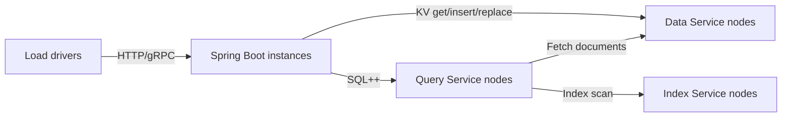
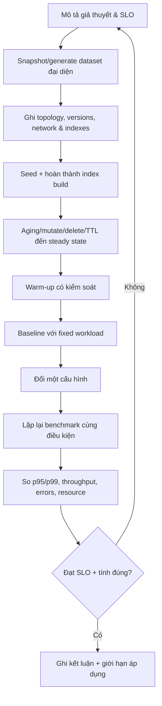
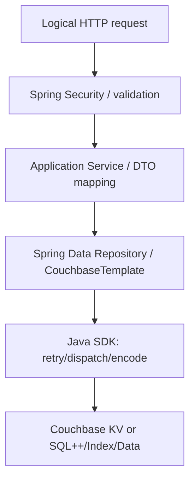

# Đo với dữ liệu và topology đại diện trước khi chọn cấu hình

## 1. Vì sao benchmark nhanh trên laptop chưa đủ để quyết định production?

Một API `GET /orders/{id}` sử dụng Spring Data Couchbase chạy nhanh khi thử 1.000 document trên laptop. Nhóm kỹ thuật quyết định giảm timeout, tăng số request đồng thời và chuyển toàn bộ truy vấn tìm kiếm sang SQL++ vì bài test nhỏ cho kết quả tốt. Sau khi triển khai, hệ thống chậm hẳn vào giờ cao điểm:

- Dữ liệu thật có hàng triệu order với **kích thước và độ sâu JSON rất khác nhau**, không phải 1.000 document đồng dạng.
- Một số tenant cực lớn, một số SKU/order được truy cập **nóng**, nên phân bố key không đều.
- Client ở một availability zone (AZ), Data Service ở AZ khác; Query Service phải qua Index Service và Data Service.
- Các câu tìm kiếm có **độ chọn lọc (selectivity)** khác nhau, `ORDER BY` và `OFFSET` sâu; index hoạt động khác so với dataset nhỏ.
- Một phần mutation dùng `@Version`/CAS, durable write, TTL và transaction; chúng có chi phí khác thao tác `get` không durability.
- Tải thật có nhiều request đồng thời, retry, GC, compaction, index maintenance, rebalance và sự kiện tăng lưu lượng.

Kết luận “cấu hình A nhanh hơn B” chỉ có nghĩa khi **dữ liệu, workload, topology, consistency và điều kiện đo** tương đương với điều cần phục vụ. Đây là trọng tâm của bài thuộc chương **Hiệu năng** của module **SPRING_DATA_COUCHBASE**: xây dựng tầng truy cập Couchbase bằng Spring Data mapping, repository, `CouchbaseTemplate`, SQL++, bucket/scope/collection, index, TTL, CAS, giao dịch và reactive API.

### Mục tiêu học tập

Sau bài học, bạn có thể:

1. Biến yêu cầu người dùng thành **SLO và giả thuyết đo được**, thay vì tối ưu theo cảm giác.
2. Xây dataset đại diện theo số document, phân phối kích thước, tenant/key skew, nested fields, TTL, mutation history và độ chọn lọc index.
3. Ghi nhận topology đầy đủ: node/service/replica, CPU/RAM/disk, network/AZ, SDK client và index state.
4. Thiết kế workload trộn KV, repository/Template, SQL++, CAS, durability, transaction và reactive với tỉ lệ và mức đồng thời thực tế.
5. Đo end-to-end p50/p95/p99, throughput hữu ích, lỗi, retry, saturation, queue và resource utilization.
6. Sử dụng `EXPLAIN`, query profiling, SDK tracing/metrics và server metrics để khoanh vùng bottleneck.
7. Chạy baseline → thay **một biến** → lặp lại → so sánh có kiểm soát trước khi chọn index, timeout, connection settings hoặc mức concurrency.
8. Viết báo cáo kết quả có giới hạn áp dụng và bộ test hồi quy hiệu năng.

> **Phạm vi kỹ thuật:** Ví dụ dùng Java 17+, Spring Data Couchbase/Java SDK 3.x cùng BOM tương thích và một Couchbase Server/Capella cluster được phép đo. **Không có một cấu hình Couchbase tối ưu cho tất cả dữ liệu.** Các con số dataset, topology, SLO, lưu lượng và kết quả ví dụ trong bài đều là **giả định minh họa**, không phải số đo production hay benchmark được chạy trong tài liệu này.

## 2. Bắt đầu từ quyết định cần đưa ra, không bắt đầu từ tham số

Một benchmark có ích trả lời một câu hỏi ra quyết định cụ thể:

| Câu hỏi sản phẩm/vận hành | Chỉ số và phép thử | Quyết định có thể đưa ra |
| --- | --- | --- |
| API mở chi tiết đơn đáp ứng SLA không? | p95/p99 end-to-end, lỗi, KV latency theo offered load | Dùng KV theo ID, giới hạn concurrency/timeout ra sao |
| Truy vấn danh sách theo tenant có ổn định? | SQL++ p95/p99, `EXPLAIN`, index scan/fetch/sort, page depth | Chọn index và pagination nào |
| Tạo đơn với durability cần bao lâu? | Write p99, durable timeout, replica health, commit ambiguity | Đặt durability policy theo invariant và capacity |
| Bao nhiêu khách hàng đồng thời hệ thống chịu được? | Throughput hoàn thành, backlog, error rate, saturation | Sizing node, rate-limit, autoscale |
| Reactive có lợi ở điều kiện nào? | Latency, CPU, thread/heap, backpressure dưới I/O concurrency cao | Chọn synchronous hay reactive theo tải thật |
| Thay collection/topology giúp hay hại? | Benchmark A/B giữ cùng workload và data, kiểm tra rebalance/HA | Có nên tách dịch vụ, thêm node hoặc isolate tenant |

### 2.1. Viết giả thuyết có tiêu chí bác bỏ

Ví dụ:

> “Với cùng dữ liệu 5 triệu order, 20% tenant chiếm 80% lưu lượng (đây là giả định thử nghiệm), thêm index theo `(tenant_id,status,created_at_ms)` sẽ giảm p95 của query danh sách ở mức 300 requests/s mà không làm write p99 vượt ngưỡng SLO.”

Giả thuyết **có thể bị bác bỏ** bởi số liệu: query p95 giảm nhưng write p99 tăng vì chi phí index maintenance, hoặc Query Service vẫn nghẽn vì sort/fetch không được index cover. Nếu không nêu tiêu chí trước, nhóm có thể chỉ chọn ra metric “đẹp” sau thử nghiệm.

### 2.2. Định nghĩa SLO trước khi xem benchmark

Một **bộ mục tiêu minh họa** cho hệ thống đơn hàng:

| Operation | SLO ví dụ | Tính cả gì? |
| --- | --- | --- |
| `GET /orders/{id}` | p95 dưới 120 ms, p99 dưới 250 ms | HTTP auth, Spring Data, SDK, network, serialization |
| `GET /orders?status=PAID` | p95 dưới 350 ms, p99 dưới 700 ms | SQL++ Query + Index + Data, mapping, response |
| `POST /orders` | p99 dưới 900 ms | Validate, key, insert/transaction/durability, receipt |
| `PATCH /orders/{id}` | p99 dưới 500 ms, conflict rate trong ngưỡng cho phép | Read-modify-write CAS và xử lý conflict |
| Error rate | Dưới 0,2% lỗi server ở tải mục tiêu | Không che timeout thành `404` hoặc retry vô hạn |

**Các ngưỡng trên không có giá trị phổ quát**; phải thay bằng SLO thật do team sản phẩm/khách hàng định nghĩa. Đừng tách DB latency khỏi end-to-end SLO rồi tuyên bố đạt, nếu 80% thời gian nằm ở thread pool, serialization hoặc network.

### 2.3. Phân biệt latency, throughput và capacity

- **Latency**: thời gian một logical request hoàn tất, gồm cả queue, retries và mapping.
- **Throughput**: số request **thành công/hữu ích** hoàn tất mỗi giây, không chỉ số HTTP requests đã gửi.
- **Offered load**: số requests được tạo gửi vào hệ thống mỗi giây.
- **Concurrency**: số requests đang in-flight cùng thời điểm.
- **Capacity**: mức tải có thể duy trì **trong SLO và error budget**.
- **Saturation**: dấu hiệu hệ thống không còn phục vụ được tải mới (queue tăng, CPU/Disk/Index lag/GC cao).

Tăng concurrency có thể làm throughput tăng tới một điểm, rồi throughput bão hòa nhưng p99 và timeout tăng mạnh. Không chọn một cấu hình chỉ vì đỉnh requests/s cao nhất nếu nó vi phạm SLO.

## 3. Dataset đại diện: đo mô hình thật, không phải số lượng document giả

“5 triệu document” chưa mô tả đủ dữ liệu. Cùng số document nhưng kích thước, schema, path filter và distribution khác nhau có thể cho kết quả trái ngược.

### 3.1. Bảng mô tả dữ liệu cần lưu cùng báo cáo

| Thuộc tính | Cần đo/ghi | Vì sao ảnh hưởng hiệu năng? |
| --- | --- | --- |
| Tổng số document | Count theo bucket/scope/collection và trạng thái | Quy mô keyspace/index |
| Kích thước JSON | p50/p95/p99, tối thiểu/tối đa, nén hay chưa | Network, decode, memory, disk I/O |
| Dạng schema | Fields `MISSING`/`NULL`, nested arrays, `_class`, schema version | Mapping/index predicates và fetch |
| Phân bố tenant | Top tenant, long tail, hot/cold tenants | Skew, isolation và tài nguyên chia sẻ |
| Phân bố khóa | Hot keys/zipf-like skew, prefix, random IDs | Cache hit, CAS conflict, hotspot |
| Cardinality của field | Số trạng thái, số khách hàng/SKU, số giá trị phân biệt | Selectivity, index scan |
| Các tổ hợp filter | `tenant+status+date`, branch, nulls, nested arrays | Index coverage, sort/offset |
| Tỷ lệ active/deleted/expired | Soft delete, TTL/retention, tombstone | Các query và background cleanup |
| Tần suất cập nhật | Update per key, CAS conflicts, độ dài document | Write amplification/contention |
| TTL distribution | Thời hạn ngắn/dài, expiry burst theo thời gian | Expiration/cleanup load, cache |
| Quan hệ giữa collection | Order→Customer/Product, fan-out và JOIN | Query planner và number of fetches |
| Data/index residency | Working set nằm trong memory hay cần disk | Warm/cold behavior |

### 3.2. Ví dụ hồ sơ dữ liệu giả định (để dựng benchmark)

```yaml
# BENCHMARK SCENARIO — số liệu giả định, không phải hệ thống thật
dataset:
  orders: 5000000
  customers: 600000
  products: 250000
  tenants: 120
  orderSizeBytesApprox:
    p50: 1500
    p95: 12000
    p99: 45000
  tenantTrafficSkew:
    top10PercentTenantsShare: 0.70
  orderStateDistribution:
    NEW: 0.08
    PAID: 0.42
    SHIPPED: 0.30
    CANCELLED: 0.12
    OTHER: 0.08
  lifecycle:
    activeFraction: 0.91
    softDeletedFraction: 0.09
  nestedItemsPerOrder:
    p50: 2
    p95: 20
    p99: 80
```

Các con số chỉ giúp xây **một kịch bản có đặc tính rõ**. Cần thay chúng bằng phân vị/thống kê thực tế đã **ẩn danh** và được phép dùng. Với số mẫu nhỏ, p99 kích thước hoặc tenant skew dễ sai; cần lấy mẫu đủ rộng và có phân tầng theo thời gian/tenant. Không copy trực tiếp PII, thông tin thanh toán hoặc access token từ production sang test.

### 3.3. Phân bố ngẫu nhiên đều dễ làm “benchmark đẹp giả”

Nếu generator tạo `tenantId` đều trên 120 tenant, mỗi tenant có gần như bằng nhau requests và documents, nó **không mô phỏng** sản phẩm có vài tenant rất lớn. Tương tự, chọn order ID đồng đều ngẫu nhiên trên toàn dataset có thể không giống cache/hot-key ratio ở thực tế.

Để tái hiện:

1. Đo traffic share theo tenant/tier và theo giờ.
2. Tạo request theo **weighted tenant distribution**, không chỉ `Random.nextInt(tenants)`.
3. Trong mỗi tenant, chọn hot/cold keys theo histogram hoặc một phân bố lệch (ví dụ Zipf-like), nhưng **không áp đặt Zipf khi chưa có bằng chứng**.
4. Có workload riêng cho top 1%, top 10%, median và long-tail tenant.
5. Giữ một tập đọc lạnh từ disk và tập hot keys được đọc lặp, không chỉ chạy all-hot sau warm-up.

### 3.4. Chọn mẫu theo thao tác, không chỉ theo bảng dữ liệu

```text
KV get:
  80% key tồn tại, 20% key không tồn tại (ví dụ tùy use case)
  kích thước small/medium/large theo phân phối

SQL++ list:
  filter tenant + state + createdAt
  page1 nhiều, page100 ít, một số deep offset
  high-selectivity vs low-selectivity filters

CAS update:
  hot document nhiều writer tranh chấp
  cold document ít conflict

Create:
  insert-only, duplicate/idempotent retry
  durability đúng policy
```

Những tỉ lệ trên là **kịch bản tham số hóa**, không mặc nhiên là traffic thật. Nếu production có hơn 99,9% GET tìm thấy thì test 20% miss sẽ đo sai mặt bằng latency/lỗi. Một benchmark đáng tin cần lưu và so các tỉ lệ với nguồn telemetry.

### 3.5. Dataset sau nhiều tháng hoạt động khác dataset mới seed

Dữ liệu production đã trải qua:

- Insert/update/delete, tombstone, index maintenance, fragmentation và compaction.
- Sự khác nhau giữa `ACTIVE`, `DELETED`, TTL đã hết hạn và record tạm.
- Document schema v1/v2, `MISSING`/`NULL`, dynamic attributes và nested arrays.
- Rebalance, index rebuild, backup/restore và phân phối vBucket.
- Tenant trưởng thành với lịch sử dài, không chỉ các record mới.

Do đó, ngoài dataset mới nạp, cần đo thêm một pha **steady-state aging**: mutate, delete, expire theo workload được phép; cho compaction/index maintenance chạy theo cấu hình; đo lại khi trạng thái cluster đã ổn định. Không chỉ benchmark ngay sau import khi mọi dữ liệu còn nóng trong cache.

## 4. Topology đại diện: mô tả toàn đường đi của request

Trong Couchbase, **KV Get theo key** chủ yếu liên quan Data Service; **SQL++** liên quan Query Service, Index Service và Data Service tùy execution plan. Tách hay gộp service, số node, replica, AZ, disk và network có thể làm đổi hoàn toàn latency của cùng câu query.



### 4.1. Hồ sơ topology phải ghi được tái lập

| Nhóm | Trường cần ghi |
| --- | --- |
| Couchbase | Server version/edition, node count, service placement, bucket/scope/collection, node allocation |
| Data Service | RAM quota, vBucket/replica count, bucket compression/eviction, disk type/IOPS |
| Query Service | Node count, CPU/RAM, request concurrency, service quotas, prepared-plan settings |
| Index Service | Index node count, memory/storage, index definitions, partitions/replicas, index build state |
| Kết nối | TLS, authentication, RTT giữa API↔server, proxy/load balancer, cross-AZ/region egress |
| SDK | Java SDK và Spring Data versions, client count/connection reuse, timeout, retry, compression |
| App runtime | JDK, heap/GC, CPU quota/limits, container replicas, thread pools/virtual threads/reactor usage |
| Môi trường | VM/physical/cloud instance SKU, noisy neighbors, storage QoS, thời điểm bảo trì |
| Dữ liệu | Total documents/bytes, working set/cache residency, TTL/deletes, index size |
| Consistency | KV vs SQL++, query scan consistency, durability level, transaction policy |

**Không đồng nhất một máy chạy cả Data+Query+Index** với production phân tán qua nhiều AZ. Ngược lại, tách nhiều node trong production có thể còn nhanh hơn một node local đối với query song song nhưng có chi phí network. Không thể dự đoán hướng thay đổi chỉ từ số node.

### 4.2. Kịch bản topology minh họa để so sánh

```yaml
# Giả định cho bài thực hành, không phải khuyến nghị sizing
cluster:
  serverVersion: "điền phiên bản đã kiểm tra"
  dataNodes: 3
  indexNodes: 2
  queryNodes: 2
  bucket: shop
  scope: sales
  collections: [orders, customers, products]
  replicas: 1
  tls: true
  azLayout: "2-AZ (mô tả chính xác vị trí của từng node)"
application:
  instances: 4
  javaVersion: 17
  cpuQuotaPerInstance: "điền giá trị đo"
  sdkClientsPerInstance: 1
  networkRttToDataP95Ms: "đo thực tế"
```

Đây **không phải** topology “chuẩn” của Couchbase. Với số node/replica/HA thật, phải xem service placement, failover, resource contention và yêu cầu bảo vệ dữ liệu. Một benchmark có thể chạy song song topology A (gộp) và B (tách) nhưng cần giữ **cùng dataset, workload, client placement, SLO** nếu mục tiêu là đo khác biệt topology.

### 4.3. Replica, durability và failure domain là thành phần của cấu hình

```java
import com.couchbase.client.java.durability.DurabilityLevel;
import static com.couchbase.client.java.kv.InsertOptions.insertOptions;

collection.insert(key, document,
        insertOptions().durability(DurabilityLevel.MAJORITY));
```

So sánh `MAJORITY` với thao tác **không durable** có thể đo một đánh đổi latency/consistency đáng kể; nhưng **không thể chọn durability yếu chỉ vì benchmark nhanh hơn** nếu business cần guarantee cao. Topology phải có replica và trạng thái cluster phù hợp mức durability; khi node bị lỗi hoặc network partition, kết quả có thể đổi.

Không chỉ chạy scenario “all nodes healthy”: tối thiểu cần thử thời gian rebalance/maintenance và partial failure theo phạm vi được phép; đây là lúc retry, timeout và p99 thường trở nên đáng chú ý.

## 5. Mô hình workload: đo đúng tỷ trọng API và tình huống khó

### 5.1. Bản mô tả workload phải có tỷ lệ, kích thước và SLA

Một workload giả định:

| Operation | Tỷ trọng logical requests | Đường truy cập | Các biến cần thay đổi |
| --- | ---: | --- | --- |
| Xem chi tiết Order | 55% | `repository.findById` → KV | Hot/cold keys, kích thước document, hit/miss |
| Danh sách Order | 20% | SQL++ Query/Index | Selectivity, sort, page size, offset/keyset, consistency |
| Cập nhật Order | 10% | Read + CAS `repository.save` | Số writer/key, conflict rate, document size |
| Tạo Order | 10% | Insert-only + receipt/outbox | Durability, transaction, idempotent duplicate |
| Báo cáo/đối soát | 5% | SQL++ aggregation hoặc export | Số row quét, khối lượng trả về, thời điểm chạy |

Tỷ lệ **55/20/10/10/5 chỉ là kịch bản mẫu**. Trong hệ thống thật, lấy từ API/trace logs theo một giai đoạn đại diện; xem cả peak hour, ngày cuối tháng, sales campaign hoặc batch job để có **nhiều workload profiles**. Không đo riêng 100% KV GET rồi suy ra capacity của ứng dụng có 20% SQL++ và transaction.

### 5.2. Read/write ratio chưa đủ — phải xét hình dạng request

Một `GET /orders/{id}` có thể:

- Chỉ đọc **một** Order trong KV bằng key xác định.
- Đọc Order rồi tìm Customer/Product theo N+1 calls.
- Truy vấn SQL++ để kiểm tra quyền/thời hạn/sort.
- Đọc cache hit hoặc cache miss.
- Serialize một response 2 KB hay 50 KB.

Mỗi phiên bản tạo chi phí khác nhau. Vì vậy **định nghĩa scenario theo logical user action** và đo thêm span riêng `repository`, `SDK`, `serialization`, `permission`, `cache`; không chỉ gọi tên endpoint.

Với write ratio, cần biết tỷ lệ:

- `insert` mới và duplicate-key;
- `replace` có CAS conflict;
- `upsert` không durability hoặc durability theo policy;
- giao dịch nhiều document (Order + Receipt + Outbox);
- `mutateIn` chỉ sửa một path hoặc ghi cả document;
- TTL expiry và background purge;
- write được lặp sau timeout/idempotency.

### 5.3. Tạo các profile tải thay vì trộn mọi thứ một cách mơ hồ

| Profile | Dùng để trả lời | Đặc điểm |
| --- | --- | --- |
| **Baseline** | Năng lực bình thường | Traffic mix và dữ liệu đại diện, cluster khỏe |
| **Read-heavy** | API tra cứu chịu tải đến đâu | Tăng KV GET + list, giữ tỉ lệ hot/cold |
| **Write-heavy** | CAS, durability và index maintenance chịu tải không | Tăng insert/replace, tranh chấp hot keys |
| **Reporting hour** | Báo cáo có ảnh hưởng CRUD không | Aggregation/exports chạy cùng traffic tương tác |
| **Expiry wave** | TTL burst và purge ảnh hưởng thế nào | Nhiều document đến hạn trong một cửa sổ |
| **Tenant skew** | Tenant lớn có ảnh hưởng tenant nhỏ không | Top tenant chiếm phần lớn request |
| **Degraded** | Hệ thống có còn đáp ứng SLO khi lỗi không | Rebalance, node failover, network RTT tăng |

Khi chọn cấu hình **cho production**, phải kiểm tra ít nhất baseline + một profile tải cao/thao tác quan trọng + kịch bản degraded/maintenance có ý nghĩa với SLA, không chỉ điểm tối đa requests/s khi tất cả thành phần khỏe.

### 5.4. Bài học từ độ chọn lọc của SQL++

Hai truy vấn cùng cấu trúc, nhưng khác tham số có thể khác chi phí:

```sql
SELECT META(o).id AS documentId,
       o.status, o.created_at_ms, o.total_minor
FROM `shop`.`sales`.`orders` AS o
WHERE o.tenant_id = $tenantId
  AND o.lifecycle_state = "ACTIVE"
  AND o.status = $status
  AND o.created_at_ms >= $fromMillis
ORDER BY o.created_at_ms DESC, META(o).id DESC
LIMIT $size OFFSET $offset;
```

Nếu tenant A có 10.000 Order ACTIVE còn tenant B có 1.000.000, cùng `LIMIT 20` nhưng query planner/index scan/cache có thể khác đáng kể. `OFFSET 500000` có thể phải xử lý rất nhiều index entries trước khi trả 20 records; đừng chỉ đo page 0.

Tạo tập tham số **được gắn nhãn**:

```text
Q1 = tenant nhỏ + status hiếm + page đầu
Q2 = tenant lớn + status phổ biến + page đầu
Q3 = tenant lớn + status phổ biến + page sâu
Q4 = tenant lớn + khoảng ngày rộng + sort
Q5 = tenant lớn + một số field MISSING/NULL
```

Khi benchmark một index mới, **dùng cùng bộ Q1–Q5**, cùng giá trị thời gian và cùng dữ liệu; không so index A chạy Q1 với index B chạy Q3.

### 5.5. Đúng ngữ nghĩa trước khi so tốc độ

Các cách truy cập có thể trả **kết quả khác nhau**:

- `repository.findById` và SDK `collection.get` đều nhắm key xác định, nhưng có thể khác entity mapping, converter, `@Version` metadata và cách xử lý `_class`.
- Repository derived/`@Query` dùng SQL++ và có thể thêm type discriminator; raw SDK SQL++ có thể trả cả legacy documents không có `_class`.
- `QueryScanConsistency.NOT_BOUNDED` có thể nhanh hơn `REQUEST_PLUS` nhưng có nguy cơ thấy index cũ; **không so như hai implementation tương đương** nếu SLO yêu cầu read-after-write.
- CAS/durability levels khác nhau tạo guarantee khác nhau; giảm guarantee để đạt p99 không phải tối ưu tương đương.
- Đường async/reactive có thể trả publisher chưa được **subscribe/consume**, khiến benchmark “đo” thời gian tạo `Mono` thay vì I/O.

Trước khi tính latency: xác minh **đúng tenant, đúng document ID, số row, sorting, mutation outcome và business invariants**. Chạy nhanh nhưng trả thiếu dữ liệu hoặc bỏ kiểm tra quyền không được công nhận là thắng.

## 6. Dựng môi trường đo: từ seed đến steady state

### 6.1. Quy trình tối thiểu



**Không seed lúc đang đo steady-state** trừ khi seed/import chính là workload muốn đánh giá. Nếu query index còn `BUILDING`, một thử nghiệm đo “hiệu năng query” thật ra đang đo cạnh tranh tài nguyên với index builder.

### 6.2. Ghi cấu hình đã cố định

Ví dụ `benchmark-manifest` cần được phiên bản hóa:

```yaml
# Ví dụ manifest kết quả, không phải file đã được tạo ở bước này
scenarioId: "orders-readmix-v1"
datasetSeed: 20261125
datasetFingerprint: "sha256-of-generator-config-and-snapshot"
schemaVersion: "order-v3"
serverVersion: "ghi phiên bản thật"
javaSdkVersion: "ghi phiên bản thật"
springDataVersion: "ghi phiên bản thật"
javaRuntime: "17, heap/GC/container limits"
topologyId: "data3-index2-query2-2az"
networkProfile: "API in AZ-1, RTT histogram attached"
indexManifestVersion: "baseline-index-v1"
replicaCount: 1
durability: "per-operation, as production"
scanConsistency: "per-query, as production"
workloadProfile: "baseline-55-20-10-10-5"
arrivalModel: "open-loop scheduled arrivals"
targetOfferedRps: 300
warmup: "điền số phút đã chạy"
measurementWindow: "điền số phút"
repetitions: 5
reportArtifacts:
  - "latency-histograms"
  - "offered-vs-completed-rps"
  - "errors-and-retries"
  - "couchbase-node-metrics"
  - "query-explain-and-profile"
```

Nếu kết quả không ghi rõ `serverVersion`, `topologyId`, workload và index manifest, gần như không thể giải thích vì sao lần đo sau thay đổi. **Sự tái lập quan trọng hơn một con số throughput đẹp mà không có ngữ cảnh.**

### 6.3. Seed một phần nhỏ, rồi kiểm tra generator

Generator cần tái lập từ seed và có khả năng tạo đúng phân phối kích thước, tenant, field null/missing và hot keys. Có thể dùng nguyên tắc:

```java
import java.util.SplittableRandom;

public final class RepresentativeOrders {
    private final SplittableRandom random;

    public RepresentativeOrders(long seed) {
        this.random = new SplittableRandom(seed);
    }

    public int nextLineItemCount() {
        double p = random.nextDouble();
        if (p < 0.50) return 2;
        if (p < 0.95) return 5 + random.nextInt(16);
        if (p < 0.99) return 21 + random.nextInt(60);
        return 81 + random.nextInt(120);
    }
}
```

Hàm này **chỉ minh họa** cách tạo phân phối lệch; các phân vị thực tế không tự bằng p50=2, p95=20, p99=80 vì phép ánh xạ có bước nhảy và random ranges. Nếu yêu cầu khớp phân vị chính xác, nên dùng histogram thực/empirical CDF và kiểm định output generator trước khi seed. Một seed cố định giúp tái lập, nhưng không thay thế nhiều seed/repetitions để kiểm tra độ ổn định.

**Đặc biệt:** `SplittableRandom` không thread-safe; dùng một instance per worker hoặc `split()` được quản lý, không chia một generator mutable giữa nhiều threads rồi gây data race trong benchmark. Các khóa nghiệp vụ, tenant ID và JSON payload phải được validate và **không chứa PII production chưa được phép**.

### 6.4. Xác minh dữ liệu đã tạo

Sau seed:

- Đếm document theo collection, tenant, lifecycle và status.
- Tính histogram kích thước JSON theo p50/p95/p99.
- Kiểm tra số items nested, `MISSING`/`NULL`, số SKU/Customer distinct.
- Kiểm tra index build hoàn tất/ONLINE và index size/fragmentation phù hợp.
- Đo working set và data/index residency, xác nhận không vô tình all-cache trên một dataset quá nhỏ.
- Kiểm tra TTL chưa làm biến mất 30% fixture trong lúc warm-up.
- Chụp topology và replica health trước khi chạy.

**Không dùng `COUNT(*)` SQL++ chưa được cho consistency phù hợp ngay sau seed để tự tin dữ liệu đã đủ.** Cần xác minh completion và index catch-up theo API/cluster state, rồi chạy query kiểm kê ở mức consistency phù hợp. Một câu `COUNT` đơn lẻ cũng không chứng minh toàn bộ phân bố field đã đúng.

### 6.5. Warm-up, steady-state và cold-start là ba phép đo khác nhau

| Giai đoạn | Mục đích | Cần quan sát |
| --- | --- | --- |
| **Cold start** | API/SDK mới khởi động, TLS/connection/setup, cache lạnh | Startup latency, first-request p99, connection storms |
| **Warm-up** | JIT, classloading, connection pools, query plan cache, data cache hội tụ | CPU/GC/latency đang biến đổi |
| **Steady state** | Đo khi metrics tương đối ổn định | Throughput, percentiles, errors, node resources |
| **Soak/aging** | Phát hiện leak, GC, index/compaction, drift sau thời gian dài | Memory growth, latency drift, retry, expiry |

**Không bỏ cold start** nếu autoscaling hoặc rolling deploy xảy ra thường xuyên. Nhưng cũng không lấy 30 giây đầu của một JVM vừa khởi động làm bằng chứng tốc độ steady-state. Cần tách báo cáo từng giai đoạn.

### 6.6. Tránh benchmark tự làm nhiễu hệ thống

- Load generator cần CPU/network đủ rộng; nếu generator đã 100% CPU, throughput không đo capacity database.
- Tách tải **seed/verification** khỏi tải đo chính thức; không chạy `EXPLAIN PROFILE timings` cho mọi query trong window nếu profiling tạo overhead đáng kể.
- Nếu monitoring scrape/tracing sample quá dày, nó có thể ảnh hưởng latency; ghi rõ mức observability overhead.
- Không để CI builds, backups, cron compaction hoặc team khác cùng dùng cluster mà không ghi lại sự kiện.
- Không chạy stress/failover test trên production hoặc cluster dùng chung khi chưa có quyền/phương án phục hồi; dùng môi trường đại diện, dữ liệu synthetic/anonymized, kill switch và quota an toàn.

## 7. Đo những gì: histogram end-to-end, throughput hữu ích và saturation

### 7.1. Không dùng trung bình latency làm kết luận chính

Một API có thể trả 990 requests trong 30 ms và 10 requests mất 5 giây. Trung bình trông không quá tệ, nhưng **1% người dùng có thể chịu 5 giây**. Vì vậy:

- Báo cáo ít nhất **p50, p95, p99** cho từng operation class; thêm p99.9 khi có đủ mẫu.
- Báo cáo **histogram** hoặc dữ liệu có thể tính lại, không chỉ một giá trị trung bình.
- Kèm **sample count** và measurement window. p99 của 100 mẫu không đủ ổn định để quyết định SLA quan trọng.
- Đo latency **kể cả requests thất bại/timeout** trong một metric riêng; đừng loại hết lỗi rồi chỉ báo cáo p99 của những request “sống sót”.
- Tách warm-up, steady-state, degraded; không trộn trong cùng một phân vị mà không phân nhãn.
- Ghi cả **offered rate**, **completed goodput**, **in-flight/queue** và tỉ lệ lỗi để tránh “p99 tốt do hệ thống từ chối 70% requests”.

### 7.2. Phân biệt phép đo theo tầng



Một trace nên có:

```text
request_total = 270 ms
  ingress+auth = 15 ms
  service/business = 8 ms
  repository+converter = 22 ms
  SDK operation = 205 ms
      local queue/encode = 10 ms
      network/server/response = 195 ms
  response mapping + serialization = 20 ms
```

Số liệu trên **chỉ minh họa**; không lấy tổng span con nếu spans chồng nhau một cách ngây thơ. Với reactive operations, một số thời gian **waiting/queue** không nằm trên CPU; cần đo wall-clock, active threads và in-flight operations để giải thích.

### 7.3. Micrometer đo logical operation tại Service

Ví dụ đo một thao tác tìm Order bằng Spring Data:

```java
package com.example.shop.orders.application;

import io.micrometer.core.instrument.MeterRegistry;
import io.micrometer.core.instrument.Timer;
import org.springframework.stereotype.Service;

@Service
public class OrderReadService {
    private final OrderRepository repository;
    private final MeterRegistry meters;

    public OrderReadService(
            OrderRepository repository, MeterRegistry meters) {
        this.repository = repository;
        this.meters = meters;
    }

    public OrderDocument findById(String authorizedDocumentId) {
        Timer.Sample sample = Timer.start(meters);
        String outcome = "success";
        try {
            return repository.findById(authorizedDocumentId)
                    .orElseThrow(OrderNotFoundException::new);
        } catch (OrderNotFoundException notFound) {
            outcome = "not_found";
            throw notFound;
        } catch (RuntimeException failure) {
            outcome = "error";
            throw failure;
        } finally {
            sample.stop(meters.timer(
                    "orders.read.logical.duration",
                    "operation", "get_by_id",
                    "outcome", outcome));
        }
    }
}
```

`OrderRepository` và `OrderNotFoundException` là kiểu do dự án định nghĩa; method **giả định** authorization tenant/resource đã được thực thi ở tầng ngoài. Trong hệ thống thật có thể đặt timer trên **toàn Service** để bao gồm authorization và mapping, rồi dùng SDK spans cho các thành phần con; ví dụ trên chủ yếu đo call repository.

**Không dùng document ID, email, raw SQL++ hoặc tenant ID không giới hạn làm tag.** Metric này chỉ là raw timer; muốn có p95/p99 ổn định cần cấu hình histogram/distribution SLO buckets phù hợp trong Micrometer/Prometheus, không mặc định mọi backend sẽ xuất percentiles. Tách `success/not_found/error` để không trộn ý nghĩa các kết quả.

### 7.4. Java SDK có metric/tracing riêng

Theo tài liệu Java SDK, request metrics có thể được ghi qua LoggingMeter hoặc tích hợp Micrometer/OpenTelemetry, cung cấp số requests, latency percentiles theo service/operation; request tracing/threshold logs giúp điều tra các lời gọi chậm. Các số SDK **khác** timer HTTP:

- SDK metric đo **operation phía client/SDK**, có thể gồm internal retry và queue/dispatch, không bao gồm mọi bước Controller.
- Server query metrics đo **Query Service execution**, không gồm toàn bộ HTTP mapping/serialization.
- API timer đo **logical request**, có thể gọi nhiều KV/SQL++ operations.
- Một transaction có nhiều attempts và document operations; không đồng nhất transaction p99 với KV p99.

So một KPI giữa các tầng cần hiểu đơn vị: SDK log có thể ghi microseconds, HTTP timer thường hiển thị seconds/milliseconds, JSON timestamps có thể là epoch milliseconds. **Không so 5.000 µs với 5.000 ms**.

Để điều tra query chậm, xem slow-operation threshold logging/orphan responses và OpenTelemetry spans; bật **sample có chủ đích** để tránh overhead cao khi benchmark. Cấu hình các exporter và sampling phải được ghi trong manifest vì chính instrumentation có thể làm đổi p99.

### 7.5. Dùng bảng đo đa chiều

| Lớp | Metric | Dấu hiệu nghi ngờ |
| --- | --- | --- |
| Client/load driver | Offered RPS, successful RPS, generator CPU | Driver không phát đủ tải |
| Gateway/API | In-flight, queue, request p99, 4xx/5xx | App/gateway bão hòa |
| JVM | CPU, heap usage, GC pause, allocation, threads | Mapping JSON/GC gây latency |
| Reactor | Pending tasks, concurrency, backpressure, event-loop blocks | Không thật sự non-blocking |
| SDK | Retry/timeout reasons, dispatched requests, p99 by service | Network/endpoint/queue bất ổn |
| Data Service | Latency, ops/s, memory residency, disk I/O, replica load | KV bão hòa, cache miss |
| Index Service | Scan throughput, queue, resident percent, index build/maintenance | Selectivity/index lag |
| Query Service | Query p99, queue, plan cache, sort/fetch cost, active requests | Query bị nghẽn hoặc kế hoạch không tốt |
| Cluster | Rebalance/failover, compaction, disk usage, memory quota | Nhiễu vận hành/topology |

Chỉ khi biết **nút thắt nằm ở đâu** mới chọn biến cấu hình phù hợp. Ví dụ nếu p99 HTTP cao vì JSON serialization trên JVM, tăng memory quota Index Service có thể không cải thiện gì.

## 8. Mô hình tạo tải: open-loop, closed-loop và coordinated omission

### 8.1. Closed-loop dễ che giấu lúc backend chậm

Trong mô hình closed-loop, mỗi virtual user đợi response rồi mới gửi request tiếp:

```text
virtual user #1:
  send -> wait response -> think time -> send ...
```

Khi backend chậm, client tự gửi ít hơn. Throughput giảm có thể làm hệ thống “dễ thở” hơn và biểu đồ latency trông ổn định, dù **người dùng đến theo thời gian thực** vẫn xếp hàng.

Mô hình **open-loop/arrival-rate** gửi requests theo lịch đã chọn, ví dụ 200 requests/s, gần với nhiều workload HTTP được tạo bởi người dùng bên ngoài:

```text
arrival schedule:  t=0ms, 5ms, 10ms, 15ms, ...
responses:         có thể đến chậm và chồng lên nhau
```

Open-loop cũng phải có **safety cap** về in-flight/connection/queue; nếu backend quá tải, load driver không được làm sập môi trường dùng chung. Ghi **offered** và **accepted/completed** riêng.

### 8.2. Coordinated omission làm p99 đẹp giả

Nếu load generator chỉ đo từ lúc **thực sự gửi** đến lúc nhận response, nó có thể bỏ qua thời gian một request **đáng lẽ phải được gửi** nhưng bị trì hoãn do thread/connection limit. Khi backend đình trệ, ít request được phát; histogram không tính đủ quãng chờ.

Để giảm sai lệch:

1. Định nghĩa arrival schedule độc lập với response time.
2. Đo **scheduled-to-complete latency** (nếu tool hỗ trợ), hoặc dùng histogram correction/phương pháp phù hợp.
3. Ghi enqueue delay, connection wait, in-flight và số request **không được gửi đúng lịch**.
4. Báo cáo failures/timeouts và offered load; không chỉ p99 successful responses.
5. Kiểm thử load generator còn dư CPU/network và không tự nghẽn.

Không có một bộ load-driver mặc định đúng cho mọi workload. Closed-loop vẫn hữu ích để khảo sát số user đồng thời; open-loop hữu ích để xác định capacity tại **arrival rate**. Nêu rõ mô hình đang dùng và giải thích giới hạn khi so số liệu.

### 8.3. Little's Law để kiểm tra tính hợp lý

Ở trạng thái ổn định, một gần đúng:

\[
L = \lambda W
\]

Trong đó `L` là số requests trung bình đang trong hệ thống, `λ` là throughput hoàn thành/giây và `W` là **thời gian ở trong hệ thống trung bình**, bao gồm queue. Ví dụ minh họa: `λ=200/s`, `W=0.15s` thì `L≈30` in-flight requests.

Đây là **quan hệ giữa các giá trị trung bình trong hệ ổn định**, không phải công thức `concurrency = RPS × p99`. Nếu queue tăng liên tục, hệ chưa ở steady state; không được áp dụng máy móc để chọn threads theo một điểm đo transient.

### 8.4. Chọn các nấc tải trước khi đo

```text
Baseline target:      100 requests/s
Expected production:  250 requests/s
Peak planning:        400 requests/s
Stress until SLO fail: nhiều nấc tăng có cap/quyền rõ
```

Các mức **chỉ là kịch bản**, phải thay bằng business traffic thực tế. Mỗi nấc cần warm-up thích hợp, đủ thời gian measurement để thu mẫu p99, và một khoảng nghỉ/ổn định nếu workload làm nóng cache hoặc thay đổi dữ liệu.

Nếu nấc 300 requests/s có p99 vượt SLO, nấc 400 requests/s dù throughput cao hơn cũng **không phải capacity hữu ích**. Ghi nấc cuối đạt tất cả latency/error/correctness limits.

### 8.5. Tránh phép thử sai vì mutation làm dataset đổi liên tục

Một benchmark mix có `POST/PATCH/DELETE` khiến số lượng document, index và hot-key distribution biến đổi. Hai lần A/B chạy liên tiếp sẽ không còn cùng dữ liệu nếu không reset/clone dataset.

Một trong các chiến lược:

- Restore snapshot fixture ở đầu mỗi run.
- Dùng **pre-generated deterministic command stream** với ID riêng và cùng outcome distribution.
- Cho mỗi run một namespace riêng nhưng cùng phân bố và index topology.
- Với soak test, **chấp nhận dataset drift** là đối tượng đo, nhưng không so run A/B như cùng state ban đầu.

Không vô tình dùng `upsert` cho load generator “dễ reset” nếu use case production dùng insert-only/idempotent semantics. Đó là một workload khác.

## 9. SQL++: đo `EXPLAIN`, Query Profile và chi phí index trước khi thêm index

Một index giúp query nhanh ở một tập dữ liệu không có nghĩa nó tốt khi dữ liệu tăng gấp 20 lần hoặc tenant distribution thay đổi. Hãy tìm **query plan** và xem bao nhiêu index entries/fetch/sort đã được xử lý trước khi đặt cấu hình.

### 9.1. Tạo query baseline với bind parameters

```sql
SELECT META(o).id AS id,
       o.status,
       o.created_at_ms,
       o.total_minor
FROM `shop`.`sales`.`orders` AS o
WHERE o.tenant_id = $tenantId
  AND o.lifecycle_state = "ACTIVE"
  AND o.status = $status
  AND o.created_at_ms >= $fromMillis
ORDER BY o.created_at_ms DESC, META(o).id DESC
LIMIT $pageSize;
```

Đừng ghép `tenantId`, ngày hoặc status thành string SQL++ tùy ý. Bind parameters bảo vệ query và giúp cố định statement shape. So sánh các tham số **cùng tần suất/hình dạng** theo workload; đừng benchmark trên một tenant may mắn có 20 rows.

### 9.2. `EXPLAIN` trước và sau khi tạo index

```sql
EXPLAIN
SELECT META(o).id AS id,
       o.status,
       o.created_at_ms,
       o.total_minor
FROM `shop`.`sales`.`orders` AS o
WHERE o.tenant_id = "benchmark-tenant"
  AND o.lifecycle_state = "ACTIVE"
  AND o.status = "PAID"
  AND o.created_at_ms >= 1790000000000
ORDER BY o.created_at_ms DESC, META(o).id DESC
LIMIT 20;
```

`EXPLAIN` cho biết execution plan mà Query Service lựa chọn; đây không phải số đo end-to-end p99. Khi so:

1. Kiểm tra index nào được scan, có `PrimaryScan` không.
2. Số lượng scan/fetch dự kiến, mức độ **covering** của index.
3. Có sort ngoài index, `OFFSET` sâu, nhiều JOIN, `UNNEST`/array operations?
4. Có hiệu ứng `OR`, `MISSING`, `NULL` hoặc type discriminator làm predicate không phù hợp index?
5. Liệu query phải fetch nhiều document lớn để lấy vài field?
6. Plan có thay đổi khi tenant/status/cardinality khác nhau không?

Một index thử nghiệm:

```sql
CREATE INDEX ix_orders_tenant_state_status_time
ON `shop`.`sales`.`orders`(
    tenant_id,
    lifecycle_state,
    status,
    created_at_ms DESC
);
```

Đừng tuyên bố index này **chắc chắn** cover SELECT hoặc đáp ứng toàn bộ ORDER BY gồm `META(o).id`: phải xem plan cuối và trường `total_minor` có cần fetch hay không. Có thể cần index khác hoặc thay query/pagination; mọi index mới đều tốn RAM/disk và **write maintenance**.

### 9.3. Query Profile `phases` và `timings`

Theo tài liệu Query Service, profiling có các mức `off`, `phases`, `timings`. Trong Query Workbench hoặc REST/cbq, có thể bật profile `timings` **cho một số sample đại diện** để thấy thời gian parser, planner, scan, fetch, sort, join, aggregation và số lượng items theo operator.

Điểm cần đọc:

| Dấu hiệu profile | Giả thuyết cần kiểm chứng |
| --- | --- |
| `IndexScan` xử lý rất nhiều entry | Selectivity thấp hoặc index predicate sai |
| `Fetch` lớn | Truy vấn chưa cover hoặc SELECT nhiều field |
| `Order`/sort tốn CPU/memory | Index không phục vụ ORDER BY, page sâu |
| `Join` có fan-out cao | Key design/relationship/query shape chưa phù hợp |
| Thời gian plan cao ở query động | Statement shape thay đổi, prepared-plan cache không hiệu quả |
| Queue/waiting cao nhưng operator execution ngắn | Query Service đang quá tải hoặc concurrency config |
| Query Service nhanh nhưng HTTP chậm | Network, mapping, serialization, retries, client queue |

**Profiling chi tiết có overhead và có thể tạo dữ liệu profile lớn**; không bật `timings` cho mọi query trong benchmark steady-state mà không đo tác động. Có thể lưu mẫu `EXPLAIN`/profile trước và sau cấu hình, sau đó tắt profile để đo p99 production-like.

Java SDK có thể trả **Query metrics trong metadata** khi bật tùy chọn tương ứng:

```java
import com.couchbase.client.java.query.QueryResult;
import static com.couchbase.client.java.query.QueryOptions.queryOptions;

QueryResult result = cluster.query(
        sql, queryOptions().parameters(params)
                .readonly(true).metrics(true));
var rows = result.rowsAsObject(); // Consume để xác nhận row count.

result.metaData().metrics().ifPresent(metrics -> {
    System.out.println("Query execution: "
            + metrics.executionTime());
    System.out.println("Query elapsed: "
            + metrics.elapsedTime());
});
```

Trong ví dụ, `cluster`, `sql`, `params` là biến đã chuẩn bị trong adapter; không phải API Controller nhận raw SQL từ client. `executionTime` và `elapsedTime` là **thời gian phía Query Service** theo contract metadata, không thay cho timer HTTP/client end-to-end. Việc bật metrics/profiling và chi phí quan sát phải được ghi trong benchmark manifest.

### 9.4. `NOT_BOUNDED` và `REQUEST_PLUS` không tương đương

```java
import com.couchbase.client.java.query.QueryScanConsistency;
import static com.couchbase.client.java.query.QueryOptions.queryOptions;

var result = cluster.query(
    "SELECT META(o).id AS id, o.status " +
    "FROM `shop`.`sales`.`orders` AS o " +
    "WHERE o.tenant_id = $tenantId AND o.status = $status",
    queryOptions()
        .parameters(com.couchbase.client.java.json.JsonObject.create()
            .put("tenantId", trustedTenantId)
            .put("status", "PAID"))
        .scanConsistency(QueryScanConsistency.REQUEST_PLUS)
        .readonly(true)
);
```

`REQUEST_PLUS` đợi secondary indexes theo kịp mutation trong phạm vi consistency contract; điều đó có thể làm query latency cao hơn `NOT_BOUNDED` khi Index Service đang lag. Nếu ứng dụng yêu cầu dữ liệu mới sau mutation, benchmark phải giữ cùng consistency **bắt buộc** khi so cấu hình.

Một query trả dữ liệu cũ nhưng p95 thấp **không phải lựa chọn thắng** đối với nghiệp vụ cần read-your-writes. Ngược lại, các trang báo cáo có tolerance eventual consistency có thể chọn policy khác, nhưng phải nêu rõ và test tính đúng theo policy.

### 9.5. So truy vấn theo số row trả và công việc backend

Chỉ so latency không đủ. Đối với `LIMIT 20`:

```text
Scenario A:  scan 20 index entries   -> return 20 rows
Scenario B:  scan 500,000 entries    -> return 20 rows
```

Scenario B có thể nhanh khi index nằm trong cache và ít tải, nhưng rất dễ tăng p99 khi nhiều tenants/query đồng thời hoặc index phải đọc từ disk. Xem scanned entries, fetched documents, result size, sort và CPU/disk của Query/Index Service.

### 9.6. Prepared queries và `adhoc(false)`

Java SDK hỗ trợ đường prepared statement khi sử dụng `queryOptions().adhoc(false)` theo phiên bản. Prepared plans có thể giảm chi phí planning cho query lặp lại, nhưng:

- Lợi ích phụ thuộc **query shape** ổn định và môi trường Query Service.
- Dynamic SQL++ với rất nhiều tổ hợp `WHERE`/`ORDER BY` có thể sinh nhiều prepared statements.
- Plan cache chịu ảnh hưởng DDL/index changes, Query Service topology và phiên bản.
- Prepared plan không sửa được **index thiếu hoặc selectivity xấu**.

Đo `adhoc(true)` và `adhoc(false)` với **cùng semantics, workload, cache/warm-up và SLO**, ghi lại plan behavior. Không bật `adhoc(false)` cho mọi query chỉ vì một truy vấn mẫu được tối ưu.

## 10. Đo chi phí ghi: CAS, durability, TTL và transaction

Các operation write khác nhau không nên gộp vào một “Couchbase write latency”:

| Operation | Tác động cần đo | Chú ý tính đúng |
| --- | --- | --- |
| `insert` | ID generation, duplicate rate, write/index maintenance | Create-only, không dùng upsert thay thế |
| `replace` + CAS | Read-modify-write, conflict/retry | Đọc lại và recheck domain khi conflict |
| `upsert` | Ghi full document, CAS/expiry thay đổi | Có thể ghi đè dữ liệu hiện hữu |
| `mutateIn` | Sub-document path update | Không mặc định nhanh hơn full replace trên mọi schema |
| Durable write | Replication/persistence acknowledgement | Giữ mức durability theo business |
| Multi-document transaction | Transaction coordinator, metadata, retry/commit | Đảm bảo các document cùng commit/abort |
| TTL setting/expiry burst | Expiration metadata, cleanup/index changes | Không coi TTL là workflow business |

### 10.1. Hai phép đo CAS: ít tranh chấp và key nóng

```text
CAS-cold: mỗi worker sửa ID khác nhau
CAS-hot:  100 workers sửa cùng 1 hoặc một nhóm ID
```

Với CAS-hot, cần đo:

- Số conflict/1000 logical updates.
- Số lần read-retry sau conflict.
- Latency p95/p99 **của logical update**, không chỉ thành công cuối cùng của `replace`.
- Throughput commit được **bao nhiêu update hợp lệ**, không phải số `save` attempts.
- Có mất cập nhật/đổi trạng thái trái nghiệp vụ không?

Nếu chỉ đo throughput `upsert` không CAS, kết quả có thể trông nhanh nhưng **không cùng correctness contract**. Một policy retry CAS cần giới hạn attempts và budget để tránh hot key làm latency tail bùng lên.

### 10.2. Durability nên chia thành các profile nghiệp vụ

```java
import com.couchbase.client.java.durability.DurabilityLevel;
import static com.couchbase.client.java.kv.UpsertOptions.upsertOptions;

collection.upsert(key, body,
        upsertOptions().durability(DurabilityLevel.MAJORITY));
```

Thử các mức durability **chỉ khi sản phẩm cho phép so sánh**. Không kết luận “`NONE` là cấu hình tốt hơn `MAJORITY`” chỉ vì latency thấp; hai mức có guarantee khác nhau. Khi benchmark, ghi số replica khả dụng, placement, disk persistence và trạng thái failover; đo `durable write` với **cùng topology**.

### 10.3. Transaction có nhiều lần I/O và retry nội bộ

Tạo một Order với receipt/outbox:

```text
Transaction:
  INSERT Order(orderId)
  INSERT Receipt(commandId)
  INSERT Outbox(eventId)
```

Không so latency của transaction này với **một** `collection.insert(order)` rồi gọi đó là sự khác biệt overhead do framework. Hai workload khác nhau về số document và guarantee.

Nếu muốn đo transaction overhead có kiểm soát, tạo baseline nhiều mutation riêng và transactional variant với **cùng** 3 document/size, rồi ghi rõ rằng baseline **không có atomicity**. Quyết định cuối phải tính cả hậu quả lỗi giữa các mutations, reconciliation và correctness; latency không phải yếu tố duy nhất.

### 10.4. `@Version`, expiry và index write amplification

- `@Version` ánh xạ CAS metadata; chi phí chủ yếu nằm ở **đường read-modify-write và conflict/retry**, không phải một phép hash “khóa” bí ẩn trong JVM.
- Một document có nhiều secondary indexes có thể làm write maintenance tăng. Đo write-heavy workload **trước và sau khi tạo index**, không chỉ query benefit.
- `@Document(expiry=...)`/SDK expiry có thể làm record biến mất theo thời gian; đo đúng **trạng thái dataset** khi TTL đến hạn.
- Một `replace` có thể reset expiry nếu không `preserveExpiry`; không thay đổi semantics retention để được latency tốt. Kiểm tra metadata expiry theo version/configuration.
- Transaction/SDK retry khi commit ambiguous cần receipt/reconciliation; **đừng retry tạo ID mới** trong benchmark, nếu không count operations sai và dữ liệu bị nhân đôi.

### 10.5. Đừng đo chỉ “đã gửi mutation”

Một benchmark dùng asynchronous SDK có thể báo throughput cực lớn nếu đếm request khi **được submit** thay vì khi mutation được **acknowledge/commit**:

```text
submitted  = 50,000 mutations
completed  = 32,000 acknowledged
timed out  = 15,000
pending    = 3,000
```

Thông lượng hữu ích không phải 50.000; cần đo completion, failure/ambiguous outcome và side-effect correctness. Trong transaction, thành công có nghĩa đã nhận xác nhận theo contract; nếu outcome ambiguous cần **tách loại**, không mặc định thành công/thất bại.

## 11. Spring Data Repository, Template, SDK và Reactive: so đúng lớp trừu tượng

Framework overhead có thể quan trọng, nhưng trước khi kết luận “Spring Data chậm”, cần chứng minh các đường đang làm **cùng thao tác I/O và cùng serialization/data mapping**.

### 11.1. Bảng so sánh công bằng

| Đường truy cập | Mẫu thao tác | Những gì phải giữ giống nhau |
| --- | --- | --- |
| SDK KV | `collection.get(id)` + decode JSON | Cùng ID, cùng field, cùng type conversion, same timeout |
| Repository KV | `repository.findById(id)` | Cùng collection, `@Document/@Field/@Version`, type mapping |
| Template KV | `template.findById(Entity.class).one(id)` | Cùng entity mapping và ID |
| SDK SQL++ | `cluster.query(statement, options)` | Same WHERE, parameters, consistency, projection, row count |
| Repository `@Query` | `@Query` mapping/projection | Cùng SQL++ semantics, type filter, result type |
| Template Query | `findByQuery`/`QueryCriteria` | Tương đương predicate/sort/pagination/count |
| Reactive SDK/repository | `Mono`/`Flux` consumed to completion | Cùng payload, concurrency, backpressure và timeout |

**Không so** `repository.findById` (KV) với một SQL++ `SELECT *` thiếu index rồi quy kết chênh lệch cho “ORM”. Chênh lệch chủ yếu có thể đến từ **Data Service vs Query/Index Service** và query plan, không phải converter.

### 11.2. Đo mapping JSON và projection

Ví dụ entity:

```java
import org.springframework.data.annotation.Id;
import org.springframework.data.annotation.Version;
import org.springframework.data.couchbase.core.mapping.*;

@Document
@Scope("sales")
@Collection("orders")
public class OrderDocument {
    @Id private String id;
    @Field("tenant_id") private String tenantId;
    @Field("status") private String status;
    @Field("total_minor") private Long totalMinor;
    @Field("items") private java.util.List<OrderItemDocument> items;
    @Version private Long version;
    public OrderDocument() {}
    // Constructor/getters/setters thực tế được lược bỏ.
}
```

Truy vấn danh sách chỉ cần `id,status,totalMinor`. Nếu dùng entity full document chứa hàng trăm items rồi map sang 3 field DTO, có thể tăng:

- Network bytes từ Data Service.
- Số object Java được tạo/GC.
- Thời gian converter/map nested items.
- CPU và heap ở Spring Boot instances.

Để đo projection, tạo **cùng** endpoint/authorization/pagination semantics, so `SELECT` chỉ các field cần thiết với phương án fetch entity full. Xác minh field name `@Field` mapping, `_class` discriminator và các field audit; **không cắt field cần cho permission check** rồi vô tình bỏ kiểm soát quyền.

### 11.3. Mapping overhead có thể biến theo schema

Đừng benchmark converter bằng một document có `items=[]` nếu production có nested arrays p99 rất lớn. Chạy:

```text
Small:  1 KB,   1–2 nested items
Medium: 10 KB, 10–20 nested items
Large:  50 KB, 80+ nested items
Legacy: MISSING/NULL fields, schema v1
```

Đây là các mức **ví dụ cần thay theo histogram thật**. Nếu tối ưu DTO mapping, giữ cùng chính sách handling `NULL/MISSING` và cùng dữ liệu; không làm mất field version/CAS hoặc tenant authorization.

### 11.4. Reactive benchmark không được chỉ đo tạo publisher

```java
// SAI: chưa làm I/O, chỉ tạo publisher.
long start = System.nanoTime();
Mono<GetResult> pending = collection.reactive().get(documentId);
long bogusLatency = System.nanoTime() - start;
```

Phép đo đúng phải theo lifecycle thực sự:

```java
import io.micrometer.core.instrument.MeterRegistry;
import io.micrometer.core.instrument.Timer;
import com.couchbase.client.java.kv.GetResult;
import reactor.core.publisher.Mono;

public Mono<GetResult> getMeasured(
        com.couchbase.client.java.ReactiveCollection collection,
        String documentId,
        MeterRegistry meters) {

    return Mono.defer(() -> {
        Timer.Sample sample = Timer.start(meters);
        return collection.get(documentId)
                .doFinally(signal -> sample.stop(
                        meters.timer("orders.kv.reactive.duration",
                                "operation", "get",
                                "signal", signal.name())));
    });
}
```

Hàm minh họa lấy `ReactiveCollection` từ SDK và đo elapsed time của **một subscription**. `doFinally` bao gồm cả complete/error/cancel, nên phải **phân loại signal** thay vì coi `CANCEL` là thành công; với timeout/cancel mutation, server vẫn có thể commit. Không gắn raw IDs thành metric tags.

Khi benchmark với load generator, phải thực sự subscribe, consume kết quả, ghi outcome, giới hạn in-flight và đợi đủ terminal signals. `.block()` có thể được dùng trong một **benchmark driver blocking có chủ đích**, nhưng **không** trong WebFlux request path; dùng đúng kiểu test/client để không đo sai đặc tính reactive.

### 11.5. Synchronous và Reactive có thể thắng ở hai điều kiện khác nhau

Reactive I/O thường hữu ích khi có nhiều operations đang chờ I/O và cần tránh giữ quá nhiều blocking threads; nhưng:

- Với concurrency thấp, lợi ích có thể nhỏ hoặc bị operator/converter overhead bù trừ.
- Với CPU-bound mapping/JSON processing, reactive không giảm chi phí CPU tự động.
- Backpressure/in-flight limit không phù hợp có thể gây heap tăng hoặc overload SDK/Query Service.
- Sử dụng `publishOn`/scheduler nhiều lần có context switching.
- Blocking code trong reactive pipeline có thể làm nghẽn event-loop.
- Thread model, JVM GC, memory và số app instances phải được ghi trong báo cáo.

Do vậy, thử **đường request đầy đủ** ở nhiều nấc concurrency, đo thread/heap/GC, p95/p99, throughput, error và CPU. Không dùng một microbenchmark gọi `Mono.just()` để quyết định thay tất cả `CouchbaseRepository` bằng `ReactiveCouchbaseRepository`.

### 11.6. `CouchbaseTemplate`, derived query và QueryCriteria

Một query động:

```java
import org.springframework.data.couchbase.core.query.Query;
import org.springframework.data.couchbase.core.query.QueryCriteria;

Query query = Query.query(
    QueryCriteria.where("tenantId").is(trustedTenantId));
query.addCriteria(
    QueryCriteria.where("lifecycleState").is("ACTIVE"));
query.addCriteria(
    QueryCriteria.where("status").is("PAID"));
```

Ở production, `QueryCriteria`/Template có thể chuyển Java property names thành stored JSON `@Field` aliases, thêm type filter và tạo SQL++ cuối. Khi so với raw SDK SQL++, cần xem **SQL++ được sinh ra** (ẩn tham số nhạy cảm trong log), áp cùng sort, page và count; không giả định hai query tương đương vì code đều nhắc tới `status`.

**Không giữ một `Query` mutable trong singleton để tái sử dụng giữa concurrent requests.** Điều này vừa có nguy cơ rò tenant, vừa làm benchmark bị race; tạo `Query` mới mỗi invocation/subscription, cache chỉ statement/template bất biến nếu thích hợp.

## 12. Topology và network: khoanh vùng nút thắt trước khi thay tham số

### 12.1. Khi Data Service bão hòa

Các biểu hiện có thể bao gồm p99 KV tăng, memory residency giảm, disk I/O cao, replica/active data traffic tranh chấp và SDK timeout/retry.

Giả thuyết cần kiểm:

- Working set không còn ở memory, disk bị chạm nhiều.
- Top hot keys/tenants tạo lưu lượng cục bộ lớn; một số partitions/node nóng.
- Document p99 quá lớn hoặc ứng dụng fetch full JSON chỉ cần vài field.
- Durable writes/compaction/backup đang cạnh tranh I/O.
- Nhiều writers trên cùng key gây CAS conflict/retry.

Đừng mặc định “tăng KV timeout” là giải pháp. Timeout cao hơn có thể chỉ giữ nhiều requests trong queue lâu hơn và làm p99 HTTP nặng hơn. Cần xem resource metrics, topology và thiết kế dữ liệu.

### 12.2. Khi Index Service bão hòa

Một query có predicate không phù hợp index hoặc một workload update-heavy duy trì quá nhiều GSI có thể khiến Index Service quá tải. Hãy xem:

- Index resident percentage/working set.
- Index scan rate, items scanned per query.
- Index write/maintenance latency và backlog.
- Index memory/storage pressure.
- Index placement/replicas và tác động của rebalance.

Đề xuất thêm composite index phải được thử dưới **write-heavy mix**; nếu chỉ đo query list một mình có thể bỏ qua chi phí của index mới trên mutations.

### 12.3. Khi Query Service bão hòa

Query Service parse/plan/execute SQL++, điều phối IndexScan, Fetch, Sort/Join/Aggregate, rồi trả row về SDK. Nếu query execution không hiệu quả:

- Kiểm tra `EXPLAIN`/profile, `SELECT *`, deep `OFFSET`, `UNNEST` và fan-out JOIN.
- Xem query concurrency, queue length, timeout và memory.
- Đo benefit/overhead của prepared plans với statement shape đại diện.
- Xem request consistency `REQUEST_PLUS` có chờ index catch-up không.
- Tách reporting/batch khỏi interactive queries nếu workload tương ứng.

Tăng `queryTimeout` không giúp một query quét hàng triệu entries để trả 20 rows trở thành hiệu quả.

### 12.4. Network RTT và AZ placement

Đo riêng:

```text
API -> Data Service        RTT distribution
API -> Query Service       RTT distribution
Query -> Index/Data        east-west traffic
TLS handshake             cold connections
Payload bytes             request/response size
Cross-AZ/region            latency + egress cost
```

Chỉ đo “latency trên laptop cùng máy với Couchbase” rồi áp sang API pod ở AZ khác là sai điều kiện. TLS/connection reuse/proxy có thể ảnh hưởng first request hơn steady-state. Đo cả đường client thật và một test cùng AZ (để tách network), nhưng **không gộp** số liệu hai topology thành một benchmark.

### 12.5. Connection/client lifecycle cũng là biến đo

Đối với Spring Boot, nên quản lý `Cluster`/SDK client theo lifecycle của ứng dụng và tái sử dụng connections; tạo một `Cluster.connect()` mới cho **mỗi HTTP request** có thể thêm DNS/TLS/connection bootstrap đáng kể và tăng tải lên cluster.

Khi benchmark:

1. Ghi số JVM/app instances, số SDK clients mỗi instance.
2. Phân biệt cold initialization với steady-state operations.
3. Đo connection/socket count và pending operations.
4. Thử tăng app replicas mà **không đổi client count per instance** nếu đang đo application scale-out.
5. Khi thay network/container CPU, đừng đồng thời thay toàn bộ timeout và concurrency vì không xác định được nguyên nhân.

### 12.6. Tách tenant ở collection/cluster có tác động tới benchmark

Shared collection với `WHERE tenant_id = ...` khác collection per tenant ở số index/keyspace, DDL, connection routing và cache locality. Để chọn mô hình multi-tenancy cần test:

- Một tenant lớn + nhiều tenant nhỏ chạy đồng thời.
- Query và secondary index theo mỗi mô hình.
- Storage isolation, RBAC, tenant routing, migration/rebalance cost.
- Admin cross-tenant report và khả năng maintain indexes.

**Không bỏ tenant predicate hoặc authorization để đạt throughput tốt hơn**. Nếu một phương án dùng credential query toàn collection nhưng không giới hạn tenant, đó là sai thiết kế chứ không phải tối ưu.

## 13. Thử nghiệm A/B có kiểm soát: từ baseline đến quyết định

### 13.1. Chỉ thay một biến tại một thời điểm

Giả sử muốn quyết định thêm index `ix_orders_tenant_state_status_time`. Quy trình:

1. Giữ nguyên dữ liệu seed và trạng thái index khác, topology, SDK/JVM versions, network và query statement.
2. Chạy **A (baseline)**: hiện trạng indexes.
3. Chạy **B**: thêm index mới, đợi build hoàn tất và hệ thống ổn định.
4. Kiểm chứng hai lần query **trả cùng row/total/sort** trên Q1–Q5.
5. Chạy đủ số repetitions theo kế hoạch, warm-up lại tương ứng; giữ offered load và traffic mix.
6. Đo không chỉ query p95/p99 mà cả **write p99, index storage, CPU và memory**.
7. Có thể chạy **A-B-A** (nếu môi trường cho phép hoàn nguyên index) để phát hiện thay đổi do cluster warming/time drift, thay vì mặc định mọi chênh lệch đều do index.
8. Kết luận dựa trên SLO và trade-off được chấp thuận trước.

Nếu trong lúc B vừa thêm index lại đồng thời tăng số Query nodes, đổi GC và tăng JVM CPU, không thể quy kết cải thiện nào đến từ **index**. Khi phải thay nhiều tham số vì phụ thuộc, mô tả đây là **một cấu hình tổ hợp** và thiết kế ma trận thí nghiệm riêng.

### 13.2. Bảng kết quả giả định để tập đọc

**Lưu ý: TẤT CẢ con số bên dưới là tình huống giả định nhằm dạy cách phân tích; không phải kết quả đo được của bài này.**

| Metric ở 300 offered RPS | A: index hiện tại | B: thêm composite index | C: thêm index + tăng query concurrency |
| --- | ---: | ---: | ---: |
| Query list p95 | 310 ms | 205 ms | 190 ms |
| Query list p99 | 680 ms | 460 ms | 430 ms |
| Write p99 (CAS + insert mix) | 300 ms | 410 ms | 620 ms |
| Logical success rate | 99,9% | 99,9% | 99,2% |
| Completed goodput | 299,7 RPS | 299,7 RPS | 297,6 RPS |
| Index memory footprint | 1,0× | 1,3× | 1,3× |
| Query CPU peak | 60% | 65% | 95% |
| Data/index correctness | PASS | PASS | PASS |

Giả sử **SLO query p99 dưới 700 ms**, **write p99 dưới 500 ms**, error rate dưới 0,2% và memory quota đủ cho 1,3× index footprint:

- **A đạt ngưỡng** nhưng có rất ít headroom query p99.
- **B có thể là lựa chọn tốt** nếu lợi ích lặp lại ổn định trên cả Q1–Q5, profile cho thấy scan/fetch giảm và index cost nằm trong capacity.
- **C không đạt write p99 và error budget** dù query p99 thấp hơn B. Không chọn C chỉ vì một ô metric đẹp.

Đây là **phép suy luận có điều kiện**; không triển khai dựa trên bảng giả định. Cần dữ liệu thật, uncertainty, degraded runs và rollout guard trước khi chọn.

### 13.3. Không lấy trung bình của p99 từng run rồi coi là “p99 toàn bộ”

Ví dụ năm lần run có p99: 440, 470, 455, 520, 445 ms. Trung bình của năm số này không nhất thiết bằng p99 nếu gộp **toàn bộ samples**; phân vị **không cộng/tính trung bình tuyến tính** như latency mean.

Quy trình báo cáo tốt:

- Lưu histogram/raw summary có **số mẫu** và start/end timestamp mỗi run.
- Báo cáo median/range giữa các repetitions và có thể tính interval qua phương pháp bootstrap phù hợp; ghi điều kiện lấy mẫu.
- Nếu gộp histograms, tính phân vị từ **phân phối gộp**, không trung bình các p99.
- Khi workload có autocorrelation/burst, đừng giả định từng request là mẫu độc lập hoàn toàn; có thể bootstrap theo block/time-window.
- Với p99.9 hoặc error rate rất thấp, cần nhiều requests để có đủ quan sát; thiếu mẫu phải ghi `INCONCLUSIVE`, không “làm tròn” thành chắc chắn.

Không chỉ chạy một lần 60 giây và tuyên bố một thay đổi 3% là cải thiện thật nếu noise của cluster đã 5–10%.

### 13.4. Kiểm soát cache/warm-up drift

Độ nóng của cache thường thay đổi theo thứ tự chạy:

```text
A đầu tiên:  disk cold, plan cache cold
B thứ hai:  data/index hot do A vừa chạy
```

Nếu B nhanh hơn, chưa chắc do cấu hình. Có thể:

- Warm-up cả A và B đến trạng thái được định nghĩa, theo cùng script.
- Reset/restore snapshot hoặc chọn cold-run riêng.
- Lặp thứ tự A-B-A/B-A-B (nếu khả thi) để phát hiện drift.
- Ghi cache residency/working set và JIT/GC metrics.
- Tách cold start, steady state và soak thành các kết luận riêng.

**Không ngầm xóa cache production để “đo cold”**; thử nghiệm phá cache chỉ nên chạy ở môi trường được phép, với runbook.

### 13.5. Cấu hình thắng phải có phạm vi áp dụng

Một kết luận hoàn chỉnh có dạng:

> “Với dataset có phân bố X, topology Y, Java SDK Z, workload W ở 300–400 offered RPS, index B giảm query p99 theo histogram đo lặp và vẫn giữ write p99/error trong SLO. Kết luận áp dụng cho tenant sizes/page depth đã thử; chưa xác minh khi tenant lớn gấp 3 lần, failover kéo dài hoặc cross-region RTT tăng.”

Đừng viết “Couchbase nhanh hơn X 4 lần” nếu chỉ đo một endpoint, một tenant, một cluster cỡ nhỏ và không kiểm tra tính tương đương semantics.

## 14. Đo dưới lỗi và hoạt động vận hành

Production không luôn ở trạng thái ổn định lý tưởng. Ít nhất cần các tình huống được chọn **theo rủi ro thật**:

| Kịch bản | Điều kiện mô phỏng | Metric quan trọng |
| --- | --- | --- |
| Rolling restart của app | SDK client bootstraps, connections warm lại | Cold-start p99, connection burst, failed requests |
| Data node unavailable (staging) | Rebalance/failover theo runbook | KV timeout/retry, durable write failures, recovery |
| Index Service backlog | Write-heavy burst hoặc index maintenance | SQL++ `REQUEST_PLUS` wait, query p99, index lag |
| Query node saturation | Reporting + interactive SELECT | Query queue, p99, goodput |
| Increased network RTT | AZ/network impairment bằng fault proxy | SDK dispatch latency, timeout, retry |
| TTL/expiry wave | Nhiều session/cache documents hết hạn | Data/index load, background cleanup lag |
| Hot-key CAS contention | Nhiều writers cho cùng document | Conflict count, write p99, goodput |
| Batch export/backup | Query/IO cùng thời điểm CRUD | Cross-workload interference, headroom |
| GC pressure | Heap/allocation cao với documents lớn | JVM pause, app p99, memory |
| Authentication/policy lookup latency | Permission store chậm | HTTP p99 vs SDK p99 |

### 14.1. Stress test tìm điểm mất SLO, không phải phá cluster

Tăng offered load theo nấc có **trần an toàn** để tìm:

- Điểm p99 vượt mục tiêu.
- Điểm error/timeout rate tăng đột ngột.
- Điểm queue/in-flight liên tục tăng mà goodput không tăng.
- Nút nào/service nào đã bão hòa trước.
- Khi giảm tải, latency và error có phục hồi hay hệ thống tiếp tục mất ổn định?

Nếu retry storm nổ ra khi quá tải, **chỉ đo throughput đã nhận** sẽ bỏ qua amplification. Ghi internal SDK retries, logical app retries, timeout và cancellation.

### 14.2. Soak test phát hiện vấn đề mà 5 phút benchmark không thấy

Một soak run đủ dài theo workload thực có thể bộc lộ:

- JVM heap/GC và direct memory tăng dần.
- Index storage/fragmentation, compaction pressure.
- TTL cleanup backlog hoặc event/outbox backlog tăng.
- Query plan cache/statement shapes tích lũy, leak resources.
- SDK connections/threads tăng do tạo client không đúng lifecycle.
- Data growth/tenant skew làm memory residency giảm.

Thời lượng soak phụ thuộc chu kỳ nghiệp vụ và giới hạn môi trường: nếu job lớn nhất chạy mỗi giờ, một bài test 5 phút chưa đo được. Đặt tiêu chí dừng khi resource vượt safety threshold thay vì luôn cố chạy đủ thời gian.

### 14.3. Failover là bài test **khả năng chịu lỗi**, không phải số để tối ưu bằng cách bỏ replica

Khi đo degraded scenario:

- Ghi rõ thời điểm fault injection và phase recovery.
- Phân biệt request đã thành công, lỗi chắc chắn và mutation **ambiguous outcome**.
- Không sinh ID mới khi retry lệnh tạo đơn; kiểm tra receipt/transaction.
- Đo p99 trong fault window riêng với steady-state.
- Kiểm tra dữ liệu sau recovery: consistency, CAS/version, missing/duplicate documents.
- Không thay đổi durability/replica count trong lúc fault test để được latency tốt hơn, trừ khi đó chính là thí nghiệm được thiết kế có đánh đổi rõ.

**Chỉ chạy kịch bản failover/rebalance trên cluster có quyền, dữ liệu được phép phá và phương án phục hồi.** Với production, quan sát lịch sử sự cố/tracing thật có thể bổ sung cho staging mà không cần gây lỗi mới.

## 15. Các anti-pattern làm benchmark “nhanh” nhưng sai

| Anti-pattern | Vì sao sai? | Cách sửa |
| --- | --- | --- |
| Chỉ có 1.000 document và một node local | Không đại diện working set, index, mạng | Seed đủ phân phối và topology |
| Chỉ báo cáo avg latency | Che tail p95/p99 và timeout | Histograms, latency per operation/outcome |
| Chỉ đo completed RPS | Không thấy backlog/drop khi offered load lớn hơn | Offered vs completed, queue và in-flight |
| Closed-loop mà không ghi request schedule | Coordinated omission | Open-loop hoặc điều chỉnh báo cáo theo arrival |
| So raw SDK GET với SQL++ SELECT | I/O path khác | So cùng operation/semantic, ghi layer cost |
| Reactive benchmark không subscribe | Chỉ đo tạo publisher | Consume terminal signal, bound concurrency |
| Thay index và tăng node cùng lúc | Không gán được nguyên nhân | A/B từng biến hoặc thiết kế factorial |
| Index vừa BUILDING vừa chạy query test | Đo competition do index build | Chờ ONLINE, có kịch bản riêng cho build |
| Dataset toàn keys random đều | Không phản ánh hot-key/tenant skew | Weighted distribution và histogram |
| Bỏ tenant/auth filter để tăng tốc | Đổi correctness contract, rò dữ liệu | Giữ authorization và query tương đương |
| So `NOT_BOUNDED` với `REQUEST_PLUS` như nhau | Consistency khác | Giữ consistency theo SLO |
| So `insert` đơn với transaction 3 document | Số mutation/guarantee khác | So theo workload và nêu rõ trade-off |
| Dùng `upsert` thay CAS/insert-only để thắng benchmark | Có thể mất dữ liệu hoặc tạo trùng | Bảo toàn business invariants |
| Không tính retries/timeouts vào số liệu | Success latency “đẹp” giả | Report all outcomes/retry amplification |
| Không reset dataset giữa A và B | A/B khác state | Snapshot, deterministic commands |
| Không đo CPU/GC/network của load driver | Driver thành bottleneck | Capacity headroom của driver |
| Một run 30 giây, khẳng định cải thiện 2% | Dễ do noise/randomness | Repetitions, uncertainty, A-B-A |
| Chọn cấu hình bằng best-case max RPS | Không đáp ứng p99/error SLO | Chọn goodput tại SLO |
| Không thử workload write-heavy sau tạo index | Bỏ qua write amplification | Mixed load trước/sau index |
| Không thử TTL/compaction/maintenance | Thiếu thời kỳ vận hành thực | Steady/soak/degraded profiles |

**Thước đo quan trọng:** một benchmark chỉ có giá trị quyết định nếu trả đúng data, đúng quyền, đúng durability/consistency và giữ các giới hạn SLO. Nếu không, “nhanh hơn” chỉ là **đã bỏ công việc cần làm**.

## 16. Ma trận kiểm chứng: phải thử cả correctness và hiệu năng

Chỉ có load test “200 requests/s, p95=80 ms” chưa chứng minh cấu hình đúng. Một benchmark đáng tin được bao quanh bởi **unit, integration, contract và chaos tests** để bảo đảm các phương án A/B làm cùng công việc.

### 16.1. Ma trận dữ liệu và workload

| Trục | Giá trị cần bao phủ | Assertion |
| --- | --- | --- |
| Document size | Small, median, p95, p99 | Row/entity mapping đúng; không bỏ field |
| Tenant | Largest, median, long-tail | Không cross-tenant; tỉ lệ request đúng phân phối |
| Key popularity | Hot, warm, cold | Conflict/cache hit distribution đã ghi |
| Query selectivity | High/medium/low | `LIMIT`, row count, query plan, p99 |
| Page depth | First, middle, deep | Sorting/pagination đúng, ghi chi phí |
| Schema | v1/v2, `MISSING`, `NULL`, nested arrays | Converter/SQL++ semantics tương đương |
| Lifecycle | ACTIVE, soft-deleted, TTL expired | Query/response đúng retention policy |
| Mutation | Insert, duplicate, CAS update, hot-key | Đúng owner/version, không nhân đôi command |
| Durability | Default và mức bắt buộc của domain | Không giả đổi guarantee để lấy latency |
| Consistency | `NOT_BOUNDED` vs `REQUEST_PLUS` theo use case | Đúng freshness policy |
| Service health | Healthy, index lag, rebalance/failover | Phân loại timeout/unknown, không mất dữ liệu |
| Load | Baseline, peak, stress, soak | Goodput, p99 và error đạt/không đạt SLO |

### 16.2. Assertion tính đúng cho truy vấn hai tầng

Ví dụ cùng một endpoint danh sách Order:

```text
Expected (authoritative fixture):
  tenant=store-A, state=ACTIVE, status=PAID, fromMillis=T
  expectedIds = {A1, A4, A7}

Benchmark A: @Query/Repository
Benchmark B: SDK parameterized SQL++
Benchmark C: Template/QueryCriteria

Before recording latency:
  assert rowsA.ids == expectedIds
  assert rowsB.ids == expectedIds
  assert rowsC.ids == expectedIds
  assert sort/order/page semantics match
  assert authorized tenant/resource predicates remain
```

Nếu B trả 2 rows còn A trả 3 do type discriminator `_class` hoặc `MISSING` được xử lý khác, **không ghi B là “nhanh hơn 20%”**. Trước tiên phải làm rõ semantics và mapping tương đương.

### 16.3. Assertion tính đúng cho ghi đồng thời

Một kịch bản với 50 requests cùng sửa một hot Order:

- Mỗi command có `commandId` riêng và điều kiện nghiệp vụ rõ.
- CAS conflicts được đếm; không có lost update do bỏ CAS.
- Bounded retry không tạo event/receipt lặp lại.
- Kết quả cuối phản ánh đúng số command **đã commit**, không phản ánh số attempts.
- Với timeout ambiguous, kết quả vào **UNKNOWN** rồi reconciliation; không mặc định rollback.
- Các writes không được phép về tenant/role hoặc state phải bị từ chối trước mutation.

Đây là correctness gate trước khi so latency CAS-hot giữa các cấu hình.

### 16.4. Kiểm thử đọc theo KV và SQL++ sau mutation

```text
T0: INSERT Order K thành công qua KV.
T1: GET K qua KV thấy document.
T2: SELECT theo secondary index dùng NOT_BOUNDED có thể chưa thấy K.
T3: SELECT REQUEST_PLUS hoặc read-your-writes contract thấy K
    sau khi index bắt kịp.
```

Không coi T2 là “lỗi query cần retry 100 lần” và không coi T3 đợi index là “framework chậm không giải thích được”. Gắn kết quả vào consistency requirement và ghi chi phí. Khi test với shared cluster, cần dùng **document IDs riêng** và cleanup an toàn, tránh các câu `DELETE FROM collection` không có tenant/test prefix.

### 16.5. Performance regression trong CI: chọn lớp phù hợp

| Kiểu test | Chạy thường xuyên? | Mục đích |
| --- | --- | --- |
| Unit converter/key builder | Mỗi commit | Correctness và phân phối generator |
| Spring Data integration trên dataset nhỏ | CI thường xuyên | Mapping/QueryCriteria/type discriminator |
| `EXPLAIN` shape/index smoke test | Khi đổi query/index/SDK | Phát hiện full scan/unexpected sort |
| Microbenchmark serializer/mapper | Khi sửa converter | CPU/allocation cho từng document size |
| End-to-end load đại diện | Theo lịch/PR nhạy cảm | p95/p99, goodput, error, headroom |
| Soak/stress/failover | Staging theo lịch/release | Capacity và resilience |

Không yêu cầu mỗi commit chạy một cluster đầy đủ 5 triệu document trong 3 giờ; chọn **nhiều lớp test**. Một benchmark nhỏ trong CI không chứng minh capacity production, nhưng có thể phát hiện sai mapping/query plan trước khi chạy thử nghiệm tốn kém.

## 17. Runbook: phát hiện bottleneck rồi chọn đúng thí nghiệm

### 17.1. Khi API list p99 cao, xử lý theo thứ tự

1. **Xác nhận phạm vi:** cluster, tenant, giờ tải, số query, p99 sample count, error/timeouts.
2. **Xem end-to-end trace:** thời gian nằm ở authorization, Spring Data, SDK, network, Query Service hay serialization?
3. **Kiểm tra SQL++ thực tế:** predicate tenant/state, `OR`, `ORDER BY`, `LIMIT/OFFSET`, dynamic parameters và type filter.
4. **Chạy `EXPLAIN`** trên tập query/tenant có selectivity đại diện.
5. **Bật profiling có chọn lọc:** index scan, fetch, sort, plan, queue; không bật overhead nặng cho mọi query.
6. **Đối chiếu server metrics:** Query/Index CPU, memory, index residency, disk, backlog.
7. **Thiết kế một thay đổi:** index composite/covering, keyset pagination, projection, read-model hoặc query rewrite.
8. **Benchmark A/B** với cùng data/workload, kiểm tra cả write p99 và index maintenance.
9. **Đánh giá SLO và trade-off**, kể cả giá storage/memory và việc mất consistency nếu có.
10. **Rollout có kiểm soát**, đo lại và có phương án rollback.

Nếu profile cho thấy 80% latency nằm ở SDK network RTT, tạo thêm index có thể không giúp. Nếu Query Service chỉ mất 10 ms nhưng HTTP mất 500 ms, cần tìm bottleneck ở các tầng khác.

### 17.2. Khi KV get p99 cao

1. Xác minh cùng document key và kích thước JSON giữa môi trường benchmark và production.
2. Kiểm tra client lifetime/TLS connection reuse, network RTT và SDK retries.
3. Đo Data Service p99 theo node, CPU, memory residency, disk IOPS.
4. So hot/cold key traffic; kiểm tra skew và tenant interference.
5. Xem JVM JSON decode/GC nếu document p99 rất lớn.
6. Chỉ sau khi khoanh vùng mới thử tăng resources, điều chỉnh concurrency hoặc giảm payload.

**Không đổi đường KV get sang SQL++ SELECT chỉ vì muốn “tối ưu” mà chưa có query requirement.** Khi đã biết key, KV thường là đường phù hợp hơn vì không cần Query+Index Service; nhưng vẫn phải đo theo workflow thật.

### 17.3. Khi write p99 tăng sau khi thêm index

1. So write throughput/p99 trước và sau DDL.
2. Xem Index Service maintenance, memory/disk pressure.
3. Kiểm tra số index thật sự dùng bởi read queries; có index dư/overlap?
4. Đo CAS conflict, durable write latency và transaction timing; không quy mọi thứ cho index.
5. Tách write-heavy và mixed workload, xem liệu tenant hot key làm contention.
6. Quyết định **giữ/đổi/xóa index** dựa trên tổng SLO, không chỉ một query.

### 17.4. Khi throughput tăng nhưng error rate tăng

```text
Offered: 500 requests/s
Completed goodput: 350 requests/s
Timed out / rejected: 150 requests/s
Mean success latency: 60 ms
```

Một dashboard chỉ hiển thị mean success latency có thể tạo ảo giác “vẫn nhanh”. Thực tế **30% requests không được phục vụ thành công**. Cần giảm offered rate/giới hạn concurrency, tìm saturation, xem retry token/circuit breaker và capacity tại mức **đạt SLO**, thay vì gọi 500 là throughput thành công.

### 17.5. Cách nhận biết kết luận chưa đủ dữ liệu

Đánh dấu `INCONCLUSIVE` khi:

- Không biết phiên bản server/SDK/index/topology.
- Load driver đã bão hòa hoặc có request bị bỏ qua mà không đo.
- A và B dùng datasets/semantics khác nhau.
- Không đủ mẫu để ước lượng p99/p99.9.
- Benchmark run bị tác động bởi backup/rebalance không được ghi log.
- Không có metric errors/timeouts/unknown transactions.
- Sự cải thiện nằm trong noise giữa các repetitions.
- Chưa đo workload write-heavy/degraded tương ứng với thay đổi.

Một kết luận “chưa đủ chứng cứ” **tốt hơn** triển khai cấu hình chưa được kiểm chứng lên dữ liệu thật.

## 18. Checklist trước khi chọn cấu hình dựa trên benchmark

### 18.1. Mục tiêu và tính đúng

1. Đã viết rõ câu hỏi ra quyết định và giả thuyết có thể bác bỏ?
2. Có SLO về p95/p99, goodput, error rate và durability/consistency?
3. Có tách latency end-to-end khỏi SDK/Query Service latency?
4. Cùng một query/operation giữa A và B trả **cùng dữ liệu, quyền và sorting**?
5. Có giữ tenant/resource authorization, CAS, idempotency, TTL và transaction guarantees?
6. Có phân loại outcome `SUCCESS`, `FAILED`, `TIMEOUT`, `UNKNOWN`?

### 18.2. Dữ liệu đại diện

1. Dataset có số document/bytes và **phân vị kích thước JSON** đã đo?
2. Có tenant/key skew, hot/cold key working set, field cardinality/selectivity?
3. Có nested arrays, `MISSING`/`NULL`, schema version, soft delete/TTL phân phối thực?
4. Có tỷ lệ create/update/CAS conflict/durable writes/transaction tương ứng production?
5. Dataset đã qua pha aging/maintenance nếu production không phải freshly seeded?
6. Dữ liệu test được phép sử dụng, đã anonymize/synthesize; không lộ PII?
7. Generator/snapshot có seed/fingerprint và kiểm định phân bố?

### 18.3. Topology và môi trường

1. Đã ghi server/SDK/Spring Data/JDK versions và dependency BOM?
2. Đã ghi Data/Index/Query nodes, replica, service placement, AZ, disk, RAM/CPU?
3. Đã ghi bucket/scope/collection, index manifest, build state và quotas?
4. Có RTT histogram, TLS/proxy/connection reuse và vị trí load driver?
5. Có JVM heap/GC/container limits, số app replicas và in-flight concurrency?
6. SDK client lifecycle ổn định, không tạo connection per request?
7. Có kiểm tra load generator không thành bottleneck?
8. Có phân tách network/topology change khỏi index/query change trong thí nghiệm?

### 18.4. Phương pháp tạo tải và đo

1. Có kịch bản workload mix và **per-operation** results, không chỉ tổng RPS?
2. Có offered vs accepted/completed throughput, drop, timeout, retry?
3. Có phân biệt open-loop vs closed-loop, kiểm soát coordinated omission?
4. Có cold start, warm-up, steady-state, soak và degraded profiles?
5. Có p50/p95/p99/histograms cùng sample counts và repetition IDs?
6. Có ghi server/app/SDK metrics/traces, `EXPLAIN` và selective query profile?
7. Có hạn an toàn cho concurrency/fault injection/cleanup?
8. Có chừa headroom và kiểm tra latency drift dưới load peak?

### 18.5. So sánh và nghiệm thu

1. A/B chỉ thay một biến hoặc đã mô tả thí nghiệm nhiều biến?
2. Các runs có cùng dataset/command stream, order/warm-up ổn định?
3. Có lặp lại và báo uncertainty/noise, không chỉ so hai số p99?
4. Có xét **write/index maintenance** khi read index nhanh hơn?
5. Có kiểm tra chi phí CPU/RAM/storage/network của cấu hình thắng?
6. Có thử degraded/maintenance theo SLA nếu áp dụng production?
7. Có test correctness gate và failure/ambiguous outcomes trước khi xét performance?
8. Kết luận có ghi rõ phạm vi áp dụng, giới hạn chưa thử và rollback plan?

## 19. Bài tập thực hành

### Bài 1 — Đặt SLO có ý nghĩa

Một API tìm kiếm Order có average latency 40 ms nhưng p99 2,5 giây và 2% timeout. Product yêu cầu “nhanh hơn”. Hãy viết ba SLO/KPI đo được và giải thích vì sao average không đủ.

**Gợi ý:** p95/p99 end-to-end theo workload, completed goodput/error rate ở peak offered load, correctness/consistency. Báo cáo timeout riêng, không loại hết requests lỗi khỏi histogram.

### Bài 2 — Dataset 5 triệu Order có đại diện chưa?

Hai dataset cùng có 5 triệu Order. Dataset A mỗi document 1 KB và tenant/key phân bố đều; dataset B có document từ 0,5 đến 50 KB và 10% tenant nhận 70% traffic. Tại sao kết quả KV p99 và Query p99 có thể khác dù cùng số document? Đề xuất ít nhất sáu thuộc tính cần ghi trong dataset manifest.

### Bài 3 — Topology Data/Query/Index

Một benchmark chạy trên một node Data+Query+Index. Production có 3 Data nodes, 2 Query nodes, 2 Index nodes và ứng dụng ở AZ khác. Hãy liệt kê những chênh lệch khiến benchmark không chuyển thẳng được, rồi đề xuất topology thử lại.

**Đáp án gợi ý:** khác network RTT/east-west traffic, disk/I/O, memory/index residency, replica, service placement, TLS, concurrency và failover. Cần ghi cấu hình riêng từng node/service; không kết luận hướng cải thiện nếu chưa đo.

### Bài 4 — Độ chọn lọc của tenant

Query `WHERE tenant_id=$t AND status="PAID" ORDER BY created_at_ms DESC LIMIT 20` có p95 tốt ở tenant nhỏ nhưng p99 xấu ở tenant lớn. Hãy dùng `EXPLAIN`/profiling để xác định index scan, fetch và sort. Thiết kế Q1–Q4 với các tenant và page depths khác nhau.

### Bài 5 — Chọn index không chỉ từ read latency

Sau khi thêm composite index, query p99 giảm từ 650 ms xuống 400 ms, nhưng write p99 tăng từ 280 ms lên 580 ms; SLO write p99 dưới 500 ms. Có nên triển khai index không? Hãy đề xuất các phương án tối ưu tiếp theo và phép đo lại.

**Đáp án:** không chấp nhận phương án hiện tại nếu SLO write là bắt buộc. Cần kiểm tra index overlap/maintenance, covering index vs projection, workload mix và topology Index Service trước khi thử lại.

### Bài 6 — Open-loop và closed-loop

Một generator có 20 virtual users chạy closed-loop, backend chậm từ 100 ms lên 2 giây. Tại sao offered requests/s có thể giảm mạnh, làm latency histogram không phản ánh lượng người dùng đến theo thời gian thật? Đề xuất open-loop test và metrics chống coordinated omission.

### Bài 7 — Kiểm tra Little's Law

Tại steady state, completed throughput là 250 requests/s, average response time 120 ms. Ước lượng average in-flight. Tại sao không thể thay average response time bằng p99=500 ms trong phép tính này?

**Đáp án:** `L ≈ 250 × 0.12 = 30` requests in-flight. Little's Law dùng **giá trị trung bình** trong trạng thái ổn định, không dùng percentile p99.

### Bài 8 — So Repository với SDK có công bằng?

Benchmark A dùng `repository.findById` đọc một document 5 KB, benchmark B dùng `cluster.query("SELECT * ...")` trên SQL++ có filter tenant và status. B chậm hơn A. Có thể kết luận `CouchbaseTemplate`/SDK/Repository framework nào nhanh hơn không?

**Gợi ý:** không. Khác KV vs Query+Index, query predicate/index, mapping, payload và consistency. Muốn đo overhead framework, phải cùng operation, data shape, keyspace, result và mapping semantics.

### Bài 9 — Reactive chỉ tạo `Mono`

Đoạn benchmark:

```java
long start = System.nanoTime();
Mono<GetResult> operation = reactiveCollection.get(key);
long elapsed = System.nanoTime() - start;
```

Thời gian trên có đại diện cho DB latency không? Viết lại cách đo theo subscription đến `onComplete/onError`, đồng thời giới hạn in-flight và tính cancellations.

### Bài 10 — CAS-hot và write semantics

Hai benchmark cùng gọi update Order: A dùng `repository.save` có `@Version`, B dùng `upsert` ghi đè. B có throughput cao hơn. Vì sao **không** thể chọn B chỉ dựa trên tốc độ? Đề xuất test đo logical update success, CAS conflict và lost-update correctness.

### Bài 11 — Consistency và độ trễ

Sau KV insert, `SELECT` với `NOT_BOUNDED` đôi khi không thấy document mới, còn `REQUEST_PLUS` chờ lâu hơn. Product yêu cầu người dùng mở danh sách thấy ngay order vừa tạo. Hãy chọn read contract và phép đo phù hợp; có nên dùng query nhanh nhưng stale làm phương án thắng?

**Đáp án:** không nếu vi phạm read-after-write. Có thể dùng KV theo key, mutation-state/read-your-writes hoặc `REQUEST_PLUS` tùy kiến trúc; đo cùng correctness contract.

### Bài 12 — A/B không cùng trạng thái cache

A chạy khi cluster lạnh, B chạy ngay sau A nên index/data cache đã nóng. B tốt hơn 25%. Hãy thiết kế warm-up/restore/thứ tự A-B-A và cách ghi cache residency để phân biệt hiệu ứng cấu hình và hiệu ứng làm nóng.

### Bài 13 — Retry và requests/s

Benchmark gửi 300 logical requests/s. Do overload, mỗi request trung bình có 1,5 SDK dispatches, và 15% logical requests thất bại. Đề xuất metric cho offered, goodput, dispatch amplification và error rate. Vì sao không thể gọi 450 dispatches/s là 450 successful requests/s?

**Gợi ý:** offered=300/s, goodput khoảng 255/s nếu mọi requests còn lại hoàn tất, SDK dispatches khoảng 450/s theo giả thiết; dispatch không tương đương logical result. Ghi riêng unknown mutation outcomes nếu có.

### Bài 14 — TTL wave và retention

Một triệu session documents hết hạn trong cùng một khung giờ, đồng thời Query Service chạy report. Thiết kế kịch bản đo expiry wave: Data/Index load, query latency, cleanup lag và correctness. Vì sao không dùng TTL tự động để thay lệnh hoàn tồn kho của reservation?

### Bài 15 — Staging failover

Với cluster được phép thử, Data node tạm không sẵn sàng trong 60 giây. Hãy ghi offered traffic, p99 KV, SDK retries/timeouts, durable write outcomes và recovery. Vì sao một `AmbiguousTimeoutException` trên `POST /orders` không được đếm là “chắc chắn không có Order”?

### Bài 16 — Chọn cấu hình từ bảng giả định

Ở mục 13, A có query p99 680 ms, write p99 300 ms; B có query p99 460 ms, write p99 410 ms; C có query p99 430 ms, write p99 620 ms. Với SLO query dưới 700 ms, write dưới 500 ms và error rate dưới 0,2%, phương án nào hợp lý nhất **nếu các kết quả đo lặp lại có ý nghĩa thống kê và đủ capacity**?

**Đáp án gợi ý:** B có thể là lựa chọn phù hợp hơn A vì cải thiện query trong khi vẫn đạt write SLO; C không đạt SLO, dù query tốt hơn. Cần cân nhắc index memory/storage, noise, workload khác và degraded tests trước rollout.

### Bài 17 — Regression test cho query mới

Một Pull Request thay `@Query` từ `WHERE tenant_id=$t AND state=$s` thành query động có OR và nested array. Hãy đề xuất test correctness, `EXPLAIN`, small CI integration, performance dataset và A/B workload; giải thích vì sao p99 “đẹp” không cứu được truy vấn làm lộ tenant.

### Bài 18 — Viết benchmark report một trang

Giả định bạn được giao chọn giữa:

1. Giữ index hiện tại.
2. Thêm index composite cho Order list.
3. Tăng Query Service nodes.

Soạn báo cáo một trang có: giả thuyết, SLO, dataset distribution, topology, SDK versions, workload mix, load model, warm-up, số repetitions, p95/p99, goodput, error, SDK retry, Query/Index metrics, correctness, chi phí và recommendation. **Đánh dấu `UNKNOWN` hoặc `NOT_TESTED` khi chưa có dữ liệu**, không điền số tưởng tượng.

## 20. Tổng kết

Trong Spring Data Couchbase, cấu hình hiệu năng chỉ có ý nghĩa khi đo trên **dữ liệu và topology đủ đại diện**:

- Bắt đầu bằng một **quyết định cần đưa ra, giả thuyết và SLO**, không bắt đầu bằng giá trị timeout hoặc số thread.
- Dựng dataset có kích thước và schema phân bố thực tế, tenant/key hot skew, cardinality/selectivity, TTL, soft deletes và mutation history.
- Ghi topology Data/Index/Query, replica, hardware, AZ/network, SDK/JDK/Framework versions, index state và client lifecycle.
- Đo **workload mix** gồm KV/SQL++, repository/Template, CAS/durability/transaction, reactive, pagination, batch và concurrent traffic.
- Dùng histogram p95/p99, goodput, errors, retry, queue, resource saturation và `EXPLAIN`/Query profiling, không chỉ average latency hay requests submitted.
- Đo **open-loop arrival rate** hoặc nói rõ giới hạn closed-loop/coordinated omission; tách cold start/warm-up/steady/soak/degraded.
- So A/B trên **cùng semantics** và chỉ thay một biến; đo cả hiệu quả đọc và chi phí ghi/index/storage, lặp lại để giảm nhiễu.
- Không “thắng benchmark” bằng cách bỏ tenant authorization, giảm durability trái yêu cầu, đọc stale data không được phép hoặc bỏ CAS/receipt.

**Nguyên tắc kết luận:** cấu hình tốt nhất không phải cấu hình có một phép đo nhanh nhất, mà là cấu hình **đáp ứng SLO, giữ đúng bất biến nghiệp vụ và có chi phí vận hành chấp nhận được** trên workload/topology mà sản phẩm thực sự phải phục vụ.

## 21. Tài liệu tham khảo chính thức

- [Couchbase Java SDK — Key–Value Operations](https://docs.couchbase.com/java-sdk/current/howtos/kv-operations.html): KV access, CAS, durability, expiry và semantics của mutation.
- [Couchbase Java SDK — SQL++ Queries](https://docs.couchbase.com/java-sdk/current/howtos/sqlpp-queries-with-sdk.html): named parameters, `adhoc(false)`, scan consistency và query options.
- [Couchbase Java SDK — Metrics Reporting](https://docs.couchbase.com/java-sdk/current/howtos/observability-metrics.html): SDK latency distributions, logging meter và integration với Micrometer/OpenTelemetry.
- [Couchbase Java SDK — Request Tracing](https://docs.couchbase.com/java-sdk/current/howtos/observability-tracing.html): request traces, threshold logs và sampling.
- [Couchbase Java SDK — Slow Operations Logging](https://docs.couchbase.com/java-sdk/current/howtos/slow-operations-logging.html): threshold/orphan logging để phân tích tail latency.
- [Couchbase Server — Query Service](https://docs.couchbase.com/server/current/learn/services-and-indexes/services/query-service.html): SQL++ execution qua Query/Index/Data Services.
- [Couchbase Server — Query Profiling and Monitoring](https://docs.couchbase.com/server/current/n1ql/n1ql-manage/monitoring-n1ql-query.html): `EXPLAIN`/profile phases/timings và monitoring catalogs.
- [Couchbase Server — Configure Queries](https://docs.couchbase.com/server/current/n1ql/n1ql-manage/query-settings.html): Query Service settings, profiling và consistency.
- [Couchbase Server — Indexing Overview](https://docs.couchbase.com/server/current/indexes/indexing-overview.html): secondary indexes và quản trị hiệu năng query.
- [Couchbase Java SDK — Durability and Consistency](https://docs.couchbase.com/java-sdk/current/concept-docs/data-durability-acid-transactions.html): durable writes, CAS và trade-off.
- [Spring Data Couchbase — Entity Mapping](https://docs.spring.io/spring-data/couchbase/reference/couchbase/entity.html): `@Document`, `@Field`, `@Version` và mapping.
- [Spring Data Couchbase — Template Operations](https://docs.spring.io/spring-data/couchbase/reference/couchbase/template.html): `CouchbaseTemplate`, Query/QueryCriteria và persistence API.
- [Spring Data Couchbase — Repository](https://docs.spring.io/spring-data/couchbase/reference/couchbase/repository.html): repository CRUD/queries và projections.
- [Micrometer — Histograms and Percentiles](https://docs.micrometer.io/micrometer/reference/concepts/histogram-quantiles.html): percentile histograms và cấu hình phân phối.
- [OpenTelemetry — Observability Primer](https://opentelemetry.io/docs/concepts/observability-primer/): tracing, metrics và các lớp observability.
