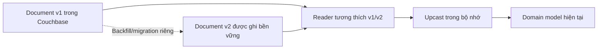
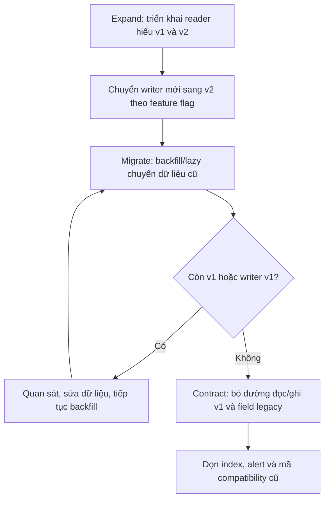
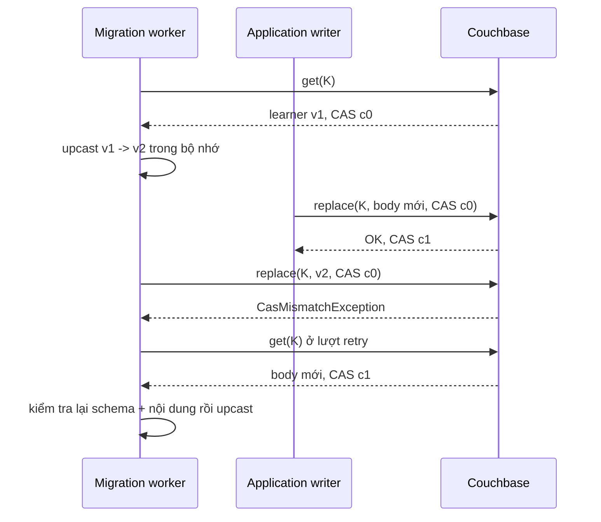
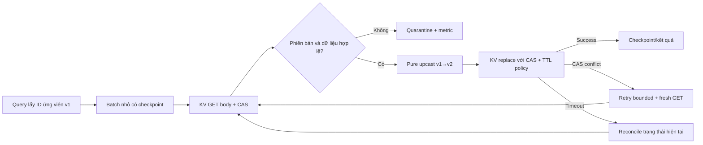

# Quản lý phiên bản tài liệu trong cơ sở dữ liệu không có lược đồ cứng

## 1. Vì sao Couchbase linh hoạt về lược đồ nhưng ứng dụng vẫn cần quản lý phiên bản?

Couchbase lưu document JSON mà không yêu cầu mọi document trong cùng collection có cấu trúc field giống hệt nhau. Trong một hệ thống dùng Spring Data Couchbase, điều này giúp thêm thuộc tính mới mà không cần thực hiện một câu lệnh `ALTER TABLE` kiểu cơ sở dữ liệu quan hệ. Tuy nhiên, **không có lược đồ cứng ở tầng lưu trữ không có nghĩa là không có hợp đồng dữ liệu**.

Một hệ thống đào tạo có thể lưu learner theo hai dạng:

**Document cũ — phiên bản lược đồ 1 (v1):**

```json
{
  "documentType": "learner",
  "tenantId": "acme",
  "learnerId": "learner-17",
  "name": "Minh Anh",
  "phone": "+84-xxx",
  "active": true
}
```

**Document mới — phiên bản lược đồ 2 (v2):**

```json
{
  "documentType": "learner",
  "schemaVersion": 2,
  "tenantId": "acme",
  "learnerId": "learner-17",
  "profile": {
    "displayName": "Minh Anh",
    "phoneNumber": "+84-xxx"
  },
  "preferences": {
    "emailUpdates": false
  },
  "active": true
}
```

Nếu code mới chỉ đọc `profile.displayName`, learner v1 có thể hiện tên rỗng. Nếu code cũ chỉ sửa `name`, document v2 không còn field `name` có thể khiến service cũ ghi dữ liệu sai. Nếu một job migration thay body bằng JSON chỉ có các field nó nhận biết, nó có thể xóa các field do service mới thêm. Đây là các lỗi **tương thích lược đồ (schema compatibility)**, không chỉ là lỗi parse JSON.

Trong module **SPRING_DATA_COUCHBASE**, quản lý tiến hóa dữ liệu phải đặt trong toàn bộ tầng truy cập: document mapping, Repository, `CouchbaseTemplate`, SQL++, bucket/scope/collection, index, CAS, TTL, transaction, API reactive và vận hành.

> **Nguyên tắc:** lược đồ có thể linh hoạt trong database, nhưng contract giữa document, ứng dụng, API và các tác vụ di trú phải được quản lý có chủ đích.

### 1.1. Mục tiêu bài học

Sau bài, người học có thể:

- Phân biệt **schema version** với CAS/`@Version`, version ứng dụng và thời điểm cập nhật.
- Thiết kế trường `schemaVersion` và quy tắc cho document chưa có trường đó.
- Đọc nhiều dạng document trong giai đoạn chuyển tiếp mà không phá vỡ dữ liệu.
- Chọn **expand–migrate–contract**, lazy migration, backfill hay copy/dual-read phù hợp.
- Viết chuyển đổi v1 → v2 bảo toàn field, có khả năng kiểm thử và xử lý trường hợp không chuyển đổi được.
- Áp dụng CAS cho việc cập nhật lược đồ khi vẫn có writer khác hoạt động.
- Lập kế hoạch index/SQL++, rollback, quan sát, TTL, transaction và tính tương thích giữa các phiên bản ứng dụng.

## 2. Bốn loại “version” rất dễ nhầm

Một document có thể đồng thời mang bốn loại thông tin phiên bản:

| Khái niệm | Ví dụ | Câu hỏi nó trả lời | Ai quản lý? |
| --- | --- | --- | --- |
| **Schema version** | `schemaVersion: 2` trong JSON | Body này theo hợp đồng cấu trúc nào? | Ứng dụng/quy trình migration |
| **CAS / `@Version`** | Token 64 bit metadata | Body đã thay đổi từ lần đọc hay chưa? | Couchbase, Spring Data ánh xạ |
| **Application release** | `learning-api 3.4.0` | Mã đang chạy có khả năng đọc/ghi format nào? | Quy trình phát hành |
| **Business revision** | `policyRevision: 12` | Quy tắc nghiệp vụ đã được phê duyệt ở lần nào? | Domain/application |

**CAS không phải schema version.** Một document v1 có thể được cập nhật hàng nghìn lần; CAS đổi nhưng `schemaVersion` vẫn là 1. Một bước di trú v1 → v2 làm CAS đổi, nhưng không thể suy phiên bản lược đồ từ giá trị CAS.

Trong Spring Data Couchbase:

```java
import org.springframework.data.annotation.Version;

@Version
private Long casVersion; // Metadata CAS, không phải schemaVersion.
```

Trường quản lý format nên là field domain thông thường:

```java
private Integer schemaVersion; // Có thể được lưu trong JSON body.
```

Nếu chọn tên `version` cho schema version, rất dễ va chạm về ý nghĩa với `@Version` và nhầm lẫn trong API, mapper hoặc tài liệu kỹ thuật. Đặt tên rõ **`schemaVersion`** và **`casVersion`** sẽ giảm rủi ro.

### 2.1. Vì sao `updatedAt` không thay thế schemaVersion?

Timestamp có thể bị sai giờ hệ thống, bị import lại hoặc không đổi khi sửa lược đồ. Một document được tạo năm trước có thể đã được migrate sang format mới; một document mới có thể được tạo bởi ứng dụng cũ trong quá trình rolling deployment. Do đó **thời gian tạo/cập nhật không xác định format**.

### 2.2. Có phải mọi document đều cần schemaVersion?

Không nhất thiết. Nếu mọi reader/writer đều hiểu một format duy nhất và dữ liệu tồn tại ngắn, việc lưu version riêng có thể không đáng chi phí. Nhưng khi document có tuổi thọ dài, nhiều service/phát hành cùng truy cập, có thay đổi không tương thích hoặc backfill kéo dài, **version tường minh là một công cụ đơn giản và có thể kiểm chứng**.

## 3. Phân loại thay đổi lược đồ theo mức tương thích

Không phải mọi thay đổi đều cần một cuộc di trú lớn:

| Thay đổi | Rủi ro | Cách tiếp cận ban đầu |
| --- | --- | --- |
| Thêm field **optional** | Reader cũ thường bỏ qua được; reader mới phải chịu được MISSING | Expand và mặc định hợp lệ |
| Thêm field bắt buộc | Document cũ thiếu giá trị | Tạm optional, backfill rồi mới enforce |
| Đổi tên `name` thành `profile.displayName` | Reader cũ và query cũ có thể không đọc được | Dual-read/compatibility, migration |
| Đổi kiểu `"120"` → `120` | Converter/query/index có thể sai | Chuyển đổi có validation và kiểm soát lỗi |
| Chuyển field phẳng thành nested | DTO/query/index thay đổi | Expand, dual-read, backfill, contract |
| Tách một document thành nhiều document | Thay đổi atomicity, key, query | Workflow/transaction và cutover |
| Đổi document ID/key format | Ảnh hưởng reference, lookup, idempotency | Alias/redirect/dual-read, không “rename” mù |
| Đổi scope/collection | Có thể cần copy và chuyển writer | Chuyển tuyến truy cập/di trú dữ liệu |
| Xóa field | Reader/job cũ có thể còn phụ thuộc | Chỉ contract sau khi xác minh usage |
| Thêm hoặc thay discriminator | Mapping polymorphic có thể sai | Compatibility giữa converter và dữ liệu |

Khi thay đổi chỉ là **một field tùy chọn mới**, có thể không cần cập nhật ngay tất cả document. Khi thay đổi làm code cũ không đọc/ghi được, phải xây dựng **giai đoạn tương thích**.

### 3.1. MISSING khác NULL và giá trị mặc định

Trong JSON/Couchbase SQL++, field có thể:

- **MISSING**: chưa tồn tại trong document.
- **NULL**: tồn tại nhưng giá trị là `null`.
- **Giá trị rõ ràng**: ví dụ `false`, `0`, `""` hoặc object rỗng.

Không coi ba trạng thái này tương đương trong mọi nghiệp vụ.

Ví dụ:

```json
{"preferences": {"emailUpdates": false}}
```

`false` có thể là lựa chọn hoặc mặc định an toàn được xác định khi migration; trong khi `preferences` MISSING biểu thị chưa có dữ liệu. **Không tự biến field thiếu thành opt-in = true**, nhất là với lựa chọn quyền riêng tư/tiếp thị.

Trong Java, kiểu primitive `boolean` có default `false`, nhưng `false` không cho biết field thật sự có mặt trong JSON hay chỉ do mapper tạo ra. Khi cần phân biệt, dùng kiểu nullable hoặc converter/validation có chủ đích.

Khi cần **thống kê** theo version trên dữ liệu legacy, SQL++ có thể biểu diễn một giá trị đọc thay thế, ví dụ:

```sql
SELECT META(d).id AS documentId,
       IFMISSINGORNULL(d.schemaVersion, 1) AS effectiveSchemaVersion
FROM `learning`.`training`.`learners` AS d
WHERE d.documentType = "learner";
```

`IFMISSINGORNULL` trong truy vấn chỉ tạo **giá trị biểu diễn khi đọc**; nó không ghi `schemaVersion=1` vào document và không xác minh rằng mọi document thiếu version thật sự thuộc v1. Quy tắc mặc định phải được chấp nhận dựa trên dữ liệu và loại document trước khi dùng cho migration.

## 4. Quy ước trường phiên bản và version mặc định cho dữ liệu legacy

Một quy ước đơn giản:

```json
{
  "documentType": "learner",
  "schemaVersion": 2,
  "tenantId": "acme",
  "learnerId": "learner-17"
}
```

Quy tắc:

1. `schemaVersion` là **số nguyên dương** mô tả contract của **loại document**.
2. Mỗi bước chuyển đổi nêu rõ nguồn/đích, ví dụ `Learner v1 → Learner v2`.
3. Writer mới ghi **phiên bản cụ thể mà nó hỗ trợ**, không ghi “latest” mơ hồ.
4. Reader phải quyết định có chấp nhận `v1`, `v2`, unknown future version hay không.
5. Document legacy không có trường version chỉ được coi là `v1` khi quy ước đó đã được chứng minh đúng cho **toàn bộ tập dữ liệu liên quan**.
6. Không tự hạ cấp document future version rồi ghi lại vì có thể xóa field mới.

**Không có một bảng schemaVersion toàn cluster bắt buộc**. Một collection có thể chứa nhiều document type; mỗi type có thể có tiến hóa riêng. Chẳng hạn Learner v2 không liên quan Order v2.

### 4.1. Quy tắc cho document chưa có version

Giả sử một collection cũ có hai dạng JSON. Không được mặc định tất cả document thiếu `schemaVersion` là Learner v1 nếu có cả audit event hoặc enrollment.

Dùng bộ lọc định danh đáng tin cậy:

```sql
SELECT META(d).id AS documentId,
       d.documentType,
       d.schemaVersion
FROM `learning`.`training`.`learners` AS d
WHERE d.documentType = "learner"
  AND d.tenantId = $tenantId;
```

Nếu dữ liệu legacy cũng thiếu `documentType`, cần xác định dạng document qua namespace key, collection, field đặc trưng hoặc manifest đã được kiểm chứng. **Không bịa một quy tắc suy đoán rồi ghi đè document không khớp.**

## 5. Mô hình tiến hóa v1 → v2 có thể hiểu và kiểm thử

Giả sử hệ thống quyết định:

- `name` chuyển thành `profile.displayName`.
- `phone` chuyển thành `profile.phoneNumber`.
- Thêm `preferences.emailUpdates` với mặc định `false` đã được nghiệp vụ phê duyệt.
- Giữ nguyên `documentType`, `tenantId`, `learnerId`, `active` và các field chưa biết.
- Gán `schemaVersion = 2` **sau khi** xây dựng body v2 hợp lệ.

### 5.1. Quy tắc chuyển đổi

```text
Input v1:
  name="Minh Anh"
  phone="+84-xxx"
  active=true

Output v2:
  profile.displayName="Minh Anh"
  profile.phoneNumber="+84-xxx"
  preferences.emailUpdates=false
  active=true
  schemaVersion=2
```

Không có ý nghĩa nghiệp vụ nào cho việc biến một `name` trống thành `"Unknown"` mà không được quy định; nếu thiếu dữ liệu bắt buộc, hãy **cách ly document để xử lý** hoặc thực hiện policy làm sạch dữ liệu được phê duyệt.

### 5.2. Hàm upcast pure ở ranh giới JSON

Một hướng dễ kiểm soát là chuyển đổi JSON ở adapter, giữ riêng logic chuyển schema với logic ghi database:

```java
import com.couchbase.client.java.json.JsonObject;

public final class LearnerV1ToV2 {
    private LearnerV1ToV2() {}

    public static JsonObject convert(JsonObject source) {
        Integer declared = source.getInt("schemaVersion");
        int version = declared == null ? 1 : declared;

        if (version == 2) {
            // Bản v2 giữ nguyên; không tự hạ cấp.
            return JsonObject.fromJson(source.toString());
        }
        if (version != 1) {
            throw new UnsupportedSchemaVersionException(version);
        }
        if (!"learner".equals(source.getString("documentType"))) {
            throw new IllegalArgumentException("Không phải learner");
        }

        String name = source.getString("name");
        if (name == null || name.isBlank()) {
            throw new IllegalArgumentException("Learner v1 thiếu name");
        }

        // Sao chép toàn bộ JSON trước, không mutate source.
        JsonObject target = JsonObject.fromJson(source.toString());

        JsonObject profile = JsonObject.create()
            .put("displayName", name)
            .put("phoneNumber", source.getString("phone"));

        target.put("profile", profile);
        target.put("preferences", JsonObject.create()
            .put("emailUpdates", false));

        target.removeKey("name");
        target.removeKey("phone");
        target.put("schemaVersion", 2);
        return target;
    }
}

final class UnsupportedSchemaVersionException
        extends RuntimeException {
    UnsupportedSchemaVersionException(int version) {
        super("Không hỗ trợ learner schemaVersion=" + version);
    }
}
```

Hàm chuyển đổi:

- Không đọc/ghi Couchbase: dễ unit test.
- Copy JSON thay vì dựng object chỉ gồm một vài field, giảm nguy cơ mất dữ liệu không biết trước.
- Không tự gán CAS.
- Chỉ chấp nhận version xác định và loại document xác định.
- Có thể gọi nhiều lần trên v2 mà không làm phát sinh thay đổi nội dung theo quy ước.
- Cố tình không đưa dữ liệu thiếu `name` thành bản v2 có vẻ hợp lệ.

**Giới hạn cần thiết kế thêm:** nếu v1 đã có field `profile` hoặc `preferences` vì các writer cũ ghi không đồng nhất, hàm này có thể ghi đè field đó. Production cần quy tắc giải quyết xung đột giữa field cũ/mới, phát hiện dữ liệu bất thường, và test với đầy đủ các biến thể thực tế.

### 5.3. Không xóa field legacy quá sớm

Hàm ở trên minh họa phép **upcast đầy đủ** sang v2 sau khi đã quyết định ngừng phụ thuộc field cũ. Khi chạy rolling deployment có writer v1, có thể cần giai đoạn **chưa xóa `name` và `phone`**, hoặc dùng một contract dual-read/dual-write được kiểm soát. Không áp dụng trực tiếp một hàm “v2 only” vào toàn bộ dữ liệu khi còn service chỉ hiểu v1.

## 6. Phân biệt chuyển đổi khi đọc và di trú bền vững

**Read upcasting**: lúc đọc body v1, tạo view/domain object theo cấu trúc v2 **trong bộ nhớ**, nhưng không nhất thiết ghi document trở lại Couchbase.

**Persistent migration**: thực sự ghi document v2 vào database, làm thay đổi body và CAS, có thể ảnh hưởng TTL, index, audit và các writer khác.



Ưu điểm của **read upcast**:

- Triển khai code đọc format mới trước, giảm phụ thuộc vào tốc độ backfill.
- Cho phép rolling deployment và rollback một số thay đổi.
- Không phát sinh mutation/TTL thay đổi chỉ vì ai đó GET document.
- Có thể phát hiện invalid version và báo lỗi có cấu trúc.

Hạn chế:

- Mỗi lần đọc legacy tốn conversion.
- Nếu còn rất nhiều v1, complex query/index phải hỗ trợ cả hai dạng.
- Ghi trở lại document phải có chiến lược rõ, tránh hạ cấp hoặc mất field.
- Không đủ để loại bỏ code cũ khi chưa migrate hoặc chưa ngừng legacy writers.

### 6.1. Không tự động “migrate on every read” thiếu kiểm soát

Viết lại document ngay trong một GET có thể:

- Tăng tải mutation bất ngờ khi traffic đọc lớn.
- Thay CAS khiến một writer khác đang update bị conflict.
- Động tới expiry/TTL và metadata.
- Gây timeout/latency cho endpoint chỉ cần đọc.
- Tạo retry storm nếu nhiều reader cùng nâng một document.

Nếu muốn lazy migration, phải đặt **ngân sách, CAS condition, observability và recovery**; không chỉ đặt một lệnh `save` bên trong getter.

## 7. Các chiến lược tiến hóa lược đồ phổ biến

| Chiến lược | Cách làm | Ưu điểm | Rủi ro/điều kiện |
| --- | --- | --- | --- |
| **Read-old/write-new** | Reader hiểu v1/v2, mọi write mới theo v2 | Tích lũy chuyển đổi theo hoạt động | Document ít dùng vẫn v1 |
| **Lazy migration** | Chuyển v1 khi được truy cập theo policy | Không quét toàn bộ ngay | Contention với traffic, latency/TTL |
| **Eager backfill** | Job quét document legacy và ghi v2 | Có thể đo tiến độ, chủ động hoàn thành | Tải cluster/index, conflict, restart |
| **Expand–migrate–contract** | Cho phép hai dạng, chuyển dần, bỏ dạng cũ sau | Hợp rolling deployment/rollback | Tốn thời gian duy trì compatibility |
| **Copy to new collection** | Ghi document v2 vào keyspace mới rồi cutover | Tách rủi ro/kiểm thử song song | Dual-write/CDC/cutover phức tạp |
| **Dual-read** | Thử đọc format/key mới rồi fallback cũ | Hỗ trợ di trú keys/collection | Chính sách ưu tiên và tính nhất quán |
| **Dual-write** | Một logical mutation ghi cả cũ và mới | Giúp giai đoạn chuyển đổi | Khó atomic, drift, lỗi partial commit |
| **On-demand projection** | Dùng converter/query để hiển thị thống nhất | Không cần rewrite ngay | Legacy tồn tại lâu, chi phí query |

**Lựa chọn phải dựa trên điều kiện thật:** kích thước dữ liệu, thời gian sống, khả năng đọc/ghi của từng service, giới hạn TTL, yêu cầu rollback, và bất biến liên document.

### 7.1. Thông thường nên ưu tiên expand–migrate–contract



Thứ tự quan trọng: **reader tương thích đi trước writer tạo format mới**; sau đó mới loại bỏ field/cách đọc cũ. Đảo thứ tự có thể khiến code cũ không đọc được dữ liệu mới hoặc làm mất field v2.

## 8. Ma trận tương thích giữa các phiên bản ứng dụng và document

Giả sử A1 chỉ biết `name` v1, A2 hiểu cả v1/v2, A3 chỉ hiểu v2:

| Application | Đọc v1 | Đọc v2 | Ghi v1 | Ghi v2 |
| --- | --- | --- | --- | --- |
| **A1 — legacy** | Có | Không chắc, có nguy cơ sai | Có | Không |
| **A2 — bridge** | Có, upcast | Có | Có thể nếu policy chuyển tiếp | Có |
| **A3 — v2 only** | Không | Có | Không | Có |

Một phương án rolling deployment an toàn thường là:

1. Đưa A2 lên **toàn bộ reader path**.
2. Xác minh A1 writer đã dừng, hoặc có quy ước tương thích đủ mạnh trước khi ghi v2.
3. Bật writer v2.
4. Backfill v1.
5. Đo tồn dư v1 và lỗi converter.
6. Chỉ khi không còn v1/legacy writer, triển khai A3 và loại bỏ nhánh cũ.

Nếu A1 còn chạy mà A2 đã xóa `name` khi ghi v2, A1 có thể tiếp tục ghi sai hoặc mất thông tin. Feature flag “write v2” phải có điều kiện bật rõ; không xem mọi rolling deployment đều tương thích mặc định.

### 8.1. Forward compatibility có giới hạn

Một A2 chỉ hỗ trợ đến v2 không nên tự coi document `schemaVersion=3` là v2 rồi ghi đè. Nó có thể vô tình xóa field mà A3 mới bổ sung.

Một policy an toàn cho unknown future version là:

- Đọc và báo `UnsupportedSchemaVersionException` hoặc chuyển sang luồng chỉ đọc theo contract được phê duyệt.
- Không ghi whole document khi không hiểu format.
- Theo dõi số document future-version xuất hiện trong service cũ.
- Đưa compatibility rule vào kiểm thử deploy/rollback.

Nếu tổ chức cần hỗ trợ forward-compatible readers, phải định nghĩa rõ field nào được bỏ qua và đường ghi nào **không được phá dữ liệu chưa biết**.

## 9. Spring Data Couchbase mapping khi dữ liệu tồn tại nhiều format

Spring Data Couchbase cung cấp document mapping giữa JSON và Java entity. Ví dụ một entity v2:

```java
import org.springframework.data.annotation.Id;
import org.springframework.data.annotation.Version;
import org.springframework.data.couchbase.core.mapping.Document;

@Document
public class LearnerDocument {
    @Id
    private String id;

    @Version
    private Long casVersion;

    private Integer schemaVersion;
    private String documentType;
    private String tenantId;
    private String learnerId;
    private Profile profile;
    private Preferences preferences;
    private Boolean active;

    protected LearnerDocument() {}

    public String getId() { return id; }
    public Long getCasVersion() { return casVersion; }
    public Integer getSchemaVersion() { return schemaVersion; }
    public String getTenantId() { return tenantId; }
    public Profile getProfile() { return profile; }

    public record Profile(String displayName, String phoneNumber) {}
    public record Preferences(Boolean emailUpdates) {}
}
```

Những điều cần chú ý:

- `schemaVersion` là **field JSON nghiệp vụ**.
- `casVersion` do `@Version` quản lý, không cần và không nên được tự nhúng như field JSON schema thông thường.
- Entity v2 có `profile`, nhưng document v1 chỉ có `name`; converter mặc định không thể tự biết “name phải thành profile.displayName” nếu chưa cấu hình tương thích.
- Một `@Version` hợp lệ **không bảo đảm mapping schema đã đúng**.
- `@Id` xác định document key; nó cũng không thể tự nhận ra một key format legacy khi document đã chuyển collection/key.

### 9.1. Các cách đọc legacy bằng Spring Data

Có thể thiết kế adapter với một trong các lựa chọn:

1. **DTO v1 và v2 riêng** ở biên lưu trữ, sau đó map sang một domain model hiện tại.
2. **Custom reading converter** chỉ được dùng khi đã kiểm soát input/output và metadata CAS/ID theo contract Spring Data Couchbase thực tế.
3. **KV SDK đọc JSON thô**, upcast thành format chuẩn trong một adapter, rồi map sang domain.
4. **Query projection cho read-only views**, không dùng projection partial như persistence entity để `save`.

Mỗi cách có trade-off. Custom converter có thể tạo ra entity đúng field nhưng nếu làm mất ID/CAS thì stale update protection biến mất. Vì vậy phải test **cả dữ liệu lẫn metadata** khi chuyển từ raw document sang entity.

### 9.2. Không dùng `@Version` để chứa schemaVersion

Anti-pattern:

```java
@Version
private Long schemaVersion; // SAI về ý nghĩa trong Spring Data Couchbase.
```

Field annotated sẽ được hiểu theo cơ chế version/CAS của Spring Data, không phải số phiên bản cấu trúc JSON của ứng dụng. Cần hai field riêng nếu cần cả hai khái niệm.

## 10. Repository, Template và SDK là các đường ghi khác nhau

Một hệ thống migration có thể trộn:

- `CouchbaseRepository<LearnerDocument, String>`.
- `CouchbaseTemplate` entity operations.
- SDK `Collection.get/replace/mutateIn`.
- SQL++ `UPDATE` hoặc một job backfill.
- Reactive repository và reactive SDK.

Mỗi đường ghi cần kiểm tra:

| Câu hỏi | Ý nghĩa |
| --- | --- |
| Có đọc được v1 **và** v2 chưa? | Tránh mất dữ liệu legacy |
| Có giữ ID/CAS của snapshot đã đọc? | Tránh lost update |
| Có giữ field không biết không? | Tránh body partial replace làm mất dữ liệu |
| Có đúng bucket/scope/collection? | Tránh migrate nhầm keyspace |
| Có bảo toàn TTL/expiry không? | Tránh hồi sinh hoặc làm hết hạn sai |
| Có preserve type discriminator/mapping metadata? | Tránh Spring Data không nhận entity |
| Có retry đúng loại lỗi không? | CAS mismatch khác timeout không rõ commit |
| Có chặn schemaVersion tương lai không? | Tránh writer cũ hạ cấp dữ liệu |

Không chỉ cần “converter chạy qua được” mà phải chứng minh **bản ghi sau update vẫn giữ invariant, metadata và dữ liệu của writer khác**.

### 10.1. `CouchbaseTemplate.save` và repository versioned save

Các đường entity save hỗ trợ `@Version` có thể dùng CAS để tránh stale update. Tuy nhiên, không suy rằng **mọi** overload Template, mọi SDK upsert hay SQL++ UPDATE tự đọc annotation `@Version`. Hãy xác minh API đang sử dụng với dependency cụ thể.

Một migration trực tiếp qua SDK `replace` có thể an toàn khi truyền CAS; một câu SQL++ UPDATE do application tự viết cần concurrency predicate riêng, không tự kế thừa `@Version` từ class Java.

## 11. Di trú in-place an toàn bằng CAS

Khi các writer vẫn hoạt động, một job migration không nên thực hiện:

```text
GET document v1
convert sang v2
UPSERT document v2 không có điều kiện
```

Giữa GET và UPSERT, learner có thể đã được người dùng cập nhật. UPSERT body từ bản cũ sẽ xóa mất thay đổi vừa ghi. Đây chính là lỗi **lost update** trong quá trình migration.

Cách tiếp cận có điều kiện:



**CAS chỉ bảo vệ job migration nếu các writer khác không cố tình ghi đè vô điều kiện.** Nếu vẫn còn SDK `upsert` body cũ không CAS, writer đó có thể hạ cấp document sau khi migration thành công. Phải cập nhật concurrency policy và giai đoạn chuyển writer trước hoặc đồng thời với migration.

### 11.1. Mã Java SDK cho một lần nâng version

```java
import com.couchbase.client.core.error.CasMismatchException;
import com.couchbase.client.java.Collection;
import com.couchbase.client.java.json.JsonObject;
import com.couchbase.client.java.kv.GetResult;

import static com.couchbase.client.java.kv.ReplaceOptions.replaceOptions;

public final class LearnerMigrationWorker {
    private final Collection learners;

    public LearnerMigrationWorker(Collection learners) {
        this.learners = learners;
    }

    public boolean migrateOneAttempt(String documentId) {
        GetResult observed = learners.get(documentId);
        JsonObject source = observed.contentAsObject();

        Integer rawVersion = source.getInt("schemaVersion");
        int schemaVersion = rawVersion == null ? 1 : rawVersion;

        if (schemaVersion == 2) {
            return false; // Already migrated; không cần mutation.
        }
        if (schemaVersion != 1) {
            throw new UnsupportedSchemaVersionException(schemaVersion);
        }

        JsonObject upgraded = LearnerV1ToV2.convert(source);

        // Phải dùng CAS của chính body vừa upcast.
        // preserveExpiry(true) cần được kiểm chứng trên SDK/version triển khai.
        learners.replace(
            documentId,
            upgraded,
            replaceOptions()
                .cas(observed.cas())
                .preserveExpiry(true));

        return true;
    }
}
```

Đoạn code:

- Không tự tăng CAS; CAS từ `GetResult.cas()`.
- Chuyển đổi JSON **trong bộ nhớ** trước khi mutation.
- Chỉ thay document nếu phiên bản chưa đổi.
- Không ghi lại document đã v2, giảm mutation vô ích.
- Giữ expiry theo tùy chọn SDK được chọn; phải test với TTL thực.
- Một lượt thử có thể gặp `CasMismatchException`, `DocumentNotFoundException` hoặc timeout.

**Lưu ý tính đúng:** cú pháp và hành vi option `preserveExpiry(true)` cần đối chiếu đúng Java SDK đang triển khai. Nếu dữ liệu legacy vốn có TTL, cần tránh thay đổi ngày hết hạn dù CAS write thành công. Nếu áp dụng chính sách expiry mới khi nâng schema, phải mô tả rõ business decision đó.

### 11.2. Retry sau CAS mismatch: đọc lại từ đầu

Một vòng xử lý đúng:

```java
import com.couchbase.client.core.error.CasMismatchException;

public boolean migrateWithBoundedRetry(String documentId) {
    final int maxAttempts = 3;

    for (int attempt = 1; attempt <= maxAttempts; attempt++) {
        try {
            return migrateOneAttempt(documentId);
        } catch (CasMismatchException conflict) {
            if (attempt == maxAttempts) {
                throw conflict;
            }
            // Production: backoff ngắn, jitter, tổng deadline.
        }
    }

    throw new IllegalStateException("Nhánh không thể tới");
}
```

Method giả định cùng lớp với `migrateOneAttempt`. Sau mỗi conflict, hàm **đọc lại body/CAS** rồi quyết định có còn cần migration không. Không gọi lại `replace` với bản đã upcast từ snapshot cũ, không lấy CAS mới rồi áp vào body cũ.

Để giảm contention khi backfill trên cluster bận, cần giới hạn concurrency, số lần thử và tốc độ mutation. Đừng retry vô hạn một hot key.

### 11.3. Idempotency của phép upcast khác idempotency của request

Một converter đúng nên tạo ra cùng định dạng v2 khi được gọi lặp trên document đã là v2. Nhưng một request migration bị timeout **không chắc chắn đã commit hay chưa**.

Sau timeout:

1. Đọc lại document bằng ID.
2. Xác định phiên bản hiện hành và các invariant.
3. Nếu đã v2 hợp lệ, có thể coi mục tiêu migration đã đạt.
4. Nếu còn v1, đánh giá lại và quyết định thử lại.
5. Nếu document biến mất/hết TTL, xử lý theo policy lifecycle.
6. Không phát lại các side effect ngoài Couchbase nếu chưa đối soát.

Không suy luận “CAS mismatch nghĩa là lần ghi trước của migration đã thành công”; writer khác cũng có thể làm CAS đổi.

## 12. Tính chất của một converter/migration có thể tin cậy

Một converter tốt cần những điều sau:

**Deterministic** — cùng input tạo cùng output, trừ khi business quy định dữ liệu phụ trợ có version và nguồn rõ.

**Re-runnable** — sau khi chạy một phần, job có thể tiếp tục mà không làm hỏng document đã nâng cấp.

**Validated** — document thiếu `name`, `profile` sai kiểu, tenant không hợp lệ hoặc schema version lạ không bị biến thành “v2 thành công” giả.

**Loss-aware** — nêu rõ field nào bị xóa, đổi tên, chuyển kiểu hoặc bỏ đi.

**CAS-safe** — không mất thay đổi của writer cạnh tranh khi ghi.

**Observable** — có thể đếm migrated/skipped/conflicted/rejected/failed và truy nguyên ID lỗi.

**Backwards-compatible trong rollout** — không loại bỏ field cũ trước khi mọi reader cần thiết đã chuyển.

### 12.1. Xử lý unknown fields

Giả sử writer A đã thêm:

```json
{
  "preferredLanguage": "vi"
}
```

vào learner v1 trước khi migration chạy. Một converter chỉ dựng body v2 từ sáu field cố định có thể làm mất `preferredLanguage`. Sao chép JSON gốc rồi thay các field đích giúp giữ field không biết trước.

Tuy nhiên, **giữ unknown fields không đồng nghĩa tất cả field đều hợp lệ mãi mãi**. Một số field là bí mật, dữ liệu không nên sao chép, hoặc đã bị deprecated vì lý do pháp lý. Policy migration phải chỉ ra field nào được giữ, loại bỏ, mã hóa/chuyển nơi lưu và lý do.

### 12.2. Xử lý thông tin v1 đã mâu thuẫn với v2

Ví dụ một document trong giai đoạn dual-write đã có cả:

```json
{
  "name": "Minh Anh",
  "profile": {
    "displayName": "Minh A."
  }
}
```

Không được mặc định overwrite `profile.displayName` bằng `name` hoặc ngược lại. Cần quy tắc nguồn sự thật (*source of truth*) và thứ tự ưu tiên theo giai đoạn rollout.

Có thể chọn:

- Nếu version=1, `name` là authoritative; `profile` phải được đối soát.
- Nếu version=2, `profile.displayName` là authoritative; `name` chỉ là compatibility copy.
- Nếu hai nguồn khác nhau ngoài rule đã biết, đưa vào quarantine cho vận hành xem xét.

Quy tắc này phải được test, không chỉ mô tả bằng lời.

## 13. Expand: thêm schema mới mà không làm gãy reader cũ

Giai đoạn **expand** tạo không gian tương thích để chuyển dữ liệu từ từ.

Ví dụ muốn đổi `name` thành `profile.displayName`:

1. Reader mới vẫn đọc được `name` v1.
2. Reader mới ưu tiên `profile.displayName` trên v2.
3. Writer mới tạm thời có thể ghi thêm legacy field theo policy nếu còn reader v1.
4. Query/DTO mới không giả định mọi document có `profile`.
5. Metrics ghi nhận tỷ lệ v1/v2 và lỗi fallback.
6. Feature flag cho phép tắt writer v2 nếu phát hiện bất thường.

Ở bước này **không nên xóa toàn bộ `name`** chỉ vì build mới đã lên một server: còn worker cũ, thiết bị offline, scheduled job, message consumer hoặc một cluster khác có thể vẫn cần field đó.

### 13.1. Dual-write có chi phí nhất quán

Khi writer lưu cả `name` và `profile.displayName` trong **cùng document**, hai field có thể được cập nhật bằng **một mutation nguyên tử trên document** (whole-document replace có CAS hoặc multi-spec sub-document phù hợp).

Nếu ghi hai field trong **hai document/collection khác nhau**, các mutation độc lập không tự atomic. Cần transaction hoặc cơ chế reconcile/cutover, tùy kiến trúc.

Trong mọi trường hợp, phải có nguồn authoritative và rule xử lý drift. “Ghi cả hai cho chắc” không đủ nếu một writer khác chỉ ghi một bên.

## 14. Migrate: backfill dữ liệu lớn theo lô

Backfill cần được thiết kế như một **job có thể dừng và tiếp tục**. Không nên tải toàn collection vào bộ nhớ rồi thay tất cả body trong một lần.

Một pipeline thực tế:



### 14.1. SQL++ tìm ứng viên legacy

Ví dụ:

```sql
SELECT META(l).id AS documentId,
       l.tenantId,
       l.schemaVersion
FROM `learning`.`training`.`learners` AS l
WHERE l.documentType = "learner"
  AND (
      l.schemaVersion IS MISSING
      OR l.schemaVersion = 1
  );
```

Khi tên collection hoặc type discriminator khác, phải dùng contract thực tế. Không nối input tenant hay keyspace vào SQL string tùy ý. Query parameter dành cho giá trị, còn keyspace nên cố định theo cấu hình cho phép.

Cần đặc biệt chú ý:

- **MISSING** không giống NULL. Nếu policy xem cả NULL là v1, phải xét thêm `IS NULL` và test dữ liệu.
- Query trên index có thể không tự bao phủ document thiếu field trong index key. Phải kiểm tra **index definition, EXPLAIN và dữ liệu thực tế**.
- Kết quả query là **danh sách ứng viên**, không phải lock. Trước khi ghi phải KV GET lại.
- Nếu query dùng `REQUEST_PLUS`, chỉ giải quyết visibility theo scan consistency; không tránh writer chen vào sau query.
- Không coi `SELECT COUNT(*)` chạy một lần là bằng chứng tuyệt đối mọi document đã chuyển xong trong khi writer v1 còn hoạt động.

### 14.2. Tránh phân trang OFFSET khi tập dữ liệu đang thay đổi

Nếu backfill chọn page bằng:

```sql
SELECT META(l).id
FROM `learning`.`training`.`learners` AS l
WHERE l.schemaVersion = 1
LIMIT 100 OFFSET 100;
```

thì sau khi page đầu được nâng lên v2, tập `WHERE schemaVersion = 1` đã thu hẹp. `OFFSET 100` của page sau có thể **bỏ qua** một phần document chưa xử lý.

Các phương án an toàn hơn:

- Keyset pagination với **cursor ổn định theo ID**, và query/index được kiểm chứng.
- Dùng batch scan/chunk theo phân vùng key định trước.
- Dùng queue chứa danh sách ID cần nâng, có dedupe/checkpoint.
- Quét lặp tới khi đủ điều kiện hoàn thành và writer cũ đã dừng.

Ví dụ keyset mang ý tưởng, cần đối chiếu index và query plan:

```sql
SELECT RAW META(l).id
FROM `learning`.`training`.`learners` AS l
WHERE l.documentType = "learner"
  AND (l.schemaVersion IS MISSING OR l.schemaVersion = 1)
  AND META(l).id > $lastId
ORDER BY META(l).id
LIMIT $batchSize;
```

Nếu trong quá trình scan một document được tạo/cập nhật thành legacy ở ID **nhỏ hơn cursor**, nó có thể bị bỏ qua trong pass đó. Vì vậy cần **ngăn writer v1 tạo dữ liệu mới trước khi chốt**, hoặc thực hiện các pass đối soát sau.

### 14.3. Checkpoint và khả năng restart

Một job nên lưu ngoài hoặc trong một kho trạng thái được quy định:

```json
{
  "migrationId": "learner-schema-v1-to-v2-2026",
  "collection": "learning.training.learners",
  "lastProcessedId": "learner::acme::learner-01700",
  "attempted": 1700,
  "migrated": 1650,
  "alreadyCurrent": 30,
  "conflicted": 15,
  "rejected": 5
}
```

Đây là ví dụ **trạng thái job nghiệp vụ**, không phải metadata Couchbase tự tạo. Nếu dùng nhiều worker, cần partition/cursor theo worker, tránh một checkpoint bị ghi đè.

Checkpoint nên được cập nhật **sau khi** xử lý/kết quả của batch được ghi nhận phù hợp. Nếu job crash giữa mutation và checkpoint, lần chạy sau có thể xử lý lại một document; phép upcast và điều kiện version phải hỗ trợ điều này.

### 14.4. Giới hạn tải và backpressure

Không chạy một triệu `replace` đồng thời rồi hy vọng cluster tự cân bằng. Nên đặt:

- Số worker/concurrency.
- Batch size và tốc độ mutation.
- Giới hạn bộ nhớ; không giữ full body của cả collection.
- Timeout/deadline và retry budget.
- Backoff/jitter khi CAS conflict hoặc throttling.
- Cảnh báo CPU, disk, network, index lag, KV latency.
- Thời gian chạy thấp điểm và khả năng pause/stop bằng feature flag.

Không đánh đổi correctness để đổi lấy tốc độ. Nếu tăng contention gây thất bại cho request người dùng, job cần có khả năng giảm tốc hoặc dừng.

## 15. Contract: chỉ loại bỏ legacy format sau khi có bằng chứng

Giai đoạn **contract** là bước rủi ro cao nhất vì loại bỏ đường đọc/ghi cũ.

Các điều kiện nên có:

1. Không còn phiên bản service nào **chỉ hiểu v1**.
2. Không còn worker/job/event consumer nào có thể tạo lại v1.
3. Dashboard cho thấy số v1 và invalid document đã về ngưỡng chấp nhận/zero theo policy.
4. Các bản v1 còn lại đã được xử lý hoặc có exception list được phê duyệt.
5. Query, index, DTO, API, cache và hệ thống phân tích không còn phụ thuộc field legacy.
6. Có kế hoạch rollback code mà **không yêu cầu dữ liệu phải rollback mất thông tin**.
7. Các test production-like đã chạy cả mixed-schema và v2-only.
8. Có snapshot/backup và khôi phục theo yêu cầu của hệ thống.

Sau đó mới:

- Ngừng viết `name`/`phone` cũ.
- Di trú phần còn lại.
- Xóa compatibility branch và index legacy không cần thiết.
- Cập nhật data contract và tài liệu vận hành.

Nếu một client offline lâu ngày vẫn gửi payload v1, server cần biết xử lý qua upcast/validation hoặc từ chối với lỗi rõ ràng. Không cho old payload làm hạ cấp document v2.

## 16. Index và SQL++ trong giai đoạn tồn tại v1/v2

Một query cũ:

```sql
SELECT l.learnerId, l.name
FROM `learning`.`training`.`learners` AS l
WHERE l.tenantId = $tenantId;
```

có thể trả `MISSING` cho `name` của v2.

Một read-only view chuyển tiếp có thể dùng:

```sql
SELECT l.learnerId,
       CASE
           WHEN l.schemaVersion = 2
                THEN l.profile.displayName
           ELSE l.name
       END AS displayName
FROM `learning`.`training`.`learners` AS l
WHERE l.tenantId = $tenantId
  AND l.documentType = "learner";
```

**Đây là compatibility query**; nó không thay migration logic, không tự bảo toàn dữ liệu khi lưu và cần test với document có field thiếu, NULL, sai kiểu và future schemaVersion.

### 16.1. Field chuyển từ phẳng sang nested ảnh hưởng index

Trước migration, index có thể phục vụ tìm theo `name`; sau migration, query dùng `profile.displayName` có thể cần index mới. Một kế hoạch an toàn:

1. Tạo index mới phù hợp query v2 và kiểm tra build/ready.
2. Dùng `EXPLAIN` và đo latency.
3. Triển khai query tương thích v1/v2 hoặc chuyển tuyến có kiểm soát.
4. Backfill data.
5. Sau khi không còn dependency v1, bỏ index legacy nếu thích hợp.

Không xóa index cũ ngay khi vừa deploy query mới. Một vài job/reporting có thể vẫn tham chiếu field cũ.

### 16.2. MISSING có thể làm sai số đếm hoặc filter

Tùy định nghĩa index, document không có field trong index key có thể không được index như các document có giá trị. Với query kiểm kê v1 thiếu `schemaVersion`, cần **xác minh index thực sự bao phủ tập MISSING**, không chỉ chạy query trên dữ liệu v2 rồi thấy kết quả đẹp.

Sử dụng test dataset gồm:

- `schemaVersion` MISSING.
- `schemaVersion` NULL.
- `schemaVersion` = 1.
- `schemaVersion` = 2.
- Unknown version.
- Document type khác trong cùng collection.
- Document expired và wrong-tenant (để xác nhận policy truy vấn).

### 16.3. SQL++ UPDATE không tự dùng Spring Data `@Version`

Một câu lệnh:

```sql
UPDATE `learning`.`training`.`learners` AS l
SET l.schemaVersion = 2
WHERE l.schemaVersion = 1;
```

**không phải một migration hợp lệ** cho ví dụ này. Nó chỉ đổi nhãn version mà chưa đổi `name/phone` sang `profile`, khiến reader v2 tin nhầm body đã được nâng.

Ngoài ra, SQL++ mutation do application tự viết không tự kế thừa CAS condition từ annotation `@Version` trên Java entity. Khi mutation concurrent, phải có policy riêng; với phép chuyển đổi phức tạp trên một document, SDK KV GET + CAS replace thường dễ kiểm chứng hơn.

## 17. TTL, expiration và tài liệu đã bị xóa trong lúc migration

Một learner document có thể hết hạn vì chính sách lưu trữ (ví dụ session, temporary profile) hoặc bị xóa theo yêu cầu nghiệp vụ.

```text
T0 migration GET K -> body v1, CAS c0
T1 K hết TTL hoặc bị xóa bởi worker khác
T2 migration REPLACE K, CAS c0
```

Lệnh replace có thể nhận not-found. Không đặt version null rồi `insert` để “hồi sinh” document đã hết hạn/xóa, trừ khi nghiệp vụ có workflow tái tạo rõ ràng.

### 17.1. Giữ expiry không đồng nghĩa giữ quyền truy cập

Một job migration phải kiểm tra:

- Document có TTL hay được giữ lâu dài?
- Mutation `replace` có đang bảo toàn expiry hay làm đặt lại?
- Có bucket max TTL hoặc policy cấp collection?
- Document có được phép truy cập/migrate sau khi người dùng yêu cầu xóa?
- Có tombstone hoặc retention policy riêng?
- Nếu document tạo lại cùng key, nó có còn cùng business identity không?

CAS là cơ chế phiên bản, không tự quản lý data retention, privacy hoặc expiry.

### 17.2. Di trú có thể làm thay đổi thời điểm hết hạn nếu thiếu kiểm soát

Một thay đổi metadata nhỏ như `schemaVersion` cũng là mutation. Nếu phương thức ghi đặt lại TTL, job có thể vô tình kéo dài hoặc rút ngắn vòng đời dữ liệu. Phải test với document có expiry ngắn và dài, kiểm chứng cách dùng preserve expiry trên phiên bản SDK và cấu hình bucket/collection.

## 18. Reactive migration: không dùng resubscription như “exactly once”

Một hệ thống reactive có thể cần nâng version khi gặp document legacy. Với SDK reactive, pipeline đọc body/CAS, upcast rồi ghi có điều kiện:

```java
import com.couchbase.client.core.error.CasMismatchException;
import com.couchbase.client.java.Collection;
import reactor.core.publisher.Mono;
import reactor.util.retry.Retry;

import java.time.Duration;

import static com.couchbase.client.java.kv.ReplaceOptions.replaceOptions;

public final class ReactiveLearnerMigration {
    private final Collection collection;

    public ReactiveLearnerMigration(Collection collection) {
        this.collection = collection;
    }

    public Mono<Boolean> migrate(String id) {
        return Mono.defer(() ->
                collection.reactive().get(id)
                    .flatMap(observed -> {
                        var body = observed.contentAsObject();
                        Integer v = body.getInt("schemaVersion");

                        if (v != null && v == 2) {
                            return Mono.just(false);
                        }

                        var upgraded = LearnerV1ToV2.convert(body);

                        return collection.reactive().replace(
                                id, upgraded,
                                replaceOptions()
                                    .cas(observed.cas())
                                    .preserveExpiry(true))
                            .thenReturn(true);
                    }))
            .retryWhen(
                Retry.backoff(2, Duration.ofMillis(30))
                    .filter(CasMismatchException.class::isInstance)
                    .onRetryExhaustedThrow(
                        (spec, signal) -> signal.failure()));
    }
}
```

Điểm quan trọng:

- `Mono.defer` và `retryWhen` bao quanh **cả GET → upcast → CAS replace**; mỗi retry đọc lại body/CAS.
- Lỗi converter, unsupported version, permission, not-found không được mặc định retry như CAS.
- Timeout không rõ commit cần đối soát bằng một GET mới và policy riêng, không gộp vào `CasMismatchException`.
- Không phát email hoặc tạo side effect bên ngoài trong pipeline có thể resubscribe.
- Giới hạn concurrency ở tầng `Flux` khi chạy batch; không `flatMap` vô hạn.

Nếu Reader cần trả dữ liệu ngay nhưng migration write lỗi, có thể có policy **đọc được bằng upcast nhưng ghi nâng cấp thất bại**. Đây là hai outcome riêng; không coi một GET thất bại chỉ vì background migration bị conflict, trừ khi contract bắt buộc phải persist v2 trước khi trả dữ liệu.

## 19. Tách, ghép document và transaction nhiều document

Nâng `name` thành `profile.displayName` trong **cùng document** có thể dùng một mutation CAS. Nhưng các thay đổi cấu trúc lớn hơn có thể cần tạo document mới:

```text
learner::acme::learner-17
    ↓ tách
learner-profile::acme::learner-17
learner-preferences::acme::learner-17
```

Nếu phải bảo đảm hai document mới được tạo và document cũ được cập nhật trạng thái **cùng một commit**, CAS trên document cũ không đủ.

Các lựa chọn:

- **Couchbase distributed ACID transactions** nếu các thao tác/môi trường được hỗ trợ và invariant cần atomic.
- **State machine + dual-read/cutover** khi cần migration dài, có khả năng phục hồi và những hệ thống ngoài Couchbase.
- **Saga/compensation** khi bước di trú qua nhiều dịch vụ.
- **Outbox** cho event sau commit; downstream dedupe.

### 19.1. Transaction callback có thể được gọi lại

Một transaction callback có thể bị chạy lại khi SDK xử lý conflict/transient failure theo contract. Vì vậy:

- Không sinh ID mới mỗi attempt cho cùng learner.
- Không gửi email/webhook trong callback.
- Không publish event ngoài database mà không có outbox/idempotency.
- Không truy cập trực tiếp SDK ngoài transaction rồi giả định nó được rollback theo.
- Xác minh các operation cần atomic đều tham gia đúng transaction-aware API.

SchemaVersion không tự biến một batch migration thành transaction. Với hàng triệu document, một transaction khổng lồ thường không thực tế; ưu tiên **migrate theo từng document/batch nhỏ và checkpoint**, trừ trường hợp có bất biến atomic liên document cụ thể.

## 20. Chuyển collection/key format có rủi ro cao hơn đổi field

Ví dụ chuyển document learner từ:

```text
learning._default._default / learner-17
```

sang:

```text
learning.training.learners / learner::acme::learner-17
```

Không có một phép “rename key” logic chung mà tự cập nhật tất cả references, cache, query, event và idempotency key trong hệ thống. Cần lập kế hoạch:

1. Xác định nguồn authoritative và ID mapping.
2. Bổ sung reader tìm key mới trước, fallback key cũ khi policy cho phép.
3. Copy/migrate document, giữ relation/tenant metadata.
4. Đồng bộ các thay đổi mới phát sinh trong giai đoạn chuyển tiếp.
5. Xác minh số lượng, hash/field equality hoặc domain invariants.
6. Cutover writer sang collection/key mới.
7. Ngừng đường fallback cũ rồi xóa legacy theo retention policy.

**Dual-write không tự atomic.** Nếu một writer ghi old và new collection bằng hai mutation độc lập, có thể một bước thành công và bước kia thất bại. Khi cần tính nguyên tử, cân nhắc transaction được hỗ trợ; nếu migration dài, có thể cần event log/CDC, reconciliation và cutover window.

### 20.1. TTL và cùng ID không chứng minh cùng thực thể

Document mới tạo lại ở key cũ sau khi document trước bị xóa có thể đại diện vòng đời khác. Một event migration đến muộn không được phép “đồng bộ” lại dữ liệu từ vòng đời cũ và ghi đè mới.

Cần stable business identity, operation ID hoặc tombstone phù hợp.

## 21. Kiểm thử converter ở mức unit

Một converter là nơi tốt nhất để test nhanh và đầy đủ các biến thể dữ liệu. Ví dụ JUnit 5:

```java
import static org.junit.jupiter.api.Assertions.*;

import com.couchbase.client.java.json.JsonObject;
import org.junit.jupiter.api.Test;

class LearnerSchemaConverterTest {

    @Test
    void convertsV1ToV2WithoutLosingUnknownFields() {
        JsonObject old = JsonObject.create()
            .put("documentType", "learner")
            .put("tenantId", "acme")
            .put("learnerId", "learner-17")
            .put("name", "Minh Anh")
            .put("phone", "+84-xxx")
            .put("active", true)
            .put("preferredLanguage", "vi");

        JsonObject now = LearnerV1ToV2.convert(old);

        assertEquals(2, now.getInt("schemaVersion"));
        assertEquals("Minh Anh",
            now.getObject("profile").getString("displayName"));
        assertEquals(false,
            now.getObject("preferences").getBoolean("emailUpdates"));
        assertEquals("vi", now.getString("preferredLanguage"));
        assertNull(now.getString("name"));

        // Chuyển đổi không được mutate object nguồn.
        assertEquals("Minh Anh", old.getString("name"));
    }

    @Test
    void unknownFutureVersionMustNotBeDowngraded() {
        JsonObject future = JsonObject.create()
            .put("documentType", "learner")
            .put("schemaVersion", 99)
            .put("name", "Unknown");

        assertThrows(
            UnsupportedSchemaVersionException.class,
            () -> LearnerV1ToV2.convert(future));
    }
}
```

Đây là khung unit test; cần project có Couchbase SDK/JUnit và chính xác class converter. Thêm các case:

- `schemaVersion` MISSING và NULL theo policy.
- v1/v2 idempotency.
- `name` rỗng/không đúng kiểu.
- `profile` đã tồn tại và khác với `name`.
- Unknown fields phải được giữ hoặc loại bỏ theo danh sách quy định.
- Nested `preferences` có giá trị chưa biết.
- Unicode và dữ liệu đa ngôn ngữ.
- Không tự suy consent hoặc privilege từ giá trị thiếu.

## 22. Integration test CAS và rolling migration

Unit test converter **không chứng minh** Job dùng CAS đúng. Phải có integration test với Couchbase thật và dependency đang triển khai.

### 22.1. Migrate một document khi không có writer cạnh tranh

1. Insert document v1 thiếu `schemaVersion`.
2. Dùng job GET + convert + CAS replace.
3. GET lại, kiểm tra v2, ID không đổi, các field đã chuyển đúng và unknown field theo policy.
4. Nếu document có TTL, assert expiry vẫn đúng trong biên độ kiểm thử phù hợp.
5. Gọi job lần nữa, kết quả `alreadyCurrent`, không rewrite dữ liệu v2.
6. Kiểm tra Spring Data v2 reader materialize đúng và có `@Id`/`@Version` khi dùng mapping.

### 22.2. Writer cạnh tranh: migration không được ghi đè bản mới

Các bước quan trọng:

```text
T0 Migration GET K v1, CAS c0
T1 App writer GET K c0
T2 App writer đổi phone và REPLACE CAS c0 -> c1
T3 Migration REPLACE body upcast từ c0, CAS c0 -> mismatch
T4 Migration đọc lại K c1 và upcast phone mới
T5 Migration REPLACE CAS c1 -> success, schemaVersion=2
```

Assertion:

- Phone mới của app writer vẫn tồn tại trong `profile.phoneNumber`.
- Không có field nào bị kéo về giá trị snapshot c0.
- Version cuối là 2.
- Job ghi nhận conflict/retry hợp lệ.

Nếu app writer dùng `upsert` không CAS ở T2 hoặc T5, job có thể không tự bảo vệ được. Đây là lý do phải triển khai concurrency policy thống nhất trước khi backfill.

### 22.3. Test “document biến mất” và “future version”

- Xóa hoặc cho document hết TTL sau GET, trước replace.
- Kiểm tra migration không tự insert lại document bị xóa.
- Tạo document v3 và xác nhận worker v1→v2 **không rewrite/hạ cấp**.
- Cho sai tenant/type, xác nhận không migrate nhầm.
- Inject timeout sau mutation và kiểm tra reconciliation thay vì double write/side effect.
- Tạo v1 và v2 xen kẽ, đo query/backfill không bỏ sót vì scan index MISSING.

### 22.4. Ma trận kiểm thử rollout

| Trường hợp | Kết quả kỳ vọng |
| --- | --- |
| A2 đọc v1 | Domain/view hợp lệ thông qua upcast |
| A2 đọc v2 | Không cần upcast phá body |
| A1 đọc v2 trước cutover | Phải được chặn bởi rollout policy hoặc backward-compatible contract |
| Writer A2 sửa v1 | Ghi v2 an toàn theo policy, giữ CAS |
| Worker v1→v2 chạy lại | Không tạo mutation dư thừa khi đã v2 |
| Reader gặp `schemaVersion=99` | Không hạ cấp; báo lỗi rõ |
| Index thiếu schemaVersion | Query backfill vẫn tìm đủ nhờ plan/index được xác minh |
| Writer thay document sau GET | CAS chặn overwrite |
| TTL hết hạn giữa GET/replace | Không hồi sinh tài liệu |
| Document sai type/tenant | Không bị migrate |
| Đổi collection/key | Không mất reference hoặc tạo trùng |
| Multi-document migration một bước fail | Transaction/compensation bảo toàn invariant |
| Rollback app sau ghi v2 | Reader vẫn hiểu v2 hoặc rollback bị chặn an toàn |
| Reactive retry | Mỗi attempt GET mới, không lặp side effect |

## 23. Quan sát vận hành một cuộc di trú

Một dashboard migration nên có:

- `documents_by_schema_version` theo document type/tenant/collection.
- Số document `MISSING`/`NULL` schemaVersion theo policy legacy.
- Tổng số attempted/migrated/already-current/rejected/unknown-version.
- Số CAS conflicts và số lần retry.
- Số timeout/ambiguous outcomes cần reconcile.
- Latency P50/P95/P99 của GET/convert/replace.
- Tốc độ migration, tiến độ cursor/checkpoint và dự báo còn lại theo quan sát.
- Số field validation failures, type mismatches, drift giữa legacy/new field.
- Tác động lên request người dùng: KV latency, error rate, index lag.
- Số writer v1 còn hoạt động sau cutover.
- Tỷ lệ fallback của reader v1/v2.
- Bất biến domain: không mất learner, enrollment, preference, quyền tenant.

Ví dụ log có cấu trúc:

```text
event=schema_migration_attempt
migrationId=learner-v1-to-v2
documentType=learner
sourceVersion=1
targetVersion=2
outcome=CAS_CONFLICT
attempt=2
requestId=<correlation-id>
```

Không ghi JSON chứa số điện thoại, dữ liệu cá nhân hoặc credential vào log. Document ID có thể chứa định danh nhạy cảm; khi cần, dùng ID đã được rút gọn hoặc hash theo policy.

### 23.1. Khi nào phải tạm dừng migration?

- Tỷ lệ CAS conflict làm tăng độ trễ request quan trọng.
- Có dấu hiệu mất field/drift giữa v1 và v2.
- Reader mới báo nhiều unsupported/invalid documents.
- Một writer legacy còn sinh v1 sau khi đã chuyển write-v2.
- Query/index backfill không bao phủ document MISSING.
- Retry/timeout vượt ngưỡng, xuất hiện ambiguous commit chưa giải quyết.
- TTL bị đặt lại ngoài policy.
- Cluster đang thiếu capacity hoặc có dấu hiệu không ổn định.

Migration an toàn phải có **pause/resume**, không phải một lệnh khởi chạy không thể dừng.

## 24. Rollback không đồng nghĩa hạ cấp dữ liệu

Sau khi đã ghi document v2, rollback ứng dụng A2 về A1 có thể khiến A1 không đọc được v2. Vì vậy, một chiến lược rollback tốt cần:

1. **Giữ reader tương thích** với dữ liệu đã viết, kể cả khi tắt writer v2.
2. Bật/tắt writer v2 bằng feature flag được kiểm soát.
3. Không tự “downcast” v2 → v1 nếu đã mất thông tin hoặc có trường mới không thể biểu diễn.
4. Dùng backup/snapshot/đối soát khi cần khôi phục dữ liệu thật.
5. Chỉ contract legacy field sau khi thời gian rollback an toàn đã qua.

Có hai thao tác rollback khác nhau:

- **Code rollback:** trở về binary cũ nhưng vẫn phải đọc được dữ liệu hiện hữu.
- **Data rollback:** ghi lại body format cũ; có thể làm mất field mới và không phải lúc nào cũng hợp lệ.

Nếu thay đổi là lossy, dữ liệu v2 **không có inverse conversion hoàn hảo**. Đừng tuyên bố “chỉ cần chạy script ngược lại” nếu chưa có quy tắc khôi phục đầy đủ.

## 25. Bài tập tình huống: chuyển `name` thành `profile.displayName`

Hệ thống có một triệu learner document. Dữ liệu v1 thiếu `schemaVersion`, code v1 dùng `name`, code v2 dùng `profile.displayName`. Một phần learner có TTL, một số worker viết bằng SDK `upsert`, hệ thống triển khai rolling update nhiều giờ.

**Yêu cầu:**

1. Vì sao không thể chỉ đổi Java field `name` thành `profile.displayName` rồi deploy?
2. Hãy phân biệt `schemaVersion` và `@Version`/CAS trong ví dụ này.
3. Thiết kế một quy ước cho document thiếu `schemaVersion`; khi nào quy ước MISSING=1 không an toàn?
4. Sắp thứ tự expand–migrate–contract cho các service đang chạy song song.
5. Viết các trường cần có trong v2 và quy tắc nếu v1 thiếu `name`.
6. Vì sao chạy `UPDATE SET schemaVersion=2` trước khi đổi body là sai?
7. Vì sao SDK `upsert` không CAS có thể làm mất dữ liệu khi backfill?
8. Backfill nên dùng OFFSET hay checkpoint/keyset? Lý do?
9. Làm thế nào để bảo toàn TTL khi dùng replace?
10. Sau timeout migration, cần quyết định retry bằng cách nào?
11. Nếu đổi từ một document sang hai document, phải dùng CAS hay transaction?
12. Nếu rollback code cũ không đọc được v2, phương án an toàn là gì?
13. Những metric/test nào chứng minh đã hết document v1?
14. Một document xuất hiện schemaVersion=3 phải được xử lý ra sao?

**Gợi ý:** deploy compatibility reader trước writer v2, chuẩn hóa `schemaVersion` theo type, backfill theo batch và CAS. Không thay version mà không đổi cấu trúc. Bảo vệ expiry, chặn SDK upsert mù, kiểm tra `MISSING`/index, dùng operation ID và reconciliation với ambiguous outcome, giữ code reader tương thích khi rollback.

## 26. Checklist trước khi phát hành migration schema

1. Đã viết rõ document type và schemaVersion của từng format?
2. Có phân biệt schemaVersion với CAS/`@Version` và application release?
3. Có policy cho MISSING, NULL, unknown và future version?
4. Reader có đọc cả old/new format trong cửa sổ rollout?
5. Writer v2 chỉ được bật sau khi tất cả consumer cần thiết đã tương thích?
6. Có xác định source of truth khi dual-write hai field?
7. Converter có deterministic, idempotent, validated và test loss?
8. Có giữ unknown fields theo policy được phê duyệt?
9. Có tránh mặc định dữ liệu nhạy cảm/consent không được chứng minh?
10. Có chặn document sai type/tenant/collection?
11. Có giữ ID/CAS của cùng snapshot tại mutation cuối?
12. Có dùng CAS replace khi migration in-place trong lúc writer đang hoạt động?
13. Có ngừng hoặc sửa mọi SDK upsert không điều kiện gây hạ cấp?
14. Retry CAS có GET mới, revalidate và budget?
15. Timeout commit không rõ có reconciliation, không retry mù?
16. Có kiểm soát TTL/preserve expiry và không hồi sinh document đã hết hạn?
17. SQL++ query backfill tìm đủ document schemaVersion MISSING/NULL?
18. Có kiểm tra EXPLAIN/index và query visibility?
19. Có tránh OFFSET trên tập ứng viên đang thu hẹp?
20. Có checkpoint/partition và khả năng pause/resume an toàn?
21. Có giới hạn throughput/concurrency, đo tác động lên request production?
22. Có test type changes, nested fields và dữ liệu malformed?
23. Có test Repository/Template/SDK mapping và version metadata?
24. Khi tách/ghép document, có transaction hoặc workflow nhất quán?
25. Có strategy cho copy/dual-read/dual-write và cutover keyspace?
26. Có test legacy event/client không hạ cấp dữ liệu mới?
27. Có feature flag và kế hoạch rollback code sau khi đã ghi v2?
28. Có xác định khi nào mới được xóa legacy fields/indexes?
29. Có dashboard version distribution, drift, conflicts, invalid docs?
30. Có checklist backup, audit, phân quyền và bảo vệ PII?
31. Có runbook xử lý document bị cách ly và repair?
32. Có integration test xác minh invariant sau migration cạnh tranh?

## Tài liệu tham khảo

- [Spring Data Couchbase Reference](https://docs.spring.io/spring-data/couchbase/reference/): document mapping, repositories, template, optimistic locking và reactive.
- [Spring Data Couchbase — Object Mapping](https://docs.spring.io/spring-data/couchbase/reference/couchbase/entity-mapping.html): ánh xạ field, metadata, type và entity conversion.
- [Spring Data Couchbase — Template Operations](https://docs.spring.io/spring-data/couchbase/reference/couchbase/template.html): đường đọc/ghi entity và mapping.
- [Couchbase Java SDK — Key-Value Operations](https://docs.couchbase.com/java-sdk/current/howtos/kv-operations.html): `get`, `replace`, CAS, expiry options và lỗi KV.
- [Couchbase Java SDK — Sub-Document Operations](https://docs.couchbase.com/java-sdk/current/howtos/subdocument-operations.html): thao tác path khi chuyển đổi một phần document.
- [Couchbase SQL++ Reference](https://docs.couchbase.com/server/current/n1ql/n1ql-language-reference/index.html): `SELECT`, `UPDATE`, `MISSING` và metadata.
- [Couchbase Indexing](https://docs.couchbase.com/server/current/learn/services-and-indexes/indexes/indexes.html): index và lựa chọn query plan.
- [Couchbase Java SDK — Distributed ACID Transactions](https://docs.couchbase.com/java-sdk/current/howtos/distributed-acid-transactions-from-the-sdk.html): transaction đa document cho di trú cấu trúc.

## Kết luận

**Cơ sở dữ liệu JSON không có lược đồ cứng vẫn cần hợp đồng phiên bản tài liệu rõ ràng.** Trường `schemaVersion` mô tả cấu trúc dữ liệu, còn CAS/`@Version` bảo vệ một mutation trước writer cạnh tranh; hai cơ chế không thay thế nhau. Trong Spring Data Couchbase, hãy triển khai reader tương thích trước writer format mới, chuyển đổi dữ liệu bằng converter có kiểm thử, migrate theo lô với CAS/checkpoint, kiểm soát TTL/index và giữ cách xử lý unknown fields. Chỉ loại bỏ code/field legacy sau khi không còn writer cũ và đã xác minh dữ liệu thực tế. Khi nhiều document hoặc collection cùng tham gia một business invariant, dùng transaction/workflow phù hợp; khi request timeout, dùng idempotency và reconciliation. **Một migration thành công không chỉ làm tăng schemaVersion, mà còn bảo toàn dữ liệu, quyền truy cập, vòng đời tài liệu và khả năng tiếp tục vận hành trong suốt quá trình chuyển đổi.**
