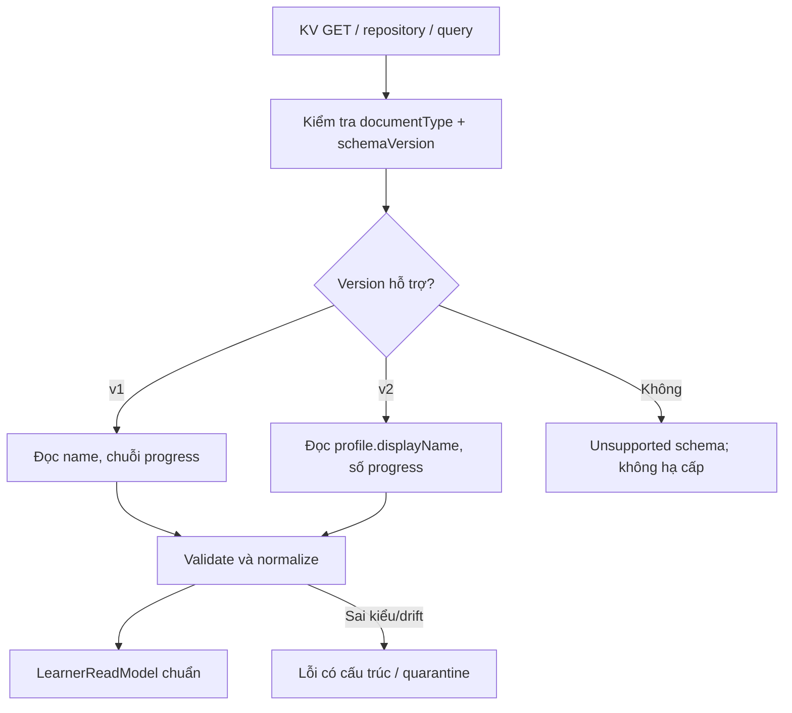
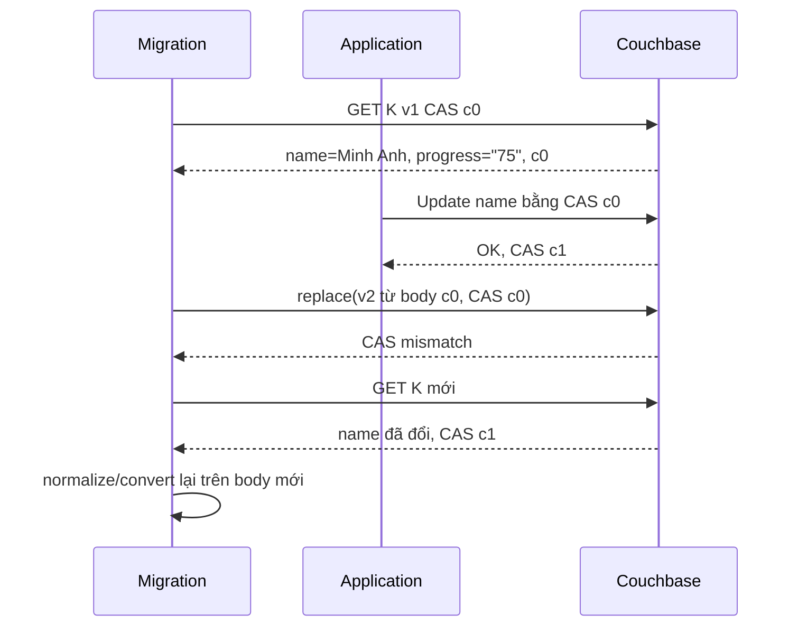

# Đọc tương thích khi thêm, đổi tên hoặc thay kiểu trường trong Spring Data Couchbase

## 1. Bối cảnh: JSON không có lược đồ cứng, nhưng reader vẫn có hợp đồng dữ liệu

Một hệ thống đào tạo dùng **Spring Data Couchbase** lưu hàng triệu learner document. Sau nhiều lần phát hành, các document có thể mang cấu trúc khác nhau trong cùng bucket/scope/collection:

**Dạng legacy (v1)** — tên và tiến độ ở dạng cũ:

```json
{
  "documentType": "learner",
  "tenantId": "acme",
  "learnerId": "learner-17",
  "name": "Minh Anh",
  "progressPercent": "75",
  "active": true
}
```

**Dạng mới (v2)** — đổi tên trường, đổi kiểu và thêm lựa chọn:

```json
{
  "documentType": "learner",
  "schemaVersion": 2,
  "tenantId": "acme",
  "learnerId": "learner-17",
  "profile": {
    "displayName": "Minh Anh"
  },
  "progressPercent": 75,
  "preferences": {
    "emailUpdates": false
  },
  "active": true
}
```

Ba thay đổi cùng xảy ra:

1. **Thêm trường:** `preferences.emailUpdates` có thể chưa có ở các document cũ.
2. **Đổi tên/vị trí:** `name` trở thành `profile.displayName`.
3. **Đổi kiểu:** `progressPercent` từ chuỗi số `"75"` sang số nguyên JSON `75`.

Couchbase không buộc mọi JSON document trong collection phải đổi dạng cùng lúc. Chính vì thế ứng dụng phải biết **đọc đúng cả dữ liệu cũ lẫn dữ liệu mới** trong giai đoạn nâng cấp. Nếu chỉ đổi class Java rồi triển khai, các lỗi thường xảy ra:

- Reader mới hiển thị tên trống vì document cũ chưa có `profile`.
- Converter đọc `progressPercent` là `Integer` nhưng dữ liệu cũ còn là `String`.
- Một `boolean` primitive mặc định `false` khiến code không phân biệt field thật sự bằng false với field chưa có.
- Reader fallback sang `name` ngay cả khi document v2 đã chủ ý xóa `displayName`.
- API đọc được dữ liệu nhờ fallback, nhưng khi save lại toàn entity đã làm mất các field chưa được map.
- Writer cũ ghi lại cấu trúc v1 lên document v2 trong rolling deployment.

**Đọc tương thích (compatible read)** là việc xác định format của dữ liệu đầu vào, chuyển các dạng được phép sang một **mô hình đọc chuẩn**, bảo toàn ý nghĩa nghiệp vụ và từ chối dữ liệu không thể diễn giải an toàn.

> **Mấu chốt:** tolerant reader không phải reader “đoán cho ra một giá trị”. Khi cấu trúc thiếu, mâu thuẫn hoặc sai kiểu, phải có policy minh bạch: mặc định hợp lệ, fallback có điều kiện, báo lỗi hoặc cách ly dữ liệu.

Bài nằm trong chương **Tiến hóa và di trú** của module `SPRING_DATA_COUCHBASE`: xây dựng tầng truy cập Couchbase với document mapping, repository, `CouchbaseTemplate`, SQL++, bucket/scope/collection, chỉ mục, TTL, CAS, transaction và Reactive API.

### Mục tiêu

Sau bài, bạn có thể thiết kế reader hỗ trợ v1/v2, phân biệt MISSING/NULL, thêm field an toàn, giải quyết rename và dual-field drift, chuẩn hóa dữ liệu đổi kiểu không mất thông tin; chọn SDK JSON adapter, Spring Data converter/projection và SQL++ cho từng mục đích; lên kế hoạch rolling rollout, kiểm thử contract và bảo vệ các đường ghi bằng CAS.

## 2. Đọc tương thích khác migration ghi lại document như thế nào?

Cần phân biệt hai hành động:

**Read-time normalization (upcast):**

```text
JSON v1 hoặc v2 trong Couchbase
           |
           v
  Compatibility reader
           |
           v
  LearnerReadModel chuẩn v2
           |
           v
   API / domain read-only
```

Bước này **chỉ chuyển đổi trong bộ nhớ**. Document ở Couchbase vẫn có thể là v1; CAS, expiry và nội dung lưu không bị đổi do một lần đọc.

**Persistent migration:**

```text
GET JSON + CAS -> chuyển sang v2 -> REPLACE với CAS -> lưu JSON v2
```

Bước này là mutation thực sự, có thể gặp conflict, ảnh hưởng TTL và phải được điều phối. Compatible reader giúp ứng dụng hoạt động **trước và trong lúc** migration; nó không tự động thay thế công việc backfill.

| Thuộc tính | Reader tương thích | Migration bền vững |
| --- | --- | --- |
| Thay JSON trong Couchbase? | Không | Có |
| Thay CAS? | Không chỉ do đọc | Có khi mutation thành công |
| Cần xử lý conflict khi ghi? | Không ở bước chỉ đọc | Có |
| Cần policy TTL/preserve expiry? | Không ở bước chỉ đọc | Có |
| Có thể chấp nhận nhiều version song song? | Có | Tùy giai đoạn |
| Có giải quyết future document sai kiểu? | Phải nhận diện/từ chối có chủ đích | Không được hạ cấp mù |
| Có loại bỏ toàn bộ legacy docs? | Không | Có thể, nếu backfill đủ |

Việc **GET rồi tự động save trong converter** là một anti-pattern: thao tác đọc bất ngờ trở thành mutation, tăng latency, đổi CAS và có thể gây retry storm.

## 3. Phân biệt `schemaVersion` với CAS, `@Version` và API version

Một document có thể chứa:

```json
{
  "schemaVersion": 2,
  "progressPercent": 75
}
```

Trường `schemaVersion` thuộc **hợp đồng JSON của ứng dụng**: nó cho biết phải diễn giải field theo cấu trúc nào.

Couchbase đồng thời có CAS metadata; trong Spring Data:

```java
import org.springframework.data.annotation.Version;

@Version
private Long casVersion;
```

CAS dùng để kiểm tra document có bị thay đổi giữa đọc và ghi không. Nó không tăng đều theo số phiên bản schema và không phải timestamp.

| Phiên bản | Quản lý bởi | Dùng để |
| --- | --- | --- |
| `schemaVersion` | Ứng dụng/migration | Chọn reader/transformer v1, v2... |
| CAS, ánh xạ `@Version` | Couchbase/Spring Data | Chặn stale write |
| API version | Hợp đồng HTTP/client | Xác định payload trả về/nhận vào |
| Application release | Quy trình deploy | Cho biết binary hỗ trợ những schema nào |
| Domain revision | Nghiệp vụ | Theo dõi lần phê duyệt chính sách nếu cần |

Một document v1 có thể được update hàng trăm lần nhưng vẫn là v1. Ngược lại, migration v1 → v2 có thể đổi CAS nhưng không thể suy schemaVersion từ giá trị CAS.

**Không viết:**

```java
@Version
private Long schemaVersion; // Sai: bị dùng làm metadata phiên bản CAS.
```

Nên đặt hai field riêng nếu cần vừa ghi vừa đọc nhiều schema.

## 4. MISSING, NULL, sai kiểu và giá trị mặc định: bốn tình huống khác nhau

Trong Couchbase JSON/SQL++, một field có thể:

- **MISSING:** field không có trong JSON.
- **NULL:** field có mặt nhưng giá trị JSON là `null`.
- **Đúng kiểu, đúng giá trị:** ví dụ `false`, `0`, `""` hoặc object.
- **Sai kiểu/giá trị không hợp lệ:** ví dụ `"yes"` khi cần boolean, `150` khi tỷ lệ tiến độ phải từ 0–100.

Ví dụ:

```json
{"documentType":"learner"}
```

```json
{"documentType":"learner","preferences":null}
```

```json
{"documentType":"learner","preferences":{"emailUpdates":false}}
```

```json
{"documentType":"learner","preferences":{"emailUpdates":"false"}}
```

Không nên biến cả bốn thành cùng một kết quả mà không cân nhắc business meaning.

### 4.1. Bảng policy cho từng trường

| Trường | MISSING | NULL | Sai kiểu | Giá trị hợp lệ |
| --- | --- | --- | --- | --- |
| `name` trên v1 | Reject/quarantine nếu bắt buộc | Reject | Reject | Chuỗi không rỗng |
| `profile.displayName` trên v2 | Reject nếu bắt buộc | Reject | Reject | Chuỗi không rỗng |
| `progressPercent` | Có thể coi là *unknown*, không phải 0 | *Unknown* theo policy | Reject | Số nguyên 0–100 |
| `preferences.emailUpdates` | Mặc định `false` **nếu policy đã phê duyệt** | Reject hoặc policy riêng | Reject | Boolean |
| `schemaVersion` | Có thể legacy v1 **nếu đã chứng minh** | Không tự đồng nhất với MISSING | Reject | Version được hỗ trợ |

Giá trị `progressPercent=0` nghĩa là học viên chưa hoàn thành bài nào; không có field `progressPercent` có thể nghĩa là hệ thống cũ chưa theo dõi. Dùng `Integer` nullable trong read model sẽ giữ được sự khác biệt.

Với trường quyền riêng tư/tiếp thị, **không tự mặc định opt-in thành true**. `false` trong bài là một chính sách minh họa đã được chọn nhằm tránh tự cấp quyền nhận marketing; hệ thống thật vẫn phải tuân thủ dữ liệu đồng ý hợp lệ và quy định liên quan.

### 4.2. SQL++ chỉ hỗ trợ diễn giải, không sửa dữ liệu

Ví dụ minh họa đọc value thay thế khi field MISSING:

```sql
SELECT l.learnerId,
       IFMISSING(l.preferences.emailUpdates, FALSE) AS emailUpdates
FROM `learning`.`training`.`learners` AS l
WHERE l.documentType = "learner";
```

`IFMISSING` chỉ dùng fallback nếu biểu thức là MISSING; không tự xử lý NULL như MISSING. Nếu business coi cả hai như chưa có, có thể xét `IFMISSINGORNULL` nhưng đó là **quyết định hợp đồng**, không phải cách “sửa lỗi dữ liệu” mặc định.

**Các hàm SQL++ phía trên chỉ tạo projection đọc, không backfill document hay thay đổi CAS.** SQL++ query còn phải xử lý các document sai kiểu/nested path hoặc future version theo yêu cầu thật.

## 5. Thêm trường: mở rộng trước, siết chặt sau

Ví dụ muốn bổ sung:

```json
"preferences": {
  "emailUpdates": false
}
```

Đừng ngay lập tức bắt tất cả document phải có `preferences.emailUpdates` trong code mới. Hãy:

1. Định nghĩa chính xác ý nghĩa giá trị khi MISSING, NULL và sai kiểu.
2. Deploy reader chấp nhận document cũ và áp dụng fallback được cho phép.
3. Chuyển writer mới sang ghi field rõ ràng.
4. Đo số document chưa có field.
5. Backfill có điều kiện nếu query/index hoặc quy tắc mới yêu cầu field tồn tại.
6. Chỉ sau đó mới biến field thành bắt buộc ở nơi lưu/validation.

### 5.1. Java wrapper tránh nhầm MISSING với false

Nếu model Spring Data dùng:

```java
private boolean emailUpdates;
```

thì object có thể nhận `false` vì giá trị mặc định của Java ngay cả khi JSON không có field. Nếu cần phân biệt nguồn gốc dữ liệu, có thể dùng:

```java
private Boolean emailUpdates;
```

và thực hiện normalization ở **adapter/domain boundary**, thay vì dàn mặc định trên mọi setter/getter.

Nếu bạn chỉ cần giá trị hiệu lực để hiển thị và policy cho phép MISSING→false, một `boolean` trong *read model* đã normalized là phù hợp. Nhưng nó không nên được dùng để chứng minh trong database đã có field.

### 5.2. Không để default read trở thành default write

Ví dụ document v1 không có `emailUpdates`, reader trả `false` cho API. Nếu controller cập nhật tên và save lại một entity mới được dựng từ read model, dữ liệu có thể bị ghi thêm `emailUpdates=false` và mất các field khác ngoài ý muốn.

Một **view giá trị hiệu lực** không phải **persistence snapshot đầy đủ**. Để ghi, tải document đầy đủ + CAS và áp dụng command có chủ đích, hoặc dùng một workflow migration riêng.

## 6. Đổi tên hoặc di chuyển field: cần quy tắc ưu tiên nguồn

Một thay đổi dễ hiểu về mặt Java có thể phá dữ liệu:

```text
v1: name = "Minh Anh"
v2: profile.displayName = "Minh Anh"
```

Không nên chỉ dùng:

```java
return profile != null ? profile.getDisplayName() : name;
```

vì:

- `profile` có thể tồn tại nhưng `displayName` MISSING hoặc NULL.
- Trong giai đoạn dual-write, cả `name` và `profile.displayName` có thể cùng tồn tại nhưng khác giá trị.
- Một writer v1 có thể cập nhật `name` sau khi writer v2 cập nhật `profile.displayName`.
- Một v2 cố ý xóa `displayName` không được tự phục hồi bằng `name` stale.
- Future version v3 có thể dùng trường khác và không được reader v2 diễn giải tùy tiện.

### 6.1. Source of truth theo version

Một chính sách có thể kiểm thử:

| Version | Field authoritative | Field còn lại nếu có | Khi hai field mâu thuẫn |
| --- | --- | --- | --- |
| v1/legacy | `name` | `profile.displayName` là bản tương thích | Báo drift/quarantine hoặc reconcile theo rule |
| v2 | `profile.displayName` | `name` chỉ là legacy mirror nếu có | Báo drift hoặc dùng nguồn v2 và phát cảnh báo theo policy |
| v3 chưa biết | Không suy đoán | Không đọc/ghi mù | Từ chối hoặc read-only theo contract |

Đối với dữ liệu có giá trị cao, nên **báo drift thay vì im lặng chọn một field**. Nếu thật sự cần ưu tiên để đảm bảo availability, phải ghi rõ logic, đo số lần fallback và biết khi nào bỏ fallback.

### 6.2. Dual-read khác dual-write

**Dual-read:** reader chấp nhận cả name và profile.displayName theo contract.

**Dual-write:** writer cập nhật cả hai field để phục vụ các ứng dụng cũ và mới. Dual-write trong **một document** có thể được thực hiện bằng một mutation nguyên tử; dual-write sang **hai document/collection** cần transaction hoặc cơ chế đối soát riêng.

**Dual-write chỉ là chiến lược chuyển tiếp.** Nó có thể tạo drift nếu writer cũ sửa name mà không cập nhật profile. Phải thống nhất writer authoritative và thời điểm cutover.

### 6.3. Khi nào phải bỏ field cũ?

Chỉ khi mọi reader/writer còn hoạt động, kể cả batch job, consumer, client offline và kế hoạch rollback, đều không phụ thuộc legacy `name`. Việc một API mới đã hiển thị profile thành công không có nghĩa có thể xóa field cũ ngay.

## 7. Thay kiểu: chuyển đổi phải không mất nghĩa

Chuyển `progressPercent` từ chuỗi số `"75"` sang số JSON `75` có vẻ đơn giản, nhưng phải xử lý:

```text
"75"    -> 75     (hợp lệ theo v1)
"075"   -> ?      (chuẩn hóa có chấp nhận zero đầu?)
"75.5"  -> ?      (có được làm tròn?)
"75%"   -> ?      (có hỗ trợ dấu %?)
""      -> ?      (missing hay invalid?)
" 75 "  -> ?      (có được trim?)
-1      -> ?      (sai phạm vi)
101     -> ?      (sai phạm vi)
null    -> ?      (unknown hay invalid?)
```

Một policy chặt:

- v1: chấp nhận **chuỗi thập phân nguyên chính tắc** từ `"0"` tới `"100"`, không có dấu %, khoảng trắng, số 0 vô nghĩa ở đầu hoặc phần thập phân.
- v2: chấp nhận **JSON number biểu diễn số nguyên** 0–100, không chấp nhận chuỗi.
- MISSING/NULL: trả `null` trong read model nếu nghiệp vụ phân biệt *unknown* với 0.
- Sai kiểu/sai phạm vi: trả lỗi có mã riêng, không âm thầm ép kiểu hay clamp.

Policy này là **ví dụ thiết kế**; một tập dữ liệu legacy thực tế có thể cần hỗ trợ thêm các dạng từng được hệ thống cho phép. Cần khảo sát dữ liệu trước khi quyết định quy tắc parse.

### 7.1. Tránh phép chuyển đổi có thể mất thông tin

- Không dùng `Integer.parseInt` rồi clamp 101 về 100 nếu không có quy tắc nghiệp vụ.
- Không lấy `double` rồi làm tròn `75.5` thành 76 một cách im lặng.
- Không dùng `toString()` để chấp nhận boolean/object như tiến độ số.
- Với tiền tệ, không dùng `double` để chuyển amount; phải xác định đơn vị (đồng, cent...) và dùng integer minor units hoặc `BigDecimal` có scale rõ.
- Với timestamp, phải biết timezone/đơn vị milliseconds–seconds trước khi đổi kiểu.
- Với ID, không đổi sang number nếu có thể mất số 0 đầu hoặc precision.

Chuyển đổi kiểu là **thay đổi ngữ nghĩa dữ liệu**, không chỉ là đổi type annotation Java.

## 8. Thiết kế một canonical read model bất biến

Để tránh lan tràn các nhánh `if (schemaVersion == 1)` trong domain logic, có thể tạo read model dùng chung:

```java
public record LearnerReadModel(
        String tenantId,
        String learnerId,
        String displayName,
        Integer progressPercent,  // null biểu thị unknown theo policy.
        boolean emailUpdates,     // normalized effective value.
        boolean active,
        int sourceSchemaVersion
) {}
```

Mô hình này **không phải entity dùng để `repository.save`**. Nó biểu diễn dữ liệu để đọc, không nhất thiết chứa toàn bộ field gốc, CAS, type discriminator, unknown fields và expiry.

Một adapter riêng đảm nhận:



**Đặt compatibility logic ở một ranh giới ổn định** sẽ dễ test hơn việc mỗi controller/query/template có một kiểu fallback riêng.

## 9. Java SDK `JsonObject`: đọc dữ liệu hỗn hợp có kiểm soát

Couchbase Java SDK cho phép đọc JSON object trực tiếp. Ví dụ sau dùng **type inspection trên giá trị JSON**, tránh kỳ vọng converter Java tự xử lý mọi format.

### 9.1. Error type dùng cho dữ liệu không phù hợp

```java
public final class IncompatibleLearnerDocument
        extends RuntimeException {

    public IncompatibleLearnerDocument(String reason) {
        super(reason);
    }
}
```

Trong production có thể thêm code lỗi và correlation ID; không trả raw document chứa PII trong exception/HTTP response.

### 9.2. Tách policy parse thành các hàm rõ ràng

```java
import com.couchbase.client.java.json.JsonObject;

public final class LearnerCompatibilityReader {
    private LearnerCompatibilityReader() {}

    public static LearnerReadModel normalize(JsonObject doc) {
        if (!"learner".equals(doc.get("documentType"))) {
            throw new IncompatibleLearnerDocument(
                "Document không phải learner");
        }

        int version = readVersion(doc);
        String name = readName(doc, version);
        Integer progress = readProgress(doc, version);
        boolean emailUpdates = readEmailPreference(doc);
        boolean active = requireBoolean(doc, "active");

        return new LearnerReadModel(
            requireString(doc, "tenantId"),
            requireString(doc, "learnerId"),
            name,
            progress,
            emailUpdates,
            active,
            version);
    }

    private static int readVersion(JsonObject doc) {
        if (!doc.containsKey("schemaVersion")) {
            // Chỉ hợp lệ nếu collection/type này quy định MISSING = v1.
            return 1;
        }

        Object raw = doc.get("schemaVersion");
        // Chỉ chấp nhận 1/2 dưới dạng JSON number; không ép String.
        if (raw instanceof Number n) {
            if (n.doubleValue() == 1d) return 1;
            if (n.doubleValue() == 2d) return 2;
        }

        throw new IncompatibleLearnerDocument(
            "schemaVersion không được hỗ trợ hoặc sai kiểu");
    }

    private static String readName(JsonObject doc, int version) {
        String legacy = optionalString(doc, "name");

        JsonObject profile = optionalObject(doc, "profile");
        String modern = profile == null
            ? null
            : optionalString(profile, "displayName");

        String authoritative = version == 1 ? legacy : modern;
        String other = version == 1 ? modern : legacy;

        if (authoritative == null || authoritative.isBlank()) {
            throw new IncompatibleLearnerDocument(
                "Thiếu tên bắt buộc trong schema v" + version);
        }

        if (other != null && !other.equals(authoritative)) {
            // Trong rollout có thể chọn cách reconcile có kiểm soát.
            throw new IncompatibleLearnerDocument(
                "Drift giữa tên legacy và tên mới");
        }

        return authoritative;
    }

    private static Integer readProgress(JsonObject doc, int version) {
        if (!doc.containsKey("progressPercent") ||
            doc.get("progressPercent") == null) {
            return null; // Unknown; không tự thay bằng 0.
        }

        Object raw = doc.get("progressPercent");

        if (version == 1) {
            if (!(raw instanceof String s) ||
                !s.matches("0|[1-9][0-9]?|100")) {
                throw new IncompatibleLearnerDocument(
                    "v1 progressPercent phải là chuỗi nguyên 0-100");
            }
            return Integer.parseInt(s);
        }

        if (!(raw instanceof Number n)) {
            throw new IncompatibleLearnerDocument(
                "v2 progressPercent phải là JSON number");
        }

        double value = n.doubleValue();
        if (!Double.isFinite(value) ||
            value < 0 || value > 100 || value != Math.rint(value)) {
            throw new IncompatibleLearnerDocument(
                "v2 progressPercent phải là số nguyên 0-100");
        }

        return (int) value;
    }

    private static boolean readEmailPreference(JsonObject doc) {
        if (!doc.containsKey("preferences")) {
            return false; // Default vắng mặt theo policy minh họa.
        }

        JsonObject preferences = requireObject(doc, "preferences");

        if (!preferences.containsKey("emailUpdates")) {
            return false;
        }

        Object raw = preferences.get("emailUpdates");
        if (!(raw instanceof Boolean value)) {
            throw new IncompatibleLearnerDocument(
                "emailUpdates phải là boolean, không chấp nhận null");
        }

        return value;
    }

    private static boolean requireBoolean(JsonObject doc, String field) {
        Object raw = doc.get(field);
        if (raw instanceof Boolean value) return value;

        throw new IncompatibleLearnerDocument(
            "Thiếu hoặc sai kiểu boolean: " + field);
    }

    private static String requireString(JsonObject doc, String field) {
        Object raw = doc.get(field);
        if (raw instanceof String s && !s.isBlank()) return s;

        throw new IncompatibleLearnerDocument(
            "Thiếu hoặc sai kiểu chuỗi: " + field);
    }

    private static String optionalString(JsonObject doc, String field) {
        if (!doc.containsKey(field)) return null;

        Object raw = doc.get(field);
        if (raw == null) return null;
        if (raw instanceof String s) return s;

        throw new IncompatibleLearnerDocument(
            "Sai kiểu chuỗi: " + field);
    }

    private static JsonObject optionalObject(JsonObject doc, String field) {
        if (!doc.containsKey(field)) return null;

        Object raw = doc.get(field);
        if (raw == null) return null;
        if (raw instanceof JsonObject object) return object;

        throw new IncompatibleLearnerDocument(
            "Sai kiểu object: " + field);
    }

    private static JsonObject requireObject(JsonObject doc, String field) {
        JsonObject result = optionalObject(doc, field);
        if (result != null) return result;

        throw new IncompatibleLearnerDocument(
            "Thiếu object bắt buộc: " + field);
    }
}
```

Đoạn code minh họa cho **Java 17+** (record, pattern matching `instanceof`), dùng Couchbase SDK JsonObject và policy dữ liệu cố định trong bài. Nó được viết để **fail fast** với schema tương lai, drift tên hoặc kiểu không hợp lệ.

### 9.3. Đọc kỹ các quyết định trong code

- `schemaVersion` **MISSING** được xem là v1 **chỉ vì contract ví dụ quy định điều đó**. `schemaVersion: null` bị từ chối, không ngầm thành v1.
- `v1.progressPercent` chỉ nhận string chuẩn; `v2.progressPercent` chỉ nhận number nguyên. Đây là cách phát hiện writer dùng sai format.
- `profile.displayName` của v2 là authoritative; legacy `name` tồn tại thì phải khớp hoặc được đưa vào quy trình drift handling.
- `emailUpdates` MISSING được diễn giải `false`; explicit NULL hoặc `"false"` bị từ chối.
- `progressPercent` MISSING hoặc NULL được diễn giải là **unknown**, không tự đặt 0.
- Phép chuẩn hóa chỉ trả read model; **không ghi Couchbase, không thay CAS hoặc expiry**.
- Nếu dataset cũ có format tiến độ khác, phải thay policy qua khảo sát và test; không mở rộng parser kiểu “chấp nhận mọi thứ” mà không kiểm soát.

## 10. Khi dùng Spring Data mapping thì chọn cách nào?

Spring Data Couchbase có document mapping và Repository, nhưng một field Java kiểu `Integer` không tự biến mọi legacy JSON string thành integer theo một contract nghiệp vụ phức tạp. Có thể chọn ba hướng, tùy nhu cầu:

| Hướng | Phù hợp khi | Điều phải lưu ý |
| --- | --- | --- |
| Repository entity đúng một schema | Dữ liệu đã đồng nhất hoặc thay đổi additive đơn giản | Reader có thể lỗi với rename/type cũ |
| Custom reading converter ở mapping boundary | Muốn trả entity/domain thống nhất từ JSON cũ/mới | Phải xác minh ID, CAS, discriminator, unknown fields và write converter |
| SDK KV đọc JsonObject → compatibility reader → view | Cần kiểm soát các trường hợp malformed, rename, type conversion phức tạp | Không đem view partial đi `repository.save` |
| SQL++ projection cho read-only search/report | Chỉ cần một vài trường để hiển thị | Query không thay thế converter cho write |

Nếu cần vừa đọc mixed schema vừa update, một mô hình an toàn là **lấy document đầy đủ + CAS bằng KV**, chuẩn hóa thành domain/read model, nhưng giữ **raw body** cho mutation có điều kiện; không serialize read model ngược thành whole document khi nó thiếu field.

### 10.1. Entity versioned cho dữ liệu đã chuẩn hóa

Ví dụ một entity v2 khi backfill gần hoàn tất:

```java
import org.springframework.data.annotation.Id;
import org.springframework.data.annotation.Version;
import org.springframework.data.couchbase.core.mapping.Document;

@Document
public class LearnerDocument {
    @Id
    private String id;

    @Version
    private Long casVersion;

    private Integer schemaVersion;
    private String documentType;
    private String tenantId;
    private String learnerId;
    private Profile profile;
    private Integer progressPercent;
    private Preferences preferences;
    private Boolean active;

    protected LearnerDocument() {}

    public String getId() { return id; }
    public Long getCasVersion() { return casVersion; }

    public record Profile(String displayName) {}
    public record Preferences(Boolean emailUpdates) {}
}
```

Đây là model ánh xạ format v2; nếu một document v1 chỉ có `name` và chuỗi tiến độ, **không tự giả định** mapping từ JSON sang class trên sẽ tự đổi field hoặc type đúng.

Trường `casVersion` là metadata CAS khi mapping hỗ trợ. Trường `schemaVersion` là JSON data riêng. Một converter cài đặt sai có thể trả entity đủ field nhưng mất CAS hoặc ID, khiến update không còn optimistic locking.

### 10.2. Query entity khác projection DTO

Một custom `@Query` có thể chỉ chọn các field cần hiển thị; kết quả đó là projection phù hợp cho màn hình, nhưng không nên được dùng làm full entity để save.

Nếu query trả entity cho mục đích update, cần đảm bảo Spring Data ánh xạ đúng metadata như ID/CAS theo cơ chế của dependency cụ thể, ví dụ cơ chế entity selection `#{#n1ql.selectEntity}` được hỗ trợ; test xem `@Id`/`@Version` được nạp.

**Đừng lấy CAS mới rồi gắn vào entity sinh từ partial projection**: phép ghi có thể được server chấp nhận nhưng vẫn xóa field mà projection không chứa.

## 11. SDK adapter: giữ ID, CAS riêng với read model

Một reader trả `LearnerReadModel` đã chuẩn hóa, nhưng model này **không đủ để cập nhật toàn document**: nó thiếu các field chưa biết, type metadata, expiry và thông tin phiên bản ghi.

Nếu service có nhu cầu update, hãy giữ riêng snapshot metadata mà không biến read model thành persistence entity.

```java
import com.couchbase.client.java.Collection;
import com.couchbase.client.java.kv.GetResult;

public record LearnerSnapshot(
    String documentId,
    long cas,
    LearnerReadModel view
) {}

public final class LearnerReadService {
    private final Collection learners;

    public LearnerReadService(Collection learners) {
        this.learners = learners;
    }

    public LearnerSnapshot findById(
            String authorizedDocumentId,
            String trustedTenantId) {

        GetResult observed = learners.get(authorizedDocumentId);
        LearnerReadModel view =
            LearnerCompatibilityReader.normalize(
                observed.contentAsObject());

        if (!trustedTenantId.equals(view.tenantId())) {
            throw new SecurityException(
                "Không có quyền xem document của tenant khác");
        }

        return new LearnerSnapshot(
            authorizedDocumentId,
            observed.cas(),
            view);
    }
}
```

Lưu ý:

- Document ID phải được xây dựng hoặc kiểm tra với tenant được xác thực. Một caller không có quyền không thể chỉ cần đoán ID để đọc dữ liệu.
- CAS là metadata của document khi GET, không phải `schemaVersion`.
- `LearnerReadModel` dùng cho đọc; không giữ được tất cả unknown fields.
- Nếu cần cập nhật, phải GET raw body/CAS hiện hành hoặc dùng một write adapter đã bảo toàn đầy đủ dữ liệu và version.
- CAS 64 bit truyền qua HTTP nên dùng **token dạng chuỗi opaque**, không ép qua JavaScript number.

### 11.1. Anti-pattern: save view như entity hoàn chỉnh

```java
LearnerSnapshot snapshot = readService.findById(id, tenant);

// Pseudocode sai: DTO là bản hiển thị thiếu nhiều metadata và field.
LearnerDocument reconstructed =
    mapViewToPersistenceEntity(snapshot.view());

repository.save(reconstructed);
```

Hàm `mapViewToPersistenceEntity` ở đây chưa được định nghĩa, chỉ minh họa lỗi thiết kế. Entity mới có thể thiếu CAS và làm mất field mà view không chứa. Cố gắn CAS mới nhất vào body partial cũng **không làm body trở thành snapshot đầy đủ**.

## 12. SQL++ projection tương thích cho danh sách hoặc báo cáo

Một truy vấn có thể hiển thị tên theo cả hai format:

```sql
SELECT
    META(l).id AS documentId,
    l.learnerId,
    CASE
        WHEN l.schemaVersion = 2 THEN l.profile.displayName
        ELSE l.name
    END AS displayName,
    IFMISSING(l.preferences.emailUpdates, FALSE) AS emailUpdates
FROM `learning`.`training`.`learners` AS l
WHERE l.tenantId = $tenantId
  AND l.documentType = "learner"
  AND (
      l.schemaVersion IS MISSING
      OR l.schemaVersion IN [1, 2]
  );
```

**Phạm vi:** query **read-only projection** cho tập dữ liệu đã kiểm kê. Nhánh ELSE chỉ dùng với legacy/v1 do WHERE đã giới hạn version. Query không kiểm tra drift hai tên, kiểu của progress hoặc explicit NULL của emailUpdates như Java adapter. Không lấy row này làm whole persistence entity để save.

Giá trị `$tenantId` phải được bind dưới dạng parameter từ tenant được ủy quyền. Keyspace phải thuộc cấu hình/allowlist; không nối trực tiếp tên bucket/scope/collection từ input client.

### 12.1. Vì sao `COALESCE`/`IFMISSINGORNULL` vô điều kiện có thể nguy hiểm?

```sql
SELECT IFMISSINGORNULL(l.profile.displayName, l.name)
       AS displayName
FROM `learning`.`training`.`learners` AS l;
```

Biểu thức này thuận tiện cho UI, nhưng:

1. Không nhận ra nguồn authoritative là v1 hay v2.
2. Có thể giấu document v2 sai format bằng cách lấy tên cũ.
3. Không phát hiện hai field khác nhau.
4. Không chặn schemaVersion tương lai.
5. Trộn NULL với MISSING dù business có thể phân biệt.

Nếu chọn fallback kiểu này nhằm ưu tiên availability, phải ghi rõ đây là **temporary compatibility behavior**, theo dõi fallback/drift và có kế hoạch chấm dứt.

### 12.2. Query không khóa document cho update

Kết quả SQL++ chỉ là **snapshot quan sát**. Writer khác có thể thay body sau SELECT. Khi update:

```text
SQL++ tìm candidate IDs
    -> KV GET full body + CAS
    -> compatibility reader + validate nghiệp vụ
    -> mutation có CAS nếu cần ghi
```

Scan consistency như `REQUEST_PLUS` giúp đáp ứng một số nhu cầu index visibility nhưng **không khóa document sau SELECT**, không ngăn stale write và không thay transaction.

### 12.3. Index cho field cũ và mới

Khi query chuyển từ `name` sang `profile.displayName`:

- Query cũ đang sử dụng index nào?
- Index mới có bao phủ nested field và điều kiện v2 không?
- Các document MISSING field có bị bỏ qua bởi lựa chọn index không?
- Có cần hai index/nhánh query trong giai đoạn chuyển tiếp?
- Index mới đã build xong trước khi bật query mới?
- `EXPLAIN` và latency trên bộ dữ liệu mixed schema ra sao?

Không xóa index legacy chỉ vì màn hình mới đã hoạt động; reporting và batch job cũ có thể vẫn cần nó.

## 13. Spring Data Repository và `CouchbaseTemplate` khi mixed schema

Repository entity v2 đơn giản khi dữ liệu đã đồng nhất:

```java
import org.springframework.data.couchbase.repository.CouchbaseRepository;

public interface LearnerRepository
        extends CouchbaseRepository<LearnerDocument, String> {
}
```

Nhưng v1/v2 hỗn hợp đòi hỏi ba điều kiện:

1. **Mapping:** field cũ/mới được chuyển thành domain/view đúng chưa?
2. **Metadata:** entity đọc để update có ID/CAS thực sự chưa?
3. **Preservation:** thao tác save có giữ field không hiện diện trong converter/projection không?

Không nên nghĩ thêm một annotation `@Field` vào property mới sẽ tự chuyển mọi legacy document hoặc đổi kiểu theo business rule.

### 13.1. Annotation mapping không thay version-aware reader

Một annotation ánh xạ tên JSON sang Java có thể không đủ để mô tả:

```text
v1 -> name, progress string
v2 -> profile.displayName, progress number
có cả name và profile nhưng khác nhau -> drift
missing preference -> false theo policy
future schema -> từ chối
```

Có thể dùng custom reading converter theo API Spring Data Couchbase, nhưng phải kiểm chứng đúng signature, conversion context, metadata ID/CAS, type discriminator và cách ghi trở lại trong phiên bản dependency thực tế.

### 13.2. Template là tầng mapping, không phải mọi API đều như nhau

Một thao tác Template đọc entity có thể đi qua converter, trong khi custom query/projection do ứng dụng viết chỉ trả một vài field. Một đường Template save entity versioned có thể áp dụng `@Version`; một fluent upsert hoặc SQL++ UPDATE riêng không tự kế thừa điều kiện CAS từ class.

| Đường đọc | Dùng cho compatible read? | Điều phải kiểm tra |
| --- | --- | --- |
| Repository `findById` | Có với converter hỗ trợ | ID/CAS và schema/type đúng |
| Template entity read | Có với converter hỗ trợ | Scope, collection, mapping |
| Repository custom `@Query` trả entity | Có điều kiện | SELECT đủ body + metadata |
| SQL++ projection DTO | Có, read-only | Không whole-document save |
| SDK KV GET + compatibility reader | Có | Giữ raw body/CAS riêng khi ghi |
| Reactive SDK GET | Có | Không tự tạo mutation lúc đọc |

### 13.3. Query entity khác query projection

Spring Data Couchbase có cơ chế tạo phần SELECT entity như `#{#n1ql.selectEntity}` ở các phiên bản tương ứng. Với custom query trả entity cho update, hãy test:

- `@Id` là document key đúng.
- `@Version` chứa CAS, không null.
- Body và type mapping đầy đủ.
- Query không chỉ SELECT partial fields.
- Stale entity bị từ chối sau khi writer khác ghi.

**Query chạy không lỗi không chứng minh save sau đó sẽ bảo vệ optimistic locking.**

## 14. Ghi sau khi đọc: đừng hạ cấp hoặc xóa field mới

Một ví dụ race:

```text
T0 A GET learner v1, normalize name -> view.profile.displayName
T1 B thay name/progress trong document v1
T2 A save whole body dựng từ view
```

Nếu A dùng `upsert` không CAS, nó có thể ghi đè B. Nếu dùng CAS cũ, server từ chối, nhưng CAS khớp vẫn **không chứng minh body dựng từ view đủ mọi field**.

### 14.1. Mẫu writer v2, chỉ sửa field được phép

Ví dụ dưới đây cố ý yêu cầu document **đã là v2**, không âm thầm migrate v1 khi người dùng đổi tên.

```java
import com.couchbase.client.java.Collection;
import com.couchbase.client.java.json.JsonObject;
import com.couchbase.client.java.kv.GetResult;

import static com.couchbase.client.java.kv.ReplaceOptions.replaceOptions;

public final class LearnerNameWriter {
    private final Collection learners;

    public LearnerNameWriter(Collection learners) {
        this.learners = learners;
    }

    public long renameCurrentV2(
            String documentId,
            String trustedTenantId,
            String nextName) {

        if (nextName == null || nextName.isBlank()) {
            throw new IllegalArgumentException("Tên mới không hợp lệ");
        }

        GetResult observed = learners.get(documentId);
        JsonObject body = observed.contentAsObject();

        LearnerReadModel current =
            LearnerCompatibilityReader.normalize(body);

        if (!trustedTenantId.equals(current.tenantId())) {
            throw new SecurityException("Sai tenant");
        }
        if (current.sourceSchemaVersion() != 2) {
            throw new IllegalStateException(
                "Writer v2 yêu cầu document đã được migrate");
        }

        JsonObject profile = body.getObject("profile");
        profile.put("displayName", nextName);

        // Chỉ giữ legacy mirror khi contract rollout yêu cầu.
        if (body.containsKey("name")) {
            body.put("name", nextName);
        }

        return learners.replace(
            documentId,
            body,
            replaceOptions()
                .cas(observed.cas())
                .preserveExpiry(true))
            .cas();
    }
}
```

Điểm quan trọng: tải body/CAS cùng snapshot, dùng reader để validate, sửa raw body chứ không save DTO, và kiểm tra CAS tại mutation cuối. Giữ TTL khi đó là policy, và vẫn phải tôn trọng `If-Match` nếu user chỉnh form cũ.

### 14.2. Nếu document còn v1?

- **Ghi theo v1:** phù hợp giai đoạn bridge khi writer vẫn ở format cũ.
- **Migrate có CAS rồi ghi:** tách rõ workflow nâng version, đọc lại và áp dụng command.
- **Từ chối/đưa queue:** phù hợp khi migration cần dữ liệu bổ sung hoặc được vận hành giám sát.

Không biến mọi GET thành một migration write bất ngờ. Một read-time normalization là operation chỉ đọc.

## 15. Rolling deployment: reader đi trước writer

Một kế hoạch triển khai có thể gồm:

1. Deploy **bridge reader** hỗ trợ v1/v2, lỗi rõ với malformed/future docs.
2. Kiểm kê toàn bộ API, batch, job, consumer và client còn phụ thuộc field cũ.
3. Cập nhật writer để không hạ cấp schema hoặc upsert stale body.
4. Bật write-v2 bằng feature flag khi không còn reader v1-only bị ảnh hưởng.
5. Backfill dần document legacy bằng CAS/checkpoint.
6. Đo version distribution, fallback, drift và invalid cases.
7. Contract: dừng ghi field cũ, bỏ reader v1 chỉ sau khi hết dependency.

### 15.1. Ma trận tương thích

| Binary | Đọc v1 | Đọc v2 | Ghi v1 | Ghi v2 |
| --- | --- | --- | --- | --- |
| A1 legacy | Có | Không bảo đảm | Có | Không |
| A2 bridge | Có | Có | Có điều kiện theo rollout | Có |
| A3 v2-only | Không | Có | Không | Có |

Không bật A3 khi còn document v1; không bật writer v2 nếu A1 vẫn có thể đọc v2 sai và ghi lại body v1.

**Đọc tương thích không tự bảo đảm ghi tương thích.** Cần kiểm kê read contract **và** write contract riêng.

### 15.2. Giữ khả năng rollback

Sau khi v2 đã xuất hiện, rollback về A1 chỉ hiểu v1 có thể khiến hệ thống ngừng đọc. Chọn một phiên bản **bridge** có khả năng đọc v2 làm điểm rollback, hoặc duy trì compatibility mirror đã chứng minh an toàn.

Rollback code không tự rollback dữ liệu. Phép chuyển đổi ngược có thể mất thông tin.

## 16. Dual-field drift: phát hiện trước khi chọn nguồn

Ví dụ dữ liệu:

```json
{
  "schemaVersion": 2,
  "name": "Minh Anh",
  "profile": {
    "displayName": "Minh A."
  }
}
```

Ba hướng xử lý:

- **Quarantine/fail closed:** không trả giá trị khi không rõ authoritative source.
- **Ưu tiên trường v2 và ghi metric drift:** chỉ khi nghiệp vụ cho phép read partial availability.
- **Reconcile:** xác định nguồn sự thật và đồng bộ legacy mirror bằng mutation CAS.

Không chọn “cái nào khác null thì lấy” vô điều kiện.

Một query hỗ trợ tìm document có lệch tên:

```sql
SELECT META(l).id AS documentId,
       l.name AS legacyName,
       l.profile.displayName AS modernName
FROM `learning`.`training`.`learners` AS l
WHERE l.documentType = "learner"
  AND l.schemaVersion = 2
  AND l.name IS NOT MISSING
  AND l.profile.displayName IS NOT MISSING
  AND l.name != l.profile.displayName;
```

Query chỉ là tín hiệu; NULL, whitespace, Unicode normalization và sai kiểu cần được kiểm tra riêng. Không log raw tên người học ở dashboard công khai.

## 17. Reactive reader: chuẩn hóa trong publisher, không tự mutate

Reactive API không thay đổi hợp đồng schema. Ví dụ Reactive Couchbase Java SDK:

```java
import com.couchbase.client.java.Collection;
import reactor.core.publisher.Mono;

public final class ReactiveLearnerReadService {
    private final Collection learners;

    public ReactiveLearnerReadService(Collection learners) {
        this.learners = learners;
    }

    public Mono<LearnerSnapshot> findById(
            String documentId,
            String trustedTenantId) {

        return learners.reactive().get(documentId)
            .map(observed -> {
                LearnerReadModel view =
                    LearnerCompatibilityReader.normalize(
                        observed.contentAsObject());

                if (!trustedTenantId.equals(view.tenantId())) {
                    throw new SecurityException("Sai tenant");
                }

                return new LearnerSnapshot(
                    documentId, observed.cas(), view);
            });
    }
}
```

Publisher có thể phát lỗi không nên gộp:

- `DocumentNotFoundException`: document không còn tồn tại hoặc hết TTL.
- `IncompatibleLearnerDocument`: schema không thể diễn giải an toàn.
- Lỗi quyền truy cập: caller không được đọc learner.
- Lỗi hạ tầng/timeout: chưa khẳng định document sai format.

Không dùng `onErrorResume` bắt mọi lỗi rồi trả một `LearnerReadModel` giả: một learner sai kiểu hoặc thiếu tên không nên được coi như hồ sơ hợp lệ.

### 17.1. Retry GET không sửa được JSON malformed

Một GET tạm thất bại có thể được retry theo resilience policy. Nhưng `schemaVersion=99` hoặc `progressPercent="seventy-five"` là lỗi **dữ liệu/contract**, không tự biến mất nhờ retry liên tục.

Nếu muốn lazy migration trong Reactive pipeline, đó là **một mutation khác**: phải có CAS, TTL policy và retry toàn chu trình theo ngữ nghĩa, không ngầm thực hiện trong mapper của GET.

### 17.2. Không tạo side effect trong luồng có thể resubscribe

Một reactive publisher có thể được subscribe nhiều lần. Nếu một `map` của GET đồng thời gửi email, tạo audit record hoặc ghi lại document, tác dụng có thể lặp. Compatibility reader nên là **hàm thuần** để dễ resubscribe/test.

## 18. Đổi kiểu với dữ liệu thực tế: tiền tệ, timestamp và ID

Ví dụ chuyển progress đơn giản vì số 0–100 có miền giá trị rõ. Các kiểu khác rủi ro hơn:

| Chuyển đổi | Câu hỏi phải trả lời | Nguy cơ |
| --- | --- | --- |
| `"125000"` → số tiền | Đơn vị đồng, cent hay minor unit nào? | Sai giá trị giao dịch |
| `"2026-11-25"` → timestamp | Timezone và thời điểm đầu/cuối ngày? | Sai hạn đăng ký |
| Epoch seconds → millis | Có xác định unit v1 chính xác? | Lệch 1.000 lần |
| `"0017"` → số 17 | Số 0 đầu có thuộc identity? | Đổi ID |
| Array tags → Set | Trật tự và duplicate có nghĩa không? | Mất thứ tự |
| String enum → Java enum | Unknown enum trong future version? | Reader cũ lỗi |
| `0/1` → boolean | Có contract cũ cho 0/1 không? | Sai ý nghĩa trạng thái |
| String score `"75.5"` → integer | Có làm tròn không? | Mất độ chính xác |

Không xây một converter tổng quát sử dụng `String.valueOf`, `Double.parseDouble` rồi tự suy ngữ nghĩa. Với tiền, nên dùng integer minor units hoặc `BigDecimal` có scale/rounding policy; với timestamp cần format và timezone; với ID nên giữ chuỗi nếu có leading zeros.

### 18.1. Numeric JSON và giá trị nguyên

Hàm `readProgress` minh họa chấp nhận v2 JSON number **có giá trị toán học nguyên** 0–100 (ví dụ `75` hoặc `75.0` sau khi parser biểu diễn thành number). Nếu contract đòi phân biệt **văn bản nguyên gốc** `75` với `75.0`, JSON number đã được parser chuẩn hóa có thể không giữ đủ thông tin; phải thiết kế thêm validation ở ranh giới phù hợp thay vì chỉ nhìn `Number.doubleValue()`.

Giới hạn miền 0–100 giúp minh họa an toàn với `double` ở bước so nguyên. Không áp lại kỹ thuật này cho số tiền 64 bit hoặc ID lớn có thể mất precision.

## 19. Backfill và write path không thay thế compatibility read

Một migration v1 → v2 có thể:

1. Query tìm candidate IDs có `schemaVersion` MISSING/v1.
2. KV GET body + CAS gần thời điểm ghi.
3. Validate, chuyển đổi JSON theo quy tắc đã kiểm thử.
4. Replace với CAS và chính sách expiry.
5. Retry CAS conflict bằng **fresh GET**, không retry body stale.
6. Ghi checkpoint/quarantine và chạy lại cho đến khi đủ điều kiện contract.

Trong thời gian migration còn chạy, compatible reader vẫn phải hiểu **cả hai format**. Một batch backfill thành công 80% không cho phép loại bỏ nhánh v1.

### 19.1. Không dùng `UPDATE SET schemaVersion=2` một mình

```sql
UPDATE `learning`.`training`.`learners` AS l
SET l.schemaVersion = 2
WHERE l.documentType = "learner"
  AND l.schemaVersion = 1;
```

Đối với ví dụ đổi `name` → `profile.displayName` và string → number, câu trên **sai về mặt dữ liệu**: nó đổi nhãn version mà chưa chuyển body. Reader v2 sau đó sẽ nhìn field mới MISSING hoặc sai kiểu.

Việc đổi version phải diễn ra cùng bước chuyển đổi nội dung hợp lệ. SQL++ UPDATE tự viết còn không tự kế thừa Spring Data `@Version`/CAS, nên cần concurrency policy riêng.

### 19.2. Migration không được làm mất update của writer khác



Một writer SDK dùng `upsert` không CAS có thể phá an toàn này sau khi migration hoàn tất. Vì vậy phải kiểm soát **tất cả writer** trong giai đoạn chuyển schema, không chỉ job migration.

### 19.3. TTL và document đã bị xóa

Đọc không đổi TTL; migration có thể đổi expiry tùy thao tác/options. Khi dùng SDK `replace` và cần giữ expiry, kiểm tra `preserveExpiry(true)` trong SDK/version thực tế và test với document có TTL.

Nếu document hết hạn/xóa giữa GET và mutation, không reset version rồi insert mù. Nếu key được tái sử dụng cho một vòng đời khác, request migration đến muộn không được ghi đè vòng đời mới.

## 20. Compatibility reader trong workflow nhiều document

Một learner có thể được tách:

```text
learner::acme::learner-17
    |
    +-- learner-profile::acme::learner-17
    +-- learner-preferences::acme::learner-17
```

Đây không còn là đổi tên field trong một JSON body. Reader tương thích có thể cần dual-read từ một hoặc nhiều collection, chọn nguồn authoritative và đối chiếu thông tin.

Nhưng một thao tác ghi phải đồng thời tạo profile + preferences và cập nhật trạng thái learner thì **CAS một document không bảo vệ toàn bộ workflow**. Cân nhắc Couchbase distributed ACID transactions, state machine hoặc saga/reconciliation theo yêu cầu atomicity.

### 20.1. Transaction callback và side effect

Một callback transaction có thể bị chạy lại khi SDK retry conflict theo contract. Không gửi email, gọi payment hoặc sinh operation ID mới trong mỗi attempt. Các mutation cần atomic phải thật sự tham gia transaction-aware context; một lệnh KV ngoài transaction không tự thuộc cùng commit chỉ vì cùng Java method.

### 20.2. Không “đọc tương thích” bằng cách trộn trạng thái không đồng bộ

Nếu reader dual-read lấy profile ở phiên bản mới nhưng preferences cũ từ một snapshot khác, domain view có thể không đại diện trạng thái nhất quán theo nghiệp vụ. Khi invariant liên nhiều document, cần chọn transaction/điều phối hoặc diễn giải rõ mức nhất quán của read model.

## 21. Unit test compatibility contract với JUnit 5

Một reader có các nhánh v1/v2 cần được test như một **bảng dữ liệu đầu vào**, không chỉ một happy path.

```java
import static org.junit.jupiter.api.Assertions.*;

import com.couchbase.client.java.json.JsonObject;
import org.junit.jupiter.api.Test;

class LearnerCompatibilityReaderTest {

    private static JsonObject base() {
        return JsonObject.create()
            .put("documentType", "learner")
            .put("tenantId", "acme")
            .put("learnerId", "learner-17")
            .put("active", true);
    }

    @Test
    void v1WithoutVersionReadsLegacyNameAndStringProgress() {
        JsonObject source = base()
            .put("name", "Minh Anh")
            .put("progressPercent", "75");

        LearnerReadModel view =
            LearnerCompatibilityReader.normalize(source);

        assertEquals(1, view.sourceSchemaVersion());
        assertEquals("Minh Anh", view.displayName());
        assertEquals(Integer.valueOf(75), view.progressPercent());
        assertFalse(view.emailUpdates());
    }

    @Test
    void v2ReadsNestedNameAndNumericProgress() {
        JsonObject source = base()
            .put("schemaVersion", 2)
            .put("profile", JsonObject.create()
                .put("displayName", "Minh Anh"))
            .put("progressPercent", 75)
            .put("preferences", JsonObject.create()
                .put("emailUpdates", true));

        LearnerReadModel view =
            LearnerCompatibilityReader.normalize(source);

        assertEquals(2, view.sourceSchemaVersion());
        assertEquals("Minh Anh", view.displayName());
        assertEquals(Integer.valueOf(75), view.progressPercent());
        assertTrue(view.emailUpdates());
    }

    @Test
    void missingProgressIsUnknownNotZero() {
        JsonObject source = base()
            .put("name", "Minh Anh");

        LearnerReadModel view =
            LearnerCompatibilityReader.normalize(source);

        assertNull(view.progressPercent());
    }

    @Test
    void oldAndNewNameDriftIsRejected() {
        JsonObject source = base()
            .put("schemaVersion", 2)
            .put("name", "Minh A.")
            .put("profile", JsonObject.create()
                .put("displayName", "Minh Anh"));

        assertThrows(
            IncompatibleLearnerDocument.class,
            () -> LearnerCompatibilityReader.normalize(source));
    }

    @Test
    void futureVersionIsNotInterpretedAsV2() {
        JsonObject source = base()
            .put("schemaVersion", 3)
            .put("profile", JsonObject.create()
                .put("displayName", "Minh Anh"));

        assertThrows(
            IncompatibleLearnerDocument.class,
            () -> LearnerCompatibilityReader.normalize(source));
    }

    @Test
    void stringProgressInV2IsRejected() {
        JsonObject source = base()
            .put("schemaVersion", 2)
            .put("profile", JsonObject.create()
                .put("displayName", "Minh Anh"))
            .put("progressPercent", "75");

        assertThrows(
            IncompatibleLearnerDocument.class,
            () -> LearnerCompatibilityReader.normalize(source));
    }
}
```

Ví dụ giả định JUnit 5 và các class reader ở phần trước đã có trong project; đây là **khung test**, không chạy Gradle theo giới hạn bước viết bài.

### 21.1. Bảng edge cases tối thiểu

| Dữ liệu | Kỳ vọng |
| --- | --- |
| `schemaVersion` MISSING, `name` hợp lệ | V1 nếu contract legacy xác nhận |
| `schemaVersion:null` | Reject theo policy hiện tại |
| `schemaVersion:"2"` | Reject, không ép string thành number |
| `schemaVersion:3` | Unsupported future, không downgrade |
| v2 thiếu `profile` | Reject |
| v2 profile có `displayName:null` | Reject |
| v2 có cả name và displayName giống nhau | Accept khi dual-write hợp lệ |
| v2 name/displayName khác | Drift, reject/quarantine |
| v1 `progressPercent:"0"` | 0 |
| v1 `progressPercent:"075"` | Reject theo policy chuỗi chính tắc |
| v1 `progressPercent:"75%"` | Reject |
| v2 `progressPercent:75` | 75 |
| v2 `progressPercent:75.5` | Reject |
| v2 `progressPercent:101` | Reject |
| progress MISSING | Unknown/null, không tự 0 |
| preferences MISSING | False theo policy minh họa |
| preferences NULL hoặc emailUpdates string | Reject |
| documentType khác learner | Không đọc như learner |
| tenantId hoặc learnerId sai kiểu | Reject |
| Dữ liệu Unicode trong tên | Giữ nguyên, không tự normalize mất thông tin |

### 21.2. Test phải độc lập với order và mutable object

Test pure reader không nên mutate JSON nguồn. Có thể serialize source trước/sau hoặc kiểm tra các trường gốc để chứng minh read normalization không rewrite source.

Nếu converter dùng cache, phải test các document version khác nhau lần lượt để chắc chắn trạng thái fallback của lần trước không bị giữ trong object dùng lại.

## 22. Integration test với Spring Data/SDK và concurrency

Unit test chỉ chứng minh hàm normalization. Test tích hợp cần bảo đảm **đúng bucket/scope/collection, converter, query, CAS và TTL**.

Các ca:

1. Tạo document v1 không schemaVersion bằng SDK; GET qua compatibility adapter phải trả read model đúng.
2. Tạo document v2; GET trả cùng read model đúng, không cần migrate.
3. Đọc v1 qua đường Spring Data đã cấu hình: kiểm tra mapper/converter không mất ID/CAS nếu entity dùng để update.
4. SQL++ read-only query có trả đúng displayName cho cả v1/v2 không; kiểm tra index MISSING/query plan.
5. Writer khác đổi body giữa GET và CAS replace; stale write phải bị từ chối, dữ liệu mới còn nguyên.
6. Document hết TTL giữa GET và write; update-only không hồi sinh document.
7. Writer legacy cố ghi vào v2; guard không cho downgrade/làm mất unknown field.
8. GET của các instance bridge trong rolling deployment không tự gây mutation hoặc đổi expiry.
9. Nếu HTTP GET phát ETag, token phải phù hợp với version representation và client `If-Match` không bị bỏ qua khi sửa form cũ.
10. Hệ thống reactive trả error signal đúng cho malformed/unsupported version, không âm thầm default toàn object.

### 22.1. Kiểm thử GET phải là read-only thực sự

Một test mạnh có thể:

```text
SDK GET K -> CAS c0
Call compatible reader nhiều lần
SDK GET K -> CAS c1
Assert c1 == c0, nếu không có writer khác
```

CAS không nên đổi chỉ vì đọc và normalize trong bộ nhớ. Cần kiểm soát môi trường test không có mutation chen giữa, và không so CAS như counter tăng đều.

### 22.2. Không chỉ assert response JSON

Nếu view trả đúng displayName nhưng writer sau đó save làm mất field v2, toàn hệ thống vẫn sai. Regression suite phải kiểm tra:

- JSON stored body sau write.
- Unknown fields còn được giữ theo policy.
- ID/CAS được ánh xạ đúng.
- Không update document sai tenant.
- TTL và expiry không bị đổi ngoài policy.
- Lỗi unknown version không bị lờ đi.

## 23. Quan sát: biết khi nào có thể bỏ compatibility branch

Duy trì reader hỗ trợ nhiều schema là một khoản nợ kỹ thuật có chủ đích. Cần metrics để biết khi nào hết nợ:

- `learner_read_by_schema_version`: v1, v2, unknown.
- `missing_schema_version_count` và `null_schema_version_count`.
- `compatibility_fallback_hits` theo field/call path.
- `legacy_name_drift_count`: tên v1/v2 không khớp.
- `invalid_progress_type_count`: lỗi kiểu/giá trị.
- `unsupported_future_schema_count`.
- `legacy_writer_activity` sau cutover.
- `reader_validation_failures` và tỷ lệ request bị ảnh hưởng.
- `migration_backfill_progress` và số document chưa chuyển.
- `stale_write_conflicts`, timeout reconciliation, TTL side effects.
- Index/query latency của mixed-schema projection.

Ví dụ log có cấu trúc:

```text
event=compatible_read_validation_failed
documentType=learner
sourceSchemaVersion=2
field=profile.displayName
reason=LEGACY_MODERN_DRIFT
requestId=<correlation-id>
```

Không log tên, số điện thoại, token hoặc JSON thô có PII. Document ID cũng có thể chứa dữ liệu nhận dạng; dùng correlation ID hoặc token được xử lý theo chính sách.

### 23.1. Tiêu chí gỡ nhánh legacy

Không bỏ v1 support chỉ vì trong một ngày không thấy lỗi. Cần xác nhận:

- Dữ liệu v1 còn lại đã migrate hoặc được xử lý theo policy.
- Không còn binary A1/legacy writer tạo v1.
- Các client offline/consumer trễ không thể ghi format cũ.
- Query/index/DTO của hệ thống phụ trợ đã chuyển.
- Rollback target có thể đọc v2.
- Có regression test v2-only và runbook cho unexpected legacy doc.

Nếu không có số liệu về dữ liệu tồn dư hoặc writer cũ, vẫn phải xem compatibility branch là **cần thiết**.

## 24. Bài tập: ba thay đổi diễn ra đồng thời

Giả sử hệ thống có 5 triệu learner document. Một nửa không có schemaVersion. Các instance A1 chỉ hiểu `name` và string `progressPercent`; A2 hiểu v1/v2; writer mới ghi v2. Trong collection còn các hồ sơ v1 thiếu progress, v2 chứa progress sai kiểu, và vài document có name/profile mâu thuẫn.

**Yêu cầu:**

1. Đề xuất contract cho `schemaVersion` MISSING, NULL, version tương lai.
2. Định nghĩa giá trị hiệu lực của `preferences.emailUpdates` khi field thiếu và khi NULL.
3. Viết logic đọc `name`/`profile.displayName`; không chọn ngầm field trong trường hợp drift.
4. Chuẩn hóa `"0"`, `"75"`, `"075"`, `"75%"`, `75.5` và `101` theo từng version.
5. Vì sao không được dùng `Integer.parseInt(String.valueOf(raw))` cho mọi format?
6. Tại sao read model không được dùng làm entity save?
7. Viết một SQL++ projection để hiển thị displayName cho cả v1 và v2, kèm filter version hợp lệ.
8. Vì sao `IFMISSINGORNULL` có thể giấu document v2 sai format?
9. Sắp xếp deploy reader bridge, bật writer v2, backfill và bỏ field cũ.
10. Nêu cách đảm bảo CAS và TTL khi backfill song song với traffic.
11. Nếu old writer vẫn upsert JSON v1 sau khi v2 đã được ghi, chuyện gì xảy ra?
12. Nếu rollback về binary A1, vì sao không bảo đảm an toàn?
13. Đề xuất các unit/integration tests và metrics cần theo dõi.
14. Nếu future schema v3 xuất hiện, reader v2 nên phản hồi ra sao?

**Gợi ý:** source schema phải được xác định theo loại document, không đoán từ timestamp; MISSING khác NULL; rename cần authoritative field; đổi kiểu cần validate miền và unit. Bridge reader là bước đầu, nhưng writer phải được bảo vệ khỏi downgrade và lost update. Projection chỉ phục vụ đọc; khi ghi phải có raw body/CAS và điều kiện nghiệp vụ.

## 25. Checklist triển khai compatible read

1. Document type và schemaVersion đã có quy ước rõ ràng chưa?
2. Có phân biệt schemaVersion với CAS/`@Version` và API release?
3. Có policy cho MISSING, NULL, sai kiểu và future version?
4. Các trường thêm mới có default **được nghiệp vụ phê duyệt**?
5. Giá trị missing progress có được phân biệt với progress=0?
6. Reader có xác định field authoritative theo version khi rename?
7. Có phát hiện name/profile drift và đường xử lý riêng?
8. Có giải thích khi nào dùng `IFMISSING` thay `IFMISSINGORNULL`?
9. Type coercion có validate unit, range, format, overflow và precision?
10. Có chặn việc ép kiểu string/number/boolean tùy tiện?
11. Có mô hình đọc chuẩn tách khỏi persistence entity?
12. Compatibility reader có pure/read-only, không tự save?
13. Custom Spring Data converter có giữ ID/CAS/discriminator khi cần write?
14. Custom `@Query` entity có đủ body và metadata?
15. SQL++ projection có giới hạn version và chỉ dành cho đọc?
16. Query/index có test với document MISSING nested field?
17. Repository/Template/SDK dùng đúng bucket/scope/collection?
18. Mọi writer sửa từ snapshot có CAS ở mutation cuối?
19. Không gắn CAS mới lên body partial hoặc body stale?
20. Writer legacy có được chặn trước khi v2 được ghi rộng rãi?
21. Có ma trận reader/writer A1–A2–A3 và feature flags?
22. Có rollback target vẫn hiểu v2?
23. Backfill có checkpoint, retry bounded và TTL preserve policy?
24. Reactive GET có xử lý lỗi schema riêng và không tạo side effect?
25. Có test wrong tenant, malformed JSON, null, drift, unknown version?
26. Có test GET không làm thay CAS/TTL?
27. Có test concurrent write và retained unknown fields?
28. Có dashboard v1/v2 distribution, fallback, drift và future schema?
29. Có điều kiện rõ ràng để bỏ legacy branch/index?
30. Có bảo vệ PII trong log, test fixtures và export?

## Tài liệu tham khảo

- [Spring Data Couchbase Reference](https://docs.spring.io/spring-data/couchbase/reference/): document mapping, repository, converter, template và reactive.
- [Spring Data Couchbase — Object Mapping](https://docs.spring.io/spring-data/couchbase/reference/couchbase/entity-mapping.html): ánh xạ entity và dữ liệu JSON.
- [Spring Data Couchbase — Repository Queries](https://docs.spring.io/spring-data/couchbase/reference/couchbase/repository-queries.html): truy vấn entity/projection và metadata.
- [Couchbase Java SDK — Key-Value Operations](https://docs.couchbase.com/java-sdk/current/howtos/kv-operations.html): `get`, CAS, replace, expiry.
- [Couchbase Java SDK — SQL++ Queries](https://docs.couchbase.com/java-sdk/current/howtos/n1ql-queries-with-sdk.html): query parameters, kết quả và scan consistency.
- [Couchbase SQL++ Language Reference](https://docs.couchbase.com/server/current/n1ql/n1ql-language-reference/index.html): `MISSING`, `NULL`, `CASE`, `IFMISSING`, predicates và metadata.
- [Couchbase Java SDK — Distributed ACID Transactions](https://docs.couchbase.com/java-sdk/current/howtos/distributed-acid-transactions-from-the-sdk.html): transaction khi đổi schema liên document.
- [Project Reactor Reference](https://projectreactor.io/docs/core/release/reference/): xử lý error signals và publisher resubscription.

## Kết luận

**Đọc tương thích khi thêm, đổi tên hoặc thay kiểu trường là một hợp đồng diễn giải dữ liệu, không phải thao tác fallback tùy tiện.** Với Spring Data Couchbase, hãy xác định schemaVersion và quy tắc MISSING/NULL, đọc tên theo field authoritative của từng version, chuyển kiểu bằng validation có miền giá trị/đơn vị rõ ràng và đưa mọi format được hỗ trợ về một read model chuẩn. Phân biệt read normalization với persistent migration: một GET không nên tự ghi lại JSON. SQL++ projection phù hợp để hiển thị; nếu cần update, phải giữ full body và CAS của cùng snapshot, không save DTO partial hoặc dùng CAS mới cho body cũ. Trong rollout, triển khai bridge reader trước writer v2, bảo vệ khỏi downgrade, đo drift/fallback và chỉ loại bỏ legacy branch sau khi có bằng chứng. **Một compatibility reader tốt vừa giúp ứng dụng phục vụ dữ liệu cũ, vừa không che giấu lỗi schema hay làm mất dữ liệu mới.**
