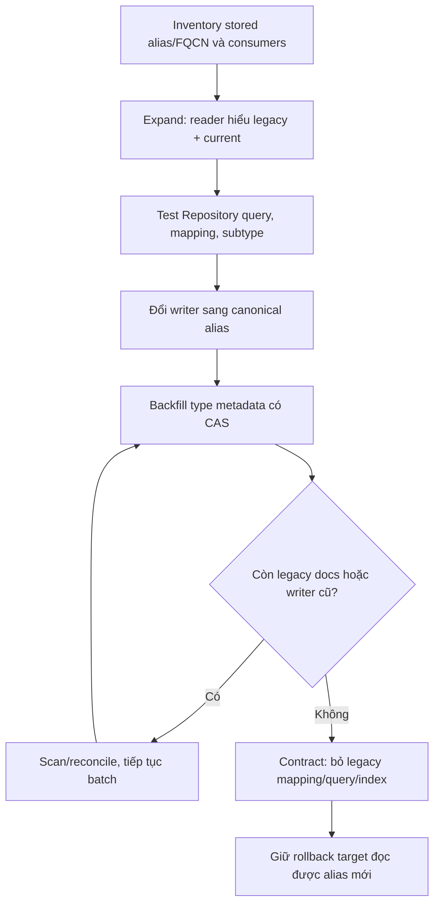
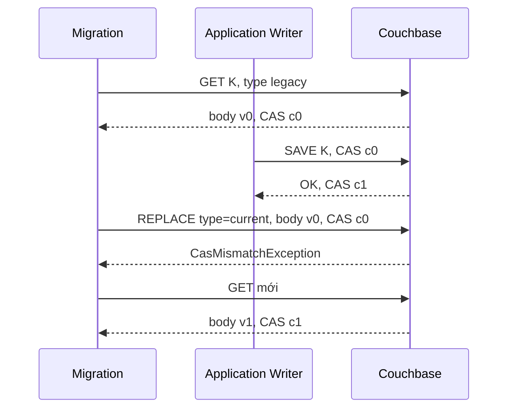
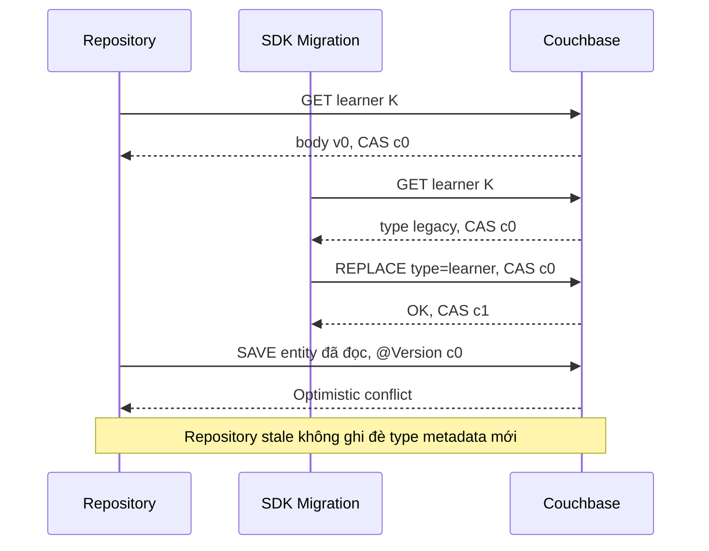

# Thay đổi @TypeAlias, thông tin kiểu và tên lớp Java trong Spring Data Couchbase

## 1. Vì sao đổi tên class Java có thể làm hỏng dữ liệu đã lưu?

Một ứng dụng Spring Data Couchbase ban đầu sử dụng entity:

```java
package com.acme.learning.domain;

@Document
public class LearnerDocument {
    // ...
}
```

Sau refactor, class chuyển sang package mới:

```java
package com.acme.learning.persistence.document;

@Document
public class LearnerProfileDocument {
    // ...
}
```

Source code có thể đã compile, nhưng **document trong Couchbase không được đổi chỉ vì tên class/package đổi**. Nếu converter lưu thông tin type theo tên Java đầy đủ, document cũ có thể chứa:

```json
{
  "_class": "com.acme.learning.domain.LearnerDocument",
  "tenantId": "acme",
  "learnerId": "learner-17",
  "displayName": "Minh Anh",
  "active": true
}
```

Khi app mới khai báo `@TypeAlias("learner")`, document mới có thể mang:

```json
{
  "_class": "learner",
  "tenantId": "acme",
  "learnerId": "learner-17",
  "displayName": "Minh Anh",
  "active": true
}
```

Tên `_class` là **minh họa cho type discriminator trong một cấu hình Spring Data Couchbase thường gặp**; type key có thể được thay đổi qua cấu hình mapping. Cần xác minh JSON/type mapper thực tế trước khi viết migration.

Rủi ro:

1. Converter không resolve được metadata trỏ đến Java class cũ đã bị xóa.
2. Repository query có type filter theo alias mới **không chọn document còn mang tên FQCN cũ**.
3. Nested polymorphic value vẫn chứa FQCN legacy dù root đã đổi.
4. SDK raw JSON writer có thể ghi đè hoặc bỏ type metadata do không hiểu Spring Data.
5. Binary cũ/mới cùng ghi làm stored type value thay đổi qua lại.
6. Job migration không dùng CAS có thể làm mất business update xảy ra đồng thời.

**Đổi `@TypeAlias`, đổi tên class hoặc package là thay đổi hợp đồng lưu trữ, không chỉ là refactor Java.**

Bài thuộc chương **Tiến hóa và di trú** của module `SPRING_DATA_COUCHBASE`: xây dựng tầng truy cập Couchbase bằng Spring Data document mapping, Repository, `CouchbaseTemplate`, SQL++, bucket/scope/collection, chỉ mục, TTL, CAS, transaction và Reactive API.

### 1.1. Mục tiêu

Sau bài này, người học có thể phân biệt type metadata với schemaVersion/CAS/document ID, giải thích `@TypeAlias` và mapping context, đánh giá tác động lên Repository query và nested type, thiết kế alias bền vững, rollout nhiều binary, viết migration CAS an toàn và kiểm thử các đường SDK/Template/reactive.

## 2. Các định danh không được trộn lẫn

```text
Bucket/scope/collection : learning.training.learners
Document ID             : learner::acme::learner-17
Business documentType   : learner
Stored type metadata    : _class = "learner"
Schema version          : schemaVersion = 2
CAS                     : opaque token do Couchbase quản lý
Java class              : com.acme.learning.persistence.LearnerDocument
```

| Giá trị | Vai trò | Có tự đổi khi rename Java class? |
| --- | --- | --- |
| Bucket/scope/collection | Chỉ vị trí vật lý document | Không |
| `@Id` / document key | Định danh document trong collection | Không |
| `documentType` | Loại đối tượng nghiệp vụ | Không |
| Stored type metadata, ví dụ `_class` | Giúp converter xác định Java type | Document cũ không tự đổi |
| `schemaVersion` | Phiên bản cấu trúc JSON nghiệp vụ | Không |
| CAS/`@Version` | Bảo vệ mutation khỏi stale write | Chỉ thay theo mutation |
| Java FQCN | Định danh class trong JVM | Có khi refactor |

**Alias không phải schemaVersion.** Một learner có thể giữ `_class="learner"` qua schemaVersion 1 → 2 → 3. Ngược lại, đổi FQCN thành alias có thể không thay schemaVersion nếu các field nghiệp vụ không đổi.

**Alias không phải CAS.** CAS do Couchbase quản lý, dùng làm điều kiện ghi; không phải timestamp, phiên bản schema hoặc bộ đếm. Spring Data ánh xạ CAS bằng `@Version` khi đi qua đường mapping hỗ trợ.

**Alias không phải authorization.** Query lọc type đúng vẫn phải xác thực tenant/caller và kiểm tra quyền đọc/ghi.

## 3. `@TypeAlias` và cách tách stored type khỏi tên Java

Spring Data Commons cung cấp:

```java
import org.springframework.data.annotation.TypeAlias;

@TypeAlias("learner")
public class LearnerDocument {
}
```

Với converter/type mapper hỗ trợ, alias `"learner"` có thể được lưu thay cho FQCN như `"com.acme.learning.persistence.document.LearnerDocument"`.

Entity minh họa:

```java
package com.acme.learning.persistence.document;

import java.time.Instant;
import org.springframework.data.annotation.Id;
import org.springframework.data.annotation.TypeAlias;
import org.springframework.data.annotation.Version;
import org.springframework.data.couchbase.core.mapping.Document;

@Document
@TypeAlias("learner")
public class LearnerDocument {

    @Id
    private String id;

    @Version
    private Long casVersion;

    private Integer schemaVersion;
    private String documentType;
    private String tenantId;
    private String learnerId;
    private String displayName;
    private boolean active;
    private Instant updatedAt;

    protected LearnerDocument() {
        // Cho Spring Data mapping.
    }

    public LearnerDocument(
            String id, String tenantId, String learnerId,
            String displayName) {
        if (id == null || id.isBlank() ||
            displayName == null || displayName.isBlank()) {
            throw new IllegalArgumentException("ID hoặc tên không hợp lệ");
        }

        this.id = id;
        this.schemaVersion = 2;
        this.documentType = "learner";
        this.tenantId = tenantId;
        this.learnerId = learnerId;
        this.displayName = displayName;
        this.active = true;
        this.updatedAt = Instant.now();
    }

    public String getId() { return id; }
    public Long getCasVersion() { return casVersion; }
    public Integer getSchemaVersion() { return schemaVersion; }
    public String getTenantId() { return tenantId; }
    public String getDisplayName() { return displayName; }

    public void rename(String nextName) {
        if (nextName == null || nextName.isBlank()) {
            throw new IllegalArgumentException("Tên không hợp lệ");
        }
        displayName = nextName;
        updatedAt = Instant.now();
    }
}
```

Các annotation tách trách nhiệm:

- `@Document`: Spring Data Couchbase entity.
- `@TypeAlias("learner")`: stored type identity khi type mapper hỗ trợ.
- `@Version`: CAS metadata, phục vụ optimistic locking.
- `@Id`: document key, độc lập với alias.
- `schemaVersion`: field JSON nghiệp vụ, không được dùng làm `@Version`.

### 3.1. Refactor class nhưng giữ alias

Phiên bản cũ:

```java
package com.acme.learning.domain;

@Document
@TypeAlias("learner")
public class LearnerEntity {
}
```

Phiên bản mới:

```java
package com.acme.learning.persistence;

@Document
@TypeAlias("learner")
public class LearnerDocument {
}
```

Vì stored identity vẫn có thể là `"learner"`, việc đổi class/package có thể không đòi rewrite toàn bộ JSON. Nhưng phải xác nhận mapping context **đã đăng ký class mới** và đọc được những document có alias hiện hành.

Một annotation trên class không được scan hoặc không có trong mapping context không tự bảo đảm converter resolve được alias.

### 3.2. Chọn alias ổn định

Nên dùng alias có ý nghĩa lâu dài, ví dụ `learner`, `enrollment`, `course-capacity`. Tránh:

- Trùng alias giữa các mapped types không tương đương.
- Alias gắn với Java package, năm phát hành hoặc tenant.
- Dùng lại alias cũ cho type có semantics hoàn toàn mới.
- Thay giá trị alias khi chỉ rename Java class.
- Cho SDK/client tùy ý gửi tên class để tự materialize type.

Một alias cần được quản lý như **hợp đồng dữ liệu**, có registry/kiểm thử tương thích giữa các ứng dụng sử dụng cùng collection.

## 4. Stored type key: `_class` chỉ là một trường hợp cấu hình

Trong ví dụ:

```json
{
  "_class": "learner",
  "schemaVersion": 2,
  "documentType": "learner",
  "tenantId": "acme"
}
```

- `_class` là field JSON có ý nghĩa với mapping framework khi được cấu hình như vậy.
- CAS là metadata bên ngoài JSON body, không phải `_class`.
- `META(d).id` trong SQL++ là document ID, không phải stored type.
- `schemaVersion` cho biết layout JSON; alias cho biết Java type identity.
- `documentType` do business quản lý, có thể trùng chuỗi alias nhưng vai trò khác nhau.

Nếu dự án đổi type key từ `_class` thành `kind` thông qua custom mapper, query/migration hard-code `_class` có thể sai. **Đổi tên type key và đổi giá trị alias là hai migration khác nhau**; tránh gộp nếu không cần.

### 4.1. Thêm annotation không rewrite document legacy

```java
@TypeAlias("learner")
```

không thực hiện một mutation tới Couchbase. Document đã lưu FQCN vẫn giữ giá trị ấy cho tới khi writer/migration có chủ đích ghi lại.

## 5. Mapping context và khả năng resolve type

Khi đọc alias, converter phải biết alias thuộc Java type nào. Entity cần được mapping context nhận diện qua cấu hình quét entity, initial entity set, repository domain types hoặc cơ chế phù hợp với dependency.

Giả sử:

```text
learning-service:
  @TypeAlias("learner") LearnerDocument đã đăng ký.

analytics-service:
  Chỉ dùng LearnerSummary DTO.
  Không đăng ký subtype LearnerDocument trong context.
```

Không thể suy luận analytics-service sẽ deserialize một nested object có alias `"learner"` đúng như learning-service chỉ vì chúng cùng dùng Spring Data.

### 5.1. Reflection không thay integration test

```java
TypeAlias typeAlias =
    LearnerDocument.class.getAnnotation(TypeAlias.class);
```

chỉ chứng minh annotation có mặt. Cần integration test:

1. Khởi động đúng Spring Data Couchbase context.
2. Save entity.
3. Dùng SDK GET raw body để kiểm tra stored key/value.
4. Đọc lại qua Repository và Template.
5. Query theo business field để kiểm tra type filter.
6. Đọc nested subtype khi có polymorphic field.

## 6. Repository query và bộ lọc type

Spring Data Couchbase có cơ chế entity-selection và type filter trong các phiên bản tương ứng, thường được dùng như:

```java
import java.util.List;
import org.springframework.data.couchbase.repository.CouchbaseRepository;
import org.springframework.data.couchbase.repository.Query;

public interface LearnerRepository
        extends CouchbaseRepository<LearnerDocument, String> {

    @Query(
        "#{#n1ql.selectEntity} WHERE #{#n1ql.filter} " +
        "AND tenantId = $1")
    List<LearnerDocument> findByTenantId(String tenantId);
}
```

Đoạn trên minh họa ý định dùng SpEL entity selection/type filtering do framework hỗ trợ; cần kiểm tra syntax/SQL++ thực tế với dependency đang chạy.

Nếu query cuối cùng tương đương:

```sql
SELECT META(d).id AS documentId,
       d.learnerId, d.tenantId
FROM `learning`.`training`.`learners` AS d
WHERE d._class = "learner"
  AND d.tenantId = $tenantId;
```

thì document mang giá trị `_class="com.acme.learning.domain.LearnerDocument"` **không khớp filter**, dù document vẫn tồn tại.

Câu SQL++ trên là **minh họa hiện tượng**, không phải SQL++ mà framework được hứa sinh chính xác. Phần SELECT alias metadata, type filter và tên keyspace trong thực tế phụ thuộc mapping/version.

### 6.1. Hai lỗi khác nhau: materialize và query selection

- **Mapping failure:** reader tìm thấy K nhưng converter không resolve được stored type.
- **Query filtering failure:** SQL++ query không chọn K vì filter theo type alias mới.

Do đó phải test cả `findById` lẫn derived/custom query. KV GET trực tiếp có thể thấy body dù repository query không trả row; ngược lại raw SQL++ có thể trả row nhưng converter Java không materialize được.

### 6.2. Index cũng có thể phụ thuộc discriminator

```sql
CREATE INDEX idx_learner_type_tenant
ON `learning`.`training`.`learners`(_class, tenantId);
```

Index hoặc partial index cũ có thể chỉ phù hợp FQCN legacy. Trong rollout, đo `EXPLAIN`/latency với cả alias cũ và mới; không xóa index legacy khi vẫn còn reader/job phụ thuộc.

## 7. Ma trận rủi ro khi refactor

| Thay đổi | Stored metadata | Rủi ro | Hướng xử lý |
| --- | --- | --- | --- |
| Đổi package/class, giữ alias ổn định | `learner` | Mapping context/type registration | Test read/write; không nhất thiết rewrite |
| Đổi class khi chưa có alias | FQCN cũ | Không resolve được old class | Reader bridge + migration |
| Thêm `@TypeAlias` sau nhiều năm | FQCN và alias cùng tồn tại | Mixed stored identity | Expand–migrate–contract |
| Đổi giá trị alias | Alias cũ còn trong database | Query/mapping không nhận | Migration metadata |
| Đổi type key | Hai key metadata qua thời kỳ | Converter nhìn sai nơi | Custom mapper/reader |
| Đổi class nested subtype | Type metadata nested cũ | Root đọc được, child lỗi | Inventory nested và test |
| Gộp/tách entity type | Nhiều alias/collection | Ambiguous hoặc mất thông tin | Transform + transaction/workflow |
| Đổi scope/collection | Khác keyspace | Truy cập sai document | Copy/cutover riêng |

Đừng đổi alias, schemaVersion, document ID và collection trong cùng một phát hành nếu không có kế hoạch migration/rollback đầy đủ.

## 8. Polymorphism: root type đúng nhưng nested type vẫn có thể sai

Một document enrollment có thể chứa property khai báo theo interface hoặc abstract class:

```java
public interface NotificationChannel {
}

@TypeAlias("channel-email")
public record EmailChannel(String address)
        implements NotificationChannel {
}

@TypeAlias("channel-sms")
public record SmsChannel(String phone)
        implements NotificationChannel {
}
```

Đây là ví dụ cấu trúc Java; yêu cầu của converter về đăng ký mapped type, nested polymorphism và constructor phụ thuộc entity model cùng Spring Data version. Không phải mọi nested object đều bắt buộc mang discriminator nếu declared type đã đủ rõ.

Trong một object graph có thể tồn tại:

```json
{
  "_class": "enrollment",
  "enrollmentId": "reg-91",
  "notificationChannel": {
    "_class": "com.acme.learning.notify.EmailChannel",
    "address": "masked@example.org"
  }
}
```

Nếu chỉ đổi root alias `"enrollment"` nhưng refactor `EmailChannel`, converter vẫn có thể lỗi tại nested property. Do đó phải kiểm kê và kiểm thử type information ở những path lồng nhau cần metadata, bao gồm list/map, abstract/interface properties và subclass.

**Không** chạy search-and-replace mọi chuỗi giống FQCN trong JSON: có những field chứa tên class vì mục đích logging/config, không phải type discriminator của converter.

### 8.1. Không materialize class tùy ý từ dữ liệu

Tránh dùng `Class.forName(rawTypeFromJson)` với chuỗi type không đáng tin cậy rồi tự khởi tạo object. Hãy dùng các type được mapper đăng ký và allowlist của ứng dụng. Unknown alias phải được nhận diện/quarantine có chủ đích.

## 9. Khi nào thật sự cần đổi alias?

Nếu class đã có alias ổn định, thường **giữ nguyên alias** khi rename Java class là lựa chọn ít rủi ro hơn.

Chỉ cân nhắc đổi alias khi có lý do dữ liệu rõ, ví dụ:

- Alias cũ trùng giữa nhiều mapped types.
- Alias mang ý nghĩa sai hoặc bị sử dụng cho hai loại document khác nhau.
- Cần chuẩn hóa registry giữa các service đang dùng chung dữ liệu.
- Mô hình business type thực sự đổi và có migration tương ứng.

| Tình huống | Hướng ưu tiên |
| --- | --- |
| Rename class, alias cũ ổn định | Giữ alias, test mapping context mới |
| Rename class khi đang lưu FQCN | Reader bridge + backfill metadata |
| Thêm alias lần đầu cho dữ liệu nhiều năm | Giữ khả năng đọc FQCN cho đến khi migrate |
| Đổi alias chỉ vì sở thích đặt tên | Cân nhắc không đổi |
| Đổi type key của mapper | Migration riêng, không nhập nhằng với đổi value |
| Tách một type thành nhiều entity | Converter/data transform + transaction khi cần |
| Chuyển collection | Copy/cutover, không chỉ sửa type key |

## 10. Case study: từ FQCN legacy sang alias ổn định

Document legacy:

```json
{
  "_class": "com.acme.learning.domain.LearnerEntity",
  "documentType": "learner",
  "schemaVersion": 1,
  "tenantId": "acme",
  "learnerId": "learner-17",
  "displayName": "Minh Anh"
}
```

Document đích:

```json
{
  "_class": "learner",
  "documentType": "learner",
  "schemaVersion": 1,
  "tenantId": "acme",
  "learnerId": "learner-17",
  "displayName": "Minh Anh"
}
```

**schemaVersion giữ nguyên 1**, bởi ví dụ này chỉ đổi stored type metadata. Nếu đồng thời đổi business layout (ví dụ tên phẳng thành nested profile), cần một phép migration schema khác có validation/test riêng.

Quy ước:

```text
LEGACY  : _class = "com.acme.learning.domain.LearnerEntity"
CURRENT : _class = "learner"
UNKNOWN : _class MISSING, NULL hoặc không thuộc allowlist
```

Mục tiêu rollout:

1. Reader bridge hiểu LEGACY và CURRENT.
2. Writer mới chỉ ghi CURRENT sau khi toàn bộ reader cần thiết đã tương thích.
3. Backfill LEGACY → CURRENT bằng CAS.
4. UNKNOWN đưa vào quarantine/điều tra, không suy đoán.
5. Contract chỉ sau khi hết legacy và có rollback target an toàn.

### 10.1. Một annotation không tạo multi-alias mapping mặc định

Không nên giả định `@TypeAlias("learner")` sẽ tự hiểu **nhiều FQCN/alias lịch sử** cùng map vào một Java class. Tùy phiên bản và yêu cầu, có thể:

- Giữ tạm class/mapping legacy.
- Viết custom type mapper hoặc reading converter.
- Dùng SDK raw JSON adapter với allowlist type.
- Dùng SQL++ projection để inventory và đọc read-only.
- Copy sang collection mới khi thay đổi cấu trúc lớn.

Custom converter phải được test với ID/CAS, subtype, discriminator, dữ liệu sai kiểu và writer path. Một read-only DTO không phải persistence entity đủ dữ liệu để save.

## 11. Expand–migrate–contract cho stored type metadata



### 11.1. Expand: kiểm kê và triển khai reader trước

Trước khi ghi type metadata mới:

1. Xác định type key thực tế trong JSON, kể cả custom mapper.
2. Đếm FQCN/alias ở root và các nested paths có polymorphism.
3. Liệt kê Repository, Template, SDK, SQL++, reactive readers/writers.
4. Liệt kê query có `#{#n1ql.filter}`, hard-coded alias hoặc partial index.
5. Chặn SDK writer tự do upsert document body cũ.
6. Kiểm tra job nền, consumer, client offline và rollback binary.
7. Triển khai reader bridge trên các service có thể đọc document mới.
8. Chạy integration tests trên dữ liệu legacy/current/unknown type.

Chỉ khi mọi reader còn chạy đã hiểu CURRENT (hoặc có cutover window được kiểm soát) mới bật writer canonical alias.

### 11.2. Migrate: bảo vệ dữ liệu khi cập nhật metadata

```text
SQL++ query tìm ID legacy
        |
        v
KV GET raw JSON và CAS mới nhất
        |
        v
Kiểm tra old type, documentType, tenant, keyspace
        |
        v
Chỉ sửa stored type metadata trên JSON đầy đủ
        |
        v
KV REPLACE với CAS và policy giữ TTL
        |
        +-- success: checkpoint
        +-- CAS mismatch: GET mới, revalidate và retry có giới hạn
        +-- timeout: reconcile
        +-- not found: lifecycle policy
```

Nếu cả app writer và migration đều tuân CAS, job không thể im lặng ghi đè body mới hơn từ snapshot cũ. Nhưng nếu còn worker SDK upsert không điều kiện, dữ liệu vẫn có thể bị hạ cấp sau migration.

### 11.3. Contract: bằng chứng cần có

- Không còn document legacy sau scan và đối soát theo index/plan đã xác minh.
- Không còn writer tạo lại giá trị legacy.
- Nested subtype metadata đã kiểm kê.
- Query/index mới đúng và không còn consumer phụ thuộc type cũ.
- Các binary được phép rollback vẫn hiểu canonical alias.
- Có runbook cho unknown metadata phát sinh sau cutover.

Không suy ra COUNT=0 là đủ nếu query dùng index bỏ qua MISSING hoặc một writer cũ có thể sinh legacy document sau đó.

## 12. SQL++ dùng để inventory thay vì che dữ liệu legacy

Query thống kê stored value:

```sql
SELECT d._class AS storedType,
       COUNT(*) AS documentCount
FROM `learning`.`training`.`learners` AS d
WHERE d.documentType = "learner"
GROUP BY d._class;
```

Cần nhìn cả type key MISSING/NULL và document type khác nếu cùng collection. Query trên chỉ đúng khi `_class` là type key thực tế và bộ lọc `documentType` bao phủ legacy data.

Query tìm ID ứng viên:

```sql
SELECT RAW META(d).id
FROM `learning`.`training`.`learners` AS d
WHERE d._class = $legacyType
  AND d.documentType = "learner";
```

Bind `$legacyType` thành FQCN legacy được xác nhận; không nối giá trị người dùng vào statement. Tên bucket/scope/collection cần cố định theo cấu hình/allowlist.

**Query trả ID ứng viên chứ không khóa document.** Trước mutation, GET lại body + CAS và kiểm tra stored type.

### 12.1. MISSING và NULL có thể bị bỏ sót

Một query `WHERE d._class = "learner"` chỉ tìm CURRENT, không cho biết bao nhiêu document có:

- Legacy FQCN khác nhau.
- `_class IS MISSING`.
- `_class IS NULL`.
- Type metadata sai kiểu.
- Nested subtype FQCN.
- Document khác type cùng collection.

Định nghĩa index có thể khiến document thiếu field không được bao phủ như mong đợi. Kiểm tra `EXPLAIN`, index và dữ liệu mẫu thực tế.

### 12.2. Cẩn thận với OFFSET

Backfill đang làm tập legacy nhỏ đi:

```sql
SELECT RAW META(d).id
FROM `learning`.`training`.`learners` AS d
WHERE d._class = $legacyType
LIMIT 100 OFFSET 100;
```

Sau khi page đầu được đổi sang CURRENT, OFFSET trên tập legacy thu hẹp có thể **bỏ qua document**. Hãy cân nhắc keyset pagination/partition ID có checkpoint hoặc scan lặp đến khi writer legacy đã dừng.

Ví dụ keyset minh họa (cần index và plan phù hợp):

```sql
SELECT RAW META(d).id
FROM `learning`.`training`.`learners` AS d
WHERE d._class = $legacyType
  AND META(d).id > $lastId
ORDER BY META(d).id
LIMIT $batchSize;
```

Nếu có writer cũ tạo ID legacy nhỏ hơn cursor, pass đó vẫn có thể bỏ sót; cần pass đối soát cuối.

### 12.3. Query consistency không phải CAS

Scan consistency giúp chọn mức visibility của index theo contract API, nhưng một writer vẫn có thể thay document sau SELECT. Chỉ mutation có CAS cuối mới bảo vệ job khỏi ghi đè một snapshot stale.

## 13. SDK migration một document có CAS

Ví dụ Java SDK với type key đã xác nhận là `_class`:

```java
import com.couchbase.client.java.Collection;
import com.couchbase.client.java.json.JsonObject;
import com.couchbase.client.java.kv.GetResult;

import static com.couchbase.client.java.kv.ReplaceOptions.replaceOptions;

public final class LearnerAliasMigration {

    private static final String LEGACY =
        "com.acme.learning.domain.LearnerEntity";
    private static final String CURRENT = "learner";

    private final Collection learners;

    public LearnerAliasMigration(Collection learners) {
        this.learners = learners;
    }

    public boolean migrateOnce(String documentId) {
        GetResult observed = learners.get(documentId);
        JsonObject body = observed.contentAsObject();

        Object storedType = body.get("_class");

        if (CURRENT.equals(storedType)) {
            return false;
        }
        if (!LEGACY.equals(storedType)) {
            throw new IllegalArgumentException(
                "Stored type không thuộc allowlist");
        }

        if (!"learner".equals(body.getString("documentType"))) {
            throw new IllegalArgumentException("Không phải learner");
        }
        if (!documentId.startsWith("learner::")) {
            throw new IllegalArgumentException(
                "ID nằm ngoài namespace migration");
        }

        // Giữ field nghiệp vụ và schemaVersion; chỉ đổi type.
        body.put("_class", CURRENT);

        learners.replace(
            documentId,
            body,
            replaceOptions()
                .cas(observed.cas())
                .preserveExpiry(true));

        return true;
    }
}
```

Chính sách:

- Keyspace đến từ cấu hình tin cậy; prefix ID không phải kiểm tra authorization đầy đủ.
- Chỉ đổi LEGACY sang CURRENT, không suy đoán unknown alias.
- Giữ full body và field chưa biết thay vì dựng JSON partial.
- Không tự gán `schemaVersion=2` nếu cấu trúc nghiệp vụ không đổi.
- CAS lấy từ chính GET đã đọc body.
- Preserve expiry khi nghiệp vụ yêu cầu và SDK/version hỗ trợ; phải test TTL.
- Nếu CAS mismatch, đọc lại chứ không lấy CAS mới rồi dùng body cũ.

### 13.1. Retry có giới hạn và revalidate

```java
import com.couchbase.client.core.error.CasMismatchException;

public boolean migrateWithRetry(String id) {
    final int maxAttempts = 3;

    for (int attempt = 1; attempt <= maxAttempts; attempt++) {
        try {
            return migrateOnce(id);
        } catch (CasMismatchException conflict) {
            if (attempt == maxAttempts) {
                throw conflict;
            }
            // Production: backoff, jitter, tổng deadline.
        }
    }

    throw new IllegalStateException("Không thể tới nhánh này");
}
```

Method minh họa thuộc cùng class với `migrateOnce`. Mỗi lượt lại GET, kiểm tra type/ID/tenant rồi replace có CAS. Timeout không rõ commit hoặc document đã xóa phải được xử lý khác CAS conflict.

### 13.2. Timeline khi app writer chen giữa



Vì không có CAS khớp, migration không làm mất update của A. Nếu SDK writer khác dùng upsert không điều kiện sau migration, vẫn có thể hạ cấp alias; cần chính sách cho **mọi writer**.

## 14. Sub-document mutation: chỉ sửa metadata path, nhưng đừng bỏ CAS

Nếu mục tiêu chỉ là đổi một type field trong JSON, có thể dùng sub-document API thay vì ghi lại toàn body. Tuy nhiên, nếu migration đã GET để kiểm tra documentType, schema và stored type thì mutation cuối vẫn phải bảo vệ **cùng snapshot**.

Ví dụ SDK (giả định nằm trong class có `learners`, `LEGACY`, `CURRENT`):

```java
import java.util.List;
import com.couchbase.client.java.kv.MutateInSpec;

import static com.couchbase.client.java.kv.MutateInOptions.mutateInOptions;

var observed = learners.get(documentId);
var body = observed.contentAsObject();

if (!LEGACY.equals(body.getString("_class"))) {
    throw new IllegalStateException("Không phải legacy type");
}
if (!"learner".equals(body.getString("documentType"))) {
    throw new IllegalStateException("Không phải learner");
}

learners.mutateIn(
    documentId,
    List.of(MutateInSpec.replace("_class", CURRENT)),
    mutateInOptions().cas(observed.cas()));
```

Đoạn trên không là file Java độc lập: biến `learners`, `documentId` và constants phải có sẵn. Cần xác minh tùy chọn preserve expiry/durability phù hợp khi dùng `mutateIn`.

Không có CAS:

```java
learners.mutateIn(
    documentId,
    List.of(MutateInSpec.upsert("_class", CURRENT)));
```

là một contract **khác**: có thể thay type sau khi reader đã quan sát một version cũ, hoặc ghi vào document đã được ứng dụng khác đổi sang loại không còn thuộc migration. Không chọn chỉ vì payload nhỏ.

### 14.1. Multi-spec trên một document

Nếu type metadata xuất hiện ở hai path được xác nhận thuộc cùng document, một `mutateIn` multi-spec có thể thay các path ấy nguyên tử ở cấp document. Nhưng nếu path thiếu/sai type hoặc thuộc tính nested không phải metadata Spring Data, mutation cần được xử lý theo schema/mapper cụ thể.

**Sub-document không tạo transaction trên hai document khác nhau**, và không tự xử lý lệnh di trú đã được gửi lại sau timeout.

### 14.2. Có cần migrate cả nested type không?

Chỉ khi nested metadata thực tế chứa legacy value được converter dùng. Việc update root `_class` và nested `notificationChannel._class` có thể cần quy tắc riêng cho từng loại object; không chạy một script cập nhật mọi thuộc tính có tên `_class` mà không xác định ý nghĩa.

## 15. Nhiều writer cùng document: Repository, Template và SDK

Khi Repository dùng entity có `@Version`, một lần save có thể tạo CAS mới. SDK migration cũng tạo CAS mới dù chỉ đổi type metadata.



Một Repository đang giữ entity từ trước migration có thể bị optimistic conflict sau khi job đổi `_class`. Đó là cơ chế bảo vệ hợp lý. Nếu dùng retry cho command, phải đọc lại toàn bộ entity và chạy lại business validation; **không reset `@Version` hoặc đổi sang upsert để ép save**.

### 15.1. SDK upsert không CAS có thể phá migration

Lịch trình khác:

```text
T0 SDK writer cũ GET K, type=FQCN, CAS c0
T1 Migration REPLACE type=learner, CAS c0 -> c1
T2 SDK writer cũ UPSERT body cũ không CAS -> c2, type lại là FQCN
```

Migration báo thành công nhưng type bị hạ cấp sau đó. Không thể giải quyết triệt để chỉ bằng tăng retry job; phải chuyển/đình chỉ writer cũ, hoặc bảo đảm mọi writer hiểu và tuân storage contract.

### 15.2. Template entity save không bao trùm mọi API khác

`CouchbaseTemplate.save(entity)` có thể đi qua Spring Data mapping và optimistic locking của entity versioned, nhưng custom/fluent update, SDK access hoặc SQL++ UPDATE do ứng dụng viết có thể có semantics khác.

Từng đường ghi phải trả lời:

| Câu hỏi | Tại sao? |
| --- | --- |
| Có dùng đúng bucket/scope/collection và key? | Cùng ID khác collection là document khác |
| Đường đọc có materialize alias cũ/mới? | Tránh lỗi type mapper |
| Entity có CAS trong `@Version`? | Tránh stale update |
| Mutation cuối có gửi CAS? | Tránh time-of-check/time-of-use |
| Có reserialize toàn body không? | Tránh mất unknown fields/type metadata |
| Writer có tự hạ cấp alias? | Tránh hồi quy sau backfill |
| Có giữ TTL, durability? | Tránh thay đổi lifecycle ngoài ý muốn |
| Query có filter alias? | Tránh dữ liệu “biến mất” khi search |

Không suy luận “đã dùng Spring Data” có nghĩa mọi native SQL++ hay SDK mutation tự dùng `@Version`.

## 16. Reader bridge: chỉ nhận stored type trong allowlist

Một compatibility reader có thể đọc raw JSON bằng SDK khi Spring Data converter không còn resolve FQCN cũ. Nó kiểm tra type metadata trước khi tạo một **read model** chuẩn.

```java
import com.couchbase.client.java.json.JsonObject;

public record LearnerView(
    String tenantId,
    String learnerId,
    String displayName,
    boolean legacyStoredType
) {}

public final class LearnerTypeCompatibilityReader {

    private static final String LEGACY =
        "com.acme.learning.domain.LearnerEntity";
    private static final String CURRENT = "learner";

    private LearnerTypeCompatibilityReader() {}

    public static LearnerView from(JsonObject body) {
        Object type = body.get("_class");
        boolean legacy = LEGACY.equals(type);
        boolean current = CURRENT.equals(type);

        if (!legacy && !current) {
            throw new IllegalArgumentException(
                "Stored type không được hỗ trợ");
        }

        if (!"learner".equals(body.getString("documentType"))) {
            throw new IllegalArgumentException("Không phải learner");
        }

        String tenant = body.getString("tenantId");
        String id = body.getString("learnerId");
        String name = body.getString("displayName");

        if (tenant == null || tenant.isBlank() ||
            id == null || id.isBlank() ||
            name == null || name.isBlank()) {
            throw new IllegalArgumentException(
                "Thiếu field bắt buộc của learner");
        }

        return new LearnerView(tenant, id, name, legacy);
    }
}
```

Ví dụ này xử lý **type identity**, chưa phải converter đầy đủ cho schemaVersion v1/v2. Nếu business schema thay đổi cùng lúc, cần thêm bước normalize theo `schemaVersion` có validation riêng. Reader không được tự giả định class cũ có layout giống class mới nếu dữ liệu thực tế khác.

### 16.1. Đừng save `LearnerView` như entity

```text
SDK GET -> LearnerView chỉ để hiển thị
                |
                v
         dựng entity partial rồi save   [SAI]
```

View không mang đủ field, CAS, type metadata, expiry. Nếu service cần cập nhật, phải đọc full body/metadata và dùng write adapter có CAS, hoặc dùng Spring Data entity mapping đã được kiểm chứng.

### 16.2. Compatibility layer cần bảo vệ tenant

```java
LearnerView view =
    LearnerTypeCompatibilityReader.from(rawBody);

if (!trustedTenantId.equals(view.tenantId())) {
    throw new SecurityException("Sai tenant");
}
```

Việc document có type `"learner"` không cấp quyền cho caller. Khi chọn key từ request, kiểm soát cả tenant trong key và body/canonical ID policy.

### 16.3. Unknown type không nên bị downcast

Nếu reader gặp `_class="learner-v3"` hoặc một FQCN bất ngờ, không được tự coi đó là `learner` rồi serialize lại body. Đây có thể là version tương lai hoặc document khác; cách xử lý nên là unsupported/quarantine/read-only theo contract.

## 17. Reactive SDK: cập nhật metadata có CAS mà không block

Reactive migration giữ nguyên các nguyên tắc đọc–kiểm tra–ghi. Ví dụ với Java SDK Reactive Collection:

```java
import java.time.Duration;

import com.couchbase.client.core.error.CasMismatchException;
import com.couchbase.client.java.Collection;
import com.couchbase.client.java.json.JsonObject;

import reactor.core.publisher.Mono;
import reactor.util.retry.Retry;

import static com.couchbase.client.java.kv.ReplaceOptions.replaceOptions;

public final class ReactiveLearnerAliasMigration {
    private static final String LEGACY =
        "com.acme.learning.domain.LearnerEntity";
    private static final String CURRENT = "learner";

    private final Collection learners;

    public ReactiveLearnerAliasMigration(Collection learners) {
        this.learners = learners;
    }

    public Mono<Boolean> migrate(String id) {
        return Mono.defer(() ->
                learners.reactive().get(id)
                    .flatMap(observed -> {
                        JsonObject body = observed.contentAsObject();
                        Object type = body.get("_class");

                        if (CURRENT.equals(type)) {
                            return Mono.just(false);
                        }
                        if (!LEGACY.equals(type) ||
                            !"learner".equals(
                                body.getString("documentType"))) {
                            return Mono.error(
                                new IllegalArgumentException(
                                    "Stored type không hỗ trợ"));
                        }

                        body.put("_class", CURRENT);

                        return learners.reactive().replace(
                                id, body,
                                replaceOptions()
                                    .cas(observed.cas())
                                    .preserveExpiry(true))
                            .thenReturn(true);
                    }))
            .retryWhen(
                Retry.backoff(2, Duration.ofMillis(30))
                    .filter(CasMismatchException.class::isInstance)
                    .onRetryExhaustedThrow(
                        (spec, signal) -> signal.failure()));
    }
}
```

Đây là pipeline có **tối đa hai retry sau lần đầu**, chưa có kiểm soát concurrency batch/deadline toàn request. Nó cố tình retry chỉ CAS mismatch và làm lại toàn bộ GET→validate→replace.

Nếu dùng `Flux.flatMap` hàng nghìn ID, phải giới hạn concurrency/batch size. Không chạy migration Reactive vô hạn với một document hot key; không đặt email, payment hoặc side effect ngoài database trong nhánh có thể resubscribe.

### 17.1. Không bắt mọi lỗi thành alias legacy

Sai:

```java
return migration.migrate(id)
    .onErrorReturn(true);
```

Đoạn này biến lỗi permission, malformed JSON, wrong type, not-found hay timeout thành một kết quả trông như migration thành công. Cần phân loại lỗi và lưu metric/queue xử lý.

## 18. TTL, durability và document hết hạn

Một lần replace type metadata cũng là mutation. Nếu SDK/options có thể thay đổi expiry, document có TTL có thể bị kéo dài hoặc rút ngắn vòng đời ngoài ý muốn.

Vì vậy cần:

- Kiểm tra tài liệu/phiên bản SDK của `preserveExpiry(true)` cho `replace` hoặc option phù hợp với `mutateIn`.
- Test document có TTL ngắn, dài và không có TTL.
- Không “hồi sinh” document đã hết hạn bằng cách fallback sang upsert.
- Đánh giá bucket/scope/collection max-TTL policy và retention rule.
- Không để migration vi phạm yêu cầu xóa dữ liệu hoặc tombstone lifecycle.

```text
T0 Migration GET K -> body cũ, CAS c0
T1 K hết TTL / bị xóa
T2 REPLACE K với CAS c0 -> not-found hoặc lỗi theo API
```

Đây không nhất thiết là CAS mismatch. Không reset `@Version` thành null để tạo document mới nếu công việc là update-only.

### 18.1. CAS không thay durability

CAS bảo vệ stale write; durability quy định mức xác nhận lưu/nhân bản theo SLA và API. Việc chuyển type metadata thành công theo CAS không tự nói rằng mọi replica đã có trạng thái đó ở mức durability mong muốn.

## 19. Xử lý lỗi và outcome không rõ

| Lỗi | Ngữ nghĩa | Cách xử lý |
| --- | --- | --- |
| `CasMismatchException` | Phiên bản đã đọc thay đổi | GET mới, đánh giá lại, retry có giới hạn |
| Spring `OptimisticLockingFailureException` | Entity stale theo mapping | Không save body cũ; đọc lại/merge hoặc báo conflict |
| `DocumentNotFoundException` | Document biến mất, TTL/xóa/sai keyspace | Policy lifecycle, không tự insert |
| Unknown alias / type key sai | Không nhận diện stored type | Quarantine/compatibility rule |
| Nested subtype mapping error | Child type metadata không giải mã được | Kiểm tra object graph/converter |
| SQL++ query không thấy row | Type filter/index/visibility có thể sai | Kiểm tra raw KV và SQL++ predicate |
| Permission/authorization | Caller không được phép | Không retry như CAS |
| Timeout/ambiguous outcome | Có thể mutation đã commit | Reconcile thay vì suy đoán fail |
| Validation sai schema | Data contract không đúng | Repair/quarantine có giám sát |

### 19.1. Ambiguous timeout không xử lý như CAS mismatch

Giả sử migration replace đã thành công nhưng network mất phản hồi:

```text
T0 GET K legacy CAS c0
T1 REPLACE K type=current CAS c0
T2 Server có thể đã commit, CAS c1
T3 Client timeout
```

Khi đó có thể đọc lại:

1. Nếu type hiện hành đã là CURRENT và body hợp lệ → mục tiêu metadata migration đạt.
2. Nếu vẫn là LEGACY → cân nhắc thử lại sau validation.
3. Nếu UNKNOWN/đã bị xóa → điều tra theo policy.
4. Nếu còn writer cũ có thể hạ cấp type, chưa được tuyên bố hoàn thành chỉ từ một lần check.

**Idempotent target state** giúp job chạy lại, nhưng không thay nhu cầu reconciliation sau timeout khi nhiều writer hoạt động.

## 20. Rolling deployment và ma trận binary–metadata

| Binary | Đọc FQCN legacy | Đọc alias mới | Ghi FQCN | Ghi alias |
| --- | --- | --- | --- | --- |
| A1 legacy | Có | Không bảo đảm | Có | Không |
| A2 bridge | Có | Có | Chỉ khi contract chuyển tiếp cho phép | Có |
| A3 alias-only | Không bảo đảm | Có | Không | Có |

Thứ tự nên là:

1. Deploy A2 reader bridge đến mọi nơi cần đọc.
2. Xác nhận A1 writer không còn hoạt động hoặc đã được chặn hạ cấp.
3. Chuyển writer sang alias đích.
4. Backfill document legacy có CAS, giám sát unknown values.
5. Khi mọi doc/writer đã current, cân nhắc A3.
6. Chỉ bỏ compatibility khi rollback target còn đọc được alias mới.

**Đọc tương thích không đồng nghĩa ghi tương thích.** Một A2 có thể read cả hai nhưng một writer A1 vẫn upsert body FQCN cũ lên document đã migrate.

### 20.1. Rollback code khác rollback data

Sau khi đã ghi `_class="learner"`, rollback về binary A1 chỉ hiểu FQCN có thể làm ứng dụng không đọc được dữ liệu. Rollback an toàn cần:

- Một target binary vẫn hỗ trợ alias mới; hoặc
- Kế hoạch down-migration đã được chứng minh, có điều kiện CAS và không mất dữ liệu; hoặc
- Cutover/routing tạm thời để tránh reader không tương thích.

Không được mặc định đổi alias ngược là vô hại khi Java class/business schema đã thay đổi. Có thể không tồn tại phép đảo ngược chính xác nếu một entity đã được tách/ghép.

### 20.2. Kế hoạch dự phòng sau deploy

Cần feature flag tắt write-new-alias và dừng backfill, dashboard số document theo type value, script kiểm kê read-only, runbook xử lý unknown alias, snapshot/backup và phương án khôi phục được kiểm chứng.

Không cố “sửa nóng” bằng cách xóa `_class` khỏi JSON để Repository đọc lại nếu mapping contract chưa được thử nghiệm.

## 21. Migration có nhiều document hoặc thay đổi collection

Nếu chỉ sửa type metadata trong một document, CAS hoặc subdocument mutation có CAS có thể đủ. Nhưng khi refactor còn tách learner thành profile/preferences:

```text
learner::acme::learner-17
    ↓
learner-profile::acme::learner-17
learner-preferences::acme::learner-17
```

CAS trên document gốc không đảm bảo hai insert ở collection mới cùng commit. Cần phân biệt:

- **Một document:** CAS/mutateIn theo business guard.
- **Nhiều document trong một transaction boundary:** Couchbase distributed ACID transactions khi được hỗ trợ.
- **Nhiều hệ thống ngoài Couchbase:** saga, outbox, reconciliation và downstream idempotency.

Không assume một SDK KV call ngoài transaction context tự tham gia transaction chỉ vì cùng Java method; phải dùng API transaction-aware được hỗ trợ.

### 21.1. Transaction callback có thể được chạy lại

Không gửi email, gọi payment gateway hoặc tạo operation ID mới trong callback có thể retry. Giữ ID ổn định cho logical migration/operation, ghi outbox trong transaction nếu cần phát event sau commit.

## 22. Tác động đến API và cache

Một API public không nên trả raw `_class` hoặc FQCN Java cho client chỉ để hỗ trợ front-end, trừ khi đó là một contract đã được thiết kế cẩn thận. Exposing type metadata trói chặt public API vào nội bộ persistence, gây thêm gánh nặng khi refactor.

Cache/read model có thể chứa dữ liệu được serialize từ entity cũ. Sau rename:

- Cache codec có thể vẫn phụ thuộc Java class name.
- Message/event serializer có thể chứa type discriminator riêng.
- Client offline có thể gửi payload cũ.
- Search index/ETL cũng có thể lưu FQCN.

Đây là các **hợp đồng khác** với Couchbase type mapper. Không tự đồng nhất chúng; hãy kiểm kê đầy đủ và migrate theo từng boundary.

## 23. Bảo mật và giới hạn của type metadata

Type metadata không thay kiểm tra authorization, schema validation hoặc data retention:

- Không nhận arbitrary Java class name từ client làm alias được chấp nhận.
- Không dùng class name để suy quyền tenant.
- Không log raw JSON có PII khi converter thất bại.
- Không cho migration chạy sang collection khác vì một document chứa field type lạ.
- Không tự động tạo lại document bị xóa/hết TTL.
- Không dùng alias như khóa idempotency; mỗi logical operation vẫn cần ID phù hợp.

Một adapter an toàn phải kết hợp allowlist type, xác minh business identity, kiểm tra tenant và CAS cho mutation cập nhật.

## 24. Integration test: chứng minh Spring Data lưu và đọc alias đúng

Unit test chỉ nhìn annotation không thể đảm bảo stored type, converter hay repository query đúng. Hãy dùng Couchbase thật trong môi trường test, với cùng dependency/cấu hình type mapper như ứng dụng.

### 24.1. Test A — ghi entity mới có canonical alias

Khung JUnit 5 minh họa:

```java
import static org.junit.jupiter.api.Assertions.*;

import org.junit.jupiter.api.Test;

class LearnerAliasIntegrationTest {

    // Fixture test thật cần inject repository và SDK Collection
    // trỏ cùng bucket/scope/collection, cleanup dữ liệu sau test.
    private LearnerRepository repository;
    private com.couchbase.client.java.Collection sdkCollection;

    @Test
    void newEntityUsesStableAlias() {
        String id = "learner::test::alias-001";

        repository.save(
            new LearnerDocument(
                id, "test", "alias-001", "Minh Anh"));

        var observed = sdkCollection.get(id);
        var raw = observed.contentAsObject();

        // Assertion dưới đây áp dụng cho cấu hình type key "_class".
        assertEquals("learner", raw.getString("_class"));

        var loaded = repository.findById(id).orElseThrow();
        assertEquals(id, loaded.getId());
        assertNotNull(loaded.getCasVersion());
    }
}
```

Đây là **khung tích hợp**, chưa có Spring bootstrapping/index/cleanup. Assertion về `_class` cần sửa nếu project cấu hình type key khác. Kiểm tra không chỉ annotation mà **giá trị JSON thực tế sau save**.

### 24.2. Test B — document legacy có thể đọc như thế nào?

Bước setup:

1. Dùng SDK insert raw JSON learner có stored type = FQCN cũ.
2. Chạy Repository `findById`.
3. Chạy derived/custom Repository query theo `tenantId`.
4. Chạy raw SQL++/SDK GET kiểm tra document thực sự tồn tại.
5. Ghi nhận rõ **mapping failure** hay **query-filter failure**.
6. Sau khi triển khai reader bridge, lặp lại và assert theo hợp đồng.

Không mặc định `findById` và query có kết quả giống nhau; chúng có đường đọc khác nhau.

Nếu Repository query chưa hỗ trợ FQCN, test có thể **cố tình chứng minh row legacy không được chọn** trước migration, rồi test lại sau khi thêm compatibility hoặc backfill. Một test chỉ assert query trả `0` không đủ để nói document đã xóa.

### 24.3. Test C — rename Java class không đổi alias

Nếu có thể giữ một fixture document có `_class="learner"` tạo bởi binary trước:

1. Load fixture bằng binary/class mới.
2. Assert data fields đúng.
3. Assert `@Version`/CAS đã nạp.
4. Save một thay đổi hợp lệ bằng Repository.
5. SDK GET lại, kiểm tra vẫn giữ canonical alias và unknown fields theo contract.
6. Lặp lại với query filter/type discriminator trong collection thực.

Đặc biệt nên chạy test này trong CI sau các pull request thay package/class hoặc nâng dependency Spring Data Couchbase.

## 25. Integration test migration: CAS không được làm mất cập nhật

Một bài test mang tính xác định:

1. SDK insert learner raw JSON legacy.
2. Migration GET snapshot c0 nhưng chưa ghi.
3. Writer khác GET/replace document với CAS c0, sửa displayName, tạo c1.
4. Migration cố REPLACE body cũ đã đổi alias với CAS c0.
5. Kỳ vọng `CasMismatchException`.
6. Migration đọc mới c1 và thử lại.
7. GET cuối: alias canonical, **displayName từ writer mới còn nguyên**, schemaVersion không tự thay đổi.

Mã minh họa kiểm tra stale mutation:

```java
import static org.junit.jupiter.api.Assertions.*;

import com.couchbase.client.core.error.CasMismatchException;
import com.couchbase.client.java.Collection;
import com.couchbase.client.java.json.JsonObject;
import org.junit.jupiter.api.Test;

import static com.couchbase.client.java.kv.ReplaceOptions.replaceOptions;

class AliasCasRaceIntegrationTest {
    private Collection sdkCollection;

    @Test
    void staleAliasMigrationCannotOverwriteBusinessUpdate() {
        String id = "learner::test::alias-race-001";

        JsonObject legacy = JsonObject.create()
            .put("_class",
                "com.acme.learning.domain.LearnerEntity")
            .put("documentType", "learner")
            .put("schemaVersion", 1)
            .put("tenantId", "test")
            .put("learnerId", "alias-race-001")
            .put("displayName", "Minh Anh");

        sdkCollection.insert(id, legacy);

        var migrationRead = sdkCollection.get(id);
        var businessRead = sdkCollection.get(id);

        var businessBody = businessRead.contentAsObject();
        businessBody.put("displayName", "Minh Anh B");
        sdkCollection.replace(
            id, businessBody,
            replaceOptions().cas(businessRead.cas()));

        var staleMigrationBody =
            migrationRead.contentAsObject();
        staleMigrationBody.put("_class", "learner");

        assertThrows(
            CasMismatchException.class,
            () -> sdkCollection.replace(
                id,
                staleMigrationBody,
                replaceOptions().cas(migrationRead.cas())));

        var latest = sdkCollection.get(id).contentAsObject();
        assertEquals(
            "Minh Anh B", latest.getString("displayName"));
        assertEquals(
            "com.acme.learning.domain.LearnerEntity",
            latest.getString("_class"));
    }
}
```

Test này kiểm tra **attempt stale bị chặn**; bước retry chuyển alias sang canonical là một case riêng. Fixture cần tạo key sạch, cleanup và giới hạn chạy trong môi trường thử nghiệm. Không dùng `upsert` không CAS cho mutation cuối của test race vì nó sẽ thay đổi điều đang kiểm tra.

### 25.1. Test D — type metadata nested

Tạo document `enrollment` có nested channel legacy. Test ít nhất:

- Root alias đã canonical nhưng nested class name cũ.
- Reader bridge hoặc custom converter đọc đúng subtype nếu được hỗ trợ.
- Khi nested migration hoàn tất, converter mới materialize đúng `EmailChannel`/`SmsChannel`.
- Unknown nested subtype được từ chối/ghi metric, không tự chọn một class khác.
- Một list có nhiều subtype không bị mất phần tử khi ghi.
- Test converter không chỉ assert root `_class`.

### 25.2. Test E — alias collision

Trong test mapping context, cố tình tạo hai mapped types dùng cùng alias để nhận biết kết quả mapping không được tin cậy. Không cần dựng một môi trường production sai alias. Mục tiêu là đưa quy tắc **alias unique** thành kiểm tra cấu hình/review chứ không dựa vào trí nhớ của lập trình viên.

### 25.3. Test F — cùng ID nhưng khác collection

Tạo một learner có ID K trong collection A và một document khác cũng có ID K trong collection B. Xác minh migration job cấu hình vào A chỉ sửa A. Một kết quả thành công trên sai collection là lỗi nghiêm trọng hơn một CAS mismatch bình thường.

### 25.4. Test G — TTL

Tạo document legacy với expiry:

- Chạy migration có CAS/preserve expiry.
- Kiểm tra thời gian hết hạn không thay đổi ngoài biên độ test.
- Cho document hết hạn giữa GET và REPLACE, xác minh update-only không hồi sinh.
- Không coi việc `schemaVersion`/alias đã đúng là lý do kéo dài retention.

### 25.5. Ma trận regression

| Trường hợp | Điều cần xác minh |
| --- | --- |
| Save entity có `@TypeAlias` | Raw type value đúng |
| Read canonical alias | Materialize đúng class |
| Read FQCN legacy | Bridge xử lý hoặc lỗi có policy rõ |
| Derived query với old/new type | Không bỏ sót document trong giai đoạn hỗ trợ |
| Custom `@Query` có `#{#n1ql.filter}` | Type filter và index phù hợp |
| FQCN class đổi package | Stored alias ổn định vẫn đọc được |
| Đổi alias từ `learner` sang alias khác | Có plan migration, không đổi source đơn thuần |
| Unknown root type | Không downcast mù |
| Nested legacy subtype | Mapping/convert được xác nhận |
| Two classes same alias | Phát hiện collision |
| SDK JSON thiếu type metadata | Không ghi đè bằng entity sai |
| SDK raw writer upsert stale body | Test đối chứng lost update/downgrade |
| CAS conflict trong migration | Không mất business update |
| Timeout không rõ outcome | Reconcile bằng GET/new state |
| TTL hết hạn | Không tự insert lại |
| Sai tenant hoặc collection | Không mutate document ngoài phạm vi |
| Reader bridge rollback | Đọc canonical alias khi quay lại binary bridge |
| Reactive pipeline retry | GET mới, không lặp side effect |
| Move/split document | Atomicity/workflow được kiểm chứng |
| Index query chỉ thấy một alias | Xác định filter/plan thay vì báo data loss |

**Đừng chỉ kiểm tra exception.** Cần đọc body cuối và xác minh các field chưa sửa vẫn đúng.

## 26. Vận hành, telemetry và tiêu chí kết thúc migration

Dashboard nên bao gồm:

- Số document theo stored type value, documentType và collection.
- Tỷ lệ FQCN legacy so với canonical alias.
- Số MISSING/NULL/unknown type metadata.
- Số nested subtype legacy phát hiện qua inventory.
- Tỷ lệ lỗi mapper/class resolution và lỗi custom converter.
- Repository query result mismatch so với raw KV/inventory.
- CAS conflict và bounded retry của job.
- Số timeout, ambiguous outcome và reconciliation.
- Tốc độ backfill, checkpoint/cursor, batch success/failure.
- Tác động đến traffic: KV latency, SQL++ latency, index lag.
- TTL/lifecycle anomalies và document not-found.
- Số legacy writers còn hoạt động sau cutover.
- Số lần alias bị downgrade sau migration.
- Số request trên rollback binary cần compatibility branch.

Ví dụ log:

```text
event=type_alias_migration
migrationId=learner-fqcn-to-alias
sourceType=legacy-learner-fqcn
targetType=learner
outcome=CAS_CONFLICT
attempt=2
requestId=<correlation-id>
```

Không cần log raw FQCN nếu tên lớp tiết lộ kiến trúc nhạy cảm, và không log JSON/PII như tên, điện thoại hoặc email. Dùng correlation ID và category đã được phê duyệt.

### 26.1. Khi nào phải dừng backfill?

- Lỗi converter tăng trên service đọc.
- Legacy writer vẫn sinh FQCN sau thời điểm cutover.
- Query có type filter không trả đủ row mà không có workaround an toàn.
- CAS conflict gây tăng latency request quan trọng.
- TTL bị thay đổi ngoài policy.
- Nested mapping xuất hiện class name chưa khảo sát.
- Có dấu hiệu làm mất unknown fields hoặc hạ cấp schemaVersion.
- Timeout/quarantine vượt ngưỡng có thể đối soát.

Job migration cần **pause/resume**, retry budget và runbook phục hồi, không chỉ một script chạy đến hết mà không thể dừng.

### 26.2. Rollback sau khi đã ghi alias mới

Rollback về source code cũ nhưng chỉ hiểu FQCN có thể khiến dữ liệu unreadable. Cần giữ một **bridge version** làm rollback target, hoặc kế hoạch down-migration an toàn được kiểm chứng. Nếu đã gộp/tách entity và thay schema, down-migration có thể không còn lossless.

Không tuyên bố code rollback là data rollback; hai quy trình khác nhau.

## 27. Bài tập tình huống: đổi tên learner trong hệ thống đang chạy

Một dự án lưu 2 triệu learner document. Vài trăm nghìn document còn:

```text
_class="com.acme.learning.domain.LearnerEntity"
```

Phần mới ghi:

```text
_class="learner"
```

Có ba service:

- A1 cũ sử dụng Repository, chỉ hiểu FQCN.
- A2 mới sử dụng `@TypeAlias("learner")`.
- Worker SDK đang dùng `upsert` từ body JSON đọc cách đây vài giây.

Ngoài ra, một số enrollment lưu nested channel type tên Java đầy đủ.

**Câu hỏi:**

1. Tại sao chỉ đổi tên class trong Java chưa đủ?
2. `@TypeAlias` khác `schemaVersion` và `@Version` thế nào?
3. Tại sao `findById` có thể cho kết quả khác query theo tenant?
4. Nếu query có `#{#n1ql.filter}`, type filter có thể làm gì với FQCN legacy?
5. Vì sao phải kiểm tra mapping context và class registration?
6. Có nên đổi `"learner"` thành `"learner-profile"` chỉ vì class mới tên LearnerProfileDocument không?
7. Nếu SDK upsert stale body sau migration thành công, metadata có thể bị hạ cấp thế nào?
8. Vì sao migration cần GET lại body/CAS trước mutation?
9. Có nên tăng `schemaVersion` khi chỉ đổi type alias không?
10. Vì sao root alias hợp lệ chưa chứng minh nested subtype đọc được?
11. Khi quét legacy IDs, OFFSET có thể bỏ sót gì?
12. Tại sao không nên xóa type field trên mọi document rồi để converter tự đoán?
13. Làm thế nào để chọn rollback binary sau khi đã ghi canonical alias?
14. Kể tên các integration tests bắt buộc trước khi bật write-new-alias.

**Gợi ý:** giữ alias ổn định qua refactor, inventory stored values, triển khai reader bridge trước, chuyển tất cả writers sang concurrency contract có CAS, migrate từng document và test cả query/mapping/nested types. Không lấy schemaVersion hoặc CAS làm alias. Không dùng rollback binary chỉ hiểu FQCN sau khi dữ liệu mới đã tồn tại.

## 28. Checklist production

1. Đã xác định đúng `menuLevel2` là thay đổi stored type/Java class identity, không chỉ sửa business field?
2. Đã kiểm tra type key thực tế thay vì mặc định mọi cluster đều dùng `_class`?
3. Đã thống kê mọi stored FQCN/alias và document types trong collection?
4. Đã phân biệt alias, schemaVersion, CAS, key và tenant?
5. Alias đích có ổn định khi đổi class/package không?
6. Có class khác trong mapping context dùng trùng alias không?
7. Mọi reader cần thiết đã đăng ký mapping cho canonical alias chưa?
8. Repository `findById` và query theo field đã được test riêng?
9. Custom `@Query` có type filter được kiểm tra trên dữ liệu old/new chưa?
10. SQL++ query/index có bao phủ document MISSING/NULL/legacy chưa?
11. Nested polymorphic object graph đã được inventory và test chưa?
12. Reader bridge có allowlist và xử lý unknown type an toàn?
13. Không cho dữ liệu không tin cậy tự chọn Java class qua reflection?
14. Không dùng type metadata như authorization hoặc business schemaVersion?
15. Writer mới chỉ ghi canonical alias khi readers đã tương thích?
16. Old writer dùng upsert stale body đã được xử lý/chặn downgrade?
17. Migration job dùng đúng bucket/scope/collection và ID?
18. Migration chỉ sửa type field/paths cần thiết, giữ unknown fields?
19. Job dùng CAS của chính body vừa GET tại mutation cuối?
20. CAS mismatch có fresh GET/revalidation và retry budget?
21. Timeout không rõ commit có reconciliation, không tự báo success/failure mù?
22. TTL và durability có policy/test phù hợp API/version?
23. Document hết hạn/xóa không bị migration tự tạo lại?
24. Dữ liệu nhiều document có transaction/workflow khi cần atomicity?
25. Reactive retry không lặp side effect ngoài Couchbase?
26. Pagination/checkpoint không bỏ sót khi tập legacy đang thu hẹp?
27. Có test wrong tenant, wrong collection, nested legacy subtype và alias collision?
28. Có integration test JSON raw sau Spring Data save?
29. Có integration test stale CAS không ghi đè thay đổi mới?
30. Có dashboard type distribution, mapping failures, query mismatch và downgrade count?
31. Có feature flag và khả năng pause/resume batch?
32. Có rollback target vẫn đọc được alias đã ghi?
33. Có runbook quarantine unknown types và kiểm tra data retention?
34. Chỉ xóa compatibility/index legacy sau khi có bằng chứng không còn dependency?

## Tài liệu tham khảo

- [Spring Data Couchbase Reference](https://docs.spring.io/spring-data/couchbase/reference/): entity mapping, type metadata, Repository, Template, optimistic locking và Reactive API.
- [Spring Data Couchbase — Object Mapping](https://docs.spring.io/spring-data/couchbase/reference/couchbase/entity-mapping.html): cơ chế mapping từ document sang Java object.
- [Spring Data Couchbase — Repository Queries](https://docs.spring.io/spring-data/couchbase/reference/couchbase/repository-queries.html): custom query và biểu thức entity/type selection.
- [Spring Data Commons — TypeAlias](https://docs.spring.io/spring-data/commons/reference/object-mapping.html): type alias và entity mapping context.
- [Couchbase Java SDK — Key-Value Operations](https://docs.couchbase.com/java-sdk/current/howtos/kv-operations.html): GET, CAS, replace, expiry và lỗi KV.
- [Couchbase Java SDK — Sub-Document Operations](https://docs.couchbase.com/java-sdk/current/howtos/subdocument-operations.html): update path và điều kiện CAS.
- [Couchbase SQL++ Reference](https://docs.couchbase.com/server/current/n1ql/n1ql-language-reference/index.html): metadata, WHERE/GROUP BY và index/query semantics.
- [Couchbase Java SDK — Distributed Transactions](https://docs.couchbase.com/java-sdk/current/howtos/distributed-acid-transactions-from-the-sdk.html): transaction đa document khi đổi collection/model.
- [Project Reactor Reference](https://projectreactor.io/docs/core/release/reference/): publisher, error signals và retry.

## Kết luận

**`@TypeAlias` giúp ổn định thông tin kiểu của Spring Data Couchbase khi tên class hoặc package Java thay đổi, nhưng nó không tự sửa dữ liệu đã lưu.** Một document legacy chứa FQCN vẫn có thể không được query mới chọn hoặc không materialize được sau khi refactor; những lỗi này cần được kiểm thử **riêng**. Khi thay alias/type key hoặc đổi Java model, hãy phân biệt stored type metadata với `schemaVersion` và CAS, bảo đảm mapped type được đăng ký, kiểm tra cả root lẫn nested polymorphism, triển khai reader bridge trước writer mới và di trú theo batch có CAS/TTL policy. Không để SDK upsert stale body hạ cấp metadata, không dùng query/index như khóa ghi và không rollback về binary không đọc được alias mới. **Một thay đổi type metadata an toàn là thay đổi mà mọi đường Repository, Template, SDK, SQL++ và Reactive đều tiếp tục đọc, tìm, cập nhật đúng document mà không làm mất dữ liệu.**
