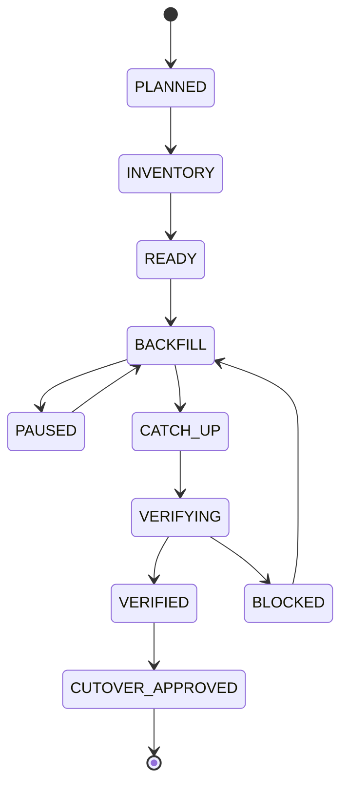
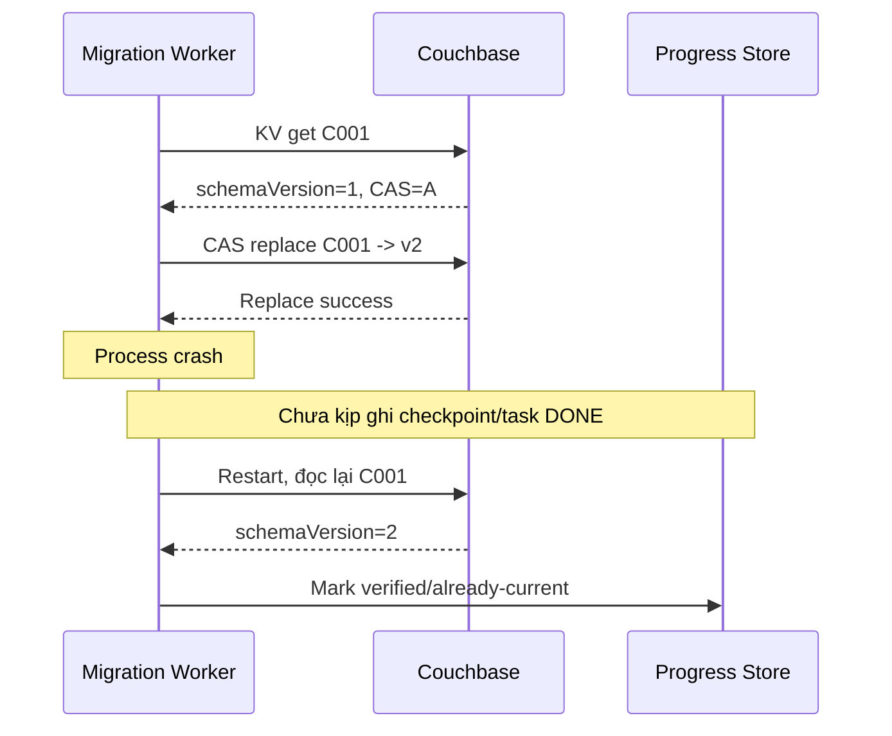
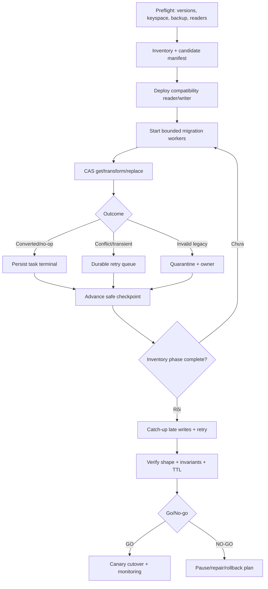

# Di trú tài liệu theo lô với tiến độ và khả năng chạy lại

Trong chương **Tiến hóa và di trú** của module **SPRING_DATA_COUCHBASE**, một thay đổi cấu trúc JSON thường phải áp dụng cho hàng nghìn đến hàng triệu document đang được Spring Data Couchbase đọc và ghi. Chạy một vòng lặp `findAll() → save()` hoặc một câu SQL++ `UPDATE` lớn có vẻ đơn giản, nhưng khó trả lời những câu hỏi cần thiết khi hệ thống đang hoạt động:

- Worker dừng ở document thứ 87.001 thì **chạy lại từ đâu**?
- Document đã `replace` thành công nhưng process chết **trước khi ghi checkpoint** có bị cập nhật hai lần không?
- Khi API sửa document trong lúc batch chạy, làm sao **không ghi đè bản mới bằng bản cũ**?
- Một document đã hết TTL, sai kiểu hoặc khác schema có khiến toàn job đứng lại?
- Tiến độ `95%` là 95% **đã quét**, **đã ghi**, hay **đã xác minh hợp lệ**?
- Nếu backup đã có nhưng chương trình chuyển đổi sai, còn khôi phục được những write hợp lệ phát sinh **sau thời điểm backup** không?

Bài này hướng dẫn thiết kế một **backfill/migration theo lô có thể tạm dừng, tiếp tục và chạy lại an toàn**, có tiến độ có ý nghĩa, xử lý CAS/TTL, phân loại lỗi, hỗ trợ nhiều worker và có bằng chứng xác minh cuối. Kiến thức áp dụng cho các API **document mapping, repository, `CouchbaseTemplate`, KV SDK, SQL++, CAS, TTL, transaction và reactive** của Spring Data Couchbase; phạm vi và tên API cụ thể phải đối chiếu phiên bản Couchbase Server, Java SDK và Spring Data đang triển khai.

**Nguyên tắc trung tâm:** Hãy xây job theo mô hình **at-least-once processing + idempotent transformation + conditional write + durable progress + final verification**. Đừng cố chứng minh một document chỉ được đọc/xử lý đúng một lần; hãy làm cho việc **xử lý lại** không phá dữ liệu.

## 1. Mục tiêu học tập

Sau bài học, bạn có thể:

1. Xác định **đơn vị công việc** của một migration và các bất biến phải bảo toàn.
2. Phân biệt `schemaVersion` của JSON với `@Version`/CAS và phiên bản code của migration job.
3. Kiểm kê legacy documents theo bucket/scope/collection, discriminator, trường thiếu, dữ liệu sai kiểu và TTL.
4. Chọn chiến lược **candidate discovery**: danh sách key cố định, keyset pagination, SDK scan hoặc nguồn thay đổi.
5. Giải thích vì sao `OFFSET` trên tập dữ liệu đang biến đổi dễ bỏ sót và vì sao keyset cũng cần **catch-up**.
6. Thiết kế converter **thuần, deterministic và idempotent**, giữ các field nằm ngoài phạm vi chuyển đổi.
7. Sử dụng `ctx` khi phải thay nhiều document cùng đơn vị, nhưng ưu tiên **CAS replace một document** cho chuyển đổi một key độc lập.
8. Dùng `GetResult.cas()` và chính sách giữ expiration để chống lost update và thay TTL ngoài ý muốn.
9. Thiết kế `migrationRun`, checkpoint, retry queue và bảng trạng thái công việc.
10. Định nghĩa tiến độ **scanned, converted, skipped, quarantined, verified** mà không đếm lại khi resume.
11. Điều phối nhiều worker với **lease, CAS, fencing** và giới hạn concurrency.
12. Phân loại lỗi hạ tầng, lỗi data, CAS conflict, timeout và mutation outcome chưa rõ.
13. Tổ chức **expand → backfill → verify → cutover → contract**, xử lý live writers và late writes.
14. Thực hiện backup/restore rehearsal, xác định rollback app so với rollback dữ liệu và RPO/RTO.
15. Viết unit/integration/failure-injection tests chứng minh job chạy lại an toàn sau crash, conflict, TTL và duplicate task.

## 2. Case study: bổ sung cấu trúc hồ sơ v2

Giả sử một hệ thống CRM dùng:

```text
Bucket:     appdata
Scope:      crm
Collection: customers

Key: customer::tenant-a::C001
```

Document hiện tại, **v1**:

```json
{
  "docType": "customer",
  "schemaVersion": 1,
  "tenantId": "tenant-a",
  "fullName": "Trần Ngọc Mai",
  "email": "mai@example.test",
  "status": "ACTIVE",
  "loyaltyPoints": 160,
  "customAttributes": {
    "preferredChannel": "store"
  }
}
```

Ứng dụng mới muốn cấu trúc **v2**:

```json
{
  "docType": "customer",
  "schemaVersion": 2,
  "tenantId": "tenant-a",
  "fullName": "Trần Ngọc Mai",
  "email": "mai@example.test",
  "profile": {
    "displayName": "Trần Ngọc Mai"
  },
  "contact": {
    "emailRaw": "mai@example.test"
  },
  "status": "ACTIVE",
  "loyaltyPoints": 160,
  "customAttributes": {
    "preferredChannel": "store"
  }
}
```

Trong pha **expand**, các trường cũ `fullName` và `email` được giữ lại để reader v1 có cơ hội tiếp tục hoạt động. Chỉ sau khi các writer/reader cũ đã hết và rollback window kết thúc mới xem xét bỏ trường legacy.

### 2.1. Bất biến không được làm mất

Với document `d` và kết quả `M(d)`:

- Document key và `tenantId` không đổi.
- `loyaltyPoints` và `status` không bị điều chỉnh bởi migration này.
- `profile.displayName` giữ **nguyên giá trị** `fullName` khi nguồn hợp lệ.
- `contact.emailRaw` giữ nguyên chuỗi `email`; không tự chuẩn hóa, đổi chữ hoa/thường hoặc suy dữ liệu người dùng.
- `customAttributes` và mọi trường không thuộc phạm vi vẫn tồn tại.
- Expiration/TTL của document không đổi ngoài chính sách được phê duyệt.
- Document đã v2 hợp lệ là **no-op**; document v2 hỏng phải được báo lỗi, không âm thầm bỏ qua.
- Một document future version không bị **downgrade** sang v2.

Ví dụ tên Unicode được giữ nguyên; migration không tự tách first name/last name vì thuật toán không thể xác định đúng mọi văn hóa đặt tên.

### 2.2. Thời điểm đọc và dữ liệu concurrent

Nếu customer được ứng dụng cộng điểm từ 160 lên 200 giữa lúc migration đọc và ghi, bản v2 cuối cùng vẫn phải có **200 điểm**. CAS-controlled write và re-read giúp tránh việc sử dụng snapshot 160 điểm đã cũ.

## 3. Vì sao migration theo lô khác một request CRUD?

Một `repository.save(customer)` xử lý một request theo thời điểm. Batch migration phải điều phối:

| Mối quan tâm | CRUD thường | Migration theo lô |
| --- | --- | --- |
| Số lượng document | Một hoặc vài key | Hàng nghìn đến hàng triệu key |
| Thời gian chạy | Ngắn | Phút/giờ/ngày, có thể qua nhiều deploy |
| Dữ liệu đầu vào | Theo schema ứng dụng hiện tại | Nhiều schema cũ, giá trị bất thường |
| Concurrency | Một request tranh vài key | Job tranh với **mọi live writer** |
| Lỗi | Một response | Retry, quarantine, resume và báo cáo tiến độ |
| Xác nhận | Operation trả kết quả | **Final reconciliation** trên toàn phạm vi |
| Rollback | Thường không cần undo batch | Backup, selective repair, code rollback/cutover |
| Quan sát | Request logs | Run ID, cursor, batch, unique results, drift, ETA ước lượng |

Một script chạy nhanh nhưng không có checkpoint, không biết điểm cần làm lại và không phân biệt lỗi data với timeout **không phù hợp production migration**.

## 4. Định nghĩa rõ ba loại phiên bản

| Tên | Ví dụ | Ý nghĩa |
| --- | --- | --- |
| `schemaVersion` trong JSON | `1`, `2` | Mô tả shape dữ liệu |
| Spring Data `@Version Long` | CAS token | Phát hiện stale document trong mapping được hỗ trợ |
| `migrationId`/`transformVersion` | `customer-v1-to-v2/r3` | Định danh chính sách/code chạy migration |
| `runId` | `run-20261125-01` | Một lần triển khai job có checkpoint/telemetry |
| Application release | `crm-api-v2.4` | Reader/writer được deploy |
| Task attempt | `attempt=4` | Một lần thử xử lý một key, không phải business commit |

**`schemaVersion=2` không phải CAS=2.** Đừng gán `@Version` bằng số schema và đừng cộng CAS như counter. CAS do Couchbase quản lý, có semantics riêng; khi conflict, đọc lại chứ không tự tăng token.

### 4.1. Dùng version làm điều kiện, không làm bằng chứng duy nhất

Một document ghi `schemaVersion=2` nhưng thiếu `profile.displayName` vẫn là **v2 không hợp lệ**. Sau backfill phải kiểm tra cả shape và invariant, không chỉ đếm có bao nhiêu document đã set version.

## 5. Bước 0: khóa phạm vi trước khi chạy job

Một **migration specification** cần nêu:

```text
migrationId: customer-v1-to-v2
transformVersion: r3
source: appdata.crm.customers
target: appdata.crm.customers
keyPattern: customer::<tenant>::<customerId>
documentType: customer
fromVersion: 1
toVersion: 2
writeMode: CAS_REPLACE_PRESERVE_EXPIRY
liveWriters: YES
batchSize: configurable
concurrency: bounded
failurePolicy: stop-on-invariant, quarantine-invalid, retry-transient
rollbackMode: application-feature-flag + selective-repair
backupRequired: YES
verificationRequired: YES
```

Đây là **biểu mẫu vận hành**, không phải configuration object có sẵn của SDK.

### 5.1. Xác định read/write ownership

Phải liệt kê HTTP pods, admin batch, stream consumers, scheduled jobs và những service trực tiếp ghi cùng collection. Nếu chỉ nâng cấp API nhưng worker cũ vẫn full-document `save`, worker đó có thể ghi ngược v1 hoặc xóa field v2 khi job vừa chạy xong.

### 5.2. Không di trú ngoài tenant được phép

Một câu lệnh admin toàn bucket có thể vô tình chạm dữ liệu của tenant không nằm trong kế hoạch. Với multi-tenant, việc chọn key/tenant phải rõ ràng, kiểm chứng ở **key pattern và payload**, không chỉ tin request parameter.

## 6. Kiểm kê legacy data trước khi tạo worklist

Những nhóm cần đếm:

- Document có `schemaVersion=1`, có thể chuyển tự động.
- Document `schemaVersion=2` đã đúng shape.
- Document `schemaVersion=2` nhưng thiếu/đổi sai field.
- Document không có version hoặc version `null`.
- Document có version sai kiểu, version lớn hơn target.
- Document thiếu `docType`, khác type hoặc bị sai key pattern.
- Document có trường nguồn null/missing/wrong-type.
- Document có TTL sắp hết hạn hoặc đã bị xóa.
- Document rất lớn, nested field phức tạp.
- Document có update rate cao gây CAS conflict.

### 6.1. Query đếm mẫu

```sql
SELECT IFMISSINGORNULL(c.schemaVersion, "MISSING") AS versionLabel,
       COUNT(1) AS documentCount
FROM `appdata`.`crm`.`customers` AS c
WHERE c.docType = "customer"
GROUP BY IFMISSINGORNULL(c.schemaVersion, "MISSING");
```

Kết quả minh họa:

| versionLabel | documentCount |
| --- | ---: |
| `1` | 120.500 |
| `2` | 1.300 |
| `MISSING` | 450 |
| `"legacy"` | 18 |
| `3` | 5 |

Đây là **số minh họa**, không phải số liệu của một cụm thật. Query có `WHERE c.docType="customer"` sẽ **không đếm document không có field docType**. Phải bổ sung khảo sát nếu dữ liệu lịch sử thiếu discriminator.

### 6.2. Index không phải bảo đảm snapshot

Có thể cần index cho `docType`/`schemaVersion`. SQL++ secondary indexes có độ trễ cập nhật, còn `REQUEST_PLUS` mô tả scan consistency của query, **không tự tạo một snapshot bất biến xuyên mọi lần quét**. Dùng `EXPLAIN` và đo chi phí scan trên đúng version/cluster.

## 7. Đơn vị công việc (work item) nên là gì?

Đơn vị tối thiểu thường là **một document key**:

```text
workItem:
  migrationId: customer-v1-to-v2
  documentKey: customer::tenant-a::C001
  targetVersion: 2
  payloadPolicy: r3
```

Ưu điểm:

- Có thể xử lý lại độc lập.
- CAS xung đột chỉ ảnh hưởng một document.
- Có thể quarantine lỗi dữ liệu theo key.
- Có thể phân chia worker theo tenant/key range.
- Progress theo unique keys rõ ràng.

Nếu cần chuyển đổi **một aggregate gồm nhiều document phải cùng commit**, work item nên là **một aggregate key** và xử lý các mutation trong **một Couchbase transaction ngắn**. Không chọn một transaction bao toàn bộ hàng triệu document.

### 7.1. Work item khác attempt

Cùng `documentKey=C001` có thể được xử lý 4 lần do CAS conflict, worker crash hoặc retry. Đây vẫn là **một work item**, không phải 4 khách hàng đã di trú.

## 8. Vì sao OFFSET dễ gây bỏ sót trong migration?

Mẫu dễ sai:

```sql
SELECT META(c).id
FROM `appdata`.`crm`.`customers` AS c
WHERE c.schemaVersion = 1
ORDER BY META(c).id
LIMIT 1000 OFFSET 1000;
```

Giả sử:

1. Trang đầu có 1.000 document v1.
2. Worker chuyển chúng thành v2.
3. Những document đó **biến mất khỏi tập `WHERE schemaVersion=1`**.
4. Query trang sau dùng `OFFSET 1000` trên **tập đã co lại**.
5. Khoảng 1.000 document v1 kế tiếp bị bỏ qua.

```text
Trước batch:
  [1..1000] [1001..2000] [2001..3000]  (đều v1)

Sau batch:
  [1001..2000] [2001..3000]            (v1 còn lại)

OFFSET 1000:
  bỏ qua 1001..2000
  xử lý 2001..3000
```

**Không dùng OFFSET như cách đảm bảo “đã đi qua N record” trên một predicate bị chính migration thay đổi.**

### 8.1. Dữ liệu mới cũng làm OFFSET không ổn định

Ngay cả khi job không đổi `schemaVersion`, live writes tạo/xóa document cũng có thể dịch chuyển vị trí row. Query SQL++ thường không bảo đảm một snapshot bất biến xuyên nhiều request query.

## 9. Keyset pagination: cải thiện thứ tự nhưng chưa đủ để chốt hoàn thành

Một cách lấy key theo thứ tự:

```sql
SELECT RAW META(c).id
FROM `appdata`.`crm`.`customers` AS c
WHERE c.docType = "customer"
  AND META(c).id > $lastKey
ORDER BY META(c).id
LIMIT $batchSize;
```

Sau một trang đã xử lý, lưu `lastKey` và lấy trang tiếp.

**Điều kiện sử dụng:**

- Thứ tự khóa ổn định, so sánh `META(c).id` có semantics phù hợp.
- Query có kế hoạch index/scan đáp ứng; không giả định một index `schemaVersion` sẽ tối ưu được ORDER BY key.
- Không nối chuỗi tham số trực tiếp vào query; dùng named parameters.
- Không thay `docType`/key của record trong migration này nếu dùng predicate làm inventory.
- Có kế hoạch xử lý những key mới được tạo với giá trị **nhỏ hơn `lastKey`**, hoặc key đang ở nơi chưa được quét nhưng v1 quay lại do writer cũ.

### 9.1. Keyset không phải snapshot

Keyset giảm lỗi OFFSET trên tập co lại nhưng **không tự bảo đảm duyệt hết dữ liệu trong hệ thống đang thay đổi**.

Nếu thêm một customer với key nhỏ hơn cursor đã đi qua, lần scan này có thể không thấy nó. Vì thế còn cần **catch-up phase, change capture, writer policy hoặc quiesce writes** trước khi tuyên bố 100%.

### 9.2. Cách tạo index phải được đo

```sql
CREATE INDEX ix_customers_doc_type
ON `appdata`.`crm`.`customers` (docType);
```

Chỉ mục trên là **điểm khởi đầu để đánh giá**, không tự bảo đảm query keyset có plan tối ưu. Hãy dùng `EXPLAIN`, kiểm tra index/filter/ORDER BY, query cost và tác động production. Với quy mô lớn, xem xét các API scan/range scan của SDK **nếu version hỗ trợ** và chúng phù hợp với tính nhất quán/cursor cần dùng.

## 10. Cách mạnh hơn: lập danh sách công việc ổn định

Nếu cần một **denominator ổn định** và giải thích chính xác key nào thuộc đợt migration, tạo **worklist/manifest** được duy trì độc lập:

```text
migrationRuns:
  run::customer-v1-to-v2::20261125-a

migrationTasks:
  task::<runId>::<hashOfDocumentKey>
      documentKey: customer::tenant-a::C001
      status: PENDING
      attempts: 0
      lastErrorCode: null
```

Manifest có thể được tạo từ một **inventory scan** theo chính sách xác định, ghi key/result vào collection hoặc hệ thống durable phù hợp. Với hàng triệu keys, chi phí worklist riêng là một trade-off; không phải migration nào cũng cần một task document cho từng key.

### 10.1. Hai lựa chọn thực tế

| Mô hình | Thích hợp | Lưu ý |
| --- | --- | --- |
| **Checkpoint cursor + retry queue** | Job tuyến tính, chi phí thấp, idempotent converter | Cursor không đủ nếu bỏ qua retry key hoặc có late writers |
| **Durable task manifest** | Cần progress theo key, nhiều workers, audit rõ | Tăng số document/ghi trạng thái, phải dọn dẹp theo retention |
| **Snapshot candidate IDs + catch-up** | Cần denominator có nghĩa ở pha đầu | Snapshot/inventory và write mới phải được xử lý riêng |
| **Change capture + replay** | Migration online phức tạp, yêu cầu không bỏ delta | Cần ordering, idempotency và checkpoint của stream |

Không đánh đồng **đã tạo manifest** với **đã xử lý hết mọi write phát sinh sau lúc tạo manifest**.

## 11. Mô hình một migration run

Document vận hành có thể nằm trong collection riêng mà ứng dụng và job được quyền quản lý:

```json
{
  "migrationId": "customer-v1-to-v2",
  "runId": "run-20261125-a",
  "transformVersion": "r3",
  "source": "appdata.crm.customers",
  "target": "appdata.crm.customers",
  "phase": "BACKFILL",
  "state": "RUNNING",
  "startedAt": "2026-11-25T03:00:00Z",
  "candidateManifestId": "manifest-20261125-a",
  "owner": "migration-worker-group",
  "leaseEpoch": 7,
  "lastCommittedCursor": "customer::tenant-a::C001",
  "processedUnique": 18000,
  "verifiedUnique": 17500,
  "retryPending": 85,
  "quarantined": 12,
  "stopRequested": false
}
```

**Các giá trị là dữ liệu minh họa**, không phải schema cố định của Spring Data/Couchbase.

### 11.1. Những trạng thái run nên phân biệt



`BACKFILL` đạt cuối cursor **không phải** `VERIFIED`. Chỉ chuyển sang trạng thái đã xác minh sau khi hoàn thành retry/quarantine policy, bắt được late writes và kiểm tra dữ liệu theo tiêu chí.

### 11.2. Tách state khỏi progress

`state=PAUSED` không có nghĩa lỗi. Đây có thể là **điểm dừng có chủ ý** để giảm tải, đổi cấu hình hoặc chờ reviewer.

## 12. Trạng thái task: kết quả nào được xem là đã xử lý?

Đề xuất:

| Task status | Ý nghĩa | Có là success migration không? |
| --- | --- | --- |
| `PENDING` | Chưa xử lý | Chưa |
| `CLAIMED` | Worker đang xử lý; lease có thể hết hạn | Chưa |
| `CONVERTED` | Mutation được xác nhận, document đã chuyển | Có điều kiện, còn verify |
| `ALREADY_CURRENT` | Document v2 hợp lệ, không cần ghi | Có điều kiện, còn verify |
| `NOT_FOUND` | Document biến mất do delete/TTL hoặc sai key | Chỉ hợp lệ nếu policy cho phép |
| `RETRY_LATER` | Conflict/transient/unknown cần xử lý lại | Chưa |
| `QUARANTINED` | Dữ liệu sai hoặc version không được hỗ trợ | **Không** coi là thành công |
| `VERIFIED` | KV/shape/invariant được xác nhận | Có |
| `FAILED_PERMANENT` | Lỗi không thể tự giải quyết | Block cutover hoặc có waiver chính thức |

**Không dùng “đã thử” như “đã làm xong”.** Nếu 300 document bị quarantine, job có thể báo đã xử lý 100% worklist nhưng **không được báo 100% dữ liệu hợp lệ v2**.

## 13. Định nghĩa tiến độ không đếm trùng

Gợi ý ít nhất **ba tỷ lệ**:

\[
\text{Discovery Coverage}
=\frac{\text{candidate keys đã ghi manifest}}
       {\text{candidate keys trong phạm vi inventory ổn định}}
\]

\[
\text{Processing Coverage}
=\frac{\text{unique keys đạt trạng thái terminal}}
       {\text{unique candidate keys đã biết}}
\]

\[
\text{Verified Coverage}
=\frac{\text{unique keys được xác minh đạt schema/invariant}}
       {\text{unique candidate keys phải còn hợp lệ}}
\]

Đây là công thức **gợi ý**: khi dữ liệu được tạo/xóa trong lúc chạy, denominator và policy `NOT_FOUND` phải được ghi rõ. Không công bố một con số 100% nếu denominator vẫn mở mà không ghi chú.

### 13.1. Đừng tăng counter mỗi lần chạy lại callback

Sai:

```java
for (String key : candidateKeys) {
    migrateOne(key);
    progress.incrementProcessed();
}
```

Nếu worker crash rồi replay batch, `incrementProcessed` có thể tăng lại cho cùng key.

Đúng hơn, khi dùng durable worklist, chỉ đếm **chuyển trạng thái của một task unique** bằng cập nhật có điều kiện. Khi có nhiều worker, tổng hợp từ task status hoặc một cơ chế transactional/compare-and-swap phù hợp thay vì cộng counter trong memory.

### 13.2. Sau crash giữa write và task ACK

Một document đã chuyển v2 nhưng task còn `CLAIMED`. Khi chạy lại, converter thấy v2 hợp lệ và đánh dấu `ALREADY_CURRENT`/`VERIFIED`. Điều đó **không có nghĩa lần này vừa convert thành công**. Nếu muốn thống kê chính xác ai đã thực hiện chuyển đổi, cần journal/marker/ack semantics bổ sung; **business correctness quan trọng hơn đếm số lần replace**.

## 14. Rủi ro cốt lõi: dữ liệu ghi thành công, checkpoint chưa ghi

Timeline:



Thiết kế an toàn khi:

1. Converter `M` là **idempotent**: `M(M(d)) = M(d)`.
2. Job không cộng điểm, gửi email hoặc append event mỗi lần nhìn thấy v1.
3. Khi nhìn thấy v2 hợp lệ, job có thể **no-op**, hoàn tất task.
4. Progress update dùng **transition độc lập có điều kiện** để không đếm trùng.
5. Nếu network timeout sau replace, worker **đọc lại và phân loại** thay vì tự kết luận operation không chạy.

Không cần cố tạo distributed transaction giữa mỗi document mutation và hệ thống log bên ngoài để giải quyết trường hợp này nếu idempotency + verification đã đủ.

## 15. Trường hợp ngược lại: checkpoint ghi trước, dữ liệu chưa ghi

Timeline nguy hiểm:

```text
T1: worker ghi lastKey = C1000
T2: worker đang chuẩn bị replace C1000
T3: process crash
T4: resume từ key > C1000
=> C1000 có thể không bao giờ được xử lý
```

Đừng dùng checkpoint như lời hứa “đã chuyển dữ liệu” khi mutation chưa được xác nhận.

### 15.1. Quy tắc checkpoint an toàn

- **Checkpoint chỉ tiến sau** khi tất cả key trước cursor đã có outcome terminal hoặc đã được ghi bền vào retry/quarantine queue.
- Nếu task chưa xong, phải giữ nó nằm trong danh sách có thể chạy lại.
- Khi không chắc ACK của document mutation, **đọc lại**; không tùy tiện tăng cursor và xóa retry state.
- Khi checkpoint bị ghi sau mutation, hãy chấp nhận replay, vì converter idempotent.
- Cuối campaign phải có **verification/catch-up** phát hiện các key vẫn sai schema.

Nếu một page có C101 thành công, C102 lỗi tạm thời, C103 thành công, **không** được bỏ C102 chỉ vì cursor đến C103. C102 cần retry task **đã được persist trước khi checkpoint qua nó**.

## 16. Converter phải là hàm thuần và có thể chạy lại

Một converter tốt:

- Nhận một document JSON từ attempt hiện tại.
- Phân loại version/shape.
- Chỉ thay đổi trường thuộc migration.
- Giữ nguyên `tenantId`, số điểm, status và unknown fields.
- Không gọi database, HTTP, gửi email hoặc sinh random ID.
- Không phụ thuộc giờ hệ thống để tạo dữ liệu nghiệp vụ nếu không có chính sách snapshot/time rõ.
- Khi input là v2 hợp lệ, **trả no-op**.
- Nếu dữ liệu sai kiểu/mâu thuẫn, trả lỗi **có thể quarantine**, không sửa bừa.
- Không mutate một object được cache dùng chung giữa các attempts.

### 16.1. Tính chất cần test

Với converter \(M\):

\[
M(M(d)) = M(d)
\]

Và với field phải bảo toàn \(f\):

\[
f(M(d)) = f(d)
\]

Không chỉ so `schemaVersion=2`. Phải so những field không được phép đổi và các nested custom values.

## 17. Java converter minh họa: v1 → v2 theo quy tắc bảo toàn

```java
package com.example.crm.migration;

import com.couchbase.client.java.json.JsonObject;

public final class CustomerV2Transformer {

    private CustomerV2Transformer() {}

    public static JsonObject upgrade(JsonObject input) {
        if (!"customer".equals(input.getString("docType"))) {
            throw new InvalidLegacyDocument(
                    "Không đúng loại document customer");
        }

        Integer version = input.getInt("schemaVersion");

        if (version != null && version == 2) {
            validateV2(input);
            return input; // No-op: caller không cần KV replace.
        }

        if (version == null || version != 1) {
            throw new InvalidLegacyDocument(
                    "Chưa có chính sách chuyển đổi schema này");
        }

        String fullName = input.getString("fullName");
        if (fullName == null || fullName.isBlank()) {
            throw new InvalidLegacyDocument(
                    "fullName thiếu hoặc không hợp lệ");
        }

        // Sao chép JSON, không sửa input lấy từ SDK.
        // Kiểm tra việc copy các kiểu dữ liệu đặc thù trên fixture.
        JsonObject result =
                JsonObject.fromJson(input.toString());

        JsonObject profile = result.getObject("profile");
        if (profile == null) {
            profile = JsonObject.create();
        }

        String existingName =
                profile.getString("displayName");
        if (existingName != null
                && !existingName.equals(fullName)) {
            throw new InvalidLegacyDocument(
                    "Mâu thuẫn giữa fullName và displayName");
        }

        profile.put("displayName", fullName);
        result.put("profile", profile);

        String email = input.getString("email");
        if (email != null) {
            JsonObject contact = result.getObject("contact");
            if (contact == null) {
                contact = JsonObject.create();
            }

            String currentEmail = contact.getString("emailRaw");
            if (currentEmail != null
                    && !currentEmail.equals(email)) {
                throw new InvalidLegacyDocument(
                        "Mâu thuẫn dữ liệu email");
            }

            contact.put("emailRaw", email);
            result.put("contact", contact);
        }

        result.put("schemaVersion", 2);
        validateV2(result);
        return result;
    }

    public static void validateV2(JsonObject doc) {
        JsonObject profile = doc.getObject("profile");
        if (profile == null
                || profile.getString("displayName") == null
                || profile.getString("displayName").isBlank()) {
            throw new InvalidLegacyDocument(
                    "V2 thiếu profile.displayName");
        }
    }

    public static final class InvalidLegacyDocument
            extends RuntimeException {
        public InvalidLegacyDocument(String message) {
            super(message);
        }
    }
}
```

**Phạm vi code:** Đây là ví dụ cho document v1 **hợp lệ**. Nếu `schemaVersion`/`profile`/`contact` sai kiểu, SDK getter có thể ném lỗi type; runner phải **phân loại/quarantine**, không catch chung rồi coi đó là lỗi transient. Không tự xem document thiếu version là v1 nếu chưa có rule legacy fingerprint được phê duyệt.

### 17.1. Không normalize email tùy ý

`emailRaw` giữ nguyên chuỗi cũ. Nếu sản phẩm cần `emailNormalized`, hãy xây một quy tắc riêng có kiểm thử và xử lý địa chỉ bất thường; không coi thay đổi chữ hoa/thường là luôn hợp lệ cho mọi semantics.

### 17.2. Giữ field chưa biết

`customAttributes` trong JSON v1 không được xóa vì entity Java mới chưa có field tương ứng. Việc dùng raw JSON có thể tránh một số lỗi mapping khi full-document `save`, nhưng vẫn phải test round-trip cho nested arrays, numeric types và serializer thực tế.

## 18. Một document: CAS replace thay cho transaction nhiều key

Để chuyển đổi **một document trên cùng key**, thao tác KV có CAS thường gọn hơn mở một multi-document transaction:

```java
import com.couchbase.client.java.Collection;
import com.couchbase.client.java.kv.GetResult;

import static com.couchbase.client.java.kv.ReplaceOptions.replaceOptions;

public void migrateCustomer(
        Collection customers,
        String documentKey) {

    GetResult read = customers.get(documentKey);

    JsonObject original = read.contentAsObject();
    Integer version = original.getInt("schemaVersion");

    if (version != null && version == 2) {
        CustomerV2Transformer.validateV2(original);
        return;
    }

    JsonObject updated =
            CustomerV2Transformer.upgrade(original);

    customers.replace(
            documentKey,
            updated,
            replaceOptions()
                    .cas(read.cas())
                    .preserveExpiry(true));
}
```

### 18.1. CAS giải quyết concurrent update

Giả sử:

```text
Job: get C001, loyaltyPoints=160, CAS=A
App: đổi loyaltyPoints thành 200, CAS=B
Job: replace JSON C001 với CAS=A
=> CAS conflict thay vì ghi đè 200 thành 160
```

Sau conflict, job phải **đọc lại từ Couchbase**, chạy converter lại và retry có giới hạn. Không retry mãi với JSON cũ hoặc CAS cũ.

### 18.2. Vì sao cần giữ expiration?

Nếu document có TTL, một replace không có chính sách expiry phù hợp có thể làm expiration thay đổi ngoài ý muốn. `preserveExpiry(true)` là API có ở các tổ hợp SDK/server tương ứng; **phải xác minh phiên bản và hành vi thực tế**. Không xóa option rồi tự tin TTL được giữ nguyên.

### 18.3. Không có transaction “bao toàn bộ batch”

Đoạn trên biến đổi từng key độc lập. Nếu batch chết sau 100 keys, 100 keys đó vẫn được commit và phần còn lại tiếp tục về sau. Đây là **thiết kế mong muốn** khi ứng dụng đã tương thích schema hỗn hợp.

## 19. Một runner có CAS retry giới hạn

Mã minh họa cách phân loại những outcome rõ ràng:

```java
package com.example.crm.migration;

import com.couchbase.client.core.error.CasMismatchException;
import com.couchbase.client.core.error.DocumentNotFoundException;
import com.couchbase.client.java.Collection;
import com.couchbase.client.java.json.JsonObject;
import com.couchbase.client.java.kv.GetResult;

import static com.couchbase.client.java.kv.ReplaceOptions.replaceOptions;

public final class CustomerMigrationWorker {

    public enum Outcome {
        CONVERTED,
        ALREADY_CURRENT,
        NOT_FOUND,
        QUARANTINED,
        RETRY_LATER
    }

    private final Collection customers;
    private final int maxCasAttempts;

    public CustomerMigrationWorker(
            Collection customers,
            int maxCasAttempts) {
        this.customers = customers;
        this.maxCasAttempts = Math.max(1, maxCasAttempts);
    }

    public Outcome migrateOne(String key) {
        for (int attempt = 1;
             attempt <= maxCasAttempts; attempt++) {

            try {
                GetResult read = customers.get(key);
                JsonObject original = read.contentAsObject();
                Integer version =
                        original.getInt("schemaVersion");

                if (version != null && version == 2) {
                    CustomerV2Transformer.validateV2(original);
                    return Outcome.ALREADY_CURRENT;
                }

                JsonObject updated =
                        CustomerV2Transformer.upgrade(original);

                customers.replace(
                        key,
                        updated,
                        replaceOptions()
                                .cas(read.cas())
                                .preserveExpiry(true));

                return Outcome.CONVERTED;

            } catch (CasMismatchException conflict) {
                // Retry bằng một KV get mới trên attempt kế tiếp.
                // Production: bounded backoff/jitter hoặc enqueue.
                if (attempt == maxCasAttempts) {
                    return Outcome.RETRY_LATER;
                }

            } catch (DocumentNotFoundException gone) {
                // Key có thể đã được xóa/hết TTL.
                return Outcome.NOT_FOUND;

            } catch (CustomerV2Transformer
                    .InvalidLegacyDocument invalid) {
                // Ghi reason + key vào quarantine store,
                // không sửa document bất thường.
                return Outcome.QUARANTINED;
            }
        }

        return Outcome.RETRY_LATER;
    }
}
```

**Giới hạn quan trọng:**

- Đây là skeleton minh họa: runner bên ngoài phải **persist outcome** vào task/checkpoint store, xử lý backoff, quarantine và alert.
- Lỗi sai kiểu phát sinh bởi SDK JSON getter có thể không thuộc `InvalidLegacyDocument`. Cần bước **strict type validation** và mapping các loại lỗi dữ liệu đã biết vào quarantine; không catch mọi `RuntimeException` như lỗi dữ liệu.
- Các lỗi timeout/mạng/permission/cluster configuration không được catch ở đây; tầng orchestration phải phân loại **transient, fatal hoặc outcome chưa rõ** theo API/version.
- SDK exception class/package có thể khác giữa các dependency; hãy kiểm tra Javadoc đúng version.
- `maxCasAttempts` không phải số lần retry vô hạn. Với key nóng, chuyển sang retry queue thay vì chiếm CPU và Data Service liên tục.

## 20. Timeout sau replace: có thể đã ghi dù không nhận ACK

Đường KV có thể gặp **timeout hoặc kết quả mutation chưa xác định**: server có thể đã nhận và áp dụng thay đổi nhưng client không nhận acknowledgment.

Đừng:

```java
try {
    customers.replace(key, converted);
} catch (RuntimeException ex) {
    customers.upsert(key, converted); // Rất nguy hiểm.
}
```

Hành vi phù hợp hơn:

1. Phân loại exception theo SDK/version, không dựa vào chuỗi message.
2. Nếu không chắc mutation đã áp dụng hay chưa, **đọc lại key** khi hạ tầng cho phép.
3. Nếu document đã v2 hợp lệ và invariant đúng, xem task có thể chuyển sang **ALREADY_CURRENT/VERIFIED**.
4. Nếu còn v1, tính lại converter từ **bản hiện tại**, ghi với CAS mới.
5. Nếu bị thay đổi bởi writer khác, không ghi đè.
6. Nếu hạ tầng vẫn chưa ổn định, giữ `RETRY_LATER` và retry có budget/backoff.
7. Nếu not found do delete/TTL, không hồi sinh dữ liệu bằng `upsert` từ snapshot cũ.

**Idempotency + CAS + readback** quan trọng hơn một retry loop cố tình dùng lại payload cũ.

## 21. Bảng chính sách lỗi theo từng key

| Tình huống | Phân loại | Hành động |
| --- | --- | --- |
| v1 hợp lệ, replace thành công | `CONVERTED` | Persist status; verify sau |
| v2 hợp lệ | `ALREADY_CURRENT` | No-op, không đổi CAS |
| MISSING `schemaVersion` | `INVALID/LEGACY_UNCLASSIFIED` | Rule riêng hoặc quarantine |
| v1 thiếu `fullName` | `QUARANTINED` | Ghi reason, không tự bịa tên |
| `fullName` sai kiểu | `QUARANTINED` | Strict validation |
| v2 có `profile` sai shape | `QUARANTINED` | Không đánh dấu success vì version |
| Future v3 | `UNSUPPORTED_VERSION` | Không downgrade |
| CAS conflict | `RETRY_LATER` hoặc retry bounded | Re-read/recompute |
| Key biến mất do TTL/delete | `NOT_FOUND` | Áp dụng policy; không upsert |
| KV timeout/ambiguous response | `UNKNOWN/RETRY_LATER` | Readback, không suy thất bại |
| Permission/RBAC failure | `BLOCKED` | Dừng batch, sửa quyền |
| Wrong bucket/scope/collection | `FATAL_CONFIG` | Dừng ngay, không tạo dữ liệu mới |
| Cluster overload | `TRANSIENT_INFRA` | Rate limit/pause/backoff |
| Backup/restore chưa được chứng minh | `NO_GO` | Không cutover phá hủy |

### 21.1. Quarantine không đồng nghĩa bỏ qua

Một document `QUARANTINED` phải có:

- Document key/tenant dưới mức log được phép.
- Error code và field path, không cần log toàn bộ PII.
- `migrationId`, `runId`, transform version.
- Thời gian, số lần thử và loại lỗi.
- Owner/đường xử lý thủ công.
- Quyết định: sửa legacy data, thêm converter rule, exclude có phê duyệt hay rollback.

Không để job báo `SUCCESS_ALL` nếu đang còn quarantine trái với go/no-go policy.

## 22. Thiết kế checkpoint tiến tới mà vẫn có thể replay

Với cursor `lastKey`, thuật toán có thể là:

```text
page = discoverKeysAfter(lastCommittedCursor)

for key in page:
    outcome = migrateOne(key)

    if outcome terminal và được persist:
        markTaskTerminal(key, outcome)

    else if outcome cần retry:
        persistRetryTask(key, reason, nextAttemptAt)
        # Persist này phải thành công trước khi đi qua key.

sau khi toàn page đã terminal hoặc retry đã persist:
    CAS-update lastCommittedCursor = page.lastKey

nếu process crash:
    đọc run state/checkpoint
    chạy lại một đoạn có thể chồng lặp
    mỗi key được xử lý idempotently
    retry queue xử lý riêng
```

### 22.1. Vì sao phải persist retry key trước cursor?

Nếu `C102` lỗi còn `C103` thành công, cursor đi qua `C103` mà **không có retry record cho C102**, C102 có thể bị bỏ sót vĩnh viễn.

### 22.2. Progress store không tự atomic với customer mutation

Một document customer và một task/checkpoint document có thể nằm ở những collections khác nhau. Nếu ghi KV độc lập, chúng **không cùng transaction**. Đừng cố nói “task COMMITTED chính xác cùng thời điểm customer replace” khi chưa có cơ chế transactional tương ứng.

Thiết kế replay-safe chấp nhận khoảng hở giữa customer update và task ACK. Đây là lý do converter idempotent và final reconciliation là bắt buộc.

## 23. Nhiều worker: lease và CAS giúp điều phối, không thay dữ liệu đúng

Khi nhiều worker cùng lấy task, một mô hình có thể dùng:

```json
{
  "taskId": "task::run-20261125-a::C001",
  "documentKey": "customer::tenant-a::C001",
  "status": "CLAIMED",
  "leaseOwner": "worker-07",
  "leaseUntil": "2026-11-25T03:05:00Z",
  "leaseEpoch": 12,
  "attempts": 3
}
```

Quy trình:

1. Worker đọc task với CAS.
2. Kiểm tra `PENDING` hoặc lease đã hết hạn theo policy.
3. Conditional replace task thành `CLAIMED` với worker/epoch mới.
4. Xử lý document bằng converter idempotent và CAS.
5. Trước khi ghi outcome, kiểm tra **lease owner/epoch** và dùng CAS trên task.
6. Nếu lease bị mất, worker cũ **không được ghi đè task status** của worker mới.
7. Task bị bỏ dở được claim lại khi lease hết hạn.

### 23.1. Lease không bảo đảm worker cũ ngừng ghi dữ liệu

Nếu worker A bị pause lâu, lease hết hạn và B claim task, A có thể tiếp tục chạy. Vì thế:

- CAS trên **customer document** chống ghi từ snapshot cũ.
- Converter idempotent làm việc lặp không đổi semantics.
- Fencing token/epoch bảo vệ **task metadata**; khi cần exclusivity mạnh hơn cho side effect, phải đặt guard vào transaction/operation phù hợp.
- Không đặt external email/payment side effects trong callback migration.

### 23.2. Chia shard theo key hay tenant?

Có thể phân vùng ổn định bằng hash key hoặc tenant. Với tenant lớn/hot key, chia hợp lý để tránh một shard quá tải. Không ngẫu nhiên chia lại candidate list sau restart mà làm mất trạng thái task/ownership.

## 24. Rate limiting, batch size và backpressure

Không có batch size chuẩn cho mọi cluster. Chọn theo **SLO sản phẩm và tải thực tế**.

| Tham số | Nếu quá lớn | Nếu quá nhỏ |
| --- | --- | --- |
| Batch size | Nhiều memory, lâu checkpoint, khó khôi phục giữa batch | Overhead nhiều |
| Concurrency | KV timeout, CAS conflict, cluster overload | Migration rất chậm |
| Retry limit | Retry storm, CPU/I/O tăng | Nhiều task phải chờ |
| Backoff | Nếu quá nhỏ: dồn tải lên cluster | Nếu quá lớn: kéo dài migration |
| SQL++ page limit | Query chậm, response lớn | Nhiều round-trip |
| Checkpoint interval | Mất nhiều công khi crash | Ghi metadata quá thường xuyên |

### 24.1. Dấu hiệu cần pause

- P95/P99 KV latency tăng bất thường.
- Tỷ lệ CAS conflict tăng nhanh.
- Query/Index Service quá tải hoặc plan scan quá rộng.
- Hàng đợi request ứng dụng tăng, khách hàng bị ảnh hưởng.
- TTL/invariant mismatch phát hiện trong sample verification.
- Data Service trả timeout liên tiếp.
- Task `RETRY_LATER` tồn đọng tăng không giảm.

**Kill switch** nên dừng bắt đầu work items mới, cho các thao tác đang chạy hoàn tất hoặc xử lý an toàn theo deadline. Không đóng cluster client đột ngột trên production nếu điều đó tạo ra hàng loạt outcome chưa rõ mà runbook chưa chuẩn bị.

## 25. Sơ đồ tổng thể: chạy theo pha, không theo một vòng for bất tận



**Hai thông điệp:** (1) lỗi một key không nhất thiết làm bỏ hết job, nhưng phải được ghi bền và phân loại; (2) hết cursor chỉ là **kết thúc pha scan**, chưa phải chứng nhận cutover.

## 26. Live writers: backfill không thể thay thế thay đổi contract đọc/ghi

Một ứng dụng v1 có thể ghi:

```json
{
  "docType": "customer",
  "schemaVersion": 1,
  "fullName": "Trần Ngọc Mai",
  "email": "mai@example.test"
}
```

Ngay sau khi migration chuyển customer đó thành v2, một worker v1 dùng full-document save có thể **xóa `profile` và `contact`**, đưa dữ liệu trở về shape v1.

### 26.1. Thứ tự triển khai an toàn hơn

1. Triển khai **reader v2 đọc được cả v1/v2**.
2. Triển khai writer tương thích theo contract (dual-field/dual-read tạm thời nếu cần).
3. Thống kê và ngăn nguồn tạo thêm v1.
4. Chạy backfill.
5. Chạy catch-up cho legacy writes lọt trong cửa sổ.
6. Verify, canary cutover.
7. Sau rollback window, contract/xóa field cũ.

**Không bỏ field legacy trong cùng release đầu tiên** nếu app cũ còn cần rollback hoặc background worker còn sử dụng field đó.

### 26.2. Một writer cũ có thể phá dữ liệu v2 dù CAS hợp lệ

Nếu writer v1 đọc document v2 ở thời điểm mới nhất rồi full-document save bằng entity không có `profile`, thao tác có thể có **CAS hợp lệ** nhưng vẫn xóa field mới.

CAS bảo vệ **stale write**, không bảo vệ logic schema compatibility. Cần test reader/writer cũ trên dữ liệu mới và hạn chế rollout.

## 27. Catch-up và final reconciliation là phần bắt buộc

Sau lần quét đầu:

- Các document tạo mới trong lúc quét có thể chưa có trong worklist.
- Những document với key nhỏ hơn cursor có thể chưa được phát hiện.
- Legacy writer có thể ghi v1 lên document vừa chuyển v2.
- Những key bị CAS conflict đã đi vào retry queue.
- Một số document hết TTL hoặc bị xóa hợp lệ.
- Secondary index có thể chưa phản ánh ngay mutation mới.

### 27.1. Một catch-up pass

Có thể chạy lại inventory query tìm v1/sai shape bằng điều kiện scan consistency phù hợp, kết hợp KV sampling và durable retry queue. Nếu đang có live writers, **lặp cho đến khi hệ thống tạo v1 đã được chặn hoặc có thỏa thuận cutover rõ**; không hứa tập đang thay đổi sẽ tự hội tụ nếu writer cũ vẫn tiếp tục.

### 27.2. Verification gates phải nhiều hơn count

- `schemaVersion=2` và shape v2 hợp lệ.
- `tenantId`/`loyaltyPoints`/`status` không drift trái phép.
- Unknown fields/Unicode và TTL được giữ.
- Không còn retry task quá hạn; quarantine được xử lý/waive chính thức.
- Reader mới và rollback candidate hoạt động theo compatibility contract.
- Không có writer cũ tiếp tục phát sinh v1.
- Backup/restore có kết quả diễn tập đạt yêu cầu.

## 28. SQL++ và index: vừa cần cho tiến độ vừa có thể tạo sai số

Query kiểm tra candidate:

```sql
SELECT META(c).id AS documentKey,
       c.schemaVersion,
       c.tenantId
FROM `appdata`.`crm`.`customers` AS c
WHERE c.docType = "customer"
  AND c.schemaVersion = 1;
```

Query tìm document v2 có shape chưa đúng:

```sql
SELECT META(c).id AS documentKey
FROM `appdata`.`crm`.`customers` AS c
WHERE c.docType = "customer"
  AND c.schemaVersion = 2
  AND (
       c.profile IS MISSING
       OR c.profile.displayName IS MISSING
       OR c.profile.displayName IS NULL
  );
```

**Đây là query minh họa**, phải bổ sung type validation/invalid values và index phù hợp. Một field profile là string thay vì object cũng có thể cần query riêng; SQL++ type predicates phải được thiết kế/test theo dữ liệu thực tế.

### 28.1. Không dùng count trên index như số liệu tuyệt đối không đổi

Secondary index có thể có độ trễ. Nếu dùng `NOT_BOUNDED`/`REQUEST_PLUS`, hãy hiểu contract scan consistency, query cost và cách kết quả thay đổi trong lúc writes diễn ra. Dùng **KV verification** cho key mẫu/tập trọng yếu.

### 28.2. Không chỉnh index ngoài plan

Tạo/drop index trên production có chi phí và quyền riêng. Chỉ tạo index migration sau khi xem `EXPLAIN`/capacity; không drop index legacy cho đến khi các reader cũ và rollback window đã hết.

## 29. Spring Data Repository/Template: khi nào nên dùng?

Có thể định nghĩa entity:

```java
import org.springframework.data.annotation.Id;
import org.springframework.data.annotation.Version;
import org.springframework.data.couchbase.core.mapping.Collection;
import org.springframework.data.couchbase.core.mapping.Document;
import org.springframework.data.couchbase.core.mapping.Scope;

@Document
@Scope("crm")
@Collection("customers")
public class CustomerDocument {

    @Id
    private String id;

    private String tenantId;
    private Integer schemaVersion;
    private String fullName;
    private String email;
    private Profile profile;
    private Contact contact;

    @Version
    private Long version;

    // Constructors, getters/setters và validation domain.
}
```

Repository:

```java
import org.springframework.data.couchbase.repository.CouchbaseRepository;

public interface CustomerRepository
        extends CouchbaseRepository<CustomerDocument, String> {
}
```

Với customer legacy, việc ánh xạ bằng entity mới có thể:

- Làm `profile` null khi field MISSING.
- Không giữ field JSON chưa được mapping khi save toàn document.
- Áp dụng custom converter/default không mong muốn.
- Gặp lỗi type/constructor trên dữ liệu sai shape.

### 29.1. Vì sao KV raw JSON thường phù hợp backfill?

Một job thay JSON shape, giữ unknown fields, CAS và TTL thường cần kiểm soát raw document sâu hơn Repository mặc định. SDK KV `Collection.get`/`replace` hoặc các operation thấp hơn do `CouchbaseTemplate` cung cấp (khi có cùng semantics/option) giúp thể hiện rõ mutation.

**Không có nghĩa Repository/Template luôn sai.** Chọn API dựa trên dữ liệu/cấu hình/version và integration tests. Nếu dùng `@Transactional`, phải xác minh manager, proxy và operation participation; annotation không biến một vòng `saveAll` thành một transaction duy nhất.

## 30. Reactive migration: giới hạn độ đồng thời, đừng gom toàn bộ vào RAM

Một pipeline reactive có thể streaming keys rồi xử lý bằng `flatMap` với concurrency giới hạn:

```java
Flux<String> keys = discoverKeys(); // Publisher đã phân trang.

int concurrency = 8;

return keys.flatMap(
        key -> migrateOneReactive(key)
                .onErrorResume(ex ->
                        persistRetryOrQuarantine(key, ex)
                                .thenReturn(Outcome.RETRY_LATER)),
        concurrency);
```

**Đây là pseudocode cấu trúc**, các helpers phải được triển khai bằng Reactive SDK/ReactiveCouchbaseTemplate có hợp đồng rõ. Đặc biệt:

- `flatMap` có thể chạy nhiều mutation đồng thời, cần giới hạn concurrency.
- `onErrorResume` chỉ hợp lệ nếu **persist lỗi/queue** và trả trạng thái đúng; không nuốt lỗi rồi báo success.
- Không `collectList()` tất cả hàng triệu keys vào memory.
- Không gọi `subscribe()` bên trong mapper để tách branch mất tracking.
- Nếu cần thứ tự nghiêm ngặt, dùng `concatMap` hoặc chiến lược phù hợp.
- `retryWhen` có thể resubscribe toàn stream, làm lại keys; converter phải idempotent.
- `timeout`/cancellation có thể xảy ra khi KV mutation đã áp dụng nhưng response chưa đến; readback/metadata quyết định resume.

### 30.1. Reactive không tự là một transaction

`Flux.flatMap`/`Mono.when` chỉ quản lý Publisher, không tạo ACID cho nhiều document. Khi cần atomicity theo aggregate, dùng `CouchbaseTransactionalOperator` hoặc SDK transaction API **ở version hỗ trợ** và đặt mọi thao tác cùng context. Không bọc cả chiến dịch nhiều giờ trong một transaction.

## 31. Khi nào thật sự cần Couchbase multi-document transaction?

Migration C001 chỉ thêm `profile` trên cùng customer key: CAS replace một document thường đủ.

Nhưng nếu tách:

```text
customer::C001    -> profile::C001
customer::C001    -> preferences::C001
customer::C001    -> customer::C001 (references)
```

và các document phải cùng tồn tại để API hoạt động, một work item có thể đại diện cho **aggregate C001**:

```java
cluster.transactions().run(ctx -> {
    // ctx.get(source, key)
    // validate source hiện tại và marker
    // ctx.insert(profile, profileKey, ...)
    // ctx.insert(preferences, preferencesKey, ...)
    // ctx.replace(sourceResult, updatedSource)
});
```

Đây là **pseudocode**, không phải implementation đầy đủ. Phải giải quyết duplicate/missing target, transaction callback retry, idempotency key, CAS/transaction conflict, TTL, cleanup và support cho đúng keyspaces.

### 31.1. Không dùng một transaction cho cả batch triệu document

Transaction dài:

- Dễ expiration/timeout.
- Giữ nhiều read/write sets và metadata.
- Tăng conflict với ứng dụng.
- Khó resume và phân loại lỗi theo key.
- Không thay được checkpoint/verification/backup.

Boundary hợp lý là **aggregate nhỏ** hoặc **một document**, không phải toàn campaign.

## 32. Sao lưu và rollback trước khi bật batch

Migration có thể **không đảo ngược được** nếu bỏ field gốc hoặc chuẩn hóa mất dữ liệu. Trước khi chạy:

1. Chốt phạm vi bucket/scope/collection.
2. Kiểm tra bản backup tồn tại với timestamp/runId rõ.
3. Thử **restore trên cluster lab cô lập**, không chỉ nhìn exit code của backup.
4. Đo RPO/RTO, đặc biệt nếu nhiều write hợp lệ xảy ra sau backup.
5. Thử app cũ **đọc và ghi** vào document sau expand/backfill.
6. Có feature flag/kill switch dừng writer mới và job.
7. Có runbook selective repair/forward fix nếu chỉ một số key bị sai.
8. Chỉ full restore khi đã xem xét mất update hợp lệ sau backup và có recovery approval.

### 32.1. Backup không phải nút Undo tự động

Giả sử backup lúc 09:00 lưu points=160, app cộng hợp lệ lên 200 lúc 09:20, migration làm sai `profile.displayName` lúc 09:30. Restore nguyên JSON từ backup có thể **làm mất 40 điểm hợp lệ**.

Nếu xác định rõ lỗi chỉ ở displayName, **selective repair với CAS** từ nguồn tin cậy có thể an toàn hơn full restore. Phương án này vẫn cần audit, verification và approval.

### 32.2. Xuất JSON không thay full backup

`cbexport`/script export có thể không bảo toàn toàn bộ metadata/index/expiry theo yêu cầu. XDCR/replication có thể nhân bản luôn cả mutation sai. Dùng backup tool hỗ trợ, manifest và restore rehearsal theo đúng Couchbase version/edition; không suy mọi bản backup có snapshot ACID xuyên nhiều collection nếu công cụ không cam kết.

## 33. Kiểm thử converter: dữ liệu cũ, sai kiểu và idempotency

Unit test mẫu:

```java
import static org.junit.jupiter.api.Assertions.*;
import org.junit.jupiter.api.Test;

import com.couchbase.client.java.json.JsonObject;

class CustomerV2TransformerTest {

    @Test
    void convertsLegacyAndPreservesBusinessData() {
        JsonObject original = JsonObject.create()
                .put("docType", "customer")
                .put("schemaVersion", 1)
                .put("tenantId", "tenant-a")
                .put("fullName", "Trần Ngọc Mai")
                .put("email", "mai@example.test")
                .put("loyaltyPoints", 160)
                .put("customAttributes", JsonObject.create()
                        .put("preferredChannel", "store"));

        JsonObject next =
                CustomerV2Transformer.upgrade(original);

        assertEquals(2, next.getInt("schemaVersion"));
        assertEquals("Trần Ngọc Mai",
                next.getObject("profile")
                        .getString("displayName"));
        assertEquals("mai@example.test",
                next.getObject("contact")
                        .getString("emailRaw"));
        assertEquals(160, next.getInt("loyaltyPoints"));
        assertEquals("store",
                next.getObject("customAttributes")
                        .getString("preferredChannel"));
    }

    @Test
    void secondConversionIsANoop() {
        JsonObject legacy = JsonObject.create()
                .put("docType", "customer")
                .put("schemaVersion", 1)
                .put("fullName", "Trần Ngọc Mai");

        JsonObject once =
                CustomerV2Transformer.upgrade(legacy);
        JsonObject twice =
                CustomerV2Transformer.upgrade(once);

        assertEquals(once, twice);
    }

    @Test
    void refusesMissingRequiredField() {
        JsonObject legacy = JsonObject.create()
                .put("docType", "customer")
                .put("schemaVersion", 1);

        assertThrows(
                CustomerV2Transformer.InvalidLegacyDocument.class,
                () -> CustomerV2Transformer.upgrade(legacy));
    }

    @Test
    void refusesFutureVersion() {
        JsonObject future = JsonObject.create()
                .put("docType", "customer")
                .put("schemaVersion", 3)
                .put("fullName", "Trần Ngọc Mai");

        assertThrows(
                CustomerV2Transformer.InvalidLegacyDocument.class,
                () -> CustomerV2Transformer.upgrade(future));
    }
}
```

Bổ sung fixtures cho MISSING/NULL, wrong-type, Unicode, nested arrays, nhiều tenant, future schema, field mâu thuẫn, số lớn và document có TTL. Test này kiểm tra logic converter; **không chứng minh KV CAS hoặc checkpoint đúng**.

## 34. Integration test: concurrent update không bị overwrite

Trên Couchbase test:

1. Fixture C001 `schemaVersion=1`, `loyaltyPoints=160`.
2. Job thực hiện `get` và giữ CAS=A.
3. API cập nhật điểm thành `200`, CAS=B.
4. Job cố `replace` payload cũ bằng CAS=A.
5. Assert SDK báo CAS mismatch, không biến điểm 200 thành 160.
6. Job đọc lại C001, convert JSON đang có điểm 200.
7. Replace với CAS mới, kiểm tra `schemaVersion=2`, `loyaltyPoints=200` và các field phụ được giữ.

### 34.1. Một ví dụ test setup

```java
GetResult before = customers.get(key);
long oldCas = before.cas();

JsonObject changedByApp = before.contentAsObject()
        .put("loyaltyPoints", 200);

customers.replace(key, changedByApp,
        replaceOptions().cas(oldCas).preserveExpiry(true));

// Backfill dùng CAS cũ sẽ conflict.
assertThrows(CasMismatchException.class,
        () -> customers.replace(
                key,
                convertedFromOldSnapshot,
                replaceOptions().cas(oldCas)
                        .preserveExpiry(true)));
```

Đây là một **fragment integration test** giả định import và các biến fixture đã có. Không dùng `collection.upsert` để chứng minh CAS, vì `upsert` không có cùng điều kiện stale-write như `replace` kèm CAS.

## 35. Failure injection: crash sau replace trước checkpoint

Đây là bài kiểm thử quan trọng nhất cho “khả năng chạy lại”.

Fixture:

```text
C001..C100 = v1
Job configured: checkpoint sau mỗi 10 keys
Failure injected: sau khi C037 được CAS replace thành v2,
                  trước khi task/checkpoint ACK.
```

Kỳ vọng sau restart:

- C001..C037 có thể được đọc lại; v2 hợp lệ là no-op.
- C038..C100 vẫn được xử lý.
- Không có document bị convert hai lần theo nghĩa **tăng số dư, append data hoặc đổi business values**.
- `fullName`, `email`, `loyaltyPoints`, `tenantId` và unknown fields được giữ.
- Progress/terminal task status theo **unique key**, không tăng vô hạn theo số attempts.
- Sau catch-up/verify, mọi key hợp lệ đạt shape v2, còn key invalid được ghi trong quarantine.
- Crash trước/giữa write nhưng sau checkpoint **không được làm bỏ sót key** theo cơ chế lưu cursor/task.

### 35.1. Không dùng một kết quả mock làm bằng chứng đầy đủ

Unit test có thể fake worker crash và check converter no-op. Nhưng cần **integration test với Couchbase thật** để kiểm tra CAS, TTL, latency, task status và checkpoint trong điều kiện SDK/network thực tế.

## 36. Integration test: TTL và document bị xóa giữa scan

Fixture:

```text
C101 = v1, TTL còn khoảng 10 phút
C102 = v1, TTL rất ngắn
C103 = v1, không TTL
```

Test:

1. Ghi lại expiration C101 trước migration bằng API thích hợp.
2. Migrate C101 bằng replace với preserve-expiry policy.
3. So expiration sau migration với dung sai phù hợp version/độ phân giải.
4. Để C102 hết hạn giữa discovery và `get`.
5. Job trả `NOT_FOUND` và **không upsert C102 từ snapshot cũ**.
6. C103 chuyển v2, không bị gắn TTL mới.
7. Repeat với task replay để chắc chắn document đã expire không bị hồi sinh.

**TTL chỉ là một metadata/time policy**; checkpoint/cursor có thời hạn lưu riêng. Không xóa task metadata quá sớm khi còn cần resume hoặc audit.

## 37. Integration test: worker lease và xử lý trùng

Kịch bản:

1. Worker A claim task C001, `leaseEpoch=10`.
2. A bị pause lâu hơn lease.
3. Worker B claim C001 với `leaseEpoch=11`.
4. B đọc JSON, CAS replace thành v2 và ghi task `VERIFIED`.
5. A hoạt động lại, cố ghi task status với epoch 10.
6. Hệ thống phải **từ chối status update stale** của A.
7. Nếu A thử ghi customer từ CAS cũ, phải conflict hoặc no-op theo trạng thái mới.
8. Kết thúc chỉ có một **unique verified task** cho C001, không phải hai.
9. Metric attempts có thể bằng 2; metric successful customer keys vẫn bằng 1.

### 37.1. Thử multi-worker sau restart

Chạy hai worker với concurrency giới hạn và một số task cố ý fail. Kill/restart một worker; worker còn lại hoặc worker mới phải reclaim task hết lease, không để `CLAIMED` tồn tại mãi không owner xử lý.

## 38. Test trên dữ liệu sai schema và quarantine

Dựng các trường hợp:

| Key | Bất thường | Kỳ vọng |
| --- | --- | --- |
| C201 | Thiếu `fullName` | Quarantine |
| C202 | `fullName=42` | Quarantine/type error |
| C203 | `schemaVersion="2"` | Quarantine hoặc rule riêng được phê duyệt |
| C204 | `profile="hello"` | Không ghi đè im lặng |
| C205 | Future `schemaVersion=4` | Không downgrade |
| C206 | `tenantId` body khác key tenant | Security/data error |
| C207 | V2 thiếu `profile.displayName` | Không đánh dấu already-current hợp lệ |
| C208 | Nested custom object phức tạp | Giữ data nguyên |
| C209 | Unicode/emoji | Không đổi giá trị |
| C210 | Thay đổi trong lúc đọc | CAS retry đúng |
| C211 | Bị xóa khi worker xử lý | Not found, không hồi sinh |
| C212 | TTL ngắn | Không biến thành vô hạn |

Một job có 12 keys trên không phải `SUCCESS_ALL` nếu còn các key quarantine chưa xử lý theo chính sách. Hãy báo **processed coverage** và **verified coverage** riêng.

## 39. Rollback và sửa dữ liệu theo phạm vi lỗi

Nếu converter phát hiện đã ghi `profile.displayName` sai ở 20 document, phải:

1. Dừng migration job và ngăn writer tiếp tục làm sai.
2. Ghi lại `runId`, transform version, các key bị ảnh hưởng.
3. Xác định field nào sai và field nào hợp lệ đã được cập nhật sau migration.
4. Khôi phục backup vào **lab** để lấy bằng chứng old values.
5. Ưu tiên selective repair bằng CAS nếu lỗi cục bộ và có nguồn dữ liệu đáng tin.
6. Chỉ full restore khi RPO/RTO và kế hoạch replay cho writes sau backup cho phép.
7. Verify invariants và re-run canary trước khi mở lại batch.
8. Giữ audit trail về repair, không xóa bằng chứng sự cố.

### 39.1. Rollback binary không rollback dữ liệu

Quay app v2 về app v1 không xóa `profile`/`contact` khỏi Couchbase. Ngược lại, app v1 có thể full-save và làm mất các field mới. Vì vậy phải test **read + write của release rollback candidate** trên document v2.

## 40. Monitoring: những con số cần nhìn riêng

| Metric | Nội dung |
| --- | --- |
| `migration_candidates_total` | Số key trong snapshot/manifest |
| `migration_scanned_unique_total` | Unique keys đã scan |
| `migration_converted_unique_total` | Unique keys có mutation được xác nhận |
| `migration_already_current_unique_total` | Unique keys đã v2 hợp lệ |
| `migration_verified_unique_total` | Unique keys thỏa shape/invariant |
| `migration_quarantined_unique_total` | Unique keys lỗi data |
| `migration_retry_pending` | Key cần retry |
| `migration_cas_conflicts_total` | Số attempts bị CAS conflict |
| `migration_kv_timeouts_total` | KV timeouts |
| `migration_unknown_outcomes_total` | Mutations chưa rõ kết quả |
| `migration_task_reclaims_total` | Lease hết hạn được claim lại |
| `migration_worker_attempts_total` | Số lần chạy, khác unique keys |
| `migration_last_checkpoint_age` | Checkpoint chậm cập nhật |
| `migration_lag_remaining_v1` | Legacy documents còn lại từ catch-up |
| `migration_invalid_v2_total` | v2 sai shape |
| `migration_ttl_mismatches_total` | TTL bị thay đổi ngoài policy |
| `migration_invariant_violations_total` | Thay business fields hoặc tenant |
| `migration_backup_age` | Độ cũ của backup |
| `migration_restore_drill_status` | Khả năng restore đã được xác minh |

Không log nguyên document hoặc dữ liệu PII. Với key khách hàng, xử lý theo chính sách bảo mật, có thể hash/ẩn danh ở dashboard tổng hợp.

### 40.1. Ghi rõ run và transform version

Mọi metric, quarantine và checkpoint nên có `migrationId`, `runId`, `transformVersion` và keyspace. Nếu deploy bản converter r4 giữa run r3, phải có **quy trình versioning/restart** rõ; không tự coi hai transformer khác nhau là cùng một lần chạy idempotent.

## 41. Mẫu báo cáo tiến độ minh bạch

Một progress report tốt có thể là:

```text
Migration: customer-v1-to-v2 / run-20261125-a
Transform: r3
Phase: BACKFILL
Source: appdata.crm.customers
Manifest candidates: 120,000 unique keys
Processed terminal: 93,500 unique keys
Verified v2: 92,900 unique keys
Retry pending: 320 keys
Quarantined: 280 keys
CAS conflict attempts: 2,450
Last checkpoint: customer::tenant-a::C095
Live writers still producing v1: UNKNOWN
Backup restore drill: PASSED
Cutover decision: NOT READY
```

**Đừng** hiển thị “77,9% hoàn thành” mà giấu `RETRY_PENDING`/`QUARANTINED` hoặc chưa chắc legacy writer đã dừng.

Nếu buộc phải hiển thị phần trăm, ghi **đó là processed manifest**, không phải verified toàn database.

### 41.1. ETA có sai số

ETA dựa trên throughput của batch gần đây có thể thay đổi khi phần còn lại nhiều document lỗi/hot keys. Hãy hiển thị ETA là ước lượng có thời điểm đo, không hứa một deadline chắc chắn.

## 42. Checklist go/no-go trước cutover

### 42.1. Code và dữ liệu

- [ ] Converter có unit tests idempotency, wrong type, unknown fields, Unicode và future versions.
- [ ] CAS-controlled write trên một key không ghi đè concurrent updates.
- [ ] TTL policy được kiểm chứng trên SDK/Server version đang dùng.
- [ ] Ứng dụng mới đọc được document v1/v2 hỗn hợp.
- [ ] Không có legacy writer tạo v1 trái phép sau điểm chốt.
- [ ] Keyspace và tenant scoping chính xác.
- [ ] Không tự sinh default business values từ dữ liệu thiếu.

### 42.2. Tiến độ và khả năng chạy lại

- [ ] Có runId, transform version, cursor/worklist và retry queue durable.
- [ ] Crash sau replace trước checkpoint không làm hỏng dữ liệu.
- [ ] Checkpoint không bỏ sót task cần retry.
- [ ] Task lease/fencing chống stale worker update.
- [ ] Progress phân biệt unique terminal, retries, quarantined và verified.
- [ ] Catch-up xử lý late writes và document bỏ sót.
- [ ] Có kill switch/rate limiting và ngưỡng dừng.

### 42.3. Vận hành

- [ ] Backup đúng scope, có restore drill đạt yêu cầu.
- [ ] RPO/RTO và xử lý writes sau backup đã được phê duyệt.
- [ ] Có rollback app/feature flag và selective repair/forward fix runbook.
- [ ] Index/query plan đủ, không ảnh hưởng SLO bất thường.
- [ ] Quyền RBAC theo collection/metadata phù hợp.
- [ ] Có người chịu trách nhiệm xử lý quarantine/incident.
- [ ] Invariants và shape v2 được verify trên dữ liệu thật.

## 43. Bài thực hành

Thực hành với Couchbase thử nghiệm có thể reset tại `appdata.crm.customers`; không sử dụng PII production nguyên trạng.

**Bài 1 — Định nghĩa phạm vi.** Viết migration specification: source/target, schema, key pattern, TTL, transform version, expected invariants.

**Bài 2 — Inventory.** Tạo v1/v2/missing-version/wrong-type docs. Viết query đếm version và chỉ ra document thiếu `docType` bị bỏ sót.

**Bài 3 — Converter.** Viết `CustomerV2Transformer` giữ `fullName` và `email`, bổ sung `profile`/`contact`.

**Bài 4 — Idempotency.** Test `M(M(d))=M(d)` với 20 fixture, gồm nested custom fields/Unicode.

**Bài 5 — CAS.** App đổi `loyaltyPoints` giữa get và replace; job không được ghi đè.

**Bài 6 — TTL.** Chạy backfill trên document có expiration; kiểm tra bảo toàn theo version.

**Bài 7 — OFFSET bug.** Tạo 2.000 v1 docs, chuyển 1.000 rồi dùng `OFFSET 1000`; quan sát key bị bỏ sót.

**Bài 8 — Keyset.** Dùng `META().id > $lastKey` và ORDER BY; giải thích late key phía sau cursor.

**Bài 9 — Worklist.** Tạo manifest keys và task status, phân biệt task unique với attempt.

**Bài 10 — Progress.** Hiển thị processed coverage khác verified coverage khi có 5 quarantine.

**Bài 11 — Crash after write.** Worker ghi C037 xong rồi crash trước checkpoint; resume không làm tăng points hoặc ghi lỗi.

**Bài 12 — Crash after checkpoint.** Chứng minh checkpoint trước mutation gây skip, sửa thuật toán.

**Bài 13 — Retry queue.** Một key CAS conflict nhiều lần được persist thành `RETRY_LATER`, không mất khi cursor đi qua.

**Bài 14 — Lease/fencing.** Worker A mất lease, B claim và hoàn tất; A không được overwrite task status.

**Bài 15 — Rate limiting.** Đo latency theo concurrency 2, 8, 32 trên test cluster; chọn ngưỡng dựa trên SLO.

**Bài 16 — Live writers.** Cho worker v1 ghi đè document vừa backfill; xây compatibility/catch-up policy.

**Bài 17 — Reactive.** Dùng `flatMap` concurrency giới hạn, không tự `subscribe()` các mutation phụ.

**Bài 18 — Multi-document aggregate.** Tách một customer thành profile+preferences docs; xác định transaction boundary, idempotency marker và verify.

**Bài 19 — Backup.** Lập manifest backup và thực hiện restore rehearsal trong lab.

**Bài 20 — Selective repair.** Backup có points=160, hiện tại 200 nhưng profile sai; sửa profile mà không làm mất 40 điểm.

**Bài 21 — Go/no-go.** Giả lập progress 100% processed nhưng 300 quarantine và legacy writer còn chạy; giải thích vì sao chưa cutover.

**Bài 22 — Incident drill.** Chạy migration bằng feature flag, phát hiện TTL mismatch, pause và chuẩn bị repair/rollback.

Không tạo tải lớn, xóa metadata/ATR hoặc thử fail-injection trên production. Các bài thực hành phải có dữ liệu/cluster riêng, có thể khôi phục.

## 44. Câu hỏi tự kiểm tra

1. Vì sao migration theo lô cần checkpoint dù converter rất nhanh?
2. Vì sao `findAll() → saveAll()` chưa chứng minh job có thể resume?
3. `schemaVersion` khác `@Version`/CAS ở đâu?
4. Vì sao một document đã version 2 vẫn có thể không hợp lệ?
5. Tại sao phải kiểm kê document thiếu `docType`?
6. SQL++ `REQUEST_PLUS` có tạo snapshot toàn bộ campaign không?
7. Vì sao `OFFSET` có thể bỏ sót sau khi bản ghi v1 biến thành v2?
8. Keyset pagination còn bỏ sót document nào khi có live writes?
9. Khi nào nên dùng durable worklist thay vì chỉ lưu cursor?
10. Một work item có thể có bao nhiêu attempts?
11. `processedUnique` khác `attemptCount` thế nào?
12. Vì sao task `QUARANTINED` không được tính vào verified success?
13. Nếu write C037 thành công rồi worker chết trước checkpoint, nên làm gì?
14. Nếu checkpoint ghi trước replace, rủi ro là gì?
15. Vì sao converter nên là pure function và idempotent?
16. Thứ gì có thể làm một converter v1→v2 mất unknown fields?
17. CAS trên KV replace chống trường hợp cạnh tranh nào?
18. Vì sao CAS không bảo vệ khỏi writer v1 xóa field v2 khi save với CAS mới?
19. Khi CAS conflict, có được retry cùng payload từ snapshot cũ không?
20. Tại sao `preserveExpiry` cần test theo đúng SDK/Server version?
21. Nếu key hết hạn trước `get`, có nên upsert lại từ worklist không?
22. Timeout sau replace có đủ chứng minh document chưa đổi không?
23. Tại sao cần retry queue durable trước khi checkpoint vượt key lỗi?
24. Lease khác fencing token ở đâu?
25. Worker mất lease có thể vẫn ghi document không?
26. Vì sao rate limit cần dựa trên SLO chứ không chỉ tốc độ batch?
27. Job hết cursor có đồng nghĩa có thể cutover không?
28. Catch-up phase giải quyết những thay đổi nào?
29. Legacy writer còn tạo v1 ảnh hưởng final verification ra sao?
30. `@Transactional` trên Repository có biến toàn bộ campaign thành transaction không?
31. Khi nào migration một document nên dùng CAS thay vì multi-document transaction?
32. Reactive `flatMap`/`retryWhen` gây rủi ro nào cho task tracking?
33. Vì sao backup có exit code 0 chưa đủ làm rollback plan?
34. Full restore có thể làm mất write hợp lệ nào sau backup?
35. Rollback binary có khôi phục JSON v1 không?
36. Tại sao select-repair bằng CAS có thể phù hợp hơn full restore?
37. Một progress report đúng cần những loại số liệu nào?
38. Dữ liệu quarantine phải được lưu/log ra sao để tránh lộ PII?
39. Những nhóm test nào chứng minh resume, CAS, TTL và worker concurrency?
40. Các bằng chứng nào cần có trước khi bước contract xóa legacy fields bắt đầu?

## 45. Ghi nhớ

**Di trú theo lô không thể chỉ là một vòng for.** Cần chọn candidate keys an toàn, checkpoint **sau outcome hoặc sau khi retry queue đã bền**, và chấp nhận một key có thể được xử lý lại. Dựa trên **converter idempotent, CAS-controlled replace, giữ TTL và final verification**, job có thể phục hồi sau crash mà không làm mất các write mới.

**Tiến độ phải có nghĩa.** Hãy tách `scanned`, `converted`, `already-current`, `retry-pending`, `quarantined` và `verified`; không đếm attempt thành unique key và không gọi hết cursor là hoàn thành. Với live writers, vẫn cần **compatibility release, catch-up và kiểm tra drift**, vì keyset pagination không tạo snapshot bất biến.

**Một kế hoạch resume tốt phải đi cùng phương án khôi phục.** Backup cần được restore rehearsal, rollback app phải được test read/write với data v2, và full restore phải xem xét RPO/RTO cùng những thay đổi hợp lệ sau backup. Khi có lỗi cục bộ, selective repair với CAS có thể ít phá hủy hơn trả toàn bộ collection về một thời điểm cũ.

Cuối cùng, bảo đảm chỉ được công bố sau **integration tests trên Couchbase thật**: CAS conflict khi user cập nhật, crash sau replace trước checkpoint, worker stale lease, timeout/unknown result, TTL sắp hết hạn, legacy writer ghi ngược v1 và quét lại candidate. Một migration đáng tin cậy là migration có thể **tạm dừng, chạy lại, đối soát và tiếp tục mà không làm sai bất biến dữ liệu**.
