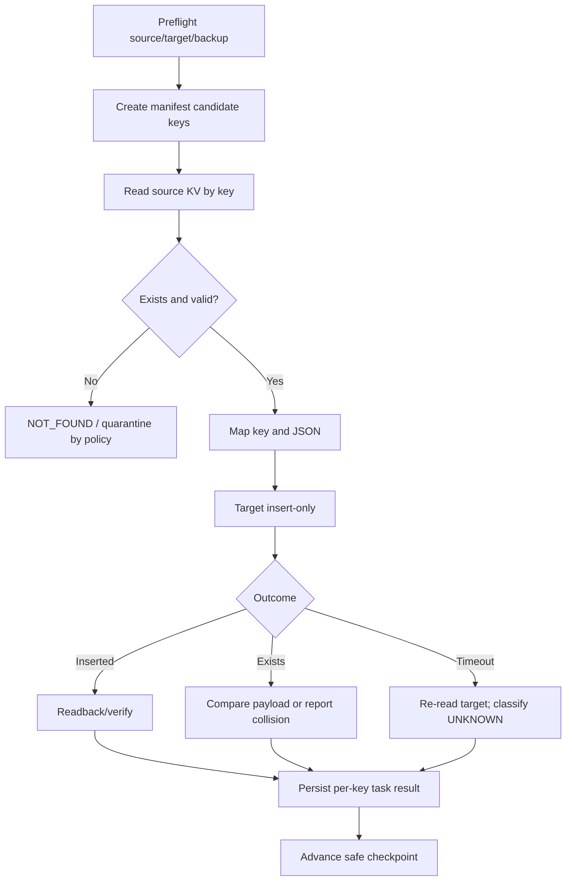
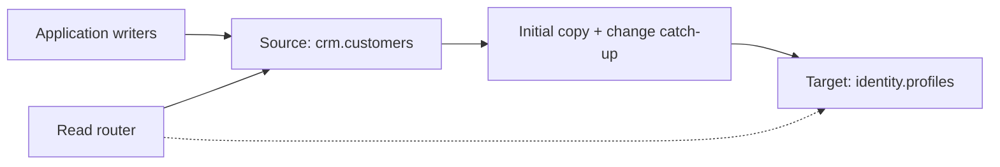

# Chuyển dữ liệu sang scope, collection hoặc bucket mới

Trong chương **Tiến hóa và di trú** của **SPRING_DATA_COUCHBASE**, không phải mọi thay đổi dữ liệu đều là đổi một vài trường JSON. Khi hệ thống tăng trưởng, cần phân tách miền nghiệp vụ, cải thiện phân quyền, thay đổi chính sách TTL, bố trí tài nguyên hoặc tổ chức lại cách truy vấn, nhóm phát triển có thể muốn chuyển document từ **bucket, scope hoặc collection hiện tại sang keyspace mới**.

Ví dụ, dữ liệu khách hàng đang nằm tại `appdata.crm.customers`; kiến trúc mới muốn các thông tin hồ sơ nằm ở `appdata.identity.profiles`. Di chuyển như vậy tác động đến **danh tính document, Repository/Template mapping, chỉ mục SQL++, quyền RBAC, TTL, ứng dụng đang ghi, khả năng rollback và phương pháp kiểm chứng**. Copy vài nghìn JSON sang collection mới chưa có nghĩa ứng dụng có thể chuyển đọc/ghi an toàn.

Đây là một bài học thực hành về **lập kế hoạch và triển khai di trú keyspace** trong Couchbase, kết hợp kiến thức Spring Data Couchbase về document mapping, Repository, `CouchbaseTemplate`, SQL++, CAS, TTL, transaction và reactive APIs. Bài phân biệt rõ:

- **Initial copy/backfill:** tạo các document tương ứng ở đích.
- **Catch-up/synchronization:** xử lý tạo mới, sửa và xóa xảy ra trong lúc copy.
- **Cutover:** chuyển quyền sở hữu đường đọc/ghi sang đích, xác minh kết quả.
- **Rollback hoặc forward recovery:** quay lại/khắc phục mà không làm mất các write hợp lệ sau cutover.
- **Contract/decommission:** loại bỏ source chỉ khi hết nhu cầu rollback và có bằng chứng đầy đủ.

**Nguyên tắc quan trọng:** Cùng một string `@Id` ở hai collection khác nhau **không phải cùng document**. Hai lời gọi ghi độc lập vào nguồn và đích cũng **không tự là một atomic transaction**.

## 1. Mục tiêu học tập

Sau bài này, bạn có thể:

1. Giải thích sự khác biệt giữa **bucket, scope, collection** và định danh document thực tế theo keyspace.
2. Phân tích lý do di chuyển dữ liệu: phân quyền, tổ chức domain, TTL, index, retention, workload isolation và vận hành.
3. Chọn giữa **di trú trong cùng bucket**, **sang bucket khác**, **trong cùng cluster** hoặc **sang cluster khác**.
4. Kiểm kê dữ liệu và metadata trước khi chuyển, gồm `_class`/type alias, CAS, expiration, index và RBAC.
5. Chuẩn bị target keyspace và Spring Data mapping sao cho Repository/Template/SDK không ghi nhầm.
6. Phân biệt **copy an toàn khi đóng băng write** với **online migration** có cập nhật đồng thời.
7. Viết copy theo KV bằng **insert-only** và xử lý idempotency/key collision có chủ đích.
8. Bảo vệ payload và các invariant khi chuyển đổi key pattern hoặc JSON shape.
9. Giải thích vì sao **CAS nguồn không thể dùng như CAS đích**, và làm gì khi source thay đổi trong lúc copy.
10. Thiết kế inventory, manifest, checkpoint, retry queue và tiến độ theo unique keys.
11. Xử lý **create/update/delete/expiry** trong catch-up, tránh document “ma” ở target.
12. Hiểu điều kiện và giới hạn của dual-write, transaction cùng cluster, XDCR/change stream và outbox.
13. Xây **read-routing, write-owner, canary và feature flag** để cutover có kiểm soát.
14. Kiểm thử mapping Spring Data, SQL++ indexes, TTL, tenant isolation, consistency và concurrency.
15. Thiết kế rollback trước và sau cutover, backup/restore rehearsal, RPO/RTO và quy trình dọn nguồn.

## 2. Bài toán xuyên suốt: chuyển customer sang hồ sơ định danh

Hệ thống cũ lưu:

```text
Cluster: couchbase-prod
Bucket:  appdata
Scope:   crm
Collection: customers

Document key: customer::tenant-a::C001
```

Ví dụ document:

```json
{
  "docType": "customer",
  "schemaVersion": 1,
  "tenantId": "tenant-a",
  "customerId": "C001",
  "displayName": "Nguyễn Thu Hà",
  "email": "ha@example.test",
  "status": "ACTIVE",
  "loyaltyPoints": 120,
  "customAttributes": {
    "preferredLanguage": "vi"
  }
}
```

Thiết kế mới muốn:

```text
Cluster: couchbase-prod
Bucket:  appdata
Scope:   identity
Collection: profiles

Document key: profile::tenant-a::C001
```

Document đích ở phiên bản mới:

```json
{
  "docType": "profile",
  "schemaVersion": 2,
  "tenantId": "tenant-a",
  "customerId": "C001",
  "displayName": "Nguyễn Thu Hà",
  "contact": {
    "emailRaw": "ha@example.test"
  },
  "status": "ACTIVE",
  "customAttributes": {
    "preferredLanguage": "vi"
  }
}
```

**Đây là tình huống chuyển keyspace kèm thay đổi projection.** Trường `loyaltyPoints` không còn nằm trong profile đích; nếu nghiệp vụ còn dùng điểm tích lũy, phải xác định **source of truth khác** hoặc tiếp tục duy trì trường đó ở một aggregate riêng. Không được âm thầm bỏ một field rồi tuyên bố chuyển toàn bộ dữ liệu thành công.

Để học dễ kiểm chứng, bài sử dụng hai phương án:

- **Phương án A — copy cùng key/cùng JSON:** dùng để minh họa chuyển collection an toàn với dữ liệu tĩnh.
- **Phương án B — đổi key và shape:** dùng cho refactor domain; cần mapping, canonical comparison và kế hoạch ownership riêng.

## 3. Bucket, scope và collection có ý nghĩa gì?

Couchbase tổ chức dữ liệu theo phân cấp:

```text
Cluster
  Bucket
    Scope
      Collection
        Document key -> JSON / binary value + metadata
```

| Thành phần | Vai trò khái quát | Tác động khi di trú |
| --- | --- | --- |
| **Bucket** | Không gian dữ liệu với các lựa chọn lưu trữ/tài nguyên/chính sách cấp bucket | Có thể thay topology, quota, durability/expiry defaults, replication và kế hoạch vận hành |
| **Scope** | Nhóm collections theo miền nghiệp vụ/khả năng phân quyền | Cần đổi mapping, RBAC và tên truy vấn |
| **Collection** | Không gian khóa độc lập chứa documents | Cần đổi keyspace và kiểm tra index/TTL/metadata |
| **Document key** | ID duy nhất trong collection | Không là duy nhất xuyên mọi collection |
| **CAS** | Token của một phiên bản document | Không phải ID ổn định để mang sang target |
| **Expiration** | Metadata quy định thời điểm document hết hạn | Có thể bị mất/thay đổi khi copy nếu không chủ động xử lý |

Định danh thực tế của dữ liệu là:

\[
(\text{bucket},\ \text{scope},\ \text{collection},\ \text{documentKey}).
\]

Do đó:

```text
appdata.crm.customers / customer::tenant-a::C001
appdata.identity.profiles / customer::tenant-a::C001
```

là **hai document khác nhau** dù phần key giống hệt.

### 3.1. Không nhầm chuyển collection với đổi schema

- **Đổi schema tại chỗ:** document giữ nguyên keyspace, thay JSON.
- **Chuyển keyspace:** target collection/bucket khác, có thể giữ nguyên JSON.
- **Chuyển key + schema:** vừa đổi identity vừa đổi nội dung.
- **Split aggregate:** một document nguồn thành nhiều documents đích.
- **Merge aggregate:** nhiều nguồn thành một target.

Mức độ phức tạp tăng đáng kể từ copy 1:1 sang split/merge; không dùng cùng một script đơn giản cho mọi loại.

## 4. Lý do chuyển dữ liệu và tiêu chí thành công

Không nên di chuyển chỉ vì “scope mới trông sạch hơn”. Phải có mục tiêu cụ thể:

| Mục tiêu | Ví dụ | Chứng cứ thành công |
| --- | --- | --- |
| Phân chia domain | CRM và identity có lifecycle khác | Mỗi service chỉ sửa aggregate mà nó sở hữu |
| RBAC tốt hơn | Customer API không cần quyền trên payment data | Quyền được kiểm chứng bằng negative tests |
| Chính sách retention | Profile giữ lâu, sessions có TTL | Expiry/retention phù hợp sau copy |
| Chỉ mục riêng | Profile query theo displayName | Index mới phục vụ đúng query plan |
| Tách workload | Một bucket mới có quota khác | Latency, memory, disk, backpressure trong SLO |
| Thay key pattern | Từ ID ngắn sang key chứa tenant | Không collision, không rò dữ liệu xuyên tenant |
| Chuẩn hóa mô hình | `profile` riêng khỏi loyalty | Mọi field có source of truth rõ |
| Chuẩn bị thay service | Read/write cutover sang module mới | Canaries + reconciliation pass, rollback plan đạt |

**Định nghĩa “done” bằng dữ liệu và hành vi ứng dụng**, không bằng số row đã insert ở target.

## 5. Ba chiến lược thay đổi keyspace

| Kiểu di trú | Ví dụ | Điểm cần đánh giá |
| --- | --- | --- |
| **Collection → collection cùng scope** | `crm.customers` → `crm.customers_v2` | Mapping, indexes, RBAC, TTL, read routing |
| **Scope → scope cùng bucket** | `crm.customers` → `identity.profiles` | Domain boundary, type discriminator, quyền và ownership |
| **Bucket → bucket trong cùng cluster** | `appdata` → `identitydata` | Tài nguyên, quota, expiry defaults, durability, transaction support theo version |
| **Bucket/collection → cluster khác** | Cluster A → Cluster B | Network, replication/capture, consistency, cutover và disaster recovery |
| **Một collection → nhiều collections** | Customer → profile + preferences | Multi-document invariant, duplicate, partial copy |
| **Nhiều collections → một collection** | Profile + contact → person | Collision, precedence, data lineage |

Điểm tách biệt quan trọng: **cùng cluster không mặc định nghĩa là mọi API Spring Data cùng dùng được một transaction xuyên các keyspace**. Cần kiểm tra khả năng của Couchbase Server, SDK và Spring Data integration đúng phiên bản, scope/collection/bucket configuration và loại operation.

## 6. Phương án offline hay online?

### 6.1. Offline/maintenance window

Dừng tất cả writer có liên quan, lấy backup, copy source → target, verify rồi cutover.

**Ưu điểm:** ít race, dễ lập luận nhất quán, rollback trước khi mở write mới đơn giản hơn.

**Giới hạn:** có downtime hoặc queue backlog; TTL có thể tiếp tục trôi qua; phải xác minh **tất cả** writer thực sự dừng, kể cả background jobs, message consumers và admin scripts.

### 6.2. Online migration

Ứng dụng vẫn phục vụ reads/writes trong lúc copy. Cần cơ chế:

- Reader tương thích source/target.
- Initial copy có checkpoint.
- Bắt kịp **create, update, delete, expiration**.
- Đảm bảo writer không ghi sai source hoặc target khi cutover.
- Một **write barrier, quiesce ngắn hoặc change-stream position** đủ để xác nhận cuối.
- Reconciliation/monitoring dài hơn một lần copy.

### 6.3. Chọn theo yêu cầu

Nếu dữ liệu có giá trị nghiệp vụ cao, số lượng không quá lớn và downtime được phép, **offline thường an toàn hơn** một thiết kế online phức tạp chưa kiểm chứng. Với hệ thống bắt buộc online, chỉ chấp nhận khi **có nguồn sự thật, đồng bộ delta và rollback logic được diễn tập**.

## 7. Kiểm kê trước migration: data và metadata

Bảng kiểm kê cần ít nhất:

1. **Source locator:** cluster, bucket, scope, collection chính xác.
2. **Target locator:** tên keyspace, version, capacity, dự kiến TTL.
3. **Key patterns:** prefix, tenant, độ dài, ký tự đặc biệt, nguy cơ collision.
4. **Document types:** `docType`, Spring Data `_class` hoặc type alias nếu dùng.
5. **Schema versions:** thiếu field, null, sai kiểu, future version, nested JSON.
6. **Dữ liệu phi JSON:** binary/string/serialized formats không thể mặc định `contentAsObject()`.
7. **CAS và expiration:** metadata nguồn, chính sách target cho mỗi loại dữ liệu.
8. **Indexes:** primary/secondary indexes, query/FTS/analytics phụ thuộc keyspace.
9. **Access control:** RBAC, service accounts, multi-tenant boundaries.
10. **Workload:** read/write QPS, hot keys, batch/concurrency limit, p95/p99.
11. **Domain relations:** các key tham chiếu qua collection, linked IDs, counters/ledger.
12. **Replication/backup:** backup repository, XDCR/streaming nếu có, restore drill.
13. **Các writer khác:** API pods, scheduled jobs, stream consumers, data import tools.
14. **Retention/compliance:** archive, delete requests, cách xử lý PII trong lab.

Một điểm kiểm kê thường bị bỏ sót là **document cùng key nhưng thuộc nhiều types** trong collection cũ. Nếu target key mapping chỉ dùng customerId, chúng có thể va vào cùng một key.

## 8. Query inventory theo source keyspace

Ví dụ số document theo `docType` và `schemaVersion`:

```sql
SELECT IFMISSINGORNULL(c.docType, "MISSING") AS typeLabel,
       IFMISSINGORNULL(c.schemaVersion, "MISSING") AS versionLabel,
       COUNT(1) AS n
FROM `appdata`.`crm`.`customers` AS c
GROUP BY IFMISSINGORNULL(c.docType, "MISSING"),
         IFMISSINGORNULL(c.schemaVersion, "MISSING");
```

Query lấy một tập candidate:

```sql
SELECT RAW META(c).id
FROM `appdata`.`crm`.`customers` AS c
WHERE c.docType = "customer"
ORDER BY META(c).id
LIMIT $batchSize;
```

**Không mặc định** có index phù hợp. Cần `EXPLAIN` và xây index theo kế hoạch được duyệt, chẳng hạn index có `docType` để hỗ trợ lọc.

### 8.1. Cảnh báo về query đếm

- Query lọc `docType="customer"` bỏ sót document thiếu discriminator.
- Secondary index có thể cập nhật trễ; scan consistency là **thuộc tính query**, không tạo snapshot bất biến xuyên mọi query.
- Một query báo `n=100000` không chứng minh 100000 keys đó còn tồn tại lúc copy.
- SQL++ với `REQUEST_PLUS` không tự tạo transaction hoặc global write barrier.
- Không dùng `COUNT(*)` không nhất quán giữa các thời điểm làm bằng chứng một-to-one nếu live writes vẫn chạy.

## 9. Chuẩn bị target: không chỉ tạo collection rỗng

Trước khi copy:

| Hạng mục | Câu hỏi cần trả lời |
| --- | --- |
| Bucket | Dung lượng RAM/disk, replication, durability, quota, maxTTL có tương thích? |
| Scope/collection | Đã được tạo, đúng tên/case, scope RBAC đúng? |
| Default/max TTL | Expiry nào được giữ, expiry nào thay đổi theo chính sách? |
| Indexes | Các query v2 chạy bằng index/plan nào? |
| Type metadata | Spring Data `_class`/type aliases ở source/target có tương thích? |
| Security | App v2 có quyền tối thiểu; app v1 có còn quyền ghi target không? |
| Network | SDK kết nối target cluster/bucket theo topology/DNS/TLS như thế nào? |
| Capacity | Target đủ resource cho copy + live traffic + index build không? |
| Backups | Target mới đã nằm trong policy backup/restore chưa? |
| Monitoring | Có baseline p95/p99, error rate, disk/replica health? |

Không để migration worker **tự tạo bucket/collection ngoài ý muốn** nếu cấu hình sai. Đây là bước thay đổi hạ tầng cần có review, naming convention, least privilege và khả năng hủy bỏ.

### 9.1. Ví dụ quản lý scope/collection

Với Couchbase Server/SQL++ hỗ trợ collection management, có thể thấy cú pháp quản trị dạng:

```sql
-- Minh họa cú pháp DDL; thực hiện bằng quyền quản trị
-- và kiểm tra phiên bản Couchbase Server trước khi dùng.
CREATE SCOPE `appdata`.`identity`;

CREATE COLLECTION `appdata`.`identity`.`profiles`;
```

Nếu đã có scope/collection, không chạy DDL create lặp mà thiếu kiểm tra. Việc **tạo bucket mới** và cấu hình RAM/replica/TTL là tác vụ quản trị riêng; không nên coi nó là một câu SQL++ mutation cùng transaction dữ liệu.

### 9.2. Chỉ mục target khác source

Ví dụ reader v2 tìm hồ sơ theo tenant/status:

```sql
CREATE INDEX ix_profiles_tenant_status
ON `appdata`.`identity`.`profiles` (
    tenantId,
    status
);
```

Xác minh index online/build complete và plan của query trước cutover. Một index của `crm.customers` **không tự áp dụng** lên `identity.profiles`.

## 10. Spring Data Couchbase: Mapping phải đổi có chủ đích

Entity cũ:

```java
import org.springframework.data.annotation.Id;
import org.springframework.data.annotation.Version;
import org.springframework.data.couchbase.core.mapping.Collection;
import org.springframework.data.couchbase.core.mapping.Document;
import org.springframework.data.couchbase.core.mapping.Scope;

@Document
@Scope("crm")
@Collection("customers")
public class CustomerDocument {

    @Id
    private String id;

    private String tenantId;
    private String customerId;
    private String displayName;
    private String email;
    private String status;

    @Version
    private Long version;

    // Constructor, getter, setter theo domain.
}
```

Entity đích:

```java
@Document
@Scope("identity")
@Collection("profiles")
public class ProfileDocument {

    @Id
    private String id;

    private String tenantId;
    private String customerId;
    private String displayName;
    private Contact contact;
    private String status;

    @Version
    private Long version;
}
```

Repository:

```java
import org.springframework.data.couchbase.repository.CouchbaseRepository;

public interface ProfileRepository
        extends CouchbaseRepository<ProfileDocument, String> {
}
```

**Lưu ý:** annotation định tuyến entity phải được kiểm chứng theo Spring Data version và bucket configuration. Scope/collection được gắn trên entity **không tự tạo** target infrastructure, indexes, RBAC hoặc backup policy.

### 10.1. Đổi bucket khó hơn đổi collection

Một cấu hình Spring Data thường có bucket mặc định gắn với `CouchbaseTemplate`/repository infrastructure. Không chỉ thay `@Scope` và `@Collection` rồi giả định repository lập tức đổi sang bucket khác.

Khi target ở bucket mới, phải quyết định tạo template/repository configuration nào quản lý bucket nào, quản lý bean names thế nào, và cách tránh truy cập nhầm. Nếu có **nhiều clusters**, vấn đề transaction và client lifecycle còn phức tạp hơn.

### 10.2. Metadata `_class`/type alias

Spring Data Couchbase có thể sử dụng metadata type-discriminator để ánh xạ entity và phục vụ một số truy vấn. Raw KV copy từ `CustomerDocument` sang target dành cho `ProfileDocument` có thể mang **type metadata cũ**.

Vì vậy:

- Kiểm tra document thực tế có `_class`/type alias hay không theo configuration.
- Thử Repository v2 đọc target sau copy, không chỉ `SDK collection.get`.
- Với transform sang class mới, định nghĩa policy metadata thay vì copy bừa.
- Derived query/`@Query` có thể thêm điều kiện type; kiểm thử với dữ liệu thật.
- Không dùng một raw JSON đã copy làm bằng chứng Spring Data mapping v2 hoạt động.

## 11. SDK locator: mở đúng collection nguồn và đích

Nếu nguồn/đích trong cùng bucket:

```java
import com.couchbase.client.java.Cluster;
import com.couchbase.client.java.Collection;

Collection source = cluster.bucket("appdata")
        .scope("crm")
        .collection("customers");

Collection target = cluster.bucket("appdata")
        .scope("identity")
        .collection("profiles");
```

Nếu target là bucket khác:

```java
Collection target = cluster.bucket("identitydata")
        .scope("identity")
        .collection("profiles");
```

Nếu target là **cluster khác**, dùng client connection/credentials/TLS và cấu hình độc lập phù hợp; không truyền nhầm một `Collection` của cluster nguồn vào lời gọi nhắm cluster đích.

### 11.1. Đừng dựa vào tên key

Cùng `customer::tenant-a::C001` tồn tại ở cả source và target. Chỉ nhìn key trong log mà không kèm keyspace có thể khiến operator nghĩ dữ liệu đã được chuyển, trong khi application vẫn đọc source.

Nên log định danh keyspace và một key/correlation ID đã được ẩn danh theo chính sách.

## 12. Chiến lược identity: giữ key hay đổi key?

### 12.1. Giữ nguyên key

```text
Source:
  appdata.crm.customers / customer::tenant-a::C001

Target:
  appdata.identity.profiles / customer::tenant-a::C001
```

Ưu điểm: không cần rewrite tham chiếu theo key, thuận tiện so sánh 1:1. Nhược điểm: tên key có thể phản ánh domain cũ.

### 12.2. Đổi key có thể có lợi về domain

```text
customer::tenant-a::C001
    ->
profile::tenant-a::C001
```

Khi đổi key, cần quy tắc mapping **injective trên phạm vi được chuyển**: hai source khác nhau không được map vào cùng target trừ khi **merge có chủ đích**.

### 12.3. Ví dụ collision

```text
Source:
  customer::tenant-a::C001
  customer::tenant-b::C001

Sai target key:
  profile::C001
```

Hai tenant đè nhau nếu thiếu tenant trong target key. Không coi “ghi sau cùng thắng” là migration.

### 12.4. Lưu mapping khi cần hỗ trợ links/rollback

Với đổi ID phức tạp, có thể có bảng mapping durable:

```json
{
  "migrationId": "customer-to-profile",
  "sourceKeyspace": "appdata.crm.customers",
  "sourceKey": "customer::tenant-a::C001",
  "targetKeyspace": "appdata.identity.profiles",
  "targetKey": "profile::tenant-a::C001",
  "mappingVersion": 1
}
```

Không đặt mapping làm source of truth duy nhất mà quên audit/backup. Bảo vệ mapping khỏi collision và xử lý duplicate bằng key/unique constraint theo mô hình.

## 13. Copy cùng key/cùng JSON khi tất cả writer đã dừng

Đây là kịch bản **đơn giản nhất** để giải thích tính đúng của copy:

```text
Tiền điều kiện:
  - Source writers được quiesce.
  - Source/target keyspaces đã xác minh.
  - Chỉ copy JSON documents không expiration.
  - Không đổi shape, không đổi key.
  - Target trống hoặc existing payload được xác minh trùng.
```

Mã SDK minh họa:

```java
package com.example.migration;

import com.couchbase.client.core.error.DocumentExistsException;
import com.couchbase.client.java.Collection;
import com.couchbase.client.java.json.JsonObject;
import com.couchbase.client.java.kv.GetResult;

public final class FrozenCollectionCopier {

    public enum CopyOutcome {
        INSERTED,
        ALREADY_MATCHING
    }

    private final Collection source;
    private final Collection target;

    public FrozenCollectionCopier(
            Collection source,
            Collection target) {
        this.source = source;
        this.target = target;
    }

    public CopyOutcome copyOne(String key) {
        GetResult read = source.get(key);

        // Chỉ dùng cho JSON trong phạm vi bài tập;
        // dữ liệu nguồn đã tạm dừng ghi và không có TTL.
        JsonObject body = JsonObject.fromJson(
                read.contentAsObject().toString());

        try {
            target.insert(key, body);
            return CopyOutcome.INSERTED;
        } catch (DocumentExistsException duplicate) {
            JsonObject existing =
                    target.get(key).contentAsObject();

            if (!existing.equals(body)) {
                throw new IllegalStateException(
                        "Target key tồn tại với payload khác: " + key);
            }

            return CopyOutcome.ALREADY_MATCHING;
        }
    }
}
```

**Giới hạn bắt buộc đọc:**

- Mẫu này **chỉ an toàn cho JSON không có TTL, source đã đóng băng writes, copy 1:1**.
- `insert` là insert-only, không ghi đè target đang có dữ liệu khác.
- `JsonObject.equals` được dùng để minh họa đối chiếu shape cùng kiểu; khi transform schema hoặc dùng serializer khác, phải có **canonical comparison** đúng domain.
- Nếu `target.insert` timeout hoặc client mất acknowledgement, không được mặc định target chưa ghi. Hãy lookup và so payload/id trước retry.
- `read.cas()` của source **không được mang sang target làm CAS**.
- Việc copy JSON **không chuyển được mọi metadata** như TTL, CAS, durability history hay cấu hình index.
- Dữ liệu non-JSON cần chiến lược riêng, không dùng `contentAsObject()`.
- Code là ví dụ về thao tác một key, chưa có inventory, checkpoint, retry, backup, read routing hoặc rollback.

### 13.1. Vì sao không dùng upsert vô điều kiện?

```java
target.upsert(key, body);
```

Nếu target đã được writer mới cập nhật, một bản copy stale có thể **ghi đè dữ liệu hợp lệ**. Bởi vậy đường initial copy thường dùng **insert-only**; thay đổi đã tồn tại được phân loại và đưa vào reconciliation theo revision/conflict policy.

## 14. Chuyển đổi key + schema phải có converter riêng

Khi đích là `profile` thay vì `customer`, cần converter thuần:

```text
Input:
  sourceKey + source JSON + source schema version

Output:
  targetKey + target JSON + mapping policy version
```

Mẫu pseudocode:

```java
public record CopyPlan(
        String sourceKey,
        String targetKey,
        JsonObject targetDocument,
        String mappingVersion) {
}

CopyPlan transformCustomer(String sourceKey, JsonObject source) {
    // Pseudocode:
    // 1. Kiểm tra docType, tenantId, schema, customerId.
    // 2. targetKey = profile::<tenantId>::<customerId>.
    // 3. Chuyển displayName/contact theo quy tắc đã duyệt.
    // 4. Điều chỉnh type-discriminator theo Spring Data target.
    // 5. Không âm thầm bỏ dữ liệu chưa có owner mới.
    // 6. Trả CopyPlan deterministic, không gọi DB/HTTP.
    throw new UnsupportedOperationException(
            "Bổ sung mapping đã được kiểm chứng");
}
```

### 14.1. Không có phép chuyển tự động mọi field

Nếu source có `loyaltyPoints` nhưng target chỉ phục vụ identity, phải quyết định:

- Điểm tiếp tục ở `crm.customers`? Nếu source sắp bị xóa, phương án này không hợp lệ.
- Điểm chuyển sang `loyalty.accounts` bằng migration khác?
- Điểm là projection của ledger cần rebuild?
- Trong thời gian chuyển tiếp, ứng dụng đọc điểm ở đâu?

Một migration chỉ copy profile có thể thành công về **profile**, nhưng không hoàn tất việc xóa source nếu `loyaltyPoints` chưa có chỗ lưu hợp lệ.

### 14.2. Converter idempotent và deterministic

Với cùng một snapshot source hợp lệ, việc chuyển đổi lại phải cho **cùng target key và cùng payload**. Không sinh UUID hoặc timestamp ngẫu nhiên trong converter. Nếu cần `migratedAt`, nên xác định semantics của run/job metadata riêng, tránh làm payload khác nhau mỗi retry.

## 15. CAS nguồn và CAS đích: không thể mang qua như một token

CAS là metadata/version token do Couchbase quản lý tại document và keyspace tương ứng. Khi `target.insert` tạo document mới, target nhận **CAS mới**.

| Mục đích | Dùng token nào? |
| --- | --- |
| Thay source document nếu chưa bị writer khác sửa | `sourceGetResult.cas()` trên **source keyspace** |
| Thay target document nếu chưa bị writer đích sửa | `targetGetResult.cas()` trên **target keyspace** |
| Ghi nhận source snapshot đã copy | Lưu source CAS như **opaque evidence/metadata**, không làm target CAS |
| So thứ tự các business events | Dùng **revision/sequence do nghiệp vụ định nghĩa**, không sort CAS |
| Chống copy stale overwrite | Insert-only hoặc target CAS + source version/order policy |
| Phát hiện source vừa thay đổi | Re-read source, so CAS/shape theo policy và lên lịch catch-up |

**Không copy CAS nguồn vào trường `@Version` của entity đích** với kỳ vọng optimistic locking tiếp tục đúng. Khi migration tạo entity đích, Spring Data version mapping phải được khởi tạo theo operation/target semantics.

## 16. TTL và expiration khi chuyển keyspace

Một document có TTL trong `crm.customers` có thể cần giữ nguyên thời điểm hết hạn khi sang `identity.profiles`, hoặc đổi retention theo **chính sách mới được phê duyệt**.

Không chỉ copy JSON: TTL thường nằm ở **metadata document**, không nhất thiết là field JSON.

### 16.1. Ba chính sách cần phân biệt

| Chính sách | Ý nghĩa |
| --- | --- |
| **Preserve absolute expiry** | Target hết hạn gần cùng thời điểm source (theo hỗ trợ phiên bản và độ phân giải) |
| **Recalculate relative TTL** | Target nhận một thời hạn mới tính từ cutover |
| **No expiry** | Target tồn tại đến khi bị xóa bằng workflow khác |

Đây là **thay đổi hợp đồng retention**, không phải tùy chọn kỹ thuật vô hại.

### 16.2. Luồng copy một document có expiry

```text
source KV get(key, request expiry metadata)
  -> đọc payload + expiry theo API/version
  -> nếu source đã hết hạn/được xóa: áp dụng delete policy
  -> chuyển đổi payload
  -> target insert với expiration phù hợp, nếu API hỗ trợ
  -> readback target expiry + payload
  -> ghi status VERIFIED
```

Trong Java SDK, khả năng lấy expiry metadata (ví dụ get options yêu cầu include expiry), và cách đặt expiry theo `Duration` hoặc thời điểm tuyệt đối phụ thuộc phiên bản. **Đừng chỉ copy `JsonObject` rồi coi TTL đã bảo toàn.**

### 16.3. Bucket/collection expiry defaults có thể khác

Khi chuyển sang bucket mới, cấu hình maxTTL/defaults có thể khiến target:

- Hết hạn sớm hơn source.
- Không hết hạn khi source có TTL.
- Bị giới hạn TTL theo chính sách target.
- Không đáp ứng retention pháp lý hoặc security policy.

Test expiration thực tế theo đúng version/cấu hình, không chỉ so một field `expiresAt` trong JSON.

### 16.4. Expiry trong lúc migration

Source document có thể hết hạn sau khi được scan nhưng trước khi copy. Nếu target vẫn được insert từ snapshot cũ, bạn có thể **hồi sinh dữ liệu đã hết hạn**. Cần rule về dữ liệu hết hạn, delete propagation và timestamp consistency.

## 17. Initial copy: inventory trước, mutation sau

Một workflow phổ biến:



### 17.1. Scan trước không đóng băng dữ liệu

Nếu tạo manifest lúc 09:00 và copy lúc 10:00, source có thể đã thay đổi. Manifest chỉ cung cấp **danh sách candidate**, không chứng minh value lúc 09:00 vẫn đúng hoặc mọi key tạo sau 09:00 được bao phủ.

### 17.2. Phải có readback

Việc `target.insert` trả thành công là bằng chứng operation được xác nhận, nhưng vẫn phải kiểm chứng mapping/schema/invariants trên target trước khi tuyên bố migration xong. Đặc biệt khi payload transform, người dùng ứng dụng có thể gặp lỗi dù SDK KV read vẫn thành công.

## 18. Worklist, checkpoint và tiến độ có thể chạy lại

Mỗi source key tương ứng một task identity ổn định:

```json
{
  "migrationId": "customer-to-profile",
  "runId": "run-20261125-a",
  "sourceKeyspace": "appdata.crm.customers",
  "sourceKey": "customer::tenant-a::C001",
  "targetKeyspace": "appdata.identity.profiles",
  "targetKey": "profile::tenant-a::C001",
  "mappingVersion": "r3",
  "state": "PENDING",
  "attempts": 0,
  "sourceSnapshotCas": null,
  "lastError": null
}
```

Task states:

| Trạng thái | Ý nghĩa |
| --- | --- |
| `PENDING` | Chưa xử lý |
| `CLAIMED` | Worker đang làm; có lease |
| `COPIED` | Mutation target đã được xác nhận |
| `MATCHED_EXISTING` | Target đã có đúng payload và policy cho phép |
| `RETRY_LATER` | Conflict/timeout/hạ tầng cần xử lý lại |
| `SOURCE_GONE` | Source bị xóa/expire; cần delete policy |
| `COLLISION` | Target key/payload không tương thích |
| `QUARANTINED` | Dữ liệu nguồn không thể chuyển an toàn |
| `VERIFIED` | Đã kiểm chứng target/mapping/invariant |
| `FAILED_PERMANENT` | Dừng/điều tra theo go-no-go policy |

**Không coi `COPIED` là `VERIFIED`**. Và khi source biến mất, cần xác định delete hợp lệ hay lỗi đọc sai keyspace.

### 18.1. Crash sau insert trước task ACK

```text
T1  Source read -> valid
T2  Target insert -> success
T3  Process crash
T4  Task vẫn PENDING
T5  Restart -> target exists
T6  So target với expected mapping
T7  Nếu trùng: VERIFIED, không insert/upsert lại
```

Đây là mô hình **at-least-once processing + idempotency**, tương tự backfill trong cùng collection.

### 18.2. Checkpoint không đi qua task bị mất

Nếu C101 thành công, C102 lỗi transient và C103 thành công, trước khi cursor vượt C103 phải **persist C102 vào retry queue**. Nếu lưu cursor trước khi lưu retry task, job có thể bỏ sót vĩnh viễn.

## 19. Tiến độ: copy, verify và delta phải được tách

Một báo cáo tiến độ nên có:

```text
Run: customer-to-profile / run-20261125-a
Phase: INITIAL_COPY
Manifest candidates: 150000 unique source keys
Scanned: 124000
Copied confirmed: 120200
Matched existing: 1800
Verified: 118700
Retry pending: 950
Collision: 12
Quarantined: 28
Source-gone: 1010 (delete policy pending)
Delta lag: UNKNOWN
Cutover eligibility: NOT READY
```

Các số **chỉ minh họa**; không cố cộng các tập giao nhau thành một tổng thiếu định nghĩa. Trong báo cáo thật, định nghĩa category là **snapshot hiện tại của task state** hay **cumulative event counter**, và tránh đếm lặp task replay.

### 19.1. “100% copied” chưa đủ

Nếu đã copy hết manifest nhưng:

- Source nhận thêm 20.000 updates.
- Delete events chưa propagate.
- Target index chưa sẵn.
- App mapping v2 lỗi vì `_class`.
- Legacy writers vẫn ghi source.
- Rollback target không còn khả thi.

thì migration **chưa đủ điều kiện cutover**.

## 20. Online migration: phải quyết định source of truth

Một sơ đồ ownership:



Trong pha copy, **source thường là nguồn sự thật**. Điều này có nghĩa:

- Write được ứng dụng xác nhận chủ yếu ở source theo hợp đồng cũ.
- Target có thể tạm trễ.
- Chỉ dùng target để shadow read/canary có kiểm soát.
- Chênh lệch không được “sửa” bằng target overwriting source nếu chưa có chính sách conflict.
- Cutover phải có **điểm chuyển ownership**.

Nếu cả source và target đều được phép nhận writes độc lập không có protocol đồng bộ, bạn đã tạo ra **hai nguồn sự thật cạnh tranh**.

## 21. Online catch-up cần bao gồm create, update, delete

Nhiều script chỉ làm:

```text
SELECT keys WHERE schemaVersion=1
COPY documents
```

Điều này bỏ qua:

- **Create:** document mới sinh sau manifest.
- **Update:** document đã copy nhưng source thay đổi.
- **Delete:** document ở source bị xóa, target còn bản copy.
- **Expiry:** source hết hạn, target tiếp tục tồn tại.
- **Key rename/move:** source key cũ bị bỏ, target key mới cần tạo.
- **Merge/split changes:** aggregate chuyển đổi, target phải được tính lại.
- **Event ordering:** update cũ tới sau update mới.

### 21.1. Ví dụ ghost document

```text
09:00 Copy C001 source -> target.
09:10 User xóa C001 ở source.
09:20 Target vẫn còn C001.
09:30 Read cutover sang target.
=> User thấy dữ liệu lẽ ra đã bị xóa.
```

Một lần count bằng nhau trước 09:10 không chứng minh sự an toàn ở 09:30.

### 21.2. Tombstone và delete intent

Nếu có change stream/outbox, delete cần event hoặc tombstone có ID/sequence đủ để target biết **key nào phải xóa**. Một “source get not found” từ scan cũng có thể do TTL/network/permission/keyspace sai, nên không được map mọi lỗi thành delete.

### 21.3. Delete có thể đến trễ và đảo thứ tự

```text
E1: update C001 to revision 12
E2: delete C001 revision 13
E3: retry update revision 12 (late)
```

Nếu áp E3 sau E2 không có revision guard, target có thể **hồi sinh** C001. Dùng **business revision/sequence** và policy tombstone/retention thay vì sort CAS.

## 22. Chọn cơ chế đồng bộ delta

| Cơ chế | Khi nào hữu ích | Giới hạn chính |
| --- | --- | --- |
| **Quiesce writers + final KV scan** | Downtime ngắn chấp nhận được | Cần dừng mọi writer; có thể tốn thời gian |
| **Application dual-write** | Có kiểm soát mọi writer | Hai KV operations độc lập có thể commit một bên |
| **Transactional dual-write trong phạm vi hỗ trợ** | Cả hai documents cùng transaction Couchbase hỗ trợ | Phụ thuộc version/API/keyspaces; không dùng cho toàn campaign |
| **Transactional outbox + worker** | Cần ghi intent update rồi propagate | At-least-once, cần idempotent consumer và ordering |
| **DCP/change stream/CDC tooling** | Tốc độ mutation cao, cần copy delta | Cần đúng connector/version, checkpoint, delete/expiry handling |
| **XDCR/replication** | Di chuyển/đồng bộ giữa clusters/buckets trong phạm vi được hỗ trợ | Khả năng scope/collection mapping, filtering, conflicts và topology cần kiểm chứng |
| **Shadow read + reconcile** | Kiểm thử target mà chưa chuyển traffic | Không tự đồng bộ writes |

Không khẳng định **XDCR có thể map mọi collection ở mọi version** hoặc **CDC cung cấp một event đúng một lần**. Kiểm tra phạm vi tính năng, checkpoint, order, delete/expiry, RBAC và sự kiện failover theo sản phẩm/version cụ thể.

### 22.1. Transactional dual-write có phải giải pháp mặc định?

Không. Ngay cả khi SDK phiên bản đang dùng hỗ trợ transaction trên những collections/buckets liên quan trong **cùng Couchbase deployment**, bạn còn phải:

- Kiểm tra cả hai operation thực sự dùng cùng `ctx`.
- Đánh giá số document, conflict, TTL và transaction expiration.
- Xem xét ứng dụng cũ không biết target.
- Bảo đảm rollback/read owner.
- Thiết kế backfill/verification ngoài phạm vi transaction của một request.

Đừng giả định Spring Data `@Transactional` tự chọn một manager có thể quản lý mọi template/bucket/cluster.

## 23. Vì sao `save(source)` rồi `save(target)` không atomic?

```java
sourceRepository.save(customer);
targetRepository.save(profile);
```

Nếu hai lời gọi độc lập:

1. Source commit, target fail → target stale.
2. Target commit, source fail → target có trạng thái không tương ứng.
3. App crash giữa hai lần → delta mất.
4. Source/target cùng thành công, HTTP response mất → client retry.
5. Hai writers khác nhau ghi ngược thứ tự → target regression.

Ngay cả khi đặt hai lời gọi trong một method có `@Transactional`, chỉ được công bố atomicity nếu **transaction manager và các operations thực tế** hỗ trợ đúng transaction context trên hai keyspace và đã kiểm chứng bằng forced-abort integration test.

### 23.1. Callback SDK cũng không tự bảo vệ operation thường

```java
cluster.transactions().run(ctx -> {
    // Transaction-aware operations qua ctx...
    target.upsert(targetKey, payload); // KV thường, ngoài ctx.
});
```

`target.upsert` như trên **không tự tham gia transaction** chỉ vì nó nằm trong lambda.

## 24. Đồng bộ delta bằng outbox: một mẫu dễ đối soát hơn

Trong pha còn giữ source làm source of truth, ứng dụng có thể ghi:

```text
Couchbase source transaction:
  UPDATE customer C001
  INSERT outbox event CustomerChanged(C001, revision=12)
COMMIT
```

Relay chuyển event tới migration consumer. Consumer:

1. Nhận event ID/revision ổn định.
2. Đọc nguồn sự thật hoặc payload snapshot theo contract.
3. Transform sang target model.
4. Kiểm tra target revision hiện tại.
5. Apply nếu event mới hơn trạng thái đã áp dụng.
6. Ghi inbox/checkpoint bền và ACK theo thiết kế.
7. Nếu event bị redeliver, không apply lại business change.

**Outbox ghi intent trong cùng transaction nguồn** giúp không mất ý định phát thay đổi sau commit, nhưng **consumer → target là một boundary khác**: vẫn cần idempotency/revision guard và có thể chấp nhận eventual consistency.

### 24.1. Không dùng CAS token làm revision tăng dần

CAS có thể thay đổi mỗi mutation, nhưng không dùng numeric comparison của CAS như timestamp/revision để sắp thứ tự nghiệp vụ. Nếu cần chống event đến chậm, dùng `aggregateRevision`/`eventSequence` do ứng dụng quản lý hoặc một cơ chế ordering tương đương có hợp đồng rõ.

### 24.2. Consumer crash sau target write trước ACK

Sự kiện có thể được giao lại. Đường consumer phải đọc/so target revision hoặc marker để không áp dụng sai hoặc gửi sự kiện ngoài hai lần.

## 25. Concurrent copy: copy từ source có thể stale ngay khi đọc

Timeline:

```text
T1 Migration đọc source C001: points=120, CAS=A
T2 API cập nhật source C001: points=200, CAS=B
T3 Migration insert target C001: points=120
T4 Không có catch-up
T5 Cutover
=> Target mất update hợp lệ.
```

### 25.1. Cách kiểm tra sau initial copy

Có thể re-read source và so với snapshot đã copy để phát hiện drift; nếu khác, đưa vào catch-up. Tuy nhiên còn **race giữa lần re-read cuối và cutover**, nên hệ thống online phải có cơ chế **write barrier hoặc delta stream có checkpoint cuối**.

### 25.2. Không ghi đè target mới bằng snapshot cũ

Nếu một target writer đã áp version mới, một retry initial copy không được `upsert` payload cũ. Dùng insert-only trong pha initial copy, và **delta apply có điều kiện** theo revision/owner policy.

### 25.3. Không khóa source CAS để “giữ trạng thái”

CAS là điều kiện ghi, **không phải mutex giữ source document đứng yên** cho tới khi target copy. Nếu cần snapshot nhất quán hơn, chọn quiesce, transaction theo aggregate khi hỗ trợ, hoặc change capture/reconciliation.

## 26. Kịch bản split một document thành nhiều documents

Từ:

```json
{
  "customerId": "C001",
  "displayName": "Nguyễn Thu Hà",
  "preferences": {
    "notifications": true
  }
}
```

sang:

```text
identity.profiles:
  profile::tenant-a::C001

identity.preferences:
  preference::tenant-a::C001
```

Nếu API cần cả hai documents cùng tồn tại để trả một customer hợp lệ, một work item phải định nghĩa invariant:

\[
\text{profileExists}(C001)
\Longleftrightarrow
\text{preferenceExists}(C001)
\]

trong các trạng thái đã xác nhận của migration/cutover, trừ khi policy cho phép partial state.

### 26.1. Transaction theo aggregate

Nếu server/SDK và keyspaces tương thích, có thể dùng **một transaction cho một customer** để insert profile + preference + marker. Không dùng một transaction cho 150.000 customers.

### 26.2. Nếu không có transaction phù hợp

Thiết kế marker `MIGRATING`/`READY`, idempotent writes, workflow recovery, read filtering và reconciliation. Không công bố aggregate ready cho reader mới khi mới có một nửa document.

### 26.3. Merge cũng cần chính sách collision

Nếu hai sources cùng đóng góp vào một target, định nghĩa precedence, consistency, stale update và trạng thái thiếu nguồn. **Không lấy last writer wins mặc định** cho dữ liệu có invariant nghiệp vụ.

## 27. Read routing: ở giai đoạn nào đọc source, ở giai đoạn nào đọc target?

Một mô hình rõ ràng:

| Pha | Write owner | Read owner | Target làm gì? |
| --- | --- | --- | --- |
| `PREPARE` | Source | Source | Tạo hạ tầng/index |
| `INITIAL_COPY` | Source | Source | Nhận copy, shadow verification |
| `CATCH_UP` | Source | Source | Theo dõi/replay delta |
| `SHADOW_READ` | Source | Source (target so sánh ngầm) | Đo parity/mapping |
| `CANARY_READ` | Source | Chọn lọc target cho canary | Đo lỗi/latency, rollback read |
| `WRITE_CUTOVER` | Target theo gate | Target | Trở thành nguồn sự thật |
| `STABILIZE` | Target | Target | Theo dõi drift/rollback decision |
| `CONTRACT` | Target | Target | Archive/dọn source khi được duyệt |

Thứ tự tùy loại migration. Ví dụ **read từ target trước write cutover** chỉ an toàn khi target có độ mới đáp ứng hợp đồng sản phẩm; không bật canary read nếu delta lag chưa được kiểm soát.

### 27.1. Không để người dùng tự chọn kho dữ liệu

Feature flag routing phải dựa trên tenant/user cohort/request policy do server kiểm soát, không tin một header tự khai khiến người dùng vượt tenant boundary hoặc đọc dữ liệu chưa được verify.

### 27.2. Read fallback có thể che lỗi

Mẫu `target.get()` lỗi thì `source.get()` fallback có thể giúp uptime nhưng **che target thiếu dữ liệu**. Nếu dùng fallback trong chuyển tiếp, cần đo rõ fallback rate và không tự tuyên bố target hoàn chỉnh.

## 28. Write cutover: cần một điểm chuyển ownership có thể kiểm chứng

Cutover không chỉ là thay bean repository:

```text
Bước 1: Ngăn source writers mới đi vào (barrier/lease/route policy).
Bước 2: Chờ các source writes in-flight đạt outcome rõ ràng.
Bước 3: Áp toàn bộ delta đã xác nhận tới target.
Bước 4: Verify parities/invariants/key mapping/index readiness.
Bước 5: Đổi write owner sang target cho cohort được duyệt.
Bước 6: Theo dõi và chặn writes cũ trái phép.
Bước 7: Chuyển read owner theo policy.
```

### 28.1. Những nguồn write dễ bị bỏ sót

- HTTP API cũ vẫn chạy một số pods.
- Scheduled job/batch import.
- Kafka/RabbitMQ consumers.
- Admin dashboard/script.
- Webhook processor.
- Retry queue đang gửi lại commands.
- Cache write-through không được cập nhật route.
- Event replay hoặc outbox dispatcher.
- Service khác dùng SDK trực tiếp không qua Repository.

Nếu một legacy writer còn tiếp tục sửa source, target có thể drift ngay sau cutover.

### 28.2. Write owner nên có cơ chế cưỡng chế

Chỉ thống nhất qua một tài liệu chưa đủ. Có thể dùng config/feature flag có version, tách RBAC để writer cũ không còn quyền sửa, hoặc gateway route cùng monitoring. Nhưng thay đổi RBAC đột ngột phải tính in-flight failures/retry.

## 29. Cutover giữa hai buckets hoặc hai clusters khó hơn

Chuyển collection cùng bucket thường cho phép tận dụng client/cluster connection đang có. Với bucket mới hoặc cluster mới cần thêm:

- Bucket/config có thể khác quota/replicas/TTL/durability.
- Default bucket Spring Data và template/repository bean configuration phải đổi rõ.
- Network/TLS, credentials, timeouts và topology connectivity phải kiểm chứng.
- RBAC, scope/collection roles và index permissions khác.
- Không mặc định cross-cluster ACID; **không có Couchbase transaction thông thường xuyên hai clusters độc lập** để gộp commit.
- Replication/XDCR hoặc change-stream có thể có độ trễ và conflict semantics riêng.
- Cutover routing có thể cần DNS/connection pool và thời gian làm ấm.
- Disaster-recovery/backup của target phải được cấu hình trước khi source bị loại.

Không dùng một giả định “SDK hỗ trợ transaction nhiều document” để suy “SDK hỗ trợ ACID xuyên mọi cluster”.

## 30. Kiểm chứng payload: so dữ liệu theo contract, không chỉ số lượng

Hai collections có cùng `COUNT(*)` nhưng dữ liệu vẫn có thể lệch:

```text
Source keys: C001, C002, C003
Target keys: C001, C002, C999
Count: 3 ở cả hai bên
=> C003 mất, C999 dư.
```

Các lớp verification:

1. **Key coverage:** mapping sourceKey → targetKey đủ và không collision.
2. **Type/schema:** target `docType`, version, type metadata hợp lệ.
3. **Business fields:** tenant, status, displayName, email và references đúng.
4. **Field lineage:** field cũ có nơi đến hoặc chính sách giữ/xóa.
5. **TTL/retention:** expiration tuân thủ hợp đồng.
6. **Delete parity:** keys đã xóa không còn bị target hồi sinh.
7. **Live deltas:** source revision đã được áp đến target.
8. **Spring Data integration:** Repository/Template của ứng dụng mới đọc và query đúng.
9. **Indexes:** query plan/latency hợp lý, query consistency được hiểu.
10. **Security:** tenant và RBAC không vượt quyền.

### 30.1. Hash nên dựa trên canonical projection

Nếu source và target có shape khác nhau, so raw bytes hay `JsonObject.toString()` có thể không có ý nghĩa. Tạo một projection chuẩn:

```text
CanonicalCustomerView {
  tenantId,
  customerId,
  displayName,
  emailRaw,
  status
}
```

Từ source v1 và target v2 đều chuyển về view này, serialize theo **quy tắc thứ tự key, kiểu số, Unicode và null** xác định rồi so digest/value. Có thể cần deep comparison trực tiếp để chẩn đoán khác biệt.

**Không bỏ trường nghiệp vụ quan trọng khỏi projection chỉ để parity test pass.**

## 31. SQL++ kiểm tra target cần index riêng

Query:

```sql
SELECT META(p).id AS documentKey,
       p.tenantId,
       p.customerId,
       p.displayName
FROM `appdata`.`identity`.`profiles` AS p
WHERE p.tenantId = $tenantId
  AND p.status = "ACTIVE";
```

Index gợi ý:

```sql
CREATE INDEX ix_profiles_tenant_status_name
ON `appdata`.`identity`.`profiles` (
    tenantId,
    status,
    displayName
);
```

Với collection khác, các index của source không được dùng tự động. Nếu target index chưa sẵn, SDK KV `get` vẫn có thể đọc key, trong khi Repository derived query/`@Query` dùng SQL++ bị lỗi hoặc chậm.

### 31.1. Spring Data query có thể lọc theo discriminator

Nếu target vẫn chứa `_class` của entity cũ, những query do Spring Data sinh ra có thể có điều kiện type không phù hợp. Cần test query bằng **Repository thực tế**, không chỉ chạy SQL++ do con người viết rồi coi đã xong.

### 31.2. Không dựa vào index để phát hiện deletion ngay lập tức

Index lag có thể khiến một key đã xóa còn xuất hiện hoặc một key mới chưa xuất hiện theo scan consistency. Đối với một `documentKey` cụ thể, dùng KV read và reconciliation phù hợp để xác minh.

## 32. Bảo mật và tenant isolation khi đổi keyspace

Một mục tiêu chuyển scope thường là RBAC tốt hơn, nhưng migration worker có thể cần quyền rộng ở cả hai bên.

Cần kiểm tra:

- Account của migration chỉ có quyền cần thiết trên source/target và metadata tương ứng.
- Reader v2 không có quyền quá mức trên source sau cutover.
- Cùng customerId ở hai tenants không bị map vào cùng targetKey.
- Payload `tenantId` và key pattern phải phù hợp.
- Query `WHERE tenantId = ...` không thay thế authorization; dữ liệu tenant phải được phân tách theo contract.
- Backup và manifest/quarantine có chứa PII, cần mã hóa/quyền/retention phù hợp.
- Log chỉ lưu key/correlation đã xử lý theo chính sách, không dump email/JSON toàn bộ.
- Nếu chuyển dữ liệu sang bucket/cluster ở khu vực khác, kiểm tra residency/compliance.

### 32.1. Quarantine mismatch giữa key và body

```text
Key:  customer::tenant-a::C001
Body: tenantId = tenant-b
```

Không tự quyết “lấy tenant theo key” và ghi sang target. Đây có thể là lỗi dữ liệu hoặc security incident; đưa vào quarantine và kiểm tra source-of-truth.

## 33. Tốc độ copy: không đánh đổi SLO production

Phần lớn migration có thể dùng KV reads/writes theo key. Tuy nhiên copy khối lượng lớn có thể tạo:

- Data Service latency tăng.
- Index build/query service saturation.
- CAS conflicts với live writers.
- Disk usage/compaction tăng.
- Network băng thông/egress tăng khi đổi cluster.
- Target memory/cache pressure.
- Retry storm khi timeout.
- Backup/replication backlog.

### 33.1. Giới hạn concurrency

Không `collectList()` hàng triệu keys hoặc mở `CompletableFuture` cho mọi key không giới hạn. Dùng batch size, concurrency và backpressure đã đo.

### 33.2. Theo dõi những gì?

| Metric | Ý nghĩa |
| --- | --- |
| `migration_candidate_keys` | Unique keys thuộc manifest |
| `migration_copied_unique` | Keys đã có target write xác nhận |
| `migration_verified_unique` | Keys đã pass parity/invariant |
| `migration_collision_total` | Target key tồn tại với payload sai |
| `migration_source_gone_total` | Source mất do delete/TTL |
| `migration_delta_lag` | Độ trễ chưa áp các thay đổi mới |
| `migration_duplicate_tasks_total` | Replay công việc |
| `migration_kv_timeouts_total` | Tải/network issues |
| `migration_target_error_rate` | Lỗi ở target |
| `migration_cas_conflicts_total` | Writer contention |
| `migration_index_ready` | Query readiness |
| `migration_parity_mismatches` | Dữ liệu không tương ứng |
| `migration_legacy_writes_detected` | Writer cũ còn hoạt động sau barrier |
| `migration_backup_age` | Độ cũ của bản backup |
| `migration_rollback_readiness` | Đã test đường rollback hay chưa |

**Đếm attempts khác đếm unique successful keys.** Một key được copy retry 5 lần không phải 5 hồ sơ đã được chuyển.

## 34. Reactive API: streaming và kiểm soát độ đồng thời

Ứng dụng reactive có thể xử lý candidate keys bằng Publisher:

```java
Flux<String> keys = discoverSourceKeys(); // Phân trang có kiểm soát.

int concurrency = 8;

return keys.flatMap(
        key -> copyOneReactive(key)
                .onErrorResume(ex ->
                        persistRetryOrQuarantine(key, ex)
                                .thenReturn(CopyOutcome.RETRY_LATER)),
        concurrency);
```

Đây là **pseudocode cấu trúc**; helpers cần triển khai, và `CopyOutcome` là type của ứng dụng.

- `flatMap` có concurrency, cần đo áp lực trên cả source/target.
- `concatMap` phù hợp khi cần giữ thứ tự tuần tự theo key/task.
- `retryWhen` có thể resubscribe toàn Publisher; copy phải idempotent.
- `timeout`/cancellation không chứng minh target insert chưa xảy ra.
- Không tự `subscribe()` ở nhánh mutation con; làm vậy tách lifecycle/error tracking.
- Không `collectList()` mọi document vào RAM.
- `Mono.when(copyA,copyB)` **không tự tạo atomic transaction** giữa các collections.

### 34.1. Transaction operator khác streaming copy

`CouchbaseTransactionalOperator` chỉ bao bọc các reactive operations **được Spring Data transaction integration hỗ trợ trong cùng scope**, không biến toàn bộ nhiều giờ copy thành một transaction. Dùng transaction ngắn cho **aggregate nhỏ** nếu cần atomicity; còn campaign tổng thể vẫn cần checkpoint, retry, verification và backup.

## 35. Kiểm thử 1: target cùng key/cùng payload trong offline mode

Fixture:

```text
Source appdata.crm.customers:
  customer::tenant-a::C001 (JSON không TTL)

Target appdata.identity.profiles:
  trống

Không có writer đồng thời.
```

Test JUnit 5 minh họa:

```java
import static org.junit.jupiter.api.Assertions.*;

import com.couchbase.client.java.json.JsonObject;
import org.junit.jupiter.api.Test;

@Test
void copyFrozenDocumentIsRepeatable() {
    String key = "customer::tenant-a::C001";

    assertEquals(
            FrozenCollectionCopier.CopyOutcome.INSERTED,
            copier.copyOne(key));

    assertEquals(
            FrozenCollectionCopier.CopyOutcome.ALREADY_MATCHING,
            copier.copyOne(key));

    JsonObject original = source.get(key).contentAsObject();
    JsonObject copied = target.get(key).contentAsObject();

    assertEquals(original, copied);
}
```

Test này chỉ chứng minh **repeatability của đoạn copy 1:1** trong fixture. Nó không chứng minh migration online, TTL, Spring Data mapping hoặc key transform đúng.

## 36. Kiểm thử 2: target key collision

Fixture:

```text
Source:
  customer::tenant-a::C001 -> name=A

Target:
  customer::tenant-a::C001 -> name=B
```

Kỳ vọng:

- `target.insert` thất bại vì key đã tồn tại.
- Code kiểm tra payload và **báo collision**.
- Không `upsert` để ép name=B thành A hoặc ngược lại.
- Work item chuyển `COLLISION`/`QUARANTINED` để điều tra.
- Nếu cùng key do hai tenant bị map nhầm, báo lỗi bảo mật/dữ liệu.

### 36.1. Đổi key có thể collision dù source keys khác

`customer::tenant-a::C001` và `customer::tenant-b::C001` không được cùng biến thành `profile::C001`. Test canonical key mapper trực tiếp bằng unit/property-based tests.

## 37. Kiểm thử 3: source thay đổi sau copy

Mô phỏng:

1. Source `C001` có `displayName=A`.
2. Initial copy target từ A.
3. App cập nhật source thành `displayName=B`.
4. Bật cơ chế delta catch-up.
5. Target phải trở thành B theo mapping/revision policy.
6. Retry event cũ A sau khi B đã áp dụng không được đưa target về A.
7. So parity và verify read path qua Spring Data Repository v2.

**Không thể pass test này nếu chỉ có một vòng initial copy.**

## 38. Kiểm thử 4: delete và TTL không được hồi sinh document

Case A — delete:

```text
C001 copy xong -> source delete C001 -> delta delete target.
```

Case B — expiry:

```text
C002 nguồn có TTL còn ngắn -> target phải giữ
đúng expiration policy -> source hết hạn -> target
không được hiển thị C002 trái hợp đồng.
```

Test thêm:

- Delete đến trước một update cũ.
- Delete bị redeliver.
- Source get not found vì sai keyspace/permission phải được phân biệt với delete hợp lệ.
- Copy đang chạy khi source expire.
- Target retention khác source theo policy đã duyệt; nếu khác, kiểm tra khác biệt này có chủ đích.

**Lưu ý:** Hệ thống không có delete stream hoặc write quiesce ổn định **không thể khẳng định không có ghost documents chỉ bằng một lần query**.

## 39. Kiểm thử 5: crash sau target insert trước checkpoint

```text
Input: C001..C100, target trống.
Worker đã insert C037.
Process crash trước ghi task C037 = VERIFIED.
Restart cùng runId.
```

Kỳ vọng:

- C037 được xử lý lại theo `target exists`.
- Payload khớp → mark terminal/verified, không ghi đè.
- C038..C100 tiếp tục được xử lý.
- Không tăng business effect hay sinh target key khác.
- Unique verified count là 100 khi mọi key hợp lệ, không phải 101 vì replay C037.
- Nếu target insert timeout và chưa rõ outcome, readback/compare trước retry.

### 39.1. Checkpoint trước write là lỗi khác

Nếu cursor vượt C037 trước khi insert, crash có thể bỏ sót vĩnh viễn. Chỉ advance cursor khi mọi key trước đó đã **terminal hoặc có retry record bền**.

## 40. Kiểm thử 6: Spring Data mapping và query

Sau khi raw copy/mapping:

```java
@Test
void profileRepositoryCanReadMigratedDocument() {
    String key = "profile::tenant-a::C001";

    ProfileDocument profile =
            profileRepository.findById(key).orElseThrow();

    assertEquals("tenant-a", profile.getTenantId());
    assertEquals("C001", profile.getCustomerId());
}
```

Đây là **test fragment**: `ProfileDocument` cần bổ sung getters/setters và fixture được chuyển bằng converter v2 tương ứng.

Cần test thêm:

- `@Scope`/`@Collection` trỏ đúng target.
- Bean Repository thật dùng bucket mong muốn.
- Type metadata/`_class`/alias tương thích.
- Derived query/`@Query` hoạt động trên target index.
- Source Repository không tự đọc target chỉ vì cùng key string.
- `@Version` của target phản ánh CAS target theo mapping.
- Reactive Repository/Template nếu ứng dụng dùng WebFlux.
- App rollback candidate đọc/ghi dữ liệu target/nguồn theo contract đã xác nhận.

## 41. Kiểm thử 7: cross-bucket/cluster cutover

Trên cluster lab có dữ liệu cô lập:

1. Tạo bucket/scope/collection target theo cấu hình test.
2. Kiểm tra RBAC/SDK connectivity cho cả source và target.
3. Copy initial data với limit/rate.
4. Gửi updates và deletes trong lúc copy; replay delta.
5. Thực hiện write barrier/ownership switch mô phỏng.
6. Thử Repository/Template v2 sau cutover.
7. Gây lỗi mạng với **target test** và quan sát outcome; không giả định failed HTTP = failed KV.
8. Kiểm tra retry cùng key không tạo duplicate.
9. Thực hiện rollback read khi chưa có target-exclusive writes.
10. Sau khi có target-exclusive writes, chỉ cho rollback nếu có **reverse sync/reconciliation hoặc policy chấp nhận** đã kiểm chứng.

Không ngắt cluster production để thử rollback/failover.

## 42. Rollback trước cutover: tương đối đơn giản, nhưng vẫn cần kiểm chứng

Trước khi đổi write owner, source vẫn nhận mọi write và là source of truth. Nếu target shadow copy sai:

- Dừng migration worker/relay.
- Giữ application đọc/ghi source.
- Điều tra target mà không xóa source.
- Sửa converter/key mapping/index và rebuild target nếu cần.
- Chạy lại copy/catch-up.
- Verify trước khi chuyển tiếp.

**Không xóa source** trước khi cutover và trong rollback window. Nguồn là chốt an toàn nếu target mới chưa nhận write độc quyền.

## 43. Rollback sau cutover: nguồn có thể đã stale

Timeline:

```text
09:00 Source là write owner.
09:30 Cutover sang target.
09:40 Target nhận update hợp lệ C001 -> B.
09:50 Phát hiện lỗi profile query, định rollback read/write về source.
```

Nếu source vẫn giữ `C001=A`, rollback binary/source route sẽ khiến người dùng **mất update B**.

Các lựa chọn:

1. **Forward fix:** sửa target query/index/mapper, giữ target làm write owner.
2. **Rollback read only:** chỉ khi có fallback dữ liệu đáp ứng độ mới; write vẫn target.
3. **Reverse synchronization:** truyền delta target → source, đối soát thứ tự/deletes/TTL.
4. **Maintenance window + reconcile:** dừng target writes, copy delta ngược, verify rồi chuyển owner về source.
5. **Restore có chọn lọc:** khi lỗi dữ liệu cụ thể, tránh đè các update hợp lệ.

Rollback không phải thao tác “đổi một config flag” nếu target đã có writes mới.

### 43.1. Tránh đồng bộ hai chiều không có ownership

Nếu cùng lúc source và target được cập nhật độc lập, bạn phải có conflict resolution domain-specific, revision lineage và sự kiện delete phù hợp. Không bật dual-write hai chiều chỉ để “dễ rollback” khi chưa chứng minh consistency.

## 44. Backup/restore và RPO/RTO trước khi chuyển

Trước migration:

- Có bản backup source với timestamp, scope, tool/version và manifest rõ.
- Target backup policy đã được thiết lập.
- Đã restore rehearsal trên lab cô lập.
- Đã đo RTO thực tế gồm provision, restore, indexes, test ứng dụng và cutover.
- Đã biết RPO cho phép mất bao nhiêu write gần nhất.
- Đã có cơ chế xử lý writes phát sinh sau backup.
- Đã xác định liệu metadata scopes/collections/index/RBAC/TTL có được restore theo version/tool hay cần dựng riêng.
- Không coi JSON export hoặc XDCR replica là backup lịch sử đầy đủ khi chưa có chứng cứ.

### 44.1. Vì sao restore từ backup có thể làm mất dữ liệu hợp lệ?

Backup lúc 09:00, user đổi profile lúc 10:00, migration sai lúc 10:15. Full restore về 09:00 có thể làm mất update 10:00. **Selective repair, forward fix hoặc replay từ journal đáng tin** có thể phù hợp hơn, tùy độ rộng corruption và mục tiêu RPO/RTO.

### 44.2. Không đổi CAS sau restore bằng cách copy token

CAS sau restore/copy là metadata của document được tạo lại. Các updater phải **đọc CAS hiện tại**, không dùng token lưu từ trước restore hoặc từ collection khác.

## 45. Những dấu hiệu phải dừng migration

Ngưỡng chính xác tùy baseline/SLO, nhưng cần STOP/PAUSE khi:

- Có target key collision không giải thích được.
- Document chuyển nhầm tenant/keyspace.
- Field quan trọng như trạng thái, tiền, quyền, số dư bị mất.
- Source deletion không propagate trong thời gian vượt policy.
- CAS/revision conflicts tăng không kiểm soát.
- Target expiry bị thay đổi sai so với retention contract.
- App mapping v2 lỗi, source fallback tăng.
- Target index/RBAC chưa sẵn sàng.
- Legacy source writes còn xuất hiện sau write barrier.
- Outbox/change stream checkpoint không tiến hoặc delta lag tăng.
- Backup/restore rehearsal chưa đạt yêu cầu.
- Target capacity hoặc production p99 bị ảnh hưởng nghiêm trọng.
- Chưa rõ cách rollback sau khi có target-exclusive writes.

Không “retry tiếp cho hết lỗi” khi lỗi là **mismatch dữ liệu hoặc cấu hình**, không phải transient network failure.

## 46. Ma trận sự cố và hành động

| Quan sát | Khả năng nguyên nhân | Xử lý phù hợp |
| --- | --- | --- |
| `target.insert` báo duplicate | Target có key cùng tên | So canonical payload; không overwrite |
| Target dữ liệu cũ sau source update | Thiếu catch-up/revision guard | Đồng bộ delta, xác minh ordering |
| Target còn document đã xóa | Thiếu tombstone/delete propagation | Reconcile, xử lý delete an toàn |
| Source get not found | Delete/TTL hoặc sai keyspace | Phân loại theo evidence, không tự upsert |
| Target TTL mất | Copy JSON thiếu expiration metadata | Kiểm tra policy và repair trên test trước |
| Target query trả 0 nhưng KV tồn tại | Index/scan consistency/type metadata | EXPLAIN, RBAC, `_class`, query |
| App v2 đọc nhầm source | Bean/annotation bucket/scope sai | Kiểm tra DI/template mapping |
| Repository v2 không parse document | Shape/type alias không phù hợp | Converter + mapping tests |
| Copy xong nhưng count target ít hơn | Quarantine/NULL/TTL/delete/index lag | So manifest unique keys + outcomes |
| Hai tenants cùng target key | Key mapper bỏ tenant | Dừng; data-security review |
| App write source sau cutover | Legacy writer chưa bị chặn | Ownership enforcement/catch-up |
| Timeout trong insert | Acknowledgement có thể mất | Đọc lại target và so expected |
| Checkpoint đi qua failed key | Retry task chưa persist | Sửa cursor semantics, re-scan |
| Rollback khiến update biến mất | Source stale sau cutover | Reverse sync/forward fix |
| Multi-bucket transaction không hoạt động | API/version/manager không hỗ trợ | Kiểm tra contract, chọn workflow khác |
| XDCR không map theo mong đợi | Version/filter/namespace khác | Kiểm tra công cụ & dữ liệu lab |
| Data Service tăng latency | Copy quá tải/concurrency cao | Rate limit/pause |
| Restore không có index/RBAC | Phạm vi tool/metadata chưa đủ | Recreate theo runbook, verify |

## 47. Checklist trước production

### 47.1. Data và architecture

- [ ] Đã chọn rõ source/target cluster, bucket, scope, collection và key pattern.
- [ ] Đã phân loại copy 1:1 hay transform/split/merge.
- [ ] Mọi field nghiệp vụ có source of truth ở kiến trúc mới.
- [ ] Key mapper không collision, tenant isolation đúng.
- [ ] Có inventory document types, missing/invalid schema, TTL và custom fields.
- [ ] Metadata `_class`/type alias/`@Version` đã kiểm thử.
- [ ] Target capacity, RBAC, indexes, TTL và backup policy đã sẵn sàng.

### 47.2. Copy và catch-up

- [ ] Initial copy dùng insert-only/conditional write; không upsert stale payload.
- [ ] Worklist/checkpoint/retry queue durable và idempotent.
- [ ] Progress tách copied, verified, retry, collision và delta lag.
- [ ] Có chiến lược tạo mới/sửa/xóa/expiry trong lúc online migration.
- [ ] Có ordering/revision guard chống late events.
- [ ] Có readback và parity/invariant checks trên target.
- [ ] Nếu dùng transaction, support/context/boundary đã được test.
- [ ] Có rate limit, kill switch và stop criteria.

### 47.3. Cutover và rollback

- [ ] Reader v2 đã chạy trên target với canary/shadow tests.
- [ ] Writer ownership và in-flight requests đã được kiểm soát.
- [ ] Delta lag đạt yêu cầu trước gate.
- [ ] Có bằng chứng legacy writer bị chặn hoặc nâng cấp.
- [ ] Đã thử rollback **trước** và **sau** target-exclusive writes.
- [ ] Đã xác định restore RPO/RTO và cách giữ writes sau backup.
- [ ] Source chưa được xóa trong rollback window.
- [ ] Có incident owner, verification evidence và phê duyệt go/no-go.

## 48. Bài thực hành

Chuẩn bị hai collection Couchbase **thử nghiệm**, không dùng dữ liệu cá nhân production:

```text
source = appdata.crm.customers
target = appdata.identity.profiles
```

**Bài 1 — Keyspace identity.** Tạo cùng key ở hai collection; chứng minh đây là hai document độc lập.

**Bài 2 — Inventory.** Viết SQL++ query đếm document type/version, tính cả trường MISSING.

**Bài 3 — Target setup.** Tạo scope/collection và index phù hợp, kiểm tra RBAC bằng tài khoản ít quyền.

**Bài 4 — Spring mapping.** Tạo `CustomerRepository` và `ProfileRepository`; verify repository thực sự đọc đúng collection.

**Bài 5 — Copy offline.** Dừng writers, copy một tập JSON không TTL bằng `insert`, đọc lại và so payload.

**Bài 6 — Replay.** Chạy lại copy lần hai; những key đã trùng payload phải được ghi nhận MATCHED, không overwrite.

**Bài 7 — Collision.** Target có same key nhưng payload khác; job dừng key và quarantine.

**Bài 8 — Rename key.** Đổi `customer::<tenant>::<id>` thành `profile::<tenant>::<id>`; test không collision giữa tenants.

**Bài 9 — Type metadata.** Raw copy từ class cũ rồi thử Repository v2; xử lý đúng `_class`/alias theo converter.

**Bài 10 — TTL.** Copy document có expiry; kiểm tra expiration trước/sau và target maxTTL policy.

**Bài 11 — Source update.** Copy xong, sửa source; dùng catch-up để target đạt revision mới.

**Bài 12 — Delete.** Xóa source sau copy, apply tombstone; target không còn ghost.

**Bài 13 — Out-of-order.** Gửi delete revision 13 rồi update revision 12; không hồi sinh document.

**Bài 14 — Worklist.** Tạo task/manifest, mô phỏng crash sau target insert trước checkpoint, resume an toàn.

**Bài 15 — Online writes.** Cho source writer chạy trong khi copy; đo delta lag và cách đồng bộ.

**Bài 16 — Read canary.** Cho một cohort đọc target, so response/hashes với source theo canonical projection.

**Bài 17 — Indexes.** Tạo index riêng trên target, dùng `EXPLAIN` và query từ Repository.

**Bài 18 — Reactive copy.** Dùng `flatMap` concurrency giới hạn; xử lý retry mà không tự subscribe nhánh mutation.

**Bài 19 — Split aggregate.** Tách customer thành profile và preference docs; xác định transaction boundary hoặc marker/state machine.

**Bài 20 — Cross-bucket.** Chuyển vào bucket khác trong lab; thử cấu hình Template/Repository/permissions độc lập.

**Bài 21 — Write barrier.** Mô phỏng chuyển quyền ghi từ source sang target; kiểm tra legacy writer không ghi source sau đó.

**Bài 22 — Rollback.** Sau khi target nhận update mới, thử rollback về source và chỉ ra dữ liệu sẽ mất nếu không reverse sync.

**Bài 23 — Backup.** Restore backup vào lab, kiểm tra các collections và dữ liệu mới sau backup bằng reconciliation.

**Bài 24 — Incident drill.** Giả lập key collision/TTL mismatch; dừng migration, đối soát và đưa ra quyết định repair/cutover.

Chỉ chạy fault injection, làm rơi mạng, thay RBAC hoặc xóa collection trên **môi trường thử nghiệm có thể reset**.

## 49. Câu hỏi tự kiểm tra

1. Vì sao cùng một document key ở hai collections không đại diện cho cùng một document?
2. Bucket, scope và collection có những loại cấu hình/vận hành nào cần xem xét khi chuyển?
3. Copy JSON khác với chuyển CAS, TTL và index như thế nào?
4. Đổi `@Collection` có tự tạo collection mới không?
5. Đổi `@Scope`/`@Collection` có đủ khi chuyển **bucket** không?
6. Spring Data type discriminator/`_class` có thể ảnh hưởng đường đọc target ra sao?
7. Vì sao KV read thành công không chứng minh Repository query target thành công?
8. Khi nào nên giữ key cũ, khi nào nên đổi key pattern?
9. Hai source keys khác nhau có thể collision sau transform thế nào?
10. Vì sao target initial copy nên dùng insert-only thay vì upsert không điều kiện?
11. Source CAS có thể được dùng như CAS target không?
12. Dùng CAS token nguồn để so thứ tự event delta có đúng không?
13. Làm sao giữ hoặc thay TTL theo policy trong khi copy?
14. Source document hết hạn sau scan có thể gây ghost ở target không?
15. Vì sao inventory manifest không phải snapshot value toàn database?
16. Checkpoint phải ghi trước hay sau khi operation đạt outcome rõ?
17. Nếu worker crash sau insert trước task ACK, retry cần làm gì?
18. Thế nào là `COPIED` khác `VERIFIED`?
19. Vì sao progress 100% copied chưa đủ để cutover?
20. Online migration phải xử lý những loại delta nào?
21. Nếu chỉ đồng bộ update mà không đồng bộ delete, hậu quả là gì?
22. Vì sao một update cũ tới sau delete có thể làm document hồi sinh?
23. Cần loại revision/sequence nào để kiểm soát ordering?
24. XDCR hoặc DCP/CDC có mặc định đáp ứng mọi scope/collection mapping không?
25. Dual-write hai KV calls độc lập có atomic không?
26. `@Transactional` trên service có tự gộp hai bucket/cluster không?
27. `collection.upsert` trong SDK transaction callback có tự tham gia transaction không?
28. Transactional outbox giải quyết vấn đề gì và không giải quyết điều gì?
29. “Source of truth” cần thay đổi khi nào trong cutover?
30. Những writer nào dễ bị quên khi chuyển quyền ghi?
31. Read fallback từ target về source có thể che dấu lỗi nào?
32. SQL++ `REQUEST_PLUS` có tạo consistent snapshot của mọi bước migration không?
33. Index source có dùng được ở target khác collection không?
34. Làm sao kiểm chứng tenant isolation trong target?
35. Vì sao count bằng nhau không chứng minh key coverage?
36. Canonical projection có vai trò gì khi JSON shape source/target khác nhau?
37. CAS có giúp ngăn một writer v1 xóa field v2 khi ghi full JSON có CAS mới không?
38. Vì sao bucket/cluster mới cần kiểm tra capacity/RBAC/TLS?
39. Reactive `flatMap` và `retryWhen` ảnh hưởng migration ra sao?
40. Khi nào nên dùng multi-document transaction cho một aggregate?
41. Vì sao không mở một transaction cho toàn bộ campaign nhiều giờ?
42. Trước cutover, rollback khác sau write cutover ở đâu?
43. Vì sao rollback binary không đủ nếu source đã stale?
44. Backup có bảo đảm giữ mọi write sau thời điểm sao lưu không?
45. Những stop criteria nào phải ngăn production cutover?
46. Khi nào mới có thể xóa source collection hoặc bỏ quyền source writer?
47. Test nào chứng minh target không hồi sinh document đã delete/expire?
48. Những bằng chứng nào cần lưu để phát hành quyết định GO?

## 50. Ghi nhớ

**Chuyển dữ liệu sang scope, collection hoặc bucket mới là thay đổi về ranh giới lưu trữ và sở hữu dữ liệu**, không chỉ là copy JSON. Một document được xác định bởi **bucket + scope + collection + key**; CAS, TTL, type metadata, index và quyền truy cập phải được xem riêng khi target thay đổi.

**Initial copy không đủ cho online migration.** Cần checkpoint/replay an toàn, source/target key mapping không collision, chính sách insert-only/conditional write, đồng bộ create–update–delete–expiry, revision guard chống event trễ và final verification. Cùng `@Id` hoặc cùng số lượng document không chứng minh source và target tương đương.

**Cutover là điểm chuyển source of truth.** Trước cutover, source còn đáng tin và rollback dễ hơn; sau khi target nhận các write độc quyền, source có thể stale, nên rollback đòi reverse sync hoặc một quyết định forward fix có kiểm chứng. Không xóa source trong rollback window và không mặc định `@Transactional`/XDCR/Reactive APIs tự cung cấp atomicity xuyên những ranh giới không được hỗ trợ.

Cuối cùng, chỉ công bố migration hoàn thành khi có **integration tests trên Couchbase thật**, gồm target collision, mapping Spring Data, TTL, readback parity, live updates, delete/tombstones, crash giữa insert và checkpoint, write barrier, rollback sau cutover và backup/restore rehearsal. Một migration an toàn là migration **không làm mất cập nhật hợp lệ, không lộ dữ liệu xuyên tenant, có thể chạy lại và có đường phục hồi khi hệ thống gián đoạn**.
