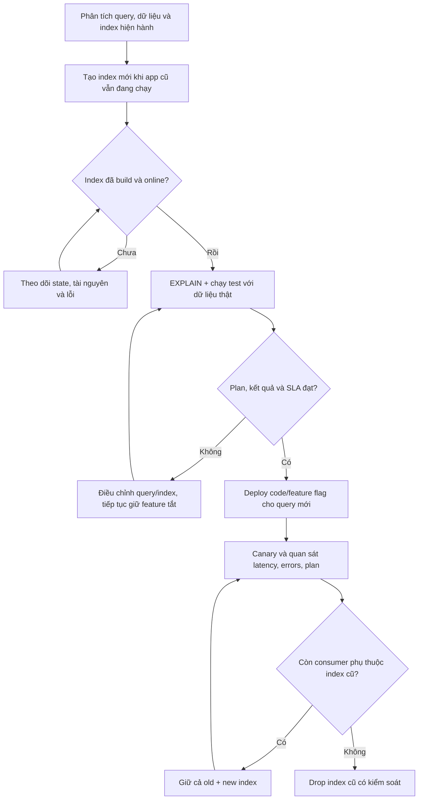
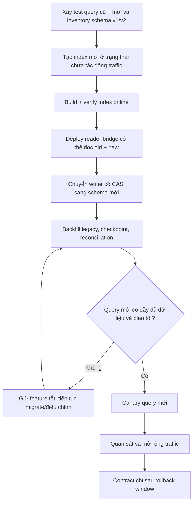
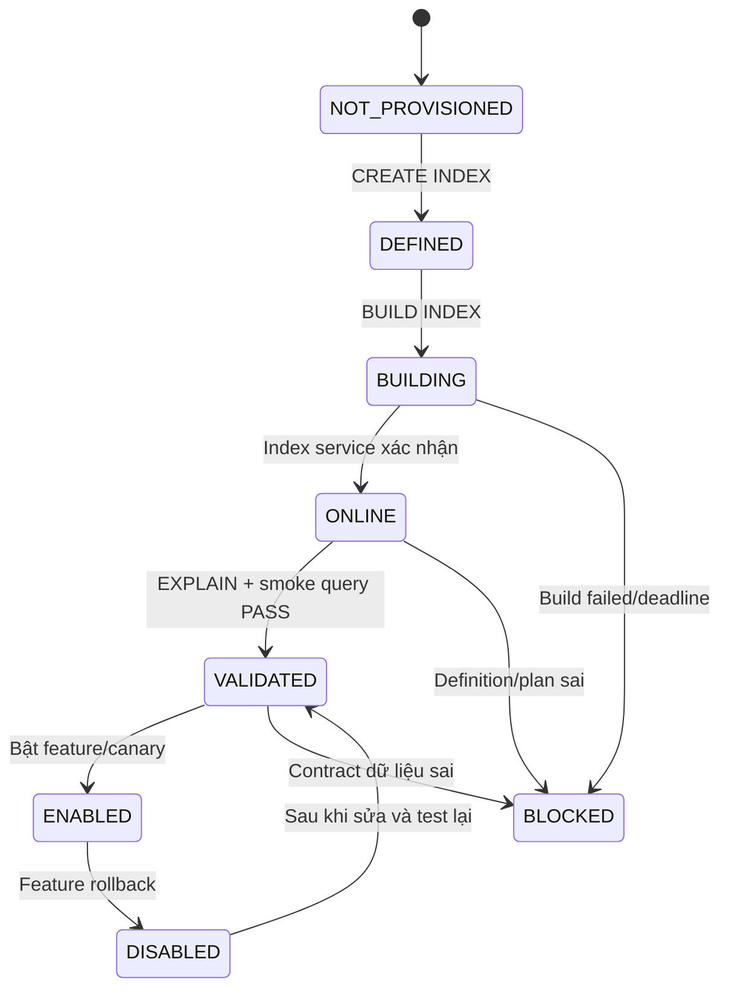

# Triển khai chỉ mục trước các truy vấn phụ thuộc trong Spring Data Couchbase

## 1. Vấn đề: code mới đã chạy nhưng chỉ mục chưa sẵn sàng

Giả sử một hệ thống đào tạo lưu enrollment trong Couchbase. Nhóm phát triển thêm màn hình **“Các đăng ký chờ duyệt gần đây”** và triển khai một Repository query mới:

```sql
SELECT META(e).id AS documentId,
       e.learnerId,
       e.courseCode,
       e.status,
       e.submittedAt
FROM `learning`.`training`.`enrollments` AS e
WHERE e.documentType = "enrollment"
  AND e.tenantId = $tenantId
  AND e.status = "PENDING"
ORDER BY e.submittedAt DESC
LIMIT 50;
```

Ở môi trường phát triển, câu query chạy tốt vì đã có một primary index phục vụ thử nghiệm. Nhưng production không có index phù hợp. Khi ứng dụng mới bắt đầu nhận traffic:

- Query có thể thất bại vì không có đường truy cập/index phù hợp.
- Hoặc planner chọn một index kém chọn lọc, thực hiện scan/fetch/sort tốn tài nguyên.
- Nếu index vừa được tạo nhưng còn đang build, query có thể chưa sử dụng được.
- Một batch migration đã thêm field mới nhưng index/query chưa được triển khai cùng thứ tự.
- Nhiều bản ứng dụng chạy song song: bản cũ phụ thuộc index cũ, bản mới cần index mới.

Cách làm đúng không phải **“deploy code trước, rồi thấy lỗi mới CREATE INDEX”**. Thứ tự cần quản lý là:

> **Thiết kế query và chỉ mục → tạo chỉ mục trước → chờ index sẵn sàng → EXPLAIN/kiểm thử đúng dữ liệu → triển khai hoặc bật query phụ thuộc → quan sát → chỉ dọn index cũ sau khi hết dependency.**

Đây là kỹ thuật **index-first rollout** trong tiến hóa và di trú hệ thống.

Bài thuộc chương **Tiến hóa và di trú** của module `SPRING_DATA_COUCHBASE`. Module tập trung xây dựng tầng truy cập Couchbase với Spring Data document mapping, `CouchbaseRepository`, `CouchbaseTemplate`, SQL++, bucket/scope/collection, chỉ mục, TTL, CAS, transaction và Reactive API.

### 1.1. Mục tiêu học tập

Sau bài, bạn có thể:

1. Phân biệt KV lookup với SQL++ query về nhu cầu index.
2. Thiết kế secondary index từ predicate, ordering, projection và kiểu document.
3. Giải thích primary/composite/partial/covering index, index key order và rủi ro index dư thừa.
4. Triển khai `CREATE INDEX`, deferred build và `BUILD INDEX` theo thứ tự an toàn.
5. Kiểm tra metadata index, `EXPLAIN` và dữ liệu thật trước khi bật ứng dụng.
6. Tạo deployment gate trong CI/CD thay vì dựa vào thời gian chờ cố định.
7. Phối hợp thay schema, backfill, mixed-version queries và index.
8. Thiết kế rollout, rollback, dọn index cũ, kiểm thử và observability cho production.

## 2. Couchbase có nhiều đường truy cập: chỉ một số cần query index

Một nhầm lẫn phổ biến là mọi thao tác Spring Data Couchbase đều phải có secondary index.

Ví dụ:

```java
CourseEnrollmentDocument found =
    repository.findById(documentId).orElseThrow();
```

Với document ID đã biết, đường Repository/KV có thể dùng **key-value lookup** trên bucket/scope/collection; không cần tạo Global Secondary Index (GSI) chỉ để GET key đó.

Nhưng truy vấn tìm nhiều enrollment theo tenant, status và thời gian cần **SQL++** với đường truy cập phù hợp.

| Đường truy cập | Ví dụ | Nhu cầu index |
| --- | --- | --- |
| KV GET theo key | `collection.get("enrollment::acme::reg-17")` | Không cần GSI cho việc tra key |
| Repository `findById(id)` theo mapping KV | Tải document biết ID | Không phụ thuộc GSI theo cùng cách SQL++ |
| SDK KV replace/mutateIn theo key | Ghi document đã biết ID | Không cần GSI để tìm key |
| Repository derived query | `findByTenantIdAndStatus(...)` | Thường được dịch sang SQL++ và cần index thích hợp |
| Custom Repository `@Query` | Lọc, sắp xếp, paging | Cần kế hoạch index/query phù hợp |
| `CouchbaseTemplate` query | Tìm theo field/tiêu chí | Cần kiểm tra query/index thực tế |
| SDK `cluster.query(...)` | SQL++ SELECT/JOIN/UPDATE | Cần kế hoạch truy cập; secondary index thường cần thiết |
| Transaction chỉ dùng KV theo key | Đọc/ghi các key đã biết | Khác với query scan và không tự cần GSI cho mọi KV call |

**Không lẫn “không có index” với “document không tồn tại”.** Khi SQL++ query không trả được dữ liệu, phải kiểm tra cả keyspace, predicate, index availability, consistency và type mapping trước khi kết luận document bị xóa.

### 2.1. Primary index không phải chiến lược production mặc định

Couchbase hỗ trợ primary index để tạo đường truy cập tổng quát tới document trong keyspace. Primary index có thể hữu ích ở local development hoặc các trường hợp vận hành đã cân nhắc.

Tuy nhiên, để phục vụ:

```sql
WHERE tenantId = $tenantId
  AND status = "PENDING"
ORDER BY submittedAt DESC
LIMIT 50
```

dựa vào primary index có thể gây scan nhiều document, fetch/filter/sort không cần thiết. Nó cũng có thể **che việc ứng dụng thiếu secondary index phù hợp** trong môi trường thử nghiệm.

Trong production, nên thiết kế index phục vụ access pattern thật, kiểm tra query plan và loại bỏ thói quen “tạo primary index cho chạy được” trên mọi collection.

### 2.2. Index thuộc keyspace, không thuộc Java entity đơn thuần

Document nằm ở:

```text
Bucket:     learning
Scope:      training
Collection: enrollments
```

Thì query index cũng phải áp dụng đúng keyspace đó. Chỉ mục cùng tên trên:

```text
learning._default._default
```

không giúp truy vấn:

```text
learning.training.enrollments
```

nếu hai keyspace khác nhau.

Các môi trường dev/staging/production có thể khác cluster, collection, quyền DDL và phiên bản Couchbase. Index trên staging ở trạng thái online **không chứng minh** production đã sẵn sàng.

## 3. Case study xuyên suốt: truy vấn enrollment chờ duyệt

Giả sử một document dạng:

```json
{
  "_class": "enrollment",
  "documentType": "enrollment",
  "schemaVersion": 2,
  "tenantId": "acme",
  "enrollmentId": "reg-17",
  "learnerId": "learner-17",
  "courseCode": "java-101",
  "status": "PENDING",
  "submittedAt": "2026-11-25T03:30:00Z",
  "createdAt": "2026-11-25T03:29:57Z"
}
```

Mỗi document có ID:

```text
enrollment::acme::reg-17
```

Yêu cầu màn hình:

- Caller chỉ được xem enrollment của tenant đã xác thực.
- Chỉ lấy bản ghi `status="PENDING"`.
- Sắp xếp mới nhất trước, tối đa 50 bản ghi.
- Có thể chuyển sang paging bằng cursor.
- Khi rollout schema mới, một phần legacy document còn dùng `createdAt` thay cho `submittedAt`.
- Có thể có các document khác loại trong collection nếu dữ liệu thực tế được tổ chức như vậy.

Một index ví dụ cho truy vấn v2:

```sql
CREATE INDEX ix_enroll_v2_tenant_status_submitted
ON `learning`.`training`.`enrollments`
    (tenantId, status, submittedAt DESC)
WHERE documentType = "enrollment"
  AND schemaVersion = 2;
```

Đây là một **secondary composite partial index**: nhiều index keys theo thứ tự, chỉ lấy những document đáp ứng predicate cố định.

**Điều kiện để index phục vụ đúng query:** query phải giới hạn tới tập v2 tương ứng hoặc có chiến lược riêng cho dữ liệu legacy, và planner phải chọn được index theo biểu thức/filter thực tế. Chỉ tạo index chưa đủ; phải kiểm tra `EXPLAIN`.

### 3.1. Query khớp phạm vi index

```sql
SELECT META(e).id AS documentId,
       e.learnerId,
       e.courseCode,
       e.status,
       e.submittedAt
FROM `learning`.`training`.`enrollments` AS e
WHERE e.documentType = "enrollment"
  AND e.schemaVersion = 2
  AND e.tenantId = $tenantId
  AND e.status = "PENDING"
ORDER BY e.submittedAt DESC
LIMIT 50;
```

Nếu ứng dụng còn cần trả cả v1, câu query này **chủ động không lấy v1**. Đừng gắn predicate `schemaVersion=2` vào API “tất cả enrollment” khi chưa backfill/cắt chuyển.

### 3.2. Tại sao query cần `documentType`?

Nếu index là partial:

```sql
WHERE documentType = "enrollment"
  AND schemaVersion = 2
```

nhưng query không có điều kiện tương đương để planner chứng minh các row trả về nằm trong tập index, nó có thể không sử dụng được index đó.

Trong Spring Data Couchbase, Repository query còn có thể mang **type filter** theo type mapper, ví dụ metadata kiểu `_class`. Filter do framework sinh ra **không tự đồng nghĩa** với business predicate `documentType`. Phải kiểm tra SQL++ thực tế và thiết kế index theo predicate thật.

## 4. Bắt đầu từ access pattern, không bắt đầu từ tên entity

Trước khi viết DDL, cần làm rõ:

- Predicate equality nào luôn có mặt? `tenantId`, `status`?
- Query lọc range nào? `submittedAt >= $from`?
- Query sort theo field nào, chiều ASC/DESC?
- Có LIMIT/pagination/cursor không?
- Có cần DISTINCT, JOIN, UNNEST, GROUP BY hoặc aggregate không?
- Projection cần trường nào? Index có thể cover hay phải fetch body?
- Có filter cố định theo `documentType`, `schemaVersion`, `_class`?
- Phân bố dữ liệu có skew/hot tenant không?
- Có nhiều phiên bản ứng dụng/dữ liệu cùng query collection không?
- Tải ghi và chi phí duy trì index có chấp nhận được không?

Một query chạy nhanh trên 30 sample documents không chứng minh cấu trúc index phù hợp với 30 triệu documents phân bố nhiều tenant.

### 4.1. Thứ tự index key quan trọng

Giả sử truy vấn:

```sql
WHERE tenantId = $tenantId
  AND status = "PENDING"
ORDER BY submittedAt DESC
```

Một index:

```sql
(tenantId, status, submittedAt DESC)
```

có thể hỗ trợ giới hạn theo hai điều kiện equality rồi duyệt theo thứ tự thời gian. Một index:

```sql
(submittedAt, tenantId, status)
```

có đặc tính truy cập khác; không mặc định tối ưu cho cùng truy vấn.

**Quy tắc thiết kế ban đầu:** thường xét các điều kiện equality lọc mạnh, rồi đến range/sort, nhưng thứ tự cuối cùng phải xác minh bằng `EXPLAIN` và đặc điểm dữ liệu. Không có công thức thứ tự key đúng cho mọi workload.

### 4.2. Composite index không thay thế mọi index khác

Index `(tenantId, status, submittedAt)` có thể hợp với query luôn lọc tenant+status. Một query chỉ `WHERE status="PENDING"` trên mọi tenant có thể không được index này phục vụ hiệu quả vì thiếu leading key.

Tương tự, query `WHERE tenantId=$tenantId ORDER BY courseCode` không chắc hưởng lợi về ORDER BY từ index có thứ tự `submittedAt`.

Nên lập **query-to-index matrix**, tránh tạo một index quá lớn rồi tuyên bố mọi query đều được hỗ trợ.

## 5. Các loại index liên quan đến triển khai an toàn

| Loại/tính chất | Mục đích | Lưu ý khi rollout |
| --- | --- | --- |
| Primary index | Đường truy cập tổng quát | Không nên dựa vào như fallback production tùy tiện |
| Secondary index | Tìm theo field/bộ field | Phải khớp query predicate |
| Composite index | Nhiều field có thứ tự | Leading key, equality/range/sort |
| Partial index | Chỉ index subset đủ WHERE cố định | Query phải phù hợp predicate của index |
| Covering index | Có đủ dữ liệu cho query theo plan | Không phải mọi index đều covering; kiểm tra `EXPLAIN` |
| Array index | Phục vụ tìm phần tử trong array theo cú pháp hỗ trợ | Cần đúng index expression và query semantics |
| Expression index | Index trên biểu thức chuẩn hóa/derived | Query expression phải tương thích, test parser/plan |
| Replica/partitioned index | Availability, phân phối tải khi bản Couchbase hỗ trợ | Cần chi phí tài nguyên và config thực tế |

Index là cấu trúc vật lý phục vụ query và cần được duy trì khi document thay đổi. Mỗi index mới có chi phí build, lưu trữ, tài nguyên Index service và write amplification nhất định. **Không tạo index chỉ vì một method Repository tồn tại**.

### 5.1. Partial index và type metadata

Nếu document được Spring Data lưu:

```json
{"_class":"enrollment","documentType":"enrollment"}
```

có thể cân nhắc index partial theo type mapper:

```sql
CREATE INDEX ix_enroll_by_mapped_type
ON `learning`.`training`.`enrollments`
    (tenantId, status, submittedAt DESC)
WHERE _class = "enrollment";
```

Nhưng đây là lựa chọn có điều kiện:

1. Cấu hình thật sự dùng field `_class`.
2. `@TypeAlias` thật sự lưu `"enrollment"`.
3. Không còn document legacy dùng FQCN cũ nếu API cần đọc chúng.
4. Repository query thực tế có type filter phù hợp.
5. Mapping context/index coverage đã được kiểm thử.

Một partial index chỉ chứa alias mới **không thể tự tìm document FQCN legacy**. Khi đổi `@TypeAlias`, phải giữ index/query tương thích tới khi migration hoàn tất.

### 5.2. Covering không phải mục tiêu bằng mọi giá

Nếu query SELECT chỉ vài field, index chứa đủ biểu thức có thể giảm fetch document. Nhưng thêm tất cả các trường vào index để cố covering có thể làm index phình to và tăng chi phí ghi.

Ưu tiên correctness và access pattern, sau đó đo bằng `EXPLAIN`/latency/Index service metrics. Tránh tạo index rộng chỉ dựa trên cảm giác “cover nhiều field là tốt”.

## 6. Trình tự chuẩn: expand index → verify → deploy query → contract index

Đây là phiên bản index-first của chiến lược **expand–migrate–contract**.



Đây là **quy trình triển khai**, không phải transaction database. Tạo index, build index và deploy ứng dụng là các bước độc lập; cần orchestration/verification bên ngoài.

### 6.1. Vì sao index phải có trước code?

Nếu code mới chạy trước khi index online, lỗi có thể xảy ra đúng vào lúc rollout:

- Không có secondary index khả dụng.
- Index đang deferred/building.
- Index đã online nhưng query predicate khác thiết kế.
- Index trên sai collection hoặc alias/keyspace.
- Index state online ở cluster A nhưng app mới đang kết nối cluster B.
- Query chọn index khác, vẫn có P99 latency cao.

Tạo index trước cho phép xử lý các lỗi này **mà chưa tác động tới luồng request mới**.

### 6.2. Index có thể online mà feature vẫn chưa an toàn

Điều kiện `state = "online"` là **điều kiện cần về readiness**, không phải bằng chứng query tốt:

- Planner có thể không chọn index vì predicate không tương thích.
- Query có thể trả thiếu dữ liệu v1 do partial index/query v2-only.
- Index expression/type không đúng field đã migrate.
- ORDER BY có thể cần Sort tốn kém.
- Query có thể leak tenant nếu WHERE bị thiếu.
- Dữ liệu có thể không được quan sát theo consistency mong muốn ngay sau mutation.

Vì vậy deployment gate cần cả **readiness** và **query correctness/performance verification**.

## 7. DDL: tạo secondary index trên collection đích

Ví dụ index composite cho enrollment v2:

```sql
CREATE INDEX ix_enroll_v2_tenant_status_submitted
ON `learning`.`training`.`enrollments`
    (tenantId, status, submittedAt DESC)
WHERE documentType = "enrollment"
  AND schemaVersion = 2;
```

SQL++ này được thực thi bởi tài khoản có quyền quản lý index trên đúng keyspace. Tài khoản ứng dụng chỉ phục vụ read/write không cần được cấp quyền DDL rộng.

Không tự động chạy `CREATE INDEX` cho mọi request hoặc mỗi instance ứng dụng khởi động. DDL phải thuộc **quy trình schema/index migration có phiên bản**, được duyệt và vận hành có kiểm soát.

### 7.1. Chọn tên index có ý nghĩa và version

Ví dụ:

```text
ix_enroll_v2_tenant_status_submitted
```

Tên giúp ghi lại:

- Domain/keyspace: enrollment.
- Phạm vi schema/access pattern: v2.
- Leading predicates: tenant, status.
- Sort/range key: submitted.

Index version trong **tên** không phải schemaVersion lưu trong document; chỉ để vận hành dễ phân biệt index cũ/mới. Không cần đổi tên index theo mọi lần phát hành nếu plan/index chưa thay đổi.

### 7.2. Idempotency khi chạy migration DDL

Một pipeline có thể retry hoặc chạy trên nhiều môi trường. Không nên giả định CREATE cùng tên lần hai luôn thành công, hoặc chỉ cần thấy tên tồn tại là DDL đã đúng.

Các bước an toàn:

1. Kiểm tra index theo **tên và keyspace**.
2. Nếu đã có, đối chiếu index keys, WHERE predicate, state và cấu hình quan trọng.
3. Nếu chưa có, tạo với DDL đã duyệt.
4. Nếu cùng tên nhưng definition khác, **fail và yêu cầu reconciliation**, không tự DROP rồi CREATE phá production.
5. Nếu đang deferred/building, chờ/build theo policy.
6. Ghi migration ID và kết quả để việc chạy lại có thể kiểm soát.

Các tùy chọn cú pháp như `IF NOT EXISTS` chỉ nên dùng khi được hỗ trợ theo phiên bản và **không thay bước xác minh definition**.

## 8. Deferred build: tạo definition trước rồi BUILD INDEX có kiểm soát

Với nhiều index hoặc collection lớn, có thể dùng chế độ hoãn build khi Couchbase version hỗ trợ:

```sql
CREATE INDEX ix_enroll_v2_tenant_status_submitted
ON `learning`.`training`.`enrollments`
    (tenantId, status, submittedAt DESC)
WHERE documentType = "enrollment"
  AND schemaVersion = 2
WITH {"defer_build": true};
```

Sau khi tạo các definition cần thiết và chọn thời điểm tài nguyên phù hợp, yêu cầu build:

```sql
BUILD INDEX ON `learning`.`training`.`enrollments`
    (ix_enroll_v2_tenant_status_submitted);
```

Tùy phiên bản/cấu hình, `BUILD INDEX` cho phép build nhiều index trong cùng keyspace. Cần đối chiếu cú pháp và giới hạn thật của cluster.

**Hoãn build không làm index sẵn sàng cho query.** Chỉ có definition ở trạng thái deferred chưa đáp ứng deployment gate.

### 8.1. Vì sao nên tách definition và build?

- Điều phối build nhiều index thay vì mỗi CREATE tự khởi build ngay.
- Tránh spike tài nguyên trong thời điểm traffic cao.
- Có thể chuẩn bị DDL trước, build trong maintenance/change window.
- Quan sát tiến độ và tài nguyên Index service.

Nhưng không nên gom quá nhiều index nặng cùng build nếu cluster không đủ CPU/RAM/disk/network. Hãy kiểm tra khả năng của Index nodes và SLA trước.

## 9. Kiểm tra index readiness qua metadata

Couchbase cung cấp system keyspace để xem metadata index, thường là `system:indexes`.

Ví dụ:

```sql
SELECT i.name,
       i.state,
       i.keyspace_id,
       i.bucket_id,
       i.scope_id,
       i.index_key,
       i.condition
FROM system:indexes AS i
WHERE i.bucket_id = "learning"
  AND i.scope_id = "training"
  AND i.keyspace_id = "enrollments"
  AND i.name = "ix_enroll_v2_tenant_status_submitted";
```

Tên/khả dụng của một số metadata fields có thể thay theo phiên bản và quyền; cần xác minh với cluster mục tiêu. Điều quan trọng là **đối chiếu đúng index definition và state**, không chỉ tìm tên.

Khi state là **online** theo metadata mà hệ thống cung cấp, index thường đã sẵn sàng để planner xem xét. Trước đó có thể là deferred/building hoặc trạng thái khác theo phiên bản.

### 9.1. Readiness gate không nên là `sleep 60 seconds`

Anti-pattern:

```text
CREATE INDEX
sleep 60
deploy application
```

Index lớn có thể mất lâu hơn 60 giây, hoặc build gặp resource issue. Một sleep cố định cũng lãng phí thời gian khi index đã online nhanh hơn.

Thay vào đó:

```text
CREATE/BUILD INDEX
    ↓
Poll trạng thái index theo policy, có deadline
    ↓
Nếu online + definition khớp → EXPLAIN + test query
    ↓
Nếu timeout/error → fail deployment gate, không bật query mới
```

Không đặt vòng poll vô hạn. Cần giới hạn tổng deadline, log state và điều kiện thất bại; nếu query service/metadata không truy cập được, đó là trạng thái **chưa xác minh**, không phải thành công.

### 9.2. Readiness là theo từng môi trường/cluster

Index online ở staging không đồng nghĩa production online. Nếu production có nhiều cluster hoặc môi trường được rollout riêng, gate phải chạy tại từng cluster được app mới kết nối.

Nếu dùng địa chỉ DNS/load balancing giữa cluster khác nhau, cần bảo đảm gate và app đang nói tới đúng cluster/keyspace; không dựa vào tên index giống nhau.

## 10. EXPLAIN: kiểm chứng planner có dùng index hay không

Sau khi index online, chạy:

```sql
EXPLAIN
SELECT META(e).id AS documentId,
       e.learnerId,
       e.courseCode,
       e.status,
       e.submittedAt
FROM `learning`.`training`.`enrollments` AS e
WHERE e.documentType = "enrollment"
  AND e.schemaVersion = 2
  AND e.tenantId = $tenantId
  AND e.status = "PENDING"
ORDER BY e.submittedAt DESC
LIMIT 50;
```

Kết quả `EXPLAIN` cung cấp query plan; format và tên operators có thể thay theo Couchbase version. Cần quan sát:

- Index được chọn có đúng tên/keyspace mong đợi không?
- Đường truy cập có sử dụng index scan thay vì full primary scan?
- Query có fetch nhiều document trước khi filter/sort không?
- Predicate tenant/status/type/schema có được áp dụng đúng?
- Có operator sort lớn trong khi query cần trang đầu không?
- Có index covers phù hợp hoặc KV fetch cần thiết không?
- LIMIT có được đẩy xuống plan như kỳ vọng không?
- Cost/cardinality estimates có lệch rõ so với dữ liệu thật không?

**Đừng assert một JSON plan shape cố định cho mọi release.** Dùng bộ kiểm tra linh hoạt và manual review khi thay đổi optimizer/version, kết hợp latency/row-count thực tế.

### 10.1. Index hint chỉ dành cho trường hợp có lý do

SQL++ hỗ trợ các cơ chế hint chọn index trong những phiên bản và cú pháp nhất định, nhưng không nên mặc định thêm `USE INDEX` vào mọi query để “buộc” hệ thống chạy nhanh. Hints có thể ràng buộc query với tên index mà rollout sau sẽ drop.

Ưu tiên thiết kế đúng predicate/index, thống kê và kiểm chứng plan. Nếu cần hint vì planner chọn kém, phải đưa **hint dependency** vào danh sách các consumer trước khi drop index.

### 10.2. Run query thực trên dataset đại diện

`EXPLAIN` tốt vẫn chưa đủ để chứng minh P99 latency:

- Test tenant nhỏ và tenant lớn.
- Test nhiều enrollment PENDING và rất ít PENDING.
- Test schemaVersion v1/v2 xen kẽ.
- Test document thiếu `submittedAt` hoặc field sai kiểu theo policy.
- Test truy vấn có `LIMIT`, pagination và sort.
- Test concurrency thật và thay đổi dữ liệu trong lúc query.
- Test với query parameters, RBAC, scopes và mapping như production.

Một query chỉ trả đúng dữ liệu trên 10 fixtures không bảo đảm tương đương business query khi có 10 triệu document.

## 11. Spring Data Couchbase: kiểm tra query thật sự được phát ra

Một Repository:

```java
import java.util.List;
import org.springframework.data.couchbase.repository.CouchbaseRepository;

public interface EnrollmentRepository
        extends CouchbaseRepository<EnrollmentDocument, String> {

    List<EnrollmentDocument> findByTenantIdAndStatus(
        String tenantId, String status);
}
```

có thể dẫn tới SQL++ query với predicate/sắp xếp và điều kiện type metadata do framework tạo ra. Chỉ biết **tên method** không đủ để tạo index tối ưu.

Cần kiểm tra:

1. Mapping của `EnrollmentDocument`, đặc biệt `@TypeAlias`/type key.
2. Tên JSON field thực tế (camelCase, custom field mapping).
3. Predicate/type filter được framework thêm.
4. Derived query có sort/paging không.
5. Tenant predicate có luôn tồn tại không.
6. Query SQL++ thực tế và plan trên cluster mục tiêu.

### 11.1. Entity ví dụ và type metadata

```java
import java.time.Instant;

import org.springframework.data.annotation.Id;
import org.springframework.data.annotation.TypeAlias;
import org.springframework.data.annotation.Version;
import org.springframework.data.couchbase.core.mapping.Document;

@Document
@TypeAlias("enrollment")
public class EnrollmentDocument {

    @Id
    private String id;

    @Version
    private Long casVersion;

    private Integer schemaVersion;
    private String documentType;
    private String tenantId;
    private String enrollmentId;
    private String learnerId;
    private String courseCode;
    private String status;
    private Instant submittedAt;
    private Instant createdAt;

    protected EnrollmentDocument() {}

    public EnrollmentDocument(
            String id, String tenantId, String enrollmentId,
            String learnerId, String courseCode,
            Instant submittedAt) {
        this.id = id;
        this.tenantId = tenantId;
        this.enrollmentId = enrollmentId;
        this.learnerId = learnerId;
        this.courseCode = courseCode;
        this.schemaVersion = 2;
        this.documentType = "enrollment";
        this.status = "PENDING";
        this.submittedAt = submittedAt;
        this.createdAt = submittedAt;
    }

    public String getId() { return id; }
    public Long getCasVersion() { return casVersion; }
    public String getTenantId() { return tenantId; }
    public String getStatus() { return status; }
    public Instant getSubmittedAt() { return submittedAt; }
}
```

Ở đây:

- `@TypeAlias("enrollment")` cho type mapping khi được hỗ trợ.
- `_class="enrollment"` có thể tồn tại trong stored JSON tùy converter.
- `schemaVersion=2` là hợp đồng dữ liệu nghiệp vụ, **khác CAS**.
- `@Version` ánh xạ CAS để bảo vệ stale write, **không phải index version**.
- Index được tạo riêng trên collection bằng SQL++, không hình thành tự động chỉ vì class có `@Document`.

### 11.2. Mô tả query bằng custom `@Query`

Một custom query có thể dùng Spring Data Couchbase expressions để chọn entity và type filter:

```java
import java.util.List;
import org.springframework.data.couchbase.repository.CouchbaseRepository;
import org.springframework.data.couchbase.repository.Query;

public interface EnrollmentRepository
        extends CouchbaseRepository<EnrollmentDocument, String> {

    @Query(
        "#{#n1ql.selectEntity} " +
        "WHERE #{#n1ql.filter} " +
        "AND documentType = 'enrollment' " +
        "AND schemaVersion = 2 " +
        "AND tenantId = $1 " +
        "AND status = 'PENDING' " +
        "ORDER BY submittedAt DESC LIMIT 50")
    List<EnrollmentDocument> findRecentPendingV2(
        String tenantId);
}
```

Đây là **ví dụ định hướng**: cú pháp SpEL, SQL++ projection, cách bind tham số, alias của keyspace/type filter và ánh xạ field phải được kiểm tra trên bản Spring Data Couchbase thực tế. Không dùng snippet này như lời đảm bảo query sinh ra có một shape cố định.

Nếu query kèm `#{#n1ql.filter}` yêu cầu `_class` nhưng index partial chỉ có `documentType="enrollment"` và `schemaVersion=2`, planner vẫn cần chọn cách đánh giá điều kiện type. Có thể cần chỉnh index để phù hợp query thật, nhưng không được bỏ type/tenant filter chỉ để index được dùng.

### 11.3. Khi nào dùng DTO projection?

Với màn hình danh sách, có thể chọn DTO chứa:

```text
enrollmentId, learnerId, courseCode, status, submittedAt
```

thay vì tải toàn entity. Điều này có thể giảm payload và mở ra khả năng covering index, nhưng:

- DTO projection **không được** xem như snapshot persistence đầy đủ.
- Không `repository.save` một entity dựng lại từ projection thiếu CAS/unknown fields.
- Muốn update hãy dùng KV GET theo ID và CAS hoặc API mutation phù hợp.
- Nếu query trả entity, phải đảm bảo ID/CAS metadata được mapping đúng.

### 11.4. Repository pagination không miễn trừ index

Một API:

```java
Page<EnrollmentDocument> findByTenantIdAndStatus(
    String tenantId, String status, Pageable pageable);
```

có thể phát sinh query lấy dữ liệu và query đếm, tùy cấu hình và kiểu trả về. **Cần kiểm tra cả query data lẫn count**, không chỉ `EXPLAIN` cho một câu SELECT thủ công.

Nếu UI không cần total count, cân nhắc dạng paging/cursor phù hợp để tránh count toàn tập tốn kém. Index và kế hoạch scan cho count cũng phải được đo.

## 12. `CouchbaseTemplate` và SDK SQL++: không tự kế thừa index từ Repository

Một job dùng `CouchbaseTemplate` hoặc SDK:

```java
import com.couchbase.client.java.Cluster;
import com.couchbase.client.java.json.JsonObject;

import static com.couchbase.client.java.query.QueryOptions.queryOptions;

public final class EnrollmentSearch {
    private final Cluster cluster;

    public EnrollmentSearch(Cluster cluster) {
        this.cluster = cluster;
    }

    public java.util.List<JsonObject> findRecentPending(
            String trustedTenantId) {
        String statement = """
            SELECT META(e).id AS documentId,
                   e.learnerId,
                   e.courseCode,
                   e.status,
                   e.submittedAt
            FROM `learning`.`training`.`enrollments` AS e
            WHERE e.documentType = "enrollment"
              AND e.schemaVersion = 2
              AND e.tenantId = $tenantId
              AND e.status = "PENDING"
            ORDER BY e.submittedAt DESC
            LIMIT 50
            """;

        return cluster.query(
            statement,
            queryOptions()
                .parameters(JsonObject.create()
                    .put("tenantId", trustedTenantId)))
            .rowsAsObject();
    }
}
```

Snippet trên giả định Java 17+ để sử dụng text block, Couchbase Java SDK phù hợp và `Cluster` đã được inject; phần quyền tenant phải được kiểm tra trước khi gọi service.

Index phải được thiết kế từ **SQL++ thực tế của từng đường gọi**, không giả định một index phục vụ Repository thì tự động phục vụ mọi custom query, Template fluent operation hoặc job SQL++ khác.

### 12.1. Tham số và tên keyspace

Đối với query:

```sql
WHERE e.tenantId = $tenantId
```

giá trị `$tenantId` nên là parameter lấy từ identity/tenant được ủy quyền, không nối chuỗi input vào SQL++.

Tên bucket/scope/collection là identifier, không giống scalar parameter. Nếu có multi-tenant routing theo keyspace, chỉ sử dụng cấu hình/allowlist được kiểm soát; không cho input người dùng tự quyết định tên collection/index.

### 12.2. Spring Data không nên tự tạo index mỗi lần khởi động production

Một ứng dụng chạy 20 replicas không nên đồng thời cố tạo index trong `@PostConstruct` hoặc startup hook chung:

- Race DDL giữa replicas.
- Mở rộng quyền Query Manage Index cho account ứng dụng.
- Startup readiness bị chặn bởi build lớn.
- Tạo/đổi index không theo quy trình phê duyệt.
- Khó xác định instance nào đã thay schema/index của cluster.

Nên quản lý DDL bằng một **database migration/deployment pipeline** độc lập, dùng danh tính có quyền đúng phạm vi, logging/audit và gate trước rollout ứng dụng.

## 13. Tiến hóa dữ liệu v1/v2: index mới không thay đổi field cũ

Giả sử v1 có:

```json
{
  "schemaVersion": 1,
  "documentType": "enrollment",
  "tenantId": "acme",
  "status": "PENDING",
  "createdAt": "2026-11-24T08:00:00Z"
}
```

v2 chuyển sang:

```json
{
  "schemaVersion": 2,
  "documentType": "enrollment",
  "tenantId": "acme",
  "status": "PENDING",
  "submittedAt": "2026-11-24T08:00:00Z"
}
```

Nếu tạo index:

```sql
CREATE INDEX ix_enroll_v2_tenant_status_submitted
ON `learning`.`training`.`enrollments`
    (tenantId, status, submittedAt DESC)
WHERE documentType = "enrollment"
  AND schemaVersion = 2;
```

thì index **không tự thêm `submittedAt` vào v1**. Một query v2-only cũng không tự đọc v1.

### 13.1. Thứ tự phù hợp khi đổi tên field

Một lộ trình an toàn:

1. Xác định app v1 đang query `createdAt` bằng index cũ nào.
2. **Giữ index cũ** để app v1 còn hoạt động.
3. Tạo index mới phục vụ query v2; build và xác minh online.
4. Deploy compatible reader/query có khả năng phục vụ v1/v2 theo contract.
5. Chuyển writer sang v2 theo feature flag khi consumers đã tương thích.
6. Backfill v1 → v2 có CAS và TTL policy nếu business yêu cầu.
7. Khi v2 coverage đủ và query mới có index readiness, bật query v2-only.
8. Duy trì cả old/new index trong rollback window.
9. Chỉ drop index cũ sau khi không còn query/reader cần field cũ.

Đây là **hai chiều tiến hóa** phải điều phối: dữ liệu và index. Thứ tự tạo index mới trước query mới vẫn đúng, nhưng chưa đủ để đảm bảo reader v2-only hoạt động với body v1.

### 13.2. Khi reader còn cần cả v1 và v2

Có thể thiết kế hai nhánh query có index riêng hoặc một expression index được kiểm chứng:

- Nhánh v1 lọc `schemaVersion=1` và sort theo `createdAt`.
- Nhánh v2 lọc `schemaVersion=2` và sort theo `submittedAt`.
- Tầng application merge theo định nghĩa chung về thời gian/pagination khi cần hiển thị cả hai.
- Hoặc dùng một SQL++ compatibility expression và index expression tương ứng sau khi kiểm thử plan.

Tránh giả định một index chỉ trên `submittedAt` luôn trả đầy đủ document v1 còn dùng `createdAt`.

### 13.3. Expression index không phải phép migration

Ví dụ ý tưởng chuẩn hóa thời gian khi đọc:

```sql
SELECT META(e).id AS documentId,
       IFMISSINGORNULL(e.submittedAt, e.createdAt)
           AS effectiveSubmittedAt
FROM `learning`.`training`.`enrollments` AS e
WHERE e.documentType = "enrollment"
  AND e.tenantId = $tenantId;
```

Biểu thức cho view đọc; nó **không đổi JSON** và không chứng minh mọi legacy document có `createdAt` hợp lệ.

Nếu muốn index trên expression, query/index phải sử dụng biểu thức tương thích và planner thực sự chọn index. Không tự tạo expression index chỉ vì có `IFMISSINGORNULL` trong SELECT; đo performance và correctness trước.

### 13.4. SchemaVersion và type alias cùng ảnh hưởng partial index

Một index WHERE:

```sql
WHERE _class = "enrollment" AND schemaVersion = 2
```

có thể bỏ qua:

- Document schemaVersion=1.
- Document chưa có schemaVersion.
- Document giữ FQCN legacy ở `_class`.
- Document đang dùng business type khác.

Đây có thể là **đúng chủ đích** cho endpoint v2-only. Nhưng sẽ là **lỗi dữ liệu bị bỏ sót** nếu endpoint cam kết trả mọi enrollment.

Trước khi lập partial index, ghi rõ tập document được index và tập mà API phải trả.

## 14. Data migration và index build: nên đặt bước nào trước?

Phụ thuộc loại migration:

**Trường hợp A — thêm query v2 mà chưa chuyển field dữ liệu:** tạo/build index v2 trước khi bật query mới. Nếu writer v2 chưa hoạt động, index có thể rỗng lúc đầu; vẫn phải kiểm tra cấu trúc và chạy fixtures/test trong staging.

**Trường hợp B — backfill nhiều triệu document v1 → v2:** index mới có thể được build trước hoặc sau một phần data backfill tùy chi phí duy trì index và yêu cầu query online. Nhưng **không bật query phụ thuộc trước khi index online và dữ liệu đáp ứng contract**.

**Trường hợp C — thay đổi một field đang được query nóng:** cần duy trì index cũ trong khi writer/reader cũ còn hoạt động. Có thể chọn dual-index trong một khoảng thời gian để bảo đảm availability.

Các quyết định phải cân bằng resource cost của việc build index trên dữ liệu lớn, write amplification của backfill và thời gian cutover.

### 14.1. Trình tự nhiều tầng để tránh mất dữ liệu



## 15. Index online khác consistency của query

Sau khi index đã online, có thể vẫn cần quyết định **scan consistency** cho SQL++ query khi đọc ngay sau mutation.

Ví dụ:

```text
T0 SDK KV INSERT enrollment K
T1 Client ngay lập tức gọi SQL++ findByTenantAndStatus
T2 Secondary index có thể chưa phản ánh mutation đó theo consistency mặc định
```

Index online nghĩa là index đủ khả năng phục vụ scan; nó **không tự bảo đảm mọi read-after-write nhìn thấy ngay mutation mới** theo mọi query option.

### 15.1. Các trục khác nhau

| Trục | Câu hỏi | Công cụ/quyết định |
| --- | --- | --- |
| Index existence | Có index phù hợp chưa? | DDL/catalog |
| Build readiness | Index đã online chưa? | `system:indexes`/state |
| Query plan | Planner có chọn index tốt không? | `EXPLAIN` và profiling |
| Mutation visibility | Query có nhìn thấy write gần nhất không? | Scan consistency/MutationState khi hỗ trợ |
| Document concurrency | Write có bị stale overwrite không? | CAS/`@Version` |
| Multi-document atomicity | Nhiều documents có commit cùng nhau? | Transaction/workflow |
| Availability | Index node/cluster có đáp ứng SLA? | Replication/monitoring/capacity |

Không nhầm `REQUEST_PLUS` với “tạo index nếu chưa có” hay “khóa document”. Query consistency không thay CAS/transaction.

### 15.2. Ví dụ QueryScanConsistency trên Java SDK

```java
import com.couchbase.client.java.Cluster;
import com.couchbase.client.java.json.JsonObject;
import com.couchbase.client.java.query.QueryScanConsistency;

import static com.couchbase.client.java.query.QueryOptions.queryOptions;

var result = cluster.query(
    sql,
    queryOptions()
        .parameters(JsonObject.create()
            .put("tenantId", authorizedTenantId))
        .scanConsistency(QueryScanConsistency.REQUEST_PLUS));
```

Snippet giả định `cluster`, `sql` và `authorizedTenantId` đã có trong service. Chế độ `REQUEST_PLUS` có thể làm query chờ index cập nhật và **tăng latency**; không phải default tối ưu cho tất cả read-heavy endpoints. Khi cần read-your-own-write với mutation state, xem API consistency theo phiên bản SDK thực tế.

Việc chọn consistency phải dựa trên hợp đồng API: dashboard có thể chấp nhận eventual visibility, nhưng một workflow kiểm tra ngay sau đăng ký có thể cần KV read theo key hoặc consistency mạnh hơn.

## 16. CI/CD: thiết kế “index readiness gate” kiểm chứng được

Để không phụ thuộc hành động thủ công, quy trình deployment nên có các pha rõ ràng:

```text
[1] Validate migration definition
          ↓
[2] Apply index DDL on target cluster
          ↓
[3] Wait for target index online, verify definition
          ↓
[4] EXPLAIN query mới với parameters đại diện
          ↓
[5] Run correctness/smoke tests
          ↓
[6] Deploy application binaries (feature còn tắt)
          ↓
[7] Canary bật query mới trên traffic nhỏ
          ↓
[8] Monitor + promote or rollback feature
          ↓
[9] Later: drop old index after dependency audit
```

### 16.1. Các tín hiệu gate cần đọc

Gate chỉ PASS khi:

- Đúng cluster/keyspace và credentials.
- Index tồn tại đúng tên **và definition mong đợi**.
- State online, không deferred/building.
- `EXPLAIN` trả plan dùng đường truy cập hợp lệ; không primary scan bất ngờ.
- Smoke query trả dữ liệu phù hợp, không lỗi quyền hay type mapping.
- Chỉ số latency trong ngân sách test phù hợp.
- Dữ liệu v1/v2 đã đáp ứng semantic của endpoint sẽ bật.
- Không có blocking error liên quan Index service/DDL.

Nếu một điều kiện chưa biết, **fail closed**: không tự coi readiness PASS.

### 16.2. Pseudocode deployment gate

```text
function indexReady(targetCluster, expectedDefinition, querySpec):
    requireAuthorizedConnection(targetCluster)
    catalog = readSystemIndexes(targetCluster)
    index = findByNameAndKeyspace(catalog, expectedDefinition)

    if index is absent:
        return NOT_READY("missing")

    if index.keys/predicate/options != expectedDefinition:
        return NOT_READY("definition mismatch")

    if index.state != "online":
        return NOT_READY("building/deferred/failed")

    plan = explain(querySpec.withRepresentativeParams)
    if plan has unexpected full scan or wrong keyspace:
        return NOT_READY("query plan mismatch")

    probe = executeSafeReadOnlySmokeQuery(querySpec)
    if probe has wrong count/tenant/data/latency:
        return NOT_READY("read correctness/performance")

    return READY
```

Đây là **pseudocode**, không phải script tự chạy. Bộ so sánh DDL cần chuẩn hóa biểu thức theo metadata engine, không so nguyên văn chuỗi SQL nếu chỉ khác khoảng trắng/thứ tự biểu thức tương đương.

### 16.3. Tránh hai pipeline đồng thời thay index

Hai release đồng thời có thể:

- Cùng CREATE một tên khác định nghĩa.
- Một pipeline DROP index mà pipeline kia đang cần.
- Một migration build deferred index chưa có đủ capacity.

Quản lý index như một artifact được version hóa theo environment, có serialization/locking ở **orchestrator** và review dependency; không đẩy DDL vào từng replica ứng dụng.

### 16.4. Gate là điều kiện cho việc bật tính năng

Có thể deploy binary mới nhưng **giữ feature flag tắt** cho endpoint phụ thuộc index. Chỉ khi gate và smoke tests PASS mới bật feature.

Nếu feature toggle không bao trùm mọi consumer (batch jobs, event-driven reads, scheduled tasks), phải kiểm kê và chặn activation của từng consumer, không chỉ nút UI.

## 17. Canary rollout và giám sát sau khi bật query

Một chỉ mục có thể hoạt động trong test nhưng chịu tải khác khi production tăng traffic.

Thứ tự:

1. Canary một tỷ lệ request/tenant nhỏ đã được chọn an toàn.
2. Kiểm tra error rate, P95/P99, CPU/Index node load và query timeout.
3. So sánh row count và domain invariants với đường cũ nếu có thể.
4. Mở dần traffic theo ngân sách.
5. Theo dõi index lag/scan throughput/memory và truy vấn chậm.
6. Nếu lỗi, tắt feature hoặc route về query cũ vẫn có index phù hợp.

### 17.1. Các metric quan trọng

- `query_duration_p50/p95/p99` theo query fingerprint.
- `query_error_rate` và số lỗi “no index available”.
- `index_state` và số lần index chuyển offline/building.
- `index_scan_rate`, số row scanned vs returned.
- `index_service_cpu/memory/disk`, backlog và latency.
- Index build duration/failed builds.
- Query plan changes sau deployment/upgrade/stats update.
- Repository/Template/SDK query timeout và retry.
- Số queries dùng primary scan ngoài ý muốn.
- Số record v1 không được new query phục vụ theo contract.
- Tỷ lệ tenant leakage checks/authorization failures.
- Throughput mutation và ảnh hưởng write latency khi thêm index mới.

Một index online trong phút đầu không có nghĩa hệ thống bền vững qua giờ cao điểm.

## 18. Rollback: tắt query trước, giữ index mới sau

Khi bật feature mới mà query gặp vấn đề:

**Rollback ứng dụng/feature:** chuyển traffic về đường query cũ; index cũ phải vẫn tồn tại.

**Rollback index:** thường **không cần DROP ngay** index mới chỉ vì rollback feature. Index mới có chi phí tài nguyên, nhưng việc xóa ngay khiến việc sửa/làm rollout lần nữa khó hơn và có thể phá consumer đã dùng nó.

Ưu tiên:

1. Tắt feature/route query mới.
2. Kiểm tra còn consumer nào dùng new index không.
3. Giữ index cũ để binary rollback còn hoạt động.
4. Sửa query/index definition trong migration version tiếp theo nếu cần.
5. Khi chắc không còn dependency và đã qua rollback window, drop index mới bị hỏng hoặc index cũ không dùng tới theo change process.

### 18.1. Không xóa index cũ ngay sau deploy mới

Trong rolling deployment, có thể có:

```text
Node A: app v1, query theo createdAt, cần idx_v1
Node B: app v2, query theo submittedAt, cần idx_v2
Batch worker: chạy query theo status, có thể dùng idx_v1
```

Nếu DROP `idx_v1` trong khi Node A hoặc batch worker còn hoạt động, chúng có thể mất đường truy cập tốt hoặc thất bại. **Contract index chỉ sau khi hết code/data dependency**, không theo thời điểm build mới PASS.

### 18.2. Index migration không luôn có “down” an toàn

Một index mới phục vụ nhiều consumer có thể cần được giữ qua các lần rollback ứng dụng. Trong database migrations, việc tự động chạy “down = DROP new index” khi code rollback có thể gây gián đoạn bất ngờ.

Quyết định drop cần dependency audit riêng; rollback app là một hành động khác rollback schema/index.

## 19. Chi phí tài nguyên khi build index trên dữ liệu lớn

Index build có thể tiêu tốn:

- CPU/RAM trên Index service.
- Disk/storage cho index entries.
- Network và đọc dữ liệu từ Data service.
- Tác động tới mutation throughput và Index service backlog.
- Thời gian để catch up các mutation phát sinh trong lúc build.
- Chi phí replica/partition nếu cấu hình redundancy.

Một rollout index-first không có nghĩa cứ tạo hàng chục index cùng lúc. Cần:

1. Capacity planning trước DDL.
2. Xác định maintenance/deployment window.
3. Giới hạn số index build đồng thời khi cần.
4. Chọn deferred build có kiểm soát.
5. Theo dõi availability và SLA của workload hiện tại.
6. Có phương án pause/điều phối khi build gây ảnh hưởng.
7. Quản lý storage/cost của cả old và new index trong rollback window.

### 19.1. Index thừa vẫn là nợ kỹ thuật

Một index không dùng tốn tài nguyên duy trì khi document được insert/update/delete. Sau khi contract:

- Audit danh sách query consumer.
- Đo index usage và query plans theo khoảng thời gian đủ đại diện.
- Xác minh có job định kỳ/tháng vẫn cần index.
- Chỉ khi không còn dependency mới drop có kiểm soát.
- Theo dõi query error sau drop và giữ đường khôi phục nếu cần.

Không xóa index chỉ vì dashboard usage một ngày bằng zero.

## 20. Quyền truy cập và an toàn khi quản lý index

Quy trình index-first có hai nhóm quyền khác nhau:

**Account ứng dụng:**

- Đọc/ghi document theo nghiệp vụ.
- Query SQL++ ở keyspace cho phép.
- Không cần DDL index rộng nếu không phụ trách migration.

**Account migration/DBA:**

- Có quyền quản lý index trên keyspace được phê duyệt.
- Được audit thao tác CREATE/BUILD/DROP.
- Có change control và giới hạn môi trường.
- Không được xem quyền DDL là lý do để thay dữ liệu ngoài phạm vi migration.

Không gắn quyền quản lý toàn cluster cho web service chỉ vì muốn tự tạo index khi start.

### 20.1. Tránh lỗi sai cluster/keyspace

Trước DDL, xác minh:

```text
target cluster + bucket + scope + collection + index name
```

Không chạy lệnh trên nhầm cluster vì URL dev/prod giống tên. Đảm bảo gate kiểm tra cùng môi trường mà binary mới sẽ truy cập.

### 20.2. Không log query parameters nhạy cảm

Query tenant có thể chứa tenant ID/PII trong parameters hoặc row. Log nên ghi query fingerprint, state/index name và correlation ID; tránh ghi raw result bodies hoặc token/credentials.

## 21. Integration test: index tồn tại và online trước khi query mới chạy

Unit test Repository mock không chứng minh Index service đã build xong. Một integration/smoke test trong CI/CD phải kết nối tới Couchbase test/staging có cấu hình gần production.

### 21.1. Xác minh state của index

Ví dụ khung JUnit 5 dùng Couchbase Java SDK:

```java
import static org.junit.jupiter.api.Assertions.*;

import java.util.List;

import com.couchbase.client.java.Cluster;
import com.couchbase.client.java.json.JsonObject;
import org.junit.jupiter.api.Test;

import static com.couchbase.client.java.query.QueryOptions.queryOptions;

class EnrollmentIndexReadinessIT {
    private Cluster cluster; // Inject từ fixture test.

    @Test
    void requiredIndexMustBeOnline() {
        String statement = """
            SELECT i.name, i.state
            FROM system:indexes AS i
            WHERE i.bucket_id = "learning"
              AND i.scope_id = "training"
              AND i.keyspace_id = "enrollments"
              AND i.name =
                "ix_enroll_v2_tenant_status_submitted"
            """;

        List<JsonObject> rows = cluster.query(statement)
            .rowsAsObject();

        assertEquals(1, rows.size(),
            "Missing or duplicate index catalog entry");
        assertEquals("online", rows.get(0).getString("state"));
    }
}
```

**Giới hạn của fixture:** cần quyền đọc metadata, cluster thực, lifecycle/setup và có thể cần điều chỉnh catalog fields theo phiên bản Couchbase. Test này chỉ kiểm tra **state/name**, chưa chứng minh index definition, query plan hay dữ liệu trả đúng. Pipeline production nên bổ sung đối chiếu index keys, predicate, scope/collection và readiness qua kế hoạch truy vấn.

Không đặt CREATE/DROP vào test này: mục đích kiểm tra **index do migration pipeline đã cài**, không để mỗi lần chạy test tự ý thay schema production.

### 21.2. Test định nghĩa index chứ không chỉ tên

Một index tên đúng nhưng được tạo khác:

```sql
(tenantId, createdAt)
```

thay vì:

```sql
(tenantId, status, submittedAt DESC)
```

vẫn có thể online, nhưng không đáp ứng query mới. Vì vậy gate nên kiểm tra metadata `index_key`, partial condition/WHERE, keyspace và cấu hình cần thiết.

Metadata có thể biểu diễn biểu thức theo dạng chuẩn hóa khác SQL gốc; test không nên so string DDL nguyên văn một cách ngây thơ. Nếu definition bất đồng, xử lý như **migration conflict**, không drop index tức thì trong production.

## 22. Test SQL++ query trên dữ liệu v1/v2 và quyền tenant

Fixtures nên có:

```text
enrollment::acme::reg-001
  schemaVersion=2, status=PENDING,
  submittedAt=2026-11-25T09:00:00Z

enrollment::acme::reg-002
  schemaVersion=2, status=PENDING,
  submittedAt=2026-11-25T10:00:00Z

enrollment::acme::reg-003
  schemaVersion=2, status=APPROVED,
  submittedAt=2026-11-25T11:00:00Z

enrollment::beta::reg-004
  schemaVersion=2, status=PENDING,
  submittedAt=2026-11-25T12:00:00Z

enrollment::acme::reg-005
  schemaVersion=1, status=PENDING,
  createdAt=2026-11-24T08:00:00Z
```

Nếu endpoint được đặc tả **v2-only**, query mới cho tenant acme phải trả reg-002 rồi reg-001, không trả APPROVED, beta hay v1. Nếu endpoint cam kết **tất cả phiên bản**, kết quả đó **thiếu reg-005** và không được coi PASS.

### 22.1. Ví dụ smoke test v2-only

```java
import static org.junit.jupiter.api.Assertions.*;

import java.util.List;

import com.couchbase.client.java.Cluster;
import com.couchbase.client.java.json.JsonObject;
import com.couchbase.client.java.query.QueryScanConsistency;

import org.junit.jupiter.api.Test;

import static com.couchbase.client.java.query.QueryOptions.queryOptions;

class EnrollmentQueryIT {
    private Cluster cluster; // Fixture tạo dữ liệu và cleanup.

    @Test
    void recentPendingV2MustBeTenantScopedAndOrdered() {
        String statement = """
            SELECT META(e).id AS documentId
            FROM `learning`.`training`.`enrollments` AS e
            WHERE e.documentType = "enrollment"
              AND e.schemaVersion = 2
              AND e.tenantId = $tenantId
              AND e.status = "PENDING"
            ORDER BY e.submittedAt DESC
            LIMIT 50
            """;

        List<JsonObject> rows = cluster.query(
            statement,
            queryOptions()
                .parameters(JsonObject.create()
                    .put("tenantId", "acme"))
                .scanConsistency(QueryScanConsistency.REQUEST_PLUS))
            .rowsAsObject();

        List<String> ids = rows.stream()
            .map(row -> row.getString("documentId"))
            .toList();

        assertEquals(
            List.of("enrollment::acme::reg-002",
                    "enrollment::acme::reg-001"),
            ids);
    }
}
```

Đây là **khung tích hợp**, cần setup index/fixtures và môi trường sạch, không chỉ dán code là chạy độc lập. `REQUEST_PLUS` giúp giảm vấn đề visibility của fixtures vừa insert trước query; **không tạo index**, không kiểm tra query plan và không thay authorization của API.

### 22.2. Test mix-version contract riêng

Nếu v1 có `createdAt` và v2 có `submittedAt`, phải thêm test cho reader/query tương thích:

- v1 PENDING có được trả theo contract không?
- Nếu cả v1/v2 cùng sort theo một “effective time”, thứ tự merge có đúng không?
- Date fields là ISO-8601 strings hay epoch numeric? Có format nhất quán không?
- NULL/MISSING `submittedAt` xử lý thế nào?
- Kết quả còn đúng khi index v2 không bao phủ v1?
- Pagination cursor có tránh duplicate/skip khi new records được tạo không?

**Sự đúng đắn của query là phần bắt buộc trong deployment gate**, không chỉ việc index online.

## 23. Kiểm thử `EXPLAIN` và plan regression

Một smoke test có thể gọi:

```java
var planRows = cluster.query(
    "EXPLAIN " + statement,
    queryOptions()
        .parameters(JsonObject.create()
            .put("tenantId", "acme")))
    .rowsAsObject();
```

Đây là snippet nằm trong fixture có `cluster`/`statement`; kết quả là JSON query plan. Nên có một assertion/inspection có kiểm soát rằng:

- Plan truy cập đúng keyspace.
- Có đường index scan thích hợp.
- Không rơi về primary scan toàn tập ngoài chủ đích.
- Không xuất hiện scan trên index khác không còn phù hợp.
- Filter tenant/status/type/schema vẫn có hiệu lực.
- Chi phí sort/fetch nằm trong budget.

Không viết test dựa trên một đường JSON tùy tiện như `plan["~children"][1]["#operator"]` mà chưa xem format của phiên bản Couchbase hiện hành. Optimizer và plan structure có thể thay đổi sau upgrade; gate nên kiểm tra những **invariants quan trọng** và báo kết quả để review.

### 23.1. Vì sao cần load/performance test riêng?

`EXPLAIN` cho biết cách engine **dự định** thực hiện query, không đo đầy đủ CPU/IO/latency ở tải production. Một index online và được chọn vẫn có thể phục vụ query tệ khi:

- Tenant cực lớn chiếm phần lớn keyspace.
- Data skew khiến estimated cardinality sai.
- Query fetch quá nhiều row vì projection/index không cover.
- Index nodes quá tải bởi batch backfill.
- Nhiều queries đồng thời tiêu thụ memory.
- Truy vấn sort/pagination sâu làm tăng work.

Cần đo query profiling và P95/P99 bằng dataset/traffic đại diện.

## 24. Kiểm thử rollout khi index chưa sẵn sàng

Một suite deployment integration test nên mô phỏng ít nhất các trạng thái sau ở **môi trường được phép thay index**:

1. Index chưa được tạo.
2. Index definition đã tạo nhưng deferred.
3. Index đang building.
4. Index online nhưng predicate không khớp query.
5. Index cùng tên nhưng keys sai.
6. Index online đúng definition, query plan tốt.
7. Index online nhưng dữ liệu v1 chưa được xử lý.
8. Index bị offline hoặc cluster không trả được metadata.
9. Tài khoản migration thiếu quyền DDL/metadata.
10. Một deployment đã bật feature trước khi gate PASS.

Kỳ vọng chung: **feature phụ thuộc index không được bật** ở các trạng thái chưa đạt điều kiện. Nếu có đường query cũ an toàn, ứng dụng tiếp tục phục vụ qua đường cũ; nếu không, trả lỗi có kiểm soát thay vì tự động chạy primary scan nặng để che sự cố.

### 24.1. Mô hình trạng thái gate



Đây là **state machine logic của pipeline**, không phải tất cả giá trị literal `system:indexes.state` của Couchbase.

## 25. Kiểm thử rollback khi code và index cùng tồn tại

Kịch bản:

1. App v1 đang dùng `ix_enroll_v1_tenant_status_created`.
2. Migration tạo/build `ix_enroll_v2_tenant_status_submitted`.
3. App v2 canary bắt đầu dùng new query.
4. P99 query v2 vượt budget.
5. Feature flag tắt, route về v1.
6. Xác minh v1 query/index vẫn hoạt động, không cần rebuild.
7. Giữ index v2 cho điều tra; chỉ drop sau change review.
8. Nếu fix và canary lại, xác nhận plan không thay đổi bất ngờ.

Test phải xác minh old API **tiếp tục trả dữ liệu đúng**, không chỉ xem index name còn trong catalog.

### 25.1. Drop cũ là một release độc lập

Ví dụ về DDL dọn index sau khi đã duyệt:

```sql
DROP INDEX `learning`.`training`.`enrollments`.
    `ix_enroll_v1_tenant_status_created`;
```

Tính hợp lệ của qualified naming và lệnh DROP cần được xác minh theo Couchbase version, keyspace và tên index triển khai. Đây là **ví dụ cho bước contract**, tuyệt đối không chạy cùng pha CREATE/BUILD index mới khi vẫn còn old consumer.

Điều kiện trước DROP:

- Không còn binary v1, batch job hay scheduled query phụ thuộc.
- Không còn hint hard-code old index.
- Không còn rollback target cần old query/index.
- Usage và plan đã quan sát qua chu kỳ đủ dài.
- Có tài liệu/quy trình khôi phục nếu cần.
- Hệ thống đủ tài nguyên để giữ cả hai tới thời điểm an toàn.

## 26. Các lỗi vận hành thường gặp và hướng khắc phục

| Hiện tượng | Nguyên nhân thường gặp | Điều cần kiểm tra |
| --- | --- | --- |
| SQL++ báo không có index khả dụng | Chưa tạo, chưa online hoặc query không có index phù hợp | `system:indexes`, keyspace, `EXPLAIN` |
| CREATE thành công nhưng feature lỗi | Index còn deferred/building | State và BUILD INDEX |
| Index online nhưng query vẫn scan nhiều | Key order/predicate/filter không phù hợp | `EXPLAIN` và query parameters |
| Query trả thiếu document legacy | Partial index hoặc query chỉ nhận v2/new alias | schemaVersion, type metadata, contract |
| Repository `findById` đúng nhưng `findByStatus` lỗi | KV GET khác SQL++ query | Query index/SpEL type filter |
| Staging PASS, prod FAIL | Cluster/index/config/data khác | Gate phải chạy tại production |
| Query mới chậm khi bắt đầu backfill | Index maintenance và KV workload tăng | Capacity, throttling, P99 |
| Index đã online nhưng read-after-write chưa thấy document | Scan consistency/async indexing | Read consistency và KV ID lookup |
| Sort vẫn chậm | Index không hỗ trợ ORDER BY như kỳ vọng | Key order, DESC, FETCH/SORT |
| Type filter không khớp index | `_class`/`@TypeAlias` khác stored data | Converter, actual SQL++ |
| Dùng primary index mà không thấy lỗi | Primary scan che index thiếu | Query plan, remove fallback policy |
| Rollback app lỗi sau DROP old index | Drop quá sớm | Dependency/rollback window |
| DDL bị từ chối | Thiếu quyền Query Manage Index | RBAC migration account |
| Nhiều pipeline CREATE cùng tên | Thiếu serialization/migration history | Orchestrator, catalog verification |
| Catalog thấy index nhưng khác definition | Trùng tên hoặc drift giữa môi trường | Keys/predicate/options diff |
| COUNT truy vấn v1/v2 chậm | Count query dùng plan khác data query | Kiểm tra cả count/index |
| Cursor paging duplicate/skip | Sort key không ổn định hoặc dữ liệu mới xen vào | Tie-breaker, cursor design |
| Timeout lúc build | Thiếu capacity hoặc deadline quá ngắn | Index service, sizing, retry policy |

### 26.1. “Index online” nhưng dữ liệu sai: phải ưu tiên correctness

Một lỗi nghiêm trọng là index online, latency tốt nhưng query **bỏ lọt tenant khác hoặc bỏ sót enrollment v1**.

Đừng chỉ nhìn dashboard hiệu năng. Cần kết quả đối chiếu trên fixtures và shadow reads khi phù hợp. Nếu query v2 chỉ được phép trả v2, phải ghi rõ điều đó trong API contract. Nếu endpoint cam kết tất cả enrollment, thiếu v1 là lỗi dù index phản hồi 5 ms.

## 27. Chiến lược paging và sort ổn định

Chọn index phục vụ:

```sql
ORDER BY e.submittedAt DESC
LIMIT 50
```

có thể phù hợp cho trang đầu, nhưng nếu nhiều enrollment có cùng `submittedAt`, thứ tự có thể không ổn định tuyệt đối. Khi paging:

- Thêm tie-breaker ổn định như document ID.
- Thiết kế index/ORDER BY/cursor đồng bộ.
- Không dùng OFFSET sâu trên tập đang biến đổi nếu cần paging không bỏ sót/duplicate.
- Xác định behavior khi document mới xuất hiện giữa hai trang.
- Xác định timezone và kiểu dữ liệu của `submittedAt`.
- Kiểm tra query plan sau khi thêm tie-breaker.

Ví dụ:

```sql
SELECT META(e).id AS documentId,
       e.learnerId,
       e.submittedAt
FROM `learning`.`training`.`enrollments` AS e
WHERE e.documentType = "enrollment"
  AND e.schemaVersion = 2
  AND e.tenantId = $tenantId
  AND e.status = "PENDING"
ORDER BY e.submittedAt DESC, META(e).id ASC
LIMIT 50;
```

**Đây là query khác query ban đầu**, nên index/EXPLAIN cũng cần được thiết kế và kiểm thử lại. Không tự cho rằng index chỉ trên `submittedAt` đã đáp ứng tối ưu tie-breaker theo `META().id`.

Một index mới phục vụ paging phải được rollout **trước** khi feature cursor paging được bật. Nếu dùng keyset cursor, dữ liệu trong cursor cần được validate và không cho caller tự sửa tenant/predicate.

## 28. Reactive SQL++ queries cũng phụ thuộc index readiness

Reactive không miễn trừ thiết kế index. Một Reactive SDK query có thể trả kết quả qua publisher, nhưng Index service/SQL++ engine vẫn cần index và có thể timeout khi chưa sẵn sàng.

Ví dụ phác thảo:

```java
import com.couchbase.client.java.Cluster;
import com.couchbase.client.java.json.JsonObject;
import reactor.core.publisher.Mono;

import static com.couchbase.client.java.query.QueryOptions.queryOptions;

public final class ReactiveEnrollmentSearch {
    private final Cluster cluster;

    public ReactiveEnrollmentSearch(Cluster cluster) {
        this.cluster = cluster;
    }

    public Mono<Integer> countPendingV2(String tenantId) {
        String statement = """
            SELECT COUNT(*) AS total
            FROM `learning`.`training`.`enrollments` AS e
            WHERE e.documentType = "enrollment"
              AND e.schemaVersion = 2
              AND e.tenantId = $tenantId
              AND e.status = "PENDING"
            """;

        return cluster.reactive().query(
                statement,
                queryOptions().parameters(
                    JsonObject.create()
                        .put("tenantId", tenantId)))
            .flatMap(result ->
                result.rowsAsObject()
                    .next()
                    .map(row -> row.getInt("total")));
    }
}
```

Đây là minh họa kiểu reactive; cách biểu diễn count và method `rowsAsObject()` cần kiểm tra với SDK version, đặc biệt kiểu number/overflow nếu COUNT lớn hơn giới hạn `int`. Production nên dùng kiểu numeric phù hợp và quản lý Reactor error signals theo contract.

### 28.1. Không retry query vô hạn khi thiếu index

Một pipeline:

```java
return findPending()
    .retryWhen(Retry.indefinitely());
```

không giải quyết việc index chưa được tạo hoặc predicate sai. Ngược lại, nó có thể gây retry storm, làm hệ thống chậm hơn.

Phân loại:

- Index missing/offline/DDL mismatch → feature gated/rollout failure.
- Timeout tạm thời sau index online → có thể retry bounded theo policy.
- Query syntax/type mismatch → sửa code/contract.
- Data schema mismatch → migrate/compatibility logic.
- Authorization error → không retry như lỗi hạ tầng.

Nếu consumer dùng Reactive Spring Data repository, việc subscribe sau khi app deploy **không làm index tự được tạo**.

## 29. Bài tập tình huống: triển khai tìm kiếm đăng ký chờ duyệt

Hệ thống đang chạy:

```text
Cluster: production
Keyspace: learning.training.enrollments

Application v1:
  Query PENDING theo createdAt
  Index: ix_enroll_v1_tenant_status_created

Application v2:
  Query PENDING theo submittedAt
  Index dự kiến: ix_enroll_v2_tenant_status_submitted

Dữ liệu:
  60% schemaVersion=1
  40% schemaVersion=2
  Có tenant lớn và tenant nhỏ
```

**Yêu cầu:**

1. Vì sao không thể deploy query v2 trước rồi mới CREATE INDEX?
2. Câu `findById` của Repository có nhất thiết cần GSI như findByStatus không?
3. Đề xuất DDL composite/partial index cho query v2.
4. Tại sao index `WHERE schemaVersion=2` không phục vụ toàn bộ document v1?
5. Làm gì khi A1 và A2 chạy song song?
6. Mô tả deferred build và điều kiện PASS của gate.
7. Ngoài `system:indexes.state=online`, vì sao phải chạy `EXPLAIN`?
8. Khi query theo tenant/status chạy chậm, cần kiểm tra thứ tự index keys thế nào?
9. Nếu query trả đúng trên staging nhưng production thiếu 60% enrollment, điều tra ra sao?
10. Tại sao `REQUEST_PLUS` không sửa được lỗi missing index?
11. Nếu feature v2 gây P99 cao, nên rollback bằng cách nào?
12. Khi nào mới được DROP index v1?
13. Cần kiểm thử nào về tenant isolation, sort, version và count query?
14. Nếu một app dùng SDK SQL++ thay vì Repository, nó có cần index không?
15. Nếu chuyển từ OFFSET sang cursor có tie-breaker ID, phải điều chỉnh index/test nào?

**Gợi ý:** chọn index-first, kiểm tra online+definition+plan, giữ cả old/new index trong cửa sổ rollout, không gộp trạng thái index với visibility của mutation, không coi index partial v2 là đủ cho API tất cả phiên bản, và chỉ drop old index khi hết mọi code/data dependency.

## 30. Checklist trước khi bật một truy vấn phụ thuộc chỉ mục

1. Đã mô tả chính xác query/access pattern chưa?
2. Đã phân biệt KV theo ID với SQL++ query cần index?
3. Đã xác định đúng bucket/scope/collection trên target cluster?
4. Đã xem SQL++ thực tế của Repository/Template/SDK chưa?
5. Có kiểm tra type filter/`@TypeAlias` và field mapping chưa?
6. Tenant/authorization predicate có đầy đủ?
7. Có thiết kế index keys theo equality, range, sort và data skew?
8. Có lý do rõ cho primary/composite/partial/covering/expression index?
9. Partial index có bao phủ đúng tập document endpoint cần?
10. Có xử lý mixed schemaVersion và legacy field/type aliases?
11. DDL được quản lý bằng migration pipeline thay vì auto-create ở mỗi app replica?
12. Migration account có RBAC đúng phạm vi, không cấp quá rộng?
13. Tạo index đã được chạy trước khi bật query mới?
14. Nếu deferred build, đã chạy `BUILD INDEX`?
15. Index state online trên **đúng cluster**?
16. Index name/keyspace/keys/predicate/options đã được đối chiếu?
17. Có deadline/failure policy, không dùng sleep cố định?
18. `EXPLAIN` xác nhận đường index phù hợp, không primary scan bất ngờ?
19. Có kiểm tra count query và pagination nếu Repository dùng chúng?
20. Có chạy smoke query với dữ liệu giống production?
21. Có xác nhận business result, tenant isolation, sort và LIMIT?
22. Có đo P95/P99 trên tenant lớn, tenant nhỏ và tải đồng thời?
23. Có chính sách scan consistency/read-after-write phù hợp?
24. Có phân biệt index readiness với CAS/transaction/durability?
25. Có canary, feature flag và kế hoạch rollback query?
26. Index cũ có được giữ trong rolling deployment?
27. Có kiểm kê batch jobs, SDK callers và hints trước khi drop index cũ?
28. Index mới có cost/capacity phù hợp với Index service?
29. Có theo dõi index build, state, scan, storage, errors và query plan?
30. Có kiểm thử query khi index thiếu/deferred/building/online/sai definition?
31. Có tránh retry vô hạn ở Reactive SQL++ khi thiếu index?
32. Có runbook điều tra data mismatch và index/query filter?
33. Có checkpoint/backfill/compatibility nếu query phụ thuộc field mới?
34. Có điều kiện rõ để kết thúc rollback window và contract index?

## Tài liệu tham khảo

- [Spring Data Couchbase Reference](https://docs.spring.io/spring-data/couchbase/reference/): Repository, query, template và mapping.
- [Spring Data Couchbase — Repository Queries](https://docs.spring.io/spring-data/couchbase/reference/couchbase/repository-queries.html): derived/custom query, type filtering và query projection.
- [Couchbase Server — Indexes](https://docs.couchbase.com/server/current/learn/services-and-indexes/indexes/indexes.html): mục đích, loại chỉ mục và Index service.
- [Couchbase SQL++ Language Reference](https://docs.couchbase.com/server/current/n1ql/n1ql-language-reference/index.html): CREATE INDEX, BUILD INDEX, EXPLAIN, SELECT/WHERE và system keyspaces.
- [Couchbase Java SDK — Querying with SQL++](https://docs.couchbase.com/java-sdk/current/howtos/n1ql-queries-with-sdk.html): QueryOptions, parameters, scan consistency và truy vấn SDK.
- [Couchbase Java SDK — Key-Value Operations](https://docs.couchbase.com/java-sdk/current/howtos/kv-operations.html): tra cứu theo key và CAS.
- [Couchbase Server — Query Service](https://docs.couchbase.com/server/current/learn/services-and-indexes/services/query-service.html): query planning, execution và yêu cầu vận hành.
- [Project Reactor Reference](https://projectreactor.io/docs/core/release/reference/): error signal/retry cho reactive query.

## Kết luận

**Triển khai chỉ mục trước các truy vấn phụ thuộc là điều kiện cần để phát hành một thay đổi Spring Data Couchbase an toàn.** Hãy thiết kế index từ SQL++ thực tế, đúng keyspace và tập document, tạo/build index bằng pipeline độc lập, chờ online rồi kiểm tra definition, `EXPLAIN`, kết quả và hiệu năng trước khi bật code hoặc feature flag. Với dữ liệu đang tiến hóa, luôn tính đến schemaVersion, legacy fields và type metadata: index mới chỉ phục vụ subset v2 không tự nâng cấp hay làm xuất hiện v1 trong kết quả. Trong rolling deployment, giữ cả index cũ và mới cho tới khi mọi consumer/rollback target đã chuyển; rollback feature không nhất thiết phải DROP index. Phân biệt rõ index readiness với query consistency, CAS, transaction và durability. **Bằng chứng hoàn thành một rollout không phải câu lệnh CREATE INDEX đã thành công, mà là query mới chạy đúng, đủ dữ liệu, đúng quyền và đạt SLA trên cluster thực tế mà không làm gián đoạn những query còn phụ thuộc chỉ mục cũ.**
