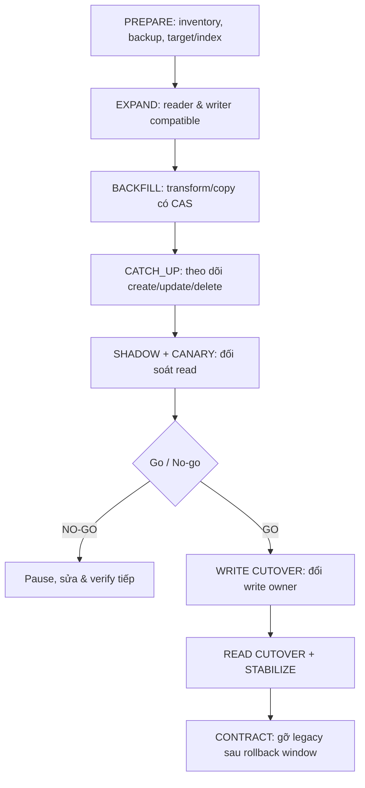
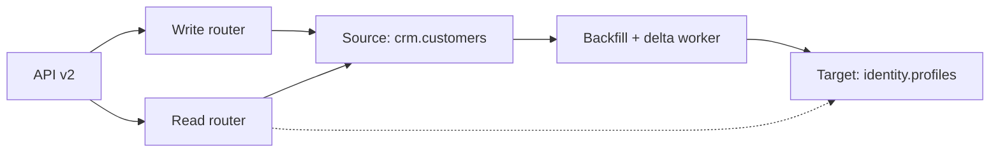
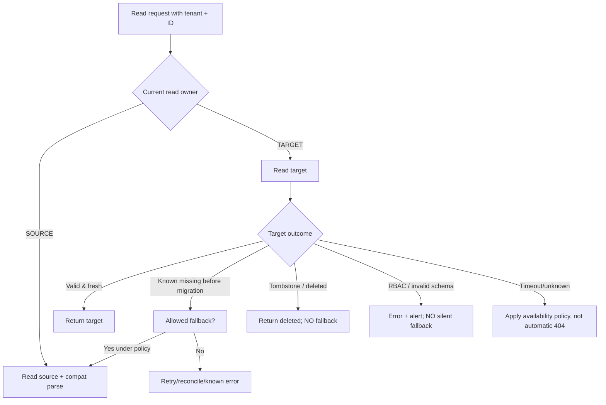
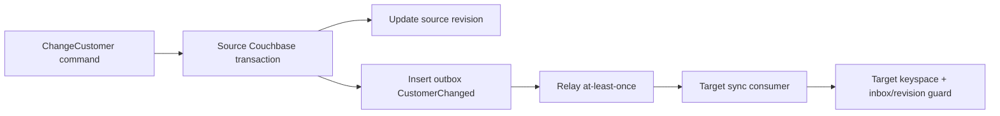

# Đọc và ghi đồng thời trong giai đoạn chuyển đổi

Trong chương **Tiến hóa và di trú** của module **SPRING_DATA_COUCHBASE**, thay đổi dữ liệu không dừng ở việc viết một converter hoặc chạy một job backfill. Một ứng dụng đang phục vụ người dùng thường phải **đọc và ghi trong lúc nhiều thế hệ document, nhiều phiên bản application và nhiều tiến trình di trú cùng tồn tại**. Điều này tạo ra rủi ro khó nhận ra: API vẫn trả `200 OK`, nhưng một writer cũ có thể xóa trường mới, reader mới có thể đọc bản sao chưa cập nhật, hoặc một event trễ có thể khôi phục document đã bị xóa.

Ví dụ, hệ thống đang dùng Spring Data Couchbase để đọc `appdata.crm.customers`. Phiên bản mới muốn bổ sung `profile.displayName`, chuyển sang `appdata.identity.profiles` và bảo đảm người dùng **không bị ngừng phục vụ** trong suốt quá trình. Trong vài giờ, cả hai schema và cả hai vị trí dữ liệu có thể cùng tồn tại. Một yêu cầu từ app cũ sửa email, một worker backfill đọc tài liệu đó, một API mới ghi profile, và một consumer gửi lại event cũ — tất cả có thể xảy ra gần như đồng thời.

Bài học giải quyết trực tiếp câu hỏi: **khi nào đọc nguồn nào, khi nào ghi nguồn nào, dùng điều kiện nào để tránh mất update, và làm sao biết đã đủ an toàn để chuyển quyền sở hữu dữ liệu?**

Nội dung kết hợp **document mapping**, `CouchbaseRepository`, `CouchbaseTemplate`, SQL++, bucket/scope/collection, `@Version`/CAS, TTL, Couchbase transactions, reactive access, khả năng vận hành và kiểm thử đồng thời. Các ví dụ về SDK/transaction được đặt trong bối cảnh phiên bản; một cú pháp hay annotation không thay cho việc xác minh API thực tế bằng integration test.

> **Tư tưởng chính:** Đọc song song không tự tạo nhất quán; ghi song song không tự tạo nguyên tử. Một quá trình chuyển đổi an toàn cần **một nguồn sự thật tại mỗi thời điểm**, **giao thức chuyển ownership**, **idempotency/revision guard**, **read routing rõ ràng**, và **bằng chứng đối soát trước/sau cutover**.

## 1. Mục tiêu học tập

Sau bài này, bạn có thể:

1. Giải thích sự khác biệt giữa **cùng tồn tại hai schema** và **cùng tồn tại hai keyspace** trong thời gian chuyển đổi.
2. Thiết kế chuỗi **expand → compatibility → backfill → catch-up → canary → cutover → contract** để hạn chế downtime.
3. Chọn chiến lược **dual-read, fallback-read, shadow-read, dual-field write hoặc dual-write** dựa trên bất biến và mức độ trễ chấp nhận.
4. Chỉ ra khi nào một writer v1 có thể phá field v2 dù dùng optimistic locking.
5. Dùng `@Version`/CAS để tránh stale write và biết giới hạn của CAS trong đồng bộ hai bản sao.
6. Thiết kế **read-repair** có điều kiện mà không ghi đè nguồn mới hơn.
7. Nhận biết read-your-writes, monotonic read và stale read trong quá trình route giữa hai collection.
8. Chọn một **single write owner** và cách thay owner khi ứng dụng còn request in-flight.
9. Phân biệt **dual-write hai thao tác độc lập** với **local Couchbase transaction + outbox**.
10. Sử dụng ID lệnh, event ID, `aggregateRevision` và tombstone để tránh duplicate/reorder/resurrection.
11. Lập chính sách TTL, delete propagation, index consistency, type discriminator và quyền truy cập.
12. Hiểu giới hạn của `@Transactional`, SDK transaction `ctx`, `CouchbaseTransactionalOperator` và reactive `Mono.when`.
13. Triển khai feature flag, canary, shadow comparison và rollback window có giám sát.
14. Viết kiểm thử cho race condition giữa old/new writer, backfill, consumer, delete và cutover.
15. Xác định khi nào rollback application an toàn và khi nào phải forward-fix/reverse-sync.

## 2. Bài toán xuyên suốt: một khách hàng, hai mô hình

Source v1:

```text
Cluster: couchbase-prod
Bucket: appdata
Scope: crm
Collection: customers
Key: customer::tenant-a::C001
```

Document:

```json
{
  "docType": "customer",
  "schemaVersion": 1,
  "tenantId": "tenant-a",
  "customerId": "C001",
  "name": "Lê Thu Trang",
  "email": "trang@example.test",
  "loyaltyPoints": 200,
  "status": "ACTIVE",
  "aggregateRevision": 17
}
```

Target v2:

```text
Cluster: couchbase-prod
Bucket: appdata
Scope: identity
Collection: profiles
Key: profile::tenant-a::C001
```

Document:

```json
{
  "docType": "profile",
  "schemaVersion": 2,
  "tenantId": "tenant-a",
  "customerId": "C001",
  "profile": {
    "displayName": "Lê Thu Trang"
  },
  "contact": {
    "emailRaw": "trang@example.test"
  },
  "status": "ACTIVE",
  "aggregateRevision": 17
}
```

Điểm tích lũy `loyaltyPoints` **không tự biến mất hợp lệ** khi tách profile: kiến trúc phải xác định nó vẫn nằm ở nguồn `crm.customers` hay đã được chuyển sang aggregate `loyalty.accounts` riêng. Nếu hệ thống dự kiến xóa source, việc bỏ field này mà không có source of truth thay thế là **mất dữ liệu nghiệp vụ**, dù profile v2 đúng cấu trúc.

Bài phân biệt:

- **Tình huống A — một collection:** mở rộng JSON v1 thành JSON chứa cả field legacy và field v2 trong cùng document.
- **Tình huống B — hai collections:** copy profile sang `identity.profiles` và đồng bộ thay đổi trước khi chuyển read/write owner.
- **Tình huống C — hai clusters hoặc nhiều datastore:** không có một commit chung được đảm bảo chỉ bởi Spring `@Transactional`; cần reconciliation, stream/outbox và kế hoạch phục hồi.

## 3. Tại sao cần cho đọc/ghi hoạt động cùng lúc?

Một migration offline có thể tạm dừng toàn bộ writer, copy, verify và mở lại. Điều này dễ chứng minh hơn, nhưng không phải sản phẩm nào cũng chịu được downtime. Online migration cho phép xử lý traffic liên tục, đổi lại phải đối mặt với:

- API pods chạy **hai release** trong lúc rolling deployment.
- Worker batch và consumer chưa được nâng cấp.
- Document v1/v2 cùng nằm trong một collection hoặc trên hai collections.
- Người dùng sửa profile trong khi backfill đang copy bản cũ.
- Delete/TTL xảy ra lúc source đã copy nhưng target chưa được xóa.
- Query SQL++ còn dùng index chưa bắt kịp dữ liệu mới.
- Request trước cutover hoàn tất **sau** thời điểm bật flag.
- Client retry khi timeout, khiến command cũ có thể đến lần hai.
- Có khả năng rollback, nhưng source có thể stale nếu target đã nhận write.

Mục tiêu không phải “mọi bản sao luôn có byte giống nhau”, mà là **mức nhất quán được định nghĩa bằng hợp đồng nghiệp vụ** và có cách kiểm chứng.

### 3.1. Độ mới của dữ liệu là yêu cầu nghiệp vụ

Với trang hồ sơ cá nhân, ứng dụng có thể chấp nhận shadow target trễ vài giây nhưng không được trả email cũ ngay sau khi người dùng vừa sửa email và nhận thông báo thành công.

Với số dư tài khoản hoặc quyền truy cập, **stale read** thậm chí vài giây có thể không chấp nhận được. Mức chịu trễ phải quyết định kiến trúc, không phải sau khi triển khai mới phát hiện.

## 4. Hai chiều tương thích: backward và forward

| Reader/Writer | Document v1 | Document v2 |
| --- | --- | --- |
| **App v1 reader** | Đọc được | Chỉ đọc được khi legacy fields/type contract còn tương thích |
| **App v2 reader** | Cần compatibility adapter | Đọc theo v2 |
| **App v1 writer** | Ghi như trước | Có thể xóa field mới nếu full-document save |
| **App v2 writer** | Cần bảo toàn legacy fields hoặc nâng cấp tại chỗ | Ghi theo chính sách v2 |
| **Backfill** | Transform idempotent, CAS | No-op/verify |
| **CDC consumer** | Phải hiểu revision/version | Không được downgrade |
| **Rollback build** | Phải thử với mixed data | Không được giả định hoạt động |

**Backward compatibility** thường nghĩa là reader mới hiểu dữ liệu cũ. **Forward compatibility trong rollout** là reader/writer cũ còn an toàn với dữ liệu do phiên bản mới tạo; việc này có thể khó hơn.

### 4.1. Một app v1 đọc được v2 không chứng minh v1 ghi được v2

Nếu class v1 chỉ chứa `name` và `email`, một `repository.save(entityV1)` trên document có `profile`/`contact` có thể ghi lại toàn bộ JSON và làm mất field mới. CAS hợp lệ chỉ xác nhận document chưa bị sửa từ lúc đọc; **CAS không hiểu rằng field mới phải được bảo toàn**.

## 5. Thiết kế migration bằng các pha rõ ràng



| Pha | Nguồn ghi | Nguồn đọc | Điều kiện chuyển pha |
| --- | --- | --- | --- |
| `PREPARE` | Source | Source | Backup/restore rehearsal, inventory, target capacity |
| `EXPAND` | Source | Source + compatibility | App mới đọc được v1/v2, app cũ không phá v2 |
| `BACKFILL` | Source | Source | Copy idempotent, không phá live updates |
| `CATCH_UP` | Source | Source | Delta backlog giảm, delete/expiry được xử lý |
| `SHADOW_READ` | Source | Source trả client; target chỉ so sánh | Parity và latency trong SLO |
| `CANARY_READ` | Source | Target cho cohort đủ điều kiện | Freshness/read-your-writes đạt contract |
| `WRITE_CUTOVER` | Chuyển Source → Target | Được điều phối theo route version | In-flight writes/barrier/offset xác định |
| `STABILIZE` | Target | Target | Không còn legacy writes, error/drift ổn định |
| `CONTRACT` | Target | Target | Hết rollback window, archive/xóa theo policy |

Thứ tự canary read/cutover write có thể điều chỉnh theo hợp đồng. **Không bắt canary đọc target trước khi target đủ tươi** chỉ để tuân theo một sơ đồ.

## 6. Trạng thái source of truth cần được công bố

Một chính sách có thể là:

```text
Phase 1..5:
  writeOwner = SOURCE
  target = derived copy, có thể trễ

Phase WRITE_CUTOVER:
  barrier stops source-new-writes
  drain source-in-flight
  catch up confirmed deltas
  switch writeOwner = TARGET

Phase STABILIZE:
  writeOwner = TARGET
  source = stale rollback candidate trừ khi reverse-sync
```

**Không bao giờ để hai nơi tự quyết cùng một thuộc tính nghiệp vụ mà không có conflict policy.** Nếu team gọi cả source và target là “source of truth”, cần xác định chính xác quy tắc quyền sở hữu trên **từng field hoặc aggregate**, không thể chỉ dựa vào last-write-wins.

### 6.1. Với nhiều field có owner khác nhau

Có thể profile name/email được Identity Service sở hữu, còn loyaltyPoints do Loyalty Service sở hữu. Khi đó migration nên **tách ownership có chủ đích**, không coi việc JSON khác nhau ở hai collections là tự động sai.

Phải lập **canonical projection** chỉ so các field mà hai bên được yêu cầu tương đương.

## 7. Chiến lược thứ nhất: dual-read, single-write

Trong giai đoạn chuyển đổi, một ứng dụng v2 có thể:

- **Ghi tại source duy nhất.**
- Đọc source làm nguồn sự thật.
- Có thể đọc target phục vụ shadow comparison hoặc fallback theo chính sách.
- Backfill/catch-up cập nhật target ngoài đường xử lý request.

Đây thường là mô hình dễ điều phối hơn việc cho cả hai store nhận writes trực tiếp.



### 7.1. Fallback không phải luôn an toàn

Nếu target `get` trả not found và source còn dữ liệu, có thể fallback về source. Nhưng nếu target not found vì **khách hàng đã xóa hợp lệ sau write cutover**, fallback sang source stale sẽ **hồi sinh dữ liệu dưới mắt người dùng**.

Fallback chỉ an toàn khi biết:

- Route phase và current owner.
- Source/target tương ứng với cùng tenant/key mapping.
- Không có tombstone/deletion hoặc revision ở owner mới mà nguồn fallback chưa biết.
- Client consistency contract cho phép.
- Lỗi `403`/RBAC, timeout, mapping invalid **không bị nuốt như `404`**.

## 8. Chiến lược thứ hai: dual-field trong cùng document

Giữ field legacy và thêm field v2:

```json
{
  "docType": "customer",
  "schemaVersion": 2,
  "name": "Lê Thu Trang",
  "email": "trang@example.test",
  "profile": {
    "displayName": "Lê Thu Trang"
  },
  "contact": {
    "emailRaw": "trang@example.test"
  }
}
```

**Lợi ích:** Hai biểu diễn nằm trong **một document**, nên một mutation phù hợp có thể cập nhật cả hai atomically **ở cấp document**, không cần dual-write sang keyspace thứ hai.

**Rủi ro:** Một v1 writer có thể chỉ cập nhật `name` mà không cập nhật `profile.displayName`, tạo **hai giá trị mâu thuẫn** trong cùng JSON; một v1 full save có thể xóa cả nested fields.

### 8.1. Chính sách consistency trong dual-field

Định nghĩa:

```text
Invariant khi document còn được dùng bởi cả v1/v2:

profile.displayName == name
contact.emailRaw == email

Nếu có chênh lệch:
  không lấy một bên ngẫu nhiên;
  dùng write owner / revision / audit policy
  để xác minh trường nào mới hơn.
```

Trong giai đoạn expand, nên nâng cấp **mọi writer** để ghi cả hai field **trong cùng mutation** hoặc giữ writer cũ không được đụng field chịu trách nhiệm của schema mới.

### 8.2. Đừng tính đến xóa field cũ ngay

Việc bỏ `name`/`email` khi còn app v1 trên một pod hoặc job background sẽ khiến app đó lỗi. Thời điểm contract phụ thuộc thực tế rollout, không chỉ tỷ lệ reader v2.

## 9. Viết một document với CAS và bảo toàn JSON

Nếu cần cập nhật đồng thời field legacy và field v2, một mẫu SDK KV có thể:

```java
package com.example.crm;

import java.util.Objects;

import com.couchbase.client.java.Collection;
import com.couchbase.client.java.json.JsonObject;
import com.couchbase.client.java.kv.GetResult;

import static com.couchbase.client.java.kv.ReplaceOptions.replaceOptions;

public final class CompatibleProfileWriter {

    private final Collection customers;

    public CompatibleProfileWriter(Collection customers) {
        this.customers = customers;
    }

    public void changeName(
            String key,
            String authorizedTenant,
            String newName) {

        if (newName == null || newName.isBlank()) {
            throw new IllegalArgumentException("Tên không hợp lệ");
        }

        GetResult read = customers.get(key);
        JsonObject original = read.contentAsObject();

        if (!Objects.equals(
                authorizedTenant,
                original.getString("tenantId"))) {
            throw new SecurityException("Sai tenant");
        }

        JsonObject updated =
                JsonObject.fromJson(original.toString());

        JsonObject profile = updated.getObject("profile");
        if (profile == null) {
            profile = JsonObject.create();
        }

        profile.put("displayName", newName);
        updated.put("profile", profile);
        updated.put("name", newName);
        updated.put("schemaVersion", 2);

        customers.replace(
                key,
                updated,
                replaceOptions()
                        .cas(read.cas())
                        .preserveExpiry(true));
    }
}
```

**Ví dụ tập trung một lần thử ghi**, chưa bao gồm bounded retry. Khi CAS mismatch:

1. **Đọc lại** document hiện tại.
2. Kiểm tra status/tenant/business policy.
3. Recompute cả hai biểu diễn từ yêu cầu gốc và dữ liệu mới.
4. Retry giới hạn với backoff hoặc trả conflict.
5. Không dùng lại CAS/JSON cũ.

### 9.1. Tại sao clone raw JSON?

Một entity Java v1 có thể không ánh xạ nested field mới; full-document `save` có nguy cơ làm mất dữ liệu. Mẫu dùng raw JSON giúp giữ field chưa biết trước trong phạm vi ví dụ. **Nó vẫn cần kiểm thử với nested JSON, kiểu số, custom serialization và dữ liệu sai kiểu**.

### 9.2. `preserveExpiry(true)` là hợp đồng version-sensitive

Lệnh giữ expiration khi replace cần được xác minh trên tổ hợp SDK/Server. Không tự bỏ option rồi cho rằng TTL sẽ giữ; cũng không lấy code mẫu này làm bằng chứng xử lý mọi dữ liệu có expiry.

### 9.3. CAS không thay read policy

Một writer tránh lost update chưa đủ nếu reader mới vẫn đọc target shadow copy cũ. **Write correctness** và **read freshness** là hai mục tiêu khác nhau.

## 10. Phân biệt schemaVersion với CAS và revision

| Giá trị | Ý nghĩa | Có dùng sắp thứ tự sự kiện? |
| --- | --- | --- |
| `schemaVersion` | Thế hệ JSON, ví dụ 1/2 | Không |
| Spring Data `@Version Long` | Metadata optimistic locking/CAS | Không |
| SDK `GetResult.cas()` | Token của document phiên bản hiện tại | Không dùng numeric order |
| `aggregateRevision` | Số thứ tự nghiệp vụ quản lý theo aggregate | **Có thể**, nếu policy đảm bảo monotonic |
| `commandId` | Định danh ý định sửa, ổn định khi retry | Dùng dedup |
| `eventId` | Định danh event logic ổn định khi publish lại | Dùng dedup |
| `attemptId` | Định danh một lần thử kỹ thuật | Không thay command/event ID |
| `routeEpoch` | Thế hệ quyền write owner | Dùng fencing/ownership |
| `backfillRunId` | Một lần chạy job | Không thay business version |

CAS có vai trò phát hiện document bị sửa từ lần đọc, **không phải đồng hồ toàn hệ thống**. Nếu cần chống delta đến sai thứ tự, có `aggregateRevision`/`eventSequence` do ứng dụng điều phối.

## 11. Vì sao old writer có thể phá schema mới dù CAS hợp lệ?

Timeline:

```text
T0: Document C001 đã có name + profile.displayName.
T1: App v1 đọc C001 mới nhất, CAS = B.
T2: App v1 tạo CustomerEntity chỉ có name/email.
T3: App v1 save toàn entity với CAS = B.
T4: C001 nhận CAS = C, nhưng JSON thiếu profile.
```

Không có stale write; CAS B hợp lệ ở T3. Lỗi xảy ra vì **writer serialization không bảo toàn field mới**.

### 11.1. Cách phòng vệ

- Triển khai compatibility writer trước backfill.
- Tránh v1 full-document save ở field/collection đã mở rộng.
- Dùng sub-document mutation hoặc mapping có preserve contract trong phạm vi version hỗ trợ.
- Kiểm thử chính **binary v1 thật** với document v2, gồm update và save.
- Theo dõi schema regression: v2 → v1, mất nested field hoặc mismatch dual-field.
- Nếu không thể nâng cấp writer cũ, chọn maintenance barrier hoặc routing chặn những write đó.

**Chỉ có “reader v2 đọc được v1” chưa đủ cho zero-downtime migration.**

## 12. Spring Data mapping và Repository trong thời gian hai version cùng chạy

Entity ví dụ:

```java
import org.springframework.data.annotation.Id;
import org.springframework.data.annotation.Version;
import org.springframework.data.couchbase.core.mapping.Collection;
import org.springframework.data.couchbase.core.mapping.Document;
import org.springframework.data.couchbase.core.mapping.Scope;

@Document
@Scope("crm")
@Collection("customers")
public class CustomerDocument {

    @Id
    private String id;

    private String tenantId;
    private Integer schemaVersion;
    private String name;
    private String email;
    private Profile profile;
    private Contact contact;
    private String status;

    @Version
    private Long version;

    public CustomerDocument() {}
    // Constructor, getters/setters và validation.
}
```

Repository:

```java
import org.springframework.data.couchbase.repository.CouchbaseRepository;

public interface CustomerRepository
        extends CouchbaseRepository<CustomerDocument, String> {
}
```

### 12.1. `@Version` và mapping của dữ liệu cũ

Trên Spring Data Couchbase, `@Version` thường gắn với CAS, giúp phát hiện stale save trên document. Không dùng `@Version` như field `schemaVersion` trong JSON. Legacy documents có thể thiếu nested objects, nên **compatibility adapter** phải xử lý thiếu field và invalid shape thay vì dereference `getProfile().getDisplayName()` vô điều kiện.

### 12.2. Type discriminator

Spring Data có thể ghi/type-filter theo metadata như `_class`/type alias tùy cấu hình. Document được copy raw giữa collections hoặc đổi từ `CustomerDocument` sang `ProfileDocument` có thể mang type metadata không phù hợp.

Kiểm thử **Repository/Template thật** đọc/derived query trên target, không chỉ SDK `collection.get` thành công.

### 12.3. Repository không là read router tự động

Đổi `@Collection("profiles")` trên entity v2 sẽ làm thay đổi keyspace truy cập theo mapping, nhưng **không tự đọc lại `crm.customers` khi target thiếu**. Nếu cần dual-read, hãy tạo **application-level router/adapter** với hai data access paths và chính sách lỗi rõ.

## 13. Đọc dữ liệu v1/v2: compatibility adapter và trạng thái phân loại

Một adapter nên trả kết quả đủ ý nghĩa thay vì trả một object có vô số `null`:

```text
readCustomer(source or target):
  FOUND_VALID_V1
  FOUND_VALID_V2
  NOT_FOUND
  DELETED_TOMBSTONE
  INCOMPATIBLE_SCHEMA
  DATA_CONFLICT
  TEMPORARILY_UNAVAILABLE
  ACCESS_DENIED
```

Các trường hợp này **không được gộp** thành `Optional.empty()`.

### 13.1. Dual-read không phải luôn đọc cả hai ở mọi request

Đọc cả hai bên cho mọi request làm tăng latency/cost và có thể tạo inconsistent response khi một phía update giữa hai lần đọc. Có thể dùng:

- Source primary, target shadow sampled.
- Target primary với fallback có điều kiện.
- Read based on ownership epoch/revision.
- Canaries theo tenant/user cohort đã được verify.
- Diagnostics riêng để so canonical values.

### 13.2. Dữ liệu thiếu khác với dữ liệu sai

Nếu v2 target tồn tại nhưng `profile.displayName` sai kiểu, fallback về source không nên biến lỗi mapping thành một phản hồi “hoàn toàn bình thường” mà không log/alert; cần chẩn đoán và repair.

## 14. Read fallback: chỉ dùng khi chứng minh được an toàn

Sơ đồ quyết định gợi ý:



### 14.1. Khi nào được fallback?

Một số ứng dụng cho phép fallback **trước cutover**, khi source là authoritative và target thiếu do chưa copy. Sau khi target đã nhận writes độc quyền, source có thể stale; fallback chỉ được phép nếu có **reverse-sync hoặc freshness proof** đáp ứng hợp đồng.

### 14.2. Không fallback qua tenant

`profile::tenant-a::C001` không được fallback sang `customer::tenant-b::C001` chỉ vì customerId trùng. Tenant phải từ ngữ cảnh ủy quyền, mapping phải injective trên phạm vi được chuyển.

## 15. Read-repair: đọc thiếu rồi sửa target có an toàn không?

**Read-repair** nghĩa là khi phát hiện target thiếu/stale trong lúc phục vụ read, ứng dụng có thể kích hoạt cập nhật target từ nguồn sự thật. Mẫu đơn giản nhưng rủi ro:

```java
if (targetNotFound) {
    var legacy = source.get(key).contentAsObject();
    target.upsert(targetKey, convert(legacy));
}
```

Rủi ro:

- Source có thể đã bị xóa sau lần đọc.
- Target có thể vừa được writer mới tạo sau `targetNotFound`.
- Payload đang giữ có thể stale.
- Nhiều read requests cùng race.
- TTL/expiry bị reset.
- Request đọc bị kéo dài và gây write amplification.
- Nếu target đã là owner, đọc source để sửa target có thể **downgrade dữ liệu**.

### 15.1. Thiết kế read-repair có điều kiện

Một protocol an toàn hơn:

1. Xác định **current write owner** và routeEpoch.
2. Chỉ repair khi source vẫn authoritative.
3. Đọc source với metadata cần thiết, xác minh tenant/key, deletion, schema.
4. Transform deterministic; giữ original source revision.
5. Dùng **target insert-only** nếu target chưa có, không `upsert` stale.
6. Nếu target đã có, so revision/payload; update có điều kiện hoặc enqueue reconciliation.
7. Không dùng một read request timeout làm lý do xóa hay hồi sinh document.
8. Ghi metric, giới hạn rate/budget và có circuit breaker.
9. Không để repair làm thay đổi business fields ngoài chính sách.
10. Có worker nền xử lý những key quá phức tạp thay vì block API.

**Read-repair có thể cải thiện hội tụ**, nhưng không thay thế change capture hoặc final cutover barrier cho hệ thống yêu cầu độ mới chặt.

## 16. Shadow read: kiểm chứng target mà không ảnh hưởng người dùng

Ở pha `SHADOW_READ`, ứng dụng trả source cho client nhưng đọc target **phục vụ so sánh nội bộ**:

```text
Client request -> Source KV / Repository -> Response

                    \--> Target KV / Repository
                         -> canonical compare
                         -> metric + sampled diagnostics
```

### 16.1. So cái gì?

| Trường/khía cạnh | Cách kiểm chứng |
| --- | --- |
| Key mapping | Source key tạo đúng target key |
| Tenant | Tenant ở key/body/caller khớp |
| Name/email | Chuẩn hóa về cùng canonical business view |
| Status | Trạng thái có hiệu lực, không bị stale |
| Revision | Target đã áp tối thiểu revision source đã xác nhận |
| Delete/TTL | Không xuất hiện document “ma” ở target |
| Shape/type | Mapping Spring Data v2 hợp lệ |
| Latency | p50/p95/p99 của target theo cohort |
| Error | Timeout, RBAC, missing index, invalid data |
| Privacy | Không log payload nhạy cảm nguyên vẹn |

### 16.2. Shadow read bản thân có race

Nếu source được đọc tại T1, target tại T2 và một write xảy ra ở giữa, hai value có thể khác nhau **hợp lệ theo thời điểm**. Đừng đánh dấu mismatch là corruption ngay lập tức nếu không có cùng revision/snapshot contract.

Dùng `aggregateRevision`/event watermark và chính sách sampling để phân biệt **expected lag** với **unexplained drift**.

### 16.3. Không dùng shadow write làm side effect tùy tiện

Một số hệ thống thử “shadow ghi” vào target khi request hoàn tất. Nếu không có outbox/retry/reconciliation, nó tạo **dual-write** và lỗi từng phần. Đọc shadow đơn giản hơn ghi shadow; đừng đánh đồng.

## 17. Read-your-writes khi đọc qua hai nguồn

Giả sử user đổi email và API trả `200 OK` từ source, rồi trang profile đọc target replica chưa catch-up:

```text
T0 user updates email -> source revision 18 (COMMITTED)
T1 HTTP 200 returned
T2 user GET profile routed to target revision 17
T3 user sees old email
```

Đó là vi phạm **read-your-writes** nếu API hứa người dùng thấy ngay thay đổi vừa xác nhận.

### 17.1. Các cách bảo vệ

- **Giữ read routing về source** khi source vẫn write owner.
- Trả `aggregateRevision=18` hoặc read token; reader target chỉ phục vụ nếu target revision ≥ 18.
- Có thời gian **sticky read** từ authoritative source theo session/tenant, dựa trên dữ liệu và policy.
- Retry/read from source khi target chưa đủ revision **chỉ ở pha source authoritative**.
- Đợi delta target đã áp revision xác nhận với deadline rõ, có trạng thái pending nếu không kịp.
- Sau write cutover, đọc target làm owner; không tự fallback sang source stale.

### 17.2. Monotonic read giữa các request

Nếu user đã thấy revision 18, request tiếp theo không nên trả revision 17 dù load balancer chuyển cohort. Một `minimumSeenRevision`/routeEpoch theo session hoặc API contract có thể giảm hiện tượng “đi ngược thời gian”.

Không biến token này thành một cơ chế security; tenant/access control vẫn phải được xác minh độc lập.

## 18. Stale read không chỉ đến từ target collection

Đọc sai hoặc cũ có thể đến từ:

- Cache in-memory/Redis chưa invalidate.
- SQL++ secondary index chưa phản ánh write mới.
- Read replica/replication lag.
- App routing flag cũ trên một pod.
- Client giữ route đến bucket/source cũ.
- Một worker v1 ghi lại schema legacy.
- CDC consumer replay event trễ.
- Derived query Spring Data có discriminator/index khác.
- TTL/deletion chỉ được xử lý ở một bên.

Vì vậy khi điều tra read mismatch, hãy truy nguồn **keyspace → read path KV/SQL++ → cache → route epoch → revision → write owner**, không chỉ so JSON hai collections.

## 19. Đường ghi: chọn một owner trước khi chọn dual-write

**Single write owner** là thiết kế dễ chứng minh nhất khi business semantics cần tính đúng cao.

Trong pha source là owner:

```text
HTTP command
  -> validate/auth
  -> source local write (commit)
  -> outbox / change capture
  -> delta consumer updates target
  -> target becomes eventually consistent
```

**Không coi target đã đồng bộ chỉ vì source write trả thành công.** API có thể trả source receipt với revision và trạng thái `TARGET_SYNC_PENDING` riêng nếu giao diện cần biểu diễn.

### 19.1. Dual-write như một tối ưu, không phải tính chất miễn phí

Nếu một request ghi cả source và target, phải hỏi:

- Chúng có thực sự trong **cùng Couchbase transaction context được hỗ trợ** không?
- Nếu không, chuyện gì xảy ra khi ghi đầu thành công, ghi sau lỗi?
- Nếu retry command, nó có tạo business effect lần hai?
- Mỗi bên có version/epoch nào?
- Khi delete, cả hai có được xóa theo đúng thứ tự không?
- Nếu target là nơi ghi chuẩn sau cutover, khi nào ngừng ghi source?

## 20. Dual-write hai KV calls có cửa sổ lỗi

Mẫu:

```java
source.replace(sourceKey, newSourceBody);
target.upsert(targetKey, newTargetBody);
```

Có thể xảy ra:

| Thời điểm lỗi | Source | Target | Hậu quả |
| --- | --- | --- | --- |
| Trước cả hai writes | Chưa đổi | Chưa đổi | Có thể retry command |
| Sau source write, trước target write | Đã đổi | Cũ | Target stale |
| Sau target write, trước source write nếu đảo thứ tự | Cũ | Đã đổi | Source chưa có effect tương ứng |
| Sau target commit, trước ACK | Đã/chuẩn bị đổi | Outcome chưa rõ | Retry có thể đè target |
| Sau cả hai writes, HTTP response mất | Đã đổi | Đã đổi | Client retry command |
| Hai requests xen kẽ | Revision mới có thể ghi sau | Revision cũ có thể đến cuối | Regression |

**Đổi thứ tự ghi không làm hai writes độc lập trở thành atomic.**

### 20.1. `@Transactional` không tự kéo hai keyspaces vào cùng commit

```java
@Transactional(transactionManager = "couchbaseTransactionManager")
public void saveBoth() {
    sourceRepository.save(customer);
    targetRepository.save(profile);
}
```

Chỉ được khẳng định atomic khi **đúng Spring Data version, manager, proxy interception, bucket/keyspace và supported operations** đều tham gia transaction. Nếu repository thuộc hai manager/clusters, annotation một manager không tự điều phối cả hai.

### 20.2. Không gọi HTTP/broker trong transaction callback

Một SDK transaction callback có thể được retry; external HTTP, email, Kafka/RabbitMQ và PostgreSQL không tự rollback khi Couchbase abort. Dùng outbox/idempotency/reconciliation phù hợp.

## 21. SDK transaction trong cùng Couchbase deployment: phạm vi cần kiểm thử

Khi cả hai collections nằm trong phạm vi transaction mà Couchbase Server/Java SDK hỗ trợ, có thể tổ chức:

```java
cluster.transactions().run(ctx -> {
    // Read source qua ctx.get(...)
    // Xác minh tenant, status, commandId/revision.
    // ctx.replace(sourceResult, updatedSource);
    // ctx.insert(targetCollection, targetKey, updatedTarget);
    // Hoặc ctx.replace(targetResult, updatedTarget) có guard.
});
```

Đây là **pseudocode về transaction boundary**. Muốn thực thi an toàn cần:

- Transaction-aware `ctx.get`/`ctx.insert`/`ctx.replace`, không trộn `collection.upsert` ngoài context.
- Xử lý target đã tồn tại và idempotency.
- Đọc/recompute trong **từng attempt**, callback có thể retry.
- Quy tắc ownership/revision và TTL riêng cho mỗi document.
- Metadata/ATR, RBAC, version và durability đúng.
- Test forced abort sau mutation đầu chứng minh không có commit một phần.

Nếu target ở **cluster khác**, không có một SDK Couchbase transaction thông thường bao được hai clusters độc lập.

### 21.1. Không có “transaction cho cả chiến dịch”

Một transaction cho mỗi aggregate nhỏ có thể phù hợp; không mở một transaction kéo dài nhiều giờ cho cả backfill. Job tổng vẫn cần checkpoint/resume, catch-up, verification, rollback.

## 22. Outbox: giữ thay đổi nguồn và ý định đồng bộ cùng commit

Một mô hình có thể dùng **local Couchbase transaction** để cập nhật source và insert outbox event:



**Ý nghĩa:** Nếu source write đã commit, intent đồng bộ cũng tồn tại trong Couchbase; relay có thể xử lý tiếp khi process crash.

**Giới hạn:** Việc apply sang target **không cùng atomic commit** với source transaction nếu consumer làm một thao tác riêng; event có thể gửi lặp, đến muộn hoặc out of order.

### 22.1. Các ID cần phân biệt

```text
commandId: cmd::tenant-a::C001::change-email::REQ9001
eventId:   evt::tenant-a::C001::rev18
aggregateId: customer::tenant-a::C001
aggregateRevision: 18
routeEpoch: source-owned-v1
attemptId: delivery-7
```

`eventId` và `commandId` **ổn định qua retry**. `attemptId` có thể thay đổi mỗi lần thử. Không tạo event ID ngẫu nhiên trong callback transaction có thể được chạy lại.

## 23. Ví dụ SDK: cập nhật source và phát intent một cách nguyên tử

Ví dụ sau giả định document nguồn chứa `aggregateRevision` do ứng dụng sở hữu và đã xác định một `commandId` duy nhất cho ý định sửa email.

```java
package com.example.migration;

import java.util.Objects;

import com.couchbase.client.java.Cluster;
import com.couchbase.client.java.Collection;
import com.couchbase.client.java.json.JsonObject;
import com.couchbase.client.java.transactions.TransactionGetResult;

public final class SourceWriteWithOutbox {

    private final Cluster cluster;
    private final Collection customers;
    private final Collection outbox;

    public SourceWriteWithOutbox(
            Cluster cluster,
            Collection customers,
            Collection outbox) {
        this.cluster = cluster;
        this.customers = customers;
        this.outbox = outbox;
    }

    public void changeEmailNewCommand(
            String customerKey,
            String authorizedTenant,
            String commandId,
            String newEmail) {

        if (commandId == null || commandId.isBlank()
                || newEmail == null || newEmail.isBlank()) {
            throw new IllegalArgumentException(
                    "Command thiếu thông tin");
        }

        // Id ổn định được cấp từ request, không tạo trong callback.
        String eventKey = "outbox::"
                + authorizedTenant + "::" + commandId;

        cluster.transactions().run(ctx -> {
            TransactionGetResult result =
                    ctx.get(customers, customerKey);

            JsonObject body = result.contentAsObject();

            if (!Objects.equals(
                    authorizedTenant,
                    body.getString("tenantId"))) {
                throw new SecurityException(
                        "Không được sửa customer khác tenant");
            }

            Long oldRevision =
                    body.getLong("aggregateRevision");
            if (oldRevision == null || oldRevision < 0) {
                throw new IllegalStateException(
                        "Thiếu revision hợp lệ");
            }

            long nextRevision =
                    Math.addExact(oldRevision, 1L);

            JsonObject next =
                    JsonObject.fromJson(body.toString());

            JsonObject contact =
                    next.getObject("contact");

            if (contact == null) {
                contact = JsonObject.create();
            }

            // Dual-field trong cùng source JSON.
            next.put("email", newEmail);
            next.put("contact",
                    contact.put("emailRaw", newEmail));
            next.put("schemaVersion", 2);
            next.put("aggregateRevision", nextRevision);

            JsonObject event = JsonObject.create()
                    .put("eventId", commandId)
                    .put("eventType", "CustomerChanged")
                    .put("aggregateId", customerKey)
                    .put("tenantId", authorizedTenant)
                    .put("revision", nextRevision)
                    .put("commandId", commandId)
                    .put("deliveryStatus", "PENDING");

            ctx.replace(result, next);
            ctx.insert(outbox, eventKey, event);
        });
    }
}
```

**Ví dụ chỉ trình bày đường xử lý một command mới**, chưa gồm đầy đủ API idempotent response. Khi retry cùng `commandId`, `ctx.insert` outbox key đã tồn tại phải dẫn tới **đối soát command marker/payload và trả outcome cũ**, không đổi commandId để “cho qua”. Nếu cùng key nhưng payload khác, phải báo conflict.

### 23.1. Chọn dữ liệu event thế nào?

Event có thể chứa bản snapshot canonical, source revision hoặc chỉ reference. Nếu consumer luôn đọc source hiện tại, nó có thể thấy revision **mới hơn** event. Điều đó có thể phù hợp với projection **latest state**, nhưng không phù hợp với hệ thống bắt buộc áp từng transition theo thứ tự.

Hãy định nghĩa contract: **snapshot-of-event** hay **refresh-to-latest**. Không trộn lẫn một cách ngầm định.

### 23.2. Outbox không giải quyết mọi thứ

Outbox bảo vệ source mutation + intent; nó không tự cho biết target đã nhận event. Cần relay status, consumer retry, inbox/revision guard, lag metrics và reconciliation. Nếu một app v1 vẫn ghi trực tiếp source nhưng **không tạo outbox**, target có thể mất những thay đổi đó; phải nâng cấp/chặn writer hoặc dùng nguồn change capture bao phủ được nó.

## 24. Target consumer: revision guard và idempotency

Một event:

```json
{
  "eventId": "evt::tenant-a::C001::rev18",
  "aggregateId": "customer::tenant-a::C001",
  "tenantId": "tenant-a",
  "revision": 18,
  "eventType": "CustomerChanged"
}
```

Khi target đang ở revision 17, consumer có thể áp trạng thái revision 18. Nhưng cần xử lý:

| Target | Event | Hành động theo projection latest-state |
| --- | --- | --- |
| Chưa có | 18 | Tạo target nếu source/payload hợp lệ và không có tombstone mới hơn |
| Rev 17 | 18 | Update có điều kiện sau validation |
| Rev 18 | 18 | Duplicate/no-op sau khi so event/payload |
| Rev 19 | 18 | Event stale/no-op, không hạ về 18 |
| Deleted rev 19 | Update 18 | Không hồi sinh |
| Rev 17 | Event 20 bỏ qua 18–19 | Nếu là **delta**, hold/replay gap; nếu snapshot latest-state có contract, có thể refresh latest rồi xác minh |

### 24.1. Revision phải được cập nhật atomically với source

Nếu hai source writers cùng đọc revision 17 và tự ghi revision 18 trên các documents khác nhau, sequence có thể trùng. Với mỗi aggregate, cập nhật revision cần được bảo vệ bởi **CAS/transaction-aware conflict** trên cùng guard document hoặc một cơ chế phân phối sequence phù hợp.

### 24.2. Không dùng timestamp do từng process tự sinh làm thứ tự tuyệt đối

Clock skew, retry và network reorder khiến `updatedAt` từ các pods không nhất thiết tạo total order chính xác. Timestamp giúp audit/monitoring, nhưng `aggregateRevision` hay event sequence có contract rõ thích hợp hơn để chống ghi lùi.

## 25. Không đồng bộ bằng cách upsert mọi event đến

Sai:

```java
void onCustomerChanged(Event event) {
    JsonObject projected = event.payload();
    target.upsert(event.targetKey(), projected);
}
```

Nếu rev 18 đến **sau** rev 19 vì retry, target có thể bị downgrade. Cũng có thể resurrect document đã delete.

### 25.1. Thao tác có điều kiện trên target

Một pattern:

```text
read target with CAS
read event revision + expected payload
if target revision >= event revision:
    verify duplicate/stale; no write
else if tombstone revision newer:
    ignore stale event
else if delta needs missing revisions:
    park/reconcile
else:
    transform/validate
    replace target with CAS or insert-only if missing
    on CAS conflict: re-read and compare again
```

Nếu consumer còn ghi inbox marker để dedupe, và inbox + target cùng nằm trong phạm vi transaction Couchbase được hỗ trợ, có thể atomically ghi marker với target mutation. Nếu không, marker update và target mutation có cửa sổ lỗi riêng, nên cần thiết kế **idempotency bằng revision/key** ngay trên target.

### 25.2. Không ack khi outcome chưa rõ

Nếu mutation target trả timeout/commit ambiguous, consumer không tự khẳng định thất bại hoặc thành công. Đọc lại revision/marker khi hạ tầng cho phép; chỉ ACK khi outcome đủ rõ để xử lý duplicate an toàn.

## 26. Delete và expiry: phải bảo vệ khỏi hồi sinh document

Một source document bị xóa không đơn giản là “source không còn trả JSON”.

Timeline:

```text
T1: Source C001 revision 18 copied to target.
T2: User xóa C001 với delete operation revision 19.
T3: Target nhận tombstone/delete rev 19.
T4: Retry event update rev 18 tới muộn.
T5: Nếu upsert mù quáng, target hồi sinh C001.
```

### 26.1. Tombstone chứa thông tin gì?

Một delete marker có thể chứa:

```json
{
  "aggregateId": "customer::tenant-a::C001",
  "tenantId": "tenant-a",
  "eventType": "CustomerDeleted",
  "aggregateRevision": 19,
  "deleted": true,
  "deleteCommandId": "DEL9001"
}
```

Chính sách tombstone phải lưu đủ lâu để chống **late events, stream replay, retry và rollback** theo retention. Xóa tombstone quá sớm có thể làm mất tri thức “đã xóa ở revision nào”.

### 26.2. TTL khác explicit delete

Khi source document hết hạn theo TTL, nó có thể biến mất mà ứng dụng không phát command `CustomerDeleted`. Nếu dữ liệu chịu TTL, đồng bộ phải có chính sách **expiry propagation** dựa trên metadata, stream hỗ trợ hoặc đối soát; không giả định mọi expiry đi qua outbox ứng dụng.

Nếu target có retention khác source do chính sách được phê duyệt, parity không phải luôn “cùng tồn tại/cùng hết hạn”; cần ghi rõ ngoại lệ.

## 27. TTL trong giai đoạn dual-field và dual-store

TTL có thể đổi vì:

- Một `replace` không giữ expiry như mong muốn.
- Target insert không mang expiration metadata từ source.
- Bucket/collection target có maxTTL/default khác.
- Document source hết hạn giữa scan và copy.
- Read-repair vô tình hồi sinh document cũ.
- Quá trình rollback copy target về source đặt lại TTL từ hiện tại thay vì giữ absolute expiry.

### 27.1. Thử preserve-expiry trên đúng version

Với Java SDK 3.x, `ReplaceOptions.preserveExpiry(true)` là một lựa chọn trong các phiên bản hỗ trợ; kiểm tra SDK/Server dependency thật và test expiration trước/sau. Đừng giả định tất cả overloads của `save`/`upsert`/Template đều giữ TTL theo cách giống nhau.

### 27.2. Sự khác biệt giữa TTL và deadline nghiệp vụ

Ví dụ đơn giữ hàng có `reservationExpiresAt`; xóa một document bằng TTL không tự cập nhật các stock documents khác. Nếu migration thay TTL, phải xét **bất biến liên document**, không chỉ độ tồn tại của document.

## 28. CAS, `@Version` và lost update ở từng keyspace

Một tình huống:

```text
T1 Backfill đọc C001 source rev 17, CAS=A.
T2 API source đổi email, source rev 18, CAS=B.
T3 Backfill định ghi lại source theo CAS=A.
→ CAS mismatch ngăn overwrite.
```

Nếu backfill **copy sang target** thay vì replace source:

```text
T1 Copy source rev17 vào target.
T2 API source rev18.
T3 Không có delta catch-up.
→ Target vẫn rev17; CAS nguồn không tự sửa target.
```

**CAS chỉ bảo vệ conditional write trên document/keyspace tương ứng.** Nó không tạo đồng bộ xuyên hai collections. Khi di chuyển dữ liệu, phải có **revision policy và catch-up**, không chuyển CAS nguồn sang `@Version` của target.

## 29. SQL++ read consistency và giới hạn của một query

Ví dụ query lấy khách hàng:

```sql
SELECT META(c).id AS documentKey,
       c.tenantId,
       c.customerId,
       c.name,
       c.email
FROM `appdata`.`crm`.`customers` AS c
WHERE c.tenantId = $tenantId
  AND c.status = "ACTIVE";
```

Query target:

```sql
SELECT META(p).id AS documentKey,
       p.tenantId,
       p.customerId,
       p.profile.displayName,
       p.contact.emailRaw
FROM `appdata`.`identity`.`profiles` AS p
WHERE p.tenantId = $tenantId
  AND p.status = "ACTIVE";
```

Nếu hai queries chạy ở hai thời điểm khác nhau, dữ liệu có thể khác vì write hợp lệ xảy ra giữa chúng.

### 29.1. `REQUEST_PLUS` giải quyết điều gì?

Query scan consistency có thể điều khiển mức cập nhật index cần đạt trước khi query chạy; `REQUEST_PLUS` giúp query có mức nhất quán chỉ mục phù hợp với thời điểm request theo contract Couchbase. Nhưng:

- Không biến hai queries tách rời thành một snapshot.
- Không đồng bộ source/target collections.
- Không tạo Couchbase transaction.
- Không thay API KV/CAS khi cần conditional update.
- Có chi phí chờ/index pressure cần đánh giá trên cluster thật.

### 29.2. Query readiness của target

Một target KV `get` thành công nhưng Repository derived query thất bại có thể do thiếu index, sai keyspace hoặc type discriminator. Cần kiểm thử **cả KV path và SQL++ path** trước canary read.

## 30. Dual-collection Spring Data config: đừng nhầm bean và keyspace

Entity source:

```java
@Document
@Scope("crm")
@Collection("customers")
public class LegacyCustomerDocument {

    @Id
    private String id;

    private String tenantId;
    private String name;
    private String email;

    @Version
    private Long version;

    // Constructors/getters/setters.
}
```

Entity target:

```java
@Document
@Scope("identity")
@Collection("profiles")
public class ProfileDocument {

    @Id
    private String id;

    private String tenantId;
    private String customerId;
    private Profile profile;
    private Contact contact;
    private Long aggregateRevision;

    @Version
    private Long version;
}
```

Repository được đặt tên theo **mục đích và type**, không dùng cùng một repository để “tự biết” nên đọc nguồn nào:

```java
public interface LegacyCustomerRepository
        extends CouchbaseRepository<LegacyCustomerDocument, String> {
}

public interface ProfileRepository
        extends CouchbaseRepository<ProfileDocument, String> {
}
```

Các fragment trên giả định imports `org.springframework.data.couchbase.core.mapping.*`, `org.springframework.data.annotation.Id`/`Version` và getter/constructor cần thiết đã được thêm. **Tài liệu chỉ minh họa mapping**, không tự cung cấp đầy đủ dependency/bean configuration.

### 30.1. Đổi bucket khác đổi scope

`@Scope`/`@Collection` hướng dẫn mapping trong bucket mà template/repository infrastructure sử dụng. Nếu target ở bucket mới, phải có template/client/repository wiring đúng; chỉ đổi annotation chưa chắc chuyển bucket. Nếu target ở cluster khác, transaction manager của cluster A không tự quản lý writes của cluster B.

### 30.2. Quản lý version của flag

Feature flags nên mang **routeEpoch/configVersion** để nhận diện pod sử dụng config cũ. Không chỉ lưu `useV2=true` rồi hy vọng mọi instance đổi đồng thời.

## 31. Read routing như một service riêng

Một interface có thể tách quyết định route khỏi CRUD:

```java
public enum DataOwner {
    SOURCE,
    TARGET
}

public record ReadContext(
        String tenantId,
        String customerId,
        long minimumRevision) {
}

public interface CustomerReadRouter {
    CustomerView read(ReadContext context);
}
```

**Đây là contract ứng dụng minh họa**, `CustomerView` là DTO domain chung. Implementation cần:

1. Xác thực tenant/customer authorization.
2. Tải routeEpoch/owner từ config nhất quán theo policy.
3. Chọn source hoặc target KV/Repository.
4. Parse schema có validation.
5. Kiểm tra minimum revision/freshness.
6. Áp fallback **chỉ khi được phép**.
7. Trả outcome/trace đủ để chẩn đoán.
8. Không leak raw source/target entity ra API.

### 31.1. Vì sao cần canonical CustomerView?

Không nên trả `LegacyCustomerDocument` cho API v1 rồi trả `ProfileDocument` cho API v2 với những business fields không đồng bộ. Một canonical view giúp xác định rõ: `customerId`, `tenantId`, `displayName`, `emailRaw`, `status`, `aggregateRevision` và trường nào **không thuộc** profile.

## 32. Shadow comparison: so cùng một projection

Dữ liệu source:

```json
{
  "name": "Lê Thu Trang",
  "email": "trang@example.test",
  "loyaltyPoints": 200,
  "aggregateRevision": 18
}
```

Target:

```json
{
  "profile": {
    "displayName": "Lê Thu Trang"
  },
  "contact": {
    "emailRaw": "trang@example.test"
  },
  "aggregateRevision": 18
}
```

Nếu mục tiêu target chỉ chứa profile, **không so raw JSON bằng bytes**; so canonical projection:

```text
CanonicalProfile {
    tenantId,
    customerId,
    displayName,
    emailRaw,
    status,
    aggregateRevision
}
```

Nhưng `loyaltyPoints` không được bỏ quên: phải có **đối soát riêng** chứng minh trường đó tiếp tục tồn tại ở nơi có ownership hợp lệ.

### 32.1. Khóa so sánh phải đúng tenant

Hai tài khoản cùng customerId ở hai tenants không được map thành một profile target duy nhất. Key mapper phải bao gồm tenant hoặc có uniqueness rule thay thế được chứng minh.

### 32.2. Mismatch do revision khác có thể chấp nhận tạm thời

Source revision 19, target 18: nếu phase cho phép lag và watermark chưa bắt kịp, metric nên là `EXPECTED_DELTA_LAG`. Khi đã tới cutover barrier và target vẫn rev 18, đó là `UNEXPLAINED_DRIFT` và phải **NO-GO**.

## 33. Route flag, write barrier và in-flight requests

Cutover rủi ro nếu chỉ bật feature flag:

```text
T1 Pod A nhận write source theo config epoch 1.
T2 Operator bật flag useTarget epoch 2.
T3 Pod B nhận write target theo epoch 2.
T4 Pod A hoàn tất source write sau khi cutover.
T5 Delta offset cuối đã chốt ở T2, nên write T4 bị bỏ.
```

Một protocol an toàn cần:

1. Chặn/định tuyến những **source writes mới** trước điểm barrier.
2. Đợi **source writes in-flight** hoàn tất hoặc xác định outcome.
3. Tiếp tục capture/replay những source commits đã xác nhận.
4. Chốt **delta watermark/offset** có ý nghĩa.
5. Verify target đã bắt kịp cùng source revision/deletion.
6. Bật target write owner theo routeEpoch mới.
7. Kiểm tra và ngăn các writer epoch cũ, kể cả batch/consumer.
8. Giữ audit record để phục hồi nếu còn late write.

### 33.1. Có cần dừng toàn hệ thống không?

Không nhất thiết phải downtime dài. Có thể dùng **per-tenant/per-aggregate cutover**, drain ngắn, write queue hoặc giao thức fencing theo epoch. Nhưng càng nhiều writer và data stores, càng cần **state machine được test**, không chỉ một boolean flag.

### 33.2. Không dùng local clock làm write barrier duy nhất

Các process có clock skew. “Mọi write trước 10:00” không tự xác định được những request đã nhận từ trước nhưng commit sau thời điểm đó. Phải dựa vào **ack, route epoch, transaction outcome và stream position** được quản lý rõ.

## 34. Canary rollout: chọn cohort và theo dõi

Một lộ trình ví dụ:

```text
0% Target reads  -> tất cả từ source
1% Shadow-read   -> target chỉ đo
5% Canary reads  -> tenant/cohort đã verified
25% Canary reads -> theo dõi cache/latency/lag
100% Reads       -> sau khi dữ liệu đạt consistency contract
Write cutover    -> theo protocol ownership được duyệt
```

Đây là **minh họa**, không phải tỷ lệ mặc định cần áp cho mọi hệ thống.

Chỉ định canary theo **cohort ổn định** (tenant/customer hash), tránh một người dùng luân phiên source/target trong thời gian ngắn gây monotonic-read regression. Đo sample bias: một vài tenant nhỏ chưa chứng minh tenant lớn/hot keys an toàn.

### 34.1. SLO và stop criteria

- Target p95/p99 read latency vượt baseline/SLO.
- Source fallback tăng.
- Target error do mapping/index/RBAC.
- Revision gap cao hơn ngân sách độ trễ.
- Mismatch business fields, wrong tenant hoặc deletion resurrection.
- Legacy writer còn ghi sau barrier.
- Data service/Query service quá tải do shadow reads.
- Không có backup/rollback path đã diễn tập.

Bất kỳ **data corruption hay cross-tenant exposure** đều là blocker nghiêm trọng; không cho qua chỉ vì tỷ lệ lỗi nhỏ.

## 35. Reactive access: Publisher không tạo nhất quán xuyên hai nơi

Trong WebFlux, có thể viết:

```java
Mono<CustomerView> fromSource = readSource(customerId);
Mono<CustomerView> fromTarget = readTarget(customerId);

return Mono.zip(fromSource, fromTarget)
        .map(pair -> compareAndSelect(
                pair.getT1(), pair.getT2()));
```

Đoạn này **chỉ là pseudocode logic read**: helper `compareAndSelect` phải xét source of truth, revision và phase. `Mono.zip` không chụp hai source ở cùng một thời điểm.

### 35.1. `Mono.when` không atomic dual-write

```java
return Mono.when(
        saveSource(command),
        saveTarget(command)
);
```

Hai Publisher có thể chạy đồng thời; một bên thành công, bên kia thất bại hoặc bị cancel. Không tự có Couchbase multi-document transaction chỉ vì đặt trong `Mono.when`.

### 35.2. `CouchbaseTransactionalOperator` có phạm vi cụ thể

Reactive Spring Data Couchbase có integration cho những operations/versions hỗ trợ. Transaction operator chỉ bảo vệ **những Publisher có transaction participation trong đúng context**, không tự điều phối HTTP, Kafka, PostgreSQL hoặc hai Couchbase clusters độc lập.

### 35.3. Đừng tự `subscribe()` ở nhánh phụ

```java
return readSource(customerId)
        .doOnNext(source -> {
            writeTarget(source).subscribe(); // Không an toàn.
        });
```

Tự subscribe tách branch khỏi request lifecycle, error handling và context; có thể làm shadow write âm thầm thất bại. Nếu cần phát intent bền, dùng outbox/queue có hợp đồng; nếu cần reactive read/compare, nối Publisher với `flatMap`/`zip` theo chiến lược.

### 35.4. Cancellation không có nghĩa mutation đã rollback

`timeout(Duration.ofSeconds(3))` có thể cancel Publisher trước khi caller thấy ACK, trong khi mutation phía server đã áp. Retry toàn workflow bằng `retryWhen` cần **idempotency key, readback và classification** để tránh áp command lần hai.

## 36. Dùng TTL và cache để đo dữ liệu cũ có thể gây ngộ nhận

Nếu target read trả bản cũ nhưng source KV đã mới, hãy kiểm tra:

- Target revision/offset.
- Cache key có chứa routeEpoch/keyspace hay không.
- Cache invalidation sau owner switch.
- Default/max TTL của target.
- Document TTL có được copy đúng không.
- Event delete/expiry có được consume không.
- SQL++ index scan consistency và query plan.
- Các app pods có dùng config flag khác nhau không.

### 36.1. Cache key phải nhận diện nguồn

Một cache entry chỉ mang `customerId=C001` mà không có tenant/routeEpoch có thể đưa kết quả của source vào target phase hoặc lẫn tenant. Cân nhắc cache key gồm tenant + entity + route epoch (hoặc invalidation policy tương đương).

### 36.2. Không dùng TTL làm cơ chế giải quyết data conflict

Đợi cache/target document tự hết hạn có thể che lỗi routing trong một thời gian; không phải chiến lược hội tụ khi user cần đọc dữ liệu chính xác.

## 37. Kiểm thử 1: reader v2 hiểu document legacy

Fixture:

```json
{
  "docType": "customer",
  "schemaVersion": 1,
  "tenantId": "tenant-a",
  "name": "Lê Thu Trang",
  "email": "trang@example.test"
}
```

Assertions:

- Reader v2 trả `CustomerView.displayName="Lê Thu Trang"`.
- Không NPE khi `profile` MISSING.
- Không tự gán email sai khi `email=null`.
- Trường `tenantId` trùng authorized tenant.
- Future schemaVersion không bị downgrade.
- Unknown fields được giữ nếu có operation ghi tiếp.

### 37.1. Unit test fragment

```java
@Test
void v2ReaderUsesLegacyNameWhenProfileMissing() {
    JsonObject legacy = JsonObject.create()
            .put("schemaVersion", 1)
            .put("name", "Lê Thu Trang")
            .put("email", "trang@example.test");

    CustomerView result =
            compatibilityAdapter.toView(legacy);

    assertEquals("Lê Thu Trang", result.displayName());
}
```

Fragment giả định `compatibilityAdapter`/`CustomerView` đã được định nghĩa. Nó chứng minh mapping logic, **không chứng minh CAS, query/index hoặc read routing thực tế**.

## 38. Kiểm thử 2: old writer không được xóa field mới

Một integration test có tính quyết định:

1. Tạo document v2 chứa `name`, `email`, `profile`, `contact`.
2. Chạy chính **application v1 build** hoặc serializer v1 thực sự đọc document.
3. Thay `name`/`email` bằng một request v1.
4. Đọc lại raw JSON qua SDK, kiểm tra `profile`/`contact` còn và vẫn thống nhất.
5. Nếu v1 xóa field mới, **compatibility contract fail**.
6. Không tiếp tục mở rộng rollout khi v1 writer còn tồn tại, trừ khi policy đã chặn hành động đó.

### 38.1. Một CAS success không phải test pass

Nếu `@Version` cho phép v1 save thành công nhưng raw JSON mất nested fields, bài test phải fail. Chỉ assert status `200` hoặc CAS update success sẽ bỏ qua lỗi quan trọng nhất.

## 39. Kiểm thử 3: hai writers sửa cùng document bằng CAS

Fixture:

```text
name = "Trang"
email = "old@example.test"
CAS = A
```

Two-thread scenario:

- Writer A cập nhật name.
- Writer B cập nhật email.
- Cả hai đọc CAS=A.
- Một write thành công, write còn lại phải conflict hoặc được xử lý theo transaction/conditional policy.
- Writer thua đọc lại CAS mới, recompute **chỉ thay đổi field của command** và giữ update của writer thắng.
- Sau khi hai commands được chấp nhận, cả name mới và email mới còn tồn tại.

Nếu retry B bằng **snapshot cũ** và full replace, nó có thể xóa name mới của A. Đây là lỗi lost update cần được integration test phát hiện.

## 40. Kiểm thử 4: dual-write thất bại một bên

Dựng các lỗi:

| Source write | Target write | Kỳ vọng orchestration |
| --- | --- | --- |
| Thành công | Thành công | Cần xác nhận revision/parity |
| Thành công | Fail xác định | Delta retry hoặc repair; không báo cả hai atomic |
| Thành công | Timeout/unknown | Re-read target; không upsert mù quáng |
| Fail xác định | Thành công | Phân loại orphan target, reconcile |
| Fail xác định | Fail | Retry/return error theo policy |
| Thành công | Thành công, HTTP response mất | Client retry **cùng commandId** |
| Hai requests khác revision đến đảo | Rev mới đã apply | Event cũ không downgrade |

Test phải kiểm tra **dữ liệu sau lỗi**, không chỉ exception. Nếu thiết kế dùng một Couchbase transaction thật cho hai collections, phải có test forced abort để chứng minh hai mutation cùng rollback.

## 41. Kiểm thử 5: shadow read và read-your-writes

Tạo source revision 18, target revision 17:

1. GET tại source trả revision 18.
2. Shadow GET target thấy 17 và ghi **expected lag**, không trả 17 cho user.
3. Người dùng vừa đổi email, API trả 200 với minimum revision 18.
4. Một request GET chuyển đến canary target.
5. Target chưa đạt revision 18 thì route theo consistency policy: chờ bounded, hoặc đọc source khi source là owner, hoặc trả pending.
6. Khi target revision 18, GET được phục vụ bởi target.
7. Không cho session sau đó thấy revision 17.

Test phải xác định rõ **availability vs consistency trade-off**; không coi fallback source là luôn hợp lệ sau write cutover.

## 42. Kiểm thử 6: source delete và stale update đến sau

Timeline test:

```text
E18: update C001 email to new@example.test
E19: delete C001
E18: redelivery late
```

Assertions:

- Tombstone/revision 19 được duy trì theo policy.
- Update revision 18 không được tạo lại target.
- Read router không fallback về source stale sau delete có hiệu lực.
- Duplicate delete không tạo side effect khác.
- Nếu tombstone retention hết sớm hơn stream replay window, test phát hiện nguy cơ resurrect.
- Nếu delete thuộc privacy/compliance request, không giữ PII không cần thiết trong tombstone/log.

## 43. Kiểm thử 7: cutover với request đang xử lý dở

Kịch bản:

1. Writer A bắt đầu update source ở routeEpoch=1, bị giữ ở điểm test barrier.
2. Operator bắt đầu cutover epoch=2.
3. Hệ thống phải không công bố target owner hoàn tất cho đến khi source write A đã **commit/abort/unknown được giải quyết theo runbook**.
4. Delta của A phải được apply hoặc event của A đã được ghi bền và bắt kịp watermark.
5. Writer B ở epoch=2 ghi target.
6. A không được tiếp tục một write source không được theo dõi sau khi cutover đã chốt.
7. GET client thấy outcome của cả A và B theo revision/ordering.
8. Test rollback read/write chỉ khi reverse-sync hoặc forward-fix plan đáp ứng freshness.

**Không giả định pod A ngừng ngay khi config thay đổi.** Route epoch và write barrier phải có cách xử lý stale worker/in-flight operations.

## 44. Kiểm thử 8: SQL++ index, Repository và TTL

Fixture:

- Customer v1 có `_class`/type metadata theo config.
- Profile v2 nằm trong target collection.
- Target index `tenantId,status` đã tạo và online.
- Một document có TTL ngắn, một document không TTL.
- Một customer không có type discriminator.
- Một customer bị delete trong lúc index cập nhật.

Assertions:

1. SDK KV `get` đọc target đúng.
2. `ProfileRepository.findById` ánh xạ entity đúng.
3. Derived query/`@Query` qua SQL++ trả kết quả đúng theo index/type filter.
4. Request-plus consistency được dùng khi test cần dữ liệu chỉ mục mới nhất; không tạo giả định snapshot giữa source và target.
5. TTL được giữ hoặc đổi đúng policy; document hết hạn không được hồi sinh khi read-repair.
6. Sai RBAC phải báo permission error, không bị diễn giải là source not found.
7. Spring Data `@Version` trỏ CAS target, không reuse CAS source.

## 45. Kiểm thử 9: reactive cancellation và idempotency

Thiết kế một test WebFlux:

1. Client gửi change profile với `commandId` ổn định.
2. Reactive pipeline đã bắt đầu mutation Couchbase.
3. Client cancel/timeout trước khi nhận response.
4. Kiểm tra document thực tế và command/outbox marker.
5. Gửi lại **cùng commandId**.
6. Kết quả cuối chỉ có **một business mutation** phù hợp, không nhân đôi một counter.
7. Không có mutation bị tách bằng `subscribe()`.
8. Target delta consumer có thể nhận lại event mà không apply hai lần.

Không dùng một `StepVerifier.expectError` đơn thuần để kết luận transaction rollback; phải đọc lại DB/markers khi outcome đã được xác định hoặc báo unknown.

## 46. Kiểm thử 10: rollback sau khi target đã ghi độc quyền

Giả sử:

```text
T0 Source owner, profile email=A.
T1 Cutover Target owner.
T2 User cập nhật Target email=B.
T3 Lỗi target index khiến muốn rollback route về source.
T4 Source vẫn email=A.
```

Nếu chỉ bật flag `useSource=true`, user sẽ thấy **A**, mất update đã xác nhận là B.

Chỉ được rollback write owner về source khi:

- Reverse synchronization đưa source tối thiểu đến revision B.
- Source delete/TTL và các command khác cũng đã được đối soát.
- Các target writes in-flight được drain hoặc theo dõi.
- Không có hai writer owners cùng hoạt động mâu thuẫn.
- Canaries/read-your-writes và invariants đã pass.

Nếu không thể, **forward fix ở target** có thể an toàn hơn rollback binary/route.

## 47. Quan sát và cảnh báo trong giai đoạn hai thế hệ cùng tồn tại

| Metric | Ý nghĩa |
| --- | --- |
| `migration_source_reads_total` | Reads tại owner source |
| `migration_target_reads_total` | Reads tại target |
| `migration_shadow_reads_total` | So sánh ngầm |
| `migration_fallback_total` | Requests fallback, chia theo reason |
| `migration_read_regressions_total` | Revision thấp hơn minimumSeen |
| `migration_shadow_parity_mismatch_total` | Canonical values không khớp |
| `migration_expected_revision_lag` | Chênh lệch đang được catch-up |
| `migration_unexplained_drift_total` | Chênh lệch sau watermark |
| `migration_dual_field_mismatch_total` | name và profile.displayName lệch |
| `migration_legacy_schema_writes_total` | Writer v1 còn sinh schema cũ |
| `migration_delta_lag_seconds` | Độ trễ đồng bộ source→target |
| `migration_outbox_pending_oldest_age` | Intent chưa apply lâu nhất |
| `migration_duplicate_events_total` | Dedupe event |
| `migration_stale_event_rejected_total` | Event revision cũ bị từ chối |
| `migration_tombstone_resurrection_total` | Lỗi hồi sinh document đã xóa |
| `migration_cas_conflicts_total` | Contention do readers/writers/backfill |
| `migration_write_owner_epoch` | Epoch owner hiện hành |
| `migration_stale_writer_attempts_total` | Write theo epoch cũ sau barrier |
| `migration_target_query_errors_total` | Index/type/RBAC errors |
| `migration_ttl_mismatches_total` | Expiry khác policy |
| `migration_commit_unknown_total` | Mutation outcome chưa xác định |
| `migration_rollback_readiness` | Kết quả diễn tập rollback |
| `migration_backup_age` | Độ cũ backup/restore drill |

### 47.1. Không log nguyên profile/PII

Logs và traces cần `correlationId`, `commandId`, `eventId`, `routeEpoch` và keyspace, nhưng phải xử lý tenant/customer IDs theo chính sách và không ghi access token, email đầy đủ, secret hay bản JSON nhạy cảm ra telemetry công khai.

## 48. Bảng xử lý lỗi thường gặp

| Triệu chứng | Nguyên nhân có thể | Hành động |
| --- | --- | --- |
| App v2 NPE khi đọc v1 | Thiếu compatibility adapter | Parse schemaVersion/shape, validate |
| App v1 save mất profile | Full-document serialization cũ | Nâng cấp/chặn writer, test binary rollback |
| Source/target email lệch | Delta lag hoặc missing event | Kiểm tra eventId/offset/revision |
| Target quay về email cũ | Stale event upsert không guard | Revision guard, CAS, replay |
| Document đã xóa xuất hiện lại | Fallback/read-repair hoặc late update | Tombstone, route policy, ordering |
| CAS mismatch liên tục | Hot key và retry không bounded | Backoff/recompute/quarantine |
| API ghi thành công nhưng GET cũ | Target stale, cache/flag cũ | Read-your-writes/minRevision/sticky routing |
| Shadow diff nhiều | So hai thời điểm khác nhau | Revision-aware comparison |
| Count source=target nhưng key sai | Key collision/missing-extra offset | Key mapping manifest, canonical diff |
| Target KV có nhưng query không thấy | Index lag, thiếu index/type filter | EXPLAIN, REQUEST_PLUS hợp lý, metadata |
| Request fallback vô hạn | Target permission error bị coi 404 | Phân loại errors, alert |
| Target TTL bị reset | Copy/upsert thiếu expiry policy | Expiration metadata test/repair |
| Outbox backlog không giảm | Relay/consumer down hoặc poison event | Retry/DLQ/alert, không xóa intent |
| Cutover xong source vẫn đổi | In-flight pod/legacy worker | Fencing/barrier/route epoch |
| Rollback làm mất profile update | Source stale sau target writes | Reverse-sync hoặc forward fix |
| `@Transactional` vẫn commit một bên | Operations không cùng manager/context | Xác minh API, forced-abort test |
| Reactive timeout gây duplicate command | Resubscribe không idempotent | Stable command ID, marker/readback |

## 49. Checklist trước production cutover

### 49.1. Dữ liệu và compatibility

- [ ] Xác định rõ source/target keyspace, key mapping và owner của từng business field.
- [ ] Reader v2 hiểu v1/v2 và phân biệt missing, null, invalid, deleted.
- [ ] Writer v1 không xóa field v2 hoặc đã bị chặn an toàn.
- [ ] Dual-field name/profile và email/contact invariant đã test.
- [ ] CAS/`@Version` không bị nhầm với schemaVersion/revision.
- [ ] Không có target key collision hoặc cross-tenant mapping.
- [ ] TTL/expiration và delete/tombstone được xử lý đúng.

### 49.2. Read path

- [ ] Read routing theo owner/routeEpoch rõ.
- [ ] Fallback chỉ được phép trong phase/freshness contract phù hợp.
- [ ] Shadow reads có canonical projection và revision-aware comparison.
- [ ] Read-your-writes/monotonic read đạt yêu cầu.
- [ ] Cache invalidation/keying theo tenant/route epoch.
- [ ] Repository/Template, type metadata và index SQL++ trên target đã sẵn.

### 49.3. Write path

- [ ] Một owner cho mỗi aggregate hoặc conflict policy đã được chứng minh.
- [ ] Command/event ID ổn định khi retry.
- [ ] Target revision guard chống stale/out-of-order.
- [ ] Outbox/CDC xử lý create/update/delete/expiry theo contract.
- [ ] Dual-write có failure matrix và recovery.
- [ ] Transaction operations đúng SDK ctx/manager/proxy/version.
- [ ] Không có external side effects không idempotent trong retry callback.
- [ ] Có handling cho timeout/commit ambiguous.

### 49.4. Cutover/rollback/vận hành

- [ ] Initial copy, catch-up và final verification đã đạt yêu cầu.
- [ ] In-flight source writers và late commits được barrier/drain.
- [ ] Delta watermark/revision đã bắt kịp.
- [ ] Source writer bị khóa/chặn sau route epoch mới.
- [ ] Canary monitoring và stop criteria đã sẵn.
- [ ] Backup/restore rehearsal có bằng chứng; RPO/RTO được chấp nhận.
- [ ] Reverse-sync hoặc forward-fix plan đã được diễn tập cho target-exclusive writes.
- [ ] Không xóa source/legacy fields trước rollback window.
- [ ] Có owner xử lý mismatch, quarantine, escalation và incident rollback.

## 50. Bài thực hành

Dùng Couchbase test với `appdata.crm.customers` và `appdata.identity.profiles`, dữ liệu giả lập, tách khỏi production.

**Bài 1 — Inventory.** Tạo document v1/v2, MISSING/null/wrong-type, viết query đếm schema, chỉ ra dữ liệu bị `WHERE docType` bỏ sót.

**Bài 2 — Compatibility adapter.** Viết reader trả canonical `CustomerView` từ v1 hoặc v2, phân biệt invalid và deleted.

**Bài 3 — Dual-field.** Mở rộng source JSON chứa `name` cùng `profile.displayName`; assert một lần update làm cả hai bằng nhau.

**Bài 4 — Old writer.** Chạy serializer/entity v1 thật trên v2; phát hiện mất nested field.

**Bài 5 — CAS concurrent writes.** Hai clients cùng sửa name/email; retry đọc lại và giữ cả hai thay đổi.

**Bài 6 — TTL.** Thử replace có `preserveExpiry`, đo TTL trước/sau và đối chiếu bucket maxTTL.

**Bài 7 — Dual-read.** Source primary, target shadow; target thiếu chỉ log, không ảnh hưởng response.

**Bài 8 — Read fallback.** Cho phép fallback khi source owner, từ chối fallback khi target có tombstone mới hơn.

**Bài 9 — Read-repair.** Target thiếu, source owner; insert-only và từ chối overwrite target do writer khác vừa tạo.

**Bài 10 — Shadow parity.** So canonical profile source rev17 và target rev17; báo mismatch khi field khác.

**Bài 11 — Revision lag.** Target rev17, source rev18; phân loại expected lag, không báo corruption ngay.

**Bài 12 — Read-your-writes.** User đổi email được rev18, GET canary không được trả rev17.

**Bài 13 — Cache.** Tạo hai route epochs và chứng minh cache entry từ source không lẫn sang target.

**Bài 14 — Dual-write lỗi.** Source commit nhưng target fail, thiết kế retry/reconcile thay vì công bố atomicity.

**Bài 15 — Outbox transaction.** Dùng SDK `ctx.replace` source và `ctx.insert` event; forced abort không được commit một bên.

**Bài 16 — Consumer dedupe.** Gửi cùng event hai lần; target chỉ áp một effect.

**Bài 17 — Out-of-order.** Gửi rev19 trước rev18; không để event cũ downgrade target.

**Bài 18 — Tombstone.** Delete rev20 rồi replay update rev19; target không hồi sinh.

**Bài 19 — SQL++.** Tạo index target, so KV `get` với Repository derived query và kiểm tra `REQUEST_PLUS`.

**Bài 20 — Reactive.** Viết dual-read `zip`/`flatMap`, mô phỏng cancellation, không dùng detached `subscribe()`.

**Bài 21 — Route flag.** Canary một tenant theo routeEpoch, bảo đảm session không nhảy revision lùi.

**Bài 22 — Cutover race.** Giữ một source write in-flight, đổi owner, chốt delta watermark và xác minh không mất write.

**Bài 23 — Rollback.** Target nhận email=B sau cutover trong khi source=A; chứng minh reverse-sync hoặc forward-fix cần thiết.

**Bài 24 — Incident drill.** Khi phát hiện target tenant collision hoặc resurrection, pause rollout và đối soát theo runbook.

Không inject network faults, delete metadata, tắt cluster hoặc làm thao tác thanh toán thật trên production. Những bài có crash/cutover phải chạy trên môi trường có thể reset.

## 51. Câu hỏi tự kiểm tra

1. Vì sao cần một write owner rõ ràng dù cả source và target cùng chứa document?
2. Dual-read khác dual-write ở đâu?
3. Vì sao việc App v2 đọc được v1 chưa chứng minh có thể rolling deploy an toàn?
4. Một v1 full-document `save` có thể làm mất field v2 dù CAS hợp lệ như thế nào?
5. Dual-field trong cùng document có ưu thế gì so với dual-write hai collections?
6. Nếu `name` khác `profile.displayName`, có thể chọn ngẫu nhiên trường nào không?
7. `schemaVersion` khác CAS và `aggregateRevision` ra sao?
8. Tại sao không dùng CAS numeric ordering làm event sequence?
9. `@Scope` và `@Collection` có tự tạo read router giữa hai keyspaces không?
10. Nếu target ở bucket khác, annotation trên entity có đủ không?
11. Source `@Version` có thể copy nguyên sang target không?
12. Fallback từ target sang source an toàn ở những pha nào?
13. Vì sao không fallback sau tombstone/delete ở target?
14. Read-repair dùng `upsert` từ snapshot cũ có rủi ro gì?
15. Tại sao shadow read có thể báo khác dù không có data corruption?
16. Canonical projection giúp kiểm chứng điều gì?
17. Read-your-writes có thể bị vi phạm khi route giữa hai collection như thế nào?
18. Một minimumSeenRevision token giúp bảo đảm gì?
19. Monotonic read khác read-your-writes ở đâu?
20. Vì sao `Mono.zip` không chụp snapshot source/target cùng lúc?
21. `Mono.when` có biến hai writes thành một transaction không?
22. Khi nào SDK `ctx` có thể giúp atomic update hai collections?
23. Vì sao một transaction manager không tự điều phối hai clusters độc lập?
24. Outbox ghi những gì cùng source mutation?
25. Outbox đã commit có chứng minh target đã cập nhật không?
26. Vì sao consumer vẫn phải dedupe/revision-guard dù relay có ack?
27. Nếu consumer nhận rev20 trước rev19, cần làm gì tùy event là delta hay snapshot?
28. Vì sao timestamp của nhiều pods không luôn có thứ tự đáng tin?
29. Tombstone giúp chống lỗi nào khi event đến muộn?
30. TTL expiration có tự phát command delete ứng dụng không?
31. Vì sao read fallback có thể hồi sinh dữ liệu đã xóa?
32. `REQUEST_PLUS` có đồng bộ dữ liệu hai collections không?
33. Vì sao index target có thể thiếu dù index source đã chạy tốt?
34. Kiểm thử nào bắt được lỗi `_class`/type alias sau copy?
35. CAS mismatch cần retry thế nào để không lost update?
36. Tại sao timeout/cancellation không chứng minh Couchbase mutation đã abort?
37. Sự khác nhau giữa commandId, eventId và attemptId là gì?
38. Một write barrier cần xử lý những request in-flight nào?
39. Vì sao chỉ dựa vào mốc giờ tường để chốt cutover có thể thiếu write?
40. RouteEpoch có vai trò gì khi nhiều app pods dùng flag khác nhau?
41. Canary cohort nên ổn định hay ngẫu nhiên theo từng request?
42. Những metric nào phân biệt expected lag với unexplained drift?
43. Vì sao rollback read về source sau target-exclusive write có thể mất dữ liệu?
44. Reverse synchronization cần xử lý những delta ngoài update?
45. Khi nào forward fix an toàn hơn rollback?
46. Vì sao backup đầy đủ không phải nút Undo không mất dữ liệu?
47. Một test forced abort chứng minh điều gì mà test happy path không chứng minh?
48. Tại sao count nguồn/đích bằng nhau chưa đủ để xác nhận cutover?
49. Khi nào mới có thể gỡ legacy fields và source collection?
50. Những bằng chứng nào phải có trước khi tuyên bố quá trình đọc/ghi đồng thời đã kết thúc an toàn?

## 52. Ghi nhớ

**Đọc và ghi đồng thời trong giai đoạn chuyển đổi là bài toán nhất quán, không chỉ là bài toán routing.** Muốn không dừng dịch vụ, ứng dụng phải hiểu dữ liệu v1/v2, tránh writer cũ xóa field mới, và biết chính xác **source of truth của từng field/aggregate**. CAS/`@Version` ngăn một số stale writes trên một document, nhưng không tự đồng bộ hai copies hay ngăn serializer cũ xóa trường mới bằng một CAS hợp lệ.

**Single write owner và điều phối delta thường dễ chứng minh hơn dual-write mù quáng.** Outbox/CDC, commandId/eventId, aggregateRevision, tombstone và consumer idempotency giúp target bắt kịp create–update–delete; những công cụ này vẫn cần checkpoint, retry và reconciliation. `@Transactional`, SDK `ctx`, `Mono.zip`, `Mono.when` hay `CouchbaseTransactionalOperator` chỉ có bảo đảm trong **đúng phạm vi operation/manager/cluster được hỗ trợ**.

**Read path cũng cần contract.** Fallback, shadow-read, read-repair và canary chỉ an toàn khi xét owner, revision, delete state, TTL và read-your-writes. Khi chuyển write owner, phải xử lý in-flight requests và chốt delta watermark; một flag đổi giữa lúc request còn chạy chưa phải cutover hoàn chỉnh.

Cuối cùng, **rollback application không tự rollback dữ liệu**. Khi target đã nhận write độc quyền, source có thể stale, nên reverse-sync hoặc forward fix cần được diễn tập. Chỉ contract/xóa dữ liệu legacy sau khi đã có **integration test thực tế, metrics parity, kế hoạch khôi phục và một rollback window rõ ràng**. Một hệ thống chuyển đổi an toàn là hệ thống **không làm mất cập nhật hợp lệ, không hồi sinh dữ liệu đã xóa và không trả dữ liệu cũ trái hợp đồng ngay cả khi nhiều phiên bản cùng hoạt động**.
