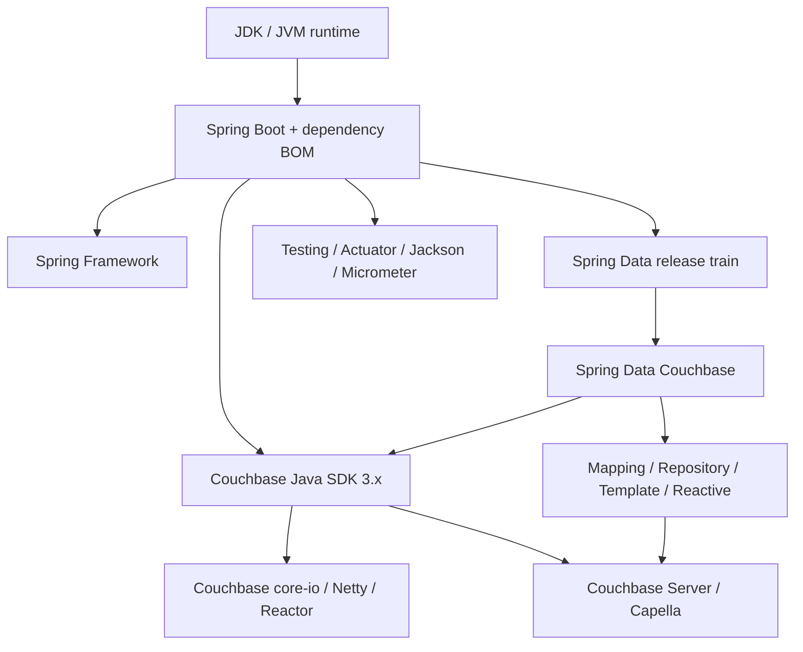
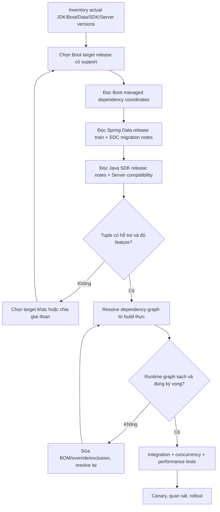
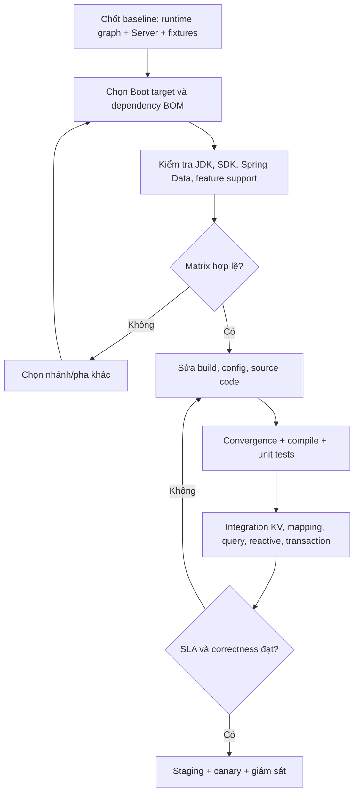
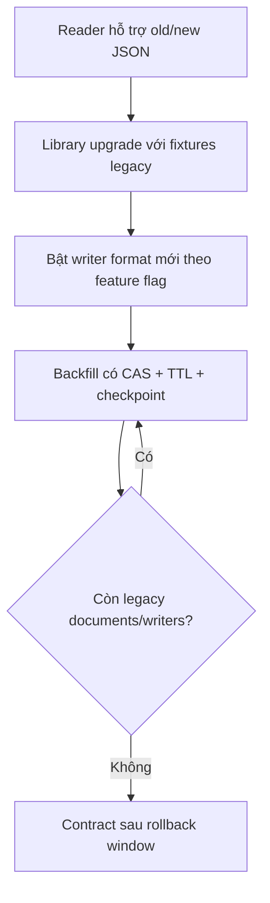

# Nâng Spring Boot, Spring Data Couchbase và Java SDK theo ma trận tương thích

## 1. Tình huống: nâng một dependency nhưng hệ thống Couchbase lỗi khi chạy

Một dịch vụ đăng ký khóa học dùng **Spring Boot**, **Spring Data Couchbase** và **Couchbase Java SDK**. Dịch vụ lưu enrollment qua `CouchbaseRepository`, chạy truy vấn SQL++ bằng `CouchbaseTemplate`, gọi KV SDK khi cần CAS và có một luồng reactive xử lý sự kiện đăng ký.

Nhóm phát triển phát hiện phiên bản Java SDK cũ có bản vá quan trọng. Một pull request chỉ thay:

```xml
<dependency>
    <groupId>com.couchbase.client</groupId>
    <artifactId>java-client</artifactId>
    <version>3.x.y</version>
</dependency>
```

Build có thể chạy qua, nhưng runtime gặp lỗi như `NoSuchMethodError`, `ClassNotFoundException`, query không hoạt động đúng, hoặc transaction/connection timeout sau khi deploy. Một nhóm khác lại nâng Spring Boot nhưng giữ cứng phiên bản Spring Data Couchbase cũ, khiến classpath chứa các thành phần thuộc nhiều release train khác nhau.

Vấn đề không nằm ở việc **một dependency có phiên bản mới hơn**. Vấn đề là toàn bộ tập thư viện, Java runtime và Couchbase Server phải tạo thành **một tổ hợp tương thích đã được kiểm chứng**.

Bài học trong chương **Tiến hóa và di trú** của module `SPRING_DATA_COUCHBASE` hướng tới việc xây dựng tầng truy cập Couchbase có thể vận hành lâu dài: document mapping, repository, `CouchbaseTemplate`, SQL++, thiết kế bucket/scope/collection, chỉ mục, TTL, CAS, giao dịch, reactive và observability.

> **Nguyên tắc cốt lõi:** bắt đầu từ phiên bản Spring Boot được chọn, để BOM của Boot quản lý Spring Data release train và Couchbase Java SDK; chỉ override khi có lý do rõ, sau khi kiểm tra matrix nhà phát hành, dependency graph thực tế và integration test.

### 1.1. Mục tiêu học tập

Sau bài này, bạn có thể:

1. Xác định các lớp phụ thuộc tạo nên một **compatibility matrix** hoàn chỉnh.
2. Đọc đúng Spring Boot managed dependency coordinates, Spring Data release train và tài liệu tương thích Couchbase SDK/Server.
3. Phân biệt version được **khai báo**, được **quản lý** và thực sự **resolved trên runtimeClasspath**.
4. Nâng cấp bằng Maven/Gradle mà không tự trộn các nhóm library không tương thích.
5. Phân loại mức độ thay đổi patch/minor/major và ảnh hưởng lên Java, Boot, Spring Data, SDK, Reactor, Netty và Jackson.
6. Kiểm thử mapping, Repository, Template, SQL++, KV CAS, TTL, transaction, reactive, TLS và query plan.
7. Triển khai canary, rollback theo hướng không làm mất dữ liệu và ghi lại bằng chứng release.

## 2. Sáu trục tương thích cần xem như một hệ thống

Một service có thể được mô tả bằng tuple:

```text
(JDK, Spring Boot, Spring Framework, Spring Data train,
 Spring Data Couchbase, Couchbase Java SDK, Couchbase Server)
```

Thực tế còn có Reactor, Netty, Jackson, Micrometer, TLS/native transports, build tools, JUnit/Testcontainers và thư viện tích hợp khác.



Đây là sơ đồ **quan hệ trách nhiệm và tương thích**, không phải dependency graph Maven/Gradle chính xác của mọi phiên bản.

| Trục | Câu hỏi phải trả lời | Nơi kiểm chứng |
| --- | --- | --- |
| JDK | Boot và SDK có hỗ trợ cùng JVM/runtime version không? | Spring Boot System Requirements; Couchbase SDK Compatibility |
| Spring Boot | Starter, auto-configuration và BOM nào đang áp dụng? | Boot documentation; dependency coordinates |
| Spring Framework | Framework version có nằm trong release train không? | Boot BOM và Spring Data docs |
| Spring Data train | Commons, Couchbase và các module khác cùng thế hệ không? | Spring Data release train/BOM |
| Spring Data Couchbase | Repository, converter, Template, transaction và reactive API còn phù hợp? | Spring Data Couchbase reference/migration notes |
| Couchbase Java SDK | Version SDK và các transitives có khớp stack không? | Boot managed versions; SDK release notes |
| Couchbase Server | Server hỗ trợ protocol và tính năng service sử dụng không? | Couchbase Server/SDK compatibility matrix |
| Reactor/Netty/Jackson | Dependency conflict hoặc thay đổi API/transport có xảy ra? | Resolved dependency graph, release notes, tests |

### 2.1. Kết nối thành công không chứng minh mọi feature tương thích

`Cluster.connect(...)` thành công chỉ kiểm tra được một phần bootstrap/TLS/auth. Nó không chứng minh:

- SQL++ trên bucket/scope/collection hiện tại chạy được.
- Index đang online và query plan ổn.
- Custom converters, `@TypeAlias` và `@Version` còn giữ metadata.
- Transaction, CAS và durability có đúng semantics.
- Reactive publisher có đúng retry/backpressure.
- SDK feature mới được Couchbase Server hiện tại hỗ trợ.
- Khi timeout sau commit, application đã xử lý ambiguous outcome đúng.

**Tương thích có nhiều mức:** build, binary link, startup, protocol, feature và business correctness.

## 3. Ma trận tham chiếu Spring Boot → Spring Data Couchbase → Java SDK

### 3.1. Ví dụ các tổ hợp được Spring Boot BOM quản lý

Bảng dưới đây tổng hợp **những phiên bản được ghi trong tài liệu managed dependencies tại các nhánh Boot được nêu**, không phải lời hứa rằng có thể phối tùy ý các ô. Với mỗi release thực tế, phải kiểm tra đúng BOM theo patch release mà bạn định sử dụng.

| Spring Boot release được đối chiếu | Spring Data Couchbase do Boot quản lý | Couchbase Java SDK `java-client` do Boot quản lý | Ý nghĩa |
| --- | --- | --- | --- |
| **3.4.13** | **5.4.x** | **3.7.9** | Một tổ hợp trong nhánh Boot 3.4 |
| **3.5.16** | **5.5.13** | **3.8.3** | Một tổ hợp trong nhánh Boot 3.5 |
| **4.0.10** | **6.0.9** | **3.9.3** | Một tổ hợp trong nhánh Boot 4.0 |
| **4.1.3** | **6.1.3** | **3.11.4** | Một tổ hợp trong nhánh Boot 4.1 |

Nguồn cho việc đối chiếu theo nhánh:

- [Spring Boot 3.4 managed dependency coordinates](https://docs.spring.io/spring-boot/3.4/appendix/dependency-versions/coordinates.html).
- [Spring Boot 3.5 managed dependency coordinates](https://docs.spring.io/spring-boot/3.5/appendix/dependency-versions/coordinates.html).
- [Spring Boot 4.0 managed dependency coordinates](https://docs.spring.io/spring-boot/4.0/appendix/dependency-versions/coordinates.html).
- [Spring Boot 4.1 managed dependency coordinates](https://docs.spring.io/spring-boot/4.1/appendix/dependency-versions/coordinates.html).

**Lưu ý:** Trang tài liệu theo nhánh có thể cập nhật khi Spring phát hành bản bảo trì mới. Vì vậy các giá trị là **ví dụ cụ thể tại thời điểm tra cứu**, không phải matrix bất biến theo thời gian; một bản 3.5.5 có thể quản lý SDK patch khác 3.5.16. Nếu muốn dùng phiên bản khác, hãy tra BOM/coordinates của **đúng release** và ghi resolved graph trong hồ sơ thay đổi.

### 3.2. Các nhánh cũ để hiểu quan hệ major/minor

Tài liệu compatibility của Spring Data Couchbase liệt kê các ví dụ:

| Spring Boot | Spring Data Couchbase | Java SDK mà Spring Data Couchbase công bố phụ thuộc trong nhánh đó |
| --- | --- | --- |
| 3.2.x | 5.2.x | 3.3.x theo tài liệu nhánh |
| 3.3.x | 5.3.x | 3.6.x |
| 3.4.x | 5.4.x | 3.7.x |

Nguồn: [Spring Data Couchbase — Installation & Configuration](https://docs.spring.io/spring-data/couchbase/reference/couchbase/configuration.html).

**Không kết hợp tùy tiện** Boot 3.2 với Spring Data Couchbase 6.1 chỉ vì cả hai đều là Maven artifacts hợp lệ. Các release train liên kết Spring Framework, Data Commons và API tương ứng. Một SDK phiên bản mới hơn có thể hỗ trợ Server mới, nhưng điều đó **không chứng minh** Spring Data đời cũ hoạt động với mọi phương thức mới hoặc mọi dependency bị override.

### 3.3. Phân biệt “compile dependency” của Spring Data và “managed version” của Boot

Có ít nhất ba nguồn phiên bản:

1. **Spring Data Couchbase POM:** khai báo SDK và các dependency mà module được phát triển/biên dịch cùng.
2. **Spring Boot dependency management/BOM:** có thể quản lý phiên bản SDK được chọn trong ứng dụng Boot.
3. **Dependency resolution thực tế:** Gradle/Maven cuối cùng resolve artifact nào khi có direct dependencies, constraints, BOMs, exclusions và overrides.

Do đó, câu hỏi chính xác không phải “Spring Data 5.5 yêu cầu SDK nào?” rồi chỉ đọc một trang; còn phải hỏi **“Ứng dụng đang chạy với java-client và core-io nào?”**.

Nếu nâng cấp theo Spring Boot starter và **không chỉ định version SDK riêng**, thông thường Boot BOM là điểm bắt đầu ổn định nhất.

## 4. Ma trận không chỉ có ba thư viện: thêm JDK và Couchbase Server

### 4.1. JVM là điều kiện tối thiểu chung

Chẳng hạn Spring Boot 4.0 đặt yêu cầu Java tối thiểu 17 theo [Spring Boot 4.0 System Requirements](https://docs.spring.io/spring-boot/4.0/system-requirements.html). Couchbase Java SDK 3.x ở một số nhánh còn có thể hỗ trợ JDK thấp hơn, nhưng **không vì SDK chạy được trên Java 8 mà ứng dụng Boot 4 có thể chạy trên Java 8**.

Version JVM cho production phải thỏa mãn:

```text
JDK runtime
  ∈ (JDK được Boot hỗ trợ)
  ∩ (JDK được Spring Framework/Data hỗ trợ)
  ∩ (JDK được Java SDK hỗ trợ)
  ∩ (JDK được container/build plugins/agents hỗ trợ)
```

Một tập giao rỗng nghĩa là không có tổ hợp được duyệt.

**Chú ý:** “SDK chạy trên Java 8” chỉ là thông tin riêng của SDK, không phải khuyến nghị dùng Java 8 cho ứng dụng Spring Boot thế hệ mới.

### 4.2. Couchbase Server/Capella là một trục độc lập

Couchbase Java SDK có compatibility matrix xác định các mức như **supported**, **compatible** và **unsupported** cho các nhánh Server/SDK. Một tính năng có thể yêu cầu:

- Couchbase Server và SDK cùng hỗ trợ scopes/collections.
- SDK hỗ trợ tính năng query mới nhưng Server hiện tại chưa triển khai.
- Server 7.6/8.0 hỗ trợ khả năng mới mà SDK cũ chưa biết cách gọi.
- Capella có phiên bản Server/quyền/tính năng khác cluster tự quản lý.

Nguồn: [Couchbase Java SDK — Compatibility](https://docs.couchbase.com/java-sdk/current/project-docs/compatibility.html).

Không phát biểu “SDK 3.x tương thích mọi Server 7.x/8.x” một cách bao quát. Cần kiểm tra **cặp phiên bản thực tế và feature đang dùng**. Tình trạng EOL của Server cũng là yếu tố quyết định support, ngay cả khi một kết nối kỹ thuật còn thành công.

### 4.3. Tính năng mới có ngưỡng phiên bản riêng

Một SDK có thể kết nối Server nhưng API mới yêu cầu ngưỡng feature cụ thể:

| Tính năng | Tầng cần kiểm tra | Test phải có |
| --- | --- | --- |
| KV CRUD/CAS | SDK API, Server KV protocol | Insert/Get/Replace với CAS |
| SQL++ query | Query service, SDK, index | Parameterized query, consistency, EXPLAIN |
| Scopes/collections | Server/keyspace, Spring Data mapping | CRUD đúng scope/collection |
| Sub-document | SDK KV API, path rules | Multi-spec, CAS, type mismatch |
| TTL/expiry | SDK option, Server retention | Expiry còn đúng sau mutation |
| Durability | Server capabilities, SDK API | Write durability theo SLA |
| Distributed transactions | Server/SDK/Spring Data transaction support | Atomic update đa document, retry |
| Reactive APIs | Reactor, SDK reactive bridge, Spring Data reactive | Subscription/error/backpressure tests |
| Vector/search-specific features | Server feature, SDK release, service/index | Integration test feature thực |

Không đưa tất cả feature vào một chữ “compatible” rồi tin rằng mọi behavior đều được bảo đảm.

## 5. Phân biệt loại nâng cấp và mức rủi ro

| Thay đổi | Ví dụ | Rủi ro thường gặp |
| --- | --- | --- |
| Patch Boot cùng nhánh | 3.5.a → 3.5.b | Version transitive/auto-config đổi, cần regression |
| Minor Java SDK 3.x | 3.8.x → 3.9.x | API/behavior/feature/Netty và core-io thay đổi |
| Spring Data Couchbase minor | 5.4 → 5.5 | Converter, repository query, data commons |
| Boot major | 3.x → 4.x | Spring Framework/Data train, auto-config, starters, Jakarta/Jackson/testing changes |
| JDK LTS upgrade | 17 → 21/25 trong phạm vi hỗ trợ | JVM flags, TLS, native transports, toolchain |
| Couchbase Server upgrade | 7.x → 8.x khi được hỗ trợ | Index/query plan, security, cluster features |
| Migration SDK major | 2.x → 3.x | API/client config và semantics khác nhiều, kế hoạch riêng |
| Override SDK vì security fix | Boot-managed 3.a → 3.b | Mất cân bằng version ở runtime graph |

Rủi ro là **theo tổ hợp và workload**, không thể chỉ xếp bằng semantic version number. Một patch thay Netty transport có thể ảnh hưởng TLS/network; một major Boot upgrade có thể compile dễ nếu code ít nhưng runtime thay cách auto-config.

### 5.1. Đừng nhảy cả JDK, Boot, SDK và Server trong một pull request

Một đợt nâng:

```text
JDK 17 -> JDK 25
Boot 3.4 -> Boot 4.1
Spring Data 5.4 -> 6.1
SDK 3.7 -> 3.11
Server 7.2 -> 8.0
```

có thể hợp về ý tưởng nhưng khó chẩn đoán khi lỗi. Nếu có thể, tách thành các bước đã có bằng chứng; mỗi bước đo version graph, tests, latency và khả năng rollback.

Không nên tách nâng cấp theo cách tạo ra **tổ hợp không được hỗ trợ tạm thời**. Thứ tự luôn phải tuân matrix: ví dụ nếu nâng Boot major cần đồng bộ Spring Data release train, hãy thay chúng trong **cùng một bước được quản lý bởi BOM**, rồi test.

## 6. Quy trình xác nhận ma trận thay vì chép danh sách version

Một chu trình có thể lặp lại:



### 6.1. Bản ghi ma trận theo môi trường

Ví dụ worksheet phục vụ code review:

| Thành phần | Baseline | Target | Bằng chứng |
| --- | --- | --- | --- |
| JDK runtime | 17 | 21 | Boot + SDK requirements |
| Spring Boot | 3.4.x | 3.5.x | Exact Boot BOM |
| Spring Framework | Managed by Boot | Managed by Boot | Effective dependency graph |
| Spring Data train | Do Boot quản lý | Do Boot quản lý | Boot/Spring Data docs |
| Spring Data Couchbase | 5.4.x | 5.5.x | Resolved dependency graph |
| Couchbase Java SDK | 3.7.x | 3.8.x | Resolved `java-client` |
| Couchbase Server | Version đang vận hành | Giữ nguyên trong bước này | SDK/Server compatibility |
| Reactor/Netty/Jackson | Baseline resolved | Target resolved | Diff dependency tree |
| Query indexes & data | Existing | Không đổi ở bước library-only | Query smoke/EXPLAIN |

**Các phiên bản có hậu tố x chỉ là ví dụ về nhánh**. Thay bằng patch release và artifact version thực tế. Không copy worksheet thành approval matrix mà chưa đối chiếu BOM, Server, tính năng và dependency graph của dự án.

## 7. Maven: để Spring Boot quản lý phiên bản

### 7.1. Ví dụ dự án Spring Boot 3.5.x

Một `pom.xml` mẫu theo mô hình starter:

```xml
<project xmlns="http://maven.apache.org/POM/4.0.0"
         xmlns:xsi="http://www.w3.org/2001/XMLSchema-instance"
         xsi:schemaLocation="
           http://maven.apache.org/POM/4.0.0
           https://maven.apache.org/xsd/maven-4.0.0.xsd">

    <modelVersion>4.0.0</modelVersion>

    <parent>
        <groupId>org.springframework.boot</groupId>
        <artifactId>spring-boot-starter-parent</artifactId>
        <version>3.5.16</version>
        <relativePath/>
    </parent>

    <groupId>com.acme.learning</groupId>
    <artifactId>enrollment-service</artifactId>
    <version>1.0.0</version>

    <properties>
        <java.version>21</java.version>
    </properties>

    <dependencies>
        <dependency>
            <groupId>org.springframework.boot</groupId>
            <artifactId>spring-boot-starter-data-couchbase</artifactId>
        </dependency>

        <dependency>
            <groupId>org.springframework.boot</groupId>
            <artifactId>spring-boot-starter-test</artifactId>
            <scope>test</scope>
        </dependency>
    </dependencies>
</project>
```

Mẫu này dùng **một Spring Boot parent** để chọn các phiên bản tương ứng. Artifact SDK có thể đến từ starter; nếu code trực tiếp import SDK, có thể khai báo dependency trực tiếp `com.couchbase.client:java-client` **không có version**, để version vẫn do BOM quản lý.

Cần đối chiếu target Boot release và JDK supported trước khi sử dụng; version trong mẫu không phải chỉ thị bắt buộc nâng đến 3.5.16.

### 7.2. Maven khi không dùng Boot parent

Trong dự án có corporate parent, có thể import BOM trong `dependencyManagement`:

```xml
<dependencyManagement>
    <dependencies>
        <dependency>
            <groupId>org.springframework.boot</groupId>
            <artifactId>spring-boot-dependencies</artifactId>
            <version>3.5.16</version>
            <type>pom</type>
            <scope>import</scope>
        </dependency>
    </dependencies>
</dependencyManagement>
```

Phần cấu hình plugin/build, Java toolchain và dependency overrides không được tự suy ra từ việc import BOM. Dùng corporate policy, Spring Boot documentation và kiểm tra `effective-pom` để chắc chắn dependency management đã áp dụng đúng.

**Không import nhiều Spring Data/Boot BOM xung đột mà không hiểu thứ tự ưu tiên trong Maven.**

### 7.3. Không pin ba phiên bản độc lập theo cảm tính

Anti-pattern:

```xml
<!-- Ví dụ cố tình sai về chiến lược, không nên sao chép. -->
<dependency>
    <groupId>org.springframework.data</groupId>
    <artifactId>spring-data-couchbase</artifactId>
    <version>5.3.0</version>
</dependency>
<dependency>
    <groupId>com.couchbase.client</groupId>
    <artifactId>java-client</artifactId>
    <version>3.11.4</version>
</dependency>
```

Nếu dự án dùng Spring Boot 4.x, việc ép Spring Data 5.3.0 là một lựa chọn lệch release train cần xem xét nghiêm túc. SDK 3.11.4 là một artifact hợp lệ nhưng **không biến tổ hợp lệch phiên bản trở thành hợp lệ**.

Tùy mục đích (security hotfix, bug fix), override SDK có thể được phép theo tài liệu; nhưng phải có kế hoạch rõ thay vì chọn số cao nhất.

## 8. Gradle: dependency management và resolved graph

Với Gradle Kotlin DSL, một cấu hình ví dụ:

```kotlin
plugins {
    java
    id("org.springframework.boot") version "3.5.16"
    id("io.spring.dependency-management") version "1.1.7"
}

java {
    toolchain {
        languageVersion = JavaLanguageVersion.of(21)
    }
}

repositories {
    mavenCentral()
}

dependencies {
    implementation("org.springframework.boot:spring-boot-starter-data-couchbase")

    // Nếu code sử dụng trực tiếp Couchbase Java SDK API:
    implementation("com.couchbase.client:java-client")

    testImplementation("org.springframework.boot:spring-boot-starter-test")
}

tasks.test {
    useJUnitPlatform()
}
```

Ví dụ trên áp dụng cho mô hình Boot 3.5 + dependency-management plugin; khi chuyển Boot major, kiểm tra plugin/Gradle compatibility và **không copy bất biến** plugin versions từ ví dụ. Một dự án có thể dùng Gradle native `platform(...)` của Boot BOM thay cho plugin quản lý phụ thuộc; quan trọng là chỉ có một chiến lược BOM rõ ràng, không có phiên bản xung đột âm thầm.

### 8.1. Phân biệt declared, managed, resolved

Trong Gradle:

```kotlin
implementation("com.couchbase.client:java-client")
```

không có version cụ thể. BOM quyết định version được ưu tiên trong quá trình resolve. Nếu một module khác mang constraint/version khác, kết quả cuối cùng có thể đổi.

**Điều cần kiểm chứng là runtimeClasspath**, không chỉ nội dung trong `build.gradle.kts`.

### 8.2. Kiểm tra dependency graph bằng lệnh

Các lệnh sau là **ví dụ để chạy trong dự án thực tế**, không được thực thi trong bước viết bài:

```bash
./gradlew dependencies --configuration runtimeClasspath

./gradlew dependencyInsight \
  --dependency spring-data-couchbase \
  --configuration runtimeClasspath

./gradlew dependencyInsight \
  --dependency java-client \
  --configuration runtimeClasspath

./gradlew dependencyInsight \
  --dependency core-io \
  --configuration runtimeClasspath

./gradlew dependencyInsight \
  --dependency reactor-core \
  --configuration runtimeClasspath
```

Trên Windows dùng `gradlew.bat` và cú pháp dòng lệnh phù hợp PowerShell/cmd; ví dụ dấu `\` nối dòng ở trên là cách trình bày kiểu POSIX.

Mục tiêu: xác định version **đã chọn**, lý do chọn (BOM/constraint/conflict resolution) và module nào kéo một bản khác tới.

### 8.3. Maven tương ứng

```bash
mvn help:effective-pom

mvn dependency:tree \
  -Dincludes=org.springframework.data:spring-data-couchbase

mvn dependency:tree \
  -Dincludes=com.couchbase.client:java-client

mvn dependency:tree \
  -Dincludes=com.couchbase.client:core-io

mvn dependency:tree \
  -Dincludes=io.projectreactor:reactor-core
```

Ở một số dependency-plugin version, cách filter hoặc cách in transitive graph có thể khác; khi cần, xuất full dependency tree và tìm artifact chính xác.

### 8.4. Không chỉ nhìn compileClasspath

Một lỗi kinh điển:

```text
Compile: com.couchbase.client:java-client 3.A
Runtime: com.couchbase.client:java-client 3.B
```

có thể tạo linkage error dù CI compile PASS. Kiểm tra cả `runtimeClasspath`, testRuntimeClasspath, container build, shaded/fat-jar và artifact thực được deploy. Với Maven, kiểm tra scope, dependency mediation và `effective-pom`.

## 9. Override Java SDK: ngoại lệ có điều kiện, không phải chiến lược mặc định

Tài liệu Spring Data Couchbase mô tả khả năng nâng SDK 3.x mới hơn phiên bản compile dependency trong một số trường hợp cần vá lỗi. Tuy vậy, việc override:

```xml
<dependency>
    <groupId>com.couchbase.client</groupId>
    <artifactId>java-client</artifactId>
    <version>3.x.y</version>
</dependency>
```

**không đồng nghĩa tổ hợp đó tự được xác nhận chỉ vì Maven resolve thành công**.

### 9.1. Checklist trước khi override

- Tại sao phải override: CVE, bug fix, feature hay yêu cầu Server?
- Spring Data Couchbase và Boot version đang chạy có khuyến nghị gì?
- SDK release notes có breaking/deprecated APIs liên quan không?
- Java runtime có được SDK/Boot hỗ trợ đồng thời không?
- `core-io`, Netty, Reactor và các dependency khác resolve ra phiên bản nào?
- Có dependency constraint đang kéo `java-client` cũ vào classpath không?
- Có SDK API gọi trực tiếp bằng custom application code không?
- Có integration tests trên Couchbase Server mục tiêu, kể cả TLS/KV/SQL++/transaction/reactive không?
- Đã có canary/rollback và CVE acceptance/approval chưa?

### 9.2. Không ép `core-io` độc lập để vá một lỗi không hiểu nguyên nhân

Các SDK JVM artifacts có quan hệ chặt chẽ. Nếu force `core-io` từ một release khác trong khi `java-client` vẫn cũ, có thể gặp binary incompatibility.

Không đoán rằng tăng Reactor/Netty tự do là phương án tốt. Chỉ thay transitive versions khi theo khuyến cáo chính thức và đã kiểm chứng dependency alignment.

### 9.3. Nếu upgrade SDK không đủ: cân nhắc nâng Boot/SDC theo BOM

Nếu SDK mới chỉ được hỗ trợ ổn định với Spring Data mới hoặc cần tính năng Server mới, nâng cả **Boot + Spring Data release train** theo matrix có thể ít rủi ro hơn việc duy trì nhiều exclusions/overrides khó hiểu.

Ngược lại, một security patch SDK có thể được áp dụng có chọn lọc với test tốt nếu nhà phát hành xác nhận tương thích. **Quyết định dựa trên evidence, không dựa trên số phiên bản lớn nhất.**

## 10. Nâng cấp theo pha với quality gates rõ ràng

Không nâng JDK, Spring Boot, Spring Data, SDK và Couchbase Server cùng lúc nếu có thể tránh. Nhưng cũng **không** tách một đợt nâng Spring Boot major thành tổ hợp tạm thời lệch BOM. Chọn mỗi mốc là một bộ phiên bản có tương thích đã được kiểm tra.



### 10.1. Baseline có thể tái hiện

Ghi đủ trước khi sửa:

- JDK vendor/patch/runtime image và Java toolchain trong CI.
- Spring Boot, Spring Framework, Spring Data train, Spring Data Couchbase.
- Resolved versions của `java-client`, `core-io`, Netty, Reactor, Jackson.
- Couchbase Server/Capella version, edition, scopes/collections và feature requirements.
- Connection string mode/TLS/certificates, RBAC, timeout/retry configuration.
- Indexes, query plans, CAS conflict/timeout rates, P95/P99.
- Các đường SDK trực tiếp, Repository, Template, SQL++, reactive, transaction.
- Legacy JSON fixtures, `schemaVersion`, `@TypeAlias`, TTL và auditing behavior.

Một file build có version đúng **không chứng minh** fat JAR/container đang chạy version đó. Cần fingerprint của artifact cuối và image tag được rollout.

### 10.2. Chọn một target đã được quản lý

Ưu tiên Spring Boot release được hỗ trợ và lấy Spring Data/Couchbase Java SDK từ BOM. Kiểm tra các thư viện ngoài Couchbase như Spring Cloud, Security hoặc tracing nếu service dùng chúng. Chỉ override SDK khi đã có bằng chứng tương thích và regression suite.

### 10.3. Tách thay library khỏi đổi dữ liệu

Nếu nâng Spring Data Couchbase buộc đổi converter, làm rõ đọc được JSON cũ trước khi bật writer mới. Đừng đồng thời đổi document key, alias, schemaVersion, collection và TTL mà không có quy trình expand–migrate–contract riêng.

### 10.4. Triển khai có thể quay lại

Chạy thử trên staging đúng Server/keyspace, sau đó canary với metrics baseline. Nếu lỗi, rollback binary/feature trước; không xóa data hoặc thay schema theo phản xạ.

## 11. Spring Boot major: kiểm tra JDK, starter và auto-configuration

Nâng từ Boot 3.x lên 4.x có thể liên quan Spring Framework/Data generation, build tool minimum, auto-configuration, testing modules và transitive dependencies. Không coi đây là thay một version trong `pom.xml`.

Các nhóm cần rà soát:

- JDK và Maven/Gradle plugin versions.
- Spring Framework/Data Commons, starters Couchbase và reactive.
- `spring.couchbase.*`, `spring.data.couchbase.*` và configuration binding.
- Jackson, Reactor/Netty, Micrometer và Actuator.
- Custom `Cluster`/`CouchbaseClientFactory`/template beans.
- Entity scanning, custom conversions, query macros và transactions.
- Spring Cloud, Spring Security và AOT/native nếu có.

Nếu gặp `NoSuchMethodError`, `NoClassDefFoundError`, `BeanCreationException`, hãy kiểm tra **resolved runtime graph** trước khi cố thêm dependency riêng.

### 11.1. Java trong CI khác Java trong image

Boot 4.0 yêu cầu Java tối thiểu 17, nhưng cần chọn một JDK mà Boot, SDK, build plugins, container và monitoring agents **đều hỗ trợ**. Java toolchain build không đảm bảo runtime image chứa đúng bytecode-compatible JVM; kiểm tra cả hai.

### 11.2. Starters không tương đương Java SDK standalone

`spring-boot-starter-data-couchbase` đưa vào Spring Data mapping/repositories/auto-configuration. Artifact `com.couchbase.client:java-client` chỉ cung cấp Java SDK API. Bỏ starter để “tránh conflict” có thể khiến Repository/Template beans biến mất. Hãy xác định kiến trúc trước khi đổi dependencies.

## 12. Kết nối, TLS và vòng đời client sau upgrade

Cấu hình Boot minh họa:

```yaml
spring:
  couchbase:
    connection-string: couchbases://cb.example.internal
    username: ${COUCHBASE_USERNAME}
    password: ${COUCHBASE_PASSWORD}
  data:
    couchbase:
      bucket-name: learning
```

Đây là placeholder, không phải credentials thật. Property names và cách cấu hình trust store cần kiểm tra theo target Boot/SDK. Không commit secrets hoặc in token/password trong logs.

Các bài test cần có:

1. Auto-configured `Cluster` được tạo chính xác.
2. Đọc/ghi đúng bucket, scope, collection; không nhầm `_default`.
3. Có quyền KV/Query/transaction cần thiết, không cấp DDL admin quá rộng.
4. TLS chain/hostname verification hợp lệ trên base image.
5. DNS SRV, firewall/port và private endpoints phù hợp cluster.
6. Đo lại bootstrap/connection/kv/query timeouts.
7. Không tạo hai SDK `Cluster.connect(...)` bên cạnh auto-configured cluster ngoài ý muốn.
8. Shutdown giải phóng client threads/connections.
9. Actuator health, tracing/metrics không bị nhân đôi.

Một Spring context khởi động thành công không chứng minh index online, query đúng quyền hoặc transaction hoạt động.

## 13. Mapping regression với `@Document`, `@TypeAlias` và `@Version`

Một entity tối giản:

```java
import org.springframework.data.annotation.Id;
import org.springframework.data.annotation.TypeAlias;
import org.springframework.data.annotation.Version;
import org.springframework.data.couchbase.core.mapping.Document;

@Document
@TypeAlias("enrollment")
public class EnrollmentDocument {
    @Id
    private String id;

    @Version
    private Long casVersion;

    private Integer schemaVersion;
    private String tenantId;
    private String status;

    protected EnrollmentDocument() {}

    public EnrollmentDocument(
            String id, Integer schemaVersion,
            String tenantId, String status) {
        this.id = id;
        this.schemaVersion = schemaVersion;
        this.tenantId = tenantId;
        this.status = status;
    }

    public String getId() { return id; }
    public Long getCasVersion() { return casVersion; }
    public Integer getSchemaVersion() { return schemaVersion; }
    public String getStatus() { return status; }
    public void setStatus(String next) { status = next; }
}
```

- `@Id` là document key.
- `@TypeAlias` quy định stored type identity khi converter/type mapper hỗ trợ.
- `schemaVersion` là phiên bản cấu trúc JSON của ứng dụng.
- `@Version` là Couchbase CAS metadata; **không** phải schemaVersion.

Sau upgrade, dùng fixtures JSON cũ để assert:

- Entity materialize đúng ID, CAS, type alias/root-nested metadata.
- `@Version` không null khi entity đã persisted và được đọc để update.
- Custom reading/writing converters giữ `Instant`, enum, nullable fields.
- Auditing callbacks và TTL policy không đổi ngoài chủ đích.
- Không mất unknown fields khi ghi lại entity trong rolling deployment.
- Không tự đổi schemaVersion/type key vì chỉ nâng library.
- Entity stale bị từ chối khi một writer khác cập nhật trước.

Nếu đổi serializer/mapping behavior, coi đó là thay đổi storage contract cần compatibility reader/migration, không phải bug có thể “fix” bằng reset CAS.

## 14. Repository query, `CouchbaseTemplate` và SQL++ cần test riêng

`findById` có thể dùng KV theo document key. Nhưng derived queries, custom `@Query` và một số Template operations dựa trên SQL++, query planner, index, type filter và converter.

```java
import java.util.List;
import org.springframework.data.couchbase.repository.CouchbaseRepository;
import org.springframework.data.couchbase.repository.Query;

public interface EnrollmentRepository
        extends CouchbaseRepository<EnrollmentDocument, String> {

    @Query(
        "#{#n1ql.selectEntity} WHERE #{#n1ql.filter} " +
        "AND tenantId = $1")
    List<EnrollmentDocument> findByTenant(String tenantId);
}
```

Đây là ví dụ dùng SpEL trong những phiên bản hỗ trợ; xác minh syntax, parameter binding, SQL++ output và metadata projection với Spring Data Couchbase target.

Checklist:

- So sánh `findById` với `findByTenantId`/custom query.
- Kiểm tra generated SQL++ và `@TypeAlias`/type filter có nhận legacy documents không.
- Kiểm tra `@Id`/CAS của entity trả từ custom query.
- Query đúng scope/collection, tenant và index; không thiếu authorization predicate.
- `EXPLAIN` có dùng index như dự tính không?
- Paging/count query, sorting và projections còn đúng?
- `CouchbaseTemplate`/SDK `cluster.query(...)` chạy đúng từng access pattern?
- Scan consistency có phù hợp read-after-write requirements?

```sql
EXPLAIN
SELECT META(e).id AS documentId, e.status
FROM `learning`.`training`.`enrollments` AS e
WHERE e.tenantId = $tenantId
  AND e.status = "PENDING";
```

**Một query chậm sau upgrade** có thể do index/planner, không nhất thiết do SDK KV. Đừng tạo primary index để che thiếu secondary index hoặc thay query filter khiến rò rỉ tenant.

## 15. SDK KV: CAS, sub-document, TTL và durability

Sau khi nâng Java SDK, cần kiểm thử các đường KV quan trọng bằng fixture trên Couchbase thực:

```java
import static com.couchbase.client.java.kv.ReplaceOptions.replaceOptions;

var observed = collection.get(key);
var body = observed.contentAsObject();

body.put("status", "CONFIRMED");

collection.replace(
    key, body,
    replaceOptions().cas(observed.cas()));
```

Giả định `collection`/`key` thuộc integration-test fixture.

Các kiểm tra:

1. `get/insert/replace/remove` theo key vẫn hoạt động.
2. CAS đúng ghi thành công; stale CAS bị từ chối và không mất update.
3. `mutateIn/lookupIn` xử lý nested path/type, multi-spec và CAS đúng.
4. Counter atomic không tự thay business invariant “remainingSeats không âm”.
5. TTL/expiry được preserve hoặc thay đổi đúng policy.
6. Durability options phù hợp Server/SLA.
7. Document đã xóa/expired không bị SDK fallback sang `upsert` vô điều kiện.
8. Lỗi not-found, path mismatch, CAS mismatch, auth và timeout được phân loại đúng.

**CAS là opaque token** để so phiên bản document, không phải số thứ tự tăng 1, không phải schemaVersion. Một SDK upgrade không tự sửa lost update nếu writer vẫn dùng `upsert` body stale.

### 15.1. Timeout không rõ commit không được retry mù

Khi write có thể đã áp dụng nhưng response bị mất, client không biết chắc outcome. Nếu cứ retry một business command trừ capacity, có thể trừ hai lần. Cần stable operation ID, idempotency/reconciliation; không gộp ambiguous timeout vào cùng nhánh retry CAS mismatch.

### 15.2. Ghi theo SDK ngoài Repository cần thống nhất concurrency contract

Nếu Repository dùng `@Version` và SDK ghi body không CAS, một writer có thể phá hợp đồng optimistic locking. Hãy test Repository–Template–SDK cùng sửa một key; kiểm tra JSON cuối, CAS và dữ liệu các field khác còn đúng.

### 15.3. Phân loại lỗi SDK sau khi đổi phiên bản

Ví dụ các lỗi có ý nghĩa khác nhau: `CasMismatchException` phản ánh CAS của mutation đã cũ, `DocumentNotFoundException` có thể phản ánh document đã bị xóa/hết TTL, còn timeout có thể là kết quả chưa biết nếu request đã tới Server. Khi nâng SDK, phải xác minh exception hierarchy và hành vi retry qua integration test của **phiên bản đích**. Không bắt tất cả thành một lỗi chung rồi retry vô hạn; với CAS mismatch, đọc lại body và đánh giá lại business rule trước mutation tiếp theo.

## 16. Reactive API: nâng SDK/Boot cũng thay môi trường Reactor

Hệ thống có thể dùng `ReactiveCouchbaseRepository`, `ReactiveCouchbaseTemplate`, `Collection.reactive()` và Reactor.

```java
import org.springframework.data.couchbase.repository.ReactiveCouchbaseRepository;
import reactor.core.publisher.Mono;

public interface ReactiveEnrollmentRepository
        extends ReactiveCouchbaseRepository<EnrollmentDocument, String> {}

public final class ReactiveEnrollmentService {
    private final ReactiveEnrollmentRepository repository;

    public ReactiveEnrollmentService(
            ReactiveEnrollmentRepository repository) {
        this.repository = repository;
    }

    public Mono<EnrollmentDocument> findById(String id) {
        return repository.findById(id);
    }
}
```

Cần test subscription, cancellation, timeout/deadline, Reactor context/tracing, bounded concurrency, backpressure, error signal và connection disposal. Không gọi blocking SDK GET trên event-loop trong `Mono.map`.

### 16.1. Retry toàn chu trình trên version mới

```java
import java.time.Duration;
import org.springframework.dao.OptimisticLockingFailureException;
import reactor.core.publisher.Mono;
import reactor.util.retry.Retry;

public Mono<EnrollmentDocument> retryFullCycle(String id) {
    return Mono.defer(() -> readValidateAndSave(id))
        .retryWhen(
            Retry.backoff(2, Duration.ofMillis(30))
                .filter(OptimisticLockingFailureException.class::isInstance));
}
```

`readValidateAndSave` là placeholder nghiệp vụ trong service. Retry này bao quanh GET–validate–CAS save, không chỉ `save(staleEntity)`. Vẫn cần budget/deadline, không áp dụng cho ambiguous commit hoặc side effect không idempotent.

### 16.2. Không `onErrorResume` mọi lỗi thành mặc định

Nếu nâng SDK làm thay exception class, việc bắt toàn bộ error rồi trả empty result có thể che lỗi permission, mapping hoặc Query service. Test phân biệt not-found, optimistic conflict, timeout, rejected schema và authorization.

## 17. Giao dịch: version tương thích chỉ là điều kiện đầu tiên

Couchbase transactions còn phụ thuộc Server features, SDK transaction API và Spring Data transaction manager/context. Sau upgrade phải chứng minh:

- Trừ capacity và tạo enrollment **cùng một transaction**.
- Khi một thao tác fail, không commit một nửa.
- Hai transaction tranh chỗ cuối không gây overbooking.
- Callback retry không phát email/payment hai lần.
- Các thao tác cần atomic dùng đúng transaction-aware context.
- Timeout không rõ commit được đối soát bằng operation ID.
- Durability, RBAC và transaction timeout phù hợp SLA.
- Reactive transaction context không bị mất qua subscription.

SDK pseudocode minh họa:

```java
cluster.transactions().run(ctx -> {
    var current = ctx.get(collection, capacityKey);

    // Validate business rule.
    // ctx.replace(...) và ctx.insert(...) trong transaction context.
    // Không dùng collection.upsert(...) bên ngoài ctx và
    // giả định nó sẽ rollback cùng transaction.
});
```

Không copy API `@Transactional`/transaction manager từ phiên bản Spring Data khác mà không xác minh target docs. Một SDK KV call ngoài transaction không tự join Spring-managed transaction chỉ vì nằm trong cùng Java method.

## 18. Tương thích Server, TLS, Capella và topology

SDK có thể hoạt động với Server version cũ ở mức KV nhưng không hỗ trợ một tính năng SQL++/Search/transaction mới. Phải dùng [Couchbase SDK Compatibility](https://docs.couchbase.com/java-sdk/current/project-docs/compatibility.html) để xác nhận cặp Server–SDK và feature.

Kiểm tra:

- Server version, edition, feature flags và tình trạng EOL/support.
- Capella/private endpoints, connection string, TLS certificates/trust store.
- DNS SRV/bootstrap, IPv4/IPv6, network/firewall ports.
- Index/Query/Search services khả dụng theo workload.
- Các bước upgrade SDK không làm thay timeout/retry/network assumptions.
- Kiểm tra container base image, CA bundle, JDK security providers.
- JVM CPU, heap/direct memory, Netty IO threads và backpressure.
- Metrics/health readiness của KV/Query/transaction, không chỉ `Cluster.connect`.

Staging dùng Couchbase local container không đại diện đầy đủ cho TLS/topology production; canary phải kiểm tra đường kết nối thật.

## 19. Data contract không nên đổi âm thầm vì library upgrade

Một nâng cấp Spring Data Couchbase có thể kéo thay đổi converter, default mapping hoặc query generation. Không nên đồng thời đổi:

- `schemaVersion`, tên/trật tự field hoặc numeric/time formats.
- `@TypeAlias` và stored `_class`.
- Document key/prefix hoặc scope/collection.
- TTL/expiry policy.
- Index definition/query semantics.
- Transaction boundary hoặc side effects.

Nếu cần đổi storage schema, dùng quy trình expand–migrate–contract:



Library binary compatibility khác data compatibility. SDK mới có thể kết nối Server nhưng converter mới làm mất field. Reader mới hiểu legacy JSON không bảo đảm app cũ hiểu JSON do writer mới tạo.

## 20. Ma trận kiểm thử từ dependency graph tới business correctness

| Tầng | Kiểm thử | Điều kiện PASS |
| --- | --- | --- |
| Build | Clean compile/package | Không lỗi compile/linkage |
| Runtime | Effective dependency graph | Version đúng với target BOM |
| Startup | Spring context và auto-config | Cluster/Repository/Template beans đúng |
| Network | TLS, DNS, RBAC | Kết nối đúng cluster/keyspace |
| KV | Insert/Get/Replace/Remove | Body/CAS/errors đúng |
| Mapping | Legacy JSON → entity → JSON | Giữ ID, CAS, type metadata, fields |
| Repository | KV findById, derived/custom query | Đúng tenant/type/rows |
| Template/SDK | Fluent/query/custom KV | Đúng semantics từng API |
| SQL++ | Parameterized query, consistency, EXPLAIN | Đúng index, result và latency |
| Subdoc | mutateIn/lookupIn/counters | Đúng path, CAS, invariants |
| TTL/Durability | Expiry sau mutation | Đúng retention và SLA |
| Transaction | Commit, abort, conflict, retry | Không partial business operation |
| Reactive | Mono/Flux/error/cancel | Không block, leak hoặc duplicate |
| Security | CVE scan, TLS, authorization | Không regression bảo mật |
| Rollback | Old binary đọc dữ liệu mới | Có đường khôi phục an toàn |

### 20.1. Test failure modes không kém happy path

Một smoke test chỉ thấy `repository.save` thành công không chứng minh:

- Stale CAS bị từ chối.
- Timeout sau commit được đối soát đúng.
- Unknown `@TypeAlias` và legacy JSON được xử lý an toàn.
- SQL++ query không bỏ sót tenant hoặc schemaVersion cũ.
- Transaction retry không gửi email hai lần.
- Reactive cancellation không để tài nguyên treo.

Đây là lý do integration tests với Couchbase thật cần thiết; mock Repository không thay thế semantics của Server/SDK.

## 21. JUnit 5: kiểm thử optimistic locking sau nâng cấp

Test phải tạo hai snapshot **trước khi** writer đầu tiên save:

```java
import static org.junit.jupiter.api.Assertions.*;

import org.junit.jupiter.api.Test;
import org.springframework.beans.factory.annotation.Autowired;
import org.springframework.boot.test.context.SpringBootTest;
import org.springframework.dao.OptimisticLockingFailureException;

@SpringBootTest
class EnrollmentUpgradeIT {

    @Autowired
    EnrollmentRepository repository;

    @Test
    void staleSaveMustNotOverrideFreshUpdate() {
        String id = "enrollment::test::upgrade-001";

        // Fixture phải bảo đảm key mới và cleanup riêng.
        repository.save(new EnrollmentDocument(
            id, 1, "test", "PENDING"));

        var first = repository.findById(id).orElseThrow();
        var second = repository.findById(id).orElseThrow();

        assertNotNull(first.getCasVersion());
        assertEquals(first.getCasVersion(),
                     second.getCasVersion());

        first.setStatus("APPROVED");
        repository.save(first);

        second.setStatus("REJECTED");
        assertThrows(
            OptimisticLockingFailureException.class,
            () -> repository.save(second));

        var latest = repository.findById(id).orElseThrow();
        assertEquals("APPROVED", latest.getStatus());
    }
}
```

Đây là **khung integration test** cần Couchbase test, cấu hình Spring Boot đúng version target và fixture setup/cleanup; không chạy trên production.

### 21.1. Test Repository và SDK cùng ghi

1. Repository GET K với CAS c0.
2. SDK GET K và replace có CAS c0 → c1.
3. Repository save entity cũ phải gặp optimistic conflict.
4. Đọc JSON cuối, xác nhận business update của SDK và metadata còn nguyên.
5. Test đối chứng SDK upsert không CAS để nhận diện đường ghi nguy hiểm (chỉ trên dữ liệu test).

Nếu nâng version khiến test stale CAS bất ngờ PASS, phải điều tra `@Version` mapping và đường ghi chứ không tắt test.

## 22. Reactive, Query và transaction tests

### 22.1. Test reactive publisher

```java
import static org.junit.jupiter.api.Assertions.*;

import org.junit.jupiter.api.Test;
import reactor.test.StepVerifier;

class ReactiveEnrollmentUpgradeIT {
    private ReactiveEnrollmentService service;

    @Test
    void reactiveGetKeepsCasMetadata() {
        String id = "enrollment::test::reactive-upgrade-001";
        // Fixture insert document trước test.

        StepVerifier.create(service.findById(id))
            .assertNext(doc -> {
                assertEquals(id, doc.getId());
                assertNotNull(doc.getCasVersion());
            })
            .verifyComplete();
    }
}
```

Khung test trên cần inject service/fixture. Thêm test cho cancel, timeout, error signal, retry budget, bounded concurrency và không duplicate side effects. `reactor-test` phải thuộc dependency graph được quản lý tương ứng.

### 22.2. Query và index

Dùng fixture v1/v2, tenant đúng/sai, NULL/MISSING, nhiều giá trị type alias. Chạy:

```sql
EXPLAIN
SELECT META(e).id AS documentId
FROM `learning`.`training`.`enrollments` AS e
WHERE e.tenantId = $tenantId
  AND e.status = "PENDING";
```

Phải kiểm tra result set và plan, không chỉ syntax. Index có thể online nhưng query không chọn nó vì predicate/type filter thay đổi sau nâng Spring Data.

### 22.3. Transaction test

Tạo hai request đặt chỗ cuối, bảo đảm chỉ một enrollment được commit; test abort không trừ capacity dở, callback retry không gửi email/payment hai lần, timeout không rõ commit có reconciliation. Nếu logic transactional dùng cả Spring Data và SDK, test từng transaction boundary đúng API.

## 23. Lưu bằng chứng resolved graph và SBOM

Một hồ sơ release có thể dùng mẫu:

```text
releaseCandidate         = enrollment-service-2026-11
gitCommit                = <immutable commit>
containerImage           = <immutable digest>
runtimeJava              = <vendor, version, patch>
springBoot               = <exact version>
springDataCouchbase      = <exact resolved version>
couchbaseJavaClient      = <exact resolved version>
couchbaseCoreIO          = <exact resolved version>
reactorCore              = <exact resolved version>
netty                    = <exact resolved modules/versions>
serverVersion            = <cluster/edition version>
compatibilityEvidence    = <links to BOM / SDK matrix>
testEvidence             = <CI run and integration reports>
```

Lưu dependency report, lockfile khi dùng Gradle, SBOM và image digest theo quy trình tổ chức. Version “đã khai báo” chưa chắc là version “đang chạy”; container/shaded JAR và transitive constraints có thể khác.

### 23.1. CVE không phải lý do override mọi transitive tùy tiện

Khi security scanner báo lỗ hổng trong Netty/Reactor:

1. Xác minh version và code path thực bị ảnh hưởng.
2. Kiểm tra Spring Boot/SDK patch release đã cập nhật dependency chưa.
3. Ưu tiên BOM-aligned upgrade nếu phù hợp support.
4. Nếu override có điều kiện, test binary/runtime graph và TLS/network.
5. Ghi lý do/rủi ro/chấp thuận nếu chưa thể nâng.

Không ép `core-io` của SDK mới vào `java-client` cũ khi không có hướng dẫn hỗ trợ.

## 24. Chẩn đoán lỗi sau nâng cấp theo triệu chứng

| Triệu chứng | Nguyên nhân có thể | Bước điều tra đúng |
| --- | --- | --- |
| `NoSuchMethodError` | Binary mismatch compile/runtime | Runtime graph, dependency mediation, shaded JAR |
| `NoClassDefFoundError` | Class bị chuyển/xóa hoặc jar thiếu | Boot/Data migration guide, resolved artifacts |
| `BeanCreationException` | Auto-configuration, property hoặc factory thay | Condition evaluation, bean definitions |
| Thiếu Repository/Template bean | Starter, package scan, config | `@Document`/repository scanning, Boot config |
| SDK connect được, Query fail | Index/Query service/RBAC | `system:indexes`, `EXPLAIN`, scopes |
| `findById` được, `findByStatus` không | KV khác SQL++ | Query plan, type filter, index |
| DTO thiếu field legacy | Converter/schema mismatch | Raw JSON, schemaVersion, custom converters |
| Entity thiếu CAS sau read | Metadata mapping/projection sai | `@Version` và entity selection |
| Stale write bị ghi đè | SDK upsert không CAS hoặc mapping sai | Mixed writers, CAS integration test |
| TTL bị reset | SDK expiry/mapper path đổi | Preserve expiry/TTL test |
| Transaction rollback không đúng | Lệnh ngoài context hoặc config khác | Transaction-aware API, contention test |
| Reactive P99 tăng | Blocking trên event-loop hoặc IO config | Traces, thread metrics, Netty/Reactor |
| TLS handshake lỗi | JDK trust store/hostname/CA | Image/certificates, connection string |
| Timeout nhiều hơn | Network/SDK retry settings/tải | Latency + timeout policy, cluster health |
| Duplicate enrollment sau retry | Không có idempotency | Stable operation ID, reconciliation |
| Staging PASS, production FAIL | Server/topology/index/dữ liệu khác | Matrix theo môi trường, canary |
| Spring Data release train lệch | Explicit override hoặc nhiều BOM | `effective-pom`/`dependencyInsight` |

### 24.1. Phân loại lỗi trước khi thay phiên bản tiếp

Một lỗi linkage thường cần sửa dependency graph. Một lỗi mapping có thể cần converter/compatibility read. Một query chậm cần kiểm tra index/plan. Một lỗi mạng cần xem TLS/DNS/timeout. Đừng thay ngẫu nhiên ba phiên bản để “thử may mắn” — nó làm mất khả năng xác định nguyên nhân.

### 24.2. Đừng làm lỗi timeout trông như kết quả rỗng

Sai:

```java
return repository.findById(id)
    .onErrorResume(error -> Mono.empty());
```

Mẫu này có thể biến permission/mapping/timeout thành “không tìm thấy”. Khi nâng SDK, exception classification có thể cần được kiểm tra lại. Chỉ chuyển lỗi sang fallback có ý nghĩa nghiệp vụ, và phải log/measure đúng loại lỗi.

## 25. Canary rollout, quality gates và rollback

Một deployment an toàn:

1. Chốt build artifact và container digest baseline.
2. Xác nhận exact version tuple trên cluster target.
3. Deploy binary mới trên staging có Server/keyspace/index gần production.
4. Chạy smoke/integration tests và đo P95/P99, CAS conflicts, transaction retries.
5. Canary một nhóm instance/traffic có thể kiểm soát.
6. Quan sát KV/SQL++/reactive/transaction errors và TLS/Netty resources.
7. So sánh domain invariants, không chỉ performance.
8. Tăng traffic từng bước khi gates đạt.
9. Nếu bất thường, dừng rollout, rollback binary/feature theo runbook.
10. Không xóa old compatibility path hoặc old index trước khi hết rollback window.

### 25.1. Binary rollback không tự rollback dữ liệu

Khi app mới ghi JSON/schemaVersion/type alias khác, app cũ có thể không đọc được. **Rollback target** phải được kiểm chứng đọc format hiện hành hoặc có bridge reader; một data down-migration có thể mất thông tin và không được mặc định chạy.

Transaction đã commit không bị undo khi chuyển image. Không tự upsert body cũ để “khôi phục” nếu có thay đổi do user khác phát sinh sau đó.

### 25.2. KPI quan sát sau upgrade

- P50/P95/P99 KV, SQL++ và transaction duration.
- Error rate theo operation: auth, timeout, CAS mismatch, not-found, path failure.
- Retry attempts và retry exhausted.
- Query plan/index scans và count query latency.
- SDK connection bootstrap/TLS failures.
- JVM heap/direct memory, Netty IO threads, event-loop blocking.
- Reactor subscribers/cancellations/queues nếu có.
- Number of active SDK clients/connection pools.
- Durability timeout, ambiguous outcome reconciliation.
- Business invariants: không overbooking, không double enrollment.
- Reader schemaVersion/type alias failures.
- Service health và rollback/feature flag state.

Không đưa PII, raw JSON hay credentials vào logs. Dùng correlation ID và operation category.

## 26. Tình huống thực hành: nâng hệ thống đăng ký khóa học

Dịch vụ `enrollment-service` có:

```text
Baseline:
  Java 17
  Spring Boot 3.4.x
  Spring Data Couchbase 5.4.x
  Couchbase Java SDK 3.7.x
  Couchbase Server 7.x (cần kiểm tra patch/support)

Features:
  - @Document / @Version repository
  - CouchbaseTemplate custom query
  - SDK collection.mutateIn(...)
  - ReactiveCouchbaseRepository
  - Transaction cập nhật capacity + insert enrollment
  - SQL++ trên learning.training.enrollments
```

Nhóm muốn nâng lên một bản Boot 3.5.x theo BOM vì yêu cầu security maintenance; đồng thời cân nhắc Boot 4.x nếu vòng đời support và khả năng vận hành phù hợp.

### 26.1. Bảng quyết định cần điền

| Thành phần | Baseline | Target đề xuất | Cần xác minh |
| --- | --- | --- | --- |
| JDK | 17 | 21 | Boot/SDK/toolchain/agent support |
| Boot | 3.4.x | 3.5.x | Exact supported patch |
| Spring Data Couchbase | 5.4.x | 5.5.x | Boot BOM + resolved graph |
| Java SDK | 3.7.x | 3.8.x | Boot BOM + Server matrix |
| Spring Framework | Boot-managed | Boot-managed | Không override trái train |
| Reactor/Netty | Baseline resolved | Target resolved | No linkage conflict |
| Couchbase Server | Actual 7.x | Chưa đổi ở pha này | SDK/Server support, feature needs |
| JSON/index/TTL | Theo contract cũ | Giữ ổn định | Regression tests |
| Rollback target | Baseline | Binary hiểu persisted data | Canary/runbook |

Các dòng trên là **kế hoạch ví dụ**, không phải chứng nhận nhánh 7.x bất kỳ đều còn supported hoặc một target phù hợp cho mọi dự án. Cần ghi actual patch versions, Server edition, lifecycle/support và dependency graph trước approval.

### 26.2. Câu hỏi thực hành

1. Nếu Boot BOM quản lý SDK khác POM compile dependency của Spring Data, phải dùng version nào để đánh giá runtime?
2. Tại sao build Gradle PASS nhưng `NoSuchMethodError` trong container vẫn có thể xảy ra?
3. Vì sao không nên nâng `core-io` độc lập với `java-client`?
4. Kể các nguồn xác nhận Java SDK hỗ trợ Server version và feature transaction.
5. Nếu `@Version` sau upgrade bị null khi query entity, cần kiểm tra gì?
6. Vì sao Repository `findById` PASS không chứng minh custom `@Query` còn đúng?
7. Nếu v1 writer vẫn đang chạy mà converter mới đổi `@TypeAlias`, cần chiến lược gì?
8. Nêu khác biệt giữa retry CAS mismatch và retry timeout không rõ commit.
9. Vì sao `Mono.defer` có thể cần khi retry toàn read–validate–save?
10. SQL++ query plan/index cần kiểm tra trước và sau upgrade ra sao?
11. Nếu canary có P99 tăng nhưng error rate bằng 0, đã đủ để promote chưa?
12. Nếu rollback Boot binary sau khi app mới đã ghi schema mới, rủi ro gì?
13. Hãy chọn ít nhất năm integration tests bắt buộc cho service có Repository, Template, SDK, reactive và transaction.
14. Làm sao chứng minh production thật sự dùng SDK patch mà release ticket ghi?
15. Nếu Server cũ đã EOL nhưng vẫn kết nối được, có nên coi matrix PASS?

**Gợi ý:** BOM là nguồn quản lý khởi đầu, dependency graph là bằng chứng runtime; feature matrix Server/SDK là một bước riêng. Compatibility chỉ hoàn chỉnh khi build, runtime, protocol, query, mapping và domain correctness đều qua kiểm thử.

## 27. Những sai lầm thường gặp

**Sai lầm 1 — chọn “latest” cho mọi thư viện.** Spring Boot, Spring Data release train và SDK không được lắp ráp tùy ý; hãy dùng BOM rồi kiểm tra Server.

**Sai lầm 2 — tin version khai báo hơn version resolved.** Transitive constraints, multiple BOMs và shaded JAR có thể khiến runtime khác source.

**Sai lầm 3 — coi Java SDK hỗ trợ JDK 8 nghĩa là Spring Boot 4 chạy được trên JDK 8.** Phải lấy giao các yêu cầu, không chỉ yêu cầu thấp nhất của một thành phần.

**Sai lầm 4 — pass compile là pass production.** Không phát hiện query plan, TLS, CAS, transactions, active readers và TTL.

**Sai lầm 5 — sửa mismatch bằng forcing Netty/Reactor/core-io theo cảm tính.** Cần guidance từ BOM/release notes, không phải nâng số lớn nhất.

**Sai lầm 6 — dùng `upsert` để né optimistic locking conflict.** Gây lost updates, không phải sửa compatibility.

**Sai lầm 7 — đổi data schema và library cùng lúc.** Làm rollback khó, dễ làm mất khả năng đọc JSON legacy.

**Sai lầm 8 — rollback code đồng nghĩa rollback dữ liệu.** Các mutations đã commit vẫn ở Server; version cũ phải hiểu format hiện hành.

**Sai lầm 9 — chỉ test SDK KV, bỏ Repository và query.** Type filter/converter/index có thể khác hẳn KV.

**Sai lầm 10 — tăng retry không giới hạn khi timeout.** Có thể gây replay effect và retry storm.

## 28. Checklist release theo ma trận tương thích

1. Đã xác định chính xác phiên bản hiện tại của JDK, Boot, SDC, SDK và Server?
2. Đã chọn target Boot release còn support theo policy tổ chức?
3. Đã xem System Requirements của Boot target?
4. JDK trong CI và container runtime tương thích, có patch thích hợp?
5. Đã đối chiếu Spring Data train và Spring Framework do Boot quản lý?
6. Đã xem Spring Data Couchbase configuration/migration notes?
7. Đã xem Boot managed dependency coordinates **đúng release**?
8. Đã xem Couchbase Java SDK release notes/compatibility matrix?
9. Có xác nhận cặp Server/SDK và những feature đang dùng?
10. Không trộn Spring Data Commons từ release train khác?
11. Không có override `java-client`/`core-io` không giải thích được?
12. Đã kiểm tra runtimeClasspath/effective-pom và transitive dependencies?
13. Có dependency lockfile/SBOM và image digest nếu quy trình yêu cầu?
14. Có giải quyết CVEs bằng tổ hợp được kiểm chứng?
15. Gradle/Maven plugins và toolchain đủ yêu cầu target?
16. Couchbase starter và reactive starter đúng nhánh Boot?
17. Không tạo `Cluster` beans trùng/lifecycle leak?
18. Cấu hình kết nối/TLS/credentials/timeout đã được test?
19. Bucket/scope/collection/RBAC đúng trong production?
20. `@Document`/`@Id`/`@TypeAlias` mapping ổn định?
21. `schemaVersion` tách khỏi CAS/`@Version`?
22. Entity legacy JSON và nested polymorphic fields được đọc đúng?
23. Custom converters/auditing không làm mất dữ liệu?
24. Repository KV read và derived/custom SQL++ query đều được test?
25. `CouchbaseTemplate` operations, SDK KV và SDK Query được test riêng?
26. Index đã online và `EXPLAIN`/latency đạt yêu cầu?
27. Kiểm tra CAS stale write conflict với hai snapshot?
28. Không có SDK writer bypass optimistic locking ngoài chủ đích?
29. TTL/preserveExpiry và durability đúng với SLA?
30. Sub-document operations và counter constraints được kiểm thử?
31. Transaction commit/rollback/conflict/retry/ambiguous outcome được test?
32. Reactive publishers, retries, cancellation và backpressure được test?
33. Không có blocking SDK call trên event-loop?
34. Idempotency và outbox bảo vệ side effects ngoài Couchbase?
35. Có integration test trên Server version/topology mục tiêu?
36. Có smoke test startup/TLS/auth/Query/Index trên staging và canary?
37. Có baseline và ngưỡng P95/P99/error rate/timeout?
38. Có feature flag, canary và phương án dừng rollout?
39. Rollback binary có đọc được dữ liệu được app mới ghi?
40. Không xóa data/index/compatibility cũ trước khi hết rollback window?
41. Có audit trail về phiên bản, matrix, CI reports và người duyệt?
42. Có runbook chẩn đoán binary mismatch vs data/Server/network lỗi?

## Tài liệu tham khảo

- [Spring Boot — Managed Dependency Coordinates 3.4](https://docs.spring.io/spring-boot/3.4/appendix/dependency-versions/coordinates.html): managed versions theo Boot 3.4.
- [Spring Boot — Managed Dependency Coordinates 3.5](https://docs.spring.io/spring-boot/3.5/appendix/dependency-versions/coordinates.html): managed versions theo Boot 3.5.
- [Spring Boot — Managed Dependency Coordinates 4.0](https://docs.spring.io/spring-boot/4.0/appendix/dependency-versions/coordinates.html): managed versions theo Boot 4.0.
- [Spring Boot — Managed Dependency Coordinates 4.1](https://docs.spring.io/spring-boot/4.1/appendix/dependency-versions/coordinates.html): managed versions theo Boot 4.1.
- [Spring Boot — System Requirements](https://docs.spring.io/spring-boot/4.0/system-requirements.html): JDK/build tool minimum.
- [Spring Boot — Couchbase auto-configuration](https://docs.spring.io/spring-boot/reference/data/nosql.html): starter, configuration, Repository và Template.
- [Spring Data Couchbase — Installation & Configuration](https://docs.spring.io/spring-data/couchbase/reference/couchbase/configuration.html): phiên bản module, SDK compatibility, cách cài và override.
- [Spring Data Couchbase Reference](https://docs.spring.io/spring-data/couchbase/reference/): mapping, Repository, Template, query, transaction và reactive.
- [Spring Data — Dependencies & BOM](https://docs.spring.io/spring-data/couchbase/reference/data-commons/dependencies.html): Spring Data release train/BOM và Boot dependency management.
- [Couchbase Java SDK — Compatibility](https://docs.couchbase.com/java-sdk/current/project-docs/compatibility.html): JDK, SDK/Server, Capella và feature matrix.
- [Couchbase Java SDK — Release Notes](https://docs.couchbase.com/java-sdk/current/project-docs/sdk-release-notes.html): thay đổi, fixes, deprecations và security releases.
- [Couchbase Java SDK — KV Operations](https://docs.couchbase.com/java-sdk/current/howtos/kv-operations.html): GET/REPLACE/CAS/expiry.
- [Couchbase Java SDK — Transactions](https://docs.couchbase.com/java-sdk/current/howtos/distributed-acid-transactions-from-the-sdk.html): transaction context và error/retry semantics.
- [Couchbase SQL++ Documentation](https://docs.couchbase.com/server/current/n1ql/n1ql-language-reference/index.html): query/index và scan consistency.
- [Project Reactor Reference](https://projectreactor.io/docs/core/release/reference/): reactive error/retry/backpressure.

## Kết luận

**Nâng Spring Boot, Spring Data Couchbase và Couchbase Java SDK theo ma trận tương thích là một quy trình kiểm soát toàn bộ runtime, không phải cập nhật ba dòng version.** Hãy bắt đầu từ Boot BOM và phiên bản thực sự resolve, đối chiếu JDK và Server/SDK feature matrix, rồi kiểm thử cả Repository, Template, SDK KV/SQL++, CAS, TTL, transaction và reactive. Không tự trộn release trains hoặc force transitive dependencies để vượt lỗi build. Triển khai theo các pha có thể kiểm chứng, dùng canary/metrics để đánh giá và giữ khả năng rollback đọc được dữ liệu đã ghi. **Một bản nâng cấp hoàn thành khi tuple thư viện–JVM–Server được hỗ trợ, artifact đang chạy đúng phiên bản, và các bất biến nghiệp vụ vẫn đúng trên môi trường thực tế.**
